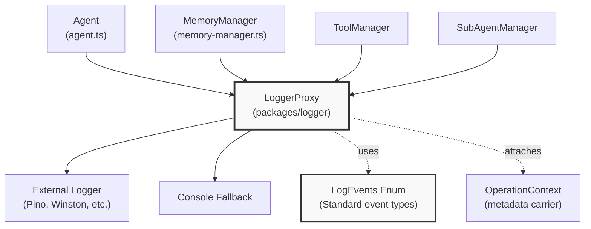
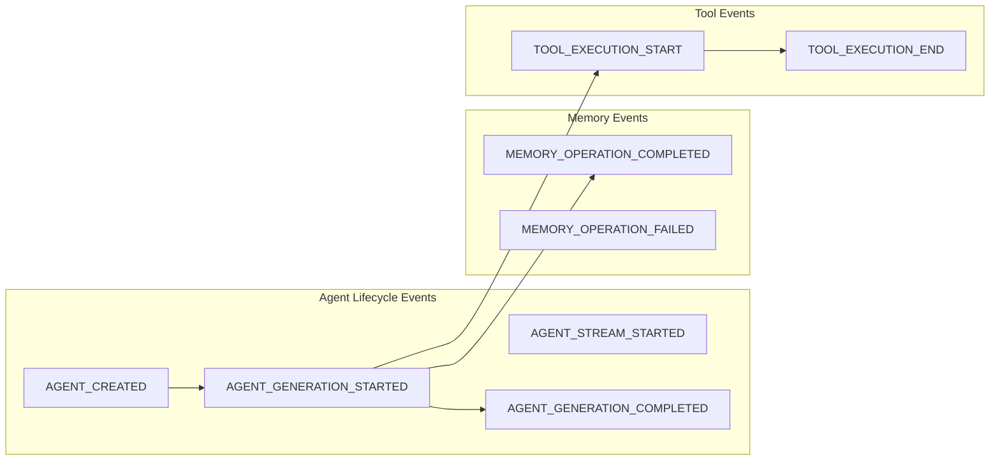
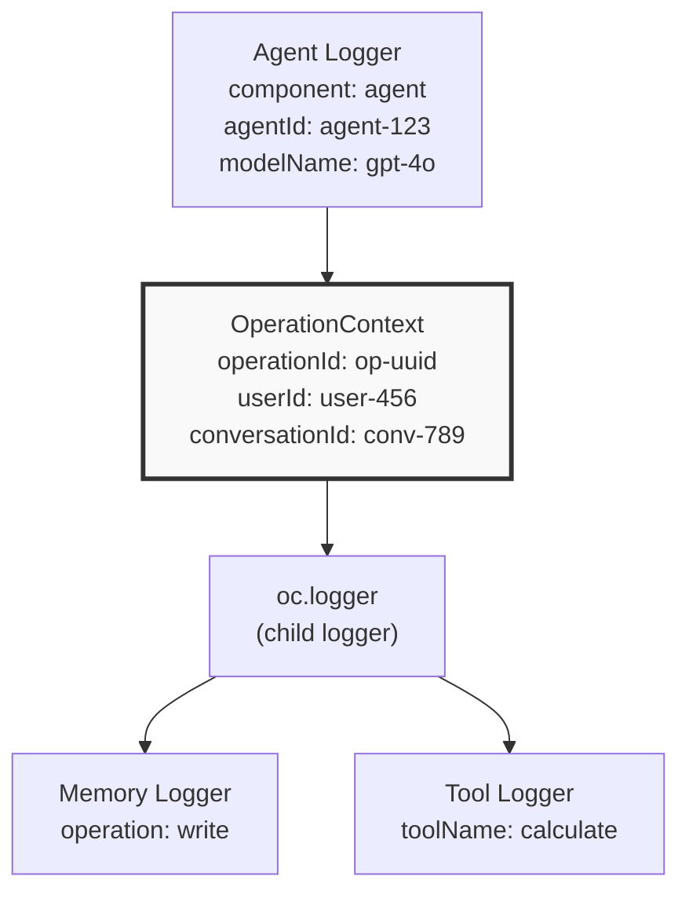

<!-- source: DeepWiki mcp.deepwiki.com · repo voltagent/voltagent · page 8.3 Logging System · fetched 2026-10-27 -->

# Logging System

<details>
<summary>Relevant source files</summary>

The following files were used as context for generating this wiki page:

- [examples/with-google-ai/package.json](examples/with-google-ai/package.json)
- [examples/with-google-vertex-ai/package.json](examples/with-google-vertex-ai/package.json)
- [examples/with-groq-ai/package.json](examples/with-groq-ai/package.json)
- [examples/with-mcp/package.json](examples/with-mcp/package.json)
- [examples/with-nextjs/package.json](examples/with-nextjs/package.json)
- [packages/core/package.json](packages/core/package.json)
- [packages/core/src/agent/agent.spec-d.ts](packages/core/src/agent/agent.spec-d.ts)
- [packages/core/src/agent/agent.spec.ts](packages/core/src/agent/agent.spec.ts)
- [packages/core/src/agent/agent.ts](packages/core/src/agent/agent.ts)
- [packages/core/src/agent/hooks/index.spec.ts](packages/core/src/agent/hooks/index.spec.ts)
- [packages/core/src/agent/hooks/index.ts](packages/core/src/agent/hooks/index.ts)
- [packages/core/src/agent/memory-persist-queue.ts](packages/core/src/agent/memory-persist-queue.ts)
- [packages/core/src/agent/message-normalizer.spec.ts](packages/core/src/agent/message-normalizer.spec.ts)
- [packages/core/src/agent/message-normalizer.ts](packages/core/src/agent/message-normalizer.ts)
- [packages/core/src/memory/manager/memory-manager.ts](packages/core/src/memory/manager/memory-manager.ts)
- [pnpm-lock.yaml](pnpm-lock.yaml)
- [website/docs/agents/context.md](website/docs/agents/context.md)
- [website/docs/agents/hooks.md](website/docs/agents/hooks.md)
- [website/docs/agents/tools.md](website/docs/agents/tools.md)

</details>


The logging system in VoltAgent provides structured, contextual logging throughout the agent execution lifecycle. It integrates with external logging frameworks (like Pino), attaches metadata automatically to log entries (operation IDs, user IDs, conversation IDs), and coordinates with OpenTelemetry tracing to provide comprehensive observability. For distributed tracing capabilities, see [OpenTelemetry Integration](#8.2). For production monitoring and debugging, see [VoltOps Platform](#8.1).

## Architecture Overview

The VoltAgent logging system is built around three core components: `LoggerProxy`, external logger integration (optional), and structured `LogEvents`.

### Logger Proxy Pattern



**Diagram: Logger Architecture**

The `LoggerProxy` class serves as an adapter between VoltAgent components and external logging systems. When an external logger is provided (via the `@voltagent/logger` package), it forwards all log calls with enhanced metadata. When no external logger is present, it falls back to console logging.

Sources: [packages/core/src/agent/agent.ts:287-296](), [packages/core/package.json:56-63]()

### Logger Initialization

| Component | Logger Creation | Context Metadata |
|-----------|----------------|------------------|
| **Agent** | `new LoggerProxy({ component: "agent", agentId, modelName }, externalLogger)` | Agent ID, model name |
| **MemoryManager** | `logger.child({ component: "memory-manager", resourceId })` | Resource ID, operation type |
| **ToolManager** | Inherits from parent agent | Tool name, execution state |
| **Operation Context** | `oc.logger` (contextual logger per operation) | Operation ID, user ID, conversation ID |

Sources: [packages/core/src/agent/agent.ts:287-296](), [packages/core/src/memory/manager/memory-manager.ts:64]()

## Structured Logging with LogEvents

VoltAgent defines standard event types through the `LogEvents` enum to ensure consistent logging across the framework. Each event represents a specific point in the agent lifecycle.

### Core Log Events



**Diagram: Log Event Flow During Agent Operation**

Sources: [packages/core/src/agent/agent.ts:32-33](), [packages/core/src/memory/manager/memory-manager.ts:152-156]()

### Event Usage Examples

**Agent Creation Event:**
```typescript
// packages/core/src/agent/agent.ts:299-306
this.logger.debug(`Agent created: ${this.name}`, {
  event: LogEvents.AGENT_CREATED,
  agentId: this.id,
  model: this.getModelName(),
  hasTools: !!options.tools,
  hasMemory: options.memory !== false,
  hasSubAgents: !!(options.subAgents && options.subAgents.length > 0),
});
```

**Generation Start Event:**
```typescript
// packages/core/src/agent/agent.ts:390-406
methodLogger.debug(
  buildAgentLogMessage(
    this.name,
    ActionType.GENERATION_START,
    `Starting text generation with ${modelName}`,
  ),
  {
    event: LogEvents.AGENT_GENERATION_STARTED,
    operationType: "text",
    contextLimit,
    memoryEnabled: !!this.memoryManager.getMemory(),
    model: modelName,
    messageCount: messages?.length || 0,
    input,
  },
);
```

**Memory Operation Event:**
```typescript
// packages/core/src/memory/manager/memory-manager.ts:152-156
memoryLogger.debug("[Memory] Write successful (1 record)", {
  event: LogEvents.MEMORY_OPERATION_COMPLETED,
  operation: "write",
  message,
});
```

Sources: [packages/core/src/agent/agent.ts:299-306](), [packages/core/src/agent/agent.ts:390-406](), [packages/core/src/memory/manager/memory-manager.ts:152-156]()

## Contextual Logging

Every agent operation creates an `OperationContext` that carries metadata throughout the execution pipeline. This context is used to automatically enrich log entries with relevant information.

### OperationContext and Logger Hierarchy



**Diagram: Logger Context Hierarchy**

Each operation gets a child logger from the agent's base logger. This child logger automatically includes the operation ID, user ID, and conversation ID in all log entries, enabling correlation across distributed operations.

Sources: [packages/core/src/agent/agent.ts:350-351](), [packages/core/src/memory/manager/memory-manager.ts:107-109]()

### Contextual Metadata Flow

| Context Level | Metadata Attached | Example |
|--------------|-------------------|---------|
| **Agent** | `component`, `agentId`, `modelName` | `{ component: "agent", agentId: "agent-1", modelName: "gpt-4o" }` |
| **Operation** | `operationId`, `userId`, `conversationId` | `{ operationId: "op-abc", userId: "user-123", conversationId: "conv-456" }` |
| **Memory** | `operation` (read/write/search/clear) | `{ operation: "write", messages: 1 }` |
| **Tool** | `toolName`, `toolCallId` | `{ toolName: "calculate", toolCallId: "call-1" }` |

The logger hierarchy ensures that all log entries can be traced back to their originating operation and agent, even across sub-agent delegations and concurrent operations.

Sources: [packages/core/src/agent/agent.ts:287-296](), [packages/core/src/memory/manager/memory-manager.ts:107-109]()

## Integration Points

### Agent Logger Initialization

When an `Agent` is created, it initializes a `LoggerProxy` instance that will be used for all logging within that agent's lifecycle:

```typescript
// packages/core/src/agent/agent.ts:287-296
this.logger = new LoggerProxy(
  {
    component: "agent",
    agentId: this.id,
    modelName: this.getModelName(),
  },
  options.logger,
);
```

The `options.logger` parameter is the external logger instance (from `@voltagent/logger` package) that users provide when creating an agent. If not provided, `LoggerProxy` falls back to console logging.

Sources: [packages/core/src/agent/agent.ts:287-296]()

### Memory Manager Logging

The `MemoryManager` creates child loggers for each operation type (read, write, search, clear):

```typescript
// packages/core/src/memory/manager/memory-manager.ts:107-109
const memoryLogger = context.logger.child({
  operation: "write",
});
```

This pattern enables filtering logs by operation type while maintaining the full context chain from agent → operation → memory operation.

Sources: [packages/core/src/memory/manager/memory-manager.ts:107-109]()

### Tool Execution Logging

Tool execution logging is handled through the agent's hook system, which logs tool start and end events automatically:

```typescript
// Example from hook execution
await this.getMergedHooks(options).onToolStart?.({ 
  agent: this, 
  tool, 
  context: oc 
});
```

The contextual logger in `oc` (operation context) ensures all tool logs include operation metadata.

Sources: [packages/core/src/agent/agent.ts:410]()

### Sub-Agent Logging

When a supervisor agent delegates to a sub-agent, the operation context (and its logger) is automatically propagated:

```typescript
// Sub-agent receives parent operation context
const subAgentResult = await subAgent.generateText(input, {
  parentOperationContext: oc,
  // ... other options
});
```

This ensures that all sub-agent logs maintain the correlation with the parent operation, enabling full trace reconstruction.

Sources: [packages/core/src/agent/agent.ts:186-187]()

## Log Levels and Message Patterns

VoltAgent uses standard log levels with specific conventions for each:

### Log Level Usage

| Level | Usage | Example |
|-------|-------|---------|
| **debug** | Detailed execution flow, state changes | `"[Memory] Write successful (1 record)"` |
| **info** | High-level operation milestones | Not heavily used (relies on OpenTelemetry) |
| **warn** | Non-fatal issues, degraded functionality | Not shown in provided code |
| **error** | Failures, exceptions, error states | `"Memory write failed: ..."` |

### Message Construction

VoltAgent uses the `buildAgentLogMessage` helper to create consistent log messages:

```typescript
// packages/core/src/agent/agent.ts:390-393
buildAgentLogMessage(
  this.name,
  ActionType.GENERATION_START,
  `Starting text generation with ${modelName}`,
)
```

This produces messages like: `"[Agent: MyAgent] [GENERATION_START] Starting text generation with gpt-4o"`

Sources: [packages/core/src/agent/agent.ts:33](), [packages/core/src/agent/agent.ts:390-393]()

### Error Logging Pattern

Error logs include full error details and operation context:

```typescript
// packages/core/src/memory/manager/memory-manager.ts:162-170
memoryLogger.error(
  `Memory write failed: ${error instanceof Error ? error.message : "Unknown error"}`,
  {
    event: LogEvents.MEMORY_OPERATION_FAILED,
    operation: "write",
    success: false,
    error: error instanceof Error 
      ? { message: error.message, stack: error.stack } 
      : error,
  },
);
```

Sources: [packages/core/src/memory/manager/memory-manager.ts:162-170]()

## Configuration and Setup

### Providing an External Logger

The `@voltagent/logger` package is an optional peer dependency. To use structured logging with an external framework:

```typescript
import { Agent } from "@voltagent/core";
import { createLogger } from "@voltagent/logger"; // or your preferred logger
import { openai } from "@ai-sdk/openai";

const logger = createLogger({
  level: "debug",
  transport: pinoTransport // example
});

const agent = new Agent({
  name: "MyAgent",
  instructions: "You are a helpful assistant",
  model: openai("gpt-4o"),
  logger: logger, // External logger provided here
});
```

When `logger` is not provided, VoltAgent falls back to console logging internally.

Sources: [packages/core/package.json:56-63]()

### Logger Proxy Behavior

The `LoggerProxy` class adapts external loggers to VoltAgent's internal logging interface:

**With External Logger:**
- All `debug()`, `info()`, `warn()`, `error()` calls are forwarded to the external logger
- Metadata is automatically merged with contextual information
- Child loggers inherit parent metadata and add their own

**Without External Logger (Console Fallback):**
- Logs are written to `console.debug`, `console.info`, `console.warn`, `console.error`
- Metadata is stringified and included in the message
- No structured logging capabilities

Sources: [packages/core/src/agent/agent.ts:287-296]()

## Logging Best Practices

### Event-Driven Logging

Use `LogEvents` enum values consistently to enable filtering and analysis:

```typescript
this.logger.debug("Operation completed", {
  event: LogEvents.AGENT_GENERATION_COMPLETED,
  duration: Date.now() - startTime,
  finishReason: result.finishReason,
  usage: result.usage,
});
```

Sources: [packages/core/src/agent/agent.ts:482-497]()

### Child Logger Pattern

Create child loggers for sub-operations to maintain metadata hierarchy:

```typescript
const memoryLogger = context.logger.child({
  operation: "write",
});

memoryLogger.debug("Starting write operation", { count: messages.length });
```

Sources: [packages/core/src/memory/manager/memory-manager.ts:107-109]()

### Coordinating with OpenTelemetry

Logging complements OpenTelemetry tracing. Use logs for detailed messages and OpenTelemetry spans for timing and structure:

```typescript
// Start span for tracing
const writeSpan = trace.createChildSpan("memory.write", "memory", {
  label: "Persist User Message",
  attributes: { "memory.operation": "write" }
});

// Log for detailed message
memoryLogger.debug("[Memory] Write successful (1 record)", {
  event: LogEvents.MEMORY_OPERATION_COMPLETED,
  operation: "write",
});

// End span
trace.endChildSpan(writeSpan, "completed", { output: { saved: true } });
```

Sources: [packages/core/src/memory/manager/memory-manager.ts:113-149]()

## Debugging with Logs

### Correlation by Operation ID

Every operation has a unique `operationId` that appears in all related logs. To trace an operation:

1. Find the initial log entry: `"Agent starting operation op-abc123"`
2. Filter all logs by `operationId: "op-abc123"`
3. Reconstruct the execution flow chronologically

### Correlation by Conversation ID

For multi-turn conversations, filter by `conversationId` to see all operations within that conversation thread:

```
conversationId: "conv-xyz789"
  → Operation 1 (op-abc123)
    → Memory read
    → LLM generation
    → Memory write
  → Operation 2 (op-def456)
    → Memory read
    → Tool execution
    → LLM generation
    → Memory write
```

Sources: [packages/core/src/agent/agent.ts:390-406]()

### Memory Persistence Queue Logs

The `MemoryPersistQueue` provides detailed logs for debounced memory writes:

```typescript
// Schedule
this.logger?.debug?.("[MemoryPersistQueue] schedule", { 
  conversationId, userId 
});

// Persist
this.logger?.debug?.("[MemoryPersistQueue] persisting", { 
  conversationId, userId, count: pending.length 
});

// Nothing to persist
this.logger?.debug?.("[MemoryPersistQueue] nothing-to-persist", { 
  conversationId, userId 
});
```

Sources: [packages/core/src/agent/memory-persist-queue.ts:50-88]()

---

