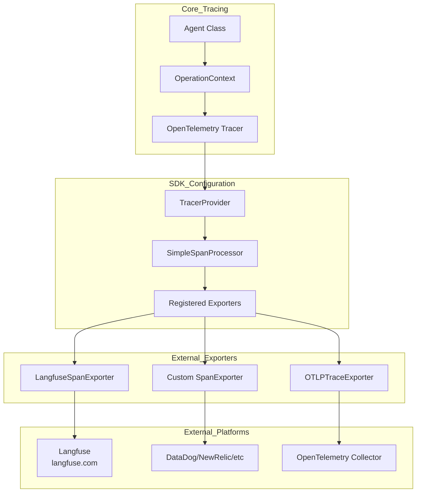
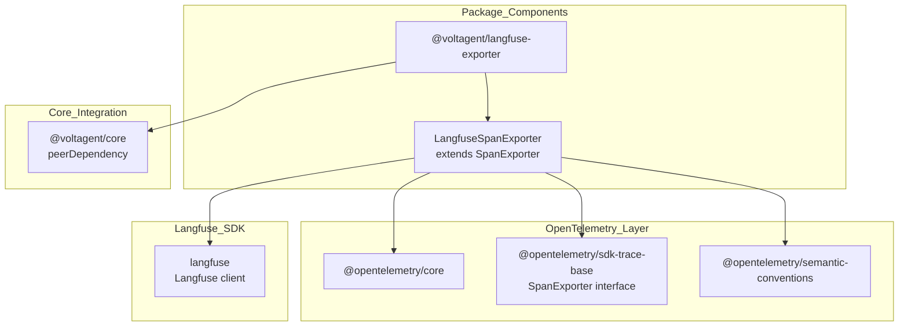
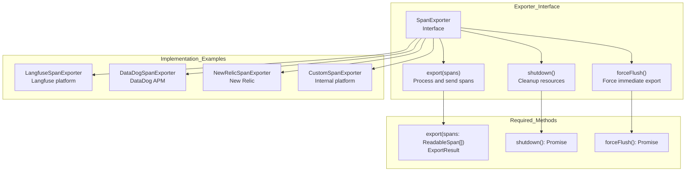
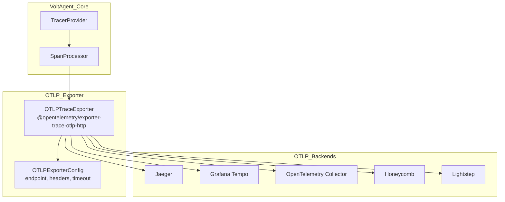
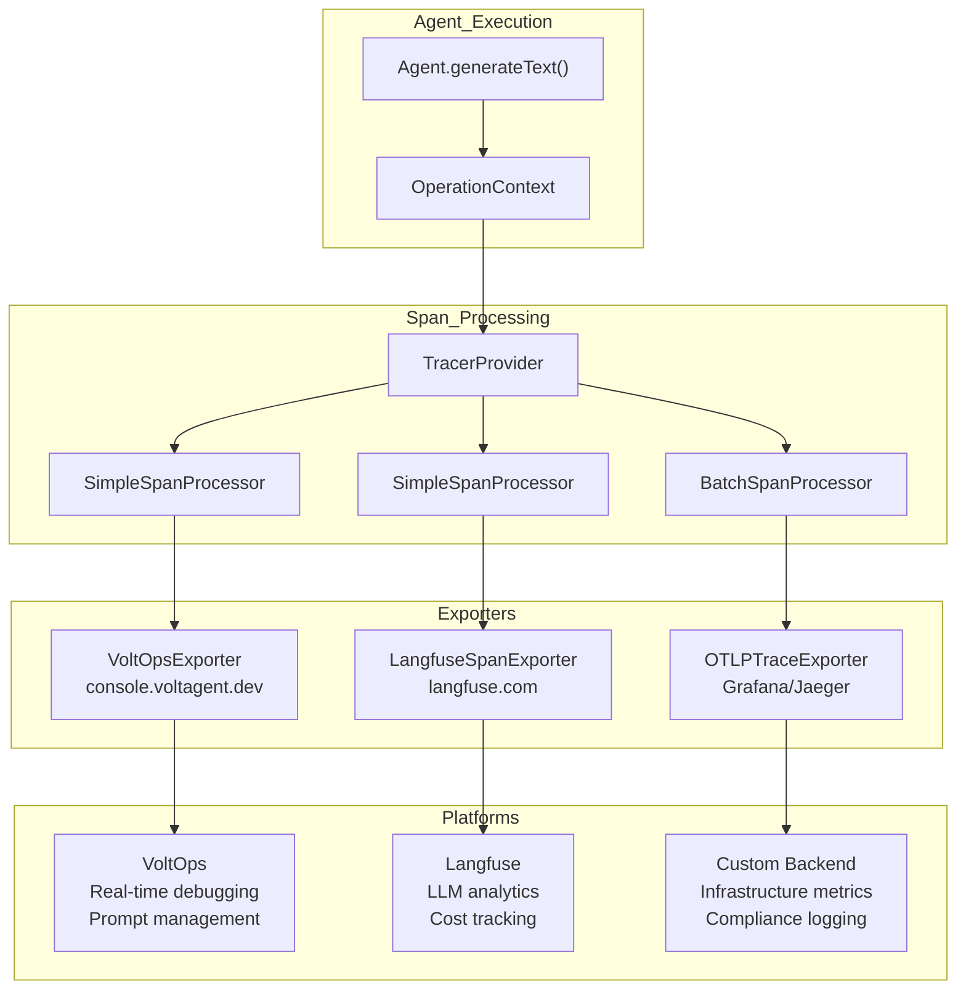

<!-- source: DeepWiki mcp.deepwiki.com · repo voltagent/voltagent · page 8.4 External Observability · fetched 2026-10-27 -->

# External Observability

<details>
<summary>Relevant source files</summary>

The following files were used as context for generating this wiki page:

- [CHANGELOG.md](CHANGELOG.md)
- [changelog.sh](changelog.sh)
- [examples/base/src/index.ts](examples/base/src/index.ts)
- [examples/with-google-ai/package.json](examples/with-google-ai/package.json)
- [examples/with-google-vertex-ai/package.json](examples/with-google-vertex-ai/package.json)
- [examples/with-groq-ai/package.json](examples/with-groq-ai/package.json)
- [examples/with-mcp/package.json](examples/with-mcp/package.json)
- [examples/with-nextjs/package.json](examples/with-nextjs/package.json)
- [packages/cli/package.json](packages/cli/package.json)
- [packages/core/package.json](packages/core/package.json)
- [packages/create-voltagent-app/CHANGELOG.md](packages/create-voltagent-app/CHANGELOG.md)
- [packages/create-voltagent-app/package.json](packages/create-voltagent-app/package.json)
- [packages/voice/package.json](packages/voice/package.json)
- [pnpm-lock.yaml](pnpm-lock.yaml)

</details>


This page documents VoltAgent's external observability integrations, specifically the Langfuse exporter and patterns for building custom exporters to connect VoltAgent's telemetry data with third-party observability platforms.

For the VoltOps platform, see [8.1](#8.1). For OpenTelemetry integration, see [8.2](#8.2). For the logging system, see [8.3](#8.3).

## External Observability Architecture

VoltAgent's external observability system is built on OpenTelemetry standards, enabling flexible integration with third-party platforms. The architecture separates trace collection (handled by `@voltagent/core`) from trace export (handled by exporter packages).

### Observability Data Flow



Sources: [packages/core/package.json:6-17](), [pnpm-lock.yaml:960-998]()

## Langfuse Integration

The `@voltagent/langfuse-exporter` package provides integration with [Langfuse](https://langfuse.com/), an open-source LLM observability and analytics platform. This exporter transforms VoltAgent's OpenTelemetry spans into Langfuse traces, enabling detailed analysis of agent executions, token usage, and cost tracking.

### Package Dependencies and Structure



The `LangfuseSpanExporter` implements the OpenTelemetry `SpanExporter` interface, processing spans exported from VoltAgent's telemetry system and forwarding them to Langfuse with proper mapping of span attributes to Langfuse trace fields.

Sources: [pnpm-lock.yaml:960-998](), [examples/with-langfuse/package.json:1-32]()

### Installation and Setup

Install the Langfuse exporter package:

```bash
pnpm add @voltagent/langfuse-exporter
```

The package requires peer dependencies `@voltagent/core` and `langfuse`, which are typically already present in VoltAgent projects.

Sources: [examples/with-langfuse/package.json:4-12]()

### Configuration

Configure the exporter using environment variables for Langfuse authentication:

| Environment Variable | Required | Description |
|---------------------|----------|-------------|
| `LANGFUSE_PUBLIC_KEY` | Yes | Langfuse project public key |
| `LANGFUSE_SECRET_KEY` | Yes | Langfuse project secret key |
| `LANGFUSE_HOST` | No | Custom Langfuse host (defaults to cloud) |

The exporter integrates with VoltAgent's OpenTelemetry configuration and automatically processes spans generated during agent operations, including:
- Agent invocations
- Tool executions
- SubAgent delegations
- LLM API calls
- Token usage and cost metrics

Sources: [pnpm-lock.yaml:960-998]()

### Span Attribute Mapping

The exporter maps OpenTelemetry span attributes to Langfuse trace fields:

| Span Attribute | Langfuse Field | Description |
|----------------|----------------|-------------|
| `trace.id` | Trace ID | Unique trace identifier |
| `span.id` | Span ID | Unique span identifier |
| `span.name` | Operation name | Agent/tool/workflow name |
| `entity.id` | Entity ID | Agent identifier |
| `gen_ai.request.model` | Model | LLM model name |
| `gen_ai.usage.input_tokens` | Input tokens | Prompt token count |
| `gen_ai.usage.output_tokens` | Output tokens | Completion token count |
| `operation.context` | Metadata | User/conversation context |

Sources: [packages/core/package.json:6-17]()

## Custom Exporter Implementation

VoltAgent supports custom exporters for integrating with any observability platform that accepts OpenTelemetry-compatible data. Custom exporters implement the OpenTelemetry `SpanExporter` interface to process and forward telemetry data to external systems.

### SpanExporter Interface



Custom exporters must implement three required methods: `export()` to process spans, `shutdown()` to cleanup resources, and `forceFlush()` to force immediate export of buffered spans.

Sources: [packages/core/package.json:6-17]()

### Implementation Pattern

A minimal custom exporter implementation follows this structure:

```typescript
// Custom exporter must implement SpanExporter interface
import { SpanExporter, ReadableSpan } from '@opentelemetry/sdk-trace-base';
import { ExportResult, ExportResultCode } from '@opentelemetry/core';

export class CustomSpanExporter implements SpanExporter {
  // Process and export spans to external platform
  export(spans: ReadableSpan[], resultCallback: (result: ExportResult) => void): void {
    // Transform spans to platform-specific format
    const transformedData = this.transformSpans(spans);
    
    // Send to external platform
    this.sendToExternalPlatform(transformedData)
      .then(() => resultCallback({ code: ExportResultCode.SUCCESS }))
      .catch((error) => resultCallback({ code: ExportResultCode.FAILED, error }));
  }
  
  // Cleanup resources on shutdown
  async shutdown(): Promise<void> {
    // Close connections, flush buffers, etc.
  }
  
  // Force immediate export of buffered spans
  async forceFlush(): Promise<void> {
    // Flush any pending spans
  }
  
  private transformSpans(spans: ReadableSpan[]): any {
    // Transform OpenTelemetry spans to target format
  }
  
  private async sendToExternalPlatform(data: any): Promise<void> {
    // HTTP request or SDK call to external platform
  }
}
```

Sources: [packages/core/package.json:6-17]()

### Span Processing Patterns

Custom exporters typically process spans in several stages:

**1. Span Filtering**
Filter spans based on attributes, names, or trace context to reduce data volume:

```typescript
private shouldExport(span: ReadableSpan): boolean {
  // Filter by span name pattern
  if (span.name.startsWith('agent:')) return true;
  
  // Filter by attributes
  if (span.attributes['entity.type'] === 'agent') return true;
  
  return false;
}
```

**2. Attribute Extraction**
Extract VoltAgent-specific attributes for platform mapping:

```typescript
private extractAgentMetadata(span: ReadableSpan) {
  return {
    agentId: span.attributes['entity.id'],
    agentName: span.attributes['entity.name'],
    modelName: span.attributes['gen_ai.request.model'],
    inputTokens: span.attributes['gen_ai.usage.input_tokens'],
    outputTokens: span.attributes['gen_ai.usage.output_tokens'],
    userId: span.attributes['user.id'],
    conversationId: span.attributes['conversation.id'],
  };
}
```

**3. Format Transformation**
Transform OpenTelemetry span format to target platform's expected format:

```typescript
private transformToTargetFormat(span: ReadableSpan) {
  return {
    // Map to platform-specific field names
    traceId: span.spanContext().traceId,
    spanId: span.spanContext().spanId,
    parentSpanId: span.parentSpanId,
    name: span.name,
    timestamp: span.startTime,
    duration: span.duration,
    attributes: this.mapAttributes(span.attributes),
    events: span.events,
    status: span.status,
  };
}
```

**4. Batch Processing**
Implement batching for efficient network usage:

```typescript
private batchSize = 100;
private batchTimeout = 5000; // 5 seconds
private spanBuffer: ReadableSpan[] = [];

export(spans: ReadableSpan[], resultCallback: (result: ExportResult) => void): void {
  this.spanBuffer.push(...spans);
  
  if (this.spanBuffer.length >= this.batchSize) {
    this.flushBuffer(resultCallback);
  } else {
    this.scheduleBatchExport(resultCallback);
  }
}
```

Sources: [packages/core/package.json:6-17]()

### Integration with VoltAgent

Register custom exporters with the OpenTelemetry SDK configuration:

```typescript
import { NodeSDK } from '@opentelemetry/sdk-node';
import { SimpleSpanProcessor } from '@opentelemetry/sdk-trace-base';

const sdk = new NodeSDK({
  spanProcessors: [
    new SimpleSpanProcessor(new CustomSpanExporter({
      endpoint: 'https://custom-platform.com/api/traces',
      apiKey: process.env.CUSTOM_API_KEY,
    })),
  ],
});

sdk.start();
```

Sources: [packages/core/package.json:6-17]()

## OTLP HTTP Exporter

VoltAgent's built-in `@opentelemetry/exporter-trace-otlp-http` exporter supports sending traces to any OpenTelemetry-compatible backend using the OTLP (OpenTelemetry Protocol) over HTTP.

### OTLP Configuration



The OTLP HTTP exporter sends traces in the standardized OTLP format, enabling integration with any OpenTelemetry-compatible observability backend without custom code.

Sources: [packages/core/package.json:11]()

### Configuration Options

| Option | Type | Description | Default |
|--------|------|-------------|---------|
| `url` | string | OTLP endpoint URL | `http://localhost:4318/v1/traces` |
| `headers` | object | HTTP headers for authentication | `{}` |
| `timeout` | number | Request timeout in milliseconds | `10000` |
| `compression` | string | Compression algorithm (gzip, none) | `none` |
| `concurrencyLimit` | number | Max concurrent requests | `30` |

Configure via environment variables:

| Environment Variable | Description |
|---------------------|-------------|
| `OTEL_EXPORTER_OTLP_ENDPOINT` | Base endpoint URL |
| `OTEL_EXPORTER_OTLP_TRACES_ENDPOINT` | Traces-specific endpoint |
| `OTEL_EXPORTER_OTLP_HEADERS` | Headers (key1=value1,key2=value2) |
| `OTEL_EXPORTER_OTLP_TIMEOUT` | Request timeout |
| `OTEL_EXPORTER_OTLP_COMPRESSION` | Compression algorithm |

Sources: [packages/core/package.json:11]()

## Multi-Platform Observability

VoltAgent supports simultaneous integration with multiple observability platforms through multiple span processors and exporters. This enables sending the same telemetry data to different platforms optimized for different use cases.

### Multi-Exporter Architecture



Each span processor can use different strategies (Simple for immediate export, Batch for buffering) and send to different platforms optimized for specific observability use cases.

Sources: [packages/core/package.json:6-17](), [pnpm-lock.yaml:960-998]()

### Configuration Pattern

Configure multiple exporters in OpenTelemetry SDK initialization:

```typescript
import { NodeSDK } from '@opentelemetry/sdk-node';
import { SimpleSpanProcessor, BatchSpanProcessor } from '@opentelemetry/sdk-trace-base';
import { LangfuseSpanExporter } from '@voltagent/langfuse-exporter';
import { OTLPTraceExporter } from '@opentelemetry/exporter-trace-otlp-http';

const sdk = new NodeSDK({
  spanProcessors: [
    // Real-time export to VoltOps for debugging
    new SimpleSpanProcessor(new VoltOpsExporter({
      publicKey: process.env.VOLTAGENT_PUBLIC_KEY,
      secretKey: process.env.VOLTAGENT_SECRET_KEY,
    })),
    
    // Real-time export to Langfuse for LLM analytics
    new SimpleSpanProcessor(new LangfuseSpanExporter()),
    
    // Batched export to OTLP backend for long-term storage
    new BatchSpanProcessor(new OTLPTraceExporter({
      url: process.env.OTEL_EXPORTER_OTLP_ENDPOINT,
    })),
  ],
});

sdk.start();
```

Sources: [packages/core/package.json:6-17]()

### Platform Specialization

Different platforms serve different observability needs:

| Platform | Primary Use Case | Key Features | Export Strategy |
|----------|-----------------|--------------|-----------------|
| VoltOps | Development & debugging | Live traces, prompt editor | SimpleSpanProcessor |
| Langfuse | LLM analytics | Token tracking, cost analysis | SimpleSpanProcessor |
| Jaeger/Tempo | Infrastructure monitoring | Trace visualization, service mesh | BatchSpanProcessor |
| DataDog/NewRelic | Application monitoring | APM, alerting, dashboards | BatchSpanProcessor |
| Custom Backend | Compliance/audit | Long-term storage, archival | BatchSpanProcessor |

Sources: [packages/core/package.json:6-17]()

## Best Practices

### Environment Configuration

External integrations should be configured through environment variables for security and flexibility:

```
VOLTAGENT_PUBLIC_KEY=your_public_key
VOLTAGENT_SECRET_KEY=your_secret_key
LANGFUSE_PUBLIC_KEY=your_langfuse_key
LANGFUSE_SECRET_KEY=your_langfuse_secret
```

### Production Considerations

1. **Error Handling**: Exporters should gracefully handle network failures
2. **Batching**: Use batch processing for high-volume applications
3. **Sampling**: Implement sampling strategies for production workloads
4. **Filtering**: Filter sensitive data before exporting

### Development vs Production

Configure different exporter behavior based on environment:

- **Development**: Enable debug logging, use lower batch sizes
- **Production**: Disable debug logging, optimize for performance

Sources: [website/docs/integrations/vercel-ai.md:421-427](), [CONSOLE.md:152]()

---

