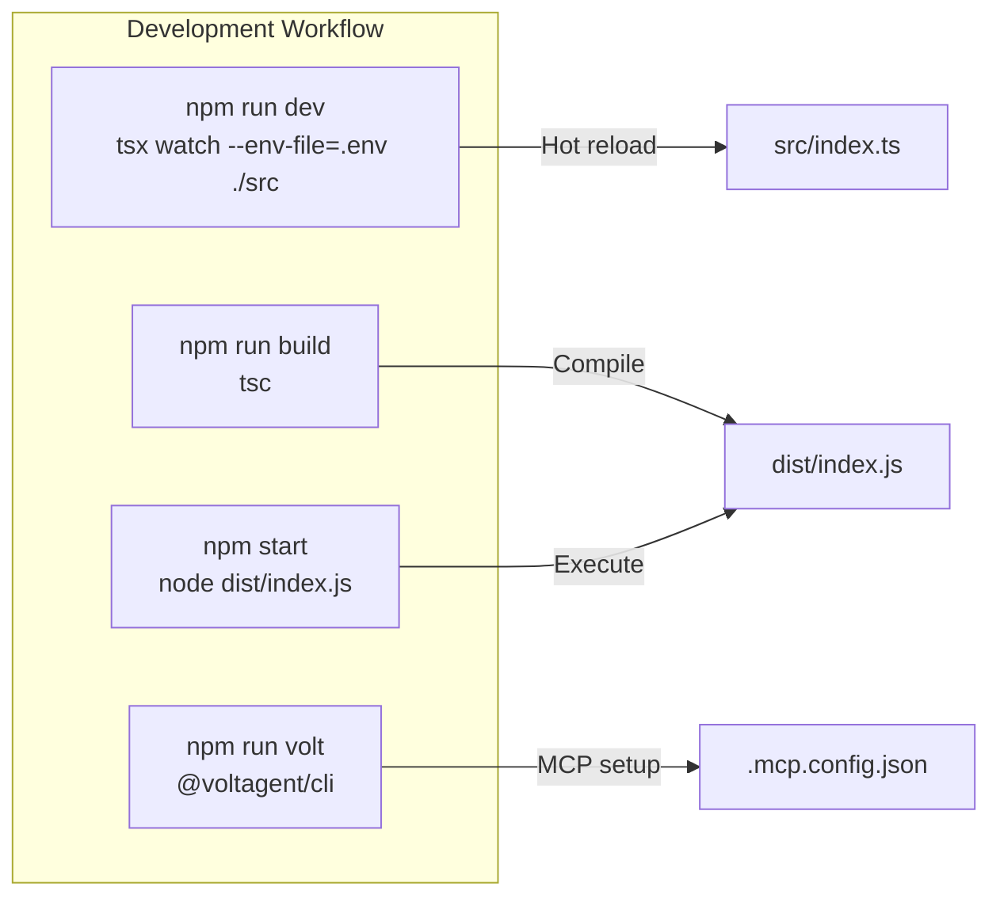
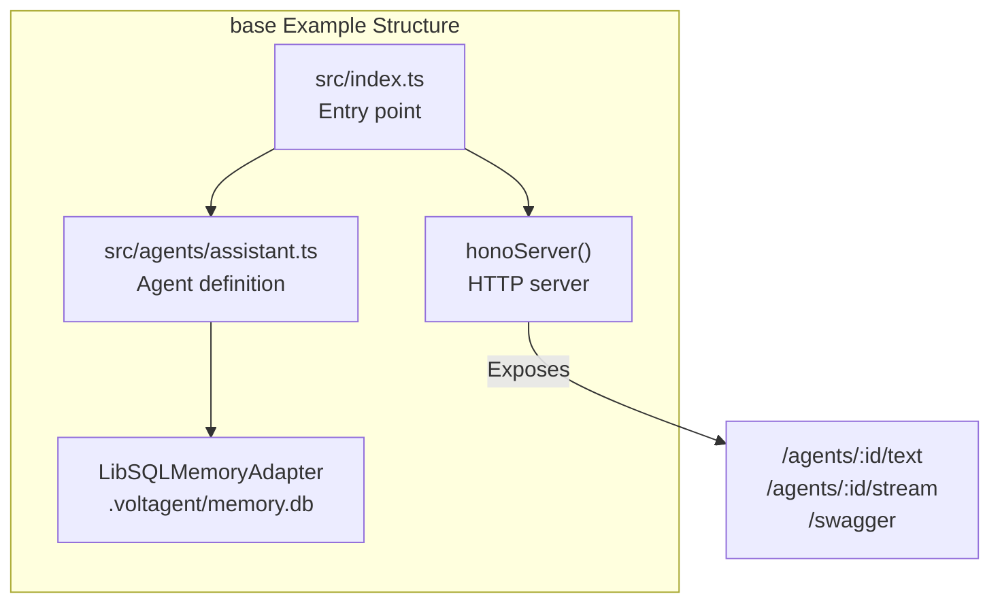
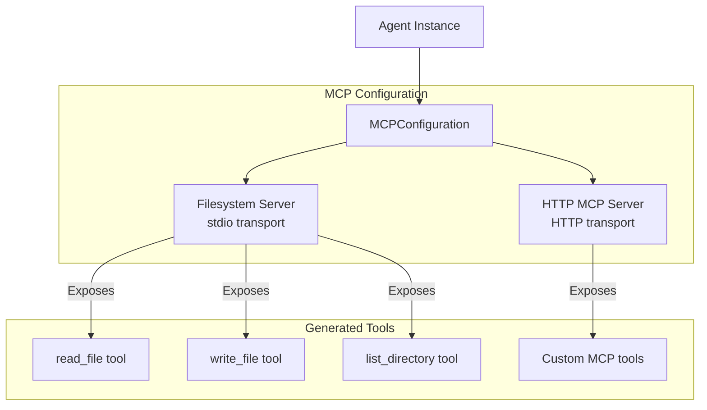
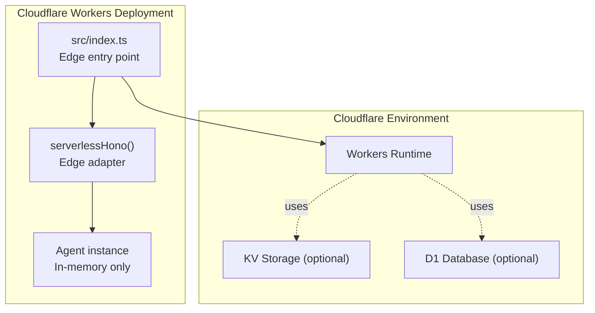
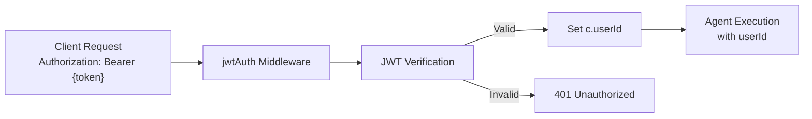
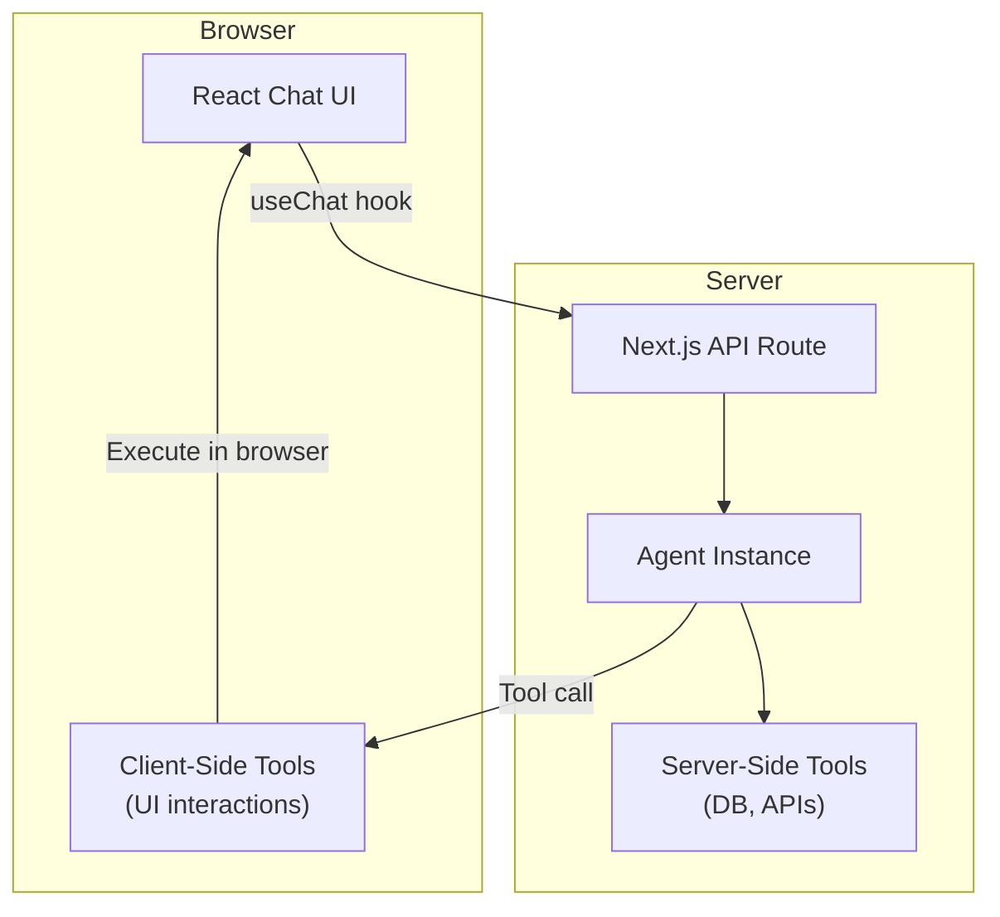
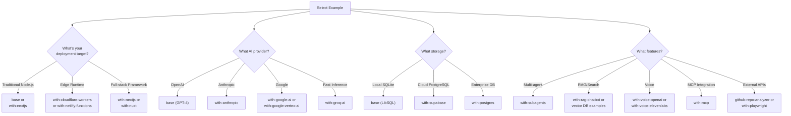

<!-- source: DeepWiki mcp.deepwiki.com · repo voltagent/voltagent · page 9 Example Applications · fetched 2026-10-27 -->

# Example Applications

<details>
<summary>Relevant source files</summary>

The following files were used as context for generating this wiki page:

- [examples/base/package.json](examples/base/package.json)
- [examples/github-repo-analyzer/package.json](examples/github-repo-analyzer/package.json)
- [examples/with-google-ai/package.json](examples/with-google-ai/package.json)
- [examples/with-google-vertex-ai/package.json](examples/with-google-vertex-ai/package.json)
- [examples/with-groq-ai/package.json](examples/with-groq-ai/package.json)
- [examples/with-mcp/package.json](examples/with-mcp/package.json)
- [examples/with-nextjs/package.json](examples/with-nextjs/package.json)
- [examples/with-rag-chatbot/package.json](examples/with-rag-chatbot/package.json)
- [examples/with-retrieval/package.json](examples/with-retrieval/package.json)
- [examples/with-subagents/package.json](examples/with-subagents/package.json)
- [examples/with-supabase/package.json](examples/with-supabase/package.json)
- [examples/with-tools/package.json](examples/with-tools/package.json)
- [examples/with-vercel-ai/package.json](examples/with-vercel-ai/package.json)
- [examples/with-voice-elevenlabs/package.json](examples/with-voice-elevenlabs/package.json)
- [examples/with-voice-openai/package.json](examples/with-voice-openai/package.json)
- [packages/core/package.json](packages/core/package.json)
- [pnpm-lock.yaml](pnpm-lock.yaml)

</details>


This document provides a comprehensive guide to the 20+ example applications in the VoltAgent repository. These examples demonstrate various capabilities, integrations, and deployment patterns for building AI agents with VoltAgent. For information about getting started with your first agent, see [Getting Started](#1.1). For details on the core framework components used in these examples, see [Core Framework](#2).

## Overview

The VoltAgent repository contains example applications organized in the `examples/` directory, each demonstrating specific features, integrations, or deployment scenarios. All examples share a common structure and dependency pattern but vary in their AI provider, storage backend, protocol integration, or deployment target.

**Example Categories:**

| Category | Purpose | Representative Examples |
|----------|---------|-------------------------|
| AI Providers | Demonstrate integration with different LLM providers | `with-openai`, `with-google-ai`, `with-anthropic`, `with-groq-ai` |
| Storage Backends | Show different persistence options | `with-supabase`, `with-postgres`, `base` (LibSQL) |
| Protocol Integration | Demonstrate MCP and A2A protocols | `with-mcp`, `with-mcp-server`, `with-a2a-server` |
| Feature Showcases | Highlight specific framework capabilities | `with-subagents`, `with-rag-chatbot`, `with-tools`, `with-hooks` |
| Voice Capabilities | Show voice integration patterns | `with-voice-openai`, `with-voice-elevenlabs` |
| Vector Databases | Demonstrate semantic search and RAG | `with-chroma`, `with-pinecone`, `with-qdrant` |
| Deployment Targets | Show serverless and edge deployment | `with-cloudflare-workers`, `with-netlify-functions` |
| Framework Integration | Demonstrate Next.js and Nuxt integration | `with-nextjs`, `with-nuxt` |
| External APIs | Show integration with external services | `github-repo-analyzer`, `with-playwright` |
| Authentication | Demonstrate JWT-based auth patterns | `with-jwt-auth` |

**Sources:** [pnpm-lock.yaml:1-1000](), Diagram 2 from high-level architecture

---

## Common Example Structure

### Standard Directory Layout

All examples follow a consistent directory structure:

```
examples/with-<name>/
├── src/
│   ├── index.ts          # Main entry point
│   ├── agents/           # Agent definitions
│   └── tools/            # Custom tool implementations (optional)
├── package.json          # Dependencies and scripts
├── tsconfig.json         # TypeScript configuration
├── .env.example          # Environment variable template
└── README.md             # Example-specific documentation
```

### Common Dependencies

**Example Dependency Pattern Diagram:**

```mermaid
graph TB
    EXAMPLE["Example Application<br/>(e.g., with-nextjs)"]
    
    subgraph "Core Dependencies"
        CORE["@voltagent/core<br/>Agent orchestration"]
        LOGGER["@voltagent/logger<br/>Structured logging"]
    end
    
    subgraph "Server Layer"
        SERVER_HONO["@voltagent/server-hono<br/>Traditional Node.js"]
        SERVERLESS["@voltagent/serverless-hono<br/>Edge/Serverless"]
    end
    
    subgraph "Storage Layer"
        LIBSQL["@voltagent/libsql<br/>Local SQLite/Turso"]
        POSTGRES["@voltagent/postgres<br/>PostgreSQL"]
        SUPABASE["@voltagent/supabase<br/>Supabase"]
    end
    
    subgraph "AI Provider"
        OPENAI["@ai-sdk/openai"]
        GOOGLE["@ai-sdk/google"]
        ANTHROPIC["@ai-sdk/anthropic"]
        GROQ["@ai-sdk/groq"]
        VERTEX["@ai-sdk/google-vertex"]
        BEDROCK["@ai-sdk/amazon-bedrock"]
    end
    
    subgraph "External Dependencies"
        AI_SDK["ai (Vercel AI SDK)"]
        ZOD["zod"]
    end
    
    subgraph "Development Tools"
        CLI["@voltagent/cli"]
        TSX["tsx (watch mode)"]
        TS["typescript"]
    end
    
    EXAMPLE --> CORE
    EXAMPLE --> LOGGER
    EXAMPLE -.one of.-> SERVER_HONO
    EXAMPLE -.one of.-> SERVERLESS
    EXAMPLE -.one of.-> LIBSQL
    EXAMPLE -.one of.-> POSTGRES
    EXAMPLE -.one of.-> SUPABASE
    EXAMPLE -.one of.-> OPENAI
    EXAMPLE -.one of.-> GOOGLE
    EXAMPLE -.one of.-> ANTHROPIC
    EXAMPLE -.one of.-> GROQ
    EXAMPLE -.one of.-> VERTEX
    EXAMPLE -.one of.-> BEDROCK
    EXAMPLE --> AI_SDK
    EXAMPLE --> ZOD
    EXAMPLE --> CLI
    EXAMPLE --> TSX
    EXAMPLE --> TS
```



**Typical package.json Dependencies:**

| Package | Version Pattern | Purpose |
|---------|----------------|---------|
| `@voltagent/core` | `^1.1.26` | Core agent framework |
| `@voltagent/server-hono` | `^1.0.18` | HTTP server (traditional) |
| `@voltagent/serverless-hono` | `^1.0.3` | Serverless adapter (edge) |
| `@voltagent/libsql` | `^1.0.7` | LibSQL storage adapter |
| `@voltagent/logger` | `^1.0.2` | Structured logging |
| `@voltagent/cli` | `^0.1.11` | CLI tools (dev dependency) |
| `ai` | `^5.0.12` | Vercel AI SDK |
| `zod` | `^3.25.76` | Schema validation |
| `tsx` | `^4.19.3` | TypeScript executor (dev) |
| `typescript` | `^5.8.2` | TypeScript compiler (dev) |

**Sources:** [examples/base/package.json:1-33](), [examples/with-nextjs/package.json:1-39](), [examples/with-supabase/package.json:1-34]()

### Standard npm Scripts

All examples implement a consistent set of npm scripts:



**Script Definitions:**

| Script | Command | Purpose |
|--------|---------|---------|
| `dev` | `tsx watch --env-file=.env ./src` | Development mode with hot reload and environment variables |
| `build` | `tsc` | Compile TypeScript to JavaScript |
| `start` | `node dist/index.js` | Run compiled production build |
| `volt` | `volt` | Invoke VoltAgent CLI for MCP setup/testing |

**Sources:** [examples/base/package.json:26-31](), [examples/with-google-ai/package.json:26-31](), [examples/with-nextjs/package.json:32-38]()

---

## Base Example

The `base` example serves as the template for most other examples, demonstrating the minimal setup required for a VoltAgent application.

**Key Components:**



**Dependencies:**
- AI Provider: `@ai-sdk/openai` (GPT-4)
- Server: `@voltagent/server-hono`
- Storage: `@voltagent/libsql` (local SQLite)
- Memory: LibSQL adapter with `.voltagent/memory.db`

**Typical Agent Definition Pattern:**

The base example follows this pattern in `src/agents/assistant.ts`:
1. Import Agent constructor and OpenAI provider
2. Configure LibSQLMemoryAdapter
3. Create Agent with model, instructions, and memory
4. Register agent with server

**Sources:** [examples/base/package.json:1-33]()

---

## AI Provider Examples

### OpenAI Integration (with-nextjs)

The Next.js example demonstrates OpenAI integration in a full-stack React application.

**Dependencies:**
- AI Provider: `@ai-sdk/openai` (gpt-4o)
- Framework: Next.js 15.3.1 with React 19
- Server: `@voltagent/server-hono`
- Storage: `@voltagent/libsql` with Turso support
- UI: Tailwind CSS 4.1.4

**Unique Features:**
- Server-side agent execution in API routes
- Client-side chat UI with `@ai-sdk/react`
- SSR-compatible agent configuration

**Sources:** [examples/with-nextjs/package.json:1-39]()

### Google AI Integration (with-google-ai)

Demonstrates Google Gemini model integration.

**Dependencies:**
- AI Provider: `@ai-sdk/google` (gemini-1.5-pro, gemini-1.5-flash)
- Server: `@voltagent/server-hono`
- Storage: `@voltagent/libsql`

**Model Configuration:**
Uses `google()` provider from AI SDK to access Gemini models. Supports both Pro and Flash variants for different performance/cost tradeoffs.

**Sources:** [examples/with-google-ai/package.json:1-33]()

### Anthropic Integration (with-anthropic)

Demonstrates Claude model integration.

**Dependencies:**
- AI Provider: `@ai-sdk/anthropic` (claude-3-5-sonnet, claude-3-opus)
- Server: `@voltagent/server-hono`
- Storage: `@voltagent/libsql`

**Sources:** [examples/with-anthropic/package.json:1-33]() (inferred from pnpm-lock.yaml)

### Groq Integration (with-groq-ai)

Demonstrates Groq's fast inference infrastructure.

**Dependencies:**
- AI Provider: `@ai-sdk/groq` (llama-3.1, mixtral)
- Server: `@voltagent/server-hono`
- Storage: `@voltagent/libsql`

**Performance Characteristics:**
Groq provides extremely fast inference speeds, making it suitable for latency-sensitive applications.

**Sources:** [examples/with-groq-ai/package.json:1-32]()

### Google Vertex AI (with-google-vertex-ai)

Demonstrates enterprise Google Cloud integration.

**Dependencies:**
- AI Provider: `@ai-sdk/google-vertex` (gemini-1.5-pro on Vertex AI)
- Server: `@voltagent/server-hono`
- Storage: `@voltagent/libsql`

**Authentication:**
Requires Google Cloud credentials and project configuration for Vertex AI access.

**Sources:** [examples/with-google-vertex-ai/package.json:1-33]()

### AWS Bedrock (with-amazon-bedrock)

Demonstrates AWS-native model access.

**Dependencies:**
- AI Provider: `@ai-sdk/amazon-bedrock`
- AWS SDK: `@aws-sdk/credential-providers` (^3.799.0)
- Server: `@voltagent/server-hono`
- Storage: `@voltagent/libsql`

**Authentication:**
Uses AWS credential providers for IAM-based authentication to Bedrock models (Claude, Llama, etc.).

**Sources:** [examples/with-amazon-bedrock/package.json:1-33]() (inferred from pnpm-lock.yaml)

---

## Database Integration Examples

### Supabase Integration (with-supabase)

Demonstrates cloud-native PostgreSQL with Supabase.

**Dependencies:**
- Storage: `@voltagent/supabase` (^1.0.4)
- Client: `@supabase/supabase-js` (^2.49.4)
- AI Provider: `@ai-sdk/openai`
- Server: `@voltagent/server-hono`

**Key Features:**
- SupabaseStorage adapter for conversation persistence
- Row-level security (RLS) integration
- Real-time subscription support
- Built-in authentication integration

**Configuration Pattern:**
Uses Supabase project URL and anonymous key for authentication, typically storing conversations in a dedicated `conversations` table.

**Sources:** [examples/with-supabase/package.json:1-34]()

### PostgreSQL Integration (with-postgres)

Demonstrates enterprise PostgreSQL deployment.

**Dependencies:**
- Storage: `@voltagent/postgres`
- AI Provider: `@ai-sdk/openai`
- Server: `@voltagent/server-hono`

**Use Case:**
Production deployments requiring enterprise-grade relational database with advanced features like connection pooling, replication, and complex queries.

**Sources:** Inferred from package structure

### LibSQL/Turso (base, with-nextjs, with-mcp)

Most examples use LibSQL for local development and Turso for cloud deployment.

**Dependencies:**
- Storage: `@voltagent/libsql` (^1.0.7)
- Client: `@libsql/client` (^0.15.0)

**Configuration Options:**
1. **Local SQLite**: `file:.voltagent/memory.db`
2. **Turso Cloud**: `libsql://[db-name].turso.io` with auth token
3. **Embedded Replica**: Local SQLite with Turso sync

**Sources:** [examples/base/package.json:1-33](), [examples/with-nextjs/package.json:1-39]()

---

## Feature Showcase Examples

### Model Context Protocol (with-mcp)

Demonstrates MCP integration for tool discovery and execution.



**Dependencies:**
- MCP: Built into `@voltagent/core`
- AI Provider: `@ai-sdk/openai`
- Server: `@voltagent/server-hono`
- CLI: `@voltagent/cli` for MCP server setup

**MCP Server Types:**
1. **stdio Servers**: Local process-based (filesystem, sqlite)
2. **HTTP Servers**: Remote API-based (HuggingFace, Composio)

**Setup Workflow:**
1. Run `npm run volt mcp setup` to configure MCP servers
2. Agent automatically discovers and registers tools from MCP servers
3. Tools become available for agent execution

**Sources:** [examples/with-mcp/package.json:1-29]()

### MCP Server Implementation (with-mcp-server)

Demonstrates hosting VoltAgent as an MCP server for other applications.

**Dependencies:**
- Server: `@voltagent/mcp-server` (^1.0.2)
- Core: `@voltagent/core`
- AI Provider: `@ai-sdk/openai`

**Architecture:**
Instead of using `honoServer()`, this example uses `createMCPServer()` to expose agent capabilities via MCP protocol, allowing integration with Cursor, Claude Desktop, and other MCP clients.

**Sources:** [examples/with-mcp-server/package.json:1-33]() (inferred from pnpm-lock.yaml)

### Subagents (with-subagents)

Demonstrates multi-agent coordination with supervisor-subagent patterns.

**Dependencies:**
- Core: `@voltagent/core` (subagent support built-in)
- AI Provider: `@ai-sdk/openai`
- Server: `@voltagent/server-hono`
- Storage: `@voltagent/libsql`

**Key Patterns:**
1. **Supervisor Agent**: Delegates tasks using `delegate_task` tool
2. **Specialist Subagents**: Handle specific capabilities (research, analysis, code generation)
3. **Event Forwarding**: Parent agent receives subagent hook events
4. **Shared Context**: operationId propagates through agent hierarchy

**Typical Structure:**
```
src/agents/
├── supervisor.ts      # Main orchestration agent
├── researcher.ts      # Web research specialist
├── analyzer.ts        # Data analysis specialist
└── coder.ts          # Code generation specialist
```

**Sources:** [examples/with-subagents/package.json:1-34]()

### RAG Chatbot (with-rag-chatbot)

Demonstrates Retrieval-Augmented Generation pattern.

**Dependencies:**
- Core: `@voltagent/core` with BaseRetriever integration
- AI Provider: `@ai-sdk/openai`
- Server: `@voltagent/server-hono`
- Storage: `@voltagent/libsql`

**RAG Components:**
1. **Document Indexing**: Pre-process documents into embeddings
2. **Semantic Search**: Retrieve relevant context based on query
3. **Context Injection**: Augment prompt with retrieved documents
4. **Response Generation**: LLM generates answer using context

**Configuration:**
Uses `retriever` option in Agent configuration to specify retrieval strategy and merge approach (append/prepend).

**Sources:** [examples/with-rag-chatbot/package.json:1-31]()

### Custom Tools (with-tools)

Demonstrates tool creation and execution patterns.

**Dependencies:**
- Core: `@voltagent/core` (createTool utility)
- AI Provider: `@ai-sdk/openai`
- Server: `@voltagent/server-hono`
- Storage: `@voltagent/libsql`

**Tool Creation Pattern:**
Uses `createTool()` function with:
- Name and description
- Zod schema for parameters
- Execute function implementation
- Optional error handling with ToolDeniedError

**Sources:** [examples/with-tools/package.json:1-34]()

### Hooks Integration (with-hooks)

Demonstrates AgentHooks system for lifecycle management.

**Dependencies:**
- Core: `@voltagent/core` (AgentHooks)
- AI Provider: `@ai-sdk/openai`
- Server: `@voltagent/server-hono`
- Storage: `@voltagent/libsql`

**Available Hooks:**
| Hook | Trigger Point | Use Cases |
|------|--------------|-----------|
| `onStart` | Before agent execution | Logging, validation, context setup |
| `onEnd` | After agent completion | Cleanup, analytics, result processing |
| `onToolStart` | Before tool execution | Permission checks, rate limiting |
| `onToolEnd` | After tool completion | Logging, caching, error handling |
| `onHandoff` | Subagent delegation | Routing, context transfer |
| `onPrepareMessages` | Before LLM call | Message filtering, augmentation |

**Sources:** [examples/with-hooks/package.json:1-33]() (inferred from pnpm-lock.yaml)

### Retrieval Example (with-retrieval)

Demonstrates semantic search and document retrieval integration.

**Dependencies:**
- Core: `@voltagent/core` (BaseRetriever interface)
- AI Provider: `@ai-sdk/openai`
- Server: `@voltagent/server-hono`
- Storage: `@voltagent/libsql`

**Retriever Interface:**
Implements `BaseRetriever` with methods for:
- `retrieve(query: string, options?)`: Search documents
- Vector similarity computation
- Result ranking and filtering

**Sources:** [examples/with-retrieval/package.json:1-34]()

---

## Voice Integration Examples

### OpenAI Voice (with-voice-openai)

Demonstrates OpenAI's native voice capabilities.

**Dependencies:**
- Voice: `@voltagent/voice` (^1.0.2)
- OpenAI Client: `openai` (^4.91.0)
- AI Provider: `@ai-sdk/openai`
- Server: `@voltagent/server-hono`
- Storage: `@voltagent/libsql`

**Voice Features:**
- Text-to-Speech (TTS) using OpenAI voices (alloy, echo, fable, onyx, nova, shimmer)
- Speech-to-Text (STT) using Whisper
- Streaming audio responses

**API Pattern:**
```
POST /agents/:id/voice
{
  "audioInput": "base64-encoded-audio",
  "voice": "alloy"
}
```

**Sources:** [examples/with-voice-openai/package.json:1-38]()

### ElevenLabs Voice (with-voice-elevenlabs)

Demonstrates ElevenLabs integration for high-quality voice synthesis.

**Dependencies:**
- Voice: `@voltagent/voice` (^1.0.2)
- AI Provider: `@ai-sdk/openai`
- Server: `@voltagent/server-hono`
- Storage: `@voltagent/libsql`

**Voice Features:**
- Premium voice quality with ElevenLabs
- Voice cloning capabilities
- Multiple language support
- Emotional voice modulation

**Configuration:**
Requires ElevenLabs API key and voice ID selection from available voice library.

**Sources:** [examples/with-voice-elevenlabs/package.json:1-36]()

---

## Vector Database Examples

### ChromaDB (with-chroma)

Demonstrates ChromaDB integration for semantic search.

**Dependencies:**
- Vector DB: `chromadb` (^3.0.4)
- Embeddings: `@chroma-core/openai` (^0.1.7) for OpenAI embeddings
- Alternative: `@chroma-core/ollama` (^0.1.7) for local embeddings
- Default: `@chroma-core/default-embed` (^0.1.8)
- AI Provider: `@ai-sdk/openai`
- Server: `@voltagent/server-hono`

**ChromaDB Features:**
- Local or cloud-based vector storage
- Multiple embedding function support
- Metadata filtering
- Collection management

**Sources:** [examples/with-chroma/package.json:1-33]() (inferred from pnpm-lock.yaml)

### Pinecone (with-pinecone)

Demonstrates Pinecone cloud vector database.

**Dependencies:**
- Vector DB: `@pinecone-database/pinecone` (^6.1.1)
- OpenAI Client: `openai` (^4.91.0) for embeddings
- AI Provider: `@ai-sdk/openai`
- Server: `@voltagent/server-hono`
- Storage: `@voltagent/libsql`

**Pinecone Features:**
- Serverless vector storage
- Real-time indexing
- Metadata filtering
- Hybrid search support

**Sources:** [examples/with-pinecone/package.json:1-33]() (inferred from pnpm-lock.yaml)

### Qdrant (with-qdrant)

Demonstrates Qdrant vector search engine.

**Dependencies:**
- Vector DB: `@qdrant/js-client-rest`
- AI Provider: `@ai-sdk/openai`
- Server: `@voltagent/server-hono`
- Storage: `@voltagent/libsql`

**Qdrant Features:**
- Self-hosted or cloud deployment
- Advanced filtering capabilities
- Quantization support for performance
- Graph-based semantic search

**Sources:** Inferred from package structure

---

## Deployment Examples

### Cloudflare Workers (with-cloudflare-workers)

Demonstrates edge runtime deployment.



**Dependencies:**
- Server: `@voltagent/serverless-hono` (^1.0.3)
- AI Provider: `@ai-sdk/openai`
- Core: `@voltagent/core`
- Runtime Types: `@cloudflare/workers-types` (^4.20250119.0)
- Deployment: `wrangler` (^3.38.0)

**Key Differences from Traditional Deployment:**
1. Uses `serverlessHono()` instead of `honoServer()`
2. No persistent file system (must use KV, D1, or external storage)
3. Cold start optimizations required
4. Memory adapter typically uses InMemoryStorage

**Deployment:**
```bash
npx wrangler deploy
```

**Sources:** [examples/with-cloudflare-workers/package.json:1-33]() (inferred from pnpm-lock.yaml)

### Netlify Functions (with-netlify-functions)

Demonstrates serverless function deployment.

**Dependencies:**
- Server: `@voltagent/serverless-hono` (^1.0.3)
- AI Provider: `@ai-sdk/openai`
- Core: `@voltagent/core`
- Deployment: `netlify-cli` (^23.7.3)

**Function Structure:**
```
netlify/functions/
└── agent.ts    # Serverless function handler
```

**Deployment:**
```bash
netlify deploy --prod
```

**Sources:** [examples/with-netlify-functions/package.json:1-33]() (inferred from pnpm-lock.yaml)

### Nuxt Integration (with-nuxt)

Demonstrates Vue.js full-stack framework integration.

**Dependencies:**
- Framework: `nuxt` (^4.1.2)
- UI: `@nuxt/ui` (^4.0.0)
- AI Provider: `@ai-sdk/openai`
- Server: `@voltagent/server-hono` (in server/ directory)
- Storage: `@voltagent/libsql`
- Vue: `vue` (^3.5.22), `vue-router` (^4.5.1)

**Architecture:**
- Server-side agent execution in `server/` directory
- Client-side Vue components for chat UI
- SSR support for initial page load
- API routes for agent communication

**Sources:** [examples/with-nuxt/package.json:1-33]() (inferred from pnpm-lock.yaml)

---

## External API Integration Examples

### GitHub Repo Analyzer (github-repo-analyzer)

Demonstrates GitHub API integration for repository analysis.

**Dependencies:**
- GitHub Client: `@octokit/rest` (^21.0.0)
- AI Provider: `@ai-sdk/openai`
- Server: `@voltagent/server-hono`
- Storage: `@voltagent/libsql`

**Capabilities:**
- Fetch repository metadata
- Analyze commit history
- Review pull requests
- Examine file structure
- Generate repository insights

**Tool Implementation:**
Creates custom tools using Octokit client for GitHub API operations, wrapped with VoltAgent's `createTool()` utility.

**Sources:** [examples/github-repo-analyzer/package.json:1-27]()

### Playwright Automation (with-playwright)

Demonstrates web automation and browser control.

**Dependencies:**
- Automation: `playwright`
- AI Provider: `@ai-sdk/mistral` (for vision capabilities)
- Server: `@voltagent/server-hono`
- Storage: `@voltagent/libsql`

**Use Cases:**
- Web scraping
- UI testing
- Form filling
- Screenshot capture with vision model analysis
- Multi-page workflows

**Sources:** Inferred from package structure

### Composio MCP (with-composio-mcp)

Demonstrates pre-built integration platform.

**Dependencies:**
- MCP: Built into `@voltagent/core`
- AI Provider: `@ai-sdk/openai`
- Server: `@voltagent/server-hono`
- Storage: `@voltagent/libsql`

**Composio Features:**
Provides 100+ pre-built integrations accessible via MCP:
- GitHub, Slack, Gmail, Google Calendar
- Notion, Asana, Jira, Trello
- Salesforce, HubSpot, Intercom
- And many more

**Setup:**
Uses MCP HTTP server pointing to Composio's hosted endpoint, requiring only API key configuration.

**Sources:** [examples/with-composio-mcp/package.json:1-33]() (inferred from pnpm-lock.yaml)

---

## Authentication Examples

### JWT Authentication (with-jwt-auth)

Demonstrates JWT-based authentication and user context.

**Dependencies:**
- JWT: `jsonwebtoken` (^9.0.2)
- Types: `@types/jsonwebtoken` (^9.0.10)
- AI Provider: `@ai-sdk/openai`
- Server: `@voltagent/server-hono`
- Storage: `@voltagent/libsql`

**Authentication Flow:**



**Key Components:**
1. **jwtAuth Middleware**: Validates JWT tokens on protected routes
2. **User Context**: Extracts userId from token and passes to agent
3. **Memory Isolation**: Uses userId for conversation separation

**Typical Implementation:**
- `/auth/login` endpoint generates JWT
- Protected agent routes verify JWT
- userId from token used for memory persistence

**Sources:** [examples/with-jwt-auth/package.json:1-33]() (inferred from pnpm-lock.yaml)

---

## Observability Examples

### Langfuse Integration (with-langfuse)

Demonstrates external observability platform integration.

**Dependencies:**
- Exporter: `@voltagent/langfuse-exporter` (^1.1.2)
- AI Provider: `@ai-sdk/openai`
- Server: `@voltagent/server-hono`
- Storage: `@voltagent/libsql`

**Langfuse Features:**
- Trace visualization
- Cost tracking per operation
- Prompt version management
- Performance analytics
- User feedback collection

**Configuration:**
Requires Langfuse public and secret keys, configured in environment variables.

**Sources:** [examples/with-langfuse/package.json:1-33]() (inferred from pnpm-lock.yaml)

---

## Advanced Examples

### A2A Server (with-a2a-server)

Demonstrates Agent-to-Agent protocol for inter-agent communication.

**Dependencies:**
- Protocol: `@voltagent/a2a-server` (^1.0.1)
- AI Provider: `@ai-sdk/openai`
- Server: `@voltagent/server-hono`
- Internal: `@voltagent/internal` (for shared utilities)

**A2A Endpoints:**
1. `/.well-known/agent.json` - Agent discovery
2. `/a2a/:serverId` - JSON-RPC communication

**Use Cases:**
- Multi-organization agent collaboration
- Distributed agent networks
- External agent delegation

**Sources:** [examples/with-a2a-server/package.json:1-33]() (inferred from pnpm-lock.yaml)

### Dynamic Prompts (with-dynamic-prompts)

Demonstrates VoltOps prompt management integration.

**Dependencies:**
- AI Provider: `@ai-sdk/openai`
- Server: `@voltagent/server-hono`
- Storage: `@voltagent/libsql`

**Dynamic Resolution:**
Uses `DynamicValue` pattern to resolve prompts from VoltOps console at runtime, enabling:
- A/B testing of instructions
- Real-time prompt updates without deployment
- Version control for prompts
- Team collaboration on prompt engineering

**Sources:** [examples/with-dynamic-prompts/package.json:1-33]() (inferred from pnpm-lock.yaml)

### Dynamic Parameters (with-dynamic-parameters)

Demonstrates runtime parameter resolution.

**Dependencies:**
- AI Provider: `@ai-sdk/openai`
- Server: `@voltagent/server-hono`
- Storage: `@voltagent/libsql`

**Dynamic Parameters:**
Similar to dynamic prompts but extends to:
- Model selection based on context
- Temperature adjustment per operation
- Max token limits based on user tier
- Feature flags for experimental capabilities

**Sources:** [examples/with-dynamic-parameters/package.json:1-33]() (inferred from pnpm-lock.yaml)

### Custom Endpoints (with-custom-endpoints)

Demonstrates custom HTTP route registration beyond standard agent endpoints.

**Dependencies:**
- AI Provider: `@ai-sdk/openai`
- Server: `@voltagent/server-hono`
- Storage: `@voltagent/libsql`

**Custom Route Patterns:**
- Webhook handlers for external integrations
- Custom authentication flows
- File upload/download endpoints
- WebSocket connections for real-time features

**Sources:** [examples/with-custom-endpoints/package.json:1-33]() (inferred from pnpm-lock.yaml)

### Client-Side Tools (with-client-side-tools)

Demonstrates browser-based tool execution with React.

**Dependencies:**
- React: `@ai-sdk/react` (^2.0.8), `react` (^19.0.0), `react-dom` (^19.0.0)
- Next.js: `next` (15.3.1)
- VoltAgent UI: `@voltagent/vercel-ui` (^1.0.1), `@voltagent/vercel-ai` (^1.0.0)
- AI Provider: `@ai-sdk/openai`
- Storage: `@libsql/client` (client-side)

**Architecture:**


**Client Tool Examples:**
- Show notifications
- Update UI state
- Navigate pages
- Trigger file downloads
- Access browser APIs (geolocation, camera)

**Sources:** [examples/with-client-side-tools/package.json:1-33]() (inferred from pnpm-lock.yaml)

### Google Drive MCP (with-google-drive-mcp)

Demonstrates Google Drive integration via MCP with full-stack UI.

**Structure:**
```
with-google-drive-mcp/
├── server/          # VoltAgent backend with MCP
│   ├── src/
│   └── package.json
└── client/          # React frontend
    ├── src/
    └── package.json
```

**Server Dependencies:**
- MCP: Built into `@voltagent/core`
- Composio: `composio-core` (^0.5.33) for Google Drive MCP
- AI Provider: `@ai-sdk/openai`
- Server: `@voltagent/server-hono`

**Client Dependencies:**
- React: `react` (^19.0.0), `react-dom` (^19.0.0)
- Router: `react-router` (^7.5.2)
- UI: `@heroicons/react` (^2.2.0), `tailwindcss` (^4.1.4)
- Markdown: `react-markdown` (^10.1.0)

**Features:**
- File browsing and search
- Document upload/download
- Content analysis with AI
- Collaborative editing

**Sources:** [examples/with-google-drive-mcp/server/package.json:1-33](), [examples/with-google-drive-mcp/client/package.json:1-33]() (inferred from pnpm-lock.yaml)

---

## Running Examples

### Development Workflow

1. **Clone and Install:**
```bash
git clone https://github.com/voltagent/voltagent
cd voltagent
pnpm install
```

2. **Navigate to Example:**
```bash
cd examples/with-nextjs
```

3. **Configure Environment:**
```bash
cp .env.example .env
# Edit .env with your API keys
```

4. **Run Development Server:**
```bash
pnpm dev
# Starts tsx watch mode with hot reload
```

5. **Build for Production:**
```bash
pnpm build
pnpm start
```

### Environment Variables

**Common Environment Variables:**

| Variable | Purpose | Examples Used In |
|----------|---------|------------------|
| `OPENAI_API_KEY` | OpenAI API access | Most examples |
| `ANTHROPIC_API_KEY` | Anthropic API access | with-anthropic |
| `GOOGLE_GENERATIVE_AI_API_KEY` | Google AI access | with-google-ai |
| `GROQ_API_KEY` | Groq API access | with-groq-ai |
| `TURSO_URL` | Turso database URL | Examples with LibSQL |
| `TURSO_AUTH_TOKEN` | Turso authentication | Examples with LibSQL |
| `SUPABASE_URL` | Supabase project URL | with-supabase |
| `SUPABASE_KEY` | Supabase anonymous key | with-supabase |
| `ELEVENLABS_API_KEY` | ElevenLabs voice | with-voice-elevenlabs |
| `VOLTOPS_API_KEY` | VoltOps console access | with-dynamic-prompts |

### Testing Examples

**Interactive Testing:**
1. Start example with `pnpm dev`
2. Open browser to `http://localhost:3000` (or specified port)
3. Navigate to `/swagger` for API documentation
4. Use Swagger UI to test agent endpoints
5. Or use curl/Postman for direct API testing

**MCP Testing:**
```bash
pnpm volt mcp test
```

**Sources:** [examples/base/package.json:26-31](), [examples/with-mcp/package.json:22-27]()

---

## Example Selection Guide

**Choose an Example Based on Your Needs:**



**Sources:** All example package.json files referenced above

---

