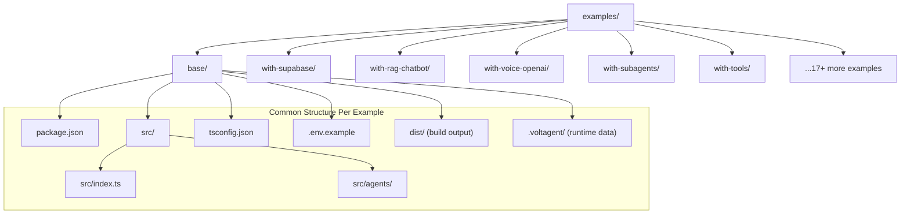
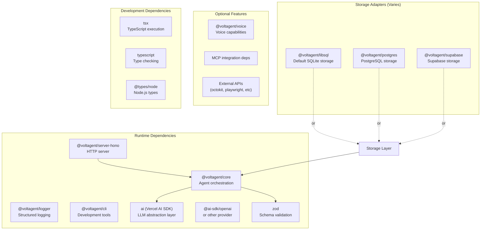
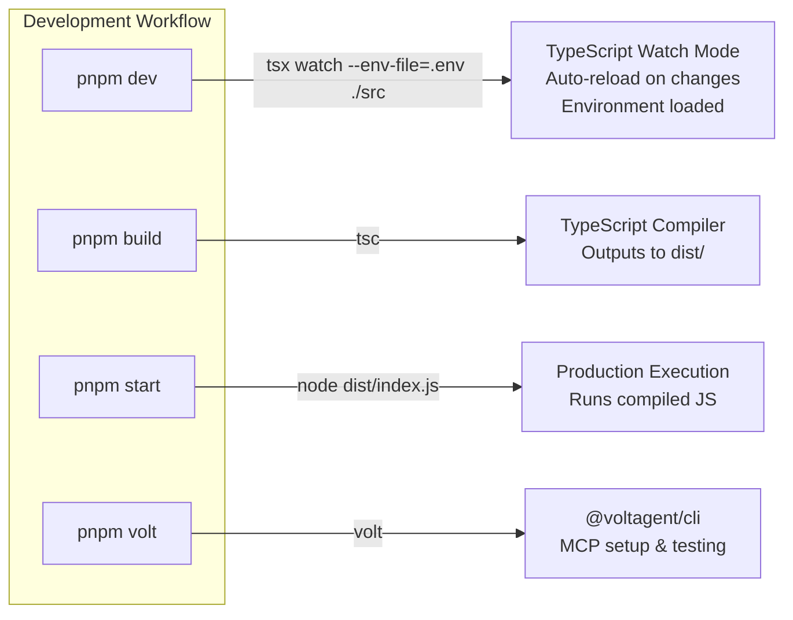
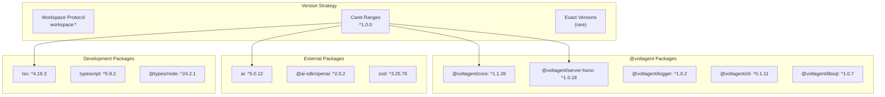
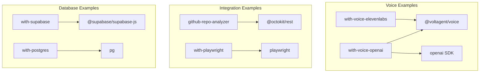
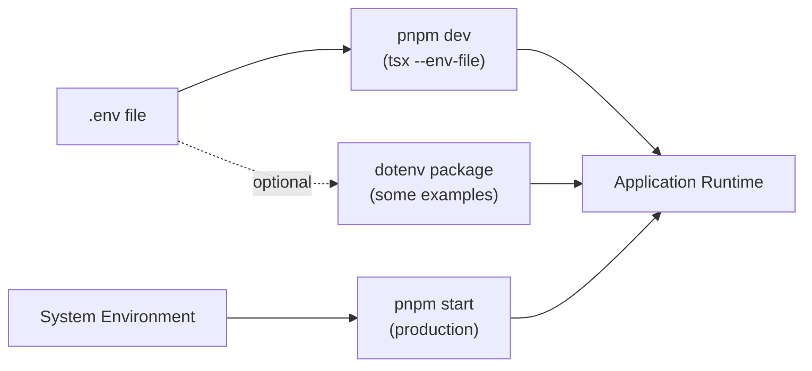
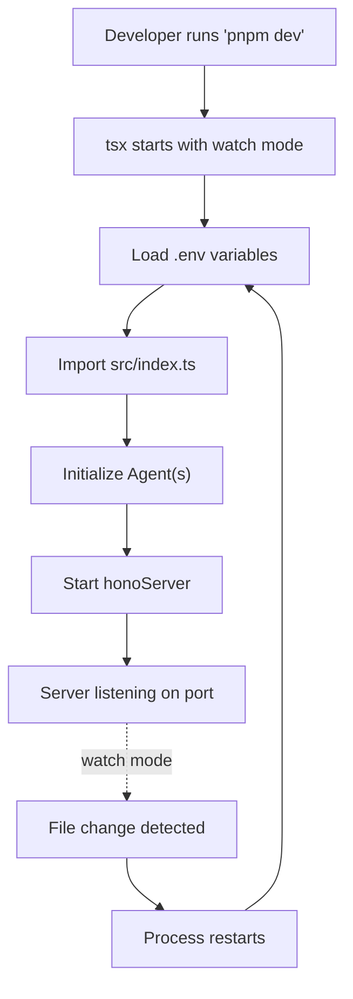
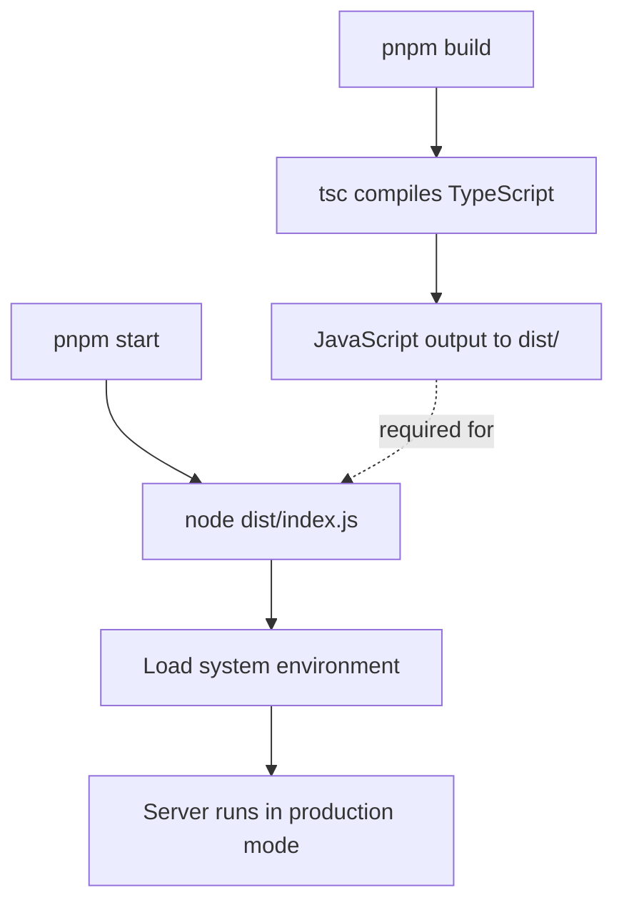
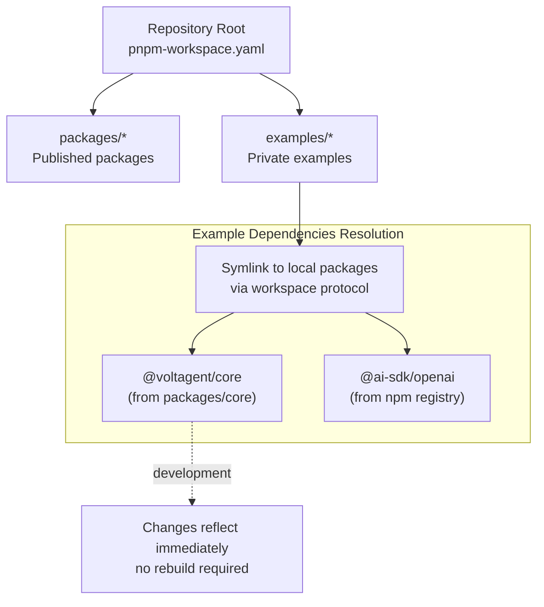

<!-- source: DeepWiki mcp.deepwiki.com · repo voltagent/voltagent · page 9.1 Example Structure and Scripts · fetched 2026-10-27 -->

# Example Structure and Scripts

<details>
<summary>Relevant source files</summary>

The following files were used as context for generating this wiki page:

- [examples/base/package.json](examples/base/package.json)
- [examples/github-repo-analyzer/package.json](examples/github-repo-analyzer/package.json)
- [examples/with-rag-chatbot/package.json](examples/with-rag-chatbot/package.json)
- [examples/with-retrieval/package.json](examples/with-retrieval/package.json)
- [examples/with-subagents/package.json](examples/with-subagents/package.json)
- [examples/with-supabase/package.json](examples/with-supabase/package.json)
- [examples/with-tools/package.json](examples/with-tools/package.json)
- [examples/with-vercel-ai/package.json](examples/with-vercel-ai/package.json)
- [examples/with-voice-elevenlabs/package.json](examples/with-voice-elevenlabs/package.json)
- [examples/with-voice-openai/package.json](examples/with-voice-openai/package.json)

</details>


## Purpose and Scope

This document describes the common structural patterns, package dependencies, and npm scripts used across the 20+ example applications in the VoltAgent repository. All examples follow a standardized template that demonstrates specific features while maintaining consistent development workflows.

For information about the content and use cases demonstrated by specific examples, see [AI Provider Examples](#9.2), [Database Integration Examples](#9.3), [Feature Examples](#9.4), [Voice and Automation Examples](#9.5), and [Deployment Examples](#9.6). For general project scaffolding workflows, see [Project Scaffolding](#7.2).

---

## Example Repository Structure

All examples reside in the `examples/` directory and share a common file structure:



**Sources**: [examples/base/package.json:1-33](), [examples/with-supabase/package.json:1-34](), [examples/with-rag-chatbot/package.json:1-31]()

---

## Standard package.json Anatomy

### Common Metadata Fields

All example `package.json` files share these structural elements:

| Field | Value Pattern | Purpose |
|-------|---------------|---------|
| `name` | `voltagent-example-{feature}` | Follows consistent naming convention |
| `private` | `true` | Prevents accidental npm publishing |
| `type` | `"module"` | Enables ES modules (import/export) |
| `license` | `"MIT"` | Standard open-source license |
| `keywords` | `["agent", "ai", "voltagent", ...]` | Searchability and categorization |

**Sources**: [examples/base/package.json:1-33](), [examples/with-tools/package.json:1-34](), [examples/with-retrieval/package.json:1-34]()

### Core Dependency Pattern

The dependency structure follows a consistent pattern across all examples:



**Sources**: [examples/base/package.json:4-13](), [examples/with-supabase/package.json:4-13](), [examples/with-voice-openai/package.json:4-16]()

---

## Standard npm Scripts

All examples implement four primary npm scripts with consistent behavior:

### Script Definitions



**Sources**: [examples/base/package.json:26-31](), [examples/with-supabase/package.json:27-32](), [examples/github-repo-analyzer/package.json:21-26]()

### Script Implementation Details

#### `dev` Script

The development script uses `tsx` in watch mode with environment file loading:

```
"dev": "tsx watch --env-file=.env ./src"
```

**Behavior**:
- Executes TypeScript directly without compilation
- Watches for file changes and auto-restarts
- Loads environment variables from `.env` file
- Entry point: `./src/index.ts` (by directory convention)
- Hot reload on any `.ts` file modification

**Variations**:
- Some examples add trailing space: `./src ` (no functional difference)
- Entry point always assumes `src/index.ts` exists

**Sources**: [examples/base/package.json:28](), [examples/with-voice-openai/package.json:33](), [examples/with-subagents/package.json:29]()

#### `build` Script

The build script compiles TypeScript to JavaScript:

```
"build": "tsc"
```

**Behavior**:
- Runs TypeScript compiler with project configuration
- Reads settings from `tsconfig.json`
- Outputs compiled JavaScript to `dist/` directory
- Generates source maps and declaration files (configuration-dependent)
- Used for production deployment preparation

**Sources**: [examples/base/package.json:27](), [examples/with-rag-chatbot/package.json:25](), [examples/github-repo-analyzer/package.json:22]()

#### `start` Script

The start script executes the compiled production build:

```
"start": "node dist/index.js"
```

**Behavior**:
- Runs compiled JavaScript from `dist/` directory
- Requires prior `build` execution
- No hot reload - production mode
- Relies on environment variables from system or `.env` loading mechanisms

**Sources**: [examples/base/package.json:29](), [examples/with-voice-elevenlabs/package.json:32](), [examples/with-tools/package.json:30]()

#### `volt` Script

The volt script provides CLI tool access:

```
"volt": "volt"
```

**Behavior**:
- Executes `@voltagent/cli` commands
- Used for MCP server setup and testing
- Common commands: `volt mcp setup`, `volt mcp test`, `volt mcp status`
- See [VoltAgent CLI](#7.1) for detailed command reference

**Sources**: [examples/base/package.json:30](), [examples/with-retrieval/package.json:31](), [examples/with-vercel-ai/package.json:30]()

---

## Dependency Version Patterns

### Core Package Versions

Examples demonstrate dependency version consistency across the monorepo:



**Key Patterns**:
- **@voltagent packages**: Caret ranges allow patch/minor updates
- **AI SDK**: Locked to v5.x for stability
- **TypeScript**: Recent version (5.8.x) for latest features
- **Node types**: Matches Node.js LTS versions (20, 22, 24)

**Sources**: [examples/base/package.json:4-18](), [examples/with-supabase/package.json:4-18](), [examples/with-rag-chatbot/package.json:5-18]()

---

## Example-Specific Dependency Variations

### Storage Adapter Selection

Different examples demonstrate different storage backends:

| Example | Storage Package | Use Case |
|---------|----------------|----------|
| `base` | `@voltagent/libsql` | Default SQLite local storage |
| `with-supabase` | `@voltagent/supabase` + `@supabase/supabase-js` | Cloud-native, auth integration |
| `with-postgres` | `@voltagent/postgres` | Enterprise PostgreSQL |
| `with-rag-chatbot` | `@voltagent/libsql` | Local development, vector search |

**Sources**: [examples/base/package.json:8](), [examples/with-supabase/package.json:6,11](), [examples/with-rag-chatbot/package.json:9]()

### Feature-Specific Dependencies

Examples add specialized packages based on demonstrated features:



**Sources**: [examples/with-voice-openai/package.json:11,14](), [examples/github-repo-analyzer/package.json:6](), [examples/with-supabase/package.json:6]()

---

## TypeScript Configuration Patterns

While `tsconfig.json` files are not provided in the source files, examples consistently use TypeScript with these implied patterns:

### Expected tsconfig.json Structure

```json
{
  "compilerOptions": {
    "target": "ES2022",
    "module": "ESNext",
    "moduleResolution": "bundler",
    "outDir": "./dist",
    "rootDir": "./src",
    "strict": true,
    "esModuleInterop": true,
    "skipLibCheck": true,
    "resolveJsonModule": true
  },
  "include": ["src/**/*"],
  "exclude": ["node_modules", "dist"]
}
```

**Key Settings**:
- `module: "ESNext"` aligns with `"type": "module"` in package.json
- `outDir: "./dist"` matches the `start` script expectation
- `rootDir: "./src"` matches the `dev` script entry point

**Sources**: Inferred from [examples/base/package.json:28-29](), [examples/with-supabase/package.json:29-30]()

---

## Environment Configuration

All examples expect environment variables via `.env` files:

### Common Environment Variables

| Variable | Purpose | Required By |
|----------|---------|-------------|
| `OPENAI_API_KEY` | OpenAI authentication | Most examples using OpenAI |
| `DATABASE_URL` | Database connection string | PostgreSQL examples |
| `SUPABASE_URL` | Supabase project URL | Supabase examples |
| `SUPABASE_ANON_KEY` | Supabase anonymous key | Supabase examples |
| `ELEVENLABS_API_KEY` | ElevenLabs authentication | Voice examples |
| `PORT` | Server listening port | Server examples (optional) |

### Environment Loading Mechanism



**Loading Methods**:
1. **Development**: `tsx --env-file=.env` loads automatically
2. **Production**: Relies on system environment or explicit `dotenv` usage
3. **Some examples**: Include `dotenv` package for manual loading

**Sources**: [examples/base/package.json:28](), [examples/with-voice-openai/package.json:13,33]()

---

## Example Execution Flow

### Development Workflow



**Sources**: [examples/base/package.json:28](), [examples/with-subagents/package.json:29]()

### Production Build Workflow



**Sources**: [examples/base/package.json:27,29](), [examples/github-repo-analyzer/package.json:22,24]()

---

## Base Example as Template

The `examples/base/` example serves as the canonical template for new examples:

### Minimal Dependencies

The base example includes only essential packages:

```json
{
  "dependencies": {
    "@ai-sdk/openai": "^2.0.2",
    "@voltagent/cli": "^0.1.11",
    "@voltagent/core": "^1.1.26",
    "@voltagent/libsql": "^1.0.7",
    "@voltagent/logger": "^1.0.2",
    "@voltagent/server-hono": "^1.0.18",
    "ai": "^5.0.12",
    "zod": "^3.25.76"
  }
}
```

**Rationale**:
- Demonstrates core functionality without additional integrations
- Uses OpenAI as default provider (most accessible)
- Uses LibSQL for default local storage
- Includes server-hono for HTTP endpoints
- Provides CLI for MCP setup

**Sources**: [examples/base/package.json:4-12]()

### Base Example Purpose

The base example demonstrates:
1. Agent initialization with minimal configuration
2. Basic tool creation and execution
3. Memory persistence with LibSQL
4. HTTP server setup with standard endpoints
5. Environment variable configuration

New examples fork from this structure and add specialized dependencies as needed.

**Sources**: [examples/base/package.json:1-33]()

---

## Development Dependencies Consistency

All examples share identical development dependencies:

### Standard DevDependencies

| Package | Version | Purpose |
|---------|---------|---------|
| `@types/node` | `^24.2.1` | Node.js type definitions |
| `tsx` | `^4.19.3` | TypeScript execution and watch mode |
| `typescript` | `^5.8.2` | TypeScript compiler |

**Why Consistent**:
- Ensures all examples work with same Node.js API surface
- Uses latest stable TypeScript features
- Shared `tsx` version prevents behavior differences

**Sources**: [examples/base/package.json:14-18](), [examples/with-supabase/package.json:15-19](), [examples/with-rag-chatbot/package.json:15-19]()

---

## Monorepo Integration

Examples integrate with the monorepo workspace structure:



**Workspace Benefits**:
- Examples always use latest local package versions
- Changes to core packages immediately available
- No version conflicts between examples
- Shared `node_modules` reduces disk usage

**Sources**: Inferred from package structure and [examples/base/package.json:7-10]()

---

## Common Script Execution Patterns

### Development Iteration Cycle

Typical developer workflow when working with examples:

1. **Initial Setup**
   ```bash
   cd examples/base
   cp .env.example .env
   # Edit .env with API keys
   ```

2. **Start Development Server**
   ```bash
   pnpm dev
   # Server starts, watches for changes
   ```

3. **Make Code Changes**
   - Edit files in `src/`
   - `tsx` automatically restarts server
   - Changes visible immediately

4. **Test with CLI**
   ```bash
   # In separate terminal
   pnpm volt mcp test
   ```

**Sources**: [examples/base/package.json:28,30]()

### Production Deployment Cycle

Workflow for deploying examples to production:

1. **Build TypeScript**
   ```bash
   pnpm build
   # Compiles to dist/
   ```

2. **Set Production Environment**
   ```bash
   export OPENAI_API_KEY=...
   export PORT=3000
   ```

3. **Run Production Server**
   ```bash
   pnpm start
   # Runs compiled JavaScript
   ```

**Sources**: [examples/base/package.json:27,29]()

---

## Summary of Standard Patterns

| Aspect | Standard Pattern | Variation Examples |
|--------|------------------|-------------------|
| **Entry Point** | `src/index.ts` | None - universal |
| **Build Output** | `dist/` directory | None - universal |
| **Dev Script** | `tsx watch --env-file=.env ./src` | Trailing space variations |
| **Build Script** | `tsc` | None - universal |
| **Start Script** | `node dist/index.js` | None - universal |
| **Storage** | `@voltagent/libsql` | Supabase, PostgreSQL variations |
| **Provider** | `@ai-sdk/openai` | Google, Anthropic, Groq variations |
| **Module Type** | ES modules (`"type": "module"`) | None - universal |
| **Privacy** | `"private": true` | None - universal |

These patterns ensure consistency across all examples while allowing flexibility for demonstrating different features and integrations.

**Sources**: [examples/base/package.json:1-33](), [examples/with-supabase/package.json:1-34](), [examples/with-voice-openai/package.json:1-38](), [examples/github-repo-analyzer/package.json:1-27]()

---

