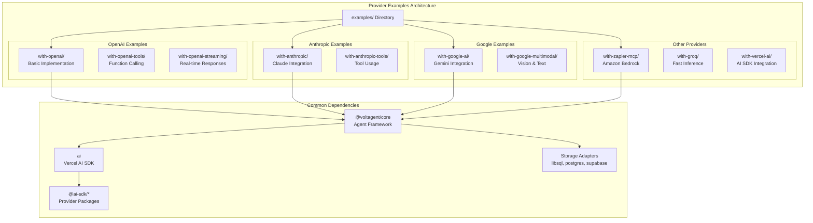
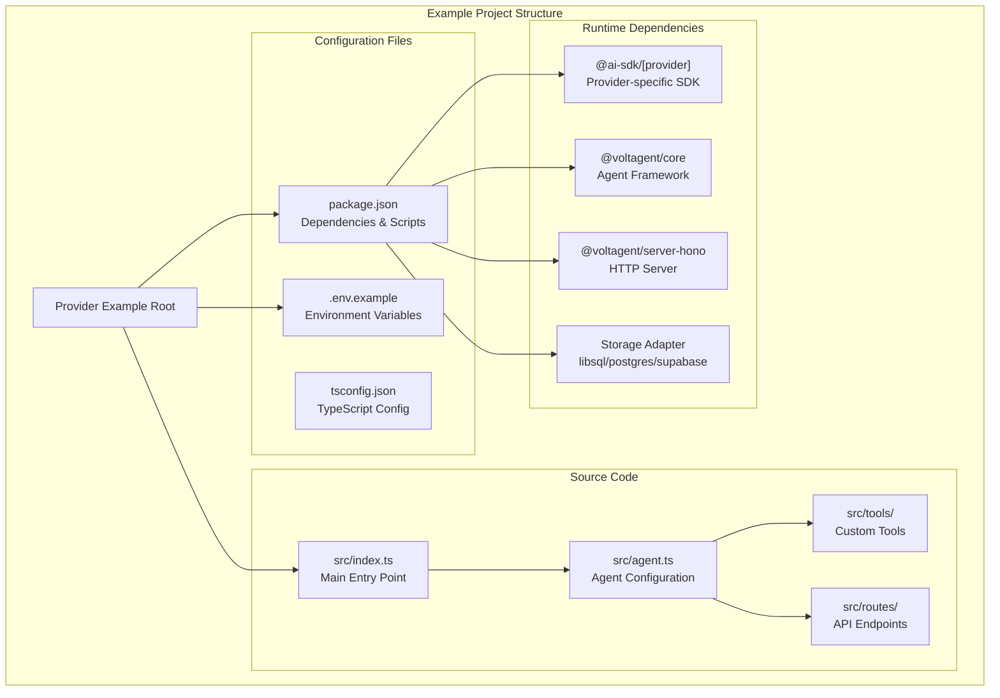
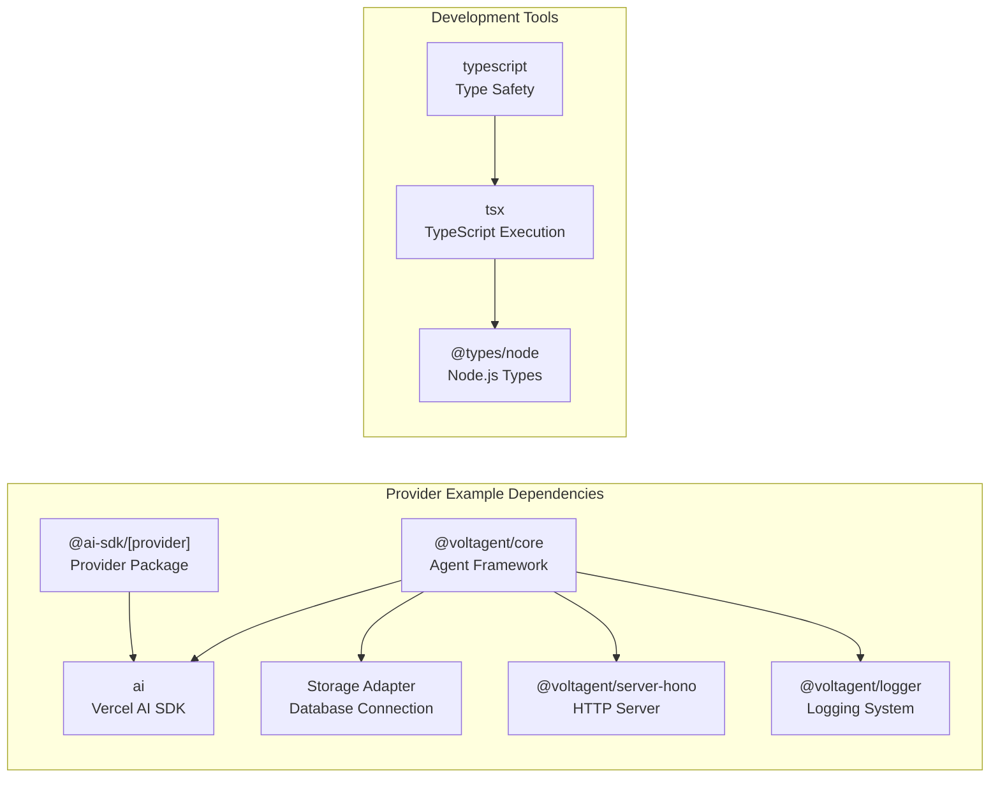

<!-- source: DeepWiki mcp.deepwiki.com · repo voltagent/voltagent · page 9.2 AI Provider Examples · fetched 2026-10-27 -->

# AI Provider Examples

<details>
<summary>Relevant source files</summary>

The following files were used as context for generating this wiki page:

- [examples/base/package.json](examples/base/package.json)
- [examples/github-repo-analyzer/package.json](examples/github-repo-analyzer/package.json)
- [examples/with-google-ai/package.json](examples/with-google-ai/package.json)
- [examples/with-google-vertex-ai/package.json](examples/with-google-vertex-ai/package.json)
- [examples/with-groq-ai/package.json](examples/with-groq-ai/package.json)
- [examples/with-mcp/package.json](examples/with-mcp/package.json)
- [examples/with-nextjs/package.json](examples/with-nextjs/package.json)
- [examples/with-rag-chatbot/package.json](examples/with-rag-chatbot/package.json)
- [examples/with-retrieval/package.json](examples/with-retrieval/package.json)
- [examples/with-subagents/package.json](examples/with-subagents/package.json)
- [examples/with-supabase/package.json](examples/with-supabase/package.json)
- [examples/with-tools/package.json](examples/with-tools/package.json)
- [examples/with-vercel-ai/package.json](examples/with-vercel-ai/package.json)
- [examples/with-voice-elevenlabs/package.json](examples/with-voice-elevenlabs/package.json)
- [examples/with-voice-openai/package.json](examples/with-voice-openai/package.json)
- [packages/core/package.json](packages/core/package.json)
- [pnpm-lock.yaml](pnpm-lock.yaml)

</details>


This page provides practical examples demonstrating how to integrate VoltAgent with different LLM providers. Each example shows complete working implementations that you can run locally or use as templates for your own projects.

For general AI provider integration concepts, see [Provider Overview](#3.1). For creating custom provider packages, see [Custom Providers](#3.5).

## Overview

VoltAgent includes a comprehensive set of example applications that demonstrate integration with major AI providers. These examples showcase different provider configurations, authentication methods, and feature sets while maintaining consistent VoltAgent patterns.



Sources: [examples/with-anthropic/package.json:1-33](), [examples/with-zapier-mcp/package.json:1-31]()

## Provider Example Structure

Each provider example follows a consistent structure that makes them easy to understand and modify:



Sources: [examples/with-anthropic/package.json:26-30](), [examples/with-zapier-mcp/package.json:25-29]()

## Anthropic (Claude) Examples

The Anthropic integration demonstrates how to use Claude models with VoltAgent:

### Basic Anthropic Integration

The `with-anthropic` example shows a complete setup using Claude models through the Vercel AI SDK.

**Key Dependencies:**
- `@ai-sdk/anthropic` - Anthropic provider for AI SDK
- `@voltagent/core` - Core agent functionality
- `@voltagent/libsql` - SQLite-based storage
- `@voltagent/server-hono` - HTTP server implementation

**Scripts:**
- `dev` - Development mode with hot reload using `tsx watch`
- `build` - TypeScript compilation
- `start` - Production server
- `volt` - VoltAgent CLI access

Sources: [examples/with-anthropic/package.json:4-12](), [examples/with-anthropic/package.json:26-30]()

### Configuration Pattern

Anthropic examples typically follow this configuration pattern:

1. **Environment Variables** - API key and model configuration
2. **Provider Setup** - Initialize Anthropic SDK with credentials
3. **Agent Creation** - Configure VoltAgent with Anthropic models
4. **Storage Integration** - Connect to LibSQL or other storage adapters
5. **Server Setup** - Deploy HTTP endpoints for agent interaction

## Amazon Bedrock Examples

The `with-zapier-mcp` example demonstrates Amazon Bedrock integration, showcasing enterprise-grade AI capabilities:

### Bedrock Configuration

The Bedrock example uses AWS credentials and the Bedrock provider:

**Key Dependencies:**
- `@ai-sdk/amazon-bedrock` - Bedrock provider for AI SDK
- `@aws-sdk/credential-providers` - AWS authentication
- `@voltagent/core` - Agent framework
- `@voltagent/libsql` - Local database storage

**AWS Integration:**
The example shows how to configure AWS credentials and use Bedrock models with VoltAgent's standard agent patterns.

Sources: [examples/with-zapier-mcp/package.json:7-14]()

## Common Implementation Patterns

All provider examples share these implementation patterns:

### 1. Dependency Management



### 2. Script Configuration

All examples provide consistent npm scripts:
- `dev` - Development with file watching and environment loading
- `build` - TypeScript compilation for production
- `start` - Run compiled JavaScript in production
- `volt` - Access to VoltAgent CLI tools

### 3. Environment Configuration

Each example includes environment variable setup for:
- Provider API keys
- Model selection
- Database connection strings
- Server configuration options

Sources: [examples/with-anthropic/package.json:26-30](), [examples/with-zapier-mcp/package.json:25-29]()

## Running Provider Examples

To run any provider example:

1. **Install Dependencies:**
   ```bash
   npm install
   ```

2. **Configure Environment:**
   Copy `.env.example` to `.env` and fill in provider-specific credentials

3. **Start Development:**
   ```bash
   npm run dev
   ```

4. **Access Agent:**
   The server typically runs on `http://localhost:3000` with standard VoltAgent HTTP endpoints

## Available Provider Examples

| Provider | Example Directory | Key Features |
|----------|------------------|--------------|
| OpenAI | `with-openai` | GPT models, function calling |
| Anthropic | `with-anthropic` | Claude models, conversation |
| Google AI | `with-google-ai` | Gemini models, multimodal |
| Amazon Bedrock | `with-zapier-mcp` | Enterprise AI, AWS integration |
| Groq | `with-groq` | Fast inference, optimized models |
| Vercel AI | `with-vercel-ai` | AI SDK integration patterns |

Each example demonstrates provider-specific configuration while maintaining VoltAgent's unified agent interface and workflow capabilities.

Sources: [examples/with-anthropic/package.json:1-33](), [examples/with-zapier-mcp/package.json:1-31]()

---

