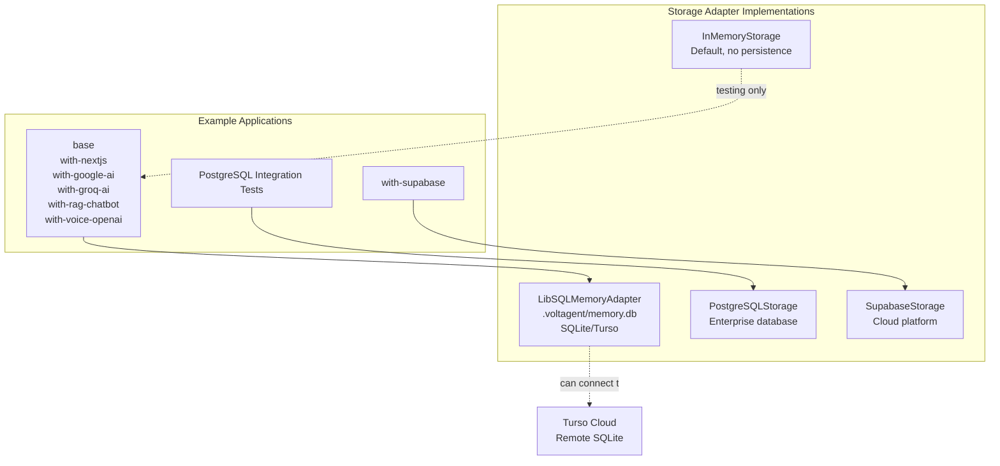
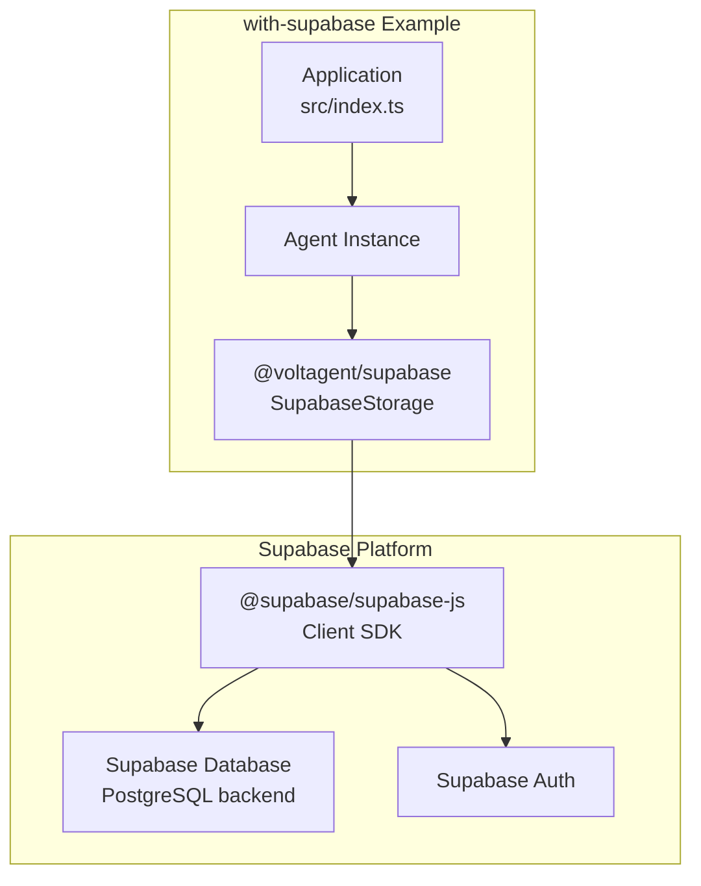
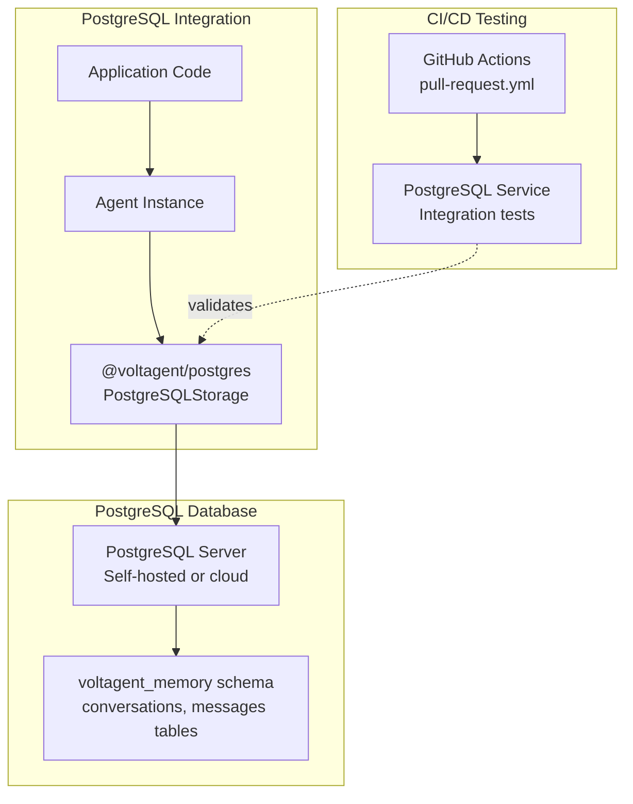
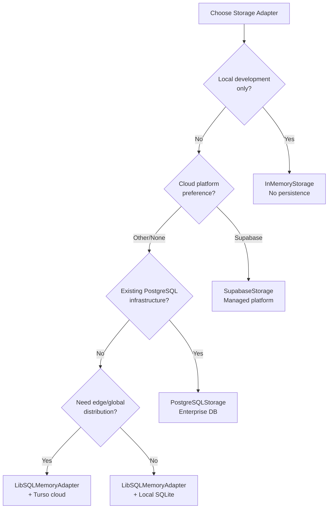
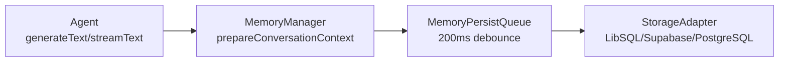

<!-- source: DeepWiki mcp.deepwiki.com · repo voltagent/voltagent · page 9.3 Database Integration Examples · fetched 2026-10-27 -->

# Database Integration Examples

<details>
<summary>Relevant source files</summary>

The following files were used as context for generating this wiki page:

- [examples/base/package.json](examples/base/package.json)
- [examples/github-repo-analyzer/package.json](examples/github-repo-analyzer/package.json)
- [examples/with-google-ai/package.json](examples/with-google-ai/package.json)
- [examples/with-google-vertex-ai/package.json](examples/with-google-vertex-ai/package.json)
- [examples/with-groq-ai/package.json](examples/with-groq-ai/package.json)
- [examples/with-mcp/package.json](examples/with-mcp/package.json)
- [examples/with-nextjs/package.json](examples/with-nextjs/package.json)
- [examples/with-rag-chatbot/package.json](examples/with-rag-chatbot/package.json)
- [examples/with-retrieval/package.json](examples/with-retrieval/package.json)
- [examples/with-subagents/package.json](examples/with-subagents/package.json)
- [examples/with-supabase/package.json](examples/with-supabase/package.json)
- [examples/with-tools/package.json](examples/with-tools/package.json)
- [examples/with-vercel-ai/package.json](examples/with-vercel-ai/package.json)
- [examples/with-voice-elevenlabs/package.json](examples/with-voice-elevenlabs/package.json)
- [examples/with-voice-openai/package.json](examples/with-voice-openai/package.json)
- [packages/core/package.json](packages/core/package.json)
- [pnpm-lock.yaml](pnpm-lock.yaml)

</details>


## Purpose and Scope

This document covers the database integration example applications that demonstrate different storage adapters for VoltAgent's Memory V2 architecture. These examples show how to configure and use LibSQL (SQLite/Turso), Supabase, and PostgreSQL as persistence layers for agent conversations and memory.

For details on the Memory V2 architecture and storage adapter interfaces, see [Memory and Persistence](#5). For information on other types of example applications (AI providers, features, deployments), see [AI Provider Examples](#9.2), [Feature Examples](#9.4), and [Deployment Examples](#9.6).

## Database Adapter Overview

VoltAgent supports multiple storage backends through the `StorageAdapter` interface. Each adapter implementation provides conversation persistence, message storage, and optional vector search capabilities.



**Sources**: [pnpm-lock.yaml:108-1173](), Diagram 6 from high-level architecture

## LibSQL Integration (Default Configuration)

### Base Example Structure

The `base` example and most other examples use `@voltagent/libsql` as the default storage adapter. This creates a local SQLite database at `.voltagent/memory.db` for development.

| Example | LibSQL Usage | Additional Features |
|---------|--------------|---------------------|
| `base` | Default local storage | Minimal setup |
| `with-nextjs` | Local `.voltagent/memory.db` | Next.js integration |
| `with-google-ai` | Local storage | Google Gemini provider |
| `with-groq-ai` | Local storage | Groq inference |
| `with-rag-chatbot` | Local + vector search | RAG pattern |
| `with-voice-openai` | Local storage | Voice capabilities |

### Package Dependencies

All LibSQL-based examples include these dependencies:

```
@voltagent/core: ^1.1.26
@voltagent/libsql: ^1.0.7
@voltagent/logger: ^1.0.2
@voltagent/server-hono: ^1.0.18
```

**Sources**: [examples/base/package.json:1-33](), [examples/with-nextjs/package.json:1-40](), [examples/with-google-ai/package.json:1-34](), [examples/with-groq-ai/package.json:1-32]()

### Configuration Pattern

LibSQL configuration typically follows this pattern:

```typescript
// Create LibSQL storage adapter
const storage = new LibSQLMemoryAdapter({
  url: 'file:.voltagent/memory.db'  // Local SQLite
  // OR
  // url: process.env.TURSO_DATABASE_URL,  // Turso cloud
  // authToken: process.env.TURSO_AUTH_TOKEN
});

// Configure agent with memory
const agent = new Agent({
  name: 'my-agent',
  model: openai('gpt-4'),
  memory: {
    userId: 'required-user-id',
    conversationId: 'optional-conversation-id',
    storage: storage
  }
});
```

The LibSQL adapter supports both local SQLite files and remote Turso cloud databases using the same interface.

**Sources**: Diagram 6 from high-level architecture, [examples/base/package.json:1-33]()

### Script Configuration

All LibSQL examples use consistent npm scripts:

| Script | Command | Purpose |
|--------|---------|---------|
| `dev` | `tsx watch --env-file=.env ./src` | Development with hot reload |
| `build` | `tsc` | TypeScript compilation |
| `start` | `node dist/index.js` | Production execution |
| `volt` | `volt` | CLI tools for MCP setup |

**Sources**: [examples/base/package.json:26-31](), [examples/with-google-ai/package.json:26-31]()

## Supabase Integration Example

### Overview

The `with-supabase` example demonstrates integration with Supabase's cloud platform, including authentication and the `@voltagent/supabase` storage adapter.



### Package Dependencies

The Supabase example includes these specific dependencies:

```
@voltagent/supabase: ^1.0.4
@supabase/supabase-js: ^2.49.4
```

Unlike LibSQL examples, this does NOT include `@voltagent/libsql`, demonstrating a complete swap of storage backends.

**Sources**: [examples/with-supabase/package.json:1-35](), [pnpm-lock.yaml:1-35]()

### Configuration Differences

Key differences from LibSQL examples:

1. **Storage Adapter**: Uses `@voltagent/supabase` instead of `@voltagent/libsql`
2. **Client SDK**: Requires `@supabase/supabase-js` for cloud platform access
3. **Authentication**: Can integrate Supabase's built-in auth with agent `userId`
4. **Cloud-Native**: No local database file; all data stored in Supabase cloud

### Environment Variables

Supabase examples require cloud platform credentials:

```
SUPABASE_URL=https://your-project.supabase.co
SUPABASE_ANON_KEY=your-anon-key
SUPABASE_SERVICE_ROLE_KEY=your-service-role-key (optional)
```

**Sources**: [examples/with-supabase/package.json:1-35]()

### Use Cases

The Supabase integration is ideal for:

- **Cloud-first applications**: No local database management
- **Multi-tenant systems**: Leverage Supabase Row Level Security
- **Real-time features**: Access to Supabase Realtime subscriptions
- **Managed infrastructure**: Automatic backups, scaling, migrations

**Sources**: Diagram 2 from high-level architecture, [examples/with-supabase/package.json:1-35]()

## PostgreSQL Integration

### PostgreSQL Adapter Package

While there isn't a dedicated `with-postgres` example in the examples directory, the `@voltagent/postgres` package provides enterprise PostgreSQL support.



### Testing Infrastructure

PostgreSQL integration is validated through CI/CD pipeline tests, as indicated in the monorepo's GitHub Actions workflows. The tests run conditionally when PostgreSQL-related code changes.

**Sources**: Diagram 5 from high-level architecture, [pnpm-lock.yaml:1-35]()

### Enterprise Deployment Pattern

PostgreSQL integration follows this configuration pattern:

```typescript
// PostgreSQL storage adapter
const storage = new PostgreSQLStorage({
  connectionString: process.env.DATABASE_URL,
  // Optional pool configuration
  max: 20,
  idleTimeoutMillis: 30000
});

// Agent with PostgreSQL memory
const agent = new Agent({
  name: 'enterprise-agent',
  model: openai('gpt-4'),
  memory: {
    userId: userId,
    conversationId: conversationId,
    storage: storage
  }
});
```

### PostgreSQL Use Cases

The PostgreSQL adapter is designed for:

- **Enterprise deployments**: Existing PostgreSQL infrastructure
- **High-scale applications**: Advanced connection pooling
- **Compliance requirements**: On-premise or specific cloud regions
- **Advanced queries**: Direct SQL access to conversation data

**Sources**: Diagram 6 from high-level architecture

## Storage Adapter Comparison

### Feature Matrix

| Adapter | Local Development | Production Ready | Cloud Native | Vector Search | Complexity |
|---------|------------------|------------------|--------------|---------------|------------|
| `InMemoryStorage` | ✅ | ❌ | N/A | ❌ | Minimal |
| `LibSQLMemoryAdapter` | ✅ | ✅ (Turso) | ✅ (Turso) | ✅ | Low |
| `SupabaseStorage` | ✅ | ✅ | ✅ | ✅ | Medium |
| `PostgreSQLStorage` | ✅ | ✅ | ✅ | ✅ | Medium |

### Selection Guide



### Migration Between Adapters

All storage adapters implement the same `StorageAdapter` interface, enabling migration by:

1. Changing the adapter instantiation
2. Updating environment variables
3. No code changes to agent configuration

```typescript
// From LibSQL
const storage = new LibSQLMemoryAdapter({ url: 'file:.voltagent/memory.db' });

// To Supabase (same interface)
const storage = new SupabaseStorage({ 
  url: process.env.SUPABASE_URL,
  key: process.env.SUPABASE_ANON_KEY 
});

// Agent configuration unchanged
const agent = new Agent({
  memory: { userId, storage }  // Same pattern
});
```

**Sources**: Diagram 6 from high-level architecture

## Common Configuration Patterns

### Memory V2 Architecture Integration

All database examples use the Memory V2 architecture with these components:



### Required Memory Configuration

All examples require `userId` in memory configuration:

```typescript
// ✅ Correct - userId is required
memory: {
  userId: 'user-123',           // REQUIRED
  conversationId: 'conv-456',   // Optional
  storage: storageAdapter
}

// ❌ Incorrect - missing userId
memory: {
  storage: storageAdapter  // Will fail validation
}
```

**Sources**: Diagram 6 from high-level architecture, [packages/core/package.json:1-78]()

### Vector Search Integration

Examples with RAG capabilities (e.g., `with-rag-chatbot`) configure optional vector search:

```typescript
const storage = new LibSQLMemoryAdapter({
  url: 'file:.voltagent/memory.db'
});

const vectorAdapter = new LibSQLVectorAdapter({
  storage: storage
});

const embeddingAdapter = new AiSdkEmbeddingAdapter({
  model: openai.embedding('text-embedding-3-small')
});

const agent = new Agent({
  memory: {
    userId: userId,
    storage: storage,
    vectorAdapter: vectorAdapter,
    embeddingAdapter: embeddingAdapter
  }
});
```

**Sources**: [examples/with-rag-chatbot/package.json:1-31](), Diagram 6 from high-level architecture

## Development Workflow

### Hot Reload Development

All database examples support live development with `tsx` watch mode:

```bash
# Development with hot reload
pnpm dev

# Compiles TypeScript on file changes
# Loads environment from .env file
# Restarts on code modifications
```

The `dev` script pattern: `tsx watch --env-file=.env ./src`

**Sources**: [examples/base/package.json:28](), [examples/with-supabase/package.json:29](), [examples/with-google-ai/package.json:28]()

### Environment Configuration

All examples use `.env` files for configuration:

```env
# OpenAI API (most examples)
OPENAI_API_KEY=sk-...

# LibSQL/Turso (optional cloud)
TURSO_DATABASE_URL=libsql://...
TURSO_AUTH_TOKEN=...

# Supabase (with-supabase)
SUPABASE_URL=https://...
SUPABASE_ANON_KEY=...

# PostgreSQL (enterprise)
DATABASE_URL=postgresql://...
```

### Database File Location

LibSQL examples create the database at `.voltagent/memory.db` relative to the project root. This directory should be added to `.gitignore`:

```gitignore
# Local database
.voltagent/
```

**Sources**: Diagram 6 from high-level architecture

## Running Database Examples

### Quick Start: Base Example

```bash
# 1. Navigate to example
cd examples/base

# 2. Install dependencies
pnpm install

# 3. Create .env file
echo "OPENAI_API_KEY=sk-..." > .env

# 4. Run development server
pnpm dev

# 5. Test agent endpoint
curl -X POST http://localhost:3000/agents/assistant/text \
  -H "Content-Type: application/json" \
  -d '{
    "userId": "user-123",
    "message": "Hello, how are you?"
  }'
```

The database file `.voltagent/memory.db` will be created automatically on first use.

**Sources**: [examples/base/package.json:26-31]()

### Quick Start: Supabase Example

```bash
# 1. Navigate to example
cd examples/with-supabase

# 2. Install dependencies
pnpm install

# 3. Configure Supabase credentials
cat > .env << EOF
OPENAI_API_KEY=sk-...
SUPABASE_URL=https://your-project.supabase.co
SUPABASE_ANON_KEY=your-anon-key
EOF

# 4. Run development server
pnpm dev
```

No local database file is created; all data is stored in Supabase cloud.

**Sources**: [examples/with-supabase/package.json:27-32]()

### Verifying Database Persistence

Test conversation persistence across restarts:

```bash
# 1. Send first message
curl -X POST http://localhost:3000/agents/assistant/text \
  -H "Content-Type: application/json" \
  -d '{
    "userId": "test-user",
    "conversationId": "test-conv",
    "message": "Remember this: my favorite color is blue"
  }'

# 2. Restart the server
# Ctrl+C to stop
pnpm dev

# 3. Send follow-up message
curl -X POST http://localhost:3000/agents/assistant/text \
  -H "Content-Type: application/json" \
  -d '{
    "userId": "test-user",
    "conversationId": "test-conv",
    "message": "What is my favorite color?"
  }'
# Agent should recall "blue" from persisted memory
```

**Sources**: Diagram 6 from high-level architecture

## Summary

Database integration examples demonstrate VoltAgent's flexible storage adapter architecture:

- **LibSQL** (`@voltagent/libsql`): Default adapter for most examples, supports local SQLite and Turso cloud
- **Supabase** (`@voltagent/supabase`): Cloud-native platform with authentication integration
- **PostgreSQL** (`@voltagent/postgres`): Enterprise database for production deployments

All adapters implement the same `StorageAdapter` interface, enabling easy migration and consistent memory management through the Memory V2 architecture.

**Sources**: [pnpm-lock.yaml:108-1173](), [examples/base/package.json:1-33](), [examples/with-supabase/package.json:1-35](), Diagrams 2, 5, and 6 from high-level architecture

---

