<!-- source: DeepWiki mcp.deepwiki.com · repo voltagent/voltagent · page 9.4 Feature Examples · fetched 2026-10-27 -->

# Feature Examples

<details>
<summary>Relevant source files</summary>

The following files were used as context for generating this wiki page:

- [examples/base/package.json](examples/base/package.json)
- [examples/github-repo-analyzer/package.json](examples/github-repo-analyzer/package.json)
- [examples/with-google-ai/package.json](examples/with-google-ai/package.json)
- [examples/with-google-vertex-ai/package.json](examples/with-google-vertex-ai/package.json)
- [examples/with-groq-ai/package.json](examples/with-groq-ai/package.json)
- [examples/with-mcp/package.json](examples/with-mcp/package.json)
- [examples/with-nextjs/package.json](examples/with-nextjs/package.json)
- [examples/with-rag-chatbot/package.json](examples/with-rag-chatbot/package.json)
- [examples/with-retrieval/package.json](examples/with-retrieval/package.json)
- [examples/with-subagents/package.json](examples/with-subagents/package.json)
- [examples/with-supabase/package.json](examples/with-supabase/package.json)
- [examples/with-tools/package.json](examples/with-tools/package.json)
- [examples/with-vercel-ai/package.json](examples/with-vercel-ai/package.json)
- [examples/with-voice-elevenlabs/package.json](examples/with-voice-elevenlabs/package.json)
- [examples/with-voice-openai/package.json](examples/with-voice-openai/package.json)
- [packages/core/package.json](packages/core/package.json)
- [pnpm-lock.yaml](pnpm-lock.yaml)

</details>


This page documents example applications that demonstrate specific VoltAgent features and capabilities. These examples focus on core framework functionality including Model Context Protocol (MCP) integration, multi-agent coordination with subagents, Retrieval-Augmented Generation (RAG), tool execution, lifecycle hooks, and dynamic configuration patterns. For AI provider-specific examples, see [AI Provider Examples](#9.2). For database integration examples, see [Database Integration Examples](#9.3). For deployment-specific examples, see [Deployment Examples](#9.6).

## Overview of Feature Examples

The feature examples demonstrate VoltAgent's extensibility through six primary categories: protocol integration (MCP), agent orchestration (subagents), knowledge augmentation (RAG/retrieval), tool execution, lifecycle management (hooks), and dynamic runtime configuration.

### Feature Example Categories

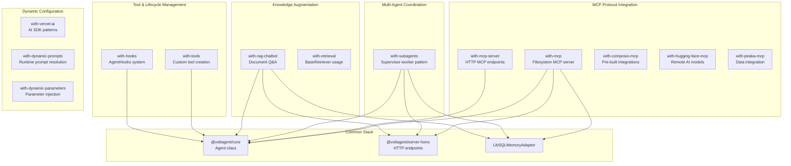

**Sources:** [examples/with-mcp/package.json:1-29](), [examples/with-subagents/package.json:1-34](), [examples/with-rag-chatbot/package.json:1-31](), [examples/with-tools/package.json:1-34](), [examples/with-retrieval/package.json:1-34](), [examples/with-vercel-ai/package.json:1-33]()

### Common Example Structure

All feature examples follow a standardized structure with consistent dependencies and scripts:

| Aspect | Configuration |
|--------|--------------|
| **Core Dependencies** | `@voltagent/core`, `@voltagent/server-hono`, `@voltagent/logger`, `ai`, `zod` |
| **Storage** | `@voltagent/libsql` (local development with `.voltagent/memory.db`) |
| **Development** | `tsx watch --env-file=.env ./src` (hot reload) |
| **Build** | `tsc` (TypeScript compilation to `dist/`) |
| **Production** | `node dist/index.js` |
| **CLI** | `volt` command (via `@voltagent/cli`) |

**Sources:** [examples/base/package.json:1-33](), [examples/with-mcp/package.json:1-29](), [examples/with-subagents/package.json:1-34]()

## MCP Integration Examples

Model Context Protocol (MCP) examples demonstrate how agents can access external tools and resources through stdio-based or HTTP-based MCP servers. The framework provides automatic tool discovery and integration through `MCPConfiguration`.

### with-mcp: Filesystem MCP Server

The basic MCP example integrates a local filesystem MCP server, allowing agents to read, write, and list files through standardized MCP tools.

**Key Features:**
- stdio-based MCP server process management
- Automatic tool exposure (`read_file`, `write_file`, `list_directory`)
- Local filesystem access with configurable allowed directories

**Architecture:**

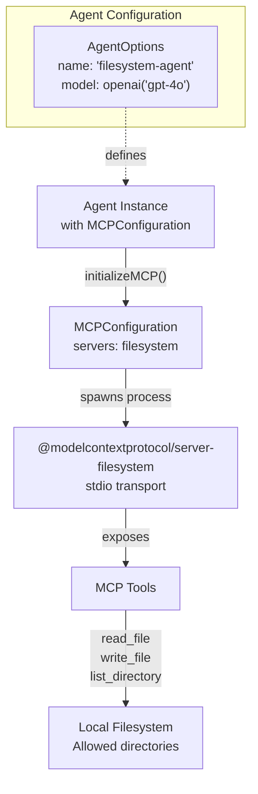

**Configuration Pattern:**

```typescript
// MCP configuration in src/index.ts
const mcpConfiguration = {
  servers: {
    filesystem: {
      command: "npx",
      args: [
        "-y",
        "@modelcontextprotocol/server-filesystem@0.6.1",
        "/allowed/directory"
      ]
    }
  }
};

// Automatic initialization via VoltAgent
const server = new VoltAgent({
  agents: [filesystemAgent],
  mcp: mcpConfiguration
});
```

**Sources:** [examples/with-mcp/package.json:1-29]()

### with-mcp-server: HTTP MCP Endpoints

This example exposes agents as MCP servers over HTTP/SSE, allowing other agents or applications to discover and use them as tools.

**Key Features:**
- HTTP and SSE transport for MCP protocol
- Automatic tool listing via `tools/list` endpoint
- Request/response streaming for long-running operations
- Integration with `@voltagent/mcp-server` package

**Architecture:**

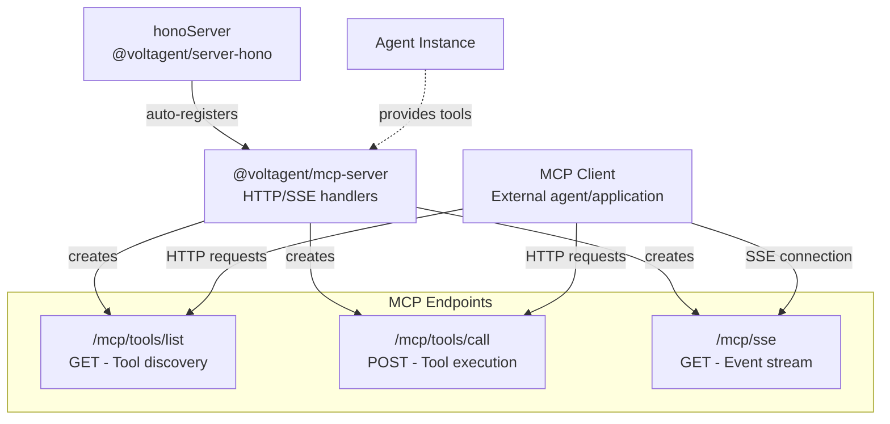

**Sources:** [examples/with-mcp-server/package.json:37-69](), [pnpm-lock.yaml:1037-1069]()

### Additional MCP Examples

| Example | Description | MCP Server Type |
|---------|-------------|-----------------|
| **with-composio-mcp** | Pre-built integrations for 100+ services (GitHub, Slack, etc.) via Composio | HTTP remote |
| **with-hugging-face-mcp** | Access Hugging Face models and datasets remotely | HTTP remote |
| **with-peaka-mcp** | Database and API integration through Peaka MCP server | HTTP remote |

**Sources:** [pnpm-lock.yaml:495-530](), [pnpm-lock.yaml:883-918](), [pnpm-lock.yaml:1215-1250]()

## Subagent and Multi-Agent Examples

### with-subagents: Supervisor-Worker Pattern

Demonstrates multi-agent coordination where a supervisor agent delegates tasks to specialized subagents. This pattern implements hierarchical agent orchestration with automatic handoff management.

**Key Features:**
- `SubAgentManager` for automatic subagent coordination
- `delegate_task` tool created automatically for supervisor agent
- Event forwarding between parent and child agents
- Shared conversation context across agent hierarchy

**Multi-Agent Architecture:**

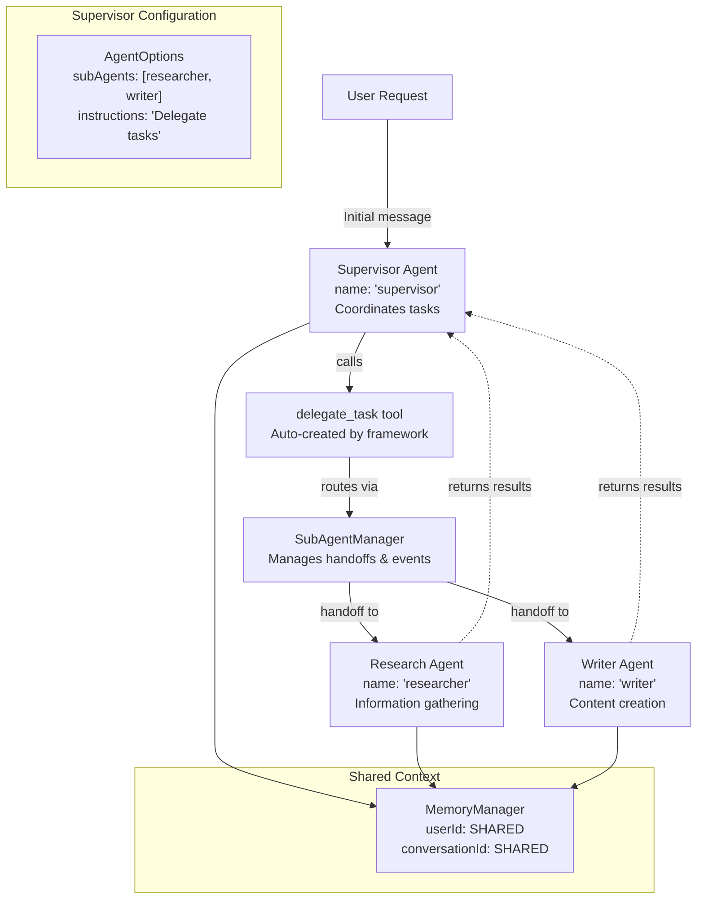

**Configuration Pattern:**

```typescript
// Research subagent
const researcher = new Agent({
  name: "researcher",
  instructions: "You are a research specialist...",
  model: openai("gpt-4o")
});

// Writer subagent
const writer = new Agent({
  name: "writer",
  instructions: "You are a content writer...",
  model: openai("gpt-4o")
});

// Supervisor with subagents
const supervisor = new Agent({
  name: "supervisor",
  instructions: "Coordinate research and writing tasks...",
  model: openai("gpt-4o"),
  subAgents: [researcher, writer]  // Automatically creates delegate_task tool
});
```

**Handoff Flow:**

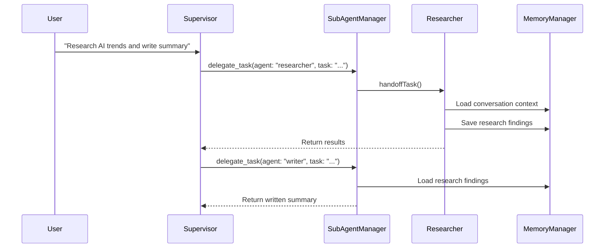

**Sources:** [examples/with-subagents/package.json:1-34]()

## RAG and Retrieval Examples

### with-rag-chatbot: Document Q&A

Implements a complete RAG (Retrieval-Augmented Generation) chatbot that answers questions based on a knowledge base. Demonstrates semantic search integration with conversation memory.

**Key Features:**
- Document ingestion and embedding generation
- Semantic search with configurable similarity thresholds
- Merge strategies for combining recent and semantic messages
- `BaseRetriever` integration for custom retrieval logic

**RAG Architecture:**

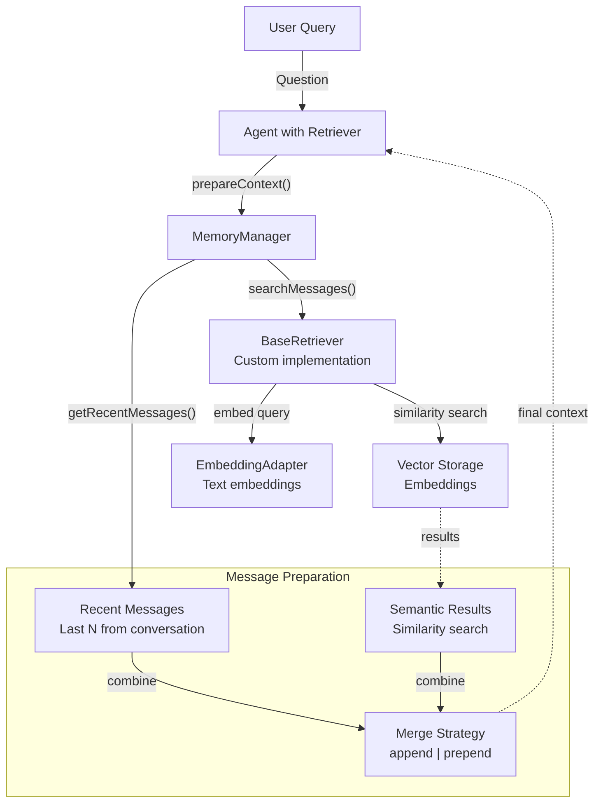

**Configuration Pattern:**

```typescript
// Custom retriever implementation
class DocumentRetriever extends BaseRetriever {
  async retrieve(query: string, options?: RetrievalOptions) {
    // 1. Generate embedding for query
    const queryEmbedding = await this.embeddingAdapter.embed(query);
    
    // 2. Search vector store
    const results = await this.vectorStore.search(queryEmbedding, {
      limit: options?.limit ?? 5,
      threshold: options?.threshold ?? 0.7
    });
    
    // 3. Return formatted results
    return results.map(r => ({
      content: r.document,
      metadata: r.metadata,
      score: r.score
    }));
  }
}

// Agent with retriever
const agent = new Agent({
  name: "rag-chatbot",
  instructions: "Answer questions using the knowledge base...",
  model: openai("gpt-4o"),
  memory: {
    userId: "user-123",
    storage: memoryAdapter,
    retriever: new DocumentRetriever({
      vectorAdapter: vectorStore,
      embeddingAdapter: embeddingModel
    }),
    retrievalOptions: {
      limit: 5,
      threshold: 0.7,
      mergeStrategy: "prepend"  // Semantic results before recent
    }
  }
});
```

**Sources:** [examples/with-rag-chatbot/package.json:1-31]()

### with-retrieval: BaseRetriever Usage

Demonstrates direct usage of the `BaseRetriever` interface for custom retrieval implementations without full RAG setup.

**Key Features:**
- `BaseRetriever` abstract class implementation
- Custom retrieval logic (database queries, API calls, etc.)
- Integration with `MemoryManager.searchMessages()`
- Configurable retrieval options per request

**Retrieval Integration:**

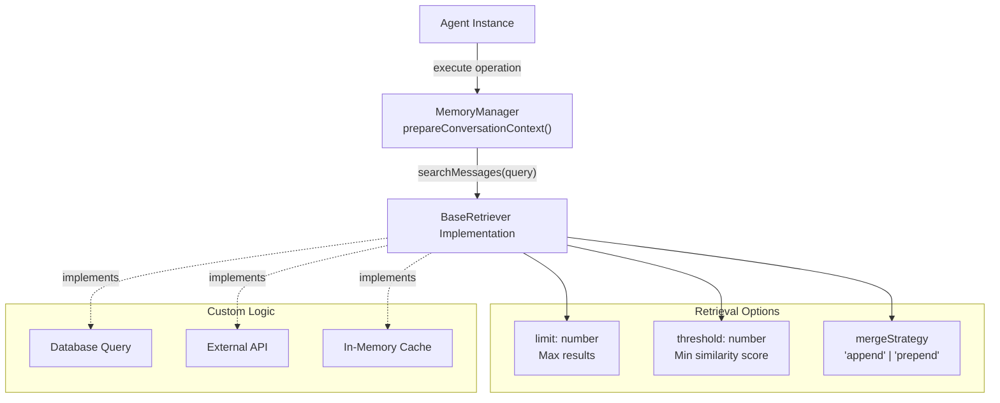

**Sources:** [examples/with-retrieval/package.json:1-34]()

## Tool Examples

### with-tools: Custom Tool Creation

Demonstrates the `createTool` utility for defining custom agent tools with type-safe parameters and execution logic.

**Key Features:**
- `createTool` function with Zod schema validation
- Tool execution with `OperationContext` access
- Error handling with `ToolDeniedError`
- Tool result typing and validation

**Tool Creation Pattern:**

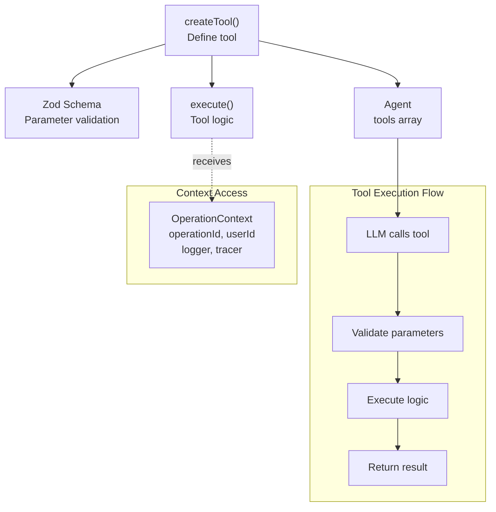

**Tool Definition Example:**

```typescript
import { createTool } from "@voltagent/core";
import { z } from "zod";

// Define tool with schema and execution
const weatherTool = createTool({
  name: "get_weather",
  description: "Get weather for a location",
  parameters: z.object({
    location: z.string().describe("City name"),
    units: z.enum(["celsius", "fahrenheit"]).optional()
  }),
  execute: async ({ location, units }, context) => {
    // Access operation context
    context.logger.info("Fetching weather", { location });
    
    // Tool logic
    const response = await fetch(
      `https://api.weather.com?location=${location}&units=${units ?? "celsius"}`
    );
    
    if (!response.ok) {
      throw new Error("Weather API failed");
    }
    
    const data = await response.json();
    
    // Typed return value
    return {
      temperature: data.temp,
      conditions: data.conditions,
      units: units ?? "celsius"
    };
  }
});

// Add to agent
const agent = new Agent({
  name: "weather-agent",
  tools: [weatherTool],
  model: openai("gpt-4o")
});
```

**Tool Execution with Context:**

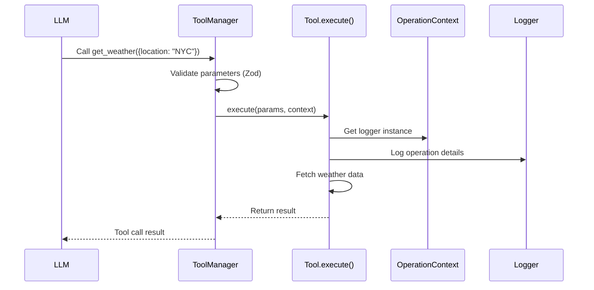

**Sources:** [examples/with-tools/package.json:1-34]()

## Lifecycle and Hooks Examples

### with-hooks: AgentHooks System

Demonstrates the complete lifecycle hook system for intercepting and augmenting agent behavior at various execution stages.

**Key Features:**
- 8 lifecycle hooks (`onStart`, `onEnd`, `onToolStart`, `onToolEnd`, `onHandoff`, `onPrepareMessages`, `onError`, `onFinish`)
- Hook execution order and async support
- Context modification capabilities
- Error handling and retry logic

**Hook Lifecycle:**

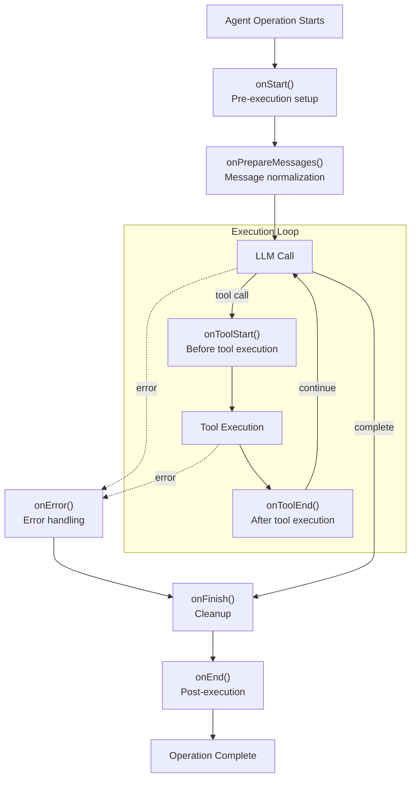

**Hook Implementation Pattern:**

```typescript
import { createHooks } from "@voltagent/core";

const loggingHooks = createHooks({
  // Called at operation start
  onStart: async (context) => {
    context.logger.info("Operation started", {
      operationId: context.operationId,
      userId: context.userId
    });
  },
  
  // Called before messages sent to LLM
  onPrepareMessages: async (messages, context) => {
    context.logger.debug("Preparing messages", {
      count: messages.length
    });
    
    // Optionally modify messages
    return messages;
  },
  
  // Called before tool execution
  onToolStart: async (tool, args, context) => {
    context.logger.info("Tool starting", {
      tool: tool.name,
      args
    });
  },
  
  // Called after tool execution
  onToolEnd: async (tool, result, context) => {
    context.logger.info("Tool completed", {
      tool: tool.name,
      success: true
    });
  },
  
  // Called on errors
  onError: async (error, context) => {
    context.logger.error("Operation error", {
      error: error.message,
      stack: error.stack
    });
  },
  
  // Called at operation end
  onEnd: async (result, context) => {
    context.logger.info("Operation completed", {
      operationId: context.operationId,
      duration: Date.now() - context.startTime
    });
  }
});

// Apply hooks to agent
const agent = new Agent({
  name: "logging-agent",
  hooks: loggingHooks,
  model: openai("gpt-4o")
});
```

**Hook Execution Order:**

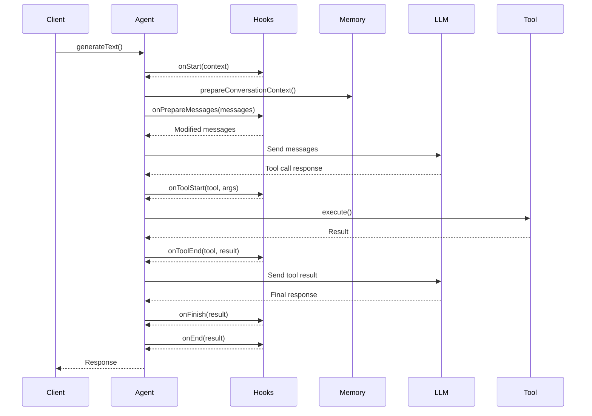

**Sources:** [examples/with-hooks/package.json:846-881]()

## Dynamic Configuration Examples

### with-vercel-ai: AI SDK Integration Patterns

Demonstrates direct usage of Vercel AI SDK features alongside VoltAgent, showing interoperability patterns.

**Key Features:**
- Direct AI SDK `generateText` and `streamText` usage
- Tool sharing between AI SDK and VoltAgent agents
- Structured output with `generateObject`
- Streaming response handling

**Sources:** [examples/with-vercel-ai/package.json:1-33]()

### with-dynamic-prompts: Runtime Prompt Resolution

Shows dynamic prompt/instruction resolution using `DynamicValue` pattern and VoltOps integration for centralized prompt management.

**Key Features:**
- `DynamicValue<string>` for instructions field
- Runtime prompt resolution based on context
- VoltOps prompt versioning integration
- A/B testing support for prompts

**Dynamic Resolution Pattern:**

```typescript
import { Agent, DynamicValue } from "@voltagent/core";

// Dynamic instructions based on user tier
const dynamicInstructions: DynamicValue<string> = async (context) => {
  const userTier = context.get("userTier");
  
  if (userTier === "premium") {
    return "You are a premium assistant with access to all features...";
  } else {
    return "You are a standard assistant with basic features...";
  }
};

const agent = new Agent({
  name: "dynamic-agent",
  instructions: dynamicInstructions,  // Resolved at runtime
  model: openai("gpt-4o")
});
```

**Sources:** [pnpm-lock.yaml:606-641]()

### with-dynamic-parameters: Parameter Injection

Demonstrates runtime parameter resolution for temperature, max tokens, and other model settings based on execution context.

**Key Features:**
- `DynamicValue<number>` for temperature, maxTokens
- Context-based parameter selection
- Cost optimization based on query complexity
- User preference integration

**Sources:** [pnpm-lock.yaml:569-604]()

## Example Dependency Matrix

| Example | Core | Server | Memory | MCP | Voice | Special Dependencies |
|---------|------|--------|--------|-----|-------|---------------------|
| with-mcp | ✓ | ✓ | LibSQL | ✓ | - | `@modelcontextprotocol/sdk` |
| with-mcp-server | ✓ | ✓ | - | ✓ | - | `@voltagent/mcp-server` |
| with-subagents | ✓ | ✓ | LibSQL | - | - | - |
| with-rag-chatbot | ✓ | ✓ | LibSQL | - | - | Vector adapter (custom) |
| with-retrieval | ✓ | ✓ | LibSQL | - | - | `BaseRetriever` impl |
| with-tools | ✓ | ✓ | LibSQL | - | - | - |
| with-hooks | ✓ | ✓ | LibSQL | - | - | - |
| with-vercel-ai | ✓ | ✓ | LibSQL | - | - | Direct AI SDK usage |
| with-composio-mcp | ✓ | ✓ | LibSQL | ✓ | - | `composio-core` |
| with-hugging-face-mcp | ✓ | ✓ | LibSQL | ✓ | - | HF MCP server |

**Sources:** [examples/with-mcp/package.json:1-29](), [examples/with-subagents/package.json:1-34](), [examples/with-rag-chatbot/package.json:1-31](), [examples/with-tools/package.json:1-34](), [examples/with-hooks/package.json:846-881]()

## Running Feature Examples

All feature examples use consistent npm scripts for development and deployment:

```bash
# Development (hot reload)
pnpm dev

# Production build
pnpm build

# Start production server
pnpm start

# VoltAgent CLI commands
pnpm volt mcp setup
pnpm volt mcp test
```

**Environment Configuration:**

Each example requires a `.env` file with provider-specific API keys:

```bash
# OpenAI examples
OPENAI_API_KEY=sk-...

# VoltOps integration (optional)
VOLTAGENT_API_KEY=va_...

# MCP-specific
# (Configuration in mcp.json for stdio servers)
```

**Sources:** [examples/base/package.json:26-31](), [examples/with-mcp/package.json:22-30]()

---

