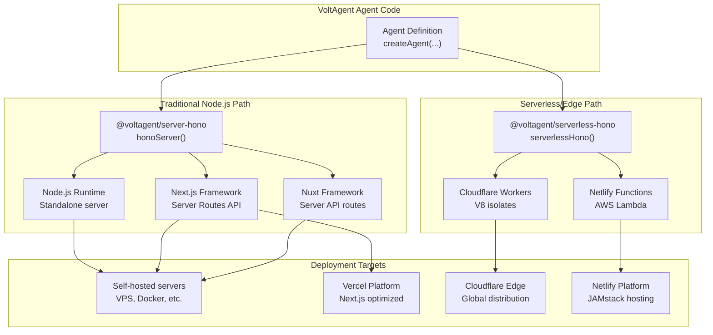
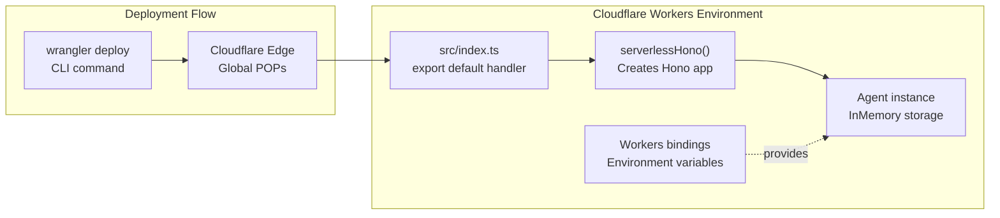
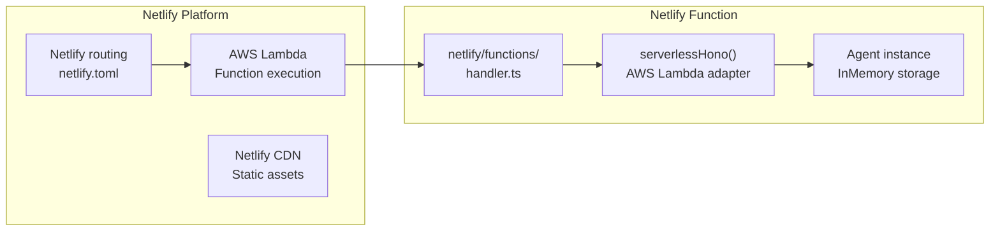
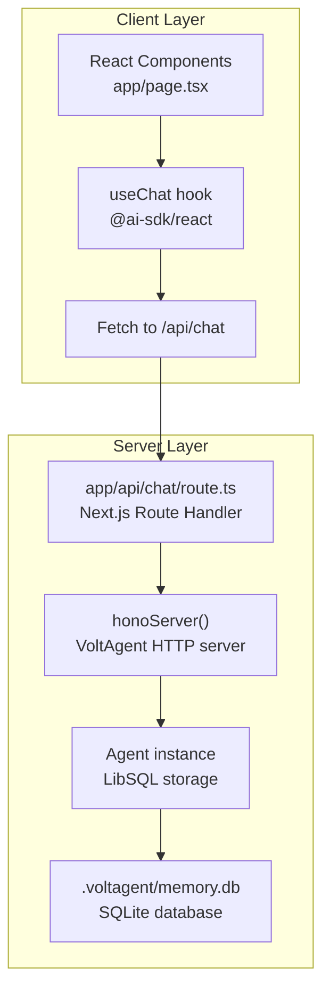
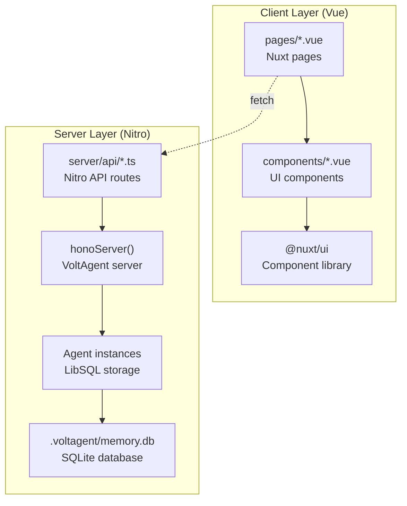
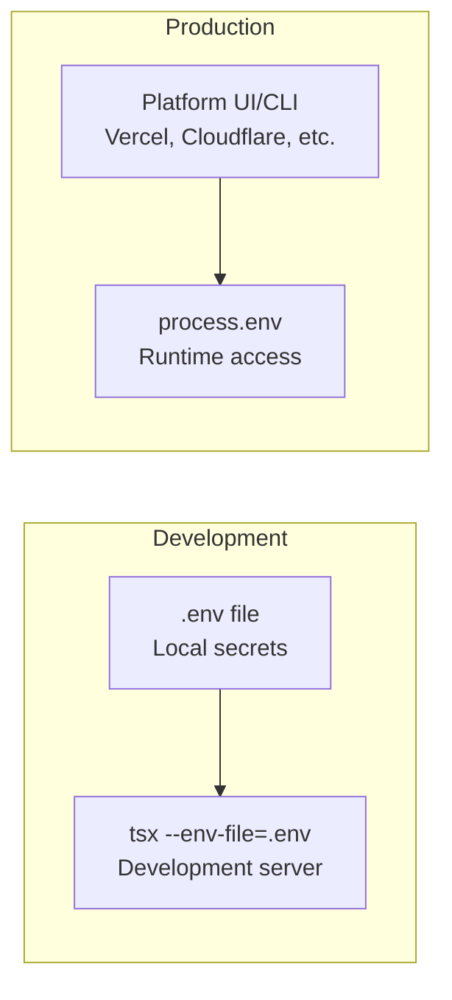

<!-- source: DeepWiki mcp.deepwiki.com · repo voltagent/voltagent · page 9.6 Deployment Examples · fetched 2026-10-27 -->

# Deployment Examples

<details>
<summary>Relevant source files</summary>

The following files were used as context for generating this wiki page:

- [examples/base/package.json](examples/base/package.json)
- [examples/github-repo-analyzer/package.json](examples/github-repo-analyzer/package.json)
- [examples/with-google-ai/package.json](examples/with-google-ai/package.json)
- [examples/with-google-vertex-ai/package.json](examples/with-google-vertex-ai/package.json)
- [examples/with-groq-ai/package.json](examples/with-groq-ai/package.json)
- [examples/with-mcp/package.json](examples/with-mcp/package.json)
- [examples/with-nextjs/package.json](examples/with-nextjs/package.json)
- [examples/with-rag-chatbot/package.json](examples/with-rag-chatbot/package.json)
- [examples/with-retrieval/package.json](examples/with-retrieval/package.json)
- [examples/with-subagents/package.json](examples/with-subagents/package.json)
- [examples/with-supabase/package.json](examples/with-supabase/package.json)
- [examples/with-tools/package.json](examples/with-tools/package.json)
- [examples/with-vercel-ai/package.json](examples/with-vercel-ai/package.json)
- [examples/with-voice-elevenlabs/package.json](examples/with-voice-elevenlabs/package.json)
- [examples/with-voice-openai/package.json](examples/with-voice-openai/package.json)
- [packages/core/package.json](packages/core/package.json)
- [pnpm-lock.yaml](pnpm-lock.yaml)

</details>


This page documents the deployment-focused examples in the VoltAgent repository, demonstrating how to deploy VoltAgent agents across different hosting platforms and web frameworks. These examples showcase the framework's deployment flexibility through two primary patterns: serverless/edge runtimes and full-stack framework integrations.

For information about other example categories, see [Example Structure and Scripts](#9.1), [AI Provider Examples](#9.2), and [Feature Examples](#9.4). For server architecture details, see [Server Architecture](#4.1) and [Serverless Deployment](#4.3).

## Deployment Architecture Overview

VoltAgent supports two distinct deployment patterns, each with its own server package and configuration approach:



**Sources**: [pnpm-lock.yaml:461-493](), [pnpm-lock.yaml:1071-1100](), [pnpm-lock.yaml:1102-1173](), [pnpm-lock.yaml:1175-1213]()

## Serverless Deployments

### Cloudflare Workers Example

**Location**: `examples/with-cloudflare-workers`

The Cloudflare Workers example demonstrates deploying VoltAgent agents to Cloudflare's edge network using V8 isolates, enabling global distribution with minimal cold start times.

#### Package Configuration

| Dependency | Version | Purpose |
|------------|---------|---------|
| `@voltagent/core` | ^1.1.26 | Agent orchestration |
| `@voltagent/serverless-hono` | ^1.0.3 | Serverless adapter |
| `@ai-sdk/openai` | ^2.0.2 | OpenAI provider |
| `hono` | ^4.7.7 | Underlying HTTP framework |
| `wrangler` | ^3.38.0 | Cloudflare CLI (dev dependency) |

**Sources**: [pnpm-lock.yaml:461-493]()

#### Key Characteristics



- **Storage**: Uses `InMemoryStorage` by default (no persistent memory between requests)
- **Runtime**: V8 isolates (no Node.js APIs)
- **Configuration**: Uses `wrangler.toml` for Workers-specific settings
- **Environment**: Accesses secrets via Workers environment bindings
- **Scripts**: `wrangler dev` for local development, `wrangler deploy` for production

**Sources**: [pnpm-lock.yaml:461-493]()

### Netlify Functions Example

**Location**: `examples/with-netlify-functions`

The Netlify Functions example shows deploying VoltAgent to Netlify's serverless function platform (AWS Lambda under the hood).

#### Package Configuration

| Dependency | Version | Purpose |
|------------|---------|---------|
| `@voltagent/core` | ^1.1.26 | Agent orchestration |
| `@voltagent/serverless-hono` | ^1.0.3 | Serverless adapter |
| `@ai-sdk/openai` | ^2.0.2 | OpenAI provider |
| `hono` | ^4.7.7 | HTTP framework |
| `netlify-cli` | ^23.7.3 | Netlify CLI (dev dependency) |

**Sources**: [pnpm-lock.yaml:1071-1100]()

#### Key Characteristics



- **Storage**: Uses `InMemoryStorage` (stateless functions)
- **Configuration**: Uses `netlify.toml` for function settings
- **Cold Starts**: Subject to AWS Lambda cold start behavior
- **Scripts**: `netlify dev` for local development, `netlify deploy` for production
- **Integration**: Can serve alongside static sites

**Sources**: [pnpm-lock.yaml:1071-1100]()

## Framework Deployments

### Next.js Example

**Location**: `examples/with-nextjs`

The Next.js example demonstrates full-stack integration with VoltAgent, including client-side UI components, server-side API routes, and persistent storage.

#### Package Configuration

| Dependency | Version | Purpose |
|------------|---------|---------|
| `@voltagent/core` | ^1.1.26 | Agent orchestration |
| `@voltagent/server-hono` | ^1.0.18 | Traditional HTTP server |
| `@voltagent/libsql` | ^1.0.7 | LibSQL memory adapter |
| `@ai-sdk/react` | ^2.0.8 | React hooks for streaming |
| `next` | 15.3.1 | Next.js framework |
| `react` | ^19.0.0 | React library |
| `tailwindcss` | ^4.1.4 | CSS framework |

**Sources**: [pnpm-lock.yaml:1102-1173](), [examples/with-nextjs/package.json:1-39]()

#### Architecture



**Sources**: [examples/with-nextjs/package.json:1-39]()

#### Key Features

- **Persistent Memory**: Uses LibSQLMemoryAdapter with local SQLite database at `.voltagent/memory.db`
- **Client-Side Streaming**: Uses `useChat` hook from `@ai-sdk/react` for real-time streaming
- **UI Framework**: Tailwind CSS 4.x with `@tailwindcss/postcss` plugin
- **Development**: Turbopack-enabled development server (`next dev --turbopack`)
- **Deployment**: Can deploy to Vercel, self-hosted Node.js, or Docker containers
- **Scripts**:
  - `dev`: Next.js development server with Turbopack
  - `build`: Production build
  - `start`: Production server
  - `volt`: VoltAgent CLI access

**Sources**: [examples/with-nextjs/package.json:1-39]()

### Nuxt Example

**Location**: `examples/with-nuxt`

The Nuxt example shows Vue.js-based full-stack integration with VoltAgent using Nuxt 4.

#### Package Configuration

| Dependency | Version | Purpose |
|------------|---------|---------|
| `@voltagent/core` | ^1.1.26 | Agent orchestration |
| `@voltagent/server-hono` | ^1.0.18 | Traditional HTTP server |
| `@voltagent/libsql` | ^1.0.7 | LibSQL memory adapter |
| `@ai-sdk/openai` | ^2.0.2 | OpenAI provider |
| `nuxt` | ^4.1.2 | Nuxt framework |
| `vue` | ^3.5.22 | Vue.js library |
| `@nuxt/ui` | ^4.0.0 | Nuxt UI components |

**Sources**: [pnpm-lock.yaml:1175-1213](), [examples/with-nuxt/package.json:1-40]()

#### Architecture



**Sources**: [examples/with-nuxt/package.json:1-40]()

#### Key Features

- **SSR Support**: Full server-side rendering with Nuxt
- **Nitro Server**: Uses Nuxt's Nitro server engine for API routes
- **Vue 3 Composition API**: Modern Vue.js patterns with `<script setup>`
- **UI Components**: Pre-built components from `@nuxt/ui`
- **Development**: Nuxt's hot module replacement
- **Deployment**: Can deploy to Vercel, Netlify, Node.js servers, or containerized environments
- **Type Safety**: Full TypeScript support with Vue type checking

**Sources**: [examples/with-nuxt/package.json:1-40]()

## Deployment Comparison

| Example | Runtime | Server Package | Memory Adapter | UI Framework | Build Tool | Primary Use Case |
|---------|---------|----------------|----------------|--------------|------------|------------------|
| **with-cloudflare-workers** | V8 Isolates | `@voltagent/serverless-hono` | InMemory | None | Wrangler | Global edge deployment, minimal latency |
| **with-netlify-functions** | AWS Lambda | `@voltagent/serverless-hono` | InMemory | None | Netlify CLI | Serverless JAMstack sites |
| **with-nextjs** | Node.js | `@voltagent/server-hono` | LibSQL | React | Next.js | Full-stack React apps, SSR |
| **with-nuxt** | Node.js | `@voltagent/server-hono` | LibSQL | Vue.js | Nuxt | Full-stack Vue apps, SSR |

**Sources**: [pnpm-lock.yaml:461-493](), [pnpm-lock.yaml:1071-1100](), [pnpm-lock.yaml:1102-1173](), [pnpm-lock.yaml:1175-1213]()

## Common Deployment Patterns

### Environment Variables

All deployment examples follow a consistent pattern for environment variable management:



**Required Environment Variables**:
- `OPENAI_API_KEY` (or provider-specific key)
- `VOLTAGENT_API_KEY` (optional, for VoltOps integration)
- Database connection strings (for PostgreSQL/Supabase examples)

**Sources**: All example `package.json` files showing `dev` scripts

### Storage Considerations

| Deployment Type | Recommended Storage | Reasoning |
|----------------|---------------------|-----------|
| **Serverless/Edge** | InMemory or external DB (Supabase, Turso) | No local filesystem access |
| **Traditional Node.js** | LibSQL (local) or PostgreSQL | Full filesystem access |
| **Framework (Next.js/Nuxt)** | LibSQL (local) or PostgreSQL | Development convenience, production scalability |

**Sources**: [pnpm-lock.yaml:461-493](), [pnpm-lock.yaml:1071-1100](), [pnpm-lock.yaml:1102-1173]()

### Build and Development Scripts

Standard script patterns across all examples:

| Script | Traditional | Serverless | Framework |
|--------|-------------|------------|-----------|
| `dev` | `tsx watch --env-file=.env ./src` | `wrangler dev` / `netlify dev` | `next dev` / `nuxt dev` |
| `build` | `tsc` | `wrangler deploy` | `next build` / `nuxt build` |
| `start` | `node dist/index.js` | N/A (deployed) | `next start` / `nuxt preview` |
| `volt` | `volt` (CLI access) | N/A | `volt` (CLI access) |

**Sources**: [examples/base/package.json:26-31](), [examples/with-nextjs/package.json:32-38]()

### TypeScript Configuration

All examples use ES modules (`"type": "module"` in `package.json`) and TypeScript 5.8+:

```typescript
// Common tsconfig.json pattern
{
  "compilerOptions": {
    "module": "ESNext",
    "target": "ES2022",
    "moduleResolution": "bundler",
    "strict": true
  }
}
```

**Sources**: [examples/base/package.json:32](), [examples/with-nextjs/package.json:1-39]()

## Running the Examples

### Cloudflare Workers

```bash
cd examples/with-cloudflare-workers
pnpm install
cp .env.example .env  # Add OPENAI_API_KEY
pnpm dev              # Local Workers emulation
pnpm deploy           # Deploy to Cloudflare
```

### Netlify Functions

```bash
cd examples/with-netlify-functions
pnpm install
cp .env.example .env  # Add OPENAI_API_KEY
pnpm dev              # Local Netlify emulation
pnpm deploy           # Deploy to Netlify
```

### Next.js

```bash
cd examples/with-nextjs
pnpm install
cp .env.example .env  # Add OPENAI_API_KEY
pnpm dev              # Next.js dev server (http://localhost:3000)
pnpm build && pnpm start  # Production build
```

### Nuxt

```bash
cd examples/with-nuxt
pnpm install
cp .env.example .env  # Add OPENAI_API_KEY
pnpm dev              # Nuxt dev server (http://localhost:3000)
pnpm build && pnpm preview  # Production build
```

**Sources**: [examples/base/package.json:26-31](), [examples/with-nextjs/package.json:32-38]()

---

