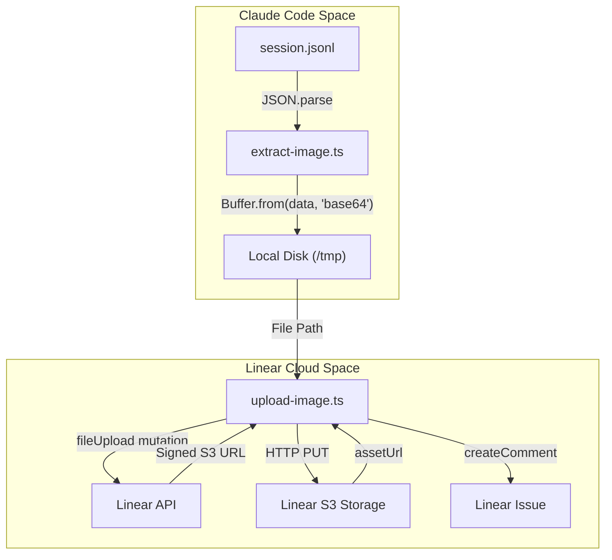
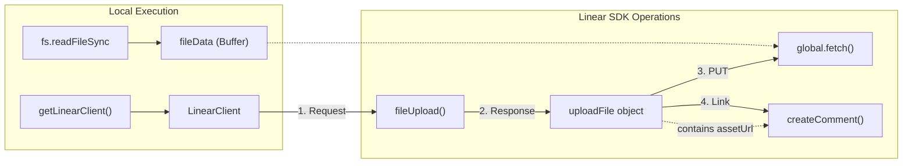

<!-- source: DeepWiki mcp.deepwiki.com · repo wrsmith108/linear-claude-skill · page 2.4 Image Pipeline · fetched 2026-10-27 -->

# Image Pipeline

Relevant source files

The following files were used as context for generating this wiki page:

- [scripts/extract-image.ts](scripts/extract-image.ts)
- [scripts/upload-image.ts](scripts/upload-image.ts)

The Image Pipeline provides a two-stage mechanism for handling visual assets within the `linear-claude-skill` ecosystem. Because Claude Code sessions store images as base64-encoded strings within local JSONL logs rather than discrete files, this pipeline facilitates the extraction of these assets and their subsequent persistence to Linear's cloud storage.

## Pipeline Overview

The pipeline consists of two primary scripts that can be used independently or in sequence:

1.  **`extract-image.ts`**: Parses Claude Code session logs to recover base64 image data and save it as local files.
2.  **`upload-image.ts`**: Orchestrates a multipart upload to Linear's S3-backed storage and optionally links the resulting asset to a specific issue via comments.

### Logical Data Flow

The following diagram illustrates the transition from the Claude Code session state to a persistent Linear asset.

**Title: Image Extraction and Upload Flow**

**Sources:** [scripts/extract-image.ts:48-62](), [scripts/upload-image.ts:72-105](), [scripts/upload-image.ts:132-139]()

---

## Image Extraction (`extract-image.ts`)

Images shared during a Claude Code session are not automatically saved to the filesystem. Instead, they are embedded within the project's session log located in `~/.claude/projects/`. The `extract-image.ts` script iterates through these logs to reconstruct the original image files.

### Key Logic
- **Path Resolution**: Replaces `~` with the user's home directory for cross-platform compatibility [scripts/extract-image.ts:36-36]().
- **JSONL Parsing**: Reads the session file line-by-line, parsing each as a JSON object [scripts/extract-image.ts:49-51]().
- **Content Inspection**: Searches for message content where `type === 'image'` and `source.type === 'base64'` [scripts/extract-image.ts:53-54]().
- **Extension Mapping**: Infers the file extension from the `media_type` (e.g., `image/png` becomes `.png`) [scripts/extract-image.ts:55-55]().

**Sources:** [scripts/extract-image.ts:1-69]()

---

## Image Upload (`upload-image.ts`)

The upload process follows Linear's specific multipart upload protocol, which requires obtaining a pre-signed URL before pushing the binary data to S3.

### Upload Lifecycle

| Step | Action | Implementation Detail |
| :--- | :--- | :--- |
| **1** | **Content Detection** | Maps file extensions to MIME types using `contentTypeMap` [scripts/upload-image.ts:24-32](). |
| **2** | **Request URL** | Calls `client.fileUpload()` with filename, size, and type to get a signed URL [scripts/upload-image.ts:73-74](). |
| **3** | **Binary Upload** | Executes an `HTTP PUT` to the `uploadUrl` with required headers [scripts/upload-image.ts:92-96](). |
| **4** | **Attachment** | If an issue ID is provided, calls `client.createComment()` with the `assetUrl` [scripts/upload-image.ts:132-135](). |

### Code Entity Map: Upload Logic

This diagram maps the natural language steps to the specific code entities in `upload-image.ts`.

**Title: upload-image.ts Entity Mapping**

**Sources:** [scripts/upload-image.ts:53-54](), [scripts/upload-image.ts:66-66](), [scripts/upload-image.ts:73-73](), [scripts/upload-image.ts:81-81](), [scripts/upload-image.ts:92-96](), [scripts/upload-image.ts:132-135]()

### Content Type Support
The script explicitly supports the following formats:
- **Images**: `.png`, `.jpg`, `.jpeg`, `.gif`, `.webp`, `.svg` [scripts/upload-image.ts:25-30]().
- **Documents**: `.pdf` [scripts/upload-image.ts:31-31]().
- **Fallback**: Defaults to `application/octet-stream` [scripts/upload-image.ts:47-47]().

---

## Technical Integration Details

### Error Handling
Both scripts utilize standardized exit codes defined in `scripts/lib/exit-codes.js`:
- `INVALID_ARGUMENTS`: Returned if required paths are missing or files cannot be read [scripts/extract-image.ts:33-45](), [scripts/upload-image.ts:39-58]().
- `MISSING_API_KEY`: Returned if the Linear client cannot be initialized [scripts/upload-image.ts:69-69]().
- `API_ERROR`: Returned if the S3 upload or GraphQL mutation fails [scripts/upload-image.ts:78-100]().
- `RESOURCE_NOT_FOUND`: Returned if the specified issue ID does not exist [scripts/upload-image.ts:124-124]().

### Issue Identification
When attaching images to issues, the script parses the human-readable identifier (e.g., `TRE-123`) into a `teamKey` and `issueNumber` to perform a filtered lookup via the Linear SDK [scripts/upload-image.ts:112-120]().

**Sources:** [scripts/upload-image.ts:108-140](), [scripts/lib/exit-codes.js:1-20]()

---

