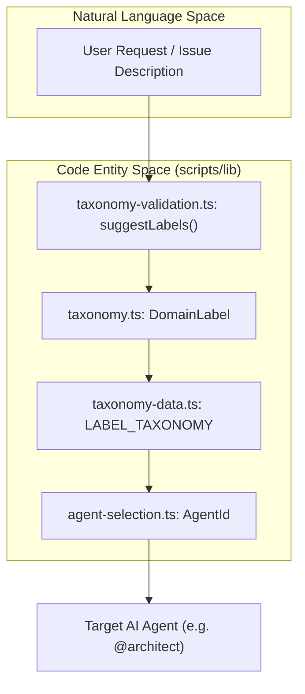
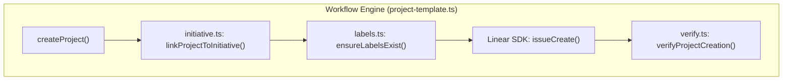

<!-- source: DeepWiki mcp.deepwiki.com · repo wrsmith108/linear-claude-skill · page 3 Shared Library (scripts/lib) · fetched 2026-10-27 -->

# Shared Library (scripts/lib)

Relevant source files

The following files were used as context for generating this wiki page:

- [scripts/lib/exit-codes.ts](scripts/lib/exit-codes.ts)
- [scripts/lib/index.ts](scripts/lib/index.ts)
- [scripts/lib/linear-utils.ts](scripts/lib/linear-utils.ts)

The `scripts/lib/` directory contains the internal SDK and business logic that powers all Linear operations within this repository. It provides a standardized layer over the official `@linear/sdk`, ensuring that all scripts follow the same patterns for authentication, entity lookup, and label application.

### Library Architecture

The library is organized into specialized subsystems, all of which are exported through a central entry point at [scripts/lib/index.ts:1-133]().

**Core Library Structure**
| Module | Responsibility |
| :--- | :--- |
| **Client & Utils** | API initialization, singleton management, and basic entity lookups. |
| **Taxonomy** | Type definitions and data for the structured label system. |
| **Label Ops** | CRUD operations for applying and validating labels on issues. |
| **Agent Routing** | Logic for mapping issues to specific AI agents based on domain labels. |
| **Project Engine** | High-level workflows for creating and verifying projects/initiatives. |
| **Lin CLI** | Performance-optimized bridge to the Rust-based `lin` binary. |

Sources: [scripts/lib/index.ts:1-133]()

---

### Linear Client & Utilities

The foundational layer of the library manages the `LinearClient` lifecycle and provides common lookup functions. It enforces the use of the `LINEAR_API_KEY` environment variable [scripts/lib/linear-utils.ts:90-94]().

*   **Singleton Access**: `getLinearClient()` provides a cached instance of the client to avoid redundant initializations [scripts/lib/linear-utils.ts:87-98]().
*   **Entity Lookups**: Standardized functions like `findProjectByName`, `findInitiativeByName`, and `findTeamByKey` implement case-insensitive matching with exact-match preference [scripts/lib/linear-utils.ts:104-235]().
*   **Exit Codes**: A standardized `EXIT_CODES` object defines error states (e.g., `MISSING_API_KEY: 1`, `VALIDATION_ERROR: 5`) to allow for programmatic error handling in shell scripts [scripts/lib/exit-codes.ts:5-13]().

For details, see [Linear Client & Utilities (#3.1)](#).

Sources: [scripts/lib/linear-utils.ts:7-235](), [scripts/lib/exit-codes.ts:1-16]()

---

### Label Taxonomy & Agent Selection

The skill uses a strict taxonomy to categorize issues and route them to the appropriate automated agents. This system bridges the gap between natural language descriptions and structured metadata.

**Code Entity to Domain Mapping**

*   **Taxonomy**: Defines four categories of labels: `Domain`, `Type`, `Scope`, and `AgentId` [scripts/lib/taxonomy.ts:1-50]().
*   **Agent Selection**: Uses the `buildAgentDomainMatrix()` and `selectAgentsForIssue()` functions to determine which agent should handle a specific task based on its `DomainLabel` [scripts/lib/agent-selection.ts:75-82]().

For details, see [Label Taxonomy System (#3.2)](#) and [Agent Selection (#3.3)](#).

Sources: [scripts/lib/index.ts:34-82](), [scripts/lib/taxonomy.ts:1-50]()

---

### Project Lifecycle Management

The library provides a high-level "Project Template" that orchestrates complex multi-step operations. Instead of raw API calls, scripts use `createProjectWithDefaults` to ensure all mandatory metadata is set.

**Project Creation Workflow**

*   **Initiative Linking**: Utilities in `initiative.ts` handle the GraphQL mutations required to associate projects with high-level initiatives [scripts/lib/initiative.ts:13-21]().
*   **Verification**: The `verify` module provides post-creation checks to ensure that labels, descriptions, and links were correctly established [scripts/lib/verify.ts:85-90]().

For details, see [Project Template & Verification (#3.4)](#).

Sources: [scripts/lib/index.ts:125-133](), [scripts/lib/index.ts:85-90]()

---

### Lin CLI Integration

To improve performance, the library includes a "fast-path" integration with the `lin` Rust CLI. This allows the system to bypass the overhead of the TypeScript SDK for common operations.

*   **Detection**: `detectLinCli()` checks for the presence of the binary and caches the result [scripts/lib/lin-cli.ts:110-111]().
*   **Circuit Breaker**: The `tryLin()` wrapper attempts to use the CLI but automatically falls back to the TypeScript SDK if the CLI fails three times or if `LINEAR_USE_LIN=0` is set [scripts/lib/lin-cli.ts:109-114]().

For details, see [Lin CLI Integration (#3.5)](#).

Sources: [scripts/lib/index.ts:108-123]()

---

