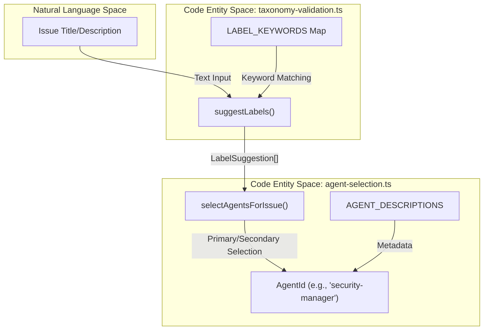
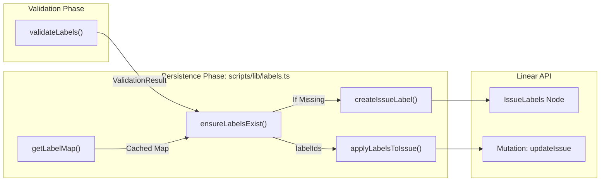

<!-- source: DeepWiki mcp.deepwiki.com · repo wrsmith108/linear-claude-skill · page 3.2 Label Taxonomy System · fetched 2026-10-27 -->

# Label Taxonomy System

Relevant source files

The following files were used as context for generating this wiki page:

- [docs/labels.md](docs/labels.md)
- [scripts/lib/agent-selection.ts](scripts/lib/agent-selection.ts)
- [scripts/lib/labels.ts](scripts/lib/labels.ts)
- [scripts/lib/taxonomy-data.ts](scripts/lib/taxonomy-data.ts)
- [scripts/lib/taxonomy-validation.ts](scripts/lib/taxonomy-validation.ts)
- [scripts/lib/taxonomy.ts](scripts/lib/taxonomy.ts)

The Label Taxonomy System is a standardized framework for categorizing Linear issues by technical domain, work type, and scope. This system ensures consistent metadata across projects, enables automated agent routing, and provides visual consistency in the Linear UI through pre-defined color mappings.

## Core Taxonomy Structure

The system is built upon three primary categories defined in `scripts/lib/taxonomy.ts`. Every issue managed by the skill is expected to adhere to these classifications to facilitate proper "Discovery Before Creation" protocols.

| Category | Requirement | Purpose |
| :--- | :--- | :--- |
| **Type** | Exactly 1 | Defines the nature of the work (e.g., `bug`, `feature`). |
| **Domain** | 1-2 (Recommended) | Indicates technical area for agent routing (e.g., `security`, `backend`). |
| **Scope** | 0-2 (Optional) | Flags special conditions or impact (e.g., `breaking-change`, `tech-debt`). |

### Data Model and Interfaces
The system uses TypeScript interfaces to enforce the taxonomy structure:
*   `LabelDefinition`: Defines the `name`, `category`, `description`, `color`, and associated `AgentId` mappings [scripts/lib/taxonomy.ts:95-108]().
*   `LabelTaxonomy`: A record-based structure grouping definitions into `domain`, `type`, and `scope` [scripts/lib/taxonomy.ts:113-120]().
*   `ValidationResult`: Captures the outcome of a taxonomy check, including parsed categories and any error/warning strings [scripts/lib/taxonomy.ts:125-139]().

**Sources:** [scripts/lib/taxonomy.ts:8-168](), [scripts/lib/taxonomy-data.ts:1-231]()

---

## Implementation Components

The taxonomy is implemented across four specialized files in `scripts/lib/`, separating concerns between data definition, validation logic, and API interaction.

### Natural Language to Code Entity Mapping
This diagram illustrates how the system bridges human-readable issue content to specific code entities and automated routing logic.

**Title: Label Suggestion and Agent Routing Flow**

**Sources:** [scripts/lib/taxonomy-validation.ts:146-176](), [scripts/lib/agent-selection.ts:23-66](), [scripts/lib/agent-selection.ts:77-145]()

### Data Flow: Label Creation and Application
The following diagram tracks the lifecycle of a label from validation to its persistence in the Linear API via `labels.ts`.

**Title: Label Lifecycle and Persistence**

**Sources:** [scripts/lib/labels.ts:41-53](), [scripts/lib/labels.ts:84-152](), [scripts/lib/labels.ts:157-199](), [scripts/lib/taxonomy-validation.ts:36-101]()

---

## Key Modules

### 1. Taxonomy Data (`taxonomy-data.ts`)
This file serves as the authoritative source for all label definitions. It includes:
*   **Domain Labels**: Maps domains like `security` or `performance` to specific colors and `primaryAgents` (e.g., `security-manager`) [scripts/lib/taxonomy-data.ts:26-131]().
*   **Type Labels**: Classification for `feature`, `bug`, `refactor`, `chore`, and `spike` [scripts/lib/taxonomy-data.ts:139-170]().
*   **Scope Labels**: Impact flags like `breaking-change` or `blocked` [scripts/lib/taxonomy-data.ts:177-220]().

### 2. Validation and Suggestion (`taxonomy-validation.ts`)
Provides the logic for ensuring label sets meet system requirements.
*   **`validateLabels(labels: string[])`**: Enforces rules such as "Exactly one Type label required" and "Unknown labels are errors" [scripts/lib/taxonomy-validation.ts:36-101]().
*   **`suggestLabels(title, description)`**: Uses the `LABEL_KEYWORDS` constant to perform keyword matching against issue text, returning `LabelSuggestion` objects with confidence scores [scripts/lib/taxonomy-validation.ts:146-176]().

### 3. CRUD Operations (`labels.ts`)
Handles the heavy lifting of interacting with the Linear SDK to manage labels.
*   **`ensureLabelsExist(teamId, labelNames, options)`**: Checks the team's existing labels via `getLabelMap`. If a label is missing, it creates it using colors defined in `LABEL_COLORS` [scripts/lib/labels.ts:84-152]().
*   **`applyLabelsToIssue(issueId, labelNames, labelMap)`**: Fetches an issue's current labels, calculates the delta, and performs a single `updateIssue` mutation to apply new labels [scripts/lib/labels.ts:157-199]().
*   **`getLabelMap(teamId)`**: Returns a case-insensitive map of label names to UUIDs to prevent duplicate creation [scripts/lib/labels.ts:41-53]().

### 4. Agent Selection (`agent-selection.ts`)
Bridges labels to the workforce.
*   **`selectAgentsForIssue(labels)`**: Implements routing logic where agents with the broadest match across multiple domain labels are prioritized [scripts/lib/agent-selection.ts:77-145]().
*   **`canAgentHandle(agentId, labels)`**: A utility for agents to verify if they are qualified for a specific task based on the taxonomy [scripts/lib/agent-selection.ts:168-207]().

**Sources:** [scripts/lib/labels.ts:1-245](), [scripts/lib/taxonomy-validation.ts:1-180](), [scripts/lib/agent-selection.ts:1-220](), [scripts/lib/taxonomy-data.ts:1-260]()

---

## Validation Rules Summary

The `validateLabels` function [scripts/lib/taxonomy-validation.ts:36]() enforces the following technical constraints:

| Rule | Severity | Description |
| :--- | :--- | :--- |
| **Rule 1: Type Requirement** | Error | Exactly one label from the `type` category must be present [scripts/lib/taxonomy-validation.ts:72-76](). |
| **Rule 2: Domain Recommendation** | Warning | At least one `domain` label is recommended for agent routing [scripts/lib/taxonomy-validation.ts:79-83](). |
| **Rule 3: Scope Limit** | Warning | More than 2 `scope` labels trigger a warning for excessive complexity [scripts/lib/taxonomy-validation.ts:86-88](). |
| **Rule 4: Taxonomy Adherence** | Error | Any label not found in `LABEL_TAXONOMY` is rejected [scripts/lib/taxonomy-validation.ts:91-93](). |

**Sources:** [scripts/lib/taxonomy-validation.ts:36-101](), [docs/labels.md:144-152]()

---

