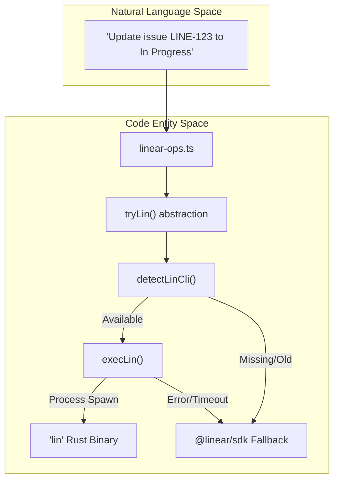
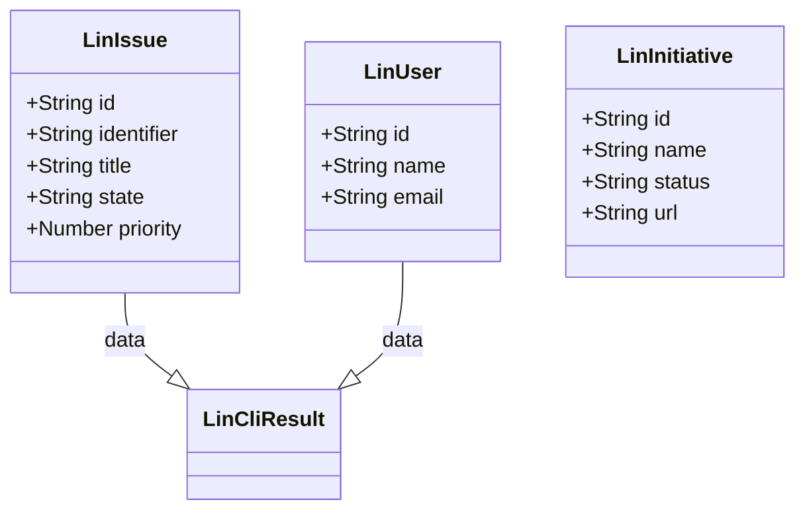

<!-- source: DeepWiki mcp.deepwiki.com · repo wrsmith108/linear-claude-skill · page 3.5 Lin CLI Integration · fetched 2026-10-27 -->

# Lin CLI Integration

Relevant source files

The following files were used as context for generating this wiki page:

- [scripts/__tests__/lin-cli.test.ts](scripts/__tests__/lin-cli.test.ts)
- [scripts/lib/lin-cli.ts](scripts/lib/lin-cli.ts)

The `lin-cli.ts` module provides an optional, high-performance integration with the `lin` Rust-based CLI binary (aaronkwhite/linear-cli) [scripts/lib/lin-cli.ts:2-2](). It serves as a "fast-path" for common Linear operations, reducing execution overhead compared to full SDK initialization while maintaining a silent fallback to the standard `@linear/sdk` path if the binary is missing or fails [scripts/lib/lin-cli.ts:4-5]().

## System Architecture

The integration is designed as a transparent abstraction layer. Command handlers in the skill use the `tryLin()` function to attempt a CLI-based execution, falling back to the TypeScript SDK if necessary.

### Execution Flow: Natural Language to Code Entity

The following diagram illustrates how a user request flows through the CLI integration layer.

**Lin CLI Execution Path**

Sources: [scripts/lib/lin-cli.ts:187-218](), [scripts/lib/lin-cli.ts:96-120]()

## Core Components

### 1. Detection and Gating
The system performs a version-aware check to ensure the installed `lin` binary meets the minimum requirements (CalVer `2026.4.0`) [scripts/lib/lin-cli.ts:73-73]().

*   **`detectLinCli()`**: Checks for binary existence via `lin --version` [scripts/lib/lin-cli.ts:106-106](). Results are cached in `_cachedDetection` for the process lifetime to avoid repeated disk I/O [scripts/lib/lin-cli.ts:85-85](), [scripts/lib/lin-cli.ts:97-97]().
*   **Kill Switch**: Setting `LINEAR_USE_LIN=0` in the environment completely disables the integration, forcing all calls to the SDK [scripts/lib/lin-cli.ts:100-103]().
*   **Circuit-Breaker**: If `lin` commands fail 3 consecutive times, the system trips a circuit-breaker and stops attempting to use the CLI for the remainder of the process [scripts/lib/lin-cli.ts:76-76](), [scripts/lib/lin-cli.ts:151-153]().

### 2. The `tryLin` Abstraction
`tryLin` is the primary entry point for all command handlers [scripts/lib/lin-cli.ts:183-183](). It accepts the CLI arguments, a fallback async function, and an optional transformation function [scripts/lib/lin-cli.ts:187-202]().

| Feature | Implementation Detail |
| :--- | :--- |
| **Concurrency** | Uses `node:child_process` `execFile` (promisified) to avoid blocking the event loop [scripts/lib/lin-cli.ts:8-8](), [scripts/lib/lin-cli.ts:21-21](). |
| **Data Format** | Always appends `--json` to CLI arguments to ensure machine-readable output [scripts/lib/lin-cli.ts:156-156](). |
| **Security** | Never passes the API key as a CLI argument; it relies on the `LINEAR_API_KEY` environment variable [scripts/lib/lin-cli.ts:12-12](). |
| **Timeout** | Defaults to a 10-second timeout per command [scripts/lib/lin-cli.ts:79-79](). |

Sources: [scripts/lib/lin-cli.ts:146-174](), [scripts/lib/lin-cli.ts:187-218]()

## Data Models

The integration uses typed wrappers to ensure consistency between CLI JSON output and internal TypeScript interfaces.

**Entity Mapping**

Sources: [scripts/lib/lin-cli.ts:41-60]()

## Key Functions

### Detection & Lifecycle
*   **`isLinCliAvailable()`**: A quick boolean check that accounts for both the detection cache and the circuit-breaker status [scripts/lib/lin-cli.ts:126-130]().
*   **`_resetDetectionCache()`**: Used primarily in tests to clear the module state [scripts/lib/lin-cli.ts:133-136]().

### Command Wrappers
*   **`linUpdateIssueState()`**: A typed wrapper for updating issue statuses [scripts/lib/lin-cli.ts:224-229]().
*   **`execLin<T>()`**: The underlying executor that handles JSON parsing and failure count increments [scripts/lib/lin-cli.ts:146-174]().

## Sunset Policy
To prevent long-term maintenance of a stale integration, the skill enforces a sunset policy: If the upstream `aaronkwhite/linear-cli` project has no new releases for 90 days after the integration date (2026-04-11), this integration layer is slated for removal [scripts/lib/lin-cli.ts:14-15]().

## Testing
The integration is verified via `scripts/__tests__/lin-cli.test.ts`, which mocks `execFile` to test:
*   Detection failure when the binary is absent [scripts/__tests__/lin-cli.test.ts:22-39]().
*   The `LINEAR_USE_LIN=0` kill switch [scripts/__tests__/lin-cli.test.ts:41-59]().
*   Silent fallback behavior when the CLI is unavailable [scripts/__tests__/lin-cli.test.ts:63-88]().

Sources: [scripts/__tests__/lin-cli.test.ts:1-130]()

---

