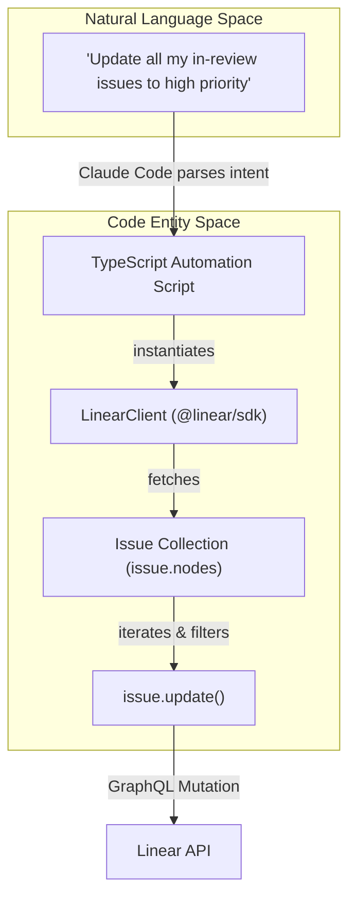
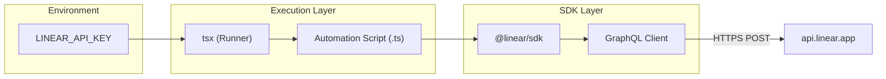

<!-- source: DeepWiki mcp.deepwiki.com · repo wrsmith108/linear-claude-skill · page 4.2 SDK Automation Patterns · fetched 2026-10-27 -->

# SDK Automation Patterns

<details>
<summary>Relevant source files</summary>

The following files were used as context for generating this wiki page:

- [LICENSE](LICENSE)
- [package-lock.json](package-lock.json)
- [scripts/query.sh](scripts/query.sh)
- [sdk.md](sdk.md)
- [tsconfig.json](tsconfig.json)

</details>


This page provides a technical reference for using the `@linear/sdk` within the `linear-claude-skill` ecosystem. It details the hierarchy for tool selection, implementation patterns for complex automations, and the standardized script template used for bulk operations and data transformations.

## Tool Selection Hierarchy

The skill follows a tiered approach to interacting with the Linear API. Developers and agents should always prefer the simplest tool that satisfies the requirement.

| Priority | Tool | Use Case |
| :--- | :--- | :--- |
| **1** | **MCP Tools** | Single entity operations (create/update), basic queries, and interactive workflows. |
| **2** | **SDK Scripts** | Loops, bulk updates, conditional logic, and complex data transformations. |
| **3** | **GraphQL API** | Fallback for operations or specific fields not exposed by the SDK or MCP. |

**Sources:** [sdk.md:5-12](), [sdk.md:251-270]()

## Implementation Patterns

### Fetching and Filtering
The SDK is preferred over raw GraphQL for complex filtering because it allows the use of native TypeScript array methods (`filter`, `map`, `reduce`) on returned collections.

```typescript
// Example: Filtering high priority open issues
const team = await client.team('TEAM-KEY');
const issues = await team.issues();

const highPriorityOpen = issues.nodes.filter(issue =>
  issue.priority === 1 &&
  issue.state.type === 'started'
);
```

**Sources:** [sdk.md:44-58]()

### Bulk Updates and Loops
The SDK provides a type-safe way to iterate over entities and perform updates based on conditional logic that would be difficult to express in a single GraphQL mutation.

```typescript
const team = await client.team('ENG');
const issues = await team.issues({
  filter: { state: { name: { eq: 'In Review' } } }
});

for (const issue of issues.nodes) {
  if (issue.assignee && issue.estimate && issue.estimate > 5) {
    await issue.update({
      priority: 2,
      labels: ['needs-split']
    });
  }
}
```

**Sources:** [sdk.md:60-79]()

### Pagination Logic
For large datasets, the skill implements a standard `while` loop pattern using `pageInfo` to traverse paginated results.

```typescript
let hasMore = true;
let after: string | undefined;
const allIssues = [];

while (hasMore) {
  const response = await client.issues({ first: 50, after });
  allIssues.push(...response.nodes);
  hasMore = response.pageInfo.hasNextPage;
  after = response.pageInfo.endCursor;
}
```

**Sources:** [sdk.md:151-173]()

## Data Flow: Natural Language to SDK Entity

The following diagram illustrates how a natural language request is translated through the system into `LinearClient` operations.

### Request Translation Path

**Sources:** [sdk.md:15-21](), [sdk.md:60-79]()

## Script Template

All automation scripts in the `scripts/` directory should follow this standardized template to ensure consistent error handling and authentication.

```typescript
#!/usr/bin/env tsx
import { LinearClient } from '@linear/sdk'

const LINEAR_API_KEY = process.env.LINEAR_API_KEY
if (!LINEAR_API_KEY) {
  console.error('LINEAR_API_KEY environment variable required')
  process.exit(1)
}

const client = new LinearClient({ apiKey: LINEAR_API_KEY })

async function main() {
  const me = await client.viewer
  // Logic goes here
}

main().catch(error => {
  console.error('Error:', error.message)
  process.exit(1)
})
```

**Sources:** [sdk.md:197-235](), [package-lock.json:12]()

## Execution Architecture

The skill utilizes `tsx` for direct execution of TypeScript files, bypassing the need for a separate compilation step during development and automation tasks.

### Script Execution Flow

**Sources:** [sdk.md:237-249](), [scripts/query.sh:21](), [tsconfig.json:1-19]()

## Technical Requirements
- **Runtime**: Node.js (>=18 recommended) [package-lock.json:67-69]()
- **Language**: TypeScript 5.7+ [package-lock.json:22]()
- **Primary Dependency**: `@linear/sdk` ^68.1.0 [package-lock.json:12]()
- **Execution Engine**: `tsx` for JIT compilation [sdk.md:275]()

**Sources:** [package-lock.json:1-25](), [tsconfig.json:1-15]()

---

