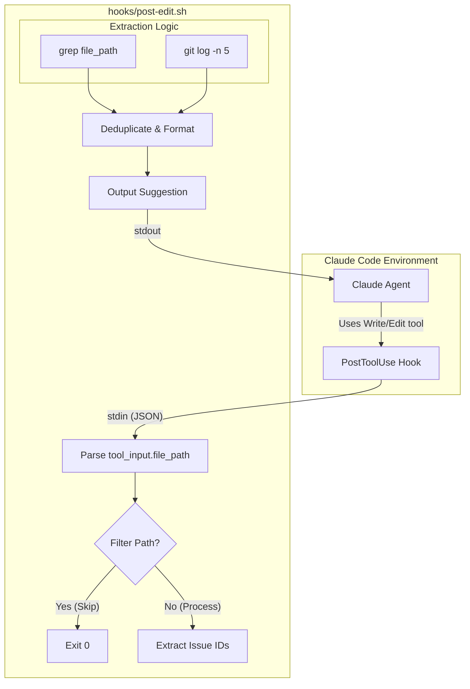
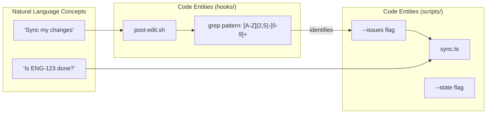

<!-- source: DeepWiki mcp.deepwiki.com · repo wrsmith108/linear-claude-skill · page 6.1 Post-Edit Hook · fetched 2026-10-27 -->

# Post-Edit Hook

<details>
<summary>Relevant source files</summary>

The following files were used as context for generating this wiki page:

- [hooks/post-edit.sh](hooks/post-edit.sh)
- [sync.md](sync.md)

</details>


The **Post-Edit Hook** is a lightweight automation utility that integrates with Claude Code's lifecycle to bridge the gap between local file modifications and Linear issue tracking. It monitors file edits in real-time, identifies associated Linear issues via pattern matching, and provides actionable synchronization suggestions to the user.

## Purpose and Scope

The primary goal of the hook is to reduce the manual overhead of keeping Linear issues in sync with code changes. By detecting issue IDs (e.g., `ENG-123`) directly within the modified source code or recent git history, it prompts the agent to consider updating issue statuses immediately after a "Write" or "Edit" operation.

- **Detection**: Scans changed files and git logs for patterns matching `[A-Z]{2,5}-[0-9]+`.
- **Filtering**: Ignores noise by skipping configuration, test, and build artifact directories.
- **Integration**: Plugs into the `PostToolUse` hook system in `.claude/settings.json`.
- **Output**: Generates a standard sync command that can be executed via the [scripts/sync.ts]() utility.

## Configuration

The hook is configured within the Claude Code environment settings. It specifically targets the `Write` and `Edit` tools to ensure it only runs after file content has been persisted.

### Hook Registration
The following configuration must be present in `~/.claude/settings.json` (or the project-local equivalent):

```json
{
  "hooks": {
    "PostToolUse": [{
      "matcher": "Write|Edit",
      "hooks": [{
        "type": "command",
        "command": "bash ~/.claude/skills/linear/hooks/post-edit.sh"
      }]
    }]
  }
}
```
Sources: [hooks/post-edit.sh:5-17](), [sync.md:51-65]()

## Implementation Detail

The hook is implemented as a Bash script [hooks/post-edit.sh](). It follows a linear execution flow: input parsing, path filtering, issue extraction, and suggestion generation.

### Input Parsing and File Filtering
The script receives a JSON payload from Claude Code on `stdin`. It uses `jq` to extract the `file_path` from the `tool_input` object [hooks/post-edit.sh:22-25]().

To prevent unnecessary processing and noise, the script applies strict filtering:
1.  **Extension Check**: Only processes source files (`.ts`, `.tsx`, `.js`, `.jsx`, `.py`, `.go`, `.rs`, `.md`, `.astro`) [hooks/post-edit.sh:33-35]().
2.  **Test/Config Skip**: Ignores files containing `.test.`, `.spec.`, `/test/`, or `/config/` [hooks/post-edit.sh:38-46]().
3.  **Artifact Skip**: Ignores `node_modules`, `/dist/`, `/.vercel/`, `/build/`, and `/.next/` [hooks/post-edit.sh:49-57]().

### Issue Detection Logic
The hook employs two methods to find Linear issue references:
1.  **File Scanning**: It uses `grep -oE '[A-Z]{2,5}-[0-9]+'` on the modified file to find mentions of issue IDs [hooks/post-edit.sh:64-67]().
2.  **Git Scanning**: It scans the last 5 git commits for similar patterns to capture context that might not be explicitly written in the file (e.g., if the user is working on a branch associated with an issue) [hooks/post-edit.sh:71-73]().

### Data Flow: Hook Execution
The following diagram illustrates the flow from a tool use event to the final suggestion output.

**Post-Edit Hook Data Flow**

Sources: [hooks/post-edit.sh:22-82](), [sync.md:67-68]()

## Sync Suggestion Output

When issues are detected, the hook outputs two lines to `stdout`. This output is captured by Claude Code and appended to the conversation context, prompting the agent to act.

**Output Format:**
1.  **Context Line**: Summarizes the changed file and detected issues.
2.  **Action Line**: Provides the exact `npx` command to sync those issues to the `Done` state.

```text
[linear-sync] Changed: user-service.ts | Issues: ENG-123 ENG-124 
[linear-sync] Consider running: npx ts-node scripts/sync.ts --issues ENG-123,ENG-124 --state Done
```
Sources: [hooks/post-edit.sh:79-82]()

## Relationship to Sync System

The Post-Edit Hook acts as the "Trigger" for **Mode 3: Hook-Triggered Sync**. While the hook identifies the issues, the actual update is performed by [scripts/sync.ts]().

| Component | Role | Entity Reference |
| :--- | :--- | :--- |
| `post-edit.sh` | Detection & Trigger | [hooks/post-edit.sh:1-85]() |
| `sync.ts` | Execution & API Mutation | [scripts/sync.ts:1-262]() |
| `.claude/settings.json` | Orchestration | [sync.md:51-65]() |

**Bridge: Natural Language to Code Entities**

Sources: [hooks/post-edit.sh:66-82](), [sync.md:15-49]()

## Technical Constraints

- **Execution Environment**: Requires `bash`, `jq`, and `grep` to be available in the shell environment where Claude Code is running [hooks/post-edit.sh:1-25]().
- **Git Dependency**: Git scanning is conditional; if the `git` command is not found, the script gracefully falls back to file-only scanning [hooks/post-edit.sh:71-73]().
- **Performance**: The script is designed to be near-instantaneous to avoid blocking the agent's workflow, using `head -10` and `head -5` to limit processing on large files or histories [hooks/post-edit.sh:66-72]().

Sources: [hooks/post-edit.sh:1-85](), [sync.md:47-68]()

---

