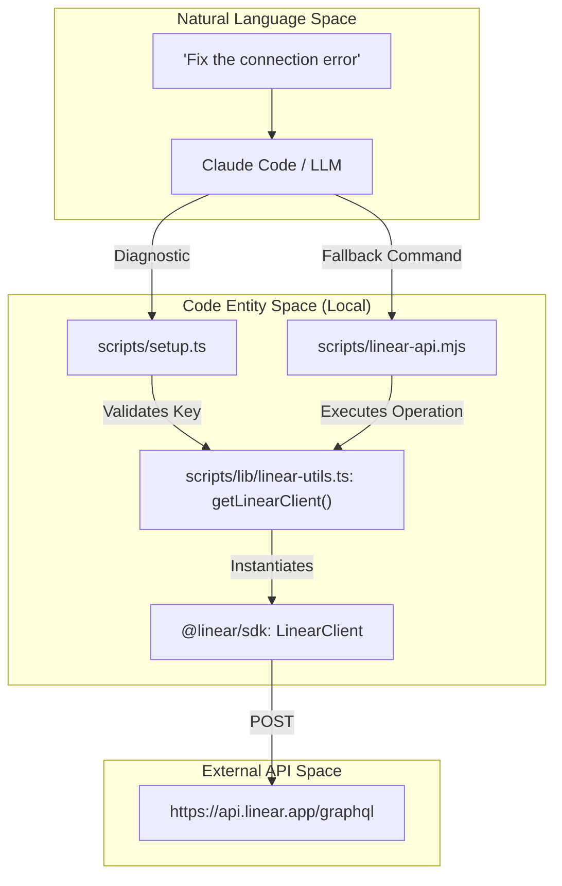
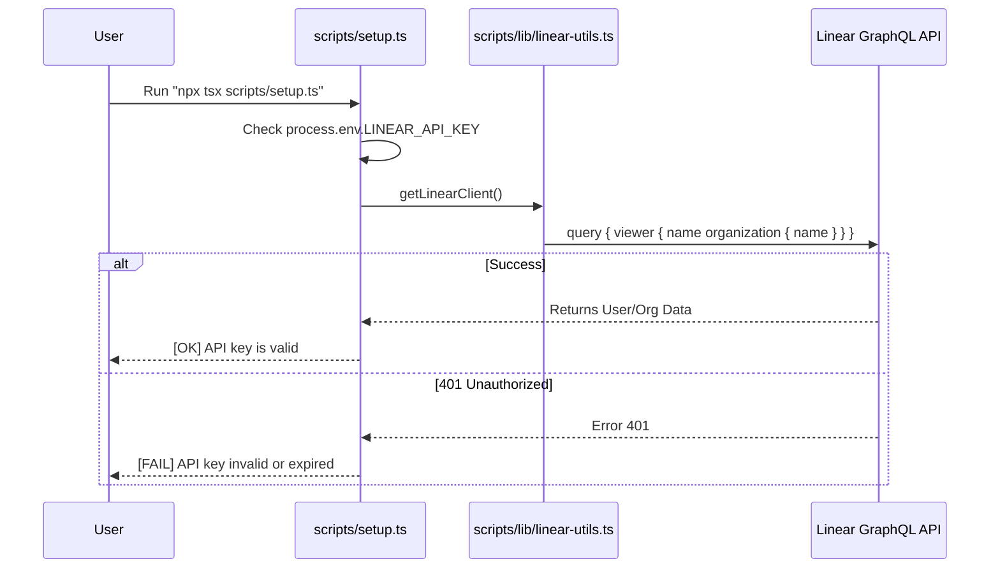

<!-- source: DeepWiki mcp.deepwiki.com · repo wrsmith108/linear-claude-skill · page 7 Troubleshooting · fetched 2026-10-27 -->

# Troubleshooting

<details>
<summary>Relevant source files</summary>

The following files were used as context for generating this wiki page:

- [api.md](api.md)
- [scripts/setup.ts](scripts/setup.ts)
- [troubleshooting.md](troubleshooting.md)

</details>


This page provides a high-level guide for diagnosing and resolving common issues encountered when using the Linear Claude Skill. The system relies on a multi-tier execution model (MCP, CLI, and direct GraphQL), and troubleshooting often involves identifying which tier is failing and falling back to a more reliable method.

## Diagnostic Workflow

When encountering issues, the first step is to verify the environment and connectivity. The codebase provides a dedicated diagnostic script for this purpose.

### The Setup Check
The `scripts/setup.ts` utility is the primary tool for validating your configuration. It performs the following checks:
1.  **SDK Installation**: Verifies `@linear/sdk` is available [scripts/setup.ts:163-171]().
2.  **API Key Validation**: Checks for the `LINEAR_API_KEY` environment variable, ensures it follows the `lin_api_` format, and attempts a live connection to the Linear API to verify the `viewer` and `organization` [scripts/setup.ts:34-95]().
3.  **MCP Configuration**: Scans for `.mcp.json` in common locations (current directory, home directory, and `.claude` folder) to ensure the `linear` server is correctly defined [scripts/setup.ts:131-152]().
4.  **CLI Availability**: Checks for the optional `linear` (Desktop CLI) and `lin` (Rust-based fast-path) binaries [scripts/setup.ts:198-230]().

For detailed instructions on fixing environment issues, see **[Environment & Authentication](#7.2)**.

---

## MCP Server Management

The skill is designed to work best with the **official Linear MCP server**. Many common "bugs" reported in the past were actually limitations of deprecated community-maintained servers.

### Official vs. Community Servers
*   **Official Server (`mcp.linear.app`)**: Uses SSE (Server-Sent Events) and correctly resolves state names (e.g., "Done") to internal UUIDs [troubleshooting.md:11-23]().
*   **Deprecated Servers**: Packages like `linear-mcp-server` often fail on status updates because they require raw UUIDs instead of status names [troubleshooting.md:33-41]().

### Connection Stability
Even with the official server, SSE connections may time out during extended idle periods or during very large bulk operations [troubleshooting.md:43-47](). In these cases, the skill should fall back to the local `scripts/linear-api.mjs` or `scripts/sync.ts` utilities.

For a matrix of reliable vs. unreliable MCP operations and how to handle SSE drops, see **[MCP Issues](#7.1)**.

---

## Execution Fallbacks

The following diagram illustrates the system's "Code Entity Space" and how the different troubleshooting scripts bridge the gap between a high-level request and the Linear GraphQL API.

### Diagnostic & Fallback Architecture
"The diagram below shows how diagnostic tools like `setup.ts` and fallback scripts like `linear-api.mjs` interact with the core `LinearClient` and the external API."


Sources: [scripts/setup.ts:69-74](), [scripts/lib/linear-utils.ts:25-45](), [scripts/linear-api.mjs:1-50](), [troubleshooting.md:55-85]()

---

## Common Error Patterns

| Error Message | Likely Cause | Recommended Resolution |
| :--- | :--- | :--- |
| `LINEAR_API_KEY not set` | Missing environment variable | Check `~/.claude/.env` or shell profile [scripts/setup.ts:40-57](). |
| `invalid format (should start with lin_api_)` | Incorrect key type used | Ensure you are using a Personal API Key, not an OAuth token [scripts/setup.ts:62-66](). |
| `Status Update Schema Error` | Community MCP server usage | Switch to `mcp.linear.app` or use `scripts/linear-api.mjs` [troubleshooting.md:123-131](). |
| `SSE Connection Timeout` | Idle connection drop | Re-run the command or use `npm run sync` for bulk tasks [troubleshooting.md:133-139](). |

### The "Reliable Fallback" Script
When the MCP tools fail or time out, the most reliable way to interact with Linear is via `scripts/linear-api.mjs`. This script handles JSON escaping and status resolution natively:

```bash
# Example: Using the fallback script to update an issue status
node scripts/linear-api.mjs update-status --issue ENG-123 --status done
```
Sources: [troubleshooting.md:55-85](), [troubleshooting.md:127-131]()

---

## System Connectivity Flow

This diagram maps the authentication and connectivity flow used during troubleshooting.


Sources: [scripts/setup.ts:68-94](), [scripts/lib/linear-utils.ts:25-45](), [api.md:32-41]()

---

## Child Pages

For deep dives into specific troubleshooting areas, refer to the following:

*   **[MCP Issues](#7.1)**: Detailed guide on official vs. community servers, handling SSE timeouts, and GraphQL fallback patterns.
*   **[Environment & Authentication](#7.2)**: Comprehensive guide on API key configuration, shell profiles, and using `setup.ts` to debug credentials.

---

