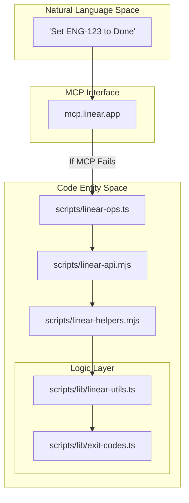
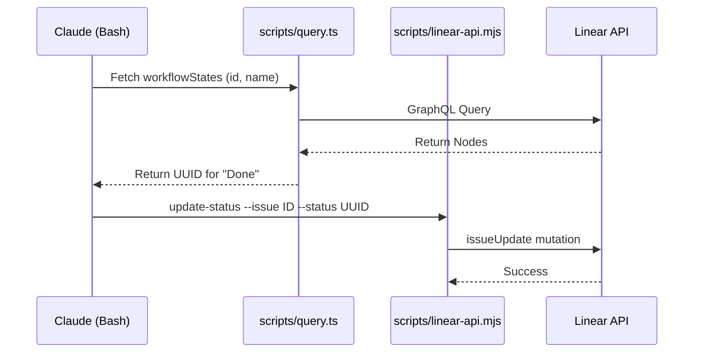

<!-- source: DeepWiki mcp.deepwiki.com · repo wrsmith108/linear-claude-skill · page 7.1 MCP Issues · fetched 2026-10-27 -->

# MCP Issues

<details>
<summary>Relevant source files</summary>

The following files were used as context for generating this wiki page:

- [CHANGELOG.md](CHANGELOG.md)
- [troubleshooting.md](troubleshooting.md)

</details>


The Model Context Protocol (MCP) is the primary bridge between Claude Code and the Linear API. While it provides a seamless natural language interface for managing issues and projects, specific implementation details and historical bugs in community servers necessitate a strict configuration and fallback strategy. This page documents the official server requirements, common failure modes like SSE timeouts, and the GraphQL fallback patterns used to maintain reliability.

## Official Server Configuration

To ensure stability and feature compatibility, the skill **must** use the official Linear MCP server. Deprecated community servers (e.g., `linear-mcp-server` or `jerhadf/linear-mcp-server`) contain critical schema mismatches that break status updates and issue linking [troubleshooting.md:9-25]().

### Recommended Configuration
The official server is hosted at `mcp.linear.app/sse` and should be configured in the MCP settings JSON:

```json
{
  "mcpServers": {
    "linear": {
      "command": "npx",
      "args": ["mcp-remote", "https://mcp.linear.app/sse"],
      "env": { "LINEAR_API_KEY": "your_api_key" }
    }
  }
}
```
*Sources: [troubleshooting.md:13-23]()*

## Reliability Matrix

The following table outlines the reliability of various operations when performed via the official MCP server versus the internal helper scripts.

| Operation Category | MCP Reliability | Recommended Fallback | Reason |
| :--- | :--- | :--- | :--- |
| **Issue Creation** | High | `linear-ops create-issue` | MCP handles title/desc well. |
| **Status Updates** | Medium | `linear-api.mjs update-status` | Schema sensitivity (UUID vs Name). |
| **Bulk Operations** | Low | `npm run sync` | SSE timeouts on sequential calls. |
| **Image Uploads** | N/A | `upload-image.ts` | MCP does not support multipart S3. |
| **Complex Search** | Medium | `query.ts` (Raw GraphQL) | MCP search can be non-deterministic. |

*Sources: [troubleshooting.md:33-48](), [troubleshooting.md:107-108]()*

## Common MCP Failure Modes

### 1. SSE Connection Timeouts
Server-Sent Events (SSE) connections can drop during extended idle periods or during long-running operations (e.g., creating 20+ sub-issues) [troubleshooting.md:43-45](). 

**Resolution Strategy:**
- For operations involving more than 5 entities, use the `npm run sync` engine which uses the `@linear/sdk` directly [troubleshooting.md:133-139]().
- If a timeout occurs, verify connectivity using the raw query utility: `npm run query -- "query { viewer { name } }"` [troubleshooting.md:161-163]().

### 2. Status Update Schema Mismatch
A common point of failure in MCP tools is the confusion between `stateId` (UUID) and `state` (Name). While the official server resolves names to UUIDs internally, specific workflow transitions may still fail if the state name is ambiguous [troubleshooting.md:33-41]().

**Implementation Detail:**
The `linear-api.mjs` helper script provides a robust alternative by wrapping the GraphQL mutation directly, ensuring proper JSON escaping and type safety [troubleshooting.md:55-57]().

### 3. "MCP Tools Not Available"
In some environments, Claude may lose the MCP context. This is handled by falling back to the `linear-ops` CLI or the `lin` Rust binary fast-path [troubleshooting.md:113-121]().

## Data Flow: MCP to Code Entity Space

This diagram illustrates how a natural language request through the MCP interface maps to specific code entities and scripts within the skill.

### MCP Request Mapping

*Sources: [troubleshooting.md:9-23](), [troubleshooting.md:55-75](), [troubleshooting.md:127-131]()*

## GraphQL Fallback Patterns

When MCP tools are unreliable, the skill defaults to direct GraphQL execution via `scripts/query.ts` or `scripts/linear-api.mjs`.

### Reliable Status Transition
Instead of relying on MCP's internal resolution, the skill uses the following pattern to ensure a state exists before updating:


*Sources: [troubleshooting.md:171-173](), [troubleshooting.md:64-67]()*

### Script Reference for MCP Fallbacks
- **`scripts/linear-api.mjs`**: The primary wrapper for issue updates and comments when MCP fails [troubleshooting.md:55-85]().
- **`scripts/query.ts`**: Used for raw GraphQL queries to verify state IDs or team keys [troubleshooting.md:161-163]().
- **`scripts/linear-helpers.mjs`**: Provides simplified issue-number-based commenting (e.g., `add-comment 123 "message"`) to avoid UUID lookups [troubleshooting.md:93-105]().

*Sources: [troubleshooting.md:51-110]()*

---

