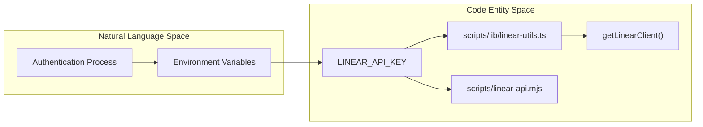

<!-- source: DeepWiki mcp.deepwiki.com · repo wrsmith108/linear-claude-skill · page 7.2 Environment & Authentication · fetched 2026-10-27 -->

# Environment & Authentication

<details>
<summary>Relevant source files</summary>

The following files were used as context for generating this wiki page:

- [.env.schema](.env.schema)
- [scripts/setup.ts](scripts/setup.ts)
- [troubleshooting.md](troubleshooting.md)

</details>


This page details the configuration, validation, and authentication mechanisms for the Linear Claude Skill. The skill relies on a valid Linear Personal API Key and supports multiple environment injection methods to ensure compatibility with Claude Code, local development, and CI/CD pipelines.

## API Key Configuration

The skill requires a Personal API Key from Linear. This key must follow the standard Linear API format, beginning with the prefix `lin_api_` [[scripts/setup.ts:62-63]]().

### Environment Variable Options

The `LINEAR_API_KEY` can be configured in several locations, which the skill checks in order of precedence:

1.  **Project `.env` file**: Standard local development setup [[scripts/setup.ts:55-56]]().
2.  **Claude Code environment**: Located at `~/.claude/.env` [[scripts/setup.ts:52-53]]().
3.  **Shell Profile**: Exported in `~/.zshrc` or `~/.bashrc` [[scripts/setup.ts:49-50]]().
4.  **Varlock Integration**: For secure environment management, the skill supports `varlock` to load sensitive keys [[troubleshooting.md:142-143]]().

### Configuration Schema

| Variable | Description | Required | Format |
| :--- | :--- | :--- | :--- |
| `LINEAR_API_KEY` | Personal API key for Linear authentication | Yes | `lin_api_...` |
| `LINEAR_DEFAULT_INITIATIVE_ID` | Default UUID used by `createProjectWithDefaults()` | No | UUID |

Sources: [[.env.schema:1-11]](), [[scripts/setup.ts:38-57]]()

## Diagnostic & Setup Script

The `scripts/setup.ts` script serves as the primary diagnostic tool for verifying the environment. It performs a multi-stage check of the local system to ensure all dependencies and credentials are functional.

### Diagnostic Workflow

The script executes the following checks:
1.  **SDK Installation**: Verifies that `@linear/sdk` is available in the node path [[scripts/setup.ts:97-111]]().
2.  **API Key Validation**:
    *   Checks for the presence of `LINEAR_API_KEY` [[scripts/setup.ts:40-41]]().
    *   Validates the `lin_api_` prefix [[scripts/setup.ts:62-63]]().
    *   Performs a live "Whoami" check by querying the `viewer` and `organization` objects via the `LinearClient` [[scripts/setup.ts:71-76]]().
3.  **CLI Availability**: Detects if the official Linear Desktop CLI or the `lin` fast-path CLI are installed [[scripts/setup.ts:113-129]]().
4.  **MCP Configuration**: Scans standard locations (`.mcp.json`, `~/.mcp.json`, `~/.claude/.mcp.json`) to verify the official Linear MCP server is correctly registered [[scripts/setup.ts:131-152]]().

### Connection Testing Logic

```mermaid
graph TD
    subgraph "Natural Language Space"
        User["User runs setup command"]
    end

    subgraph "Code Entity Space"
        Setup["scripts/setup.ts"]
        CheckKey["checkLinearApiKey()"]
        Client["LinearClient (@linear/sdk)"]
        Viewer["client.viewer"]
    end

    User -->| "npx tsx scripts/setup.ts" | Setup
    Setup --> CheckKey
    CheckKey -->| "Instantiate" | Client
    Client -->| "GraphQL Query" | Viewer
    Viewer -->| "Returns Name/Email" | Setup
```

Sources: [[scripts/setup.ts:1-95]]()

## Authentication Data Flow

Authentication is handled primarily through the `@linear/sdk` by passing the API key to the client constructor. This client is then used for all high-level script operations. For raw GraphQL queries, the key is passed as a Bearer token in the Authorization header.

### Entity Association Diagram



Sources: [[scripts/setup.ts:70-73]](), [[troubleshooting.md:55-85]]()

## Connection Testing & Troubleshooting

### Verification Commands

To verify connectivity manually, use the following commands:

*   **Quick Connectivity Check**:
    `npm run query -- "query { viewer { name } }"` [[troubleshooting.md:161-162]]()
*   **Detailed Setup Report**:
    `npx tsx scripts/setup.ts` [[scripts/setup.ts:6]]()
*   **Varlock Verification**:
    `varlock load 2>&1 | grep LINEAR` [[troubleshooting.md:143]]()

### Common Authentication Errors

| Error Message | Cause | Resolution |
| :--- | :--- | :--- |
| `401 Unauthorized` | Invalid or expired API key | Regenerate key in Linear Settings [[scripts/setup.ts:81-88]]() |
| `LINEAR_API_KEY not set` | Missing environment variable | Add to `.env` or shell profile [[scripts/setup.ts:41-57]]() |
| `Invalid format` | Missing `lin_api_` prefix | Ensure the full key string is copied [[scripts/setup.ts:62-66]]() |
| `API connection failed` | Network or DNS issues | Check proxy/firewall settings [[scripts/setup.ts:90-91]]() |

Sources: [[scripts/setup.ts:79-95]](), [[troubleshooting.md:141-153]]()

---

