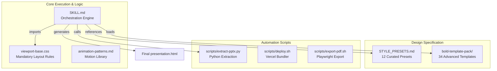
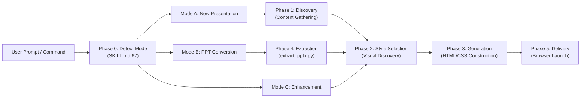

<!-- source: DeepWiki mcp.deepwiki.com · repo zarazhangrui/frontend-slides · page 1 Overview · fetched 2026-10-27 -->

# Overview

Relevant source files

The following files were used as context for generating this wiki page:

- [.claude-plugin/marketplace.json](.claude-plugin/marketplace.json)
- [README.md](README.md)
- [SKILL.md](SKILL.md)
- [plugins/frontend-slides/.claude-plugin/plugin.json](plugins/frontend-slides/.claude-plugin/plugin.json)

## Purpose and Scope

This document provides a technical introduction to the **frontend-slides** repository, a coding-agent skill system for generating animation-rich, zero-dependency HTML presentations. It covers the repository's structure, core components, the five-phase workflow pipeline, and the "Anti-AI-Slop" design philosophy.

For detailed information about specific subsystems:
- For installation and first-time setup, see **Getting Started**
- For the viewport fitting constraint system, see **Viewport Fitting System**
- For the visual theme catalog, see **Style Presets Reference**
- For the advanced template library, see **Bold Template Pack**

---

## What is Frontend Slides?

Frontend Slides is a presentation generation system designed for Claude Code and other coding agents. It transforms user intent—whether natural language prompts, PowerPoint files, or existing HTML—into professional web presentations. The system is built on a "show, don't tell" approach, generating visual previews to help users discover their preferred aesthetic [README.md:15-18]().

### Core Value Proposition

| Aspect | Implementation |
|--------|----------------|
| **Input Modalities** | Natural language prompt, PowerPoint file (`.pptx`), or existing HTML file [SKILL.md:67-73]() |
| **Output Format** | Single self-contained HTML file with inline CSS and JS [SKILL.md:12]() |
| **Runtime Dependencies** | **Zero.** No npm, build tools, or frameworks [README.md:25]() |
| **Design Philosophy** | **Anti-AI-Slop.** Curated styles that avoid generic AI aesthetics [SKILL.md:14]() |
| **Viewport Constraint** | **Fixed 16:9 Stage.** Non-negotiable 1920×1080 canvas scaled to fit [SKILL.md:16]() |

Sources: [README.md:15-31](), [SKILL.md:1-17]()

---

## Repository Structure and Core Components

The repository is organized into a core logic layer, a design specification layer, and a suite of helper scripts.

**Repository Entity Relationship**

### Component Descriptions

| Component | Role | Key Responsibilities |
|-----------|------|----------------------|
| `SKILL.md` | **Execution Engine** | Orchestrates the 5-phase workflow and enforces fixed-stage rules [SKILL.md:1-4]() |
| `STYLE_PRESETS.md` | **Design Repository** | Defines 12 safe presets with color tokens and typography [SKILL.md:15]() |
| `viewport-base.css` | **Constraint Layer** | Mandatory CSS for the 16:9 stage and scroll-snap behavior [SKILL.md:52]() |
| `bold-template-pack/` | **Advanced Library** | 34 design-forward templates from `beautiful-html-templates` [README.md:155-160]() |
| `scripts/` | **Utility Suite** | Handles PPTX extraction, Vercel deployment, and PDF export [README.md:63]() |

Sources: [README.md:53-91](), [SKILL.md:1-17]()

---

## System Capabilities & Workflow

The system operates through a structured pipeline that ensures consistency regardless of the input mode.

**Capability Routing & Pipeline**

### Operational Modes

1.  **Mode A: New Presentation**: Generates content from scratch based on a brief. The agent asks structured questions about purpose, length, and density [SKILL.md:89-108]().
2.  **Mode B: PPT Conversion**: Uses a Python script to extract text, images, and notes from `.pptx` files, preserving assets in an `assets/` directory [SKILL.md:380]().
3.  **Mode C: Enhancement**: Modifies existing HTML presentations while strictly enforcing viewport fitting and content density limits [SKILL.md:73-86]().

Sources: [SKILL.md:67-108](), [SKILL.md:380]()

---

## Core Design Principles

Four non-negotiable principles govern the technical implementation of every slide deck:

### 1. Zero Dependencies
Every presentation is a single HTML file containing all necessary CSS and JavaScript. This ensures portability and longevity without requiring `npm` or build tools [SKILL.md:12]().

### 2. Fixed 16:9 Stage (NON-NEGOTIABLE)
Unlike standard responsive web design, Frontend Slides uses a **fixed 1920×1080 canvas**. The entire stage scales uniformly to fit the viewport. This prevents content reflow and ensures the design intent is preserved on all screens, including mobile [SKILL.md:16](), [SKILL.md:38-46]().

### 3. Show, Don't Tell
The agent does not ask for abstract design descriptions. Instead, it generates three visual style previews (often one safe preset, one bold template, and one wildcard) and lets the user choose based on what they see [SKILL.md:13](), [README.md:161-166]().

### 4. Anti-AI-Slop
The system explicitly avoids generic AI design patterns, such as "purple gradients on white" or overused fonts like Inter and Arial. It prioritizes distinctive typography, high-impact motion, and layered CSS backgrounds [SKILL.md:14](), [SKILL.md:19-37]().

Sources: [SKILL.md:10-52](), [README.md:23-31]()

---

## Output Architecture

The generated output is a high-performance HTML document utilizing modern browser APIs.

| Feature | Technical Implementation |
|---------|--------------------------|
| **Layout** | `CSS Grid` and `Flexbox` within a `1920x1080` container [SKILL.md:46]() |
| **Navigation** | `SlidePresentation` JS class handling Keyboard, Touch, and Scroll events [SKILL.md:380]() |
| **Animations** | `Intersection Observer` triggering `.visible` classes for CSS transitions [SKILL.md:380]() |
| **Stage Scaling** | Viewport-relative scaling logic in `viewport-base.css` [SKILL.md:52]() |

Sources: [SKILL.md:380](), [SKILL.md:380]()

---

