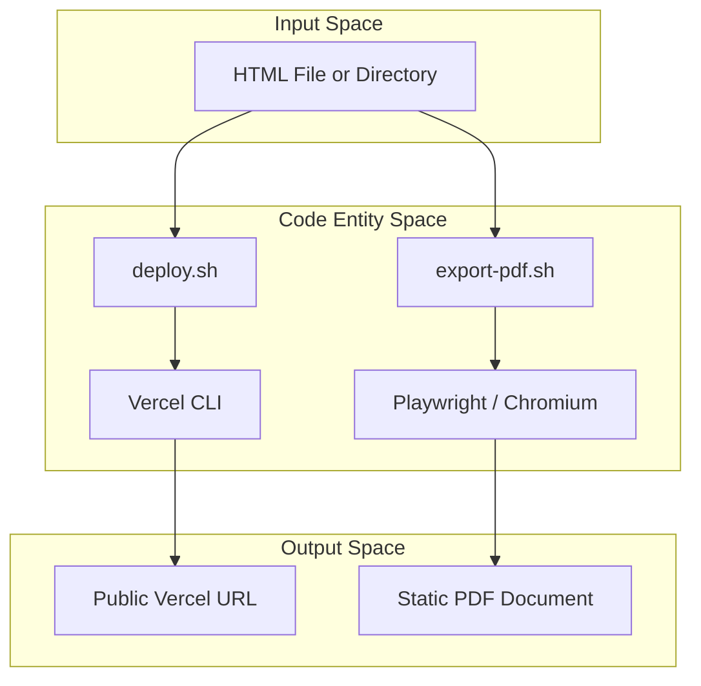
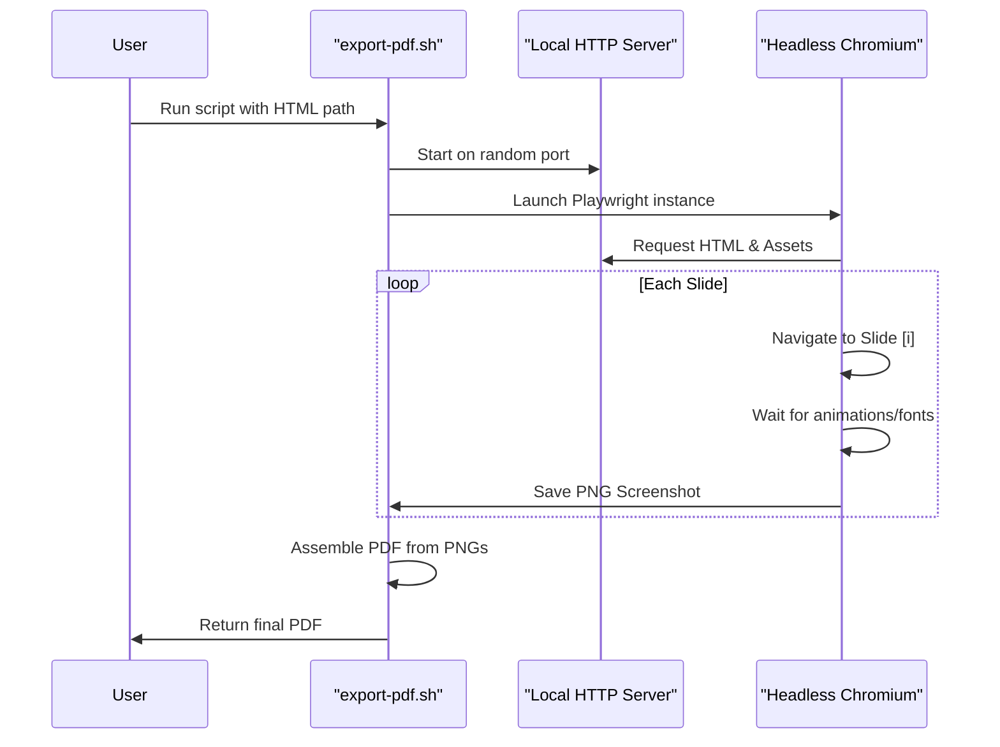

<!-- source: DeepWiki mcp.deepwiki.com · repo zarazhangrui/frontend-slides · page 10 Deployment & Export · fetched 2026-10-27 -->

# Deployment & Export

Relevant source files

The following files were used as context for generating this wiki page:

- [plugins/frontend-slides/skills/frontend-slides/scripts/deploy.sh](plugins/frontend-slides/skills/frontend-slides/scripts/deploy.sh)
- [plugins/frontend-slides/skills/frontend-slides/scripts/export-pdf.sh](plugins/frontend-slides/skills/frontend-slides/scripts/export-pdf.sh)
- [scripts/deploy.sh](scripts/deploy.sh)
- [scripts/export-pdf.sh](scripts/export-pdf.sh)

The **frontend-slides** system provides automated pipelines for distributing presentations. Users can choose between instant web hosting via Vercel or generating static documents for offline use. These capabilities are encapsulated in standalone shell scripts that handle environment preparation, asset bundling, and final delivery.

### Workflow Overview

The deployment and export processes transform the local HTML presentation into a distributable format. The system supports two primary outputs:
1.  **Web Deployment**: A public, permanent URL hosted on Vercel.
2.  **PDF Document**: A high-resolution, static capture of the presentation.

**Sources:** [scripts/deploy.sh:1-18](), [scripts/export-pdf.sh:1-18]()

---

## Vercel Deployment (`deploy.sh`)

The `deploy.sh` script automates the process of publishing a presentation to the web. It is designed to handle both standalone HTML files and complex directory-based decks with external assets.

### Asset Scraping & Bundling
When a single HTML file is provided, the script uses a `grep` and `sed` pipeline to parse the file for local references (images, styles, scripts) and bundles them into a temporary deployment directory [scripts/deploy.sh:48-67](). It also automatically includes an `assets/` folder if present in the source directory [scripts/deploy.sh:70-72]().

### Project Sanitization
To ensure compatibility with Vercel's naming conventions, the script sanitizes the project name by converting it to lowercase, replacing special characters with hyphens, and collapsing redundant separators [scripts/deploy.sh:175-178]().

For details, see [Vercel Deployment (deploy.sh)](#10.1).

**Sources:** [scripts/deploy.sh:48-88](), [scripts/deploy.sh:175-186]()

---

## PDF Export (`export-pdf.sh`)

The `export-pdf.sh` script converts the dynamic HTML presentation into a static PDF document. This is achieved by capturing high-resolution screenshots of each slide and assembling them into a single file.

### Headless Capture Pipeline
The script initializes a temporary Node.js environment (`export-slides.mjs`) that utilizes **Playwright** and **Chromium** [scripts/export-pdf.sh:119-136](). Because fonts and relative assets require an HTTP context to load correctly, the script spins up a local `http` server to serve the presentation during the capture process [scripts/export-pdf.sh:149-182]().

### Resolution & Resolution Modes
By default, slides are captured at 1920x1080 resolution [scripts/export-pdf.sh:38-39](). The script also supports a `--compact` flag which reduces the viewport to 1280x720, resulting in file sizes that are approximately 50-70% smaller [scripts/export-pdf.sh:45-49]().

**Sources:** [scripts/export-pdf.sh:127-148](), [scripts/export-pdf.sh:185-212]()

For details, see [PDF Export (export-pdf.sh)](#10.2).

---

## Summary of Commands

| Task | Command | Primary Dependency |
| :--- | :--- | :--- |
| **Deploy to Web** | `bash scripts/deploy.sh <path>` | Vercel CLI [scripts/deploy.sh:110-121]() |
| **Export PDF** | `bash scripts/export-pdf.sh <path>` | Playwright / Node.js [scripts/export-pdf.sh:100-109]() |
| **Compact PDF** | `bash scripts/export-pdf.sh <path> --compact` | Playwright / Node.js [scripts/export-pdf.sh:45-49]() |

**Sources:** [scripts/deploy.sh:5-9](), [scripts/export-pdf.sh:5-9]()

---

