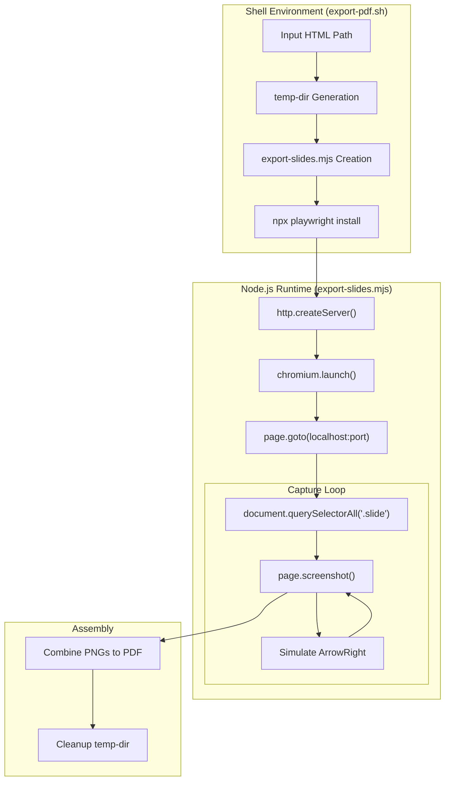
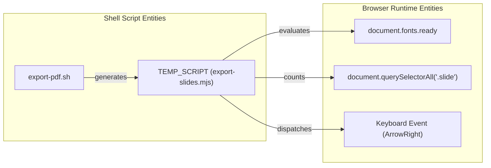

<!-- source: DeepWiki mcp.deepwiki.com · repo zarazhangrui/frontend-slides · page 10.2 PDF Export (export-pdf.sh) · fetched 2026-10-27 -->

# PDF Export (export-pdf.sh)

<details>
<summary>Relevant source files</summary>

The following files were used as context for generating this wiki page:

- [plugins/frontend-slides/skills/frontend-slides/scripts/export-pdf.sh](plugins/frontend-slides/skills/frontend-slides/scripts/export-pdf.sh)
- [scripts/deploy.sh](scripts/deploy.sh)
- [scripts/export-pdf.sh](scripts/export-pdf.sh)

</details>


The `export-pdf.sh` script provides a robust pipeline for converting animation-rich HTML presentations into static PDF documents. It ensures that the high-fidelity visual design—including custom typography, complex CSS layouts, and embedded assets—is preserved by using a headless browser to capture per-slide screenshots before assembling them into a final PDF [scripts/export-pdf.sh:11-18]().

## Pipeline Overview

The export process follows a four-step sequence to ensure that all assets (fonts, images, and styles) are correctly rendered before capture [scripts/export-pdf.sh:12-15]().

### 1. Local HTTP Server Setup
To bypass browser security restrictions regarding local file access and to ensure that Google Fonts and relative assets load correctly, the script initializes a temporary Node.js static file server [scripts/export-pdf.sh:149-150](). This server maps common presentation MIME types such as `.woff2`, `.svg`, and `.js` to their appropriate headers [scripts/export-pdf.sh:152-167]().

### 2. Headless Capture (Playwright)
The script uses **Playwright** to launch a headless Chromium instance [scripts/export-pdf.sh:193-196](). 
- **Viewport Emulation**: The browser is set to a 16:9 aspect ratio, defaulting to 1920x1080 [scripts/export-pdf.sh:38-39]().
- **Font Loading**: The script explicitly waits for `document.fonts.ready` to ensure text does not flicker or use fallback fonts during the screenshot [scripts/export-pdf.sh:202]().
- **Settling Time**: An initial 1500ms delay is applied to allow background gradients and entrance animations to settle on the first slide [scripts/export-pdf.sh:205]().

### 3. Slide Iteration Strategy
The script identifies slides by querying for `.slide` elements within the DOM [scripts/export-pdf.sh:208-210](). It iterates through the presentation by simulating keyboard navigation (Right Arrow) to trigger the internal `SlidePresentation` transitions [scripts/export-pdf.sh:226-235]().

### 4. PDF Assembly
Each slide is saved as a temporary PNG file. Once all captures are complete, the script uses `canvas` (via a generated Node script) or `img2pdf` logic to stitch these images into a single landscape PDF, where each image occupies exactly one page [scripts/export-pdf.sh:113-117]().

### Workflow Data Flow
The following diagram illustrates the transition from the shell environment to the headless browser execution.

**PDF Export Data Flow**

**Sources:** [scripts/export-pdf.sh:119-147](), [scripts/export-pdf.sh:169-188](), [scripts/export-pdf.sh:208-235]()

---

## Configuration & Flags

The script supports a resolution toggle to balance quality against file size.

| Flag | Width | Height | Description |
| :--- | :--- | :--- | :--- |
| (Default) | 1920px | 1080px | Full HD resolution. Best for printing and high-res displays. (~1-2MB per slide) |
| `--compact` | 1280px | 720px | 720p resolution. Reduces final PDF file size by 50-70%. [scripts/export-pdf.sh:45-49]() |

**Usage Example:**
```bash
bash scripts/export-pdf.sh ./my-deck/index.html ./final-output.pdf --compact
```
**Sources:** [scripts/export-pdf.sh:36-54](), [scripts/export-pdf.sh:60-67]()

---

## Implementation Details

### Browser-to-Code Interaction
The script bridges the gap between the bash environment and the presentation's JavaScript runtime by executing code within the page context.

**Code Entity Mapping**

**Sources:** [scripts/export-pdf.sh:126-148](), [scripts/export-pdf.sh:202-210](), [scripts/export-pdf.sh:229-233]()

### Dependency Management
The script performs a pre-flight check for `Node.js` and `npx` [scripts/export-pdf.sh:100-107](). It dynamically handles Playwright dependencies, ensuring the Chromium browser is available before attempting the export [scripts/export-pdf.sh:113-117]().

### Temporary Asset Handling
1. **Directory Creation**: A unique directory is created using `mktemp -d` [scripts/export-pdf.sh:119]().
2. **Serving**: The `SERVE_DIR` is set to the parent directory of the input HTML to ensure all relative paths for images and CSS are resolved correctly by the local server [scripts/export-pdf.sh:123-125]().
3. **Cleanup**: Upon completion or failure (via `set -euo pipefail`), the script is designed to remove temporary PNGs and the generated `.mjs` script [scripts/export-pdf.sh:15]().

**Sources:** [scripts/export-pdf.sh:19](), [scripts/export-pdf.sh:119-125](), [scripts/export-pdf.sh:172-182]()

---

