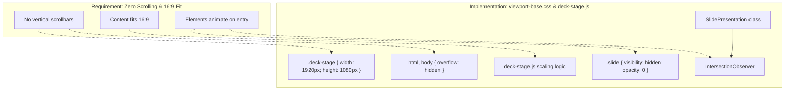
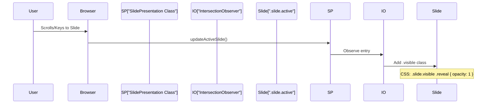

<!-- source: DeepWiki mcp.deepwiki.com · repo zarazhangrui/frontend-slides · page 11 Troubleshooting & Best Practices · fetched 2026-10-27 -->

# Troubleshooting & Best Practices

Relevant source files

The following files were used as context for generating this wiki page:

- [SKILL.md](SKILL.md)
- [viewport-base.css](viewport-base.css)

This page provides a high-level guide for resolving common technical issues encountered when using the `frontend-slides` system. It focuses on the non-negotiable **Fixed 16:9 Stage** architecture and the **Zero Dependencies** philosophy.

The system relies on a specific CSS/JS contract defined in `viewport-base.css` to ensure that presentations look identical across all devices without reflowing content. For detailed technical solutions, please refer to the child pages listed below.

## Child Pages

*   **[Common Viewport Issues](#11.1)** — Detailed diagnosis for content overflow, incorrect text sizing, and short-screen layout problems.
*   **[Content Optimization Strategies](#11.2)** — Best practices for structuring content within density limits and effective slide-splitting patterns.
*   **[Testing & Validation](#11.3)** — Comprehensive procedures for verifying presentations across different viewport sizes and devices.

---

## Core Troubleshooting Framework

Troubleshooting in `frontend-slides` primarily involves verifying compliance with the **Fixed Stage Rules** [SKILL.md:38-52](). Because the system scales a 1920×1080 canvas rather than using traditional responsive breakpoints, most "bugs" are actually content density violations or missing base styles.

### The Code-to-Viewport Relationship

The following diagram bridges the natural language requirements (e.g., "it must fit") to the specific code entities that enforce them.

**Diagram: Viewport Enforcement Architecture**

**Sources:** [viewport-base.css:7-59](), [SKILL.md:40-52](), [bold-template-pack/deck-stage.js:1-50]()

---

## Common Issue Categories

When a presentation does not render correctly, the issue usually falls into one of three categories:

### 1. Viewport Fitting & Scaling
If a slide shows a scrollbar or content is cut off, it usually means the `viewport-base.css` rules were not fully applied or the `deck-stage` scaling logic was bypassed. Every deck must use a viewport wrapper that fills the browser window and a stage that scales uniformly [SKILL.md:42-44]().

### 2. Content Density Violations
The agent enforces strict limits: no more than 4-6 bullets per slide and no text below comfortable reading sizes [SKILL.md:63-85](). If a slide feels "cramped," the best practice is to split it into multiple slides rather than shrinking the font.

### 3. Animation & State Failures
Animations are triggered by the `IntersectionObserver` adding the `.visible` class to a `.slide` [SKILL.md:380](). If elements don't appear, check if the `SlidePresentation` controller class is correctly initialized and if the `.reveal` classes are present in the HTML.

**Diagram: Animation Trigger Pipeline**

**Sources:** [SKILL.md:380](), [viewport-base.css:53-59]()

---

## Best Practices Summary

*   **Always include `viewport-base.css`**: This file contains the mandatory 16:9 stage logic [viewport-base.css:1-5]().
*   **Use `clamp()` for UI, not Slides**: While `clamp()` is used for non-slide UI, internal slide measurements should remain fixed relative to the 1920×1080 design size [SKILL.md:46-48]().
*   **Respect Density Modes**: Choose between "Low density / speaker-led" and "High density / reading-first" at the start of generation to set the correct spatial constraints [SKILL.md:54-63]().
*   **Zero Dependencies**: Do not introduce external libraries (npm, build tools). All logic must be inline CSS/JS [SKILL.md:12]().

For detailed implementation of these practices, see **[Content Optimization Strategies](#11.2)**.

**Sources:** [SKILL.md:10-16](), [viewport-base.css:1-133]()

---

