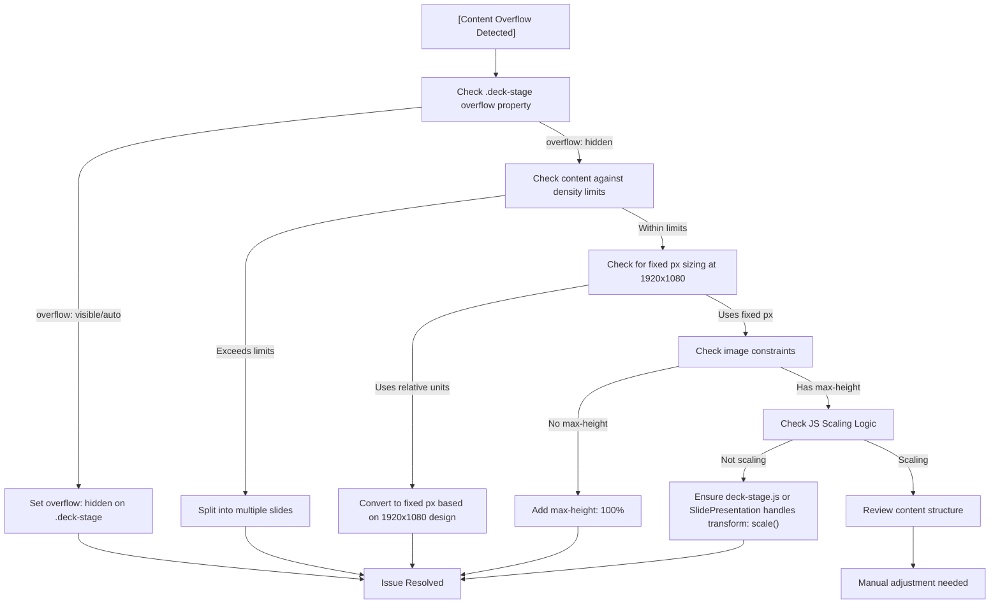
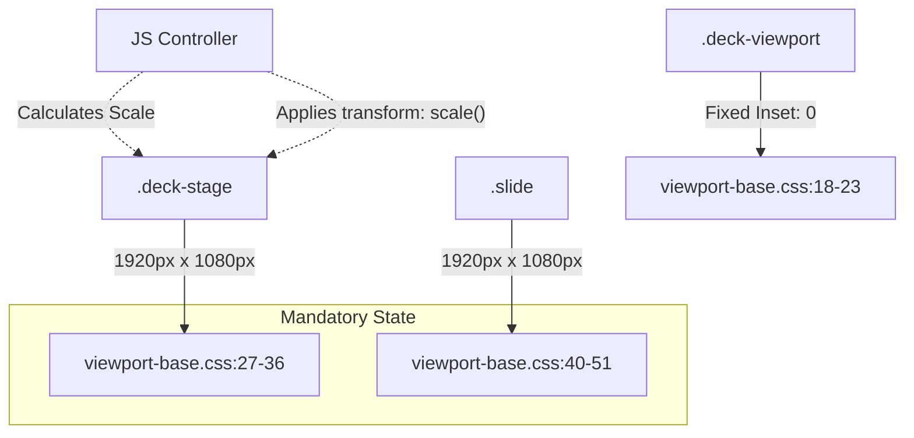

<!-- source: DeepWiki mcp.deepwiki.com · repo zarazhangrui/frontend-slides · page 11.1 Common Viewport Issues · fetched 2026-10-27 -->

# Common Viewport Issues

<details>
<summary>Relevant source files</summary>

The following files were used as context for generating this wiki page:

- [SKILL.md](SKILL.md)
- [viewport-base.css](viewport-base.css)

</details>


This page documents common problems that violate the viewport fitting constraint and provides specific diagnostic steps and solutions. Every slide in a frontend-slides presentation must fit exactly within the viewport with no scrolling. In the current architecture, this is achieved by rendering slides within a fixed 1920×1080 stage that scales uniformly to the browser window.

For the architectural rationale behind viewport fitting, see [Core Requirements & Philosophy](#5.1). For the complete CSS specification, see [Required Base CSS Architecture](#5.2).

---

## Overview

Viewport issues manifest in three primary categories:

| Issue Category | Symptom | Root Cause |
|----------------|---------|------------|
| Content Overflow | Scrollbar appears, content clipped | Too much content or fixed sizing |
| Text Sizing | Unreadable on mobile or oversized on desktop | Missing uniform scaling or incorrect design-time units |
| Layout Collapse | Excessive whitespace or squashed content | Content reflowing instead of scaling |

All viewport issues ultimately stem from violations of the **Fixed Stage Rules** defined in [SKILL.md:38-52](), which mandate that every slide is authored inside a fixed 1920×1080 design canvas.

Sources: [SKILL.md:38-52]()

---

## Issue Type 1: Content Overflow

### Symptom Identification

**Visual indicators:**
- Vertical scrollbar appears within a slide.
- Content clipped at viewport edge.
- Elements positioned outside the 1920×1080 `.deck-stage` boundary.
- `overflow: visible` or `overflow: auto` computed on `.slide`.

**Browser DevTools detection:**
```javascript
// Check if slide stage has overflow
const stage = document.querySelector('.deck-stage');
if (stage.scrollHeight > 1080 || stage.scrollWidth > 1920) {
    console.warn(`Stage overflows: ${stage.scrollWidth}x${stage.scrollHeight}`);
}
```

### Diagnostic Decision Tree



Sources: [SKILL.md:40-48](), [viewport-base.css:25-36]()

### Solution 1: Verify Stage Overflow Property

The `.deck-stage` and `.slide` classes must have `overflow: hidden` set to ensure no scrollbars appear if content slightly exceeds the design bounds.

```css
/* viewport-base.css:33-33 */
.deck-stage {
    overflow: hidden;
}

/* viewport-base.css:45-45 */
.slide {
    overflow: hidden;
}
```

**Location in specification:** [viewport-base.css:27-51]()

### Solution 2: Reduce Content to Density Limits

The system defines two density modes. If content exceeds these, it will overflow the 1080px height.

| Density Mode | Maximum Content | Specification |
|--------------|-----------------|---------------|
| **Low density** | 1 idea per slide, 1-3 bullets max | [SKILL.md:60-60]() |
| **High density** | 4-8 bullets or 4-6 cards | [SKILL.md:61-61]() |

**Action:** If content exceeds these limits, split into multiple slides. Never shrink text below readable sizes to fit more content [SKILL.md:63-63]().

Sources: [SKILL.md:54-63]()

### Solution 3: Constrain Media Heights

Media elements must be constrained to stay within the authored slide bounds to prevent pushing other content out of the stage.

```css
/* viewport-base.css:62-68 */
img,
video,
canvas,
svg {
    max-width: 100%;
    max-height: 100%;
}
```

Sources: [viewport-base.css:61-68]()

---

## Issue Type 2: Scaling and Layout Collapse

Unlike standard responsive web design, `frontend-slides` uses a **Fixed Stage** approach. Layout collapse usually occurs when developers attempt to use `vw`/`vh` units or media queries to reflow content, which is strictly forbidden.

### CSS Entity Mapping



Sources: [viewport-base.css:17-51](), [SKILL.md:40-48]()

### Solution: Enforce Fixed Internal Measurements

Content must be laid out at the 1920×1080 design size. Do not use responsive breakpoints to rearrange slide content for phones [SKILL.md:45-45]().

**Correct Pattern:**
```css
.title {
    font-size: 80px; /* Fixed px based on 1080px height */
    margin-bottom: 40px;
}
```

**Incorrect Pattern:**
```css
.title {
    font-size: 5vw; /* Will scale incorrectly relative to the already-scaled stage */
}
```

Sources: [SKILL.md:46-46]()

---

## Issue Type 3: Slide Visibility and Switching

A common issue is slides not appearing or multiple slides appearing at once due to incorrect visibility CSS.

### Visibility Logic
Slides use `visibility`, `opacity`, and `pointer-events` for switching. `display: none` is avoided because layout classes (like `.slide-content { display: flex; }`) can override it, causing all slides to stack and overflow [SKILL.md:47-47]().

```css
/* viewport-base.css:47-49 */
.slide {
    visibility: hidden;
    opacity: 0;
    pointer-events: none;
}

/* viewport-base.css:53-59 */
.slide.active,
.slide.visible {
    visibility: visible;
    opacity: 1;
    pointer-events: auto;
    z-index: 1;
}
```

Sources: [viewport-base.css:40-60](), [SKILL.md:47-47]()

---

## Diagnostic Checklist

Use this systematic checklist to identify viewport issues:

1. **Stage Lock:** Is the `.deck-viewport` set to `position: fixed; inset: 0; overflow: hidden;`? [viewport-base.css:18-23]()
2. **Fixed Dimensions:** Is the `.deck-stage` exactly `1920px` by `1080px`? [viewport-base.css:31-32]()
3. **Scaling:** Does the JavaScript apply a `transform: scale(...)` to `.deck-stage` to fit the current window? [SKILL.md:44-44]()
4. **No Reflow:** Are there any `@media` queries attempting to change the layout (flex-direction, etc.) for mobile? (If yes, remove them) [SKILL.md:45-45]()
5. **Density Check:** Does the slide contain more than 8 bullets or 6 cards? (If yes, split the slide) [SKILL.md:63-63]()
6. **Media Constraints:** Do all `img` and `video` tags have `max-height: 100%`? [viewport-base.css:66-67]()
7. **Visibility:** Are slides switched using `.active` / `.visible` classes rather than `display: block`? [SKILL.md:47-47]()

Sources: [SKILL.md:38-52](), [viewport-base.css:1-68]()

---

## Print and Reduced Motion Issues

### Print Overflow
When printing, the stage scaling must be disabled to ensure one slide fits per PDF page.

```css
/* viewport-base.css:95-101 */
@media print {
    .deck-stage {
        position: static;
        width: auto;
        height: auto;
        transform: none !important;
    }
    .slide {
        width: 1920px;
        height: 1080px;
        break-after: page;
    }
}
```

### Motion Accessibility
Animations must be suppressed for users with motion sensitivity to prevent layout shifting during transitions.

```css
/* viewport-base.css:126-133 */
@media (prefers-reduced-motion: reduce) {
    *,
    *::before,
    *::after {
        animation-duration: 0.01ms !important;
        transition-duration: 0.2s !important;
    }
}
```

Sources: [viewport-base.css:80-133]()

---

