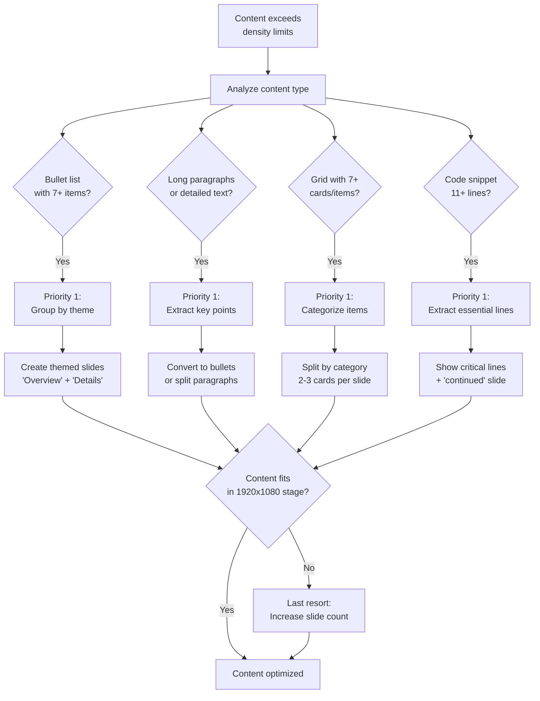
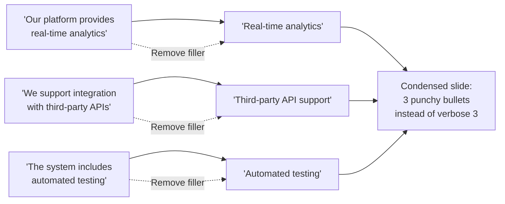
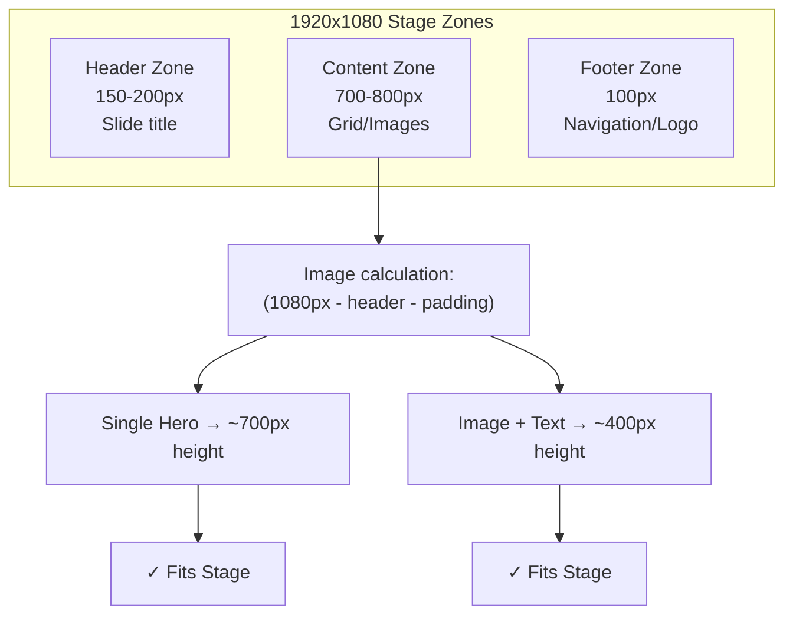

<!-- source: DeepWiki mcp.deepwiki.com · repo zarazhangrui/frontend-slides · page 11.2 Content Optimization Strategies · fetched 2026-10-27 -->

# Content Optimization Strategies

Relevant source files

The following files were used as context for generating this wiki page:

- [SKILL.md](SKILL.md)
- [plugins/frontend-slides/skills/frontend-slides/SKILL.md](plugins/frontend-slides/skills/frontend-slides/SKILL.md)

This document provides practical techniques for structuring presentation content to remain within viewport fitting constraints while maximizing information density. It focuses on when to split slides versus when to condense content, how to optimize text and media, and decision-making frameworks for content organization based on the **Fixed 16:9 Stage** architecture.

For diagnosing viewport overflow problems, see [Common Viewport Issues](). For testing procedures to validate content fits correctly, see [Testing & Validation](). For the underlying technical requirements, see [Viewport Fitting System]().

---

## Content Density Limits Reference

Every slide type has strict maximum content allowances to guarantee viewport fitting. These limits are enforced during Phase 3 (Presentation Generation) and must never be exceeded. The system utilizes a fixed 1920×1080 stage that scales uniformly to the viewport [SKILL.md:16-16](), [SKILL.md:43-44]().

### Maximum Content Per Slide Type

| Slide Type | Maximum Content | Typical Height Usage |
|------------|-----------------|---------------------|
| **Title slide** | 1 heading + 1 subtitle + optional tagline | 30-40% stage height |
| **Content slide** | 1 heading + 4-6 bullet points OR 1 heading + 2 paragraphs | 60-70% stage height |
| **Feature grid** | 1 heading + 6 cards maximum (2×3 or 3×2 grid) | 70-80% stage height |
| **Code slide** | 1 heading + 8-10 lines of code maximum | 60-70% stage height |
| **Quote slide** | 1 quote (max 3 lines) + attribution | 40-50% stage height |
| **Image slide** | 1 heading + 1 image (max 60% stage height) | 70-80% stage height |

**Sources:** [SKILL.md:40-52](), [SKILL.md:54-63]()

### Bullet Point Length Guidelines

Content slides support 4-6 bullet points, but individual bullet length matters for vertical budget:

- **1 line per bullet:** 6 bullets maximum.
- **2 lines per bullet:** 4-5 bullets maximum.
- **3+ lines per bullet:** Split into multiple slides or convert to a paragraph slide.

**Sources:** [SKILL.md:60-63](), [SKILL.md:81-81]()

---

## Content Reduction Strategy Framework

When content exceeds density limits, apply this decision framework to ensure the 1920×1080 stage remains valid without requiring scrollbars.

### Decision Flow: Content Exceeds Limits

**Diagram: Content reduction decision tree based on fixed stage constraints.**

**Sources:** [SKILL.md:54-63](), [SKILL.md:79-85]()

---

## Split vs. Condense Decision Making

### When to Split Into Multiple Slides

The system mandates that if content exceeds the selected density mode, it must be split into more slides instead of shrinking until it becomes cramped [SKILL.md:63-63]().

**Always split when:**
- Bullet points exceed 6 items.
- Code snippets exceed 10 lines.
- Grid contains more than 6 cards.
- Content requires vertical scrolling within the `.slide` container.
- Adding an image to an already full slide [SKILL.md:85-85]().

**Splitting patterns:**

| Original Content | Split Strategy | Example |
|-----------------|----------------|---------|
| 10 feature bullets | "Key Features" (6) + "Additional Features" (4) | Group by priority or theme. |
| 15-line code block | "Implementation (1/2)" + "Implementation (2/2)" | Split at logical boundary. |
| 9-card grid | "Solutions: Frontend" (3) + "Solutions: Backend" (3) + "Solutions: Deployment" (3) | Categorize by domain. |

**Sources:** [SKILL.md:60-63](), [SKILL.md:81-83]()

### When to Condense Content

**Condense when:**
- Multiple bullets convey similar information.
- Wording is verbose or repetitive.
- The presentation is "Low density / speaker-led" (1-3 bullets max) [SKILL.md:60-60]().

**Condensing techniques:**

**Diagram: Verbal condensing reduces line count to fit speaker-led density modes.**

**Sources:** [SKILL.md:60-63]()

---

## Typography and Stage Scaling

Typography in the `frontend-slides` system is unique because it must scale with the 1920×1080 stage. While `clamp()` is used for non-slide UI, internal slide measurements should ideally be fixed at the design size to ensure the uniform scale works correctly [SKILL.md:46-48]().

### Typography Sizing Guidelines

| Density Mode | Heading Size (approx) | Body Size (approx) | Use Case |
|--------------|-----------------------|--------------------|----------|
| **Low Density** | 80px - 120px | 32px - 48px | Public talks, Keynotes |
| **High Density** | 60px - 80px | 24px - 32px | Reports, Handouts |

**Do not:**
- Use `display: none` for slide switching; use `visibility` and `opacity` to avoid layout shifts [SKILL.md:47-47]().
- Use responsive breakpoints to rearrange content; the stage must scale as a whole [SKILL.md:44-45]().

**Sources:** [SKILL.md:42-48](), [SKILL.md:60-61]()

---

## Layout and Media Optimization

### Image Sizing Constraints

Images must fit within the 1920×1080 slide canvas. If a slide already has maximum content, the image must be moved to a new slide [SKILL.md:80-85]().

**Diagram: Vertical space allocation within the 1920x1080 design stage.**

**Sources:** [SKILL.md:43-46](), [SKILL.md:85-85]()

### Code Slide Optimization

Code slides have the strictest content limits due to the fixed stage height.

**Code Content Limits:**
- **Maximum:** 8-10 lines of code per slide.
- **Font:** Monospace (e.g., JetBrains Mono) sized for readability at 1080p height.

**Sources:** [SKILL.md:42-43](), [SKILL.md:63-63]()

---

## Content Optimization Checklist

Before finalizing any presentation, verify each slide against the **Fixed Stage Rules**:

- [ ] **Stage Integrity:** Slide is authored inside a 1920×1080 container [SKILL.md:43-43]().
- [ ] **No Scrolling:** Content does not overflow the stage boundaries [SKILL.md:63-63]().
- [ ] **Density Check:** Low-density slides have 1-3 bullets; high-density have 4-8 [SKILL.md:60-61]().
- [ ] **Image Fit:** Images do not overlap text or exceed the stage height [SKILL.md:82-82]().
- [ ] **Visibility Control:** Slide transitions use `visibility` and `opacity`, not `display: none` [SKILL.md:47-47]().
- [ ] **No Reflow:** Content does not rearrange itself when the browser window is resized [SKILL.md:44-45]().

**Sources:** [SKILL.md:38-52](), [SKILL.md:82-85]()

---

