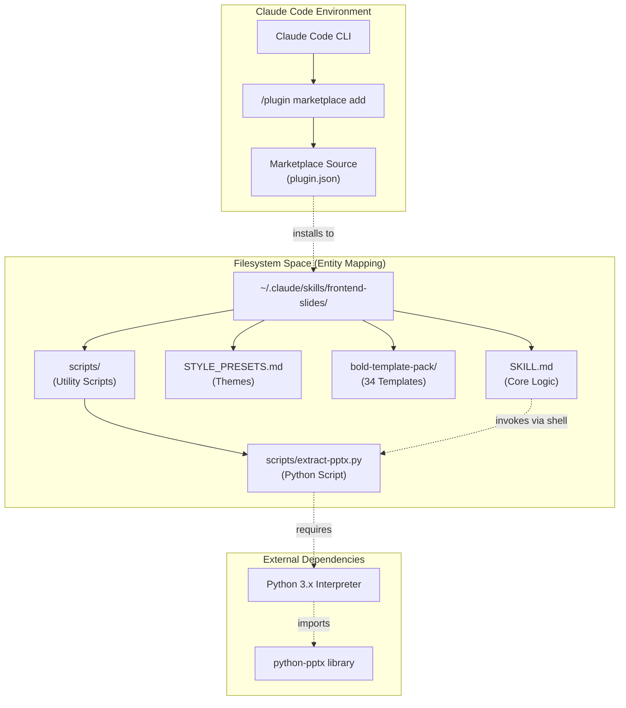
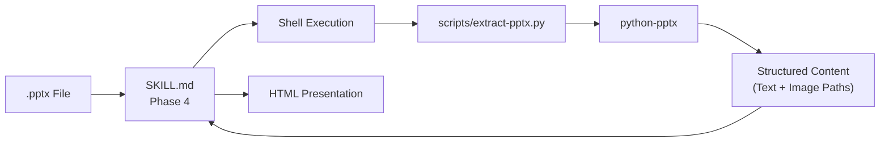

<!-- source: DeepWiki mcp.deepwiki.com · repo zarazhangrui/frontend-slides · page 2.1 Installation & Requirements · fetched 2026-10-27 -->

# Installation & Requirements

<details>
<summary>Relevant source files</summary>

The following files were used as context for generating this wiki page:

- [.claude-plugin/marketplace.json](.claude-plugin/marketplace.json)
- [README.md](README.md)
- [plugins/frontend-slides/.claude-plugin/plugin.json](plugins/frontend-slides/.claude-plugin/plugin.json)

</details>


## Purpose and Scope

This document details the installation process for the `frontend-slides` skill and its system requirements. It covers the mandatory Claude Code CLI setup via the plugin marketplace, manual installation methods for other coding agents, and the optional Python environment configuration for PowerPoint conversion.

The skill follows a **Zero Dependencies** philosophy [README.md:25-25](), ensuring that while the installation requires specific tools, the generated output is a single HTML file that runs in any modern browser without build tools.

**Sources:** [README.md:1-31](), [README.md:95-95]()

---

## System Requirements Overview

The frontend-slides skill has a minimal dependency footprint.

| Component | Status | Purpose | Used By |
|-----------|--------|---------|---------|
| **Claude Code CLI** | **Required** | Executes skill via `/plugin` or `/frontend-slides` | All modes |
| **Python 3.x + python-pptx** | Optional | Extracts content from `.pptx` files | PPT conversion only |
| **Web Browser** | Required | Renders generated HTML presentations | All modes |
| **Git** | Recommended | For cloning the repository and plugin updates | Installation |

**Sources:** [README.md:32-72](), [README.md:117-131]()

---

## Installation Architecture

The following diagram illustrates the integration of the skill into the Claude Code environment and its relationship with the optional Python extraction script.

**Diagram: Skill Integration and Code Entity Mapping**



**Sources:** [README.md:32-64](), [plugins/frontend-slides/.claude-plugin/plugin.json:1-14](), [.claude-plugin/marketplace.json:1-18]()

---

## Core Installation Methods

### 1. Via Claude Code Marketplace (Recommended)

The most streamlined way to install is using the Claude Code plugin system. This namespaces the command as `/frontend-slides:frontend-slides`.

Run these as two separate messages in Claude Code:

```text
/plugin marketplace add https://github.com/zarazhangrui/frontend-slides
```

Followed by:

```text
/plugin install frontend-slides@frontend-slides
```

**Sources:** [README.md:34-50]()

### 2. Manual Installation (Standalone Skill)

If you prefer a standalone skill (invoked via `/frontend-slides` without namespacing) or are using a different coding agent, clone the repository directly into your skills directory.

```bash
# Clone directly to the skills directory
git clone https://github.com/zarazhangrui/frontend-slides.git ~/.claude/skills/frontend-slides
```

The agent requires access to the following core files to function:
*   `SKILL.md`: The primary execution logic.
*   `STYLE_PRESETS.md`: The catalog of 12 curated styles [README.md:84-84]().
*   `bold-template-pack/`: The library of 34 advanced templates [README.md:88-88]().
*   `viewport-base.css`: The mandatory layout engine [README.md:85-85]().

**Sources:** [README.md:52-72](), [README.md:82-89]()

---

## PowerPoint Conversion Setup

PowerPoint conversion requires the `scripts/extract-pptx.py` script to be executable and its dependencies met.

### Dependency Chain

**Diagram: PPTX Extraction Data Flow**



### Installation Steps

1.  **Install Python 3**: Ensure `python3` is in your system PATH.
2.  **Install Library**:
    ```bash
    pip install python-pptx
    ```
3.  **Script Location**: Ensure `scripts/extract-pptx.py` is located in the `scripts/` subdirectory of your installation [README.md:63-63]().

**Sources:** [README.md:63-63](), [README.md:117-131]()

---

## Verification Checklist

After installation, you can verify the setup by checking for key files and command availability.

| Component | Verification Action | Expected Result |
|-----------|---------------------|-----------------|
| **Plugin** | Run `/plugin list` | `frontend-slides` appears in list |
| **Command** | Type `/frontend-slides` | Agent responds with "Phase 1: Content Discovery" |
| **Templates** | Check `bold-template-pack/` | Contains `selection-index.json` and 34 folders |
| **Scripts** | Check `scripts/` | Contains `extract-pptx.py`, `deploy.sh`, `export-pdf.sh` |
| **Python** | `python3 -c "import pptx"` | No error message |

**Sources:** [README.md:32-72](), [README.md:155-173]()

---

## File Organization

A complete installation includes the following structure:

```text
~/.claude/skills/frontend-slides/
├── SKILL.md                # Main instruction set
├── STYLE_PRESETS.md        # 12 core styles
├── viewport-base.css       # Mandatory viewport fitting CSS
├── html-template.md        # Base HTML structure
├── animation-patterns.md   # CSS animation definitions
├── bold-template-pack/     # 34 high-end templates
│   ├── selection-index.json
│   └── [template-folders]/
└── scripts/                # Utility scripts
    ├── extract-pptx.py     # PPT conversion logic
    ├── deploy.sh           # Vercel deployment
    └── export-pdf.sh       # Playwright PDF export
```

**Sources:** [README.md:52-64](), [README.md:82-89]()

---

