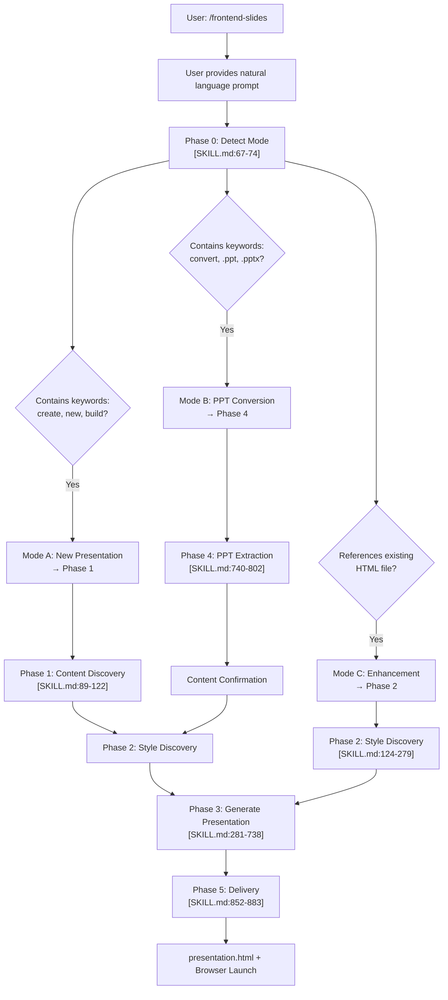
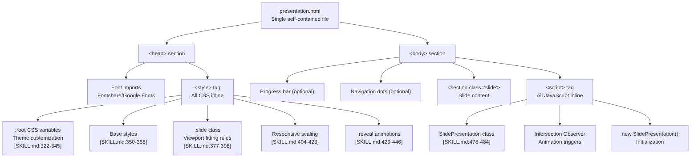
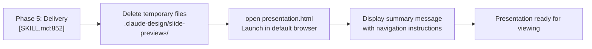

<!-- source: DeepWiki mcp.deepwiki.com · repo zarazhangrui/frontend-slides · page 2.2 Quick Start Guide · fetched 2026-10-27 -->

# Quick Start Guide

<details>
<summary>Relevant source files</summary>

The following files were used as context for generating this wiki page:

- [SKILL.md](SKILL.md)
- [plugins/frontend-slides/skills/frontend-slides/SKILL.md](plugins/frontend-slides/skills/frontend-slides/SKILL.md)

</details>


## Purpose and Scope

This guide provides a hands-on walkthrough for creating your first HTML presentation using the `/frontend-slides` command. You will learn the basic interaction pattern, understand what to expect at each phase, and see how to navigate the generated output.

For installation instructions, see **2.1 Installation & Requirements**. For in-depth coverage of specific usage modes, see **3. User Guide**.

---

## Invoking the Skill

The frontend-slides system is invoked through Claude Code CLI using the `/frontend-slides` command. When executed, the system enters **Phase 0: Mode Detection** to determine your intent.

```bash
/frontend-slides
```

After invocation, provide a natural language prompt describing what you want to create:

```
"I want to create a pitch deck for my AI startup"
```

**Mode Detection Flow**



Sources: [SKILL.md:67-74](), [SKILL.md:89-122](), [SKILL.md:124-279](), [SKILL.md:281-380](), [SKILL.md:380](), [SKILL.md:380]()

---

## Phase 1: Content Discovery

When creating a new presentation (Mode A), the system uses the `AskUserQuestion` API to gather structured information about your content requirements.

### Question Sequence

The system asks four primary questions together to minimize back-and-forth [SKILL.md:89-107]():

| Question | Header | Purpose | Options |
|----------|--------|---------|---------|
| Purpose | "Purpose" | Understand presentation context | Pitch deck / Teaching-Tutorial / Conference talk / Internal presentation |
| Slide Count | "Length" | Determine scope | Short 5-10 / Medium 10-20 / Long 20+ |
| Content Readiness | "Content" | Assess content preparation | All content ready / Rough notes / Topic only |
| Density | "Density" | Determine layout spacing | Low density (speaker-led) / High density (reading-first) |

**Example Interaction:**

```
System: What is this presentation for?
Options:
- Pitch deck
- Teaching-Tutorial
- Conference talk
- Internal presentation

User: Pitch deck

System: Approximately how many slides?
Options:
- Short 5-10
- Medium 10-20
- Long 20+

User: Medium 10-20

...
```

If you select "All content ready" or "Rough notes", the system will prompt you to share your content (text, bullet points, images, etc.) before proceeding to styling [SKILL.md:109-115]().

Sources: [SKILL.md:89-115]()

---

## Phase 2: Style Discovery

Phase 2 implements the **"show, don't tell"** philosophy [SKILL.md:126-127](). Instead of asking you to describe abstract aesthetic preferences, the system generates visual HTML preview files.

### Style Selection Methods

```mermaid
flowchart LR
    Phase2Start["Phase 2: Style Discovery<br/>[SKILL.md:124-279]"] --> PathChoice{"AskUserQuestion:<br/>How to choose style?"}
    
    PathChoice -->|"Show me options"| Guided["Guided Discovery<br/>Path A"]
    PathChoice -->|"I know what I want"| Direct["Direct Selection<br/>Path B"]
    
    Guided --> Mood["Mood Selection Question<br/>[SKILL.md:189-197]<br/>multiSelect: true"]
    Direct --> PickerList["Display 12 preset options<br/>[SKILL.md:145-159]"]
    
    Mood --> Map["Map mood to style subset<br/>[SKILL.md:211-215]"]
    PickerList --> Selected["User picks preset by name"]
    
    Map --> Generate["Generate 3 HTML previews<br/>.claude-design/slide-previews/"]
    
    Generate --> TempFiles["style-a.html<br/>style-b.html<br/>style-c.html<br/>[SKILL.md:231-239]"]
    
    TempFiles --> Browser["User opens files in browser"]
    Browser --> UserPick["AskUserQuestion:<br/>Pick Your Style<br/>[SKILL.md:266-277]"]
    
    UserPick --> Phase3["Phase 3: Generate Presentation"]
    Selected --> Phase3
```



Sources: [SKILL.md:124-279]()

### Mood Selection (Guided Discovery)

If you choose "Show me options", the system asks about the intended audience feeling using [SKILL.md:189-197]():

```
Question: What feeling should the audience have when viewing your slides?

Options (select up to 2):
- Impressed/Confident — Professional, trustworthy, this team knows what they're doing
- Excited/Energized — Innovative, bold, this is the future
- Calm/Focused — Clear, thoughtful, easy to follow
- Inspired/Moved — Emotional, storytelling, memorable
```

**Mood-to-Style Mapping Examples:**

| Mood | Suggested Styles |
|------|------------------|
| Impressed/Confident | Bold Signal, Electric Studio, Midnight Executive |
| Excited/Energized | Neon Cyber, Creative Voltage, Split Pastel |
| Calm/Focused | Notebook Tabs, Paper & Ink, Swiss Modern |
| Inspired/Moved | Dark Botanical, Vintage Editorial, Pastel Geometry |

Sources: [SKILL.md:211-215]()

### Preview File Structure

The system generates three temporary HTML files in `.claude-design/slide-previews/` [SKILL.md:231-239]():

```
.claude-design/slide-previews/
├── style-a.html   # First style option
├── style-b.html   # Second style option
└── style-c.html   # Third style option
```

Each preview is a single "title slide" demonstrating the aesthetic, typography, and motion style [SKILL.md:241-245]().

Sources: [SKILL.md:231-245]()

---

## Phase 3: Presentation Generation

After style selection, the system enters **Phase 3: Generate Presentation** [SKILL.md:281-380](), which constructs the full HTML file.

### Generated File Structure

**For single presentations:**
```
presentation.html    # Self-contained presentation
assets/              # Images (if any)
```

**For projects with multiple presentations:**
```
[presentation-name].html
[presentation-name]-assets/
```

Sources: [SKILL.md:289-300]()

### HTML Architecture

The generated file follows this structure defined in [SKILL.md:304-380]():



Sources: [SKILL.md:304-380]()

### Non-Negotiable Viewport Fitting

Every slide MUST fit exactly within the viewport without scrolling [SKILL.md:16](). The system enforces this through a **Fixed 16:9 Stage** (1920×1080) that scales uniformly to fit the browser window [SKILL.md:38-52]().

**Content Density Enforcement [SKILL.md:60-63]():**

| Slide Type | Maximum Content |
|------------|-----------------|
| Title slide | 1 heading + 1 subtitle + optional tagline |
| Content slide | 1 heading + 4-6 bullet points |
| Feature grid | 1 heading + 6 cards maximum |
| Code slide | 1 heading + 8-10 lines of code |

If content exceeds these limits, the system splits it into multiple slides [SKILL.md:63]().

Sources: [SKILL.md:16](), [SKILL.md:38-63]()

---

## Phase 5: Delivery

The final phase [SKILL.md:380]() performs cleanup and launches the presentation.

### Delivery Actions



Sources: [SKILL.md:380]()

---

## Understanding the Generated Output

### Runtime Components

The generated HTML includes these key JavaScript components:

| Component | Purpose | Location |
|-----------|---------|----------|
| `SlidePresentation` class | Main controller for navigation and interactions | [SKILL.md:380]() |
| Intersection Observer | Detects slide visibility, triggers `.visible` class | [SKILL.md:380]() |
| Keyboard Handlers | Arrow keys (← →) and Space bar navigation | [SKILL.md:380]() |

### Navigation Methods

The presentation supports multiple navigation methods:
- **Keyboard**: Arrow keys, Space bar.
- **Touch**: Swipe gestures.
- **Mouse**: Mouse wheel scrolling.
- **Direct**: Click navigation dots or progress bar.

### Animation System

The `.reveal` class pattern [SKILL.md:380]():
The Intersection Observer adds the `.visible` class when a slide enters the viewport, triggering CSS transitions for any element with the `.reveal` class.

Sources: [SKILL.md:380]()

---

## Customizing Your Presentation

### CSS Custom Properties

All theme values are defined in `:root` variables [SKILL.md:322-345]():

```css
:root {
    /* Colors */
    --bg-primary: #0a0f1c;
    --accent: #00ffcc;
    
    /* Typography */
    --font-display: 'Clash Display', sans-serif;
    --font-body: 'Satoshi', sans-serif;
}
```

**To customize:** Open the HTML file, locate the `:root` section, and modify the variable values.

Sources: [SKILL.md:322-345]()

### Testing Your Presentation

After generation, test your presentation at different sizes [SKILL.md:45-48](). The stage will letterbox or pillarbox to maintain the 16:9 aspect ratio, ensuring your layout never breaks.

Sources: [SKILL.md:38-52]()

---

