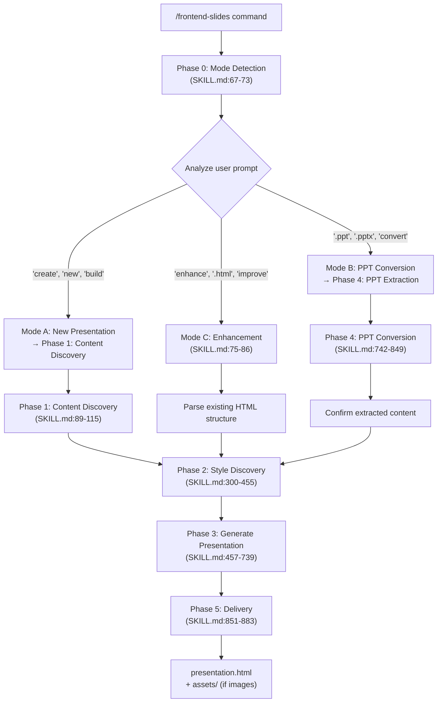
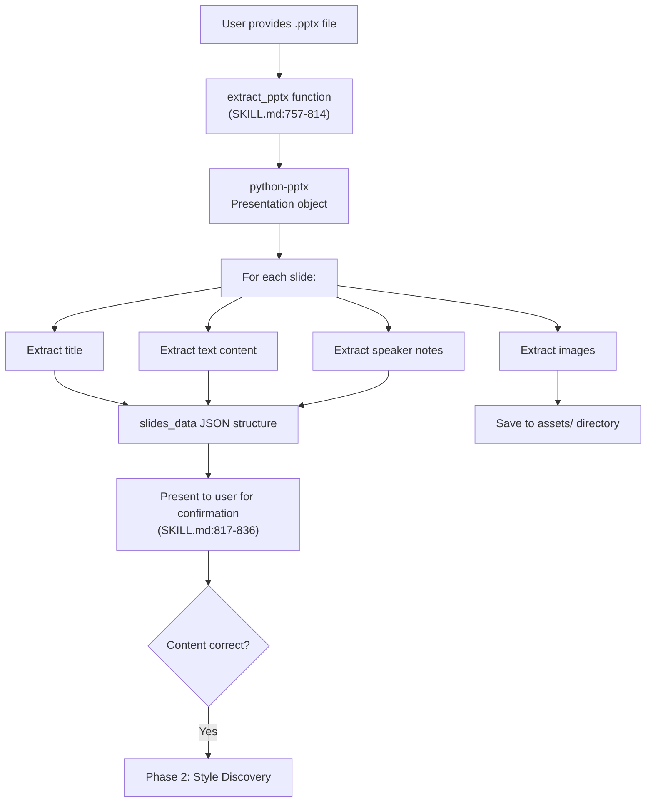
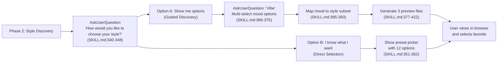

<!-- source: DeepWiki mcp.deepwiki.com · repo zarazhangrui/frontend-slides · page 3 User Guide · fetched 2026-10-27 -->

# User Guide

Relevant source files

The following files were used as context for generating this wiki page:

- [SKILL.md](SKILL.md)
- [plugins/frontend-slides/skills/frontend-slides/SKILL.md](plugins/frontend-slides/skills/frontend-slides/SKILL.md)

This page provides comprehensive guidance for using the frontend-slides system to create animation-rich HTML presentations. It covers the three main usage modes: creating new presentations from scratch, converting PowerPoint files to HTML, and enhancing existing presentations.

---

## Overview of Usage Modes

The frontend-slides system supports three distinct workflows, all accessed through the `/frontend-slides` command in Claude Code CLI. The system automatically detects which mode to use based on user intent during Phase 0 (Mode Detection).

### Mode Detection and Routing

**Sources:** [SKILL.md:67-73](), [SKILL.md:75-86](), [SKILL.md:89-115](), [SKILL.md:300-380](), [SKILL.md:380](), [SKILL.md:380](), [SKILL.md:380]()

### Mode Comparison

| Mode | Entry Point | Primary Use Case | Output |
|------|-------------|------------------|--------|
| **Mode A: New Presentation** | Natural language prompt | Creating slides from scratch, content ideation | Single `presentation.html` file |
| **Mode B: PPT Conversion** | `.ppt` or `.pptx` file | Migrating existing PowerPoint to web | `presentation.html` + `assets/` directory |
| **Mode C: Enhancement** | Existing `.html` file | Improving existing HTML presentations | Modified HTML file |

**Sources:** [SKILL.md:67-73]()

---

## Workflow Details by Mode

### Mode A: New Presentation Creation

The new presentation workflow consists of content discovery and style selection. For a detailed walkthrough of the content generation process, see [Creating New Presentations](#3.1).

#### Phase 1: Content Discovery Process

The system uses a structured-question UI to gather requirements across four key areas: Purpose, Length, Content Readiness, and Density.

**Sources:** [SKILL.md:89-115]()

#### Content Density Enforcement

To ensure **Viewport Fitting** (no scrolling within slides), the system enforces strict content limits based on the selected density mode:

| Density Mode | Best For | Design Behavior |
|--------------|----------|-----------------|
| **Low density** | Public talks, keynotes | 1 idea per slide, 1-3 bullets max, large type |
| **High density** | Reports, async review | Structured grids, 4-8 bullets or 4-6 cards |

**Sources:** [SKILL.md:54-63](), [SKILL.md:221-237]()

---

### Mode B: PowerPoint Conversion

The PPT conversion workflow extracts content using a Python-based extraction pipeline, then routes through the same style selection and generation process as new presentations. For details on how content is preserved, see [Converting PowerPoint Files](#3.2).

#### PPT Extraction Pipeline

**Sources:** [SKILL.md:380]()

---

### Mode C: Existing Presentation Enhancement

When enhancing an existing HTML presentation, the system follows specific **Mode C Modification Rules** to prevent breaking the viewport fitting system.

**Key Rules:**
1. **Density Check:** Count existing elements before adding new ones [SKILL.md:79]().
2. **Image Fitting:** Fit images inside the 1920×1080 stage; split slides if stage is full [SKILL.md:80]().
3. **Proactive Reorganization:** Automatically split content if modifications cause overflow [SKILL.md:83]().

**Sources:** [SKILL.md:75-86]()

---

## Style Selection Process

Style selection uses a "show, don't tell" philosophy. For a full catalog of available themes and the visual discovery approach, see [Style Selection Process](#3.3).

### Style Selection Path Routing

**Sources:** [SKILL.md:300-380]()

---

## Fixed 16:9 Stage Invariants

Every presentation, regardless of mode, must adhere to the **Fixed Stage Rules**:

- **1920×1080 Stage:** Every slide is authored inside a fixed design size [SKILL.md:43]().
- **Uniform Scaling:** The stage scales to fit the viewport; it does NOT re-layout content for different screens [SKILL.md:44]().
- **No Reflow:** Responsive breakpoints must not be used to rearrange slide content [SKILL.md:45]().
- **Visibility Control:** Slide switching uses `visibility` and `opacity` rather than `display: none` to avoid layout shifts [SKILL.md:47]().

**Sources:** [SKILL.md:38-52]()

---

## Delivery and Output (Phase 5)

The final phase handles cleanup and browser launch.

1. **Cleanup:** Temporary style preview files in `.claude-design/slide-previews/` are deleted [SKILL.md:380]().
2. **Launch:** The system executes an `open` command to launch the presentation in the default browser [SKILL.md:380]().
3. **Instructions:** The user is provided with navigation controls and customization tips [SKILL.md:380]().

**Sources:** [SKILL.md:380]()

---

