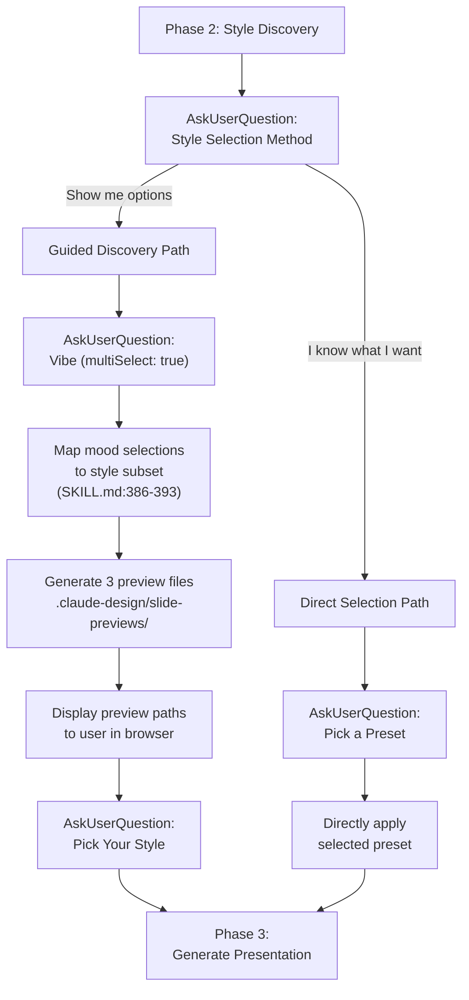
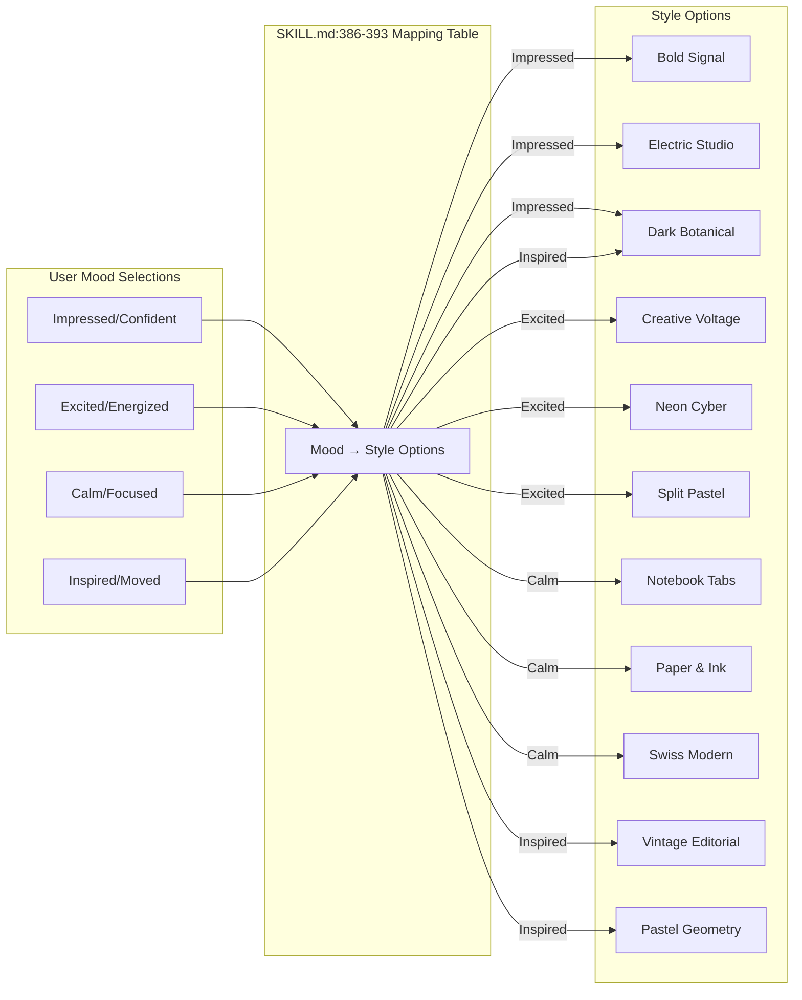
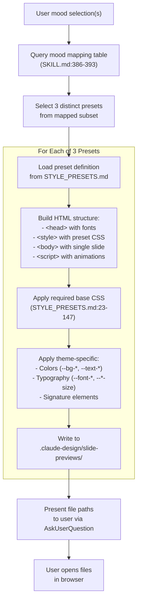
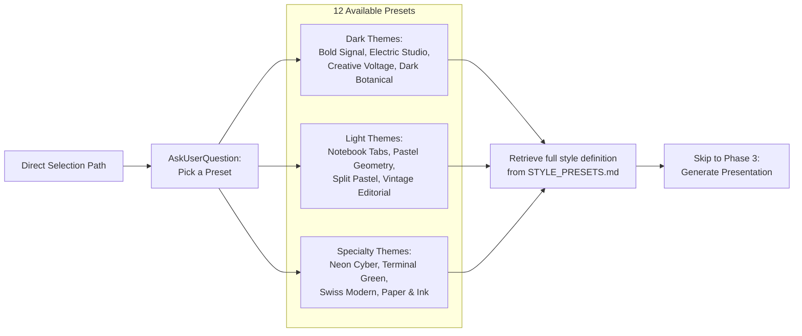
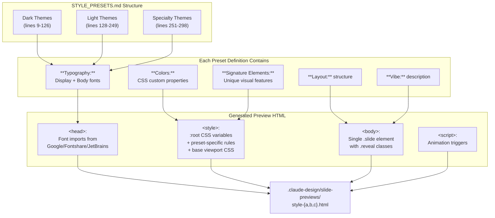

<!-- source: DeepWiki mcp.deepwiki.com · repo zarazhangrui/frontend-slides · page 3.3 Style Selection Process · fetched 2026-10-27 -->

# Style Selection Process

<details>
<summary>Relevant source files</summary>

The following files were used as context for generating this wiki page:

- [LICENSE](LICENSE)
- [STYLE_PRESETS.md](STYLE_PRESETS.md)
- [plugins/frontend-slides/skills/frontend-slides/STYLE_PRESETS.md](plugins/frontend-slides/skills/frontend-slides/STYLE_PRESETS.md)

</details>


## Purpose and Scope

This document explains how users select visual styles for their presentations through the Phase 2: Style Discovery workflow. It covers the "show, don't tell" philosophy, mood-based style mapping, preview generation, and the choice between 12 curated presets and 34 bold templates. For content gathering before style selection, see [Creating New Presentations](#3.1). For how styles are applied during generation, see [Phase 3: Presentation Generation](#4.1.4).

---

## Style Selection Paths

The system offers two distinct paths for style selection, both implemented in Phase 2 of the workflow:

| Path | User Type | Process | File Location |
|------|-----------|---------|---------------|
| **Guided Discovery** | Users unsure of preferences | Answer mood questions → View 3 generated previews → Select favorite | [plugins/frontend-slides/skills/frontend-slides/SKILL.md:311-380]() |
| **Direct Selection** | Users with specific style in mind | Choose from preset list by name → Skip to Phase 3 | [plugins/frontend-slides/skills/frontend-slides/SKILL.md:317-363]() |

The system first asks which path the user prefers using `AskUserQuestion` with the header "Style" and two options: "Show me options" (guided) or "I know what I want" (direct).

**Sources:** [plugins/frontend-slides/skills/frontend-slides/SKILL.md:301-363]()

---

## Diagram: Style Selection Decision Tree



**Sources:** [plugins/frontend-slides/skills/frontend-slides/SKILL.md:301-363]()

---

## Guided Discovery Process

### Step 2.1: Mood Selection

The system asks users to describe the intended audience feeling using `AskUserQuestion` with the header "Vibe". Users can select up to 2 options via `multiSelect: true`:

| Option | Description | Example Use Cases |
|--------|-------------|-------------------|
| `Impressed/Confident` | Professional, trustworthy, authoritative | Investor pitches, executive presentations |
| `Excited/Energized` | Innovative, bold, forward-looking | Product launches, tech talks |
| `Calm/Focused` | Clear, thoughtful, easy to follow | Educational content, reports |
| `Inspired/Moved` | Emotional, storytelling, memorable | Brand narratives, keynotes |

**Sources:** [plugins/frontend-slides/skills/frontend-slides/SKILL.md:364-375]()

### Step 2.2: Mood-to-Style Mapping

The system queries the mood mapping table to select 3 distinct style presets from a curated subset:



The complete mapping table:

| Mood | Style Options |
|------|---------------|
| Impressed/Confident | Bold Signal, Electric Studio, Dark Botanical |
| Excited/Energized | Creative Voltage, Neon Cyber, Split Pastel |
| Calm/Focused | Notebook Tabs, Paper & Ink, Swiss Modern |
| Inspired/Moved | Dark Botanical, Vintage Editorial, Pastel Geometry |

**Sources:** [plugins/frontend-slides/skills/frontend-slides/SKILL.md:376-380]()

### Step 2.3: Preview Generation

The system generates 3 self-contained HTML files in `.claude-design/slide-previews/`:

```
.claude-design/slide-previews/
├── style-a.html   # First style option
├── style-b.html   # Second style option
├── style-c.html   # Third style option
└── assets/        # Any shared assets (optional)
```

Each preview file contains:
- **Single title slide** demonstrating the aesthetic.
- **Inline CSS** with the complete style definition from [STYLE_PRESETS.md:163-346]().
- **Inline JavaScript** for entrance animations.
- **50-100 lines** total (not a full presentation).
- **Typography**, color palette, and signature elements.

**Important constraints** enforced during generation:
- Must **not** use generic patterns listed in [STYLE_PRESETS.md:346]().
- Must use distinctive font pairings from [STYLE_PRESETS.md:346]().
- Must apply viewport fitting rules from [STYLE_PRESETS.md:23-147]().

**Sources:** [plugins/frontend-slides/skills/frontend-slides/SKILL.md:376-380](), [STYLE_PRESETS.md:1-346]()

---

## Diagram: Preview Generation Pipeline



**Sources:** [plugins/frontend-slides/skills/frontend-slides/SKILL.md:376-380](), [STYLE_PRESETS.md:23-147]()

---

## Step 2.4: Preview Presentation

The system presents the three preview options to the user with descriptive text:

```
I've created 3 style previews for you to compare:

**Style A: [Name]** — [1 sentence description]
**Style B: [Name]** — [1 sentence description]
**Style C: [Name]** — [1 sentence description]

Open each file to see them in action:
- .claude-design/slide-previews/style-a.html
- .claude-design/slide-previews/style-b.html
- .claude-design/slide-previews/style-c.html
```

Then uses `AskUserQuestion` with header "Style" and options for each style or a "Mix elements" choice.

**Sources:** [plugins/frontend-slides/skills/frontend-slides/SKILL.md:380]()

---

## Direct Selection Process

For users who already know their preferred aesthetic, the system presents a preset picker using `AskUserQuestion` with header "Preset". The options list all 12 available presets with brief descriptions:



**Sources:** [plugins/frontend-slides/skills/frontend-slides/SKILL.md:317-363](), [STYLE_PRESETS.md:163-346]()

---

## Available Presets Reference

The system maintains 12 curated presets organized into three categories:

### Dark Themes

| Preset | Vibe | Display Font | Body Font | Signature Element |
|--------|------|--------------|-----------|-------------------|
| **Bold Signal** | Confident, bold | Archivo Black | Space Grotesk | Colored card focal point [STYLE_PRESETS.md:33]() |
| **Electric Studio** | Clean, professional | Manrope | Manrope | Two-panel vertical split [STYLE_PRESETS.md:62]() |
| **Creative Voltage** | Energetic, retro | Syne | Space Mono | Halftone texture patterns [STYLE_PRESETS.md:91]() |
| **Dark Botanical** | Elegant, premium | Cormorant | IBM Plex Sans | Soft gradient circles [STYLE_PRESETS.md:120]() |

### Light Themes

| Preset | Vibe | Display Font | Body Font | Signature Element |
|--------|------|--------------|-----------|-------------------|
| **Notebook Tabs** | Editorial, tactile | Bodoni Moda | DM Sans | Colorful section tabs [STYLE_PRESETS.md:156]() |
| **Pastel Geometry** | Friendly, modern | Plus Jakarta Sans | Plus Jakarta Sans | Vertical pills on right edge [STYLE_PRESETS.md:187]() |
| **Split Pastel** | Playful, creative | Outfit | Outfit | Two-color vertical split [STYLE_PRESETS.md:216]() |
| **Vintage Editorial** | Witty, editorial | Fraunces | Work Sans | Abstract geometric shapes [STYLE_PRESETS.md:244]() |

### Specialty Themes

| Preset | Vibe | Display Font | Body Font | Signature Element |
|--------|------|--------------|-----------|-------------------|
| **Neon Cyber** | Futuristic, techy | Clash Display | Satoshi | Particle backgrounds [STYLE_PRESETS.md:261]() |
| **Terminal Green** | Hacker aesthetic | JetBrains Mono | JetBrains Mono | Scan lines, blinking cursor [STYLE_PRESETS.md:273]() |
| **Swiss Modern** | Clean, precise | Archivo | Nunito | Visible grid, asymmetric [STYLE_PRESETS.md:285]() |
| **Paper & Ink** | Literary, thoughtful | Cormorant Garamond | Source Serif 4 | Drop caps, pull quotes [STYLE_PRESETS.md:297]() |

**Sources:** [STYLE_PRESETS.md:11-298]()

---

## Diagram: Preset Definition to Code Mapping



**Sources:** [STYLE_PRESETS.md:9-298](), [plugins/frontend-slides/skills/frontend-slides/SKILL.md:380]()

---

## Anti-Patterns and Constraints

The system enforces strict rules to avoid generic "AI slop" aesthetics:

### DO NOT USE Patterns

Defined in [plugins/frontend-slides/skills/frontend-slides/SKILL.md:380]() and [STYLE_PRESETS.md:3]():

| Category | Forbidden Patterns |
|----------|-------------------|
| **Fonts** | Inter, Roboto, Arial, system fonts as display |
| **Colors** | Generic indigo (#6366f1), purple gradients on white |
| **Layouts** | Everything centered, generic hero sections |
| **Visuals** | **No illustrations—only abstract CSS shapes** |

### Required Distinctive Choices

From [plugins/frontend-slides/skills/frontend-slides/SKILL.md:380]():

| Category | Required Approach |
|----------|-------------------|
| **Fonts** | Unique pairings (Clash Display, Satoshi, etc.) |
| **Colors** | Cohesive themes with personality |
| **Backgrounds** | Atmospheric (gradients, patterns, depth) |
| **Animations** | Signature moments |

**Sources:** [plugins/frontend-slides/skills/frontend-slides/SKILL.md:380](), [STYLE_PRESETS.md:3]()

---

## Implementation Details

### Preview File Requirements

Each generated preview must satisfy:

1. **Self-contained** — All CSS and JavaScript inline.
2. **Single slide** — One `<section class="slide">` element only.
3. **Animated** — Demonstrates entrance effects using `.reveal` classes.
4. **Viewport-fitting** — Includes required base CSS from [STYLE_PRESETS.md:5]().

### Cleanup Process

After the user selects a style, the temporary preview files are deleted during Phase 5: Delivery. The cleanup removes the entire `.claude-design/slide-previews/` directory [plugins/frontend-slides/skills/frontend-slides/SKILL.md:380]().

**Sources:** [plugins/frontend-slides/skills/frontend-slides/SKILL.md:380](), [plugins/frontend-slides/skills/frontend-slides/SKILL.md:380]()

---

