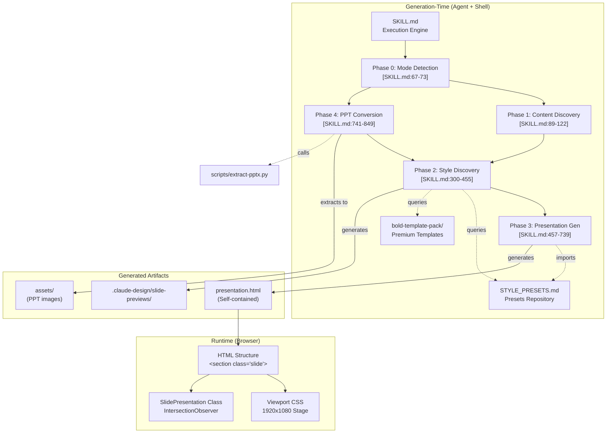
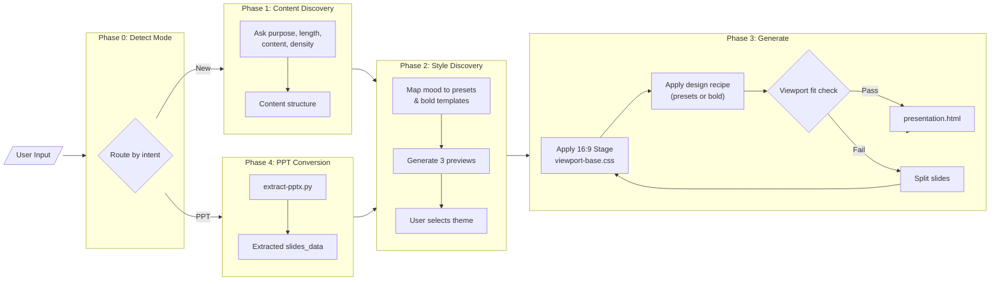

<!-- source: DeepWiki mcp.deepwiki.com · repo zarazhangrui/frontend-slides · page 4 Core Architecture · fetched 2026-10-27 -->

# Core Architecture

<details>
<summary>Relevant source files</summary>

The following files were used as context for generating this wiki page:

- [README.md](README.md)
- [SKILL.md](SKILL.md)

</details>


This document provides a technical overview of the frontend-slides system architecture, focusing on the dual-document design, the relationship between execution logic and specifications, and the five-phase generation pipeline. For detailed documentation of individual phases, see [Five-Phase Workflow Pipeline](#4.1). For the philosophical principles that drive architectural decisions, see [Design Philosophy](#4.2).

## System Overview

The frontend-slides repository is a code-generation system that transforms natural language descriptions or PowerPoint files into self-contained HTML presentation files. The architecture follows a clear separation of concerns between execution logic and declarative specifications.

### Dual-Document Architecture

The system consists of two core documents that guide the AI agent's behavior:

| Document | Role | Type | Importance |
|----------|------|------|------------|
| `SKILL.md` | Execution engine | Procedural workflow | 4.00 |
| `STYLE_PRESETS.md` | Specification repository | Declarative rules | 4.00 |

**SKILL.md** orchestrates the entire generation process, implementing the five-phase workflow, managing user interactions, and constructing the final HTML output. It contains procedural logic for content extraction, style discovery, and presentation assembly [SKILL.md:1-4]().

**STYLE_PRESETS.md** defines the constraints, rules, and visual themes that `SKILL.md` must enforce. It serves as a read-only knowledge base containing CSS architecture requirements, content density limits, and 12 curated visual presets [STYLE_PRESETS.md:1-10]().

Sources: [SKILL.md:1-17](), [STYLE_PRESETS.md:1-10]()

## Repository Structure

```
frontend-slides/
├── SKILL.md                    # Execution engine (procedural workflow)
├── STYLE_PRESETS.md           # Specification repository (declarative rules)
├── viewport-base.css           # Mandatory CSS for 16:9 stage fitting
├── html-template.md            # Structural scaffolding for generated decks
├── animation-patterns.md       # CSS animation recipes
├── bold-template-pack/         # 34 premium design systems
│   ├── selection-index.json    # Metadata for progressive disclosure
│   └── [template-name]/        # Individual template directories
├── scripts/                    # Utility scripts (Python/Bash)
│   ├── extract-pptx.py         # PPT extraction logic
│   ├── deploy.sh               # Vercel deployment pipeline
│   └── export-pdf.sh           # Playwright-based PDF generation
└── README.md                   # User-facing documentation
```

The repository follows a **Zero Dependencies** philosophy for its output: generated presentations are single HTML files with inline CSS/JS, requiring no build tools or frameworks [README.md:25-25](), [SKILL.md:12-12]().

Sources: [SKILL.md:1-4](), [README.md:52-72](), [README.md:82-90]()

## Execution Model

The system operates in two distinct phases: **generation-time** and **runtime**.

### Generation-Time (Coding Agent Context)

The agent (e.g., Claude Code) executes `SKILL.md`, which:
- Parses user intent to detect mode (New, PPT, or Enhancement) [SKILL.md:67-73]().
- Extracts content using `extract-pptx.py` for PowerPoint files [SKILL.md:380]().
- Queries `STYLE_PRESETS.md` and `bold-template-pack/selection-index.json` for themes [SKILL.md:365-380]().
- Generates 3 visual previews in `.claude-design/slide-previews/` for the "Show, Don't Tell" workflow [SKILL.md:380]().
- Enforces the **Fixed 16:9 Stage** rules during HTML construction [SKILL.md:38-52]().

### Runtime (Browser Context)

The generated HTML file runs independently in the browser:
- The `SlidePresentation` class manages navigation [SKILL.md:380]().
- The `IntersectionObserver` triggers entrance animations by adding the `.visible` class [SKILL.md:380]().
- Viewport fitting logic ensures the 1920×1080 stage scales to fit any screen [SKILL.md:40-46]().

Sources: [SKILL.md:10-16](), [SKILL.md:38-52](), [SKILL.md:380]()

## System Architecture Diagram

**Diagram: Dual-Document Architecture and Component Interactions**



Sources: [SKILL.md:248-380](), [STYLE_PRESETS.md:1-160](), [README.md:161-172]()

## Five-Phase Workflow Overview

The system implements a linear five-phase pipeline defined in `SKILL.md`. Each phase transforms input data and passes the result to the next phase.

| Phase | Purpose | Input | Output | Document Section |
|-------|---------|-------|--------|------------------|
| **Phase 0** | Mode Detection | User prompt | Execution path | [SKILL.md:67-73]() |
| **Phase 1** | Content Discovery | User answers | Content structure | [SKILL.md:89-122]() |
| **Phase 2** | Style Discovery | Mood preferences | Selected theme | [SKILL.md:300-380]() |
| **Phase 3** | Presentation Generation | Content + theme | HTML file | [SKILL.md:380]() |
| **Phase 4** | PPT Conversion | .pptx file | Extracted data | [SKILL.md:380]() |

For detailed documentation of each phase, see [Five-Phase Workflow Pipeline](#4.1).

**Diagram: Phase Routing and Data Flow**



Sources: [SKILL.md:248-380](), [SKILL.md:38-52]()

## Document Relationship: Presets vs. Bold Templates

The system uses a **Progressive Disclosure** model to manage style selection [SKILL.md:15-15]().

1.  **Style Presets (`STYLE_PRESETS.md`)**: Contains 12 curated, lightweight themes that are always available. They are the default fallback [README.md:132-154]().
2.  **Bold Template Pack (`bold-template-pack/`)**: Contains 34 high-fidelity design systems. The agent first reads a compact `selection-index.json` to shortlist candidates, then loads small `preview.md` cards for visual generation, and only loads the full `design.md` once a selection is made [README.md:167-172]().

### Mapping Logic (Phase 2)

During style discovery, the agent maps user moods to both presets and bold templates:

| User Mood | Example Candidates | Source |
|-----------|--------------------|--------|
| **Impressed/Confident** | Bold Signal, Electric Studio, Broadside | [SKILL.md:380]() |
| **Excited/Energized** | Creative Voltage, Neon Cyber, Neo-Grid | [SKILL.md:380]() |
| **Calm/Focused** | Notebook Tabs, Paper & Ink, Vellum | [SKILL.md:380]() |

Sources: [SKILL.md:365-380](), [README.md:161-172]()

## Viewport Fitting Enforcement

The most critical architectural constraint is the **Fixed 16:9 Stage** [SKILL.md:16-16](). The system enforces this through:

1.  **Mandatory Base CSS**: Every presentation must include the contents of `viewport-base.css` [SKILL.md:52-52]().
2.  **Density Limits**: The agent checks content against limits (e.g., max 6 bullets) and automatically splits slides if they would overflow the 1920×1080 stage [SKILL.md:63-63](), [STYLE_PRESETS.md:11-20]().
3.  **Height-Based Breakpoints**: CSS media queries adjust font sizes based on viewport height to maintain legibility [STYLE_PRESETS.md:99-138]().

For implementation details, see [Viewport Fitting System](#5).

Sources: [SKILL.md:38-52](), [STYLE_PRESETS.md:7-160]()

---

