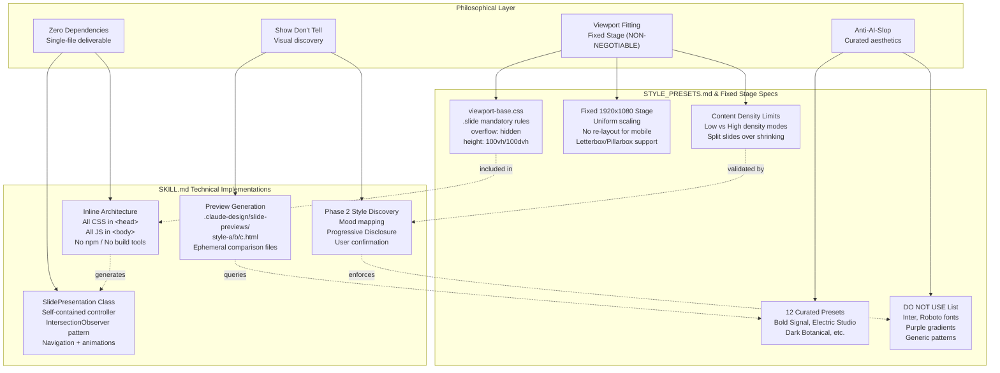
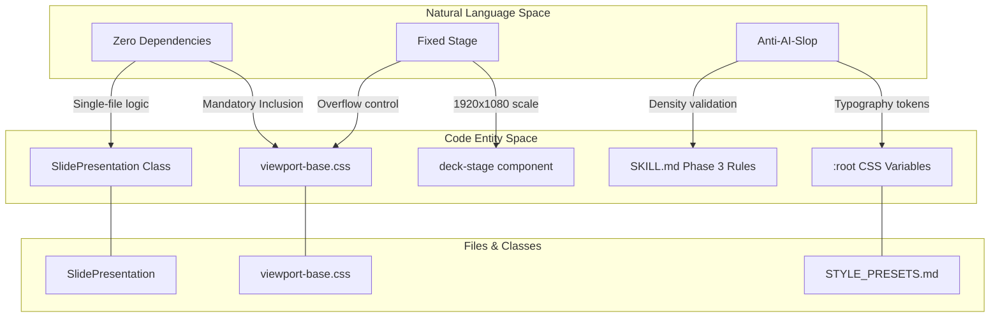

<!-- source: DeepWiki mcp.deepwiki.com · repo zarazhangrui/frontend-slides · page 4.2 Design Philosophy · fetched 2026-10-27 -->

# Design Philosophy

Relevant source files

The following files were used as context for generating this wiki page:

- [LICENSE](LICENSE)
- [SKILL.md](SKILL.md)
- [STYLE_PRESETS.md](STYLE_PRESETS.md)

This document explains the four core design principles that govern all technical decisions in the frontend-slides system: **Zero Dependencies**, **Show Don't Tell**, **Anti-AI-Slop**, and **Viewport Fitting**. Each principle drives specific architectural choices and implementation patterns throughout the codebase.

For details on how these philosophies are enforced during generation, see [Phase 3: Presentation Generation](#4.1.4). For the complete viewport fitting technical specifications, see [Viewport Fitting System](#5).

---

## Overview of Core Principles

The frontend-slides system is built on four non-negotiable design philosophies. These are not merely recommendations—they are architectural constraints that shape every aspect of the generated output.

| Philosophy | Core Constraint | Primary Enforcer | Critical Implementation |
|------------|----------------|------------------|------------------------|
| **Zero Dependencies** | Single self-contained HTML file | Inline CSS/JS architecture | All styles in `<head>`, all scripts in `<body>` |
| **Show Don't Tell** | Visual discovery over questionnaires | `.claude-design/slide-previews/` system | Three preview HTML files generated in Phase 2 |
| **Anti-AI-Slop** | 12 curated presets + 34 bold templates | `STYLE_PRESETS.md` whitelist | Explicit "DO NOT USE" blacklist |
| **Viewport Fitting** | No scrolling within slides | Required Base CSS + Fixed 16:9 Stage | `.slide { overflow: hidden; }` and uniform scaling |

**Sources:** [SKILL.md:10-16](), [STYLE_PRESETS.md:1-7]()

---

## Philosophy-to-Implementation Architecture

The following diagram shows how each philosophical principle maps to concrete technical implementations across both core system files:

**Sources:** [SKILL.md:10-63](), [SKILL.md:38-52](), [STYLE_PRESETS.md:1-20]()

---

## 1. Zero Dependencies Philosophy

### Principle Statement
Every generated presentation must be a single, self-contained HTML file that will execute identically in any modern browser without external dependencies, build tools, or package managers [SKILL.md:12](). The only runtime dependencies are web fonts loaded via CDN and optional image assets from PowerPoint conversions.

### Technical Implementations

**Inline CSS Architecture** — All styles are embedded in the `<head>` section using a single `<style>` block. The agent is instructed to read `viewport-base.css` and include its full contents in every presentation [SKILL.md:52]().

**Inline JavaScript Architecture** — All interactive logic is embedded in a single `<script>` block. The primary controller is the `SlidePresentation` class, which manages navigation and state [SKILL.md:380]().

**Sources:** [SKILL.md:12-12](), [SKILL.md:52-52](), [SKILL.md:380]()

---

## 2. Show Don't Tell Philosophy

### Principle Statement
Users discover what they want by seeing it, not by answering abstract questionnaires [SKILL.md:13](). The system generates visual previews of different aesthetics before the final generation.

### Technical Implementation: Preview Generation System
**Progressive Disclosure** — The agent reads lightweight style indexes first. For bold templates, it uses small preview cards and loads the full `design.md` only after the user picks that template [SKILL.md:15]().

**Phase 2 Workflow** — The style discovery process generates three temporary HTML files in `.claude-design/slide-previews/` [SKILL.md:380]().

**Sources:** [SKILL.md:13-15](), [SKILL.md:301-380]()

---

## 3. Anti-AI-Slop Philosophy

### Principle Statement
AI tends to converge toward generic "on distribution" outputs. The system actively avoids overused font families (Inter, Roboto), cliched color schemes (purple gradients on white), and cookie-cutter layouts [SKILL.md:20-35]().

### Curated Aesthetic System
The system relies on a whitelist of 12 curated presets in `STYLE_PRESETS.md` and 34 bold templates, each with distinctive typography and motion patterns.

| Category | Distinctive Choices |
|----------|---------------------|
| **Typography** | `Archivo Black`, `Cormorant`, `Syne`, `Fraunces` [STYLE_PRESETS.md:18,104,76,230]() |
| **Motion** | Staggered reveals (animation-delay) over scattered interactions [SKILL.md:26]() |
| **Backgrounds** | CSS gradients, geometric patterns, halftone textures [STYLE_PRESETS.md:91,120]() |

**Sources:** [SKILL.md:20-36](), [STYLE_PRESETS.md:3-3]()

---

## 4. Viewport Fitting Philosophy

### Principle Statement
**Fixed 16:9 Stage (NON-NEGOTIABLE)** — Every deck uses a 1920×1080 slide canvas scaled as a whole to the viewport [SKILL.md:16](). Slides must not re-layout content for different devices; they must scale uniformly and letterbox/pillarbox if necessary [SKILL.md:44]().

### Fixed Stage Rules
- **Viewport Wrapper:** Fills the browser window [SKILL.md:42]().
- **1920×1080 Stage:** Authoring happens inside this fixed canvas [SKILL.md:43]().
- **Visibility Control:** Slide switching uses `visibility`, `opacity`, and `pointer-events`. `display: none` is forbidden as it interferes with flex layout classes [SKILL.md:47]().

### Content Density Modes
The agent asks the user to choose a density mode during Phase 1 [SKILL.md:102-107]():

| Mode | Best For | Behavior |
|------|----------|----------|
| **Low Density** | Public talks | 1 idea/slide, large type, 1-3 bullets [SKILL.md:60]() |
| **High Density** | Reports/Handouts | Structured grids, 4-8 bullets [SKILL.md:61]() |

**Sources:** [SKILL.md:16-16](), [SKILL.md:38-63]()

---

## Code Entity Mapping: Philosophy to Implementation

The following diagram maps system names to specific code entities within the generated presentation and the agent's internal logic:

**Sources:** [SKILL.md:10-52](), [STYLE_PRESETS.md:1-22](), [SKILL.md:380]()

---

## Philosophy Enforcement Points in Workflow

| Phase | Enforcement Mechanism |
|-------|----------------------|
| **Phase 1: Content** | Ask user for "Density" mode; validate content count against limits [SKILL.md:91,102](). |
| **Phase 2: Style** | Generate 3 previews using `STYLE_PRESETS.md` whitelist [SKILL.md:377-380](). |
| **Phase 3: Generation** | Inject `viewport-base.css` and wrap content in 1920×1080 stage [SKILL.md:52,43](). |
| **Phase 5: Delivery** | Cleanup temporary `.claude-design/` preview files [SKILL.md:380](). |

**Sources:** [SKILL.md:67-73](), [SKILL.md:301-380](), [SKILL.md:380]()

---

