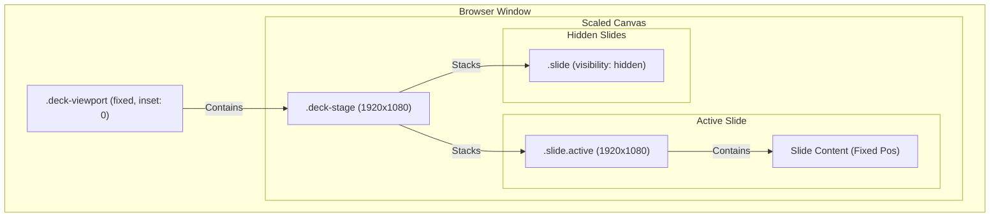
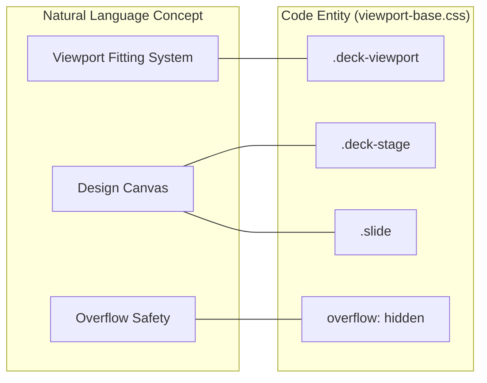

<!-- source: DeepWiki mcp.deepwiki.com · repo zarazhangrui/frontend-slides · page 5.2 Required Base CSS Architecture · fetched 2026-10-27 -->

# Required Base CSS Architecture

<details>
<summary>Relevant source files</summary>

The following files were used as context for generating this wiki page:

- [plugins/frontend-slides/skills/frontend-slides/viewport-base.css](plugins/frontend-slides/skills/frontend-slides/viewport-base.css)
- [viewport-base.css](viewport-base.css)

</details>


## Purpose and Scope

This document specifies the mandatory CSS rules that must be included in every generated presentation to enable the fixed-coordinate viewport fitting system. Unlike traditional responsive web design, this architecture treats each slide as a fixed 1920×1080 design canvas that is scaled as a single unit to fit the available browser window. These rules ensure that slides never overflow, never require internal scrolling, and maintain their intended layout integrity across all devices.

---

## Document-Level Viewport Configuration

The architecture begins by locking the browser environment to prevent default scrolling behaviors and establish the presentation stage.

### HTML and Body Elements

The `html` and `body` elements are configured to eliminate any scrolling ambiguity and set the global background:

[viewport-base.css:7-15]()

```css
html,
body {
    width: 100%;
    height: 100%;
    margin: 0;
    overflow: hidden;
    background: var(--stage-bg, #000);
}
```

| Property | Value | Purpose |
|----------|-------|---------|
| `width/height: 100%` | Both elements | Ensures the document fills the entire browser window |
| `overflow: hidden` | Both elements | **Mandatory**: Prevents the browser from ever showing scrollbars |
| `background` | `var(--stage-bg, #000)` | Sets the "letterbox" color for areas outside the 16:9 stage |

**Sources:** [viewport-base.css:7-15](), [plugins/frontend-slides/skills/frontend-slides/viewport-base.css:7-15]()

---

## The Three-Layer Viewport System

The architecture relies on a three-layer hierarchy to manage scaling and visibility.

### 1. The Deck Viewport (`.deck-viewport`)
This is a fixed container that occupies the entire browser window, serving as the clipping boundary for the presentation.

[viewport-base.css:17-23]()

```css
.deck-viewport {
    position: fixed;
    inset: 0;
    overflow: hidden;
    background: var(--stage-bg, #000);
}
```

### 2. The Deck Stage (`.deck-stage`)
The stage is a fixed-size canvas (1920×1080). The `SlidePresentation` JavaScript class dynamically calculates and applies a `transform: scale()` to this element so it fits perfectly within the `.deck-viewport`.

[viewport-base.css:25-36]()

```css
.deck-stage {
    position: absolute;
    left: 0;
    top: 0;
    width: 1920px;
    height: 1080px;
    overflow: hidden;
    transform-origin: 0 0;
    background: var(--slide-bg, #fff);
}
```

### 3. The Slide Container (`.slide`)
Slides are stacked absolutely within the stage. Only the active slide is visible and interactive.

[viewport-base.css:38-59]()

```css
.slide {
    position: absolute;
    inset: 0;
    width: 1920px;
    height: 1080px;
    overflow: hidden;
    display: block;
    visibility: hidden;
    opacity: 0;
    pointer-events: none;
    background: var(--slide-bg, #fff);
}

.slide.active,
.slide.visible {
    visibility: visible;
    opacity: 1;
    pointer-events: auto;
    z-index: 1;
}
```

### Viewport Architecture Diagram



**Sources:** [viewport-base.css:17-59](), [plugins/frontend-slides/skills/frontend-slides/viewport-base.css:17-59]()

---

## Asset and Control Constraints

To maintain the integrity of the 1920×1080 authored layout, media and UI elements are strictly controlled.

### Media Bounds
Images and videos are prevented from breaking the slide boundaries, ensuring they stay within the 1080p canvas.

[viewport-base.css:61-68]()

```css
img,
video,
canvas,
svg {
    max-width: 100%;
    max-height: 100%;
}
```

### Presentation Chrome
UI controls (navigation buttons, progress bars) are placed outside the slide design system using `fixed` positioning relative to the browser window, not the scaled stage.

[viewport-base.css:70-77]()

```css
.deck-controls {
    position: fixed;
    left: 50%;
    bottom: 22px;
    transform: translateX(-50%);
    z-index: 1000;
}
```

**Sources:** [viewport-base.css:61-77](), [plugins/frontend-slides/skills/frontend-slides/viewport-base.css:61-77]()

---

## Print and Accessibility

### Print Engine Layout
The architecture includes a dedicated `@media print` block that converts the absolute stack into a relative flow, allowing standard PDF generation tools to capture one 1920×1080 slide per page.

[viewport-base.css:79-123]()

| Element | Print Modification | Rationale |
|---------|-------------------|-----------|
| `html, body` | `overflow: visible` | Allows the print engine to scroll through all slides |
| `.deck-stage` | `transform: none !important` | Removes scaling to ensure 1:1 pixel capture |
| `.slide` | `display: block !important` | Makes all slides visible simultaneously for the printer |
| `.slide` | `break-after: page` | Forces a new page after every slide |
| `.deck-controls` | `display: none !important` | Hides navigation UI from the final PDF |

### Motion Preferences
The system respects system-level "Reduced Motion" settings by drastically shortening animation and transition durations.

[viewport-base.css:125-133]()

```css
@media (prefers-reduced-motion: reduce) {
    *,
    *::before,
    *::after {
        animation-duration: 0.01ms !important;
        transition-duration: 0.2s !important;
    }
}
```

**Sources:** [viewport-base.css:79-133](), [plugins/frontend-slides/skills/frontend-slides/viewport-base.css:79-133]()

---

## Technical Enforcement Summary

### CSS Entity Mapping



### Mandatory Property Checklist

| Selector | Property | Value | Requirement |
|----------|----------|-------|-------------|
| `.deck-stage` | `width` | `1920px` | **Fixed Width** |
| `.deck-stage` | `height` | `1080px` | **Fixed Height** |
| `.slide` | `overflow` | `hidden` | **No internal scroll** |
| `.slide` | `visibility` | `hidden` | **Initial State** |
| `html` | `overflow` | `hidden` | **No browser scroll** |

**Sources:** [viewport-base.css:1-133](), [plugins/frontend-slides/skills/frontend-slides/viewport-base.css:1-133]()

---

