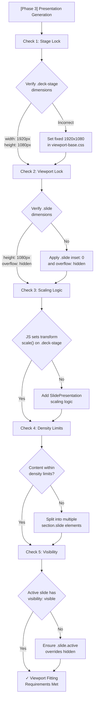
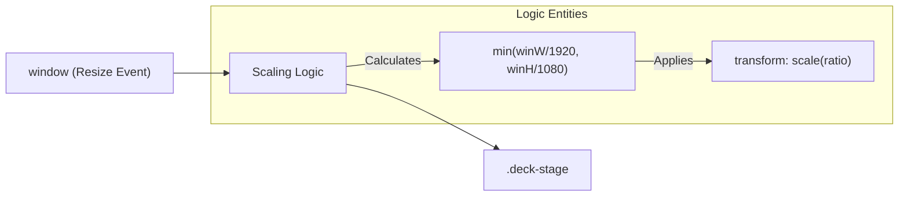

<!-- source: DeepWiki mcp.deepwiki.com · repo zarazhangrui/frontend-slides · page 5.5 Viewport Fitting Checklist · fetched 2026-10-27 -->

# Viewport Fitting Checklist

<details>
<summary>Relevant source files</summary>

The following files were used as context for generating this wiki page:

- [SKILL.md](SKILL.md)
- [viewport-base.css](viewport-base.css)

</details>


## Purpose and Scope

This document provides the practical seven-step verification checklist that must be completed before finalizing any presentation. The checklist ensures strict compliance with viewport fitting requirements—specifically that every slide fits exactly within the viewport without scrolling.

The system utilizes a **Fixed 16:9 Stage (NON-NEGOTIABLE)** architecture [SKILL.md:16-16](). Every deck uses a 1920×1080 slide canvas scaled as a whole to the browser window. Slides must stay 16:9 on every screen, including phones, and must not re-layout content [SKILL.md:43-45]().

**Sources:** [SKILL.md:16-16](), [SKILL.md:38-51](), [viewport-base.css:1-5]()

---

## The Seven-Point Verification Checklist

The following requirements must be verified for every generated presentation to ensure the `deck-stage` and `slide` elements behave correctly.

### Checklist Overview

| # | Requirement | Implementation Target | Failure Impact |
|---|-------------|-----------------------|----------------|
| 1 | Slide Viewport Lock | `.slide { height: 1080px; overflow: hidden; }` | Scrolling within slides |
| 2 | Stage Scaling | `transform: scale(...)` via JS | Content overflow or letterboxing |
| 3 | Fixed Internal Units | Author at 1920x1080 (px) | Layout breaks at extreme sizes |
| 4 | Visibility Control | `.active` / `.visible` classes | Multiple slides visible at once |
| 5 | Content Density | Max 6 bullets, max 6 cards | Content overflow the 1080px height |
| 6 | Media Constraints | `max-width: 100%; max-height: 100%` | Images push content off stage |
| 7 | Reduced Motion | `@media (prefers-reduced-motion)` | Accessibility failure |

**Sources:** [SKILL.md:38-51](), [viewport-base.css:40-59](), [viewport-base.css:126-133]()

---

## Verification Process Flow

**Diagram 1: Checklist Verification Workflow**



**Sources:** [SKILL.md:38-51](), [viewport-base.css:27-51]()

---

## Check 1: Fixed Stage Lock

**Requirement:** Every presentation must use the mandatory `viewport-base.css` structure where the stage is a fixed coordinate system.

### Verification Procedure

Inspect the CSS for the `.deck-stage` and `.slide` selectors. The following properties are **mandatory**:

```css
.deck-stage {
    position: absolute;
    width: 1920px;
    height: 1080px;
    overflow: hidden;
    transform-origin: 0 0;
}

.slide {
    position: absolute;
    inset: 0;
    width: 1920px;
    height: 1080px;
    overflow: hidden;
    visibility: hidden;
    opacity: 0;
}
```

### Code Mapping

| Property | Location | Purpose |
|----------|----------|---------|
| `width: 1920px` | [viewport-base.css:31]() | Establishes the 16:9 width |
| `height: 1080px` | [viewport-base.css:32]() | Establishes the 16:9 height |
| `overflow: hidden` | [viewport-base.css:45]() | Prevents internal scrolling |
| `visibility: hidden` | [viewport-base.css:47]() | Hides inactive slides |

**Sources:** [viewport-base.css:27-51]()

---

## Check 2: Content Density Limits

**Requirement:** Content must respect maximum item counts to ensure it fits within the 1080px height without compression.

### Density Limits Reference

| Slide Type | Maximum Content | Design Strategy |
|------------|----------------|-----------------|
| Title slide | 1 heading + 1 subtitle | Generous negative space [SKILL.md:60]() |
| Content slide | 1 heading + 4-6 bullets | Split if > 6 bullets [SKILL.md:81]() |
| Feature grid | 4-6 cards | Tighter spacing for reading-first [SKILL.md:61]() |
| Code slide | ~10-15 lines | Ensure no vertical overflow |

### Mode C Modification Rules
When enhancing existing slides:
1. Count existing elements before adding more [SKILL.md:79]().
2. If adding text results in > 6 bullets, **split into two slides** [SKILL.md:81]().
3. Never add images without checking if the 1920x1080 stage is already full [SKILL.md:85]().

**Sources:** [SKILL.md:54-63](), [SKILL.md:79-85]()

---

## Check 3: Visibility and Navigation

**Requirement:** Slide visibility must be controlled by `.active` / `.visible` classes using specific properties.

### Verification Procedure

Ensure the runtime logic applies classes that match these CSS rules:

```css
.slide.active,
.slide.visible {
    visibility: visible;
    opacity: 1;
    pointer-events: auto;
    z-index: 1;
}
```

**Rule:** Do not use `display: none` / `display: block` for slide switching. Layout classes like `.slide-content { display: flex; }` can override them and cause every slide to appear at once [SKILL.md:47]().

**Sources:** [SKILL.md:47-47](), [viewport-base.css:53-59]()

---

## Check 4: Image and Media Constraints

**Requirement:** All media must be constrained to the authored slide bounds (1920x1080).

### Verification Procedure

Inspect the global media reset in the presentation CSS:

```css
img,
video,
canvas,
svg {
    max-width: 100%;
    max-height: 100%;
}
```

**Rule:** When adding images to existing slides, if the slide already has maximum content, the image **must** be moved to a new slide [SKILL.md:80-85]().

**Sources:** [viewport-base.css:61-68](), [SKILL.md:85-85]()

---

## Check 5: JavaScript Scaling Verification

**Requirement:** The `deck-stage` must scale uniformly to fit the viewport.

### Code Entity Mapping

**Diagram 2: Scaling Implementation Logic**



**Verification:** Open the generated HTML and resize the browser. The content should shrink/grow as a single unit without reflowing text. If the window is narrower than 16:9, it should pillarbox (black bars on sides); if shorter, it should letterbox (black bars on top/bottom) [SKILL.md:44]().

**Sources:** [SKILL.md:42-46](), [viewport-base.css:25-36]()

---

## Check 6: Print and Accessibility

**Requirement:** The presentation must remain functional for printing and for users with motion sensitivity.

### Print Verification
Ensure the `@media print` block is present, which resets the stage to a static layout:
- `html, body { width: 1920px; height: auto; overflow: visible; }` [viewport-base.css:81-85]()
- `.slide { position: relative; display: block !important; page-break-after: always; }` [viewport-base.css:103-113]()

### Reduced Motion Verification
Ensure animations respect user preferences:
- `animation-duration: 0.01ms !important;`
- `transition-duration: 0.2s !important;`

**Sources:** [viewport-base.css:80-123](), [viewport-base.css:126-133](), [SKILL.md:49-49]()

---

## Check 7: CSS Function Safety

**Requirement:** Avoid syntax that breaks CSS parsing in the agent's generation phase.

### Verification Procedure
- **Negative clamp/min/max:** Never negate functions directly (e.g., `-clamp(...)`).
- **Remediation:** Use `calc(-1 * clamp(...))` instead [SKILL.md:50]().

**Sources:** [SKILL.md:50-50]()

---

