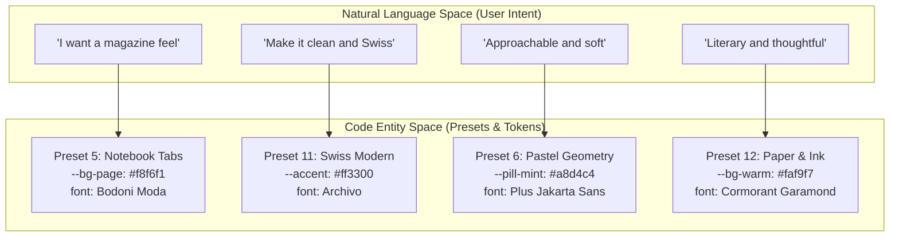
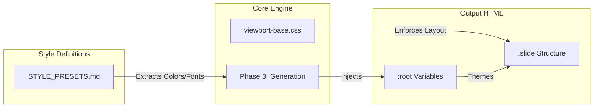

<!-- source: DeepWiki mcp.deepwiki.com · repo zarazhangrui/frontend-slides · page 6.2 Light Themes · fetched 2026-10-27 -->

# Light Themes

<details>
<summary>Relevant source files</summary>

The following files were used as context for generating this wiki page:

- [LICENSE](LICENSE)
- [STYLE_PRESETS.md](STYLE_PRESETS.md)
- [plugins/frontend-slides/skills/frontend-slides/STYLE_PRESETS.md](plugins/frontend-slides/skills/frontend-slides/STYLE_PRESETS.md)

</details>


This document catalogs the light theme presets available in the `frontend-slides` system. These themes feature bright backgrounds (white, cream, or pastel) and dark text for high contrast readability, suited for professional, editorial, or friendly presentation contexts.

The light themes are defined in [STYLE_PRESETS.md:128-299]() and [plugins/frontend-slides/skills/frontend-slides/STYLE_PRESETS.md:128-299]().

---

## Light Theme Presets Overview

The light theme collection includes curated presets and specialty modern themes:

| Preset # | Name | Vibe | Primary Background | Typography | Signature Element |
|----------|------|------|-------------------|------------|-------------------|
| 5 | Notebook Tabs | Editorial, tactile | `#f8f6f1` (cream) | Bodoni Moda / DM Sans | Colorful vertical tabs on right edge |
| 6 | Pastel Geometry | Friendly, modern | `#faf9f7` (off-white) | Plus Jakarta Sans | Vertical pills with varying heights |
| 7 | Split Pastel | Playful, creative | `#f5e6dc` / `#e4dff0` | Outfit | Two-color vertical split background |
| 8 | Vintage Editorial | Witty, confident | `#f5f3ee` (cream) | Fraunces / Work Sans | Abstract geometric CSS shapes |
| 11 | Swiss Modern | Clean, precise | Pure White | Archivo / Nunito | Visible grid, red accent (#ff3300) |
| 12 | Paper & Ink | Literary, thoughtful | `#faf9f7` (warm cream) | Cormorant Garamond | Drop caps, pull quotes |

**Diagram: Light Theme Style Mapping**



Sources: [STYLE_PRESETS.md:128-299](), [plugins/frontend-slides/skills/frontend-slides/STYLE_PRESETS.md:128-299]()

---

## Preset 5: Notebook Tabs

**Vibe:** Editorial, organized, elegant, tactile.

This theme simulates a physical notebook using a cream paper card floating on a dark outer background. It is designed for structured narratives with distinct sections.

**Typography:**
- **Display:** `Bodoni Moda` (400/700) [STYLE_PRESETS.md:137]()
- **Body:** `DM Sans` (400/500) [STYLE_PRESETS.md:138]()

**Color Palette:**
```css
:root {
    --bg-outer: #2d2d2d;
    --bg-page: #f8f6f1;
    --text-primary: #1a1a1a;
    --tab-1: #98d4bb; /* Mint */
    --tab-2: #c7b8ea; /* Lavender */
    --tab-3: #f4b8c5; /* Pink */
    --tab-4: #a8d8ea; /* Sky */
    --tab-5: #ffe6a7; /* Cream */
}
```

**Signature Elements:**
- **Paper Container:** A central card with a subtle shadow [STYLE_PRESETS.md:155]().
- **Vertical Tabs:** Colorful section tabs on the right edge with vertical text.
- **Binder Decorations:** Visual "binder holes" on the left edge [STYLE_PRESETS.md:157]().
- **Viewport Scaling:** Tab text must use `font-size: clamp(0.5rem, 1vh, 0.7rem)` to ensure fitting on all screen heights [STYLE_PRESETS.md:158]().

Sources: [STYLE_PRESETS.md:130-160]()

---

## Preset 6: Pastel Geometry

**Vibe:** Friendly, organized, modern, approachable.

Pastel Geometry uses a soft pastel background with a white content card, emphasized by rounded geometric "pills" that act as visual anchors.

**Typography:**
- **Display & Body:** `Plus Jakarta Sans` [STYLE_PRESETS.md:169-170]()

**Color Palette:**
```css
:root {
    --bg-primary: #c8d9e6;
    --card-bg: #faf9f7;
    --pill-pink: #f0b4d4;
    --pill-mint: #a8d4c4;
    --pill-sage: #5a7c6a;
    --pill-lavender: #9b8dc4;
    --pill-violet: #7c6aad;
}
```

**Signature Elements:**
- **Vertical Pills:** A sequence of pills on the right edge with varying heights (Short → Medium → Tall → Medium → Short) [STYLE_PRESETS.md:187-188]().
- **Soft Shadows:** Rounded cards with subtle elevation [STYLE_PRESETS.md:186]().

Sources: [STYLE_PRESETS.md:162-191]()

---

## Preset 7: Split Pastel

**Vibe:** Playful, modern, friendly, creative.

This theme utilizes a vertical split-screen layout, dividing the slide into two distinct pastel zones.

**Typography:**
- **Display & Body:** `Outfit` [STYLE_PRESETS.md:200-201]()

**Color Palette:**
```css
:root {
    --bg-peach: #f5e6dc;
    --bg-lavender: #e4dff0;
    --text-dark: #1a1a1a;
    --badge-mint: #c8f0d8;
    --badge-yellow: #f0f0c8;
    --badge-pink: #f0d4e0;
}
```

**Signature Elements:**
- **Two-Color Split:** Vertical background split (Peach/Lavender) [STYLE_PRESETS.md:216]().
- **Grid Overlay:** A subtle grid pattern overlay on the right panel [STYLE_PRESETS.md:218]().
- **Badge Pills:** Playful icons contained within rounded badges [STYLE_PRESETS.md:217]().

Sources: [STYLE_PRESETS.md:193-221]()

---

## Preset 8: Vintage Editorial

**Vibe:** Witty, confident, editorial, personality-driven.

Vintage Editorial focuses on high-character serif typography and abstract geometric shapes, avoiding all illustrations in favor of pure CSS art.

**Typography:**
- **Display:** `Fraunces` (700/900) [STYLE_PRESETS.md:230]()
- **Body:** `Work Sans` (400/500) [STYLE_PRESETS.md:231]()

**Color Palette:**
```css
:root {
    --bg-cream: #f5f3ee;
    --text-primary: #1a1a1a;
    --text-secondary: #555;
    --accent-warm: #e8d4c0;
}
```

**Signature Elements:**
- **Geometric Accents:** Abstract shapes consisting of circle outlines, lines, and dots [STYLE_PRESETS.md:244]().
- **Bordered Boxes:** Bold, high-contrast borders for call-to-action (CTA) boxes [STYLE_PRESETS.md:245]().
- **Pure CSS:** Strict adherence to "No illustrations—only geometric CSS shapes" [STYLE_PRESETS.md:247]().

Sources: [STYLE_PRESETS.md:223-248]()

---

## Specialty Light Themes

### Swiss Modern (Preset 11)
A Bauhaus-inspired theme emphasizing precision and the grid.
- **Typography:** `Archivo` (800) + `Nunito` (400) [STYLE_PRESETS.md:281]().
- **Palette:** Pure white, pure black, and a sharp red accent (`#ff3300`) [STYLE_PRESETS.md:283]().
- **Elements:** Visible grids and asymmetric layouts [STYLE_PRESETS.md:285]().

### Paper & Ink (Preset 12)
Designed for thoughtful, literary content resembling a high-end journal.
- **Typography:** `Cormorant Garamond` + `Source Serif 4` [STYLE_PRESETS.md:293]().
- **Palette:** Warm cream (`#faf9f7`) and charcoal (`#1a1a1a`) [STYLE_PRESETS.md:295]().
- **Elements:** Drop caps and elegant horizontal rules [STYLE_PRESETS.md:297]().

---

## Technical Implementation

Light themes are implemented by applying specific CSS variables to the mandatory viewport-fitting structure.

**Diagram: Theme Application Data Flow**



**Key CSS Implementation Rules:**
1. **Viewport Lock:** All light themes must adhere to `overflow: hidden` on the `.slide` class to prevent scrolling [STYLE_PRESETS.md:5]().
2. **Abstract Shapes:** Decorations in themes like "Vintage Editorial" or "Dark Botanical" must be created using CSS pseudo-elements (`::before`, `::after`) or empty `div` tags with border-radius and borders, never external image assets [STYLE_PRESETS.md:124, 247]().

Sources: [STYLE_PRESETS.md:1-299](), [plugins/frontend-slides/skills/frontend-slides/STYLE_PRESETS.md:1-299]()

---

