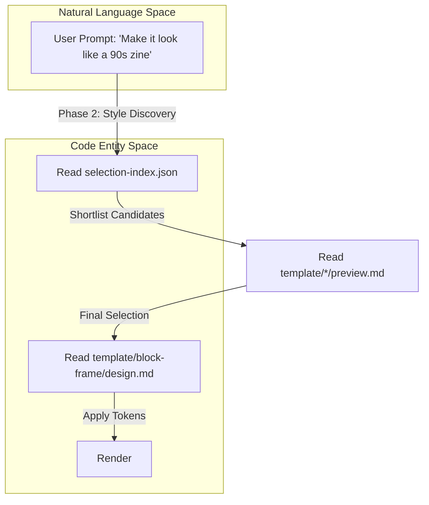
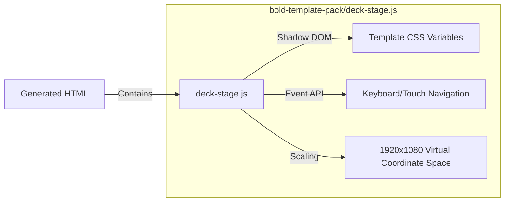

<!-- source: DeepWiki mcp.deepwiki.com · repo zarazhangrui/frontend-slides · page 7 Bold Template Pack · fetched 2026-10-27 -->

# Bold Template Pack

Relevant source files

The following files were used as context for generating this wiki page:

- [bold-template-pack/templates/biennale-yellow/design.md](bold-template-pack/templates/biennale-yellow/design.md)
- [bold-template-pack/templates/block-frame/design.md](bold-template-pack/templates/block-frame/design.md)
- [bold-template-pack/templates/bold-poster/design.md](bold-template-pack/templates/bold-poster/design.md)
- [bold-template-pack/templates/cobalt-grid/design.md](bold-template-pack/templates/cobalt-grid/design.md)
- [bold-template-pack/templates/coral/design.md](bold-template-pack/templates/coral/design.md)

The **Bold Template Pack** is a library of 34 high-impact, design-forward presentation templates sourced from `beautiful-html-templates`. Unlike the standard `STYLE_PRESETS`, which provide general aesthetic directions, these templates represent complete "design recipes" with specific typography scales, decorative vocabularies, and component grammars. The system utilizes a **progressive disclosure model** to manage the large volume of design data, allowing the AI agent to browse metadata before committing to a full template implementation.

### Design Library Overview
The pack transitions the system from generic styling to specific editorial registers, ranging from neobrutalist zine aesthetics to minimalist art gallery catalogues.

| Feature | Description |
| :--- | :--- |
| **Total Templates** | 34 unique design systems [SKILL.md:16-18]() |
| **Data Format** | YAML-frontmatter Markdown (`design.md`) [bold-template-pack/templates/biennale-yellow/design.md:1-4]() |
| **Metadata Index** | `selection-index.json` for agent-side filtering [SKILL.md:380]() |
| **Rendering Engine** | `<deck-stage>` custom web component [bold-template-pack/deck-stage.js:1-10]() |

Sources: [SKILL.md:16-18](), [bold-template-pack/templates/biennale-yellow/design.md:1-4](), [SKILL.md:380](), [bold-template-pack/deck-stage.js:1-10]()

---

### Selection Workflow & Progressive Disclosure
To prevent context window overflow, the system employs a tiered discovery process. The agent first scans a high-level index, then reads a brief preview, and finally loads the full design recipe only for the chosen template.

**Natural Language to Template Mapping**

Sources: [SKILL.md:380](), [bold-template-pack/templates/block-frame/design.md:1-15]()

For details on the metadata schema and the full list of available styles, see [Template Catalog & Selection Index (#7.1)]().

---

### Design Recipe Format
Each template is defined in a `design.md` file. This file acts as a technical specification that the AI agent follows to construct slides. It includes:
*   **Color Tokens:** Named palettes (e.g., `paper`, `ink`, `sun`) used consistently across all slide types [bold-template-pack/templates/biennale-yellow/design.md:6-13]().
*   **Typography Scale:** Precise `clamp()` values that ensure text scales fluidly between mobile and desktop while respecting the 1920×1080 internal stage [bold-template-pack/templates/biennale-yellow/design.md:18-24]().
*   **Decorative Vocabulary:** Definitions for signature elements like `diagonal-hatch` textures or `pixel-glitch` SVG overlays [bold-template-pack/templates/coral/design.md:191-193](), [bold-template-pack/templates/cobalt-grid/design.md:177-178]().
*   **Component Grammar:** Rules for how cards, rules, and badges should be constructed (e.g., "4px solid black borders with 8px hard shadows") [bold-template-pack/templates/block-frame/design.md:16-25]().

For details on how to interpret and use these recipes, see [Design Recipe Format (#7.2)]().

---

### The deck-stage Component
The `<deck-stage>` web component is the runtime engine for the Bold Template Pack. It provides a sandboxed environment for slides, ensuring that complex template CSS does not leak into the global scope and that the presentation maintains a perfect aspect ratio regardless of the browser window size.

**System Integration Architecture**

Sources: [bold-template-pack/deck-stage.js:20-50](), [bold-template-pack/deck-stage.js:145-160]()

Key responsibilities of the component include:
1.  **Coordinate Mapping:** Translating fluid `vh`/`vw` units into fixed stage positions [bold-template-pack/deck-stage.js:280-300]().
2.  **Navigation Logic:** Handling `keydown` and `touchstart` events for slide progression [bold-template-pack/deck-stage.js:320-345]().
3.  **Print Support:** Toggling the `noscale` attribute to allow high-resolution PDF exports via the `export-pdf.sh` script [bold-template-pack/deck-stage.js:410-425]().

For technical API details and implementation notes, see [deck-stage Web Component (#7.3)]().

---

