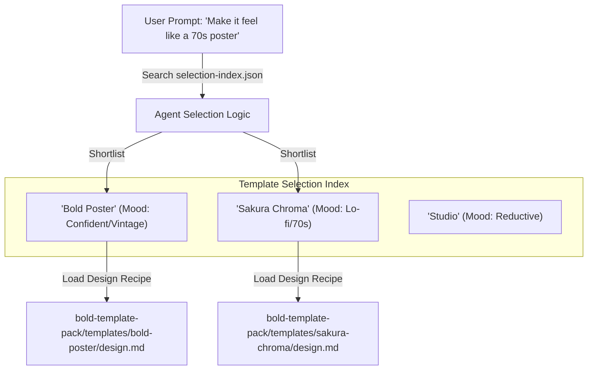
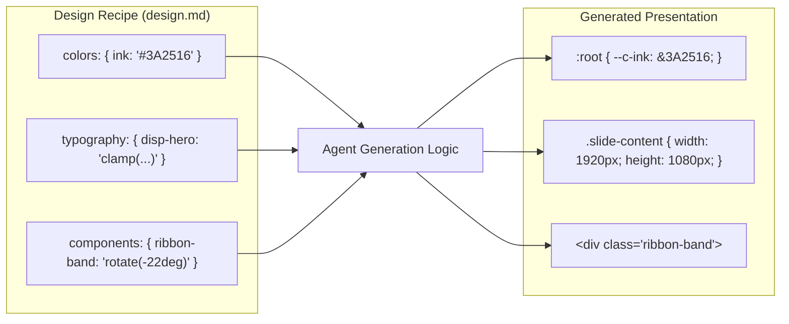

<!-- source: DeepWiki mcp.deepwiki.com · repo zarazhangrui/frontend-slides · page 7.1 Template Catalog & Selection Index · fetched 2026-10-27 -->

# Template Catalog & Selection Index

Relevant source files

The following files were used as context for generating this wiki page:

- [bold-template-pack/templates/biennale-yellow/design.md](bold-template-pack/templates/biennale-yellow/design.md)
- [bold-template-pack/templates/block-frame/design.md](bold-template-pack/templates/block-frame/design.md)
- [bold-template-pack/templates/bold-poster/design.md](bold-template-pack/templates/bold-poster/design.md)
- [bold-template-pack/templates/cobalt-grid/design.md](bold-template-pack/templates/cobalt-grid/design.md)
- [bold-template-pack/templates/coral/design.md](bold-template-pack/templates/coral/design.md)
- [bold-template-pack/templates/emerald-editorial/design.md](bold-template-pack/templates/emerald-editorial/design.md)
- [bold-template-pack/templates/peoples-platform/design.md](bold-template-pack/templates/peoples-platform/design.md)
- [bold-template-pack/templates/playful/design.md](bold-template-pack/templates/playful/design.md)
- [bold-template-pack/templates/retro-zine/design.md](bold-template-pack/templates/retro-zine/design.md)
- [bold-template-pack/templates/sakura-chroma/design.md](bold-template-pack/templates/sakura-chroma/design.md)
- [bold-template-pack/templates/scatterbrain/design.md](bold-template-pack/templates/scatterbrain/design.md)
- [bold-template-pack/templates/studio/design.md](bold-template-pack/templates/studio/design.md)

The **Bold Template Pack** provides a library of 34 high-impact design systems that go beyond the standard `STYLE_PRESETS.md`. These templates are managed through a two-tier discovery process: a metadata-rich `selection-index.json` for initial filtering, and individual `design.md` "recipes" that define the visual grammar for the agent.

## Selection Index & Metadata

The `selection-index.json` acts as a lookup table for the LLM agent to identify candidates based on user intent. Each template is tagged with five primary dimensions to ensure the agent selects a style that matches the presentation's goal.

### Metadata Schema
*   **Mood**: The emotional quality (e.g., "Atmospheric", "Populist", "Tactile").
*   **Tone**: The communication style (e.g., "Editorial", "Aggressive", "Human").
*   **Formality**: A scale from 1 (Casual) to 10 (Strict Corporate).
*   **Density**: How much content the layout comfortably holds (e.g., "Sparse", "Moderate", "Dense").
*   **Color Scheme**: The primary palette (e.g., "Monochrome + Accent", "High-Key Pastels").

### Catalog Highlights (Sample of 34)

| Template Name | Primary Mood | Key Typography | Color Palette | Density |
| :--- | :--- | :--- | :--- | :--- |
| **Biennale Yellow** | Atmospheric | Instrument Serif | Parchment, Solar Yellow, Ink | Moderate |
| **Block Frame** | Joyful / Chaotic | Inter (900) | Candy Pastels, 4px Black Borders | Dense |
| **Bold Poster** | Confident | Shrikhand | Tomato Red, White, Dark Ink | Sparse |
| **Cobalt Grid** | Architectural | Newsreader | Cream Paper, Electric Cobalt | Dense |
| **Coral** | Mid-Century | Bebas Neue | Coral Fire, Cream, Black | Moderate |
| **Emerald Editorial** | Theatrical | Bodoni Moda | Emerald, Navy, Oat Paper | Sparse |
| **People's Platform** | Populist | Alfa Slab One | Cobalt, Amber, Hot Red | Sparse |
| **Playful** | Hand-crafted | Syne | Peach-Clay, Charcoal | Moderate |
| **Retro Zine** | Tactile | Bebas Neue | Khaki, Forest Green, Black | Dense |
| **Sakura Chroma** | Lo-fi Industrial | Big Shoulders | Cream, Cassette Multi-color | Dense |
| **Scatterbrain** | Creative Process | Shrikhand | Post-it Pastels, Cork, Red Pins | Moderate |
| **Studio** | Reductive | Barlow (900) | Acid Yellow, Near-Black | Sparse |

**Sources:** [bold-template-pack/templates/biennale-yellow/design.md:1-12](), [bold-template-pack/templates/block-frame/design.md:1-15](), [bold-template-pack/templates/bold-poster/design.md:1-10](), [bold-template-pack/templates/cobalt-grid/design.md:1-13](), [bold-template-pack/templates/coral/design.md:1-15](), [bold-template-pack/templates/emerald-editorial/design.md:1-16](), [bold-template-pack/templates/peoples-platform/design.md:1-16](), [bold-template-pack/templates/playful/design.md:1-10](), [bold-template-pack/templates/retro-zine/design.md:1-12](), [bold-template-pack/templates/sakura-chroma/design.md:1-15](), [bold-template-pack/templates/scatterbrain/design.md:1-22](), [bold-template-pack/templates/studio/design.md:1-16]().

---

## Progressive Disclosure Workflow

To optimize context window usage, the agent follows a **Progressive Disclosure** model. It never reads all 34 full design specifications at once.

### The Selection Logic
1.  **Phase 2 (Style Discovery)**: The agent reads `selection-index.json` to match user prompts (e.g., "I want something that feels like a zine") to templates.
2.  **Shortlisting**: The agent selects 2-3 candidates and reads only their `preview.md` (a 5-line summary of the aesthetic).
3.  **Final Loading**: Once a template is chosen, the agent loads the full `design.md` to begin generating the presentation code.

### Natural Language to Code Entity Mapping

The following diagram illustrates how user requests for "Mood" are mapped to specific template entities in the filesystem.

**Mood-to-Template Mapping**

**Sources:** [bold-template-pack/templates/bold-poster/design.md:4-4](), [bold-template-pack/templates/sakura-chroma/design.md:4-4](), [bold-template-pack/templates/studio/design.md:4-4]().

---

## The Design Recipe (design.md)

Every template contains a `design.md` file that defines the technical constraints for the presentation. These files are structured to provide the agent with a "grammar" of components and tokens.

### Key Recipe Sections
*   **Typography Tokens**: Precise `clamp()` values for font sizes and specific Google Font pairings.
*   **Component Grammar**: Descriptions of how to build specific UI elements (e.g., `ornament-double-rule` in Emerald Editorial [bold-template-pack/templates/emerald-editorial/design.md:197-202]()).
*   **Atmospheric Layers**: Specifications for textures like `grain-overlay` [bold-template-pack/templates/retro-zine/design.md:147-151]() or `diagonal-hatch` [bold-template-pack/templates/coral/design.md:191-193]().
*   **Fixed-Stage Policy**: A mandatory instruction for the agent to translate all fluid values into a fixed 1920×1080 coordinate system [bold-template-pack/templates/studio/design.md:151-160]().

### Data Flow: From Recipe to Presentation
This diagram shows how the `design.md` metadata is ingested and transformed into a live presentation.

**Template Data Transformation**

**Sources:** [bold-template-pack/templates/sakura-chroma/design.md:9-9](), [bold-template-pack/templates/sakura-chroma/design.md:21-26](), [bold-template-pack/templates/sakura-chroma/design.md:194-198](), [bold-template-pack/templates/studio/design.md:151-160]().

---

## Technical Metadata Summary

| Component Type | Common Implementation Pattern | Example Template |
| :--- | :--- | :--- |
| **Texture/Grain** | SVG fractal-noise filter at low opacity | `Retro Zine`, `Scatterbrain` |
| **Rules/Lines** | 1px to 6px solid borders, no radius | `Emerald Editorial`, `Block Frame` |
| **Shadows** | Hard offsets (e.g., `8px 8px 0px`) | `Block Frame`, `Scatterbrain` |
| **Accents** | Rotated SVG scribbles or thumbtacks | `Playful`, `Scatterbrain` |

**Sources:** [bold-template-pack/templates/retro-zine/design.md:147-151](), [bold-template-pack/templates/scatterbrain/design.md:116-120](), [bold-template-pack/templates/emerald-editorial/design.md:220-223](), [bold-template-pack/templates/block-frame/design.md:17-25](), [bold-template-pack/templates/playful/design.md:132-137](), [bold-template-pack/templates/scatterbrain/design.md:147-153]().

---

