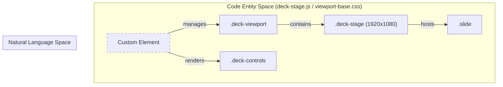
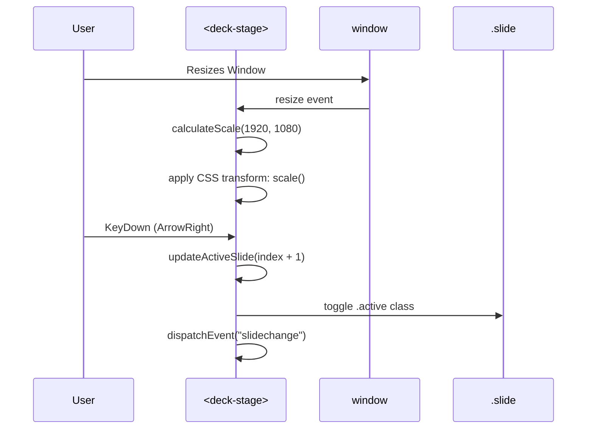

<!-- source: DeepWiki mcp.deepwiki.com · repo zarazhangrui/frontend-slides · page 7.3 deck-stage Web Component · fetched 2026-10-27 -->

# deck-stage Web Component

<details>
<summary>Relevant source files</summary>

The following files were used as context for generating this wiki page:

- [bold-template-pack/templates/biennale-yellow/design.md](bold-template-pack/templates/biennale-yellow/design.md)
- [bold-template-pack/templates/studio/design.md](bold-template-pack/templates/studio/design.md)
- [viewport-base.css](viewport-base.css)

</details>


The `<deck-stage>` custom element is the core architectural component of the Bold Template Pack. It implements a fixed-coordinate presentation environment where slides are authored at a logical resolution of 1920×1080 and uniformly scaled to fit the browser viewport. This component manages the lifecycle of a presentation, including navigation, scaling, and event dispatching.

## Purpose and Scope

The primary purpose of `<deck-stage>` is to enforce the **Viewport Fitting** requirement across diverse hardware. By treating the presentation as a fixed 16:9 canvas, it eliminates the unpredictability of CSS reflow, ensuring that complex layouts designed in the Bold Template Pack remain pixel-perfect regardless of screen size [viewport-base.css:1-5]().

## Shadow DOM Architecture

The component utilizes a Shadow DOM to encapsulate its internal layout and controls, preventing style leakage from the host document.

### Structural Composition
*   **Viewport Container**: A fixed-position wrapper that locks the browser viewport [viewport-base.css:18-23]().
*   **Stage Canvas**: The 1920×1080 drawing area that receives CSS transforms for scaling [viewport-base.css:27-36]().
*   **Slide Slot**: A `<slot>` element where individual `.slide` sections are projected.
*   **Chrome Layer**: Overlays for navigation controls, progress indicators, and speaker notes [viewport-base.css:71-77]().

### Component Relationship Diagram
"Entity Space Mapping: Component Structure"

Sources: [viewport-base.css:18-59](), [bold-template-pack/templates/studio/design.md:151-159]()

## Scaling Logic

The `<deck-stage>` component implements a "Scale-to-Fit" algorithm. It calculates the ratio between the browser's current `window.innerWidth`/`innerHeight` and the target 1920×1080 resolution.

### The `noscale` Attribute
The component supports a `noscale` attribute, which is primarily utilized by the **PPTX Exporter** and **PDF Export** pipelines [bold-template-pack/templates/studio/design.md:159](). When present:
1.  The `transform: scale()` logic is bypassed.
2.  The stage renders at its native 1920px width.
3.  This ensures high-resolution captures for static exports without interpolation artifacts [viewport-base.css:95-101]().

## Navigation and Interaction

The component acts as a central controller for user input, mapping various hardware interactions to slide state changes.

| Input Type | Action | Logic |
| :--- | :--- | :--- |
| **Keyboard** | ArrowRight / Space | `nextSlide()` |
| **Keyboard** | ArrowLeft | `prevSlide()` |
| **Touch** | Horizontal Swipe | Threshold-based navigation |
| **Tap** | Left/Right Thirds | Invisible hit-areas for mobile navigation |

### Slide Change API
Whenever a transition occurs, the component dispatches a `slidechange` `CustomEvent`. This allows external plugins (like the `Intersection Observer` or `TiltEffect`) to react to the new slide state [viewport-base.css:53-59]().

```javascript
// Example Event Detail
{
  detail: {
    current: 5,
    total: 12,
    slideElement: HTMLElement
  }
}
```

## Data Flow: Navigation and Scaling
"Natural Language to Code: Navigation Flow"

Sources: [viewport-base.css:25-36](), [viewport-base.css:53-59](), [bold-template-pack/templates/studio/design.md:159]()

## Speaker Notes Integration

The component parses `<aside class="notes">` elements found within each slide. When the presentation is in "Speaker View" (often triggered by a URL parameter or specific keybind), `<deck-stage>` extracts this content and projects it into a dedicated notes panel in the shadow DOM, synchronized with the `active` slide index.

## Print Layout Behavior

The component includes specific `@media print` overrides to facilitate high-quality PDF generation.

1.  **Flattening**: The `transform: scale()` is removed to prevent clipping [viewport-base.css:99]().
2.  **Stacking**: The `visibility: hidden` and `position: absolute` rules are revoked [viewport-base.css:103-108]().
3.  **Pagination**: Each `.slide` is forced onto a new page using `break-after: page` [viewport-base.css:111-112]().

Sources: [viewport-base.css:80-123]()

## Technical Constraints

*   **Fixed Resolution**: All coordinates in Bold Templates (e.g., `Biennale Yellow` or `Studio`) are calculated based on the 1920×1080 grid [bold-template-pack/templates/biennale-yellow/design.md:151-160]().
*   **Z-Index Management**: The component ensures that `deck-controls` remain at `z-index: 1000` to stay above slide content [viewport-base.css:76]().
*   **Motion Sensitivity**: Respects `prefers-reduced-motion` by forcing `transition-duration: 0.2s` and disabling long animations [viewport-base.css:126-133]().

Sources: [viewport-base.css:71-77](), [viewport-base.css:126-133](), [bold-template-pack/templates/studio/design.md:151-160]()

---

