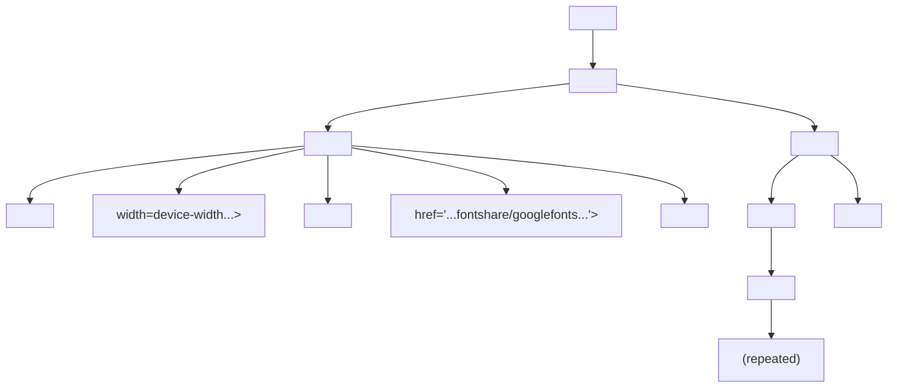
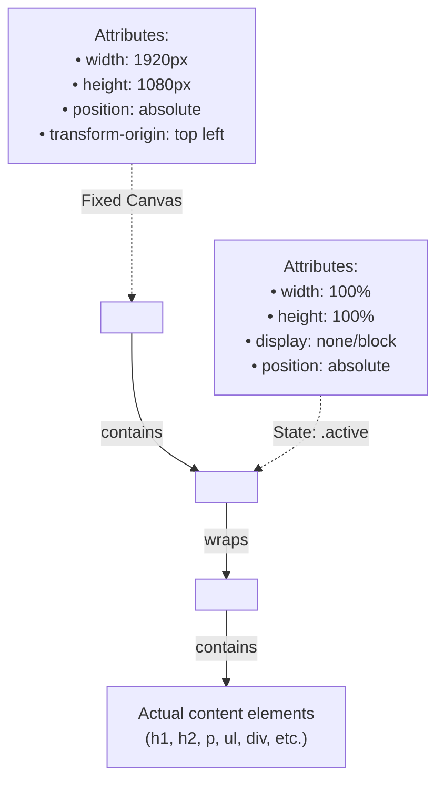
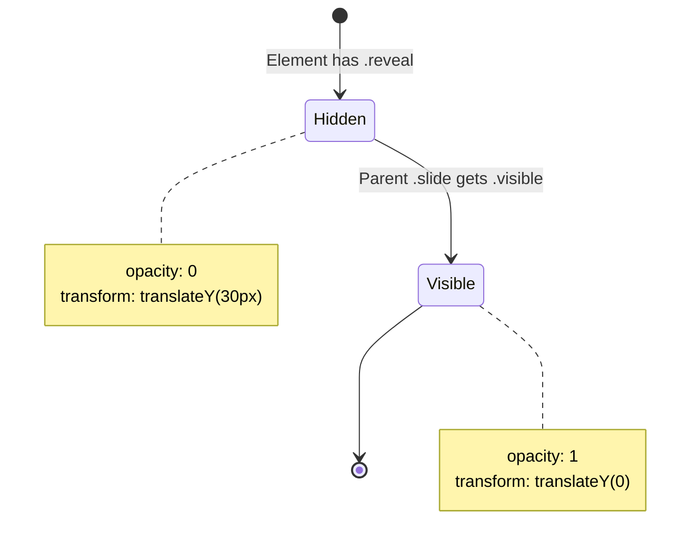

<!-- source: DeepWiki mcp.deepwiki.com · repo zarazhangrui/frontend-slides · page 8.1 HTML Structure & Semantics · fetched 2026-10-27 -->

# HTML Structure & Semantics

<details>
<summary>Relevant source files</summary>

The following files were used as context for generating this wiki page:

- [html-template.md](html-template.md)
- [plugins/frontend-slides/skills/frontend-slides/html-template.md](plugins/frontend-slides/skills/frontend-slides/html-template.md)

</details>


## Purpose and Scope

This document describes the semantic HTML structure used in all generated presentations. It covers the document organization, slide container patterns, animation hooks, and content wrappers that form the foundation of every presentation file. The architecture centers on a **fixed 16:9 stage model** where slides are authored at 1920×1080 and scaled to fit the browser window [html-template.md:1-3]().

For information about CSS styling and custom properties, see [CSS Architecture & Custom Properties](#8.2). For JavaScript navigation and animation triggering, see [JavaScript Runtime System](#8.3). For viewport fitting constraints that drive these structural decisions, see [Viewport Fitting System](#5).

---

## Overall HTML Document Structure

Every generated presentation follows a consistent document structure with inline CSS and JavaScript, ensuring zero external dependencies.

### Document Hierarchy



**Diagram: HTML Document Structure Hierarchy**

The `<body>` contains a `.deck-viewport` wrapper which houses the `#deckStage`. This stage acts as the 1920×1080 canvas for all slides [html-template.md:81-83]().

**Sources:** [html-template.md:7-97](), [plugins/frontend-slides/skills/frontend-slides/html-template.md:7-97]()

---

## Slide Container Pattern

### Core `.slide` Element

Each slide is represented by a `<section>` element with the class `slide`. This semantic choice uses the HTML5 `<section>` element to indicate thematic grouping of content.



**Diagram: Stage and Slide Container Pattern**

The structure relies on the `SlidePresentation` controller to toggle the `.active` and `.visible` classes on the current slide [html-template.md:135-138](). The `.deck-stage` is transformed via CSS `scale()` to fit the browser window while maintaining the 16:9 aspect ratio [html-template.md:115-120]().

**Sources:** [html-template.md:81-96](), [html-template.md:103-123]()

### Slide Type Variants

Different slide types use additional CSS classes to indicate their purpose:

| Slide Type | Class Pattern | Purpose |
|------------|--------------|---------|
| Title slide | `<section class="slide title-slide">` | First slide with main presentation title [html-template.md:83]() |
| Content slide | `<section class="slide">` | Standard text and bullet point slides [html-template.md:88]() |
| Active slide | `<section class="slide active visible">` | The currently displayed slide [html-template.md:136-137]() |

**Sources:** [html-template.md:83-93](), [html-template.md:133-139]()

---

## Content Organization and Semantics

### Semantic Element Usage

Generated presentations use semantic HTML5 elements to provide document structure and accessibility:

- `<h1>`: Used for the main presentation title on the `title-slide` [html-template.md:84]().
- `<h2>`: Used for individual slide titles within `.slide-content` [html-template.md:90]().
- `<p>`: Used for subtitles, body text, and descriptions [html-template.md:85, 91]().
- `<main>`: Used for the `#deckStage` to identify the primary content area [html-template.md:82]().

**Sources:** [html-template.md:82-93]()

---

## Animation Hook System

### The `.reveal` Class Pattern

All animated elements use the `.reveal` class as a hook for CSS transitions. Elements start hidden and become visible when their parent slide receives the `.visible` class from the `SlidePresentation` controller [html-template.md:59-69]().



**Diagram: `.reveal` Class Animation State Transition**

### Staggered Animation Pattern

Child elements with `.reveal` automatically receive staggered delays through CSS `:nth-child()` selectors, ensuring a sequential entrance effect [html-template.md:71-75]().

```css
.reveal:nth-child(1) { transition-delay: 0.1s; }
.reveal:nth-child(2) { transition-delay: 0.2s; }
.reveal:nth-child(3) { transition-delay: 0.3s; }
.reveal:nth-child(4) { transition-delay: 0.4s; }
```

**Sources:** [html-template.md:59-75](), [html-template.md:137]()

---

## Navigation and Editing UI

### Inline Editing Structure

Presentations include a lightweight editing affordance by default. This is implemented using a hover-based hotzone to avoid accidental triggers [html-template.md:179-184]().

```html
<div class="edit-hotzone"></div>
<button class="edit-toggle" id="editToggle" title="Edit mode (E)">✏️</button>
```

The visibility of the `.edit-toggle` is controlled via JavaScript-based hover detection with a 400ms delay to ensure usability [html-template.md:183-188]().

**Sources:** [html-template.md:171-193]()

---

## Viewport Fitting Structural Requirements

### The Fixed Stage Model

Unlike traditional responsive websites, these slides do not reflow content. The HTML structure supports a "Stage Scaling" strategy [html-template.md:158-161]():

1.  **Fixed Dimensions**: All content is authored inside a 1920×1080 `#deckStage` [html-template.md:159]().
2.  **Single Transform**: The `SlidePresentation` class calculates a `scale` factor based on the browser window and applies it to the stage [html-template.md:115-120]().
3.  **Letterboxing**: The stage is centered using `translate` to handle aspect ratio mismatches [html-template.md:117-119]().

**Sources:** [html-template.md:103-123](), [html-template.md:158-162]()

---

