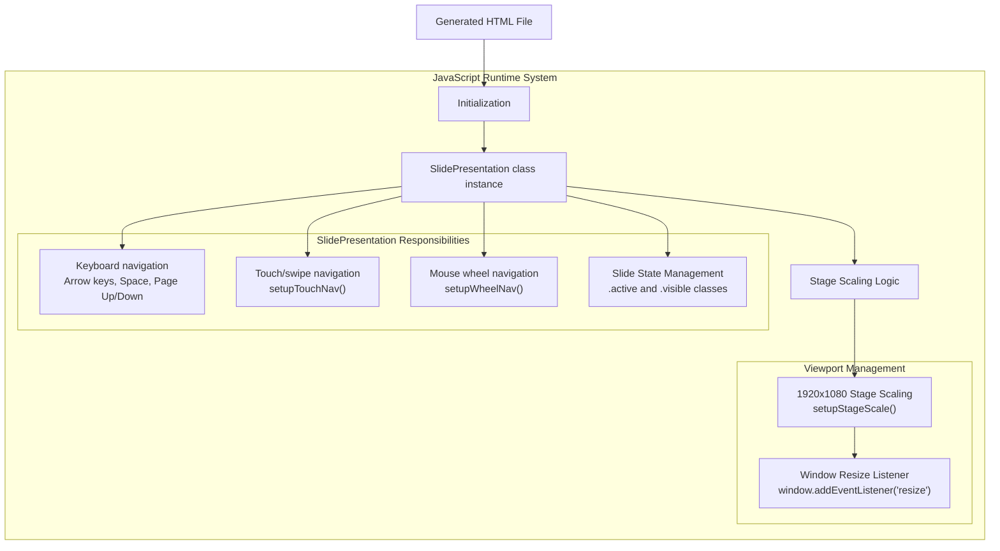
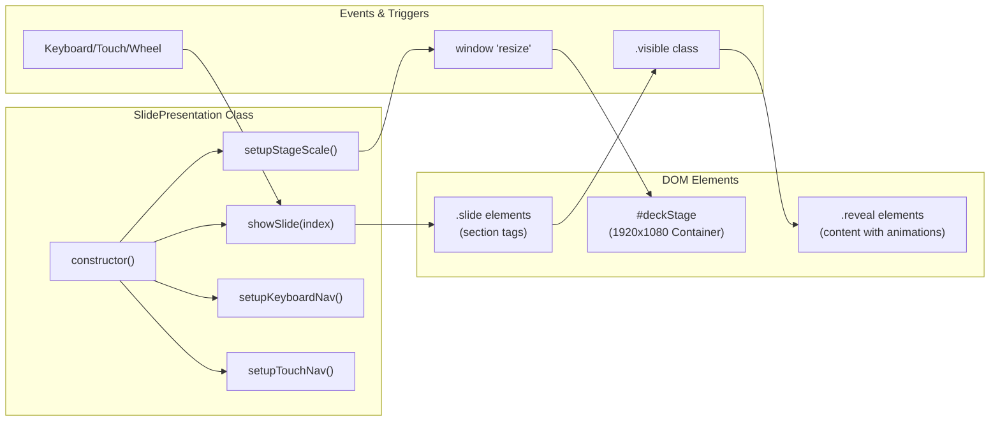

<!-- source: DeepWiki mcp.deepwiki.com · repo zarazhangrui/frontend-slides · page 8.3 JavaScript Runtime System · fetched 2026-10-27 -->

# JavaScript Runtime System

<details>
<summary>Relevant source files</summary>

The following files were used as context for generating this wiki page:

- [html-template.md](html-template.md)
- [plugins/frontend-slides/skills/frontend-slides/html-template.md](plugins/frontend-slides/skills/frontend-slides/html-template.md)

</details>


## Purpose and Scope

This document describes the JavaScript runtime system that powers generated HTML presentations. The runtime consists of two primary components: the `SlidePresentation` controller class that manages navigation and user interactions, and an Intersection Observer pattern that triggers entrance animations. This page provides an architectural overview of how these components work together to create the interactive presentation experience.

For detailed API documentation of the controller class, see [SlidePresentation Controller Class](#8.3.1). For implementation details of animation triggering, see [Intersection Observer Pattern](#8.3.2).

**Sources:** [html-template.md:100-142](), [plugins/frontend-slides/skills/frontend-slides/html-template.md:100-142]()

---

## Core Architecture

The JavaScript runtime is a self-contained system embedded directly in each generated HTML file as inline `<script>` tags. The architecture follows a zero-dependency philosophy—no external JavaScript libraries or build tools are required.



**Diagram: JavaScript Runtime Component Architecture**

The system initializes by instantiating a `SlidePresentation` object. This class is responsible for two main pillars: navigation control and the 16:9 stage scaling logic that ensures the presentation fits any screen without reflowing content.

**Sources:** [html-template.md:103-142](), [html-template.md:158-162]()

---

## Component Relationships



**Diagram: Code-Level Component Interaction Flow**

This diagram shows the specific methods and event listeners that connect the JavaScript runtime to DOM elements. The `SlidePresentation` class instantiates once and registers event listeners that route user actions to `showSlide(index)`. This method toggles classes on the `.slide` elements, which in turn triggers CSS transitions on child `.reveal` elements.

**Sources:** [html-template.md:103-142](), [html-template.md:56-69]()

---

## Initialization Pattern

The JavaScript runtime initializes using the following pattern embedded at the end of the generated HTML file:

```javascript
class SlidePresentation {
    constructor() {
        this.slides = document.querySelectorAll('.slide');
        this.currentSlide = 0;
        this.stage = document.getElementById('deckStage');
        this.setupStageScale();
        this.setupKeyboardNav();
        this.setupTouchNav();
        this.showSlide(0);
    }
    // ... methods
}

// Initialize immediately
new SlidePresentation();
```

The `constructor()` method executes immediately when the script loads. It captures the slide elements, identifies the main stage container, and initializes navigation and scaling listeners.

**Sources:** [html-template.md:103-112]()

---

## Stage Scaling System

A critical responsibility of the runtime is maintaining the fixed 16:9 aspect ratio. Unlike standard web pages, these slides do not reflow; they scale as a single unit.

- **Authoring Size**: 1920×1080 pixels.
- **Scaling Logic**: The `setupStageScale()` method calculates a scale factor based on `Math.min(window.innerWidth / 1920, window.innerHeight / 1080)`.
- **Centering**: The stage is centered using CSS `translate` transforms to create letterboxing or pillarboxing as needed.

**Sources:** [html-template.md:114-123](), [html-template.md:158-162]()

---

## Navigation System Overview

The navigation system supports multiple input modalities through the `SlidePresentation` class:

| Navigation Method | Events Handled | Methods Invoked |
|------------------|----------------|-----------------|
| **Keyboard** | `keydown` | Arrow keys, Space, Page Up/Down |
| **Touch/Swipe** | `touchstart`, `touchend` | Swipe detection for mobile |
| **Mouse Wheel** | `wheel` | Navigation with debouncing |
| **Direct Access** | `showSlide(index)` | Programmatic navigation |

All navigation methods ultimately call `showSlide(index)`, which updates the `currentSlide` pointer and manages the `.active` and `.visible` CSS classes.

**Sources:** [html-template.md:125-139](), [html-template.md:152-156]()

---

## Animation Trigger System

The animation system uses a CSS-heavy approach triggered by JavaScript class toggling:

### Phase 1: CSS Animation Definition

Content elements are marked with the `.reveal` class, which defines their initial hidden state and transition properties. The visible state is defined using the `.visible` class on the parent slide.

```css
.reveal {
    opacity: 0;
    transform: translateY(30px);
    transition: opacity var(--duration-normal) var(--ease-out-expo),
                transform var(--duration-normal) var(--ease-out-expo);
}

.slide.visible .reveal {
    opacity: 1;
    transform: translateY(0);
}
```

### Phase 2: JavaScript Trigger

When `showSlide(index)` is called, it adds the `.visible` class to the target slide. This triggers all child `.reveal` elements to animate into view.

**Sources:** [html-template.md:56-69](), [html-template.md:133-139]()

---

## Staggered Animation Pattern

Child elements within a slide can have staggered entrance animations using `nth-child` delay increments:

```css
.reveal:nth-child(1) { transition-delay: 0.1s; }
.reveal:nth-child(2) { transition-delay: 0.2s; }
.reveal:nth-child(3) { transition-delay: 0.3s; }
.reveal:nth-child(4) { transition-delay: 0.4s; }
```

This creates a cascading entrance effect where elements appear sequentially. The pattern is applied automatically by the generation system and requires no additional JavaScript logic per element.

**Sources:** [html-template.md:71-75]()

---

## Optional Enhancement Patterns

The runtime can include optional interactive enhancements based on the selected style preset:

| Enhancement | Implementation |
|------------|----------------|
| **Custom Cursor** | Cursor tracking with trail rendering |
| **Particle System** | Canvas-based background animations |
| **3D Tilt** | Interactive hover effects on cards/images |
| **Magnetic Buttons** | Elements that gravitate toward the cursor |
| **Parallax** | Layered movement based on scroll/mouse |

These enhancements are added conditionally and are not part of the base `SlidePresentation` core.

**Sources:** [html-template.md:163-170]()

---

## Inline Editing Runtime

Generated presentations include a lightweight post-draft editing affordance. This system uses a specific JavaScript-based hover pattern to avoid common CSS hover chain breaks.

- **Trigger**: Revealed via a hover hotzone or the `E` key.
- **Features**: Auto-saves to `localStorage`, allows content modification, and provides export/save functionality.
- **Approach**: Uses a JS-based hover with a 400ms delay timeout to ensure the UI remains stable while the user interacts with it.

**Sources:** [html-template.md:171-193]()

---

