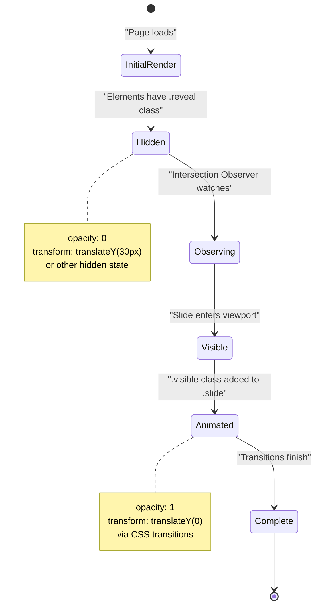
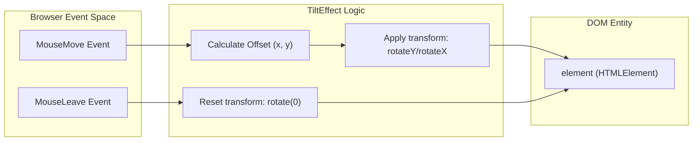

<!-- source: DeepWiki mcp.deepwiki.com · repo zarazhangrui/frontend-slides · page 9.1 Entrance Animation Patterns · fetched 2026-10-27 -->

# Entrance Animation Patterns

<details>
<summary>Relevant source files</summary>

The following files were used as context for generating this wiki page:

- [animation-patterns.md](animation-patterns.md)
- [plugins/frontend-slides/skills/frontend-slides/animation-patterns.md](plugins/frontend-slides/skills/frontend-slides/animation-patterns.md)
- [scripts/extract-pptx.py](scripts/extract-pptx.py)

</details>


## Purpose and Scope

This document details the four entrance animation types used in `frontend-slides` presentations: `fade-slide`, `scale`, `slide-left`, and `blur`. These animations are implemented using the `.reveal` class system and triggered by an `Intersection Observer` that adds a `.visible` class when slides enter the viewport.

For information about how the `Intersection Observer` triggers these animations, see [8.3.2 Intersection Observer Pattern](). For background effects like gradient meshes and noise textures, see [9.2 Background Effect Patterns](). For guidance on which animation style to use for different presentation moods, see [9.4 Style-to-Animation Mapping]().

---

## Animation System Overview

The entrance animation system in `frontend-slides` follows a consistent pattern across all four animation types:

1. Elements are initially hidden using CSS properties (`opacity`, `transform`, `filter`).
2. Elements receive a `.reveal` class variant (`.reveal`, `.reveal-scale`, `.reveal-left`, `.reveal-blur`) [plugins/frontend-slides/skills/frontend-slides/animation-patterns.md:19-51]().
3. When the slide becomes visible, the `Intersection Observer` adds a `.visible` class to the parent `.slide` element [plugins/frontend-slides/skills/frontend-slides/animation-patterns.md:26]().
4. CSS transitions animate the properties from their hidden state to their visible state.
5. Children elements use staggered `transition-delay` values to create sequential entrance effects.

### Animation Lifecycle Diagram



**Sources:** [plugins/frontend-slides/skills/frontend-slides/animation-patterns.md:19-51](), [animation-patterns.md:19-51]()

---

## The Four Entrance Animation Types

### 1. Fade + Slide Up (`.reveal`)

The most versatile entrance animation. Elements fade in while sliding up from below their final position.

**CSS Implementation:**
[plugins/frontend-slides/skills/frontend-slides/animation-patterns.md:19-29]()

```css
/* Fade + Slide Up (most versatile) */
.reveal {
    opacity: 0;
    transform: translateY(30px);
    transition: opacity 0.6s var(--ease-out-expo),
                transform 0.6s var(--ease-out-expo);
}
.visible .reveal {
    opacity: 1;
    transform: translateY(0);
}
```

**Characteristics:**
- **Initial state:** Transparent, 30px below final position.
- **Final state:** Fully opaque, at natural position.
- **Duration:** 0.6 seconds.
- **Easing:** Uses `var(--ease-out-expo)`.

### 2. Scale In (`.reveal-scale`)

Elements fade in while scaling from 90% to 100% of their natural size.

**CSS Implementation:**
[plugins/frontend-slides/skills/frontend-slides/animation-patterns.md:32-36]()

```css
/* Scale In */
.reveal-scale {
    opacity: 0;
    transform: scale(0.9);
    transition: opacity 0.6s, transform 0.6s var(--ease-out-expo);
}
```

### 3. Slide from Left (`.reveal-left`)

Elements fade in while sliding in from the left side.

**CSS Implementation:**
[plugins/frontend-slides/skills/frontend-slides/animation-patterns.md:39-43]()

```css
/* Slide from Left */
.reveal-left {
    opacity: 0;
    transform: translateX(-50px);
    transition: opacity 0.6s, transform 0.6s var(--ease-out-expo);
}
```

### 4. Blur In (`.reveal-blur`)

Elements fade in while a blur filter is removed, creating a "focus" effect.

**CSS Implementation:**
[plugins/frontend-slides/skills/frontend-slides/animation-patterns.md:46-50]()

```css
/* Blur In */
.reveal-blur {
    opacity: 0;
    filter: blur(10px);
    transition: opacity 0.8s, filter 0.8s var(--ease-out-expo);
}
```

---

## Effect-to-Feeling Guide

The system maps specific animations and visual cues to the intended mood of the presentation.

| Feeling | Animations | Visual Cues |
|---------|-----------|-------------|
| **Dramatic / Cinematic** | Slow fade-ins (1-1.5s), large scale transitions (0.9 to 1) | Dark backgrounds, spotlight effects |
| **Techy / Futuristic** | Neon glow, glitch text, grid reveals | Grid patterns, cyan/magenta, monospace |
| **Playful / Friendly** | Bouncy easing (spring physics), floating | Rounded corners, pastel colors |
| **Professional / Corporate** | Subtle fast animations (200-300ms) | Navy/slate, precise spacing |
| **Calm / Minimal** | Very slow subtle motion, gentle fades | High whitespace, muted palette |

**Sources:** [plugins/frontend-slides/skills/frontend-slides/animation-patterns.md:5-14]()

---

## Interactive Effects: Tilt

Beyond entrance animations, the codebase provides interactive patterns like 3D tilt effects for cards or panels.

**JavaScript Implementation:**
[plugins/frontend-slides/skills/frontend-slides/animation-patterns.md:82-100]()

```javascript
class TiltEffect {
    constructor(element) {
        this.element = element;
        this.element.style.transformStyle = 'preserve-3d';
        this.element.style.perspective = '1000px';

        this.element.addEventListener('mousemove', (e) => {
            const rect = this.element.getBoundingClientRect();
            const x = (e.clientX - rect.left) / rect.width - 0.5;
            const y = (e.clientY - rect.top) / rect.height - 0.5;
            this.element.style.transform = `rotateY(${x * 10}deg) rotateX(${-y * 10}deg)`;
        });
    }
}
```

### Interactive Data Flow Diagram



**Sources:** [plugins/frontend-slides/skills/frontend-slides/animation-patterns.md:82-100]()

---

## Troubleshooting

| Problem | Fix |
|---------|-----|
| Animations not triggering | Verify `Intersection Observer` is running; check `.visible` class is being added [plugins/frontend-slides/skills/frontend-slides/animation-patterns.md:107](). |
| Scroll snap not working | Ensure `scroll-snap-type: y mandatory` on `html`; each slide needs `scroll-snap-align: start` [plugins/frontend-slides/skills/frontend-slides/animation-patterns.md:108](). |
| Performance issues | Use `will-change` sparingly; prefer `transform`/`opacity` animations; throttle scroll handlers [plugins/frontend-slides/skills/frontend-slides/animation-patterns.md:110](). |

**Sources:** [plugins/frontend-slides/skills/frontend-slides/animation-patterns.md:102-110]()

---

