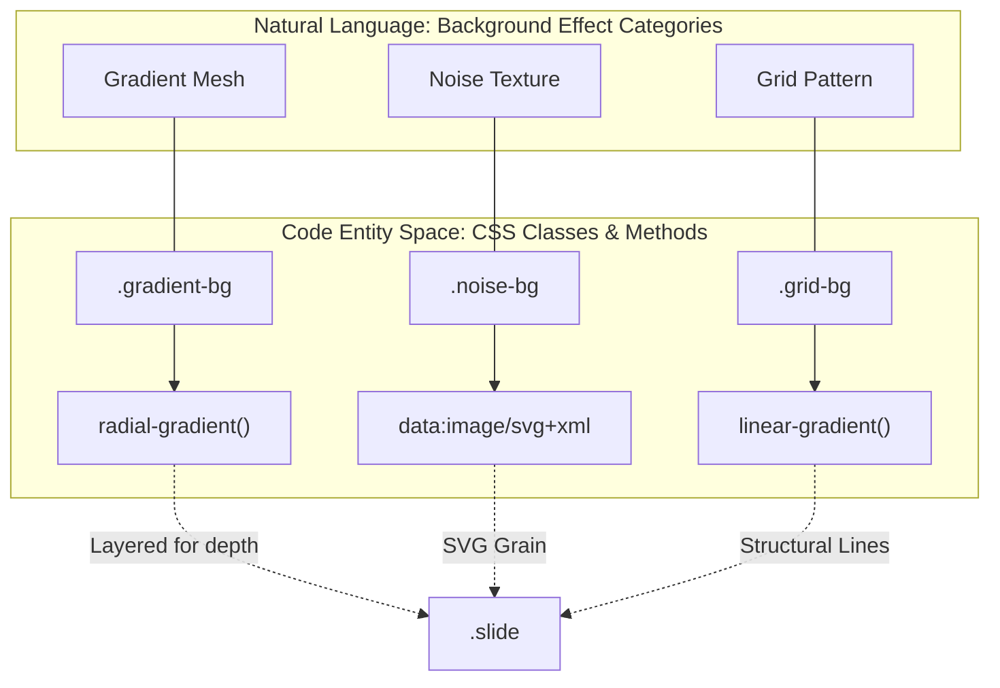
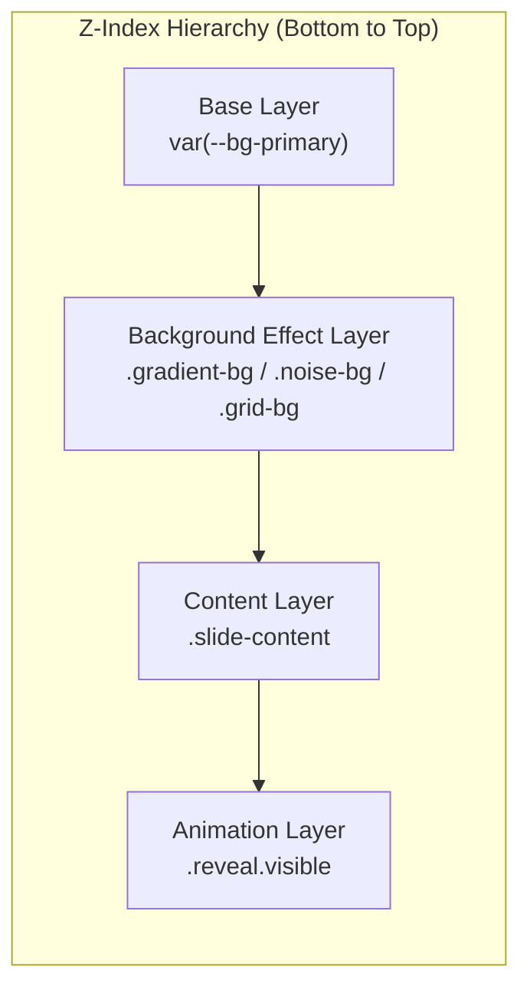

<!-- source: DeepWiki mcp.deepwiki.com · repo zarazhangrui/frontend-slides · page 9.2 Background Effect Patterns · fetched 2026-10-27 -->

# Background Effect Patterns

<details>
<summary>Relevant source files</summary>

The following files were used as context for generating this wiki page:

- [animation-patterns.md](animation-patterns.md)
- [plugins/frontend-slides/skills/frontend-slides/animation-patterns.md](plugins/frontend-slides/skills/frontend-slides/animation-patterns.md)
- [scripts/extract-pptx.py](scripts/extract-pptx.py)

</details>


This page documents the CSS-based background effect patterns used to create atmospheric depth and visual interest in presentations. Background effects are static or subtly animated layers that sit behind slide content, providing texture, gradients, and patterns without interfering with readability.

For content entrance animations, see [9.1 Entrance Animation Patterns](). For hover and interaction effects, see [9.3 Interactive Effects](). For how different styles choose their backgrounds, see [9.4 Style-to-Animation Mapping]().

## Overview

Background effects in the frontend-slides system are implemented using pure CSS techniques including gradient layers, inline SVG data URIs, and CSS patterns. All background effects are embedded directly in the HTML file with no external dependencies, adhering to the zero-dependencies philosophy (see [4.2 Design Philosophy]()).

Background effects serve three primary functions:
1.  **Atmospheric Depth** — Create visual layers behind content.
2.  **Style Identity** — Reinforce the chosen aesthetic preset.
3.  **Viewport Fitting Support** — Provide visual interest without adding content that could cause overflow.

**Sources:** [plugins/frontend-slides/skills/frontend-slides/animation-patterns.md:53-76](), [animation-patterns.md:53-76]()

## Background Effect Types

The system implements three primary background effect patterns, each with distinct visual characteristics and use cases defined in the `Background Effects` section of the animation reference.

### Pattern Architecture

The following diagram maps the natural language "Background Effects" to the specific CSS classes and methods used in the codebase.

Title: Background Effect Implementation Map


**Sources:** [plugins/frontend-slides/skills/frontend-slides/animation-patterns.md:53-76](), [animation-patterns.md:53-76]()

### Gradient Mesh

Gradient mesh backgrounds use multiple layered `radial-gradient()` functions to create soft, overlapping color spheres. This creates depth and visual interest without hard edges, often mapped to **Dramatic** or **Calm** feelings.

**CSS Implementation:** [plugins/frontend-slides/skills/frontend-slides/animation-patterns.md:57-62]()

```css
.gradient-bg {
    background:
        radial-gradient(ellipse at 20% 80%, rgba(120, 0, 255, 0.3) 0%, transparent 50%),
        radial-gradient(ellipse at 80% 20%, rgba(0, 255, 200, 0.2) 0%, transparent 50%),
        var(--bg-primary);
}
```

**Characteristics:**
*   **Layers:** 2 layered radial gradients plus a base color.
*   **Positioning:** Typically utilizes `ellipse at` coordinates (e.g., 20% 80% and 80% 20%) to anchor colors in opposite corners.
*   **Color tokens:** Integrates with the system's `:root` variables like `--bg-primary`.

**Sources:** [plugins/frontend-slides/skills/frontend-slides/animation-patterns.md:57-62](), [animation-patterns.md:57-62]()

### Noise Texture

Noise textures add subtle grain or film-like quality to backgrounds using inline SVG data URIs. This creates a tactile, organic feel without requiring external image files, supporting the "Zero Dependencies" core principle.

**CSS Implementation:** [plugins/frontend-slides/skills/frontend-slides/animation-patterns.md:65-67]()

```css
.noise-bg {
    background-image: url("data:image/svg+xml,..."); /* Inline SVG noise */
}
```

**Implementation Strategy:**
The agent typically injects a `<filter>` element within the SVG using `feTurbulence` with a `type="fractalNoise"` to generate the grain effect. The opacity is kept extremely low (0.02 - 0.05) to ensure text legibility.

**Sources:** [plugins/frontend-slides/skills/frontend-slides/animation-patterns.md:65-67](), [animation-patterns.md:65-67]()

### Grid Pattern

Grid patterns create technical, structured backgrounds using repeating linear gradients. This is a signature element for **Techy / Futuristic** visual styles.

**CSS Implementation:** [plugins/frontend-slides/skills/frontend-slides/animation-patterns.md:70-75]()

```css
.grid-bg {
    background-image:
        linear-gradient(rgba(255,255,255,0.03) 1px, transparent 1px),
        linear-gradient(90deg, rgba(255,255,255,0.03) 1px, transparent 1px);
    background-size: 50px 50px;
}
```

**Pattern Mechanics:**
*   **Structural Lines:** Two perpendicular `linear-gradient` declarations create a mesh.
*   **Subtlety:** Uses very low alpha (0.03) to prevent the grid from visually competing with slide content.
*   **Scale:** `background-size: 50px 50px` defines the density of the grid.

**Sources:** [plugins/frontend-slides/skills/frontend-slides/animation-patterns.md:70-75](), [animation-patterns.md:70-75]()

## Style-to-Effect Mapping

The choice of background effect is determined by the "Feeling" requested during the Style Discovery phase.

| Feeling | Primary Effect | Implementation |
| :--- | :--- | :--- |
| **Dramatic / Cinematic** | Spotlight / Gradient Mesh | Dark backgrounds with soft radial glows [plugins/frontend-slides/skills/frontend-slides/animation-patterns.md:9]() |
| **Techy / Futuristic** | Grid Pattern | Monospace accents with structural lines [plugins/frontend-slides/skills/frontend-slides/animation-patterns.md:10]() |
| **Calm / Minimal** | Gentle Fades | High whitespace, often with subtle noise for texture [plugins/frontend-slides/skills/frontend-slides/animation-patterns.md:13]() |
| **Playful / Friendly** | Pastel Geometries | Bright colors, often using the `.gradient-bg` pattern [plugins/frontend-slides/skills/frontend-slides/animation-patterns.md:11]() |

**Sources:** [plugins/frontend-slides/skills/frontend-slides/animation-patterns.md:5-14](), [animation-patterns.md:5-14]()

## Implementation Architecture

Background effects are applied at the slide level, ensuring they remain visible but never interfere with content or viewport fitting constraints.

Title: CSS Layering Hierarchy


### Viewport Fitting Compliance

All background effects must comply with the viewport fitting requirements. Since backgrounds are pure CSS and don't add to the DOM height, they inherently satisfy the constraint of keeping slides within the `100vh` limit.

**Compliance Rules:**
1.  **No Overflow:** Backgrounds must use `background-size: cover` or fixed pattern sizes to ensure they don't trigger scrollbars.
2.  **Performance:** Prefer `transform` and `opacity` for any animated background elements to maintain 60fps during slide transitions.
3.  **Contrast:** Background opacity for noise/grid must be throttled to ensure a minimum contrast ratio for text content.

**Sources:** [plugins/frontend-slides/skills/frontend-slides/animation-patterns.md:108-110](), [animation-patterns.md:108-110]()

## Troubleshooting Background Effects

Common issues encountered when implementing these patterns:

| Problem | Fix |
| :--- | :--- |
| **Grid lines too sharp** | Reduce the alpha channel in `rgba()` or increase `background-size`. |
| **Performance lag** | Use `will-change: transform` sparingly; prefer `opacity` animations [plugins/frontend-slides/skills/frontend-slides/animation-patterns.md:110](). |
| **Mobile clipping** | Disable heavy SVG filters or complex gradient meshes at the 768px breakpoint [plugins/frontend-slides/skills/frontend-slides/animation-patterns.md:109](). |
| **Z-index issues** | Ensure backgrounds are applied directly to `.slide` or a `::before` pseudo-element with `z-index: -1`. |

**Sources:** [plugins/frontend-slides/skills/frontend-slides/animation-patterns.md:102-110](), [animation-patterns.md:102-110]()

---

