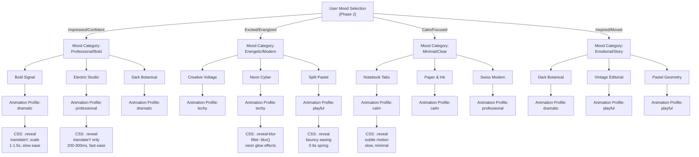
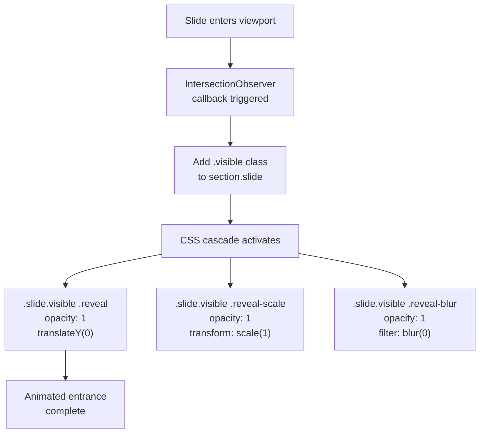

<!-- source: DeepWiki mcp.deepwiki.com · repo zarazhangrui/frontend-slides · page 9.4 Style-to-Animation Mapping · fetched 2026-10-27 -->

# Style-to-Animation Mapping

<details>
<summary>Relevant source files</summary>

The following files were used as context for generating this wiki page:

- [LICENSE](LICENSE)
- [STYLE_PRESETS.md](STYLE_PRESETS.md)
- [animation-patterns.md](animation-patterns.md)
- [scripts/extract-pptx.py](scripts/extract-pptx.py)

</details>


## Purpose and Scope

This document explains how the frontend-slides system maps user aesthetic preferences to specific animation implementations. The mapping occurs in two stages: first, user mood selections are mapped to appropriate style presets during Phase 2, and second, each style preset dictates specific animation patterns, timing, and easing functions. This creates a cohesive visual experience where animations reinforce the intended emotional impact of the presentation.

For general information about the animation system architecture, see **Section 8**. For specific animation pattern implementations, see **Section 9.1**. For background and interactive effects, see **Section 9.2** and **Section 9.3** respectively.

---

## Two-Stage Mapping Architecture

The system uses a declarative mapping approach to translate abstract user preferences into concrete CSS and JavaScript animation implementations.

### Mapping Flow Diagram



**Sources:** [animation-patterns.md:5-14](), [STYLE_PRESETS.md:1-298]()

---

## Animation Profile Definitions

Each style preset maps to one of five animation profiles defined in the system. These profiles define timing, easing, entrance patterns, and interactive behaviors.

### Profile Characteristics Table

| Profile | Duration | Easing Function | Primary Entrance | Background Effects | Interactive Elements |
|---------|----------|----------------|------------------|-------------------|---------------------|
| **Dramatic** | 1000-1500ms | `ease-out-expo` | `.reveal` + scale | Gradient mesh, parallax | `TiltEffect`, magnetic buttons |
| **Techy** | 600-800ms | `back-out` | `.reveal-blur` | Particle systems, grid patterns | Custom cursor, glow effects |
| **Playful** | 600ms | `spring-physics` | `.reveal` + bounce | Floating/bobbing | Rounded CTAs, bounce hover |
| **Professional** | 200-300ms | `linear/fast` | `.reveal` translateY | Precise spacing | Subtle hover states |
| **Calm** | 800-1200ms | `ease-in-out` | `.reveal` opacity | High whitespace, muted palette | Slow subtle motion |

**Sources:** [animation-patterns.md:5-14](), [animation-patterns.md:20-50]()

---

## Style-Specific Animation Mappings

Each of the 12 style presets has specific animation characteristics derived from its design intent.

### Animation Mapping by Preset

```mermaid
graph TB
    subgraph "Dark Themes"
        BS["Bold Signal<br/>Archivo Black"]
        ES["Electric Studio<br/>Manrope"]
        CV["Creative Voltage<br/>Syne + Space Mono"]
        DB["Dark Botanical<br/>Cormorant"]
    end
    
    subgraph "Light Themes"
        NT["Notebook Tabs<br/>Bodoni Moda"]
        PG["Pastel Geometry<br/>Plus Jakarta Sans"]
        SP["Split Pastel<br/>Outfit"]
        VE["Vintage Editorial<br/>Fraunces"]
    end
    
    subgraph "Specialty Themes"
        NC["Neon Cyber<br/>Clash Display"]
        TG["Terminal Green<br/>JetBrains Mono"]
        SM["Swiss Modern<br/>Archivo"]
        PI["Paper & Ink<br/>Cormorant Garamond"]
    end
    
    subgraph "Animation Implementations"
        Dramatic["Dramatic Profile:<br/>1-1.5s duration<br/>scale + translateY"]
        Professional["Professional Profile:<br/>200-300ms<br/>translateY only"]
        Techy["Techy Profile:<br/>600-800ms<br/>blur + glow"]
        Playful["Playful Profile:<br/>600ms bounce<br/>spring easing"]
        Calm["Calm Profile:<br/>800-1200ms<br/>opacity fade"]
    end
    
    BS --> Dramatic
    ES --> Professional
    CV --> Techy
    DB --> Dramatic
    
    NT --> Calm
    PG --> Playful
    SP --> Playful
    VE --> Playful
    
    NC --> Techy
    TG --> Professional
    SM --> Professional
    PI --> Calm
```



**Sources:** [STYLE_PRESETS.md:1-298](), [animation-patterns.md:7-14]()

### Dark Themes Animation Details

#### Bold Signal (Dramatic Profile)
- **Vibe:** Confident, bold, modern [STYLE_PRESETS.md:13]().
- **Entrance:** `.reveal` with `translateY(30px)` and scale transitions [animation-patterns.md:19-25]().
- **Signature:** Large section numbers and grid-based layout for precise alignment [STYLE_PRESETS.md:34-36]().

#### Electric Studio (Professional Profile)
- **Vibe:** Bold, clean, professional [STYLE_PRESETS.md:42]().
- **Entrance:** Subtle fast animations (200-300ms) [animation-patterns.md:12]().
- **Signature:** Two-panel vertical split with accent bar on panel edge [STYLE_PRESETS.md:62-63]().

#### Creative Voltage (Techy Profile)
- **Vibe:** Energetic, retro-modern [STYLE_PRESETS.md:71]().
- **Entrance:** Techy reveals using grid patterns and neon callouts [STYLE_PRESETS.md:92]().
- **Signature:** Halftone texture patterns and script typography accents [STYLE_PRESETS.md:91-93]().

#### Dark Botanical (Dramatic Profile)
- **Vibe:** Elegant, sophisticated, artistic [STYLE_PRESETS.md:99]().
- **Entrance:** Slow fade-ins (1-1.5s) and large scale transitions [animation-patterns.md:9]().
- **Signature:** Abstract soft gradient circles (blurred, overlapping) and thin vertical accent lines [STYLE_PRESETS.md:120-122]().

### Light Themes Animation Details

#### Notebook Tabs (Calm Profile)
- **Vibe:** Editorial, organized, tactile [STYLE_PRESETS.md:132]().
- **Entrance:** Very slow subtle motion, gentle fades [animation-patterns.md:13]().
- **Signature:** Colorful section tabs on right edge with vertical text that must scale with viewport [STYLE_PRESETS.md:156-158]().

#### Pastel Geometry (Playful Profile)
- **Vibe:** Friendly, organized, modern [STYLE_PRESETS.md:164]().
- **Entrance:** Bouncy easing (spring physics) [animation-patterns.md:11]().
- **Signature:** Vertical pills on right edge with varying heights (short → medium → tall) [STYLE_PRESETS.md:187-188]().

#### Split Pastel (Playful Profile)
- **Vibe:** Playful, modern, creative [STYLE_PRESETS.md:195]().
- **Entrance:** Floating/bobbing elements and bouncy transitions [animation-patterns.md:11]().
- **Signature:** Grid pattern overlay on right panel and playful badge pills with icons [STYLE_PRESETS.md:217-218]().

#### Vintage Editorial (Playful Profile)
- **Vibe:** Witty, confident, personality-driven [STYLE_PRESETS.md:225]().
- **Entrance:** Staggered text reveals and image-text interplay [animation-patterns.md:14]().
- **Signature:** Abstract geometric shapes (circle outline + line + dot) and bold bordered CTA boxes [STYLE_PRESETS.md:244-245]().

### Specialty Themes Animation Details

#### Neon Cyber (Techy Profile)
- **Vibe:** Futuristic, techy, confident [STYLE_PRESETS.md:255]().
- **Entrance:** `.reveal-blur` with neon glow and particle backgrounds [STYLE_PRESETS.md:261](), [animation-patterns.md:45-50]().
- **Interactive:** Particle systems (canvas) and grid reveals [animation-patterns.md:10]().

#### Terminal Green (Professional Profile)
- **Vibe:** Developer-focused, hacker aesthetic [STYLE_PRESETS.md:267]().
- **Entrance:** Precise fast animations (200-300ms) [animation-patterns.md:12]().
- **Signature:** Scan lines, blinking cursor, and code syntax styling [STYLE_PRESETS.md:273]().

#### Swiss Modern (Swiss/Professional Profile)
- **Vibe:** Clean, precise, Bauhaus-inspired [STYLE_PRESETS.md:279]().
- **Entrance:** Grid reveals and asymmetric layout transitions [STYLE_PRESETS.md:285]().
- **Signature:** Visible grid and geometric shapes [STYLE_PRESETS.md:285]().

#### Paper & Ink (Calm Profile)
- **Vibe:** Editorial, literary, thoughtful [STYLE_PRESETS.md:291]().
- **Entrance:** Very slow subtle motion and gentle fades [animation-patterns.md:13]().
- **Signature:** Drop caps, pull quotes, and elegant horizontal rules [STYLE_PRESETS.md:297]().

---

## Animation Pattern Implementation

The system uses a standardized `.reveal` class system that works with an `Intersection Observer` pattern to trigger animations when slides enter the viewport.

### Reveal Class System Diagram



**Sources:** [animation-patterns.md:19-50]()

### Base Reveal Classes

The system provides four primary reveal classes defined in `animation-patterns.md`:

| Class | Initial State | Final State | Use Case |
|-------|---------------|-------------|----------|
| `.reveal` | `opacity: 0; translateY(30px)` | `opacity: 1; translateY(0)` | Standard versatile entrance [animation-patterns.md:20-29]() |
| `.reveal-scale` | `opacity: 0; scale(0.9)` | `opacity: 1; scale(1)` | High impact/Dramatic [animation-patterns.md:32-36]() |
| `.reveal-left` | `opacity: 0; translateX(-50px)` | `opacity: 1; translateX(0)` | Editorial/Grid layouts [animation-patterns.md:39-43]() |
| `.reveal-blur` | `opacity: 0; blur(10px)` | `opacity: 1; blur(0)` | Techy/Futuristic [animation-patterns.md:46-50]() |

---

## Background and Interactive Effects

### Background Effects Implementation
The system maps background styles to CSS patterns defined in `animation-patterns.md`:

- **Gradient Mesh:** Layered radial gradients for depth, used in **Dramatic** styles [animation-patterns.md:57-62]().
- **Noise Texture:** Inline SVG for grain, used in **Editorial/Calm** styles [animation-patterns.md:65-67]().
- **Grid Pattern:** Subtle structural lines, used in **Techy/Professional** styles [animation-patterns.md:70-75]().

### Interactive Effects Mapping
Advanced interactions are handled by the `TiltEffect` class for styles requiring depth:

```javascript
/* 3D Tilt on Hover — adds depth to cards/panels */
class TiltEffect {
    constructor(element) {
        this.element = element;
        this.element.addEventListener('mousemove', (e) => {
            const rect = this.element.getBoundingClientRect();
            const x = (e.clientX - rect.left) / rect.width - 0.5;
            const y = (e.clientY - rect.top) / rect.height - 0.5;
            this.element.style.transform = `rotateY(${x * 10}deg) rotateX(${-y * 10}deg)`;
        });
    }
}
```

**Sources:** [animation-patterns.md:82-100]()

---

## Troubleshooting Mapping Issues

| Problem | Fix |
|---------|-----|
| Fonts not loading | Check Fontshare/Google Fonts URL; ensure font names match in CSS [animation-patterns.md:106]() |
| Animations not triggering | Verify Intersection Observer is running; check `.visible` class is being added [animation-patterns.md:107]() |
| Performance issues | Use `will-change` sparingly; prefer `transform`/`opacity` animations [animation-patterns.md:110]() |

**Sources:** [animation-patterns.md:104-110]()

---

