# Page: Overview

# Overview

<details>
<summary>Relevant source files</summary>

The following files were used as context for generating this wiki page:

- [.claude-plugin/marketplace.json](.claude-plugin/marketplace.json)
- [README.md](README.md)
- [SKILL.md](SKILL.md)
- [plugins/frontend-slides/.claude-plugin/plugin.json](plugins/frontend-slides/.claude-plugin/plugin.json)

</details>


## Purpose and Scope

This document provides a technical introduction to the **frontend-slides** repository, a coding-agent skill system for generating animation-rich, zero-dependency HTML presentations. It covers the repository's structure, core components, the five-phase workflow pipeline, and the "Anti-AI-Slop" design philosophy.

For detailed information about specific subsystems:
- For installation and first-time setup, see **Getting Started**
- For the viewport fitting constraint system, see **Viewport Fitting System**
- For the visual theme catalog, see **Style Presets Reference**
- For the advanced template library, see **Bold Template Pack**

---

## What is Frontend Slides?

Frontend Slides is a presentation generation system designed for Claude Code and other coding agents. It transforms user intent—whether natural language prompts, PowerPoint files, or existing HTML—into professional web presentations. The system is built on a "show, don't tell" approach, generating visual previews to help users discover their preferred aesthetic [README.md:15-18]().

### Core Value Proposition

| Aspect | Implementation |
|--------|----------------|
| **Input Modalities** | Natural language prompt, PowerPoint file (`.pptx`), or existing HTML file [SKILL.md:67-73]() |
| **Output Format** | Single self-contained HTML file with inline CSS and JS [SKILL.md:12]() |
| **Runtime Dependencies** | **Zero.** No npm, build tools, or frameworks [README.md:25]() |
| **Design Philosophy** | **Anti-AI-Slop.** Curated styles that avoid generic AI aesthetics [SKILL.md:14]() |
| **Viewport Constraint** | **Fixed 16:9 Stage.** Non-negotiable 1920×1080 canvas scaled to fit [SKILL.md:16]() |

Sources: [README.md:15-31](), [SKILL.md:1-17]()

---

## Repository Structure and Core Components

The repository is organized into a core logic layer, a design specification layer, and a suite of helper scripts.

**Repository Entity Relationship**

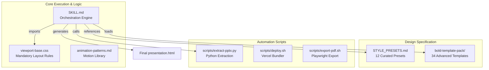

### Component Descriptions

| Component | Role | Key Responsibilities |
|-----------|------|----------------------|
| `SKILL.md` | **Execution Engine** | Orchestrates the 5-phase workflow and enforces fixed-stage rules [SKILL.md:1-4]() |
| `STYLE_PRESETS.md` | **Design Repository** | Defines 12 safe presets with color tokens and typography [SKILL.md:15]() |
| `viewport-base.css` | **Constraint Layer** | Mandatory CSS for the 16:9 stage and scroll-snap behavior [SKILL.md:52]() |
| `bold-template-pack/` | **Advanced Library** | 34 design-forward templates from `beautiful-html-templates` [README.md:155-160]() |
| `scripts/` | **Utility Suite** | Handles PPTX extraction, Vercel deployment, and PDF export [README.md:63]() |

Sources: [README.md:53-91](), [SKILL.md:1-17]()

---

## System Capabilities & Workflow

The system operates through a structured pipeline that ensures consistency regardless of the input mode.

**Capability Routing & Pipeline**

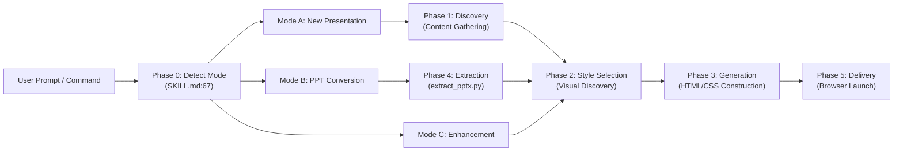

### Operational Modes

1.  **Mode A: New Presentation**: Generates content from scratch based on a brief. The agent asks structured questions about purpose, length, and density [SKILL.md:89-108]().
2.  **Mode B: PPT Conversion**: Uses a Python script to extract text, images, and notes from `.pptx` files, preserving assets in an `assets/` directory [SKILL.md:380]().
3.  **Mode C: Enhancement**: Modifies existing HTML presentations while strictly enforcing viewport fitting and content density limits [SKILL.md:73-86]().

Sources: [SKILL.md:67-108](), [SKILL.md:380]()

---

## Core Design Principles

Four non-negotiable principles govern the technical implementation of every slide deck:

### 1. Zero Dependencies
Every presentation is a single HTML file containing all necessary CSS and JavaScript. This ensures portability and longevity without requiring `npm` or build tools [SKILL.md:12]().

### 2. Fixed 16:9 Stage (NON-NEGOTIABLE)
Unlike standard responsive web design, Frontend Slides uses a **fixed 1920×1080 canvas**. The entire stage scales uniformly to fit the viewport. This prevents content reflow and ensures the design intent is preserved on all screens, including mobile [SKILL.md:16](), [SKILL.md:38-46]().

### 3. Show, Don't Tell
The agent does not ask for abstract design descriptions. Instead, it generates three visual style previews (often one safe preset, one bold template, and one wildcard) and lets the user choose based on what they see [SKILL.md:13](), [README.md:161-166]().

### 4. Anti-AI-Slop
The system explicitly avoids generic AI design patterns, such as "purple gradients on white" or overused fonts like Inter and Arial. It prioritizes distinctive typography, high-impact motion, and layered CSS backgrounds [SKILL.md:14](), [SKILL.md:19-37]().

Sources: [SKILL.md:10-52](), [README.md:23-31]()

---

## Output Architecture

The generated output is a high-performance HTML document utilizing modern browser APIs.

| Feature | Technical Implementation |
|---------|--------------------------|
| **Layout** | `CSS Grid` and `Flexbox` within a `1920x1080` container [SKILL.md:46]() |
| **Navigation** | `SlidePresentation` JS class handling Keyboard, Touch, and Scroll events [SKILL.md:380]() |
| **Animations** | `Intersection Observer` triggering `.visible` classes for CSS transitions [SKILL.md:380]() |
| **Stage Scaling** | Viewport-relative scaling logic in `viewport-base.css` [SKILL.md:52]() |

Sources: [SKILL.md:380](), [SKILL.md:380]()

---

# Page: Getting Started

# Getting Started

<details>
<summary>Relevant source files</summary>

The following files were used as context for generating this wiki page:

- [README.md](README.md)
- [SKILL.md](SKILL.md)

</details>


This document guides you through the initial setup and first-time usage of the frontend-slides system. It covers installation, system requirements, and the basic workflow for invoking the skill and generating your first presentation.

For detailed installation steps, see [Installation & Requirements](#2.1). For a comprehensive walkthrough with example prompts, see [Quick Start Guide](#2.2). For architecture details, see [Core Architecture](#4).

---

## System Overview

The frontend-slides system is a Claude Code skill that generates animation-rich HTML presentations. It consists of two core files that work together to produce self-contained HTML output, supplemented by a library of style presets and templates.

### Core Components

| Component | Path | Role |
|-----------|------|------|
| `SKILL.md` | `~/.claude/skills/frontend-slides/SKILL.md` | Execution engine: orchestrates the five-phase workflow, processes user input, generates HTML. [SKILL.md:1-4]() |
| `STYLE_PRESETS.md` | `~/.claude/skills/frontend-slides/STYLE_PRESETS.md` | Specification repository: defines 12 curated visual themes, CSS requirements, and viewport fitting rules. [STYLE_PRESETS.md:1-10]() |
| `bold-template-pack/` | `~/.claude/skills/frontend-slides/bold-template-pack/` | Extended design library: 34 high-impact templates from `beautiful-html-templates`. [README.md:155-160]() |

The system operates within the Claude Code CLI environment and is invoked using the `/frontend-slides` command. It generates a single HTML file (typically `presentation.html`) with all CSS and JavaScript inlined, requiring no external dependencies at runtime.

**Diagram: System Invocation and Component Relationships**

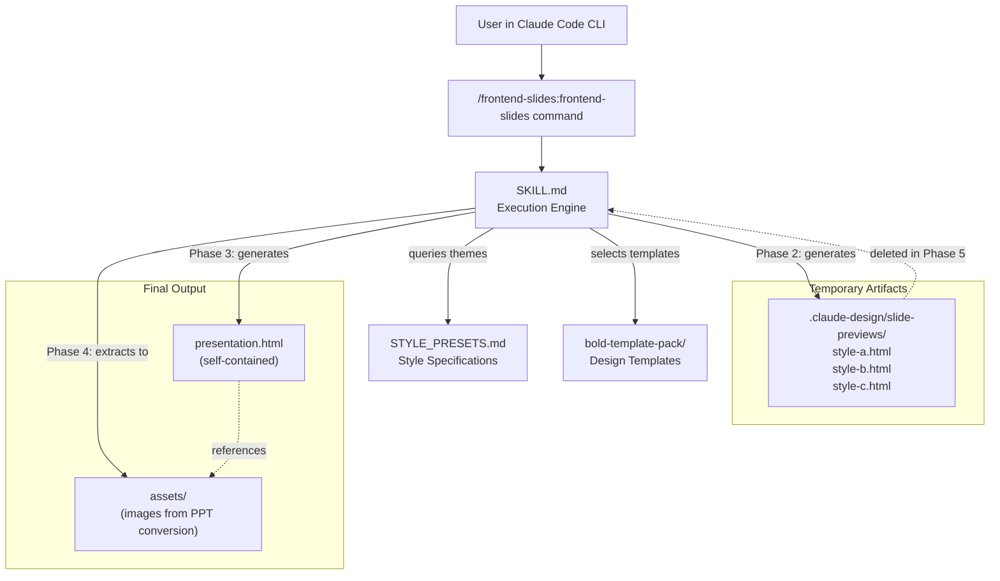

Sources: [SKILL.md:1-8](), [README.md:1-10](), [README.md:161-172]()

---

## Prerequisites

### Required

- **Claude Code CLI**: The system runs as a plugin or standalone skill within the Claude Code command-line interface. [README.md:3-4]()
- **Web Browser**: For viewing generated presentations and style previews. [SKILL.md:380]()

### Optional

- **Python 3.x** with `python-pptx` library: Required only for PowerPoint conversion (Mode B). [README.md:27](), [SKILL.md:380]()
  - Install via: `pip install python-pptx`
- **Vercel CLI**: Required for deploying presentations via the `deploy.sh` script. [README.md:63]()

The system has zero runtime dependencies for the generated output. All CSS, JavaScript, and fonts are inlined or loaded via CDN links in the final HTML. [SKILL.md:12-13]()

Sources: [README.md:15-31](), [SKILL.md:380]()

---

## Installation

### Via Claude Code Marketplace (Recommended)

Install directly from the public GitHub repo. Run these as two separate Claude Code messages:

```text
/plugin marketplace add https://github.com/zarazhangrui/frontend-slides
/plugin install frontend-slides@frontend-slides
```

Use the HTTPS URL to avoid SSH `known_hosts` issues. [README.md:34-50]()

### Manual Installation

Copy the skill files to your Claude Code skills directory:

```bash
# Create the skill directory
mkdir -p ~/.claude/skills/frontend-slides/scripts

# Copy the core files and templates
cp SKILL.md STYLE_PRESETS.md viewport-base.css html-template.md animation-patterns.md ~/.claude/skills/frontend-slides/
cp -R bold-template-pack ~/.claude/skills/frontend-slides/
cp scripts/extract-pptx.py scripts/deploy.sh scripts/export-pdf.sh ~/.claude/skills/frontend-slides/scripts/
```

Sources: [README.md:52-64](), [README.md:66-70]()

---

## Invoking the System

### Command Syntax

The system is invoked using the following command in the Claude Code CLI:

```text
/frontend-slides:frontend-slides
```

*Note: If installed manually as a standalone skill, use `/frontend-slides`.* [README.md:100-105]()

**Diagram: Mode Detection and Workflow Routing**

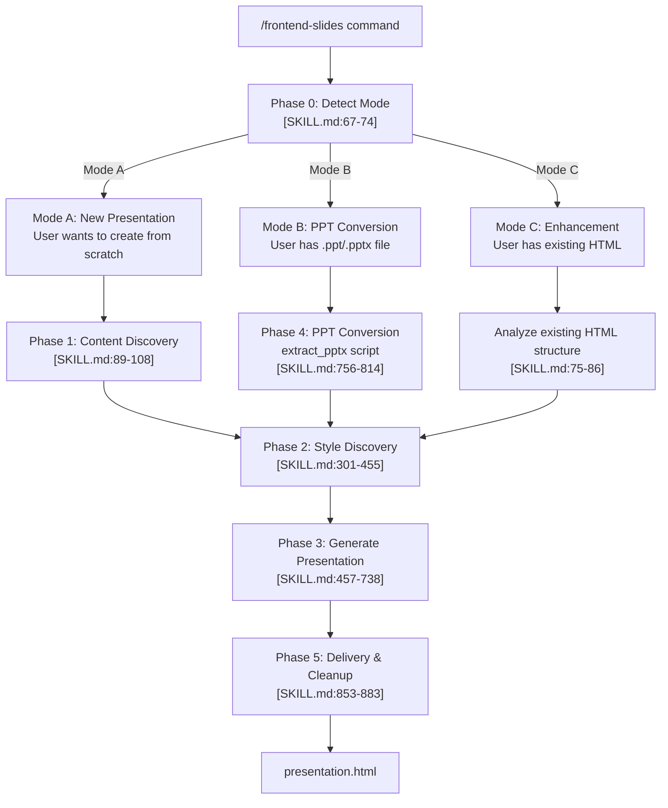

Sources: [SKILL.md:67-74](), [SKILL.md:248-263]()

---

## Workflow Overview

### Five-Phase Pipeline

The system follows a consistent five-phase workflow defined in `SKILL.md`:

| Phase | Name | Purpose | Key Outputs |
|-------|------|---------|-------------|
| Phase 0 | Mode Detection | Determine workflow (new/convert/enhance). [SKILL.md:67-74]() | Mode selection |
| Phase 1 | Content Discovery | Gather purpose, length, and density. [SKILL.md:89-108]() | Content structure |
| Phase 2 | Style Discovery | Generate visual previews (A/B/C). [SKILL.md:301-380]() | Chosen style preset |
| Phase 3 | Generate Presentation | Build HTML with fixed 16:9 stage. [SKILL.md:380]() | `presentation.html` |
| Phase 4 | PPT Conversion | Extract content using `extract-pptx.py`. [SKILL.md:380]() | `slides_data` JSON, `assets/` |
| Phase 5 | Delivery & Cleanup | Delete temp files, open browser. [SKILL.md:380]() | Final deliverable |

**Diagram: File System Interactions Across Phases**

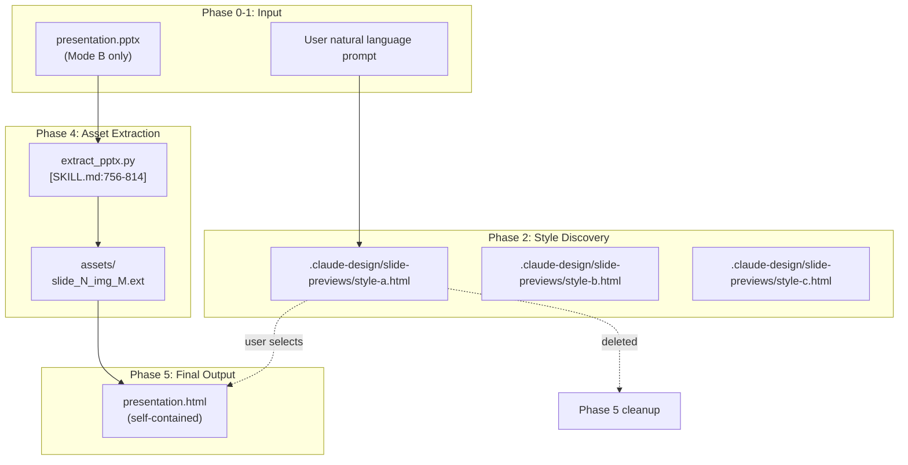

Sources: [SKILL.md:248-380](), [SKILL.md:380](), [SKILL.md:380]()

---

## First Run Expectations

### Interaction Pattern

1. **Mode Detection**: The system identifies if you are creating new slides or converting a PPT. [SKILL.md:67-74]()
2. **Content Questions**: The system asks for Purpose, Length, Content readiness, and Density in one message. [SKILL.md:91-108]()
3. **Style Discovery**: It generates 3 visual previews (one safe preset, one bold template, one wildcard). [README.md:161-172]()
4. **Style Selection**: You view the HTML files in your browser and pick a direction. [SKILL.md:380]()
5. **Generation**: The system writes the final `presentation.html` using the fixed 16:9 stage rules. [SKILL.md:38-52]()
6. **Delivery**: The presentation is opened automatically. [SKILL.md:380]()

### Navigation Controls

Generated presentations include a `SlidePresentation` controller supporting:
- **Keyboard**: Arrow keys, Space, Home/End. [SKILL.md:380]()
- **Touch**: Swipe gestures for mobile/tablet. [SKILL.md:380]()
- **UI**: Progress bar and navigation dots. [SKILL.md:380]()

Sources: [SKILL.md:380](), [README.md:108-122]()

---

## Next Steps

- **For detailed installation guidance**: See [Installation & Requirements](#2.1)
- **For step-by-step first presentation**: See [Quick Start Guide](#2.2)
- **To understand the three usage modes**: See [User Guide](#3)
- **To learn about the 12 style presets**: See [Style Presets Reference](#6)
- **To explore the 34 bold templates**: See [Bold Template Pack](#7)

Sources: [SKILL.md:1-17](), [README.md:127-137]()

---

# Page: Installation & Requirements

# Installation & Requirements

<details>
<summary>Relevant source files</summary>

The following files were used as context for generating this wiki page:

- [.claude-plugin/marketplace.json](.claude-plugin/marketplace.json)
- [README.md](README.md)
- [plugins/frontend-slides/.claude-plugin/plugin.json](plugins/frontend-slides/.claude-plugin/plugin.json)

</details>


## Purpose and Scope

This document details the installation process for the `frontend-slides` skill and its system requirements. It covers the mandatory Claude Code CLI setup via the plugin marketplace, manual installation methods for other coding agents, and the optional Python environment configuration for PowerPoint conversion.

The skill follows a **Zero Dependencies** philosophy [README.md:25-25](), ensuring that while the installation requires specific tools, the generated output is a single HTML file that runs in any modern browser without build tools.

**Sources:** [README.md:1-31](), [README.md:95-95]()

---

## System Requirements Overview

The frontend-slides skill has a minimal dependency footprint.

| Component | Status | Purpose | Used By |
|-----------|--------|---------|---------|
| **Claude Code CLI** | **Required** | Executes skill via `/plugin` or `/frontend-slides` | All modes |
| **Python 3.x + python-pptx** | Optional | Extracts content from `.pptx` files | PPT conversion only |
| **Web Browser** | Required | Renders generated HTML presentations | All modes |
| **Git** | Recommended | For cloning the repository and plugin updates | Installation |

**Sources:** [README.md:32-72](), [README.md:117-131]()

---

## Installation Architecture

The following diagram illustrates the integration of the skill into the Claude Code environment and its relationship with the optional Python extraction script.

**Diagram: Skill Integration and Code Entity Mapping**

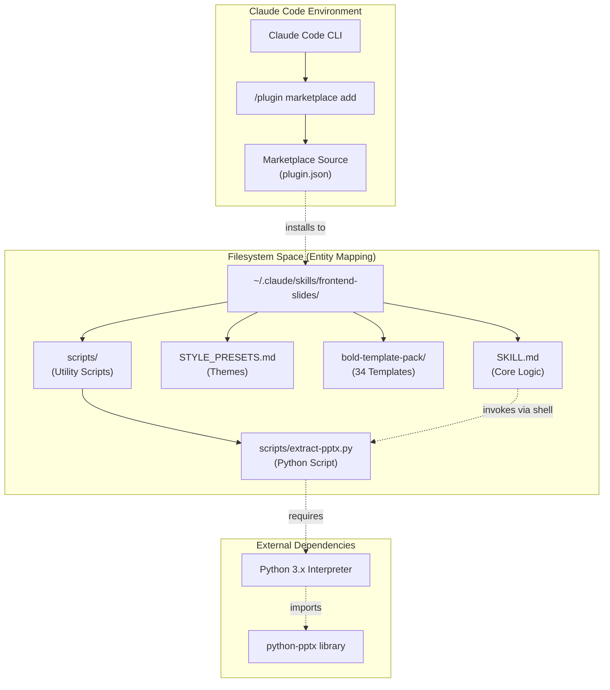

**Sources:** [README.md:32-64](), [plugins/frontend-slides/.claude-plugin/plugin.json:1-14](), [.claude-plugin/marketplace.json:1-18]()

---

## Core Installation Methods

### 1. Via Claude Code Marketplace (Recommended)

The most streamlined way to install is using the Claude Code plugin system. This namespaces the command as `/frontend-slides:frontend-slides`.

Run these as two separate messages in Claude Code:

```text
/plugin marketplace add https://github.com/zarazhangrui/frontend-slides
```

Followed by:

```text
/plugin install frontend-slides@frontend-slides
```

**Sources:** [README.md:34-50]()

### 2. Manual Installation (Standalone Skill)

If you prefer a standalone skill (invoked via `/frontend-slides` without namespacing) or are using a different coding agent, clone the repository directly into your skills directory.

```bash
# Clone directly to the skills directory
git clone https://github.com/zarazhangrui/frontend-slides.git ~/.claude/skills/frontend-slides
```

The agent requires access to the following core files to function:
*   `SKILL.md`: The primary execution logic.
*   `STYLE_PRESETS.md`: The catalog of 12 curated styles [README.md:84-84]().
*   `bold-template-pack/`: The library of 34 advanced templates [README.md:88-88]().
*   `viewport-base.css`: The mandatory layout engine [README.md:85-85]().

**Sources:** [README.md:52-72](), [README.md:82-89]()

---

## PowerPoint Conversion Setup

PowerPoint conversion requires the `scripts/extract-pptx.py` script to be executable and its dependencies met.

### Dependency Chain

**Diagram: PPTX Extraction Data Flow**

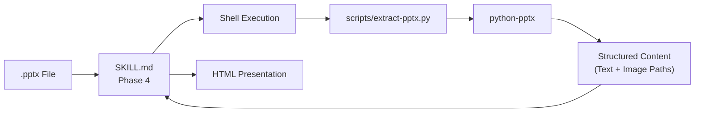

### Installation Steps

1.  **Install Python 3**: Ensure `python3` is in your system PATH.
2.  **Install Library**:
    ```bash
    pip install python-pptx
    ```
3.  **Script Location**: Ensure `scripts/extract-pptx.py` is located in the `scripts/` subdirectory of your installation [README.md:63-63]().

**Sources:** [README.md:63-63](), [README.md:117-131]()

---

## Verification Checklist

After installation, you can verify the setup by checking for key files and command availability.

| Component | Verification Action | Expected Result |
|-----------|---------------------|-----------------|
| **Plugin** | Run `/plugin list` | `frontend-slides` appears in list |
| **Command** | Type `/frontend-slides` | Agent responds with "Phase 1: Content Discovery" |
| **Templates** | Check `bold-template-pack/` | Contains `selection-index.json` and 34 folders |
| **Scripts** | Check `scripts/` | Contains `extract-pptx.py`, `deploy.sh`, `export-pdf.sh` |
| **Python** | `python3 -c "import pptx"` | No error message |

**Sources:** [README.md:32-72](), [README.md:155-173]()

---

## File Organization

A complete installation includes the following structure:

```text
~/.claude/skills/frontend-slides/
├── SKILL.md                # Main instruction set
├── STYLE_PRESETS.md        # 12 core styles
├── viewport-base.css       # Mandatory viewport fitting CSS
├── html-template.md        # Base HTML structure
├── animation-patterns.md   # CSS animation definitions
├── bold-template-pack/     # 34 high-end templates
│   ├── selection-index.json
│   └── [template-folders]/
└── scripts/                # Utility scripts
    ├── extract-pptx.py     # PPT conversion logic
    ├── deploy.sh           # Vercel deployment
    └── export-pdf.sh       # Playwright PDF export
```

**Sources:** [README.md:52-64](), [README.md:82-89]()

---

# Page: Quick Start Guide

# Quick Start Guide

<details>
<summary>Relevant source files</summary>

The following files were used as context for generating this wiki page:

- [SKILL.md](SKILL.md)
- [plugins/frontend-slides/skills/frontend-slides/SKILL.md](plugins/frontend-slides/skills/frontend-slides/SKILL.md)

</details>


## Purpose and Scope

This guide provides a hands-on walkthrough for creating your first HTML presentation using the `/frontend-slides` command. You will learn the basic interaction pattern, understand what to expect at each phase, and see how to navigate the generated output.

For installation instructions, see **2.1 Installation & Requirements**. For in-depth coverage of specific usage modes, see **3. User Guide**.

---

## Invoking the Skill

The frontend-slides system is invoked through Claude Code CLI using the `/frontend-slides` command. When executed, the system enters **Phase 0: Mode Detection** to determine your intent.

```bash
/frontend-slides
```

After invocation, provide a natural language prompt describing what you want to create:

```
"I want to create a pitch deck for my AI startup"
```

**Mode Detection Flow**

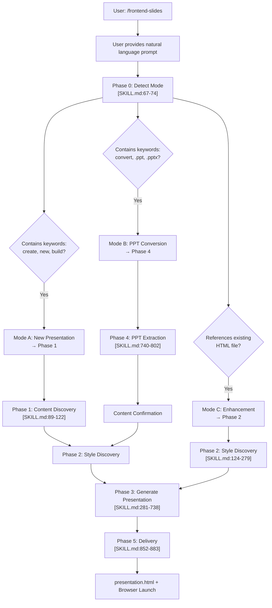

Sources: [SKILL.md:67-74](), [SKILL.md:89-122](), [SKILL.md:124-279](), [SKILL.md:281-380](), [SKILL.md:380](), [SKILL.md:380]()

---

## Phase 1: Content Discovery

When creating a new presentation (Mode A), the system uses the `AskUserQuestion` API to gather structured information about your content requirements.

### Question Sequence

The system asks four primary questions together to minimize back-and-forth [SKILL.md:89-107]():

| Question | Header | Purpose | Options |
|----------|--------|---------|---------|
| Purpose | "Purpose" | Understand presentation context | Pitch deck / Teaching-Tutorial / Conference talk / Internal presentation |
| Slide Count | "Length" | Determine scope | Short 5-10 / Medium 10-20 / Long 20+ |
| Content Readiness | "Content" | Assess content preparation | All content ready / Rough notes / Topic only |
| Density | "Density" | Determine layout spacing | Low density (speaker-led) / High density (reading-first) |

**Example Interaction:**

```
System: What is this presentation for?
Options:
- Pitch deck
- Teaching-Tutorial
- Conference talk
- Internal presentation

User: Pitch deck

System: Approximately how many slides?
Options:
- Short 5-10
- Medium 10-20
- Long 20+

User: Medium 10-20

...
```

If you select "All content ready" or "Rough notes", the system will prompt you to share your content (text, bullet points, images, etc.) before proceeding to styling [SKILL.md:109-115]().

Sources: [SKILL.md:89-115]()

---

## Phase 2: Style Discovery

Phase 2 implements the **"show, don't tell"** philosophy [SKILL.md:126-127](). Instead of asking you to describe abstract aesthetic preferences, the system generates visual HTML preview files.

### Style Selection Methods

```mermaid
flowchart LR
    Phase2Start["Phase 2: Style Discovery<br/>[SKILL.md:124-279]"] --> PathChoice{"AskUserQuestion:<br/>How to choose style?"}
    
    PathChoice -->|"Show me options"| Guided["Guided Discovery<br/>Path A"]
    PathChoice -->|"I know what I want"| Direct["Direct Selection<br/>Path B"]
    
    Guided --> Mood["Mood Selection Question<br/>[SKILL.md:189-197]<br/>multiSelect: true"]
    Direct --> PickerList["Display 12 preset options<br/>[SKILL.md:145-159]"]
    
    Mood --> Map["Map mood to style subset<br/>[SKILL.md:211-215]"]
    PickerList --> Selected["User picks preset by name"]
    
    Map --> Generate["Generate 3 HTML previews<br/>.claude-design/slide-previews/"]
    
    Generate --> TempFiles["style-a.html<br/>style-b.html<br/>style-c.html<br/>[SKILL.md:231-239]"]
    
    TempFiles --> Browser["User opens files in browser"]
    Browser --> UserPick["AskUserQuestion:<br/>Pick Your Style<br/>[SKILL.md:266-277]"]
    
    UserPick --> Phase3["Phase 3: Generate Presentation"]
    Selected --> Phase3
```

Sources: [SKILL.md:124-279]()

### Mood Selection (Guided Discovery)

If you choose "Show me options", the system asks about the intended audience feeling using [SKILL.md:189-197]():

```
Question: What feeling should the audience have when viewing your slides?

Options (select up to 2):
- Impressed/Confident — Professional, trustworthy, this team knows what they're doing
- Excited/Energized — Innovative, bold, this is the future
- Calm/Focused — Clear, thoughtful, easy to follow
- Inspired/Moved — Emotional, storytelling, memorable
```

**Mood-to-Style Mapping Examples:**

| Mood | Suggested Styles |
|------|------------------|
| Impressed/Confident | Bold Signal, Electric Studio, Midnight Executive |
| Excited/Energized | Neon Cyber, Creative Voltage, Split Pastel |
| Calm/Focused | Notebook Tabs, Paper & Ink, Swiss Modern |
| Inspired/Moved | Dark Botanical, Vintage Editorial, Pastel Geometry |

Sources: [SKILL.md:211-215]()

### Preview File Structure

The system generates three temporary HTML files in `.claude-design/slide-previews/` [SKILL.md:231-239]():

```
.claude-design/slide-previews/
├── style-a.html   # First style option
├── style-b.html   # Second style option
└── style-c.html   # Third style option
```

Each preview is a single "title slide" demonstrating the aesthetic, typography, and motion style [SKILL.md:241-245]().

Sources: [SKILL.md:231-245]()

---

## Phase 3: Presentation Generation

After style selection, the system enters **Phase 3: Generate Presentation** [SKILL.md:281-380](), which constructs the full HTML file.

### Generated File Structure

**For single presentations:**
```
presentation.html    # Self-contained presentation
assets/              # Images (if any)
```

**For projects with multiple presentations:**
```
[presentation-name].html
[presentation-name]-assets/
```

Sources: [SKILL.md:289-300]()

### HTML Architecture

The generated file follows this structure defined in [SKILL.md:304-380]():

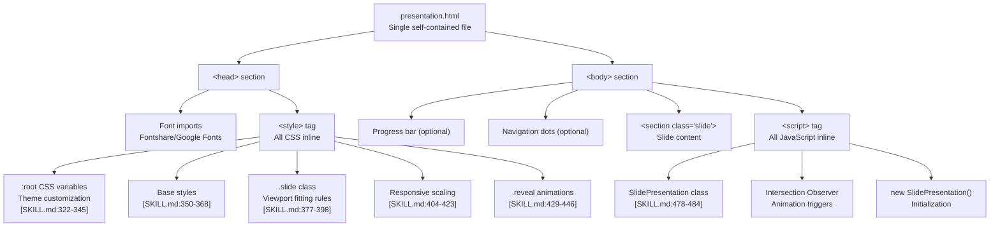

Sources: [SKILL.md:304-380]()

### Non-Negotiable Viewport Fitting

Every slide MUST fit exactly within the viewport without scrolling [SKILL.md:16](). The system enforces this through a **Fixed 16:9 Stage** (1920×1080) that scales uniformly to fit the browser window [SKILL.md:38-52]().

**Content Density Enforcement [SKILL.md:60-63]():**

| Slide Type | Maximum Content |
|------------|-----------------|
| Title slide | 1 heading + 1 subtitle + optional tagline |
| Content slide | 1 heading + 4-6 bullet points |
| Feature grid | 1 heading + 6 cards maximum |
| Code slide | 1 heading + 8-10 lines of code |

If content exceeds these limits, the system splits it into multiple slides [SKILL.md:63]().

Sources: [SKILL.md:16](), [SKILL.md:38-63]()

---

## Phase 5: Delivery

The final phase [SKILL.md:380]() performs cleanup and launches the presentation.

### Delivery Actions

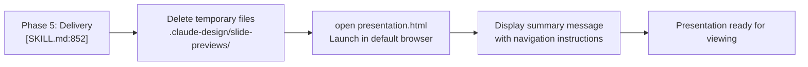

Sources: [SKILL.md:380]()

---

## Understanding the Generated Output

### Runtime Components

The generated HTML includes these key JavaScript components:

| Component | Purpose | Location |
|-----------|---------|----------|
| `SlidePresentation` class | Main controller for navigation and interactions | [SKILL.md:380]() |
| Intersection Observer | Detects slide visibility, triggers `.visible` class | [SKILL.md:380]() |
| Keyboard Handlers | Arrow keys (← →) and Space bar navigation | [SKILL.md:380]() |

### Navigation Methods

The presentation supports multiple navigation methods:
- **Keyboard**: Arrow keys, Space bar.
- **Touch**: Swipe gestures.
- **Mouse**: Mouse wheel scrolling.
- **Direct**: Click navigation dots or progress bar.

### Animation System

The `.reveal` class pattern [SKILL.md:380]():
The Intersection Observer adds the `.visible` class when a slide enters the viewport, triggering CSS transitions for any element with the `.reveal` class.

Sources: [SKILL.md:380]()

---

## Customizing Your Presentation

### CSS Custom Properties

All theme values are defined in `:root` variables [SKILL.md:322-345]():

```css
:root {
    /* Colors */
    --bg-primary: #0a0f1c;
    --accent: #00ffcc;
    
    /* Typography */
    --font-display: 'Clash Display', sans-serif;
    --font-body: 'Satoshi', sans-serif;
}
```

**To customize:** Open the HTML file, locate the `:root` section, and modify the variable values.

Sources: [SKILL.md:322-345]()

### Testing Your Presentation

After generation, test your presentation at different sizes [SKILL.md:45-48](). The stage will letterbox or pillarbox to maintain the 16:9 aspect ratio, ensuring your layout never breaks.

Sources: [SKILL.md:38-52]()

---

# Page: User Guide

# User Guide

<details>
<summary>Relevant source files</summary>

The following files were used as context for generating this wiki page:

- [SKILL.md](SKILL.md)
- [plugins/frontend-slides/skills/frontend-slides/SKILL.md](plugins/frontend-slides/skills/frontend-slides/SKILL.md)

</details>


This page provides comprehensive guidance for using the frontend-slides system to create animation-rich HTML presentations. It covers the three main usage modes: creating new presentations from scratch, converting PowerPoint files to HTML, and enhancing existing presentations.

---

## Overview of Usage Modes

The frontend-slides system supports three distinct workflows, all accessed through the `/frontend-slides` command in Claude Code CLI. The system automatically detects which mode to use based on user intent during Phase 0 (Mode Detection).

### Mode Detection and Routing

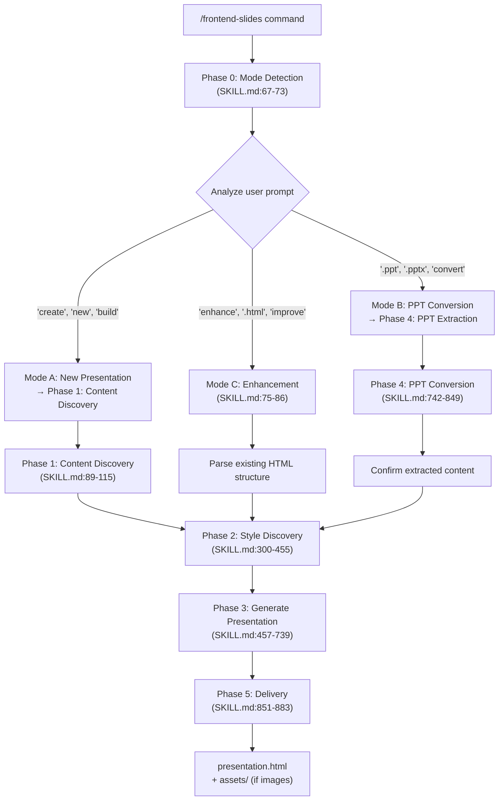

**Sources:** [SKILL.md:67-73](), [SKILL.md:75-86](), [SKILL.md:89-115](), [SKILL.md:300-380](), [SKILL.md:380](), [SKILL.md:380](), [SKILL.md:380]()

### Mode Comparison

| Mode | Entry Point | Primary Use Case | Output |
|------|-------------|------------------|--------|
| **Mode A: New Presentation** | Natural language prompt | Creating slides from scratch, content ideation | Single `presentation.html` file |
| **Mode B: PPT Conversion** | `.ppt` or `.pptx` file | Migrating existing PowerPoint to web | `presentation.html` + `assets/` directory |
| **Mode C: Enhancement** | Existing `.html` file | Improving existing HTML presentations | Modified HTML file |

**Sources:** [SKILL.md:67-73]()

---

## Workflow Details by Mode

### Mode A: New Presentation Creation

The new presentation workflow consists of content discovery and style selection. For a detailed walkthrough of the content generation process, see [Creating New Presentations](#3.1).

#### Phase 1: Content Discovery Process

The system uses a structured-question UI to gather requirements across four key areas: Purpose, Length, Content Readiness, and Density.

**Sources:** [SKILL.md:89-115]()

#### Content Density Enforcement

To ensure **Viewport Fitting** (no scrolling within slides), the system enforces strict content limits based on the selected density mode:

| Density Mode | Best For | Design Behavior |
|--------------|----------|-----------------|
| **Low density** | Public talks, keynotes | 1 idea per slide, 1-3 bullets max, large type |
| **High density** | Reports, async review | Structured grids, 4-8 bullets or 4-6 cards |

**Sources:** [SKILL.md:54-63](), [SKILL.md:221-237]()

---

### Mode B: PowerPoint Conversion

The PPT conversion workflow extracts content using a Python-based extraction pipeline, then routes through the same style selection and generation process as new presentations. For details on how content is preserved, see [Converting PowerPoint Files](#3.2).

#### PPT Extraction Pipeline

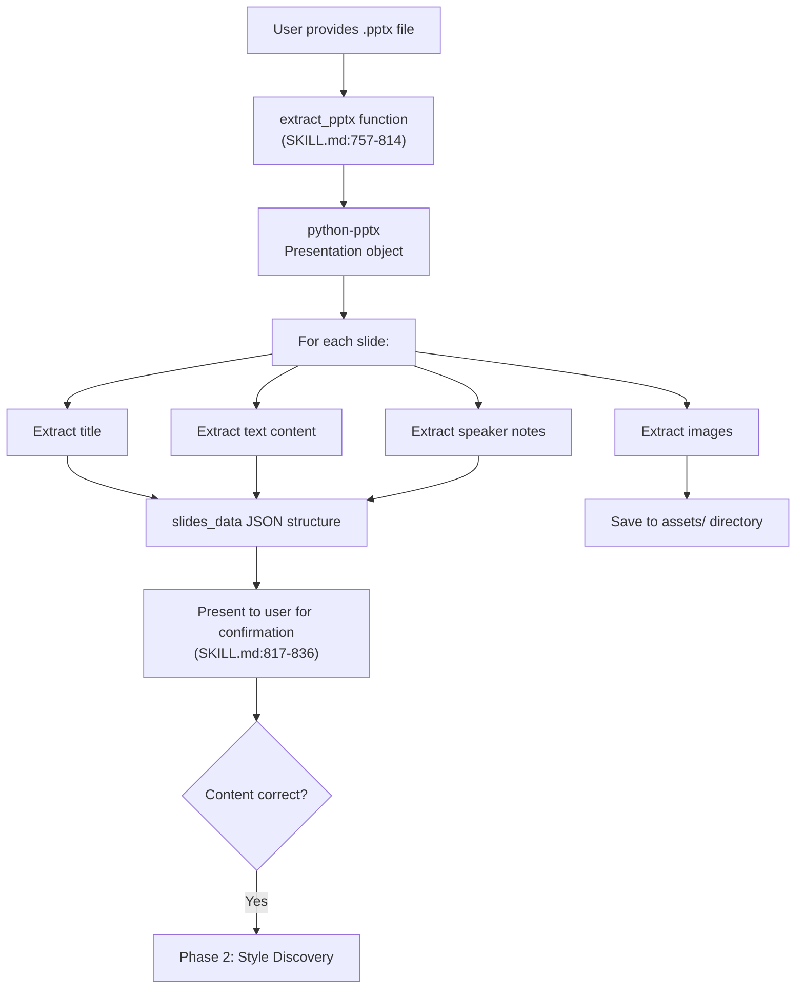

**Sources:** [SKILL.md:380]()

---

### Mode C: Existing Presentation Enhancement

When enhancing an existing HTML presentation, the system follows specific **Mode C Modification Rules** to prevent breaking the viewport fitting system.

**Key Rules:**
1. **Density Check:** Count existing elements before adding new ones [SKILL.md:79]().
2. **Image Fitting:** Fit images inside the 1920×1080 stage; split slides if stage is full [SKILL.md:80]().
3. **Proactive Reorganization:** Automatically split content if modifications cause overflow [SKILL.md:83]().

**Sources:** [SKILL.md:75-86]()

---

## Style Selection Process

Style selection uses a "show, don't tell" philosophy. For a full catalog of available themes and the visual discovery approach, see [Style Selection Process](#3.3).

### Style Selection Path Routing

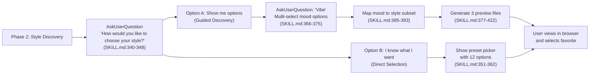

**Sources:** [SKILL.md:300-380]()

---

## Fixed 16:9 Stage Invariants

Every presentation, regardless of mode, must adhere to the **Fixed Stage Rules**:

- **1920×1080 Stage:** Every slide is authored inside a fixed design size [SKILL.md:43]().
- **Uniform Scaling:** The stage scales to fit the viewport; it does NOT re-layout content for different screens [SKILL.md:44]().
- **No Reflow:** Responsive breakpoints must not be used to rearrange slide content [SKILL.md:45]().
- **Visibility Control:** Slide switching uses `visibility` and `opacity` rather than `display: none` to avoid layout shifts [SKILL.md:47]().

**Sources:** [SKILL.md:38-52]()

---

## Delivery and Output (Phase 5)

The final phase handles cleanup and browser launch.

1. **Cleanup:** Temporary style preview files in `.claude-design/slide-previews/` are deleted [SKILL.md:380]().
2. **Launch:** The system executes an `open` command to launch the presentation in the default browser [SKILL.md:380]().
3. **Instructions:** The user is provided with navigation controls and customization tips [SKILL.md:380]().

**Sources:** [SKILL.md:380]()

---

# Page: Creating New Presentations

# Creating New Presentations

<details>
<summary>Relevant source files</summary>

The following files were used as context for generating this wiki page:

- [SKILL.md](SKILL.md)
- [plugins/frontend-slides/skills/frontend-slides/SKILL.md](plugins/frontend-slides/skills/frontend-slides/SKILL.md)

</details>


## Purpose and Scope

This page documents the workflow for creating HTML presentations from scratch using natural language prompts. It covers the complete pipeline from initial user intent through content discovery, style selection, and final HTML generation.

For converting existing PowerPoint files to HTML, see [Converting PowerPoint Files](#3.2). For detailed information about the visual style selection process, see [Style Selection Process](#3.3). For the underlying five-phase architecture, see [Five-Phase Workflow Pipeline](#4.1).

---

## Workflow Overview

Creating a new presentation follows a linear three-phase pipeline after mode detection determines the user wants to create slides from scratch (Mode A).

**Diagram: New Presentation Creation Pipeline**

```mermaid
flowchart TD
    UserPrompt["User: Natural Language Prompt<br/>'Create pitch deck for AI startup'"]
    
    Phase0["Phase 0: Mode Detection<br/>[SKILL.md:67-74]"]
    
    ModeA["Mode A Detected:<br/>New Presentation"]
    
    Phase1["Phase 1: Content Discovery<br/>[SKILL.md:89-114]"]
    
    Q1["AskUserQuestion: Purpose<br/>Options: Pitch/Teaching/Conference/Internal"]
    Q2["AskUserQuestion: Length<br/>Options: Short 5-10/Medium 10-20/Long 20+"]
    Q3["AskUserQuestion: Content Status<br/>Options: Ready/Rough/Topic only"]
    Q4["AskUserQuestion: Density<br/>Options: Low/High"]
    
    ContentGather["User Provides Content<br/>Text, bullets, images, notes"]
    
    Phase2["Phase 2: Style Discovery<br/>[SKILL.md:116-160]<br/>Detailed in page 3.3"]
    
    MoodQ["Query user mood/feeling"]
    GenPreviews["Generate 3 HTML previews<br/>.claude-design/slide-previews/"]
    UserPick["User selects preferred style"]
    
    Phase3["Phase 3: Generate Presentation<br/>[SKILL.md:162-200]"]
    
    BuildHTML["Construct HTML structure<br/>Apply Fixed Stage Rules"]
    EnforceVF["Enforce Viewport Fitting<br/>Content Density Limits"]
    AddJS["Add SlidePresentation class<br/>Intersection Observer"]
    
    Output["presentation.html<br/>Self-contained file"]
    
    UserPrompt --> Phase0
    Phase0 --> ModeA
    ModeA --> Phase1
    Phase1 --> Q1
    Q1 --> Q2
    Q2 --> Q3
    Q3 --> Q4
    Q4 --> ContentGather
    ContentGather --> Phase2
    Phase2 --> MoodQ
    MoodQ --> GenPreviews
    GenPreviews --> UserPick
    UserPick --> Phase3
    Phase3 --> BuildHTML
    BuildHTML --> EnforceVF
    EnforceVF --> AddJS
    AddJS --> Output
```

**Sources:** [SKILL.md:67-74](), [SKILL.md:89-114](), [SKILL.md:116-160](), [SKILL.md:162-200]()

---

## Mode Detection (Phase 0)

The system first determines whether the user intends to create a new presentation, convert PowerPoint, or enhance existing HTML. For new presentations, the system detects Mode A based on user language patterns.

| User Intent Pattern | Detected Mode | Next Phase |
|---------------------|---------------|------------|
| "Create slides for...", "Build a presentation about..." | Mode A: New Presentation | Phase 1 (Content Discovery) |
| "Convert my PPT", "Transform this PowerPoint..." | Mode B: PPT Conversion | Phase 4 (PPT Extraction) |
| "Improve this HTML", "Enhance my presentation..." | Mode C: Enhancement | Phase 2 (Style Discovery) |

Mode A automatically proceeds to Phase 1 for structured content gathering.

**Sources:** [SKILL.md:67-74]()

---

## Phase 1: Content Discovery

Content Discovery structures user requirements through four simultaneous questions. This phase gathers information about presentation purpose, scope, content readiness, and density before any design work begins.

**Diagram: Content Discovery Question Flow**

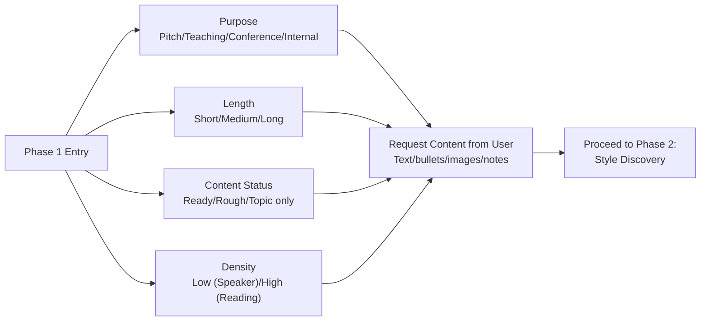

**Sources:** [SKILL.md:89-114]()

### Question 1: Presentation Purpose

The first question identifies the presentation's primary use case, which influences content structure and later style recommendations.

| Option | Description | Typical Characteristics |
|--------|-------------|------------------------|
| Pitch deck | Selling idea/product/company to investors or clients | Persuasive, concise, focused on value proposition |
| Teaching/Tutorial | Explaining concepts, how-to guides, educational content | Sequential, detailed explanations, examples |
| Conference talk | Speaking at event, tech talk, keynote | Engaging, story-driven, balanced text-visuals |
| Internal presentation | Team updates, strategy meetings, company updates | Informational, data-heavy, process-oriented |

**Sources:** [SKILL.md:93-94]()

### Question 2: Slide Count

The second question establishes presentation scope, affecting content depth per slide and overall pacing.

| Option | Slide Range | Use Cases |
|--------|-------------|-----------|
| Short (5-10) | 5-10 slides | Quick pitch, lightning talk, executive summary |
| Medium (10-20) | 10-20 slides | Standard presentation, workshop session |
| Long (20+) | 20+ slides | Deep dive, comprehensive training, detailed analysis |

**Sources:** [SKILL.md:96-97]()

### Question 4: Content Density Modes

A critical differentiator in Phase 1 is the selection of Density Mode, which dictates the layout behavior and content limits.

| Density mode | Best for | Design behavior |
| ------------- | -------- | --------------- |
| **Low density / speaker-led** | Public talks, keynote-style sharing | One idea per slide, large type, 1-3 bullets max |
| **High density / reading-first** | Reports, handouts, async review | Structured grids, 4-8 bullets, tighter spacing |

**Sources:** [SKILL.md:54-61]()

---

## Phase 2: Style Discovery Overview

Phase 2 implements the "show, don't tell" philosophy. The system generates visual previews in the `.claude-design/slide-previews/` directory. For bold templates, it uses a **Progressive Disclosure** model, reading lightweight indexes first and loading the full `design.md` only after a user selects that template.

**Sources:** [SKILL.md:13-15](), [SKILL.md:116-160]()

---

## Phase 3: Presentation Generation

Phase 3 constructs the final HTML presentation. This phase enforces the **Fixed 16:9 Stage** invariant, ensuring every deck uses a 1920×1080 slide canvas scaled to the viewport.

**Diagram: HTML Generation Process with Code Entities**

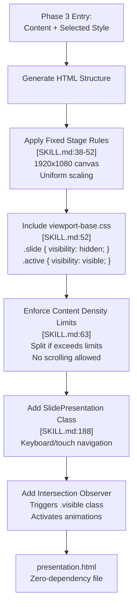

**Sources:** [SKILL.md:162-200](), [SKILL.md:38-52]()

### Fixed Stage Rules

These invariants apply to every slide to prevent layout reflow on different devices:
- Every deck has a viewport wrapper filling the browser window.
- Every slide is authored inside a fixed **1920×1080 stage**.
- The stage scales uniformly (letterbox/pillarbox) to fit the viewport.
- Slide visibility is controlled by `.active` / `.visible` classes.
- Use of `display: none` for slide switching is prohibited to prevent layout conflicts.

**Sources:** [SKILL.md:38-52]()

### Content Density Enforcement

The system guarantees viewport fitting by splitting content that exceeds limits:
- **Low Density:** 1-3 bullets max.
- **High Density:** 4-8 bullets or 4-6 cards.
- **Invariants:** No scrolling, no overflow, no overlapping panels.

**Sources:** [SKILL.md:60-63]()

---

## Viewport Fitting Validation

Before finalizing, the agent verifies the slide stage remains 16:9 and that no text overflows its card. This is particularly critical when enhancing existing presentations (Mode C).

**Modification Rules for Existing Content:**
1. Count existing elements before adding content.
2. Check against density limits.
3. If modifications cause overflow, automatically split content and inform the user.

**Sources:** [SKILL.md:75-86]()

---

## File Output and Cleanup

The final output is a single HTML file requiring only a web browser to present. The system follows a zero-dependency philosophy, meaning the file contains all necessary CSS and JS inline.

**Sources:** [SKILL.md:12](), [SKILL.md:196-200]()

---

# Page: Converting PowerPoint Files

# Converting PowerPoint Files

<details>
<summary>Relevant source files</summary>

The following files were used as context for generating this wiki page:

- [animation-patterns.md](animation-patterns.md)
- [plugins/frontend-slides/skills/frontend-slides/scripts/extract-pptx.py](plugins/frontend-slides/skills/frontend-slides/scripts/extract-pptx.py)
- [scripts/extract-pptx.py](scripts/extract-pptx.py)

</details>


## Purpose and Scope

This document describes the PowerPoint conversion workflow in the frontend-slides system, which transforms existing `.ppt` and `.pptx` files into animation-rich HTML presentations. This covers content extraction via Python scripts, asset management, and the integration with the style discovery workflow.

For information about creating new presentations from scratch, see [Creating New Presentations](#3.1). For style selection after content extraction, see [Style Selection Process](#3.3). For technical details about the PPT extraction pipeline, see [Phase 4: PPT Conversion Pipeline](#4.1.5).

**Sources:** [plugins/frontend-slides/skills/frontend-slides/scripts/extract-pptx.py:1-10](), [scripts/extract-pptx.py:1-10]()

---

## Conversion Mode Overview

PowerPoint conversion is one of three operational modes detected in Phase 0. When a user provides a PowerPoint file, the system enters **Mode B: PPT Conversion**, which bypasses content discovery (Phase 1) and proceeds directly to extraction.

| Mode | Trigger | Phase Route |
|------|---------|-------------|
| Mode A: New Presentation | Natural language prompt | Phase 1 → Phase 2 → Phase 3 |
| **Mode B: PPT Conversion** | .ppt/.pptx file provided | **Phase 4 → Phase 2 → Phase 3** |
| Mode C: Enhancement | Existing HTML file | Analyze → Phase 2 → Phase 3 |

The conversion process preserves:
- All text content (titles, body text, bullet points)
- All embedded images with original dimensions
- Slide ordering and structure
- Speaker notes (optional, as HTML comments)

**Sources:** [plugins/frontend-slides/skills/frontend-slides/scripts/extract-pptx.py:18-22](), [scripts/extract-pptx.py:18-22]()

---

## Extraction Workflow

The following diagram illustrates the complete PowerPoint conversion workflow, from file input to final HTML presentation:

### Diagram: PowerPoint to HTML Conversion Pipeline

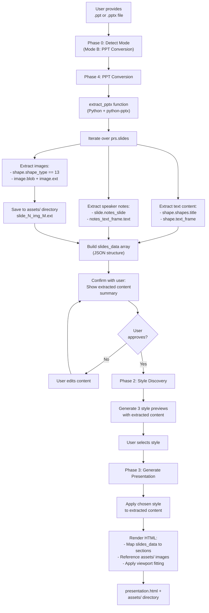

**Sources:** [plugins/frontend-slides/skills/frontend-slides/scripts/extract-pptx.py:30-75](), [scripts/extract-pptx.py:30-75]()

---

## The extract_pptx Function

The core extraction logic is implemented in the `extract_pptx` function within `scripts/extract-pptx.py`, which uses the `python-pptx` library to parse PowerPoint files. This script is invoked during Phase 4 of the workflow.

### Function Signature and Purpose

```python
def extract_pptx(file_path, output_dir="."):
    """
    Extract all content from a PowerPoint file.
    Returns a list of slide data dicts with text, images, and notes.
    """
```

The function accepts two parameters:
- `file_path`: Path to the `.ppt`/`.pptx` file [scripts/extract-pptx.py:18]()
- `output_dir`: Directory where assets and the `extracted-slides.json` should be saved [scripts/extract-pptx.py:18]()

**Sources:** [scripts/extract-pptx.py:18-22](), [plugins/frontend-slides/skills/frontend-slides/scripts/extract-pptx.py:18-22]()

### Extraction Process Steps

The extraction occurs in the following sequence:

1. **Initialize Presentation object**: `prs = Presentation(file_path)` [scripts/extract-pptx.py:23]()
2. **Create assets directory**: `os.makedirs(assets_dir, exist_ok=True)` [scripts/extract-pptx.py:28]()
3. **Iterate through slides**: `for slide_num, slide in enumerate(prs.slides):` [scripts/extract-pptx.py:30]()
4. **Process each shape** on the slide:
   - Text frames (`shape.has_text_frame`) [scripts/extract-pptx.py:41]()
   - Images (`shape.shape_type == 13`) [scripts/extract-pptx.py:50]()
5. **Extract speaker notes** if present: `slide.notes_slide.notes_text_frame` [scripts/extract-pptx.py:70]()

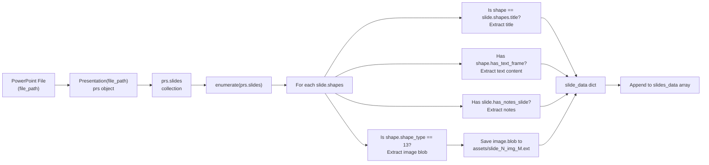

**Sources:** [scripts/extract-pptx.py:23-73](), [plugins/frontend-slides/skills/frontend-slides/scripts/extract-pptx.py:23-73]()

---

## Content Structure: slides_data Format

The `extract_pptx` function returns a structured JSON array (saved as `extracted-slides.json`) where each element represents one slide.

### Slide Data Schema

```javascript
{
  "number": 1,                    // Sequential slide number [scripts/extract-pptx.py:32]
  "title": "Slide Title",         // From slide.shapes.title [scripts/extract-pptx.py:43]
  "content": [                    // Array of content blocks [scripts/extract-pptx.py:45-47]
    {
      "type": "text",
      "content": "Text content"
    }
  ],
  "images": [                     // Array of extracted images [scripts/extract-pptx.py:60-66]
    {
      "path": "assets/slide1_img1.png",
      "width": 914400,            // Original shape.width (EMUs)
      "height": 514350            // Original shape.height (EMUs)
    }
  ],
  "notes": "Speaker notes text"   // From slide.notes_slide [scripts/extract-pptx.py:71]
}
```

**Sources:** [scripts/extract-pptx.py:31-73](), [plugins/frontend-slides/skills/frontend-slides/scripts/extract-pptx.py:31-73]()

---

## Image Extraction and Asset Management

Images are extracted as binary blobs and saved to a dedicated `assets/` directory with systematic naming conventions.

### Image Processing Flow

| Step | Operation | Code Entity |
|------|-----------|-------------|
| 1. Detect image shape | Check if shape is picture type | `shape.shape_type == 13` [scripts/extract-pptx.py:50]() |
| 2. Access image data | Get image object from shape | `image = shape.image` [scripts/extract-pptx.py:51]() |
| 3. Extract binary data | Read image blob | `image_bytes = image.blob` [scripts/extract-pptx.py:52]() |
| 4. Determine format | Get file extension | `image_ext = image.ext` [scripts/extract-pptx.py:53]() |
| 5. Generate filename | Create systematic name | `slide{slide_num + 1}_img{len + 1}.{ext}` [scripts/extract-pptx.py:54]() |
| 6. Write to disk | Save to assets directory | `with open(image_path, "wb") as f` [scripts/extract-pptx.py:57-58]() |

**Sources:** [scripts/extract-pptx.py:50-66](), [plugins/frontend-slides/skills/frontend-slides/scripts/extract-pptx.py:50-66]()

---

## Integration with Style Discovery

After content confirmation, the PPT conversion path merges with the standard workflow at Phase 2 (Style Discovery). The extracted content is used as context for style preview generation.

### Phase 2 Integration Points

The `slides_data` array influences:

1. **Mood Mapping**: The content tone from the PowerPoint informs style recommendations (e.g., "Professional" for corporate decks vs "Playful" for casual ones) [animation-patterns.md:7-14]().
2. **Preview Generation**: The three style previews use actual extracted content titles and text blocks.
3. **Animation Matching**: Entrance animations are matched to the intended feeling of the extracted content [animation-patterns.md:19-51]().

**Sources:** [animation-patterns.md:5-14](), [animation-patterns.md:16-51]()

---

## Code Entity Reference Map

The following table maps natural language concepts to specific code entities in the system:

| Concept | Code Entity | Location | Type |
|---------|-------------|----------|------|
| Extraction function | `extract_pptx(file_path, output_dir)` | [scripts/extract-pptx.py:18]() | Python function |
| PowerPoint parser | `Presentation(file_path)` | [scripts/extract-pptx.py:23]() | Library Class |
| Assets directory | `assets/` | [scripts/extract-pptx.py:27]() | Directory path |
| Image type constant | `shape.shape_type == 13` | [scripts/extract-pptx.py:50]() | Constant check |
| Image blob extraction | `image.blob` | [scripts/extract-pptx.py:52]() | Property |
| Speaker notes extraction | `slide.notes_slide.notes_text_frame` | [scripts/extract-pptx.py:70]() | Property chain |
| Title shape detection | `shape == slide.shapes.title` | [scripts/extract-pptx.py:42]() | Comparison |
| Output JSON file | `extracted-slides.json` | [scripts/extract-pptx.py:89]() | File name |

**Sources:** [scripts/extract-pptx.py:1-96](), [plugins/frontend-slides/skills/frontend-slides/scripts/extract-pptx.py:1-96]()

---

## Error Handling and Edge Cases

The system handles several edge cases during PowerPoint extraction:

| Scenario | Detection | Handling |
|----------|-----------|----------|
| Missing Title | `shape == slide.shapes.title` is false for all shapes | `slide_data["title"]` remains empty string [scripts/extract-pptx.py:33]() |
| No Notes | `slide.has_notes_slide` is false | `slide_data["notes"]` remains empty string [scripts/extract-pptx.py:36]() |
| Multiple Images | Multiple shapes with `shape_type == 13` | Appended sequentially to `images` list [scripts/extract-pptx.py:60]() |
| Command Line Usage | `len(sys.argv) < 2` | Prints usage and exits [scripts/extract-pptx.py:79-81]() |

**Sources:** [scripts/extract-pptx.py:30-81](), [plugins/frontend-slides/skills/frontend-slides/scripts/extract-pptx.py:30-81]()

---

# Page: Style Selection Process

# Style Selection Process

<details>
<summary>Relevant source files</summary>

The following files were used as context for generating this wiki page:

- [LICENSE](LICENSE)
- [STYLE_PRESETS.md](STYLE_PRESETS.md)
- [plugins/frontend-slides/skills/frontend-slides/STYLE_PRESETS.md](plugins/frontend-slides/skills/frontend-slides/STYLE_PRESETS.md)

</details>


## Purpose and Scope

This document explains how users select visual styles for their presentations through the Phase 2: Style Discovery workflow. It covers the "show, don't tell" philosophy, mood-based style mapping, preview generation, and the choice between 12 curated presets and 34 bold templates. For content gathering before style selection, see [Creating New Presentations](#3.1). For how styles are applied during generation, see [Phase 3: Presentation Generation](#4.1.4).

---

## Style Selection Paths

The system offers two distinct paths for style selection, both implemented in Phase 2 of the workflow:

| Path | User Type | Process | File Location |
|------|-----------|---------|---------------|
| **Guided Discovery** | Users unsure of preferences | Answer mood questions → View 3 generated previews → Select favorite | [plugins/frontend-slides/skills/frontend-slides/SKILL.md:311-380]() |
| **Direct Selection** | Users with specific style in mind | Choose from preset list by name → Skip to Phase 3 | [plugins/frontend-slides/skills/frontend-slides/SKILL.md:317-363]() |

The system first asks which path the user prefers using `AskUserQuestion` with the header "Style" and two options: "Show me options" (guided) or "I know what I want" (direct).

**Sources:** [plugins/frontend-slides/skills/frontend-slides/SKILL.md:301-363]()

---

## Diagram: Style Selection Decision Tree

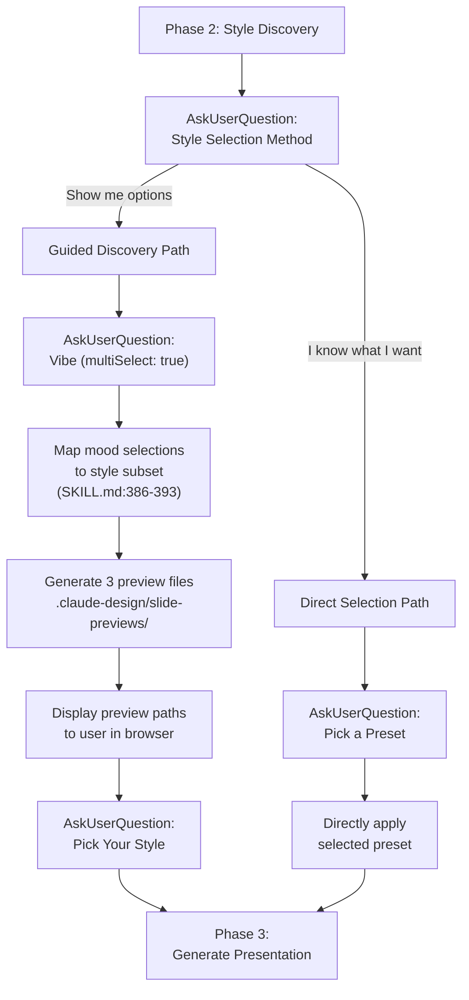

**Sources:** [plugins/frontend-slides/skills/frontend-slides/SKILL.md:301-363]()

---

## Guided Discovery Process

### Step 2.1: Mood Selection

The system asks users to describe the intended audience feeling using `AskUserQuestion` with the header "Vibe". Users can select up to 2 options via `multiSelect: true`:

| Option | Description | Example Use Cases |
|--------|-------------|-------------------|
| `Impressed/Confident` | Professional, trustworthy, authoritative | Investor pitches, executive presentations |
| `Excited/Energized` | Innovative, bold, forward-looking | Product launches, tech talks |
| `Calm/Focused` | Clear, thoughtful, easy to follow | Educational content, reports |
| `Inspired/Moved` | Emotional, storytelling, memorable | Brand narratives, keynotes |

**Sources:** [plugins/frontend-slides/skills/frontend-slides/SKILL.md:364-375]()

### Step 2.2: Mood-to-Style Mapping

The system queries the mood mapping table to select 3 distinct style presets from a curated subset:

```mermaid
graph LR
    subgraph "User Mood Selections"
        M1["Impressed/Confident"]
        M2["Excited/Energized"]
        M3["Calm/Focused"]
        M4["Inspired/Moved"]
    end
    
    subgraph "SKILL.md:386-393 Mapping Table"
        Map["Mood → Style Options"]
    end
    
    subgraph "Style Options"
        S1["Bold Signal"]
        S2["Electric Studio"]
        S3["Dark Botanical"]
        S4["Creative Voltage"]
        S5["Neon Cyber"]
        S6["Split Pastel"]
        S7["Notebook Tabs"]
        S8["Paper & Ink"]
        S9["Swiss Modern"]
        S10["Vintage Editorial"]
        S11["Pastel Geometry"]
    end
    
    M1 --> Map
    M2 --> Map
    M3 --> Map
    M4 --> Map
    
    Map -->|"Impressed"| S1
    Map -->|"Impressed"| S2
    Map -->|"Impressed"| S3
    Map -->|"Excited"| S4
    Map -->|"Excited"| S5
    Map -->|"Excited"| S6
    Map -->|"Calm"| S7
    Map -->|"Calm"| S8
    Map -->|"Calm"| S9
    Map -->|"Inspired"| S3
    Map -->|"Inspired"| S10
    Map -->|"Inspired"| S11
```

The complete mapping table:

| Mood | Style Options |
|------|---------------|
| Impressed/Confident | Bold Signal, Electric Studio, Dark Botanical |
| Excited/Energized | Creative Voltage, Neon Cyber, Split Pastel |
| Calm/Focused | Notebook Tabs, Paper & Ink, Swiss Modern |
| Inspired/Moved | Dark Botanical, Vintage Editorial, Pastel Geometry |

**Sources:** [plugins/frontend-slides/skills/frontend-slides/SKILL.md:376-380]()

### Step 2.3: Preview Generation

The system generates 3 self-contained HTML files in `.claude-design/slide-previews/`:

```
.claude-design/slide-previews/
├── style-a.html   # First style option
├── style-b.html   # Second style option
├── style-c.html   # Third style option
└── assets/        # Any shared assets (optional)
```

Each preview file contains:
- **Single title slide** demonstrating the aesthetic.
- **Inline CSS** with the complete style definition from [STYLE_PRESETS.md:163-346]().
- **Inline JavaScript** for entrance animations.
- **50-100 lines** total (not a full presentation).
- **Typography**, color palette, and signature elements.

**Important constraints** enforced during generation:
- Must **not** use generic patterns listed in [STYLE_PRESETS.md:346]().
- Must use distinctive font pairings from [STYLE_PRESETS.md:346]().
- Must apply viewport fitting rules from [STYLE_PRESETS.md:23-147]().

**Sources:** [plugins/frontend-slides/skills/frontend-slides/SKILL.md:376-380](), [STYLE_PRESETS.md:1-346]()

---

## Diagram: Preview Generation Pipeline

```mermaid
flowchart TB
    MoodInput["User mood selection(s)"]
    
    Query["Query mood mapping table<br/>(SKILL.md:386-393)"]
    
    Select3["Select 3 distinct presets<br/>from mapped subset"]
    
    subgraph "For Each of 3 Presets"
        LoadDef["Load preset definition<br/>from STYLE_PRESETS.md"]
        
        BuildHTML["Build HTML structure:<br/>- &lt;head&gt; with fonts<br/>- &lt;style&gt; with preset CSS<br/>- &lt;body&gt; with single slide<br/>- &lt;script&gt; with animations"]
        
        ApplyBase["Apply required base CSS<br/>(STYLE_PRESETS.md:23-147)"]
        
        ApplyTheme["Apply theme-specific:<br/>- Colors (--bg-*, --text-*)<br/>- Typography (--font-*, --*-size)<br/>- Signature elements"]
        
        WriteFile["Write to<br/>.claude-design/slide-previews/"]
    end
    
    Present["Present file paths<br/>to user via AskUserQuestion"]
    
    UserView["User opens files<br/>in browser"]
    
    MoodInput --> Query
    Query --> Select3
    Select3 --> LoadDef
    LoadDef --> BuildHTML
    BuildHTML --> ApplyBase
    ApplyBase --> ApplyTheme
    ApplyTheme --> WriteFile
    WriteFile --> Present
    Present --> UserView
```

**Sources:** [plugins/frontend-slides/skills/frontend-slides/SKILL.md:376-380](), [STYLE_PRESETS.md:23-147]()

---

## Step 2.4: Preview Presentation

The system presents the three preview options to the user with descriptive text:

```
I've created 3 style previews for you to compare:

**Style A: [Name]** — [1 sentence description]
**Style B: [Name]** — [1 sentence description]
**Style C: [Name]** — [1 sentence description]

Open each file to see them in action:
- .claude-design/slide-previews/style-a.html
- .claude-design/slide-previews/style-b.html
- .claude-design/slide-previews/style-c.html
```

Then uses `AskUserQuestion` with header "Style" and options for each style or a "Mix elements" choice.

**Sources:** [plugins/frontend-slides/skills/frontend-slides/SKILL.md:380]()

---

## Direct Selection Process

For users who already know their preferred aesthetic, the system presents a preset picker using `AskUserQuestion` with header "Preset". The options list all 12 available presets with brief descriptions:

```mermaid
graph LR
    DirectPath["Direct Selection Path"]
    
    PresetQ["AskUserQuestion:<br/>Pick a Preset"]
    
    subgraph "12 Available Presets"
        direction TB
        Dark["Dark Themes:<br/>Bold Signal, Electric Studio,<br/>Creative Voltage, Dark Botanical"]
        Light["Light Themes:<br/>Notebook Tabs, Pastel Geometry,<br/>Split Pastel, Vintage Editorial"]
        Special["Specialty Themes:<br/>Neon Cyber, Terminal Green,<br/>Swiss Modern, Paper & Ink"]
    end
    
    Retrieve["Retrieve full style definition<br/>from STYLE_PRESETS.md"]
    
    Phase3["Skip to Phase 3:<br/>Generate Presentation"]
    
    DirectPath --> PresetQ
    PresetQ --> Dark
    PresetQ --> Light
    PresetQ --> Special
    Dark --> Retrieve
    Light --> Retrieve
    Special --> Retrieve
    Retrieve --> Phase3
```

**Sources:** [plugins/frontend-slides/skills/frontend-slides/SKILL.md:317-363](), [STYLE_PRESETS.md:163-346]()

---

## Available Presets Reference

The system maintains 12 curated presets organized into three categories:

### Dark Themes

| Preset | Vibe | Display Font | Body Font | Signature Element |
|--------|------|--------------|-----------|-------------------|
| **Bold Signal** | Confident, bold | Archivo Black | Space Grotesk | Colored card focal point [STYLE_PRESETS.md:33]() |
| **Electric Studio** | Clean, professional | Manrope | Manrope | Two-panel vertical split [STYLE_PRESETS.md:62]() |
| **Creative Voltage** | Energetic, retro | Syne | Space Mono | Halftone texture patterns [STYLE_PRESETS.md:91]() |
| **Dark Botanical** | Elegant, premium | Cormorant | IBM Plex Sans | Soft gradient circles [STYLE_PRESETS.md:120]() |

### Light Themes

| Preset | Vibe | Display Font | Body Font | Signature Element |
|--------|------|--------------|-----------|-------------------|
| **Notebook Tabs** | Editorial, tactile | Bodoni Moda | DM Sans | Colorful section tabs [STYLE_PRESETS.md:156]() |
| **Pastel Geometry** | Friendly, modern | Plus Jakarta Sans | Plus Jakarta Sans | Vertical pills on right edge [STYLE_PRESETS.md:187]() |
| **Split Pastel** | Playful, creative | Outfit | Outfit | Two-color vertical split [STYLE_PRESETS.md:216]() |
| **Vintage Editorial** | Witty, editorial | Fraunces | Work Sans | Abstract geometric shapes [STYLE_PRESETS.md:244]() |

### Specialty Themes

| Preset | Vibe | Display Font | Body Font | Signature Element |
|--------|------|--------------|-----------|-------------------|
| **Neon Cyber** | Futuristic, techy | Clash Display | Satoshi | Particle backgrounds [STYLE_PRESETS.md:261]() |
| **Terminal Green** | Hacker aesthetic | JetBrains Mono | JetBrains Mono | Scan lines, blinking cursor [STYLE_PRESETS.md:273]() |
| **Swiss Modern** | Clean, precise | Archivo | Nunito | Visible grid, asymmetric [STYLE_PRESETS.md:285]() |
| **Paper & Ink** | Literary, thoughtful | Cormorant Garamond | Source Serif 4 | Drop caps, pull quotes [STYLE_PRESETS.md:297]() |

**Sources:** [STYLE_PRESETS.md:11-298]()

---

## Diagram: Preset Definition to Code Mapping

```mermaid
graph TB
    subgraph "STYLE_PRESETS.md Structure"
        Dark["Dark Themes<br/>(lines 9-126)"]
        Light["Light Themes<br/>(lines 128-249)"]
        Special["Specialty Themes<br/>(lines 251-298)"]
    end
    
    subgraph "Each Preset Definition Contains"
        Vibe["**Vibe:** description"]
        Layout["**Layout:** structure"]
        Typo["**Typography:**<br/>Display + Body fonts"]
        Colors["**Colors:**<br/>CSS custom properties"]
        Sig["**Signature Elements:**<br/>Unique visual features"]
    end
    
    subgraph "Generated Preview HTML"
        Head["&lt;head&gt;:<br/>Font imports from<br/>Google/Fontshare/JetBrains"]
        Style["&lt;style&gt;:<br/>:root CSS variables<br/>+ preset-specific rules<br/>+ base viewport CSS"]
        Body["&lt;body&gt;:<br/>Single .slide element<br/>with .reveal classes"]
        Script["&lt;script&gt;:<br/>Animation triggers"]
    end
    
    Dark --> Typo
    Light --> Typo
    Special --> Typo
    
    Typo --> Head
    Colors --> Style
    Sig --> Style
    Layout --> Body
    Vibe --> Body
    
    Head --> Preview[".claude-design/slide-previews/<br/>style-{a,b,c}.html"]
    Style --> Preview
    Body --> Preview
    Script --> Preview
```

**Sources:** [STYLE_PRESETS.md:9-298](), [plugins/frontend-slides/skills/frontend-slides/SKILL.md:380]()

---

## Anti-Patterns and Constraints

The system enforces strict rules to avoid generic "AI slop" aesthetics:

### DO NOT USE Patterns

Defined in [plugins/frontend-slides/skills/frontend-slides/SKILL.md:380]() and [STYLE_PRESETS.md:3]():

| Category | Forbidden Patterns |
|----------|-------------------|
| **Fonts** | Inter, Roboto, Arial, system fonts as display |
| **Colors** | Generic indigo (#6366f1), purple gradients on white |
| **Layouts** | Everything centered, generic hero sections |
| **Visuals** | **No illustrations—only abstract CSS shapes** |

### Required Distinctive Choices

From [plugins/frontend-slides/skills/frontend-slides/SKILL.md:380]():

| Category | Required Approach |
|----------|-------------------|
| **Fonts** | Unique pairings (Clash Display, Satoshi, etc.) |
| **Colors** | Cohesive themes with personality |
| **Backgrounds** | Atmospheric (gradients, patterns, depth) |
| **Animations** | Signature moments |

**Sources:** [plugins/frontend-slides/skills/frontend-slides/SKILL.md:380](), [STYLE_PRESETS.md:3]()

---

## Implementation Details

### Preview File Requirements

Each generated preview must satisfy:

1. **Self-contained** — All CSS and JavaScript inline.
2. **Single slide** — One `<section class="slide">` element only.
3. **Animated** — Demonstrates entrance effects using `.reveal` classes.
4. **Viewport-fitting** — Includes required base CSS from [STYLE_PRESETS.md:5]().

### Cleanup Process

After the user selects a style, the temporary preview files are deleted during Phase 5: Delivery. The cleanup removes the entire `.claude-design/slide-previews/` directory [plugins/frontend-slides/skills/frontend-slides/SKILL.md:380]().

**Sources:** [plugins/frontend-slides/skills/frontend-slides/SKILL.md:380](), [plugins/frontend-slides/skills/frontend-slides/SKILL.md:380]()

---

# Page: Core Architecture

# Core Architecture

<details>
<summary>Relevant source files</summary>

The following files were used as context for generating this wiki page:

- [README.md](README.md)
- [SKILL.md](SKILL.md)

</details>


This document provides a technical overview of the frontend-slides system architecture, focusing on the dual-document design, the relationship between execution logic and specifications, and the five-phase generation pipeline. For detailed documentation of individual phases, see [Five-Phase Workflow Pipeline](#4.1). For the philosophical principles that drive architectural decisions, see [Design Philosophy](#4.2).

## System Overview

The frontend-slides repository is a code-generation system that transforms natural language descriptions or PowerPoint files into self-contained HTML presentation files. The architecture follows a clear separation of concerns between execution logic and declarative specifications.

### Dual-Document Architecture

The system consists of two core documents that guide the AI agent's behavior:

| Document | Role | Type | Importance |
|----------|------|------|------------|
| `SKILL.md` | Execution engine | Procedural workflow | 4.00 |
| `STYLE_PRESETS.md` | Specification repository | Declarative rules | 4.00 |

**SKILL.md** orchestrates the entire generation process, implementing the five-phase workflow, managing user interactions, and constructing the final HTML output. It contains procedural logic for content extraction, style discovery, and presentation assembly [SKILL.md:1-4]().

**STYLE_PRESETS.md** defines the constraints, rules, and visual themes that `SKILL.md` must enforce. It serves as a read-only knowledge base containing CSS architecture requirements, content density limits, and 12 curated visual presets [STYLE_PRESETS.md:1-10]().

Sources: [SKILL.md:1-17](), [STYLE_PRESETS.md:1-10]()

## Repository Structure

```
frontend-slides/
├── SKILL.md                    # Execution engine (procedural workflow)
├── STYLE_PRESETS.md           # Specification repository (declarative rules)
├── viewport-base.css           # Mandatory CSS for 16:9 stage fitting
├── html-template.md            # Structural scaffolding for generated decks
├── animation-patterns.md       # CSS animation recipes
├── bold-template-pack/         # 34 premium design systems
│   ├── selection-index.json    # Metadata for progressive disclosure
│   └── [template-name]/        # Individual template directories
├── scripts/                    # Utility scripts (Python/Bash)
│   ├── extract-pptx.py         # PPT extraction logic
│   ├── deploy.sh               # Vercel deployment pipeline
│   └── export-pdf.sh           # Playwright-based PDF generation
└── README.md                   # User-facing documentation
```

The repository follows a **Zero Dependencies** philosophy for its output: generated presentations are single HTML files with inline CSS/JS, requiring no build tools or frameworks [README.md:25-25](), [SKILL.md:12-12]().

Sources: [SKILL.md:1-4](), [README.md:52-72](), [README.md:82-90]()

## Execution Model

The system operates in two distinct phases: **generation-time** and **runtime**.

### Generation-Time (Coding Agent Context)

The agent (e.g., Claude Code) executes `SKILL.md`, which:
- Parses user intent to detect mode (New, PPT, or Enhancement) [SKILL.md:67-73]().
- Extracts content using `extract-pptx.py` for PowerPoint files [SKILL.md:380]().
- Queries `STYLE_PRESETS.md` and `bold-template-pack/selection-index.json` for themes [SKILL.md:365-380]().
- Generates 3 visual previews in `.claude-design/slide-previews/` for the "Show, Don't Tell" workflow [SKILL.md:380]().
- Enforces the **Fixed 16:9 Stage** rules during HTML construction [SKILL.md:38-52]().

### Runtime (Browser Context)

The generated HTML file runs independently in the browser:
- The `SlidePresentation` class manages navigation [SKILL.md:380]().
- The `IntersectionObserver` triggers entrance animations by adding the `.visible` class [SKILL.md:380]().
- Viewport fitting logic ensures the 1920×1080 stage scales to fit any screen [SKILL.md:40-46]().

Sources: [SKILL.md:10-16](), [SKILL.md:38-52](), [SKILL.md:380]()

## System Architecture Diagram

**Diagram: Dual-Document Architecture and Component Interactions**

```mermaid
graph TB
    subgraph Generation["Generation-Time (Agent + Shell)"]
        SKILL["SKILL.md<br/>Execution Engine"]
        STYLE["STYLE_PRESETS.md<br/>Presets Repository"]
        BOLD["bold-template-pack/<br/>Premium Templates"]
        
        P0["Phase 0: Mode Detection<br/>[SKILL.md:67-73]"]
        P1["Phase 1: Content Discovery<br/>[SKILL.md:89-122]"]
        P2["Phase 2: Style Discovery<br/>[SKILL.md:300-455]"]
        P3["Phase 3: Presentation Gen<br/>[SKILL.md:457-739]"]
        P4["Phase 4: PPT Conversion<br/>[SKILL.md:741-849]"]
        
        SKILL --> P0
        P0 --> P1
        P0 --> P4
        P1 --> P2
        P4 --> P2
        P2 --> P3
        
        P2 -.->|"queries"| STYLE
        P2 -.->|"queries"| BOLD
        P3 -.->|"imports"| STYLE
    end
    
    subgraph Artifacts["Generated Artifacts"]
        Preview[".claude-design/slide-previews/"]
        Final["presentation.html<br/>(Self-contained)"]
        Assets["assets/<br/>(PPT images)"]
    end
    
    subgraph Runtime["Runtime (Browser)"]
        HTML["HTML Structure<br/>&lt;section class='slide'&gt;"]
        CSS["Viewport CSS<br/>1920x1080 Stage"]
        JS["SlidePresentation Class<br/>IntersectionObserver"]
        
        HTML --> CSS
        HTML --> JS
    end
    
    P2 -->|"generates"| Preview
    P3 -->|"generates"| Final
    P4 -->|"extracts to"| Assets
    Final --> HTML
    
    Python["scripts/extract-pptx.py"]
    P4 -.->|"calls"| Python
```

Sources: [SKILL.md:248-380](), [STYLE_PRESETS.md:1-160](), [README.md:161-172]()

## Five-Phase Workflow Overview

The system implements a linear five-phase pipeline defined in `SKILL.md`. Each phase transforms input data and passes the result to the next phase.

| Phase | Purpose | Input | Output | Document Section |
|-------|---------|-------|--------|------------------|
| **Phase 0** | Mode Detection | User prompt | Execution path | [SKILL.md:67-73]() |
| **Phase 1** | Content Discovery | User answers | Content structure | [SKILL.md:89-122]() |
| **Phase 2** | Style Discovery | Mood preferences | Selected theme | [SKILL.md:300-380]() |
| **Phase 3** | Presentation Generation | Content + theme | HTML file | [SKILL.md:380]() |
| **Phase 4** | PPT Conversion | .pptx file | Extracted data | [SKILL.md:380]() |

For detailed documentation of each phase, see [Five-Phase Workflow Pipeline](#4.1).

**Diagram: Phase Routing and Data Flow**

```mermaid
flowchart LR
    User[/"User Input"/]
    
    subgraph P0["Phase 0: Detect Mode"]
        Router{"Route by intent"}
    end
    
    subgraph P1["Phase 1: Content Discovery"]
        Questions["Ask purpose, length,<br/>content, density"]
        ContentStruct["Content structure"]
        Questions --> ContentStruct
    end
    
    subgraph P4["Phase 4: PPT Conversion"]
        Extract["extract-pptx.py"]
        JSON["Extracted slides_data"]
        Extract --> JSON
    end
    
    subgraph P2["Phase 2: Style Discovery"]
        Query["Map mood to presets<br/>& bold templates"]
        Gen3["Generate 3 previews"]
        Pick["User selects theme"]
        Query --> Gen3
        Gen3 --> Pick
    end
    
    subgraph P3["Phase 3: Generate"]
        Build["Apply 16:9 Stage<br/>viewport-base.css"]
        ApplyTheme["Apply design recipe<br/>(presets or bold)"]
        Validate{"Viewport fit check"}
        
        Build --> ApplyTheme
        ApplyTheme --> Validate
        Validate -->|"Pass"| Final["presentation.html"]
        Validate -->|"Fail"| Split["Split slides"]
        Split --> Build
    end
    
    User --> P0
    Router -->|"New"| P1
    Router -->|"PPT"| P4
    P1 --> P2
    P4 --> P2
    P2 --> P3
    P3 --> Final
```

Sources: [SKILL.md:248-380](), [SKILL.md:38-52]()

## Document Relationship: Presets vs. Bold Templates

The system uses a **Progressive Disclosure** model to manage style selection [SKILL.md:15-15]().

1.  **Style Presets (`STYLE_PRESETS.md`)**: Contains 12 curated, lightweight themes that are always available. They are the default fallback [README.md:132-154]().
2.  **Bold Template Pack (`bold-template-pack/`)**: Contains 34 high-fidelity design systems. The agent first reads a compact `selection-index.json` to shortlist candidates, then loads small `preview.md` cards for visual generation, and only loads the full `design.md` once a selection is made [README.md:167-172]().

### Mapping Logic (Phase 2)

During style discovery, the agent maps user moods to both presets and bold templates:

| User Mood | Example Candidates | Source |
|-----------|--------------------|--------|
| **Impressed/Confident** | Bold Signal, Electric Studio, Broadside | [SKILL.md:380]() |
| **Excited/Energized** | Creative Voltage, Neon Cyber, Neo-Grid | [SKILL.md:380]() |
| **Calm/Focused** | Notebook Tabs, Paper & Ink, Vellum | [SKILL.md:380]() |

Sources: [SKILL.md:365-380](), [README.md:161-172]()

## Viewport Fitting Enforcement

The most critical architectural constraint is the **Fixed 16:9 Stage** [SKILL.md:16-16](). The system enforces this through:

1.  **Mandatory Base CSS**: Every presentation must include the contents of `viewport-base.css` [SKILL.md:52-52]().
2.  **Density Limits**: The agent checks content against limits (e.g., max 6 bullets) and automatically splits slides if they would overflow the 1920×1080 stage [SKILL.md:63-63](), [STYLE_PRESETS.md:11-20]().
3.  **Height-Based Breakpoints**: CSS media queries adjust font sizes based on viewport height to maintain legibility [STYLE_PRESETS.md:99-138]().

For implementation details, see [Viewport Fitting System](#5).

Sources: [SKILL.md:38-52](), [STYLE_PRESETS.md:7-160]()

---

# Page: Five-Phase Workflow Pipeline

# Five-Phase Workflow Pipeline

<details>
<summary>Relevant source files</summary>

The following files were used as context for generating this wiki page:

- [SKILL.md](SKILL.md)
- [plugins/frontend-slides/skills/frontend-slides/SKILL.md](plugins/frontend-slides/skills/frontend-slides/SKILL.md)

</details>


## Purpose and Scope

This document describes the complete execution pipeline defined in [SKILL.md:67-380](), which orchestrates the generation of HTML presentations from user input. The pipeline consists of five sequential phases (Phase 0 through Phase 5) that transform natural language requests into production-ready HTML files. 

A critical architectural invariant throughout this pipeline is the **Fixed 16:9 Stage**. Every presentation is authored inside a fixed 1920×1080 stage that scales uniformly to the viewport, ensuring no reflow occurs on different devices [SKILL.md:10-16]().

This page provides an architectural overview of how phases connect and communicate. For detailed documentation of individual phases, see:
- [Phase 0: Mode Detection](#4.1.1)
- [Phase 1: Content Discovery](#4.1.2)
- [Phase 2: Style Discovery](#4.1.3)
- [Phase 3: Presentation Generation](#4.1.4)
- [Phase 4: PPT Conversion Pipeline](#4.1.5)
- [Phase 5: Delivery & Cleanup](#4.1.6)

For the philosophical principles that shape this pipeline, see [Design Philosophy](#4.2). For the viewport fitting constraints enforced during Phase 3, see [Viewport Fitting System](#5).

---

## Pipeline Architecture Overview

The workflow is a linear pipeline with a critical branching point at Phase 0. The system supports three distinct input modalities (new presentation, PowerPoint conversion, existing HTML enhancement), all of which converge at Phase 2 for unified style selection.

### High-Level Phase Sequence

```mermaid
graph LR
    P0["Phase 0<br/>Mode Detection"]
    P1["Phase 1<br/>Content Discovery"]
    P2["Phase 2<br/>Style Discovery"]
    P3["Phase 3<br/>Generate Presentation"]
    P4["Phase 4<br/>PPT Conversion"]
    P5["Phase 5<br/>Delivery & Cleanup"]
    
    P0 --> P1
    P0 --> P4
    P1 --> P2
    P4 --> P2
    P2 --> P3
    P3 --> P5
```

**Sources:** [SKILL.md:67-380]()

### Phase Responsibilities Summary

| Phase | Primary Function | Input | Output | Mandatory |
|-------|-----------------|-------|--------|-----------|
| Phase 0 | Route user intent to appropriate workflow | Natural language prompt | Mode selection (A/B/C) | Yes |
| Phase 1 | Extract content requirements | User responses to structured questions | Content structure & requirements | Only for Mode A |
| Phase 2 | Visual style selection via preview generation | Mood preferences or direct selection | Selected style preset name | Yes |
| Phase 3 | Generate complete HTML presentation | Content + style preset | `presentation.html` | Yes |
| Phase 4 | Extract content from PowerPoint | `.pptx` file | Structured JSON + extracted assets | Only for Mode B |
| Phase 5 | Cleanup and browser launch | Generated HTML file | Opened browser, deleted temp files | Yes |

**Sources:** [SKILL.md:67-380]()

---

## Mode Detection and Routing (Phase 0)

Phase 0 acts as the entry router, analyzing user intent to determine which workflow path to execute. The detection logic categorizes requests into three modes [SKILL.md:67-74]().

### Mode Routing Decision Tree

```mermaid
flowchart TD
    Start["User invokes /frontend-slides"]
    Analyze["Analyze user prompt"]
    
    Start --> Analyze
    
    Analyze --> ModeA{"Contains:<br/>- 'create'<br/>- 'new'<br/>- 'from scratch'?"}
    Analyze --> ModeB{"Contains:<br/>- '.ppt'/'.pptx'\n- 'convert'\n- 'PowerPoint'?"}
    Analyze --> ModeC{"Contains:<br/>- '.html'\n- 'enhance'\n- 'improve existing'?"}
    
    ModeA -->|Yes| P1["Phase 1:<br/>Content Discovery<br/>(New Presentation)"]
    ModeB -->|Yes| P4["Phase 4:<br/>PPT Conversion"]
    ModeC -->|Yes| EnhanceFlow["Analyze existing HTML<br/>then Phase 2"]
    
    ModeA -->|No| ModeB
    ModeB -->|No| ModeC
    ModeC -->|No| DefaultToA["Default: Mode A<br/>(New Presentation)"]
    
    P1 --> P2["Phase 2:<br/>Style Discovery"]
    P4 --> ConfirmContent["Confirm extracted content"]
    EnhanceFlow --> P2
    ConfirmContent --> P2
    DefaultToA --> P1
    
    P2 --> P3["Phase 3:<br/>Generate Presentation"]
```

**Sources:** [SKILL.md:67-87]()

### Mode Characteristics

**Mode A: New Presentation**
- Triggered by: Natural language description of presentation needs.
- Path: Phase 0 → Phase 1 → Phase 2 → Phase 3 → Phase 5 [SKILL.md:71]().
- Example prompts: "AI startup pitch deck", "Tutorial on React hooks".

**Mode B: PPT Conversion**
- Triggered by: Presence of PowerPoint file reference.
- Path: Phase 0 → Phase 4 → Phase 2 → Phase 3 → Phase 5 [SKILL.md:72]().
- Uses: `extract_pptx()` function [SKILL.md:380]().

**Mode C: Enhancement**
- Triggered by: Reference to existing HTML file.
- Path: Phase 0 → Analyze HTML → Phase 2 → Phase 3 → Phase 5 [SKILL.md:73]().
- Follows strict modification rules to ensure fixed-stage fitting [SKILL.md:75-87]().

---

## Content Acquisition Flow

After mode routing, the pipeline acquires presentation content through different mechanisms depending on the selected mode.

### Content Acquisition Pathways

```mermaid
flowchart TD
    subgraph ModeA["Mode A: New Presentation"]
        AQ1["AskUserQuestion:<br/>Purpose"]
        AQ2["AskUserQuestion:<br/>Length"]
        AQ3["AskUserQuestion:<br/>Content Readiness"]
        AQ4["AskUserQuestion:<br/>Density"]
        UserContent["User provides<br/>content/outline"]
        
        AQ1 --> AQ2
        AQ2 --> AQ3
        AQ3 --> AQ4
        AQ4 --> UserContent
        UserContent --> ContentJSON_A["Structured content<br/>requirements"]
    end
    
    subgraph ModeB["Mode B: PPT Conversion"]
        PPTFile[".pptx file"]
        ExtractFunc["extract_pptx()"]
        ParseShapes["Parse slide.shapes"]
        ExtractText["Extract text_frame"]
        ExtractImages["Extract image.blob"]
        SaveAssets["Save to assets/"]
        
        PPTFile --> ExtractFunc
        ExtractFunc --> ParseShapes
        ParseShapes --> ExtractText
        ParseShapes --> ExtractImages
        ExtractImages --> SaveAssets
        ExtractText --> ContentJSON_B["slides_data[]<br/>JSON array"]
        SaveAssets --> ContentJSON_B
    end
    
    ContentJSON_A --> Confirm["Present to user<br/>for confirmation"]
    ContentJSON_B --> Confirm
    Confirm --> P2Start["Phase 2<br/>begins"]
```

**Sources:** [SKILL.md:89-110](), [SKILL.md:380]()

### Content Data Structure

Both Mode A and Mode B produce a normalized content structure before entering Phase 2:

```javascript
// Structure produced by Phase 1 (Mode A) or Phase 4 (Mode B)
{
  "slides": [
    {
      "number": 1,
      "title": "Slide Title",
      "content": [
        {"type": "text", "content": "Bullet point"},
        {"type": "text", "content": "Another point"}
      ],
      "images": [
        {"path": "assets/slide1_img1.png", "width": 800, "height": 600}
      ],
      "notes": "Speaker notes (from PPT only)"
    }
  ]
}
```

**Sources:** [SKILL.md:380]()

---

## Style Discovery Workflow (Phase 2)

Phase 2 implements the "show, don't tell" philosophy by generating visual previews rather than asking abstract questions [SKILL.md:300-305](). It uses **Progressive Disclosure** for bold templates, reading lightweight style indexes before loading full design recipes [SKILL.md:15]().

### Style Selection Decision Flow

```mermaid
flowchart TD
    P2Start["Phase 2 begins"]
    AskMethod["AskUserQuestion:<br/>Style Selection Method"]
    
    P2Start --> AskMethod
    
    AskMethod --> Guided["Option: 'Show me options'"]
    AskMethod --> Direct["Option: 'I know what I want'"]
    
    Guided --> MoodQ["AskUserQuestion:<br/>Feeling (multiSelect)"]
    Direct --> PresetPicker["AskUserQuestion:<br/>Pick a Preset"]
    
    MoodQ --> MapMood["Map mood to<br/>style subset"]
    MapMood --> Generate3["Generate 3 previews<br/>in .claude-design/slide-previews/"]
    
    Generate3 --> StyleA["style-a.html"]
    Generate3 --> StyleB["style-b.html"]
    Generate3 --> StyleC["style-c.html"]
    
    StyleA --> Present["Present to user:<br/>Open files in browser"]
    StyleB --> Present
    StyleC --> Present
    
    Present --> UserPick["AskUserQuestion:<br/>Which style?"]
    PresetPicker --> SelectedStyle["Selected style preset"]
    UserPick --> SelectedStyle
    
    SelectedStyle --> P3["Phase 3:<br/>Generate Presentation"]
```

**Sources:** [SKILL.md:300-380]()

### Mood to Style Mapping

The system maps user mood selections to specific style presets [SKILL.md:380]():

| Mood Selection | Style Options (pick 3) |
|----------------|------------------------|
| Impressed/Confident | Bold Signal, Electric Studio, Dark Botanical |
| Excited/Energized | Creative Voltage, Neon Cyber, Split Pastel |
| Calm/Focused | Notebook Tabs, Paper & Ink, Swiss Modern |
| Inspired/Moved | Dark Botanical, Vintage Editorial, Pastel Geometry |

---

## Presentation Generation Pipeline (Phase 3)

Phase 3 constructs the complete HTML presentation by combining content, applying the selected style preset, and enforcing viewport fitting constraints [SKILL.md:380]().

### Generation Process Flow

```mermaid
flowchart TD
    P3Start["Phase 3 begins"]
    RetrieveContent["Retrieve content structure"]
    RetrieveStyle["Retrieve full style definition"]
    
    P3Start --> RetrieveContent
    P3Start --> RetrieveStyle
    
    RetrieveContent --> BuildHTML["Build HTML structure<br/>section.slide elements"]
    RetrieveStyle --> ApplyBase["Apply viewport-base.css"]
    
    BuildHTML --> ApplyBase
    ApplyBase --> ApplyTheme["Apply theme CSS variables"]
    
    ApplyTheme --> EmbedContent["Embed content inside<br/>1920x1080 Stage"]
    EmbedContent --> CheckDensity{"Content within<br/>density limits?"}
    
    CheckDensity -->|No| SplitSlide["Split content<br/>into multiple slides"]
    CheckDensity -->|Yes| AddJS["Add JavaScript:<br/>SlidePresentation class"]
    
    SplitSlide --> EmbedContent
    AddJS --> AddObserver["Add Intersection Observer<br/>for .visible class"]
    AddObserver --> Validate{"Viewport fitting<br/>checklist passes?"}
    
    Validate -->|No| DebugFix["Debug: Check overflow,<br/>font sizes, constraints"]
    Validate -->|Yes| FinalHTML["Write presentation.html"]
    
    DebugFix --> Validate
    FinalHTML --> P5["Phase 5:<br/>Delivery"]
```

**Sources:** [SKILL.md:380]()

### Fixed Stage Rules

Every generated presentation MUST follow the **Fixed Stage Rules** [SKILL.md:38-52]():
- Every slide is authored inside a fixed **1920×1080 stage**.
- The stage scales uniformly; it must **not** re-layout content for phones.
- Slide visibility is controlled by `.active` / `.visible` classes.
- Full contents of `viewport-base.css` must be included.

---

## PowerPoint Extraction Pipeline (Phase 4)

Phase 4 is invoked only for Mode B, using the `extract_pptx()` function to parse PowerPoint files [SKILL.md:380]().

### Extraction Process

```mermaid
flowchart TD
    PPTFile[".pptx file"]
    CreatePres["Presentation(file_path)"]
    IterateSlides["for slide in prs.slides"]
    
    PPTFile --> CreatePres
    CreatePres --> IterateSlides
    
    IterateSlides --> InitSlideData["slide_data = {<br/>number, title, content,<br/>images, notes}"]
    InitSlideData --> IterateShapes["for shape in slide.shapes"]
    
    IterateShapes --> CheckTextFrame{"shape.has_text_frame?"}
    IterateShapes --> CheckImage{"shape.shape_type == 13?"}
    
    CheckTextFrame -->|Yes| IsTitle{"shape == slide.shapes.title?"}
    IsTitle -->|Yes| ExtractTitle["slide_data['title'] = shape.text"]
    IsTitle -->|No| ExtractContent["slide_data['content'].append(...)"]
    
    CheckImage -->|Yes| GetBlob["image_bytes = shape.image.blob"]
    GetBlob --> SaveImage["Write to assets/"]
    
    ExtractTitle --> CheckNotes
    ExtractContent --> CheckNotes
    SaveImage --> CheckNotes
    
    CheckNotes["slide.has_notes_slide?"]
    CheckNotes -->|Yes| ExtractNotes["slide_data['notes'] = text"]
    CheckNotes -->|No| AppendSlide["slides_data.append(slide_data)"]
    
    AppendSlide --> MoreSlides{"More slides?"}
    MoreSlides -->|Yes| IterateSlides
    MoreSlides -->|No| ReturnJSON["return slides_data"]
```

**Sources:** [SKILL.md:380]()

---

## Delivery and Cleanup (Phase 5)

Phase 5 performs final housekeeping and presents the completed presentation to the user [SKILL.md:380]().

### Cleanup Operations

```mermaid
flowchart TD
    P5Start["Phase 5 begins"]
    CheckTempDir{"Directory exists:<br/>.claude-design/slide-previews/?"}
    
    P5Start --> CheckTempDir
    
    CheckTempDir -->|Yes| DeleteFiles["Delete style-a.html,<br/>style-b.html, style-c.html"]
    CheckTempDir -->|No| OpenBrowser
    
    DeleteFiles --> RemoveDir["Remove directory"]
    RemoveDir --> OpenBrowser["Execute: open presentation.html"]
    
    OpenBrowser --> Summary["Display summary message"]
```

**Sources:** [SKILL.md:380]()

### Content Density Enforcement

Phase 3 validates content against maximum density limits to guarantee viewport fitting [SKILL.md:33-65]():

| Slide Type | Maximum Content |
|------------|-----------------|
| Title slide | 1 heading + 1 subtitle + optional tagline [SKILL.md:38]() |
| Content slide | 1 heading + 4-6 bullet points [SKILL.md:39]() |
| Feature grid | 1 heading + 6 cards maximum [SKILL.md:40]() |
| Code slide | 1 heading + 8-10 lines of code [SKILL.md:41]() |

If content exceeds these limits, the system must split it into more slides [SKILL.md:63]().

---

# Page: Phase 0: Mode Detection

# Phase 0: Mode Detection

<details>
<summary>Relevant source files</summary>

The following files were used as context for generating this wiki page:

- [SKILL.md](SKILL.md)
- [plugins/frontend-slides/skills/frontend-slides/SKILL.md](plugins/frontend-slides/skills/frontend-slides/SKILL.md)

</details>


## Purpose and Scope

Phase 0 is the initial routing phase of the `frontend-slides` workflow pipeline. It analyzes user input to determine which of three execution paths to follow: creating a new presentation from scratch, converting an existing PowerPoint file to HTML, or enhancing an existing HTML presentation. This phase acts as the entry point and dispatcher for all subsequent workflow phases.

For information about the subsequent phases, see [Phase 1: Content Discovery](), [Phase 2: Style Discovery](), [Phase 4: PPT Conversion Pipeline](), and [Phase 3: Presentation Generation](). For the overall workflow architecture, see [Five-Phase Workflow Pipeline]().

---

## Overview

Phase 0 implements a three-way routing decision that determines the user's intent based on their initial input to the `/frontend-slides` command. The detection logic is implemented as a classification system described in the system instructions. [SKILL.md:67-74]().

The three modes are:

| Mode | Description | Next Phase | Trigger Signals |
|------|-------------|------------|-----------------|
| **Mode A: New Presentation** | Create slides from scratch based on user requirements | Phase 1 (Content Discovery) | User provides topic, purpose, or content outline without files [SKILL.md:71-71]() |
| **Mode B: PPT Conversion** | Convert existing PowerPoint file to HTML | Phase 4 (PPT Extraction) | User provides `.ppt` or `.pptx` file [SKILL.md:72-72]() |
| **Mode C: Enhancement** | Improve existing HTML presentation | Phase 2 (Style Discovery) | User provides existing `.html` presentation file [SKILL.md:73-73]() |

Each mode represents a distinct entry point into the system but all paths eventually converge at Phase 2 (Style Discovery) before proceeding to Phase 3 (Presentation Generation).

**Sources:** [SKILL.md:67-74]()

---

## Mode Detection Decision Flow

The following diagram illustrates how Phase 0 routes user input to the appropriate workflow path, bridging the natural language request to the specific code-defined phases:

**Diagram: Intent Routing to Phase Dispatch**
```mermaid
flowchart TD
    Start["User invokes /frontend-slides command"]
    Start --> Analyze["Analyze user input"]
    
    Analyze --> HasPPT{"User provided<br/>.ppt or .pptx file?"}
    Analyze --> HasHTML{"User provided<br/>existing .html file?"}
    Analyze --> HasContent{"User described<br/>presentation content/topic?"}
    
    HasPPT -->|Yes| ModeB["MODE B: PPT Conversion"]
    HasHTML -->|Yes| ModeC["MODE C: Enhancement"]
    HasContent -->|Yes| ModeA["MODE A: New Presentation"]
    
    HasPPT -->|No| HasHTML
    HasHTML -->|No| HasContent
    HasContent -->|No| AskIntent["Ask clarifying question:<br/>What would you like to create?"]
    
    AskIntent --> ModeA
    AskIntent --> ModeB
    AskIntent --> ModeC
    
    ModeA --> Phase1["Phase 1: Content Discovery<br/>(SKILL.md:89)"]
    ModeB --> Phase4["Phase 4: PPT Conversion Pipeline<br/>(SKILL.md:742)"]
    ModeC --> ModeCRules["Apply Mode C Modification Rules<br/>(SKILL.md:75)"]
    
    Phase1 --> Phase2["Phase 2: Style Discovery<br/>(SKILL.md:300)"]
    Phase4 --> ConfirmContent["Confirm extracted content"]
    ConfirmContent --> Phase2
    ModeCRules --> Phase2
    
    Phase2 --> Phase3["Phase 3: Presentation Generation<br/>(SKILL.md:458)"]
    Phase3 --> Phase5["Phase 5: Delivery & Cleanup<br/>(SKILL.md:852)"]
    
    style ModeA stroke-dasharray: 5 5
    style ModeB stroke-dasharray: 5 5
    style ModeC stroke-dasharray: 5 5
```

**Sources:** [SKILL.md:67-74](), [SKILL.md:75-87](), [SKILL.md:89-108](), [SKILL.md:300-305](), [SKILL.md:380](), [SKILL.md:380](), [SKILL.md:380]()

---

## Mode A: New Presentation

Mode A is triggered when the user wants to create a presentation from scratch. This is the most common workflow path and requires extensive information gathering.

### Detection Criteria
The system enters Mode A when:
- User provides natural language describing a presentation topic.
- User states explicit intent to create new slides.
- No PowerPoint or HTML files are provided. [SKILL.md:71-71]()

### Workflow Path
```
Mode A → Phase 1 (Content Discovery) → Phase 2 (Style Discovery) → Phase 3 (Generation) → Phase 5 (Delivery)
```
Mode A follows the complete pipeline, starting with Phase 1 which requires structured questions about purpose, length, content readiness, and density. [SKILL.md:89-108]()

**Sources:** [SKILL.md:71-71](), [SKILL.md:89-108]()

---

## Mode B: PPT Conversion

Mode B is triggered when the user has an existing PowerPoint file that needs to be converted to HTML format.

### Detection Criteria
The system enters Mode B when:
- User provides a file with `.ppt` or `.pptx` extension. [SKILL.md:72-72]()
- User explicitly requests PowerPoint conversion.

### Workflow Path
```
Mode B → Phase 4 (PPT Extraction) → Content Confirmation → Phase 2 (Style Discovery) → Phase 3 (Generation) → Phase 5 (Delivery)
```
Mode B skips Phase 1 entirely and proceeds to Phase 4, where the `extract_pptx` logic extracts text and images. [SKILL.md:380]()

**Sources:** [SKILL.md:72-72](), [SKILL.md:380](), [SKILL.md:380]()

---

## Mode C: Enhancement

Mode C is triggered when the user provides an existing HTML presentation file that needs improvements.

### Detection Criteria
The system enters Mode C when:
- User provides an existing HTML file. [SKILL.md:73-73]()
- User requests improvements to a provided presentation.

### Workflow Path
```
Mode C → Mode C Modification Rules → Phase 2 (Style Discovery) → Phase 3 (Generation) → Phase 5 (Delivery)
```
Mode C must strictly follow **Modification Rules** to prevent viewport fitting issues:
1. Count existing elements against density limits before adding content. [SKILL.md:79-79]()
2. Ensure images fit the 1920×1080 stage; split slides if necessary. [SKILL.md:80-80]()
3. Maintain a maximum of 4-6 bullets per slide. [SKILL.md:81-81]()
4. Verify the 16:9 stage remains intact after any modification. [SKILL.md:82-82]()

**Sources:** [SKILL.md:73-73](), [SKILL.md:75-87]()

---

## Technical Mapping: Input to Code Entities

This diagram maps specific user input types to the internal system logic and rules they trigger.

**Diagram: Input to System Logic Mapping**
```mermaid
graph LR
    subgraph "Input Space"
        Input_PPT[".pptx File"]
        Input_HTML[".html File"]
        Input_Text["Topic String"]
    end

    subgraph "Code Logic Space"
        Logic_B["Phase 4: PPT Extraction<br/>(SKILL.md:742)"]
        Logic_C["Mode C Rules<br/>(SKILL.md:75)"]
        Logic_A["Phase 1: Discovery<br/>(SKILL.md:89)"]
        
        Fitting["Fixed 16:9 Stage Rules<br/>(SKILL.md:38)"]
        Density["Content Density Modes<br/>(SKILL.md:54)"]
    end

    Input_PPT --> Logic_B
    Input_HTML --> Logic_C
    Input_Text --> Logic_A

    Logic_A --> Density
    Logic_C --> Fitting
    Logic_C --> Density
    Logic_B --> Fitting
```

**Sources:** [SKILL.md:38-52](), [SKILL.md:54-65](), [SKILL.md:75-87](), [SKILL.md:89-108](), [SKILL.md:380]()

---

## Input Analysis Patterns

Phase 0 relies on pattern matching and file presence detection.

| User Input Example | Detected Mode | Rationale |
|-------------------|---------------|-----------|
| "Create a pitch deck for my AI startup" | Mode A | Natural language topic description, no files [SKILL.md:71-71]() |
| User uploads `presentation.pptx` | Mode B | PowerPoint file detected [SKILL.md:72-72]() |
| User uploads `existing-slides.html` | Mode C | HTML file detected [SKILL.md:73-73]() |
| "/frontend-slides" (no input) | Clarification | Ambiguous intent; ask user for Mode A, B, or C [SKILL.md:67-74]() |

**Sources:** [SKILL.md:67-74](), [SKILL.md:71-73]()

---

## Exit Conditions

Phase 0 completes successfully when:

1.  **Mode A**: Intent is classified as new creation. Exit to Phase 1. [SKILL.md:71-71]()
2.  **Mode B**: PowerPoint file is identified. Exit to Phase 4. [SKILL.md:72-72]()
3.  **Mode C**: HTML file is identified. Exit to Mode C Rules/Phase 2. [SKILL.md:73-73]()

**Sources:** [SKILL.md:67-74]()

---

# Page: Phase 1: Content Discovery

# Phase 1: Content Discovery

<details>
<summary>Relevant source files</summary>

The following files were used as context for generating this wiki page:

- [SKILL.md](SKILL.md)
- [plugins/frontend-slides/skills/frontend-slides/SKILL.md](plugins/frontend-slides/skills/frontend-slides/SKILL.md)

</details>


## Purpose and Scope

Phase 1: Content Discovery is the information-gathering stage for **new presentations only**. This phase collects structured requirements from the user about the presentation's purpose, target length, content readiness, and visual density through a series of predefined questions. For PowerPoint conversion workflows, see [Phase 4: PPT Conversion Pipeline](#4.1.5). For the style selection process that follows this phase, see [Phase 2: Style Discovery](#4.1.3).

Phase 1 is activated after [Phase 0: Mode Detection](#4.1.1) determines the user wants to create a new presentation from scratch (Mode A) [SKILL.md:67-71]().

Sources: [SKILL.md:67-71](), [SKILL.md:89-108]()

---

## Overview

Phase 1 gathers requirements by asking a set of structured questions. The system is instructed to ask all questions together to minimize interaction friction [SKILL.md:91-92](). These questions establish:

1.  **Presentation context** — The intended use case (e.g., Pitch deck, Teaching).
2.  **Target scope** — Approximate slide count.
3.  **Content availability** — The user's starting point (notes vs. topic only).
4.  **Information density** — The visual balance between text and negative space.

Unlike open-ended prompts, Phase 1 uses structured choices to extract machine-parsable requirements that inform both content generation and style selection in subsequent phases.

Sources: [SKILL.md:89-108]()

---

## Question Sequence

### Question 1: Purpose
Identifies the presentation type, which influences content structure, tone, and recommended styles [SKILL.md:93-95]().

*   **Header:** `"Purpose"`
*   **Options:** `Pitch deck` / `Teaching-Tutorial` / `Conference talk` / `Internal presentation`

### Question 2: Length
Establishes scope, which determines content density and helps set user expectations for the generation process [SKILL.md:96-98]().

*   **Header:** `"Length"`
*   **Options:** `Short 5-10` / `Medium 10-20` / `Long 20+`

### Question 3: Content
Determines the level of AI assistance required for content structuring [SKILL.md:99-101]().

*   **Header:** `"Content"`
*   **Options:** `All content ready` / `Rough notes` / `Topic only`

### Question 4: Density
A critical design constraint that determines the visual "breathing room" of the slides [SKILL.md:102-106]().

*   **Header:** `"Density"`
*   **Options:**
    *   **"Low density / speaker-led"**: Big ideas, fewer words, 1-3 bullets max [SKILL.md:60-60]().
    *   **"High density / reading-first"**: Detailed internal docs, 4-8 bullets max [SKILL.md:61-61]().

Sources: [SKILL.md:54-63](), [SKILL.md:89-108]()

---

## Information Flow: Natural Language Space to Code Entity Space

The following diagram bridges the user's natural language requirements to the structured data used by the generation logic.

```mermaid
flowchart TD
    subgraph "Natural Language Input"
        User["User Intent: 'I need a pitch deck'"]
    end

    subgraph "Phase 1: Discovery Logic (SKILL.md)"
        Q1["Question 1: Purpose<br/>(Pitch/Teaching/Talk)"]
        Q2["Question 2: Length<br/>(Short/Med/Long)"]
        Q3["Question 3: Content Readiness"]
        Q4["Question 4: Density Mode<br/>(Speaker vs Reading)"]
    end

    subgraph "Code Entity Space: Internal State"
        DensityVal["ContentDensityMode"]
        PurposeVal["PresentationContext"]
        SlideLimit["MaxBulletCount"]
    end

    User --> Q1
    Q1 --> Q2
    Q2 --> Q3
    Q3 --> Q4

    Q4 -->|"Low density"| DensityVal
    DensityVal -->|"Sets limit"| SlideLimit
    Q1 --> PurposeVal
    
    SlideLimit -.->|"Enforced in"| Phase3["Phase 3: Presentation Generation"]
```

**Diagram: Requirement Mapping**

Sources: [SKILL.md:54-65](), [SKILL.md:89-108]()

---

## Content Density and Viewport Constraints

Phase 1 is the primary point where the system aligns user expectations with the **Fixed 16:9 Stage** requirement [SKILL.md:16-16](). Because every slide must fit the viewport without scrolling, the "Density" selection in Phase 1 acts as a hard constraint for Phase 3 generation.

| Density Mode | Max Bullets | Max Cards | Visual Behavior |
| :--- | :--- | :--- | :--- |
| **Low Density** | 1-3 | 2-3 | One idea per slide, large type [SKILL.md:60-60]() |
| **High Density** | 4-8 | 4-6 | Structured grids, tighter spacing [SKILL.md:61-61]() |

If the user's content exceeds these limits, the system is instructed to split the content into more slides rather than shrinking text [SKILL.md:63-63]().

Sources: [SKILL.md:54-65](), [SKILL.md:38-52]()

---

## Logic Integration: AskUserQuestion

The system uses the `AskUserQuestion` tool to present these choices. The mapping of responses to internal logic is illustrated below:

```mermaid
flowchart LR
    subgraph "SKILL.md Phase 1 Definitions"
        P1["Phase 1: Content Discovery<br/>Lines 89-108"]
    end

    subgraph "Claude Code API"
        Tool["AskUserQuestion Tool"]
    end

    subgraph "Downstream Consumers"
        P2["Phase 2: Style Discovery<br/>(Mood Mapping)"]
        P3["Phase 3: Presentation Generation<br/>(Density Enforcement)"]
    end

    P1 --> Tool
    Tool -->|"purpose"| P2
    Tool -->|"density"| P3
    Tool -->|"length"| P3
```

**Diagram: Tool Integration and Data Flow**

Sources: [SKILL.md:89-108](), [SKILL.md:301-305]()

---

## Content Validation and Refinement

After the structured questions, the system processes the user's content based on the `Content Readiness` answer [SKILL.md:100-101]():

1.  **All content ready**: The system proceeds to map the provided text into the 1920x1080 stage format.
2.  **Rough notes**: The system organizes the notes into a cohesive narrative structure.
3.  **Topic only**: The system generates a suggested outline for the user to approve.

In all cases, the system must verify that the content fits within the **Fixed Stage Rules** [SKILL.md:38-40](), ensuring no text overflows its card and no panels overlap [SKILL.md:82-82]().

Sources: [SKILL.md:38-52](), [SKILL.md:77-85](), [SKILL.md:99-101]()

---

# Page: Phase 2: Style Discovery

# Phase 2: Style Discovery

<details>
<summary>Relevant source files</summary>

The following files were used as context for generating this wiki page:

- [LICENSE](LICENSE)
- [SKILL.md](SKILL.md)
- [STYLE_PRESETS.md](STYLE_PRESETS.md)

</details>


## Purpose and Scope

Phase 2: Style Discovery is the visual exploration phase where users select the aesthetic style for their presentation. This phase implements the "show, don't tell" design philosophy by generating visual previews rather than asking abstract questions about design preferences. 

This document covers the style selection workflow, mood-based discovery system, preview generation process, and the relationship between user preferences and the 12 curated presets and 34 bold templates. For information about the presets themselves, see [Style Presets Reference](#6). For content gathering that precedes this phase, see [Phase 1: Content Discovery](#4.1.2). For the HTML generation that follows, see [Phase 3: Presentation Generation](#4.1.4).

**Sources:** [SKILL.md:301-380](), [SKILL.md:13-16]()

---

## Style Selection Philosophy

Phase 2 embodies the core principle that users cannot articulate design preferences abstractly. Rather than asking "do you want minimalist or bold?", the system generates concrete visual examples and lets users react to what they see.

### Three Selection Paths

The system provides three distinct workflows for choosing a style:

| Path | Method | Use Case |
|------|--------|----------|
| **Guided Discovery** (Default) | User answers mood questions → System generates 3 previews → User selects | Users who don't have a specific style in mind |
| **Direct Selection** | User requests preset by name → Skip to Phase 3 | Users who already know what they want |
| **Bold Template Discovery** | System queries `selection-index.json` → Shows previews → Loads full `design.md` | Users seeking high-end, professionally designed templates |

**Sources:** [SKILL.md:307-322](), [SKILL.md:15-16]()

---

## Workflow Architecture

### Phase 2 Decision Flow

```mermaid
flowchart TD
    Start["Phase 2 Entry"] --> PathQuestion["AskUserQuestion:<br/>Style Selection Method"]
    
    PathQuestion -->|"Show me options"| GuidedPath["Guided Discovery Path"]
    PathQuestion -->|"I know what I want"| DirectPath["Direct Selection Path"]
    PathQuestion -->|"Bold Templates"| BoldPath["Bold Template Discovery"]
    
    DirectPath --> PresetPicker["AskUserQuestion:<br/>Pick a Preset<br/>(Show all 12 presets)"]
    PresetPicker --> SkipToPhase3["Skip to Phase 3"]
    
    BoldPath --> QueryIndex["Read selection-index.json"]
    QueryIndex --> MatchMood["Match Mood/Tone/Formality"]
    MatchMood --> LoadPreviewMD["Read template preview.md files"]
    LoadPreviewMD --> UserSelectBold["User selects Bold Template"]
    UserSelectBold --> LoadFullDesign["Read full design.md recipe"]
    LoadFullDesign --> SkipToPhase3
    
    GuidedPath --> MoodQuestion["Step 2.1:<br/>AskUserQuestion: Vibe<br/>(multiSelect: true)"]
    
    MoodQuestion --> Options["Options:<br/>- Impressed/Confident<br/>- Excited/Energized<br/>- Calm/Focused<br/>- Inspired/Moved"]
    
    Options --> MoodMapping["Step 2.2:<br/>Map Moods to Style Subset<br/>Query STYLE_PRESETS.md"]
    
    MoodMapping --> Generate3["Generate 3 Preview Files<br/>.claude-design/slide-previews/"]
    
    Generate3 --> Files["style-a.html<br/>style-b.html<br/>style-c.html"]
    
    Files --> Present["Step 2.3:<br/>Present Previews to User"]
    
    Present --> FinalChoice["AskUserQuestion:<br/>Pick Your Style"]
    
    FinalChoice --> Selected["Style Selected<br/>Proceed to Phase 3"]
    FinalChoice -->|"Mix elements"| Customize["Ask for specifics<br/>Then proceed"]
    
    Customize --> Selected
    SkipToPhase3 --> Selected
```

**Diagram: Phase 2 Style Selection Decision Tree**

This diagram shows how users enter Phase 2 and follow one of three distinct paths to style selection, including the progressive disclosure model for Bold Templates.

**Sources:** [SKILL.md:338-380](), [SKILL.md:15-16]()

---

## Step 2.0: Style Path Selection

The first interaction in Phase 2 determines which workflow path to follow.

### AskUserQuestion Structure

```
Header: "Style"
Question: "How would you like to choose your presentation style?"
Options:
  - "Show me options" — Generate 3 previews based on my needs (recommended)
  - "I know what I want" — Let me pick from the preset list directly
  - "Bold Templates" — Choose from 34 high-end professional templates
```

**Sources:** [SKILL.md:338-362]()

---

## Step 2.1: Mood Selection (Guided Discovery)

When users choose the guided discovery path, the system asks about the desired emotional impact rather than visual characteristics.

### Mood Question Structure

```
Header: "Vibe"
Question: "What feeling should the audience have when viewing your slides?"
Options:
  - "Impressed/Confident" — Professional, trustworthy, this team knows what they're doing
  - "Excited/Energized" — Innovative, bold, this is the future
  - "Calm/Focused" — Clear, thoughtful, easy to follow
  - "Inspired/Moved" — Emotional, storytelling, memorable
multiSelect: true (up to 2 selections)
```

**Sources:** [SKILL.md:365-374]()

---

## Step 2.2: Mood-to-Style Mapping

### Mapping Logic

```mermaid
flowchart LR
    subgraph Moods["User Mood Selections"]
        M1["Impressed/<br/>Confident"]
        M2["Excited/<br/>Energized"]
        M3["Calm/<br/>Focused"]
        M4["Inspired/<br/>Moved"]
    end
    
    subgraph Mapping["SKILL.md Mapping Table<br/>(Lines 387-392)"]
        Map1["Bold Signal<br/>Electric Studio<br/>Dark Botanical"]
        Map2["Creative Voltage<br/>Neon Cyber<br/>Split Pastel"]
        Map3["Notebook Tabs<br/>Paper & Ink<br/>Swiss Modern"]
        Map4["Dark Botanical<br/>Vintage Editorial<br/>Pastel Geometry"]
    end
    
    subgraph StyleDefs["STYLE_PRESETS.md<br/>Preset Definitions"]
        S1["Bold Signal<br/>lines 11-38"]
        S2["Electric Studio<br/>lines 40-67"]
        S3["Dark Botanical<br/>lines 97-126"]
        S4["Notebook Tabs<br/>lines 130-160"]
        S5["Pastel Geometry<br/>lines 162-191"]
    end
    
    M1 --> Map1
    M2 --> Map2
    M3 --> Map3
    M4 --> Map4
    
    Map1 -.->|Query definitions| S1
    Map1 -.->|Query definitions| S2
    Map1 -.->|Query definitions| S3
    Map2 -.->|Query definitions| StyleDefs
    Map3 -.->|Query definitions| S4
    Map4 -.->|Query definitions| S3
    Map4 -.->|Query definitions| S5
```

**Diagram: Mood-to-Style Preset Mapping System**

The mood mapping table in `SKILL.md` acts as a router that selects which preset definitions from `STYLE_PRESETS.md` to instantiate as previews.

**Sources:** [SKILL.md:380](), [STYLE_PRESETS.md:11-191]()

---

## Bold Template Selection Process

For users choosing "Bold Templates," the system utilizes a **Progressive Disclosure** model to minimize token usage while offering high-quality designs.

### Selection Steps:
1. **Index Search**: The agent reads `bold-template-pack/selection-index.json` to find templates matching the user's mood, tone, and formality.
2. **Preview Cards**: The agent reads only the `preview.md` file for the top 3-5 candidates. This file contains a short description and a text-based "preview card" of the aesthetic.
3. **User Selection**: The user selects a template based on the preview cards.
4. **Recipe Loading**: Only after selection does the agent read the full `design.md` (the "design recipe") which contains the full CSS tokens and component grammar.

**Sources:** [SKILL.md:15-16]()

---

## Preview Generation Process

### Preview Generation Requirements

Each preview is a minimal HTML file demonstrating the aesthetic. The previews serve as visual "samples" that users can view in their browser.

#### Preview File Specifications

| Attribute | Requirement |
|-----------|-------------|
| **File Size** | ~50-100 lines of HTML |
| **Architecture** | Self-contained (inline CSS/JS) |
| **Content** | Single "title slide" showing aesthetic |
| **Location** | `.claude-design/slide-previews/` |

**Sources:** [SKILL.md:376-380]()

---

## Preview Generation Anti-Patterns

The system explicitly forbids "AI slop" aesthetics to maintain high-quality, distinctive design.

### Forbidden Generic Patterns:
- Purple gradients on white backgrounds.
- Generic font families like Inter, Roboto, or Arial.
- Standard blue primary colors (#6366f1).
- Cookie-cutter design that lacks context-specific character.

**Sources:** [SKILL.md:29-36](), [STYLE_PRESETS.md:3]()

---

## Step 2.3: Present Previews to User

### Final Selection Question

```
Header: "Style"
Question: "Which style preview do you prefer?"
Options:
  - "Style A: [Name]" — [Brief description]
  - "Style B: [Name]" — [Brief description]
  - "Style C: [Name]" — [Brief description]
  - "Mix elements" — Combine aspects from different styles
```

If the user selects "Mix elements", the system asks for specifics about which aspects they want to combine before proceeding to Phase 3.

**Sources:** [SKILL.md:380]()

---

## Phase 2 Exit Conditions

Phase 2 completes when:
1. **Guided Path:** User selects one of the three generated previews.
2. **Direct Path:** User selects a preset by name.
3. **Bold Path:** User selects a template and the agent has loaded the full `design.md` recipe.

### Data Passed to Phase 3:
- **Selected preset/template name**.
- **Full design tokens** (colors, typography, spacing).
- **Component grammar** (specific layout rules for the chosen style).
- **Animation patterns** (entrance and background effects).

**Sources:** [SKILL.md:380](), [SKILL.md:15-16]()

---

# Page: Phase 3: Presentation Generation

# Phase 3: Presentation Generation

<details>
<summary>Relevant source files</summary>

The following files were used as context for generating this wiki page:

- [html-template.md](html-template.md)
- [viewport-base.css](viewport-base.css)

</details>


Phase 3 is the core generation engine that transforms content and style decisions into a production-ready HTML presentation. After content has been gathered ([4.1.2]()) and a style preset has been selected ([4.1.3]()), this phase constructs the final self-contained HTML file with inline CSS, JavaScript, and enforced viewport fitting constraints.

For PowerPoint conversion specifics, see [4.1.5](). For delivery and cleanup procedures, see [4.1.6]().

## Input and Output Model

Phase 3 receives structured data and produces a single HTML artifact:

| Input | Source | Format |
|-------|--------|--------|
| Content structure | Phase 1 or Phase 4 | Slide titles, bullet points, images, notes |
| Selected style preset | Phase 2 | Preset name (e.g., "Bold Signal", "Neon Cyber") |
| Style customizations | Phase 2 | User-requested modifications to preset |

| Output | Location | Characteristics |
|--------|----------|-----------------|
| HTML presentation | `presentation.html` or `[name].html` | Self-contained, zero dependencies |
| Image assets (if any) | `assets/` or `[name]-assets/` | Referenced from HTML |

Sources: [SKILL.md:380]()

## File Structure Decisions

The generation logic determines output structure based on project context:

```mermaid
flowchart TD
    Start["Phase 3 begins"]
    CheckContext{"Multiple<br/>presentations<br/>in project?"}
    
    SingleFile["Generate:<br/>presentation.html<br/>assets/"]
    MultiFile["Generate:<br/>[name].html<br/>[name]-assets/"]
    
    Start --> CheckContext
    CheckContext -->|"No"| SingleFile
    CheckContext -->|"Yes"| MultiFile
```

**Single presentation structure:**
```
presentation.html
assets/
  ├── slide_1_img_1.png
  └── slide_3_img_1.jpg
```

**Multi-presentation structure:**
```
pitch-deck.html
pitch-deck-assets/
  └── ...
company-update.html
company-update-assets/
  └── ...
```

Sources: [SKILL.md:380]()

## HTML Document Architecture

### Overall Structure

Phase 3 generates HTML following a strict template architecture with three primary sections. Every presentation follows a fixed 16:9 stage model: slides are authored at 1920×1080 and the whole stage scales to fit the browser window [html-template.md:1-3]().

```mermaid
graph TB
    HTML["&lt;html&gt; document"]
    
    Head["&lt;head&gt;<br/>- Fonts (Fontshare/Google)<br/>- Inline &lt;style&gt; block"]
    Body["&lt;body&gt;<br/>- UI components<br/>- Slide sections<br/>- Inline &lt;script&gt;"]
    
    Fonts["Font &lt;link&gt; tags"]
    CSS["CSS content:<br/>- Custom properties<br/>- Base styles<br/>- Viewport fitting<br/>- Theme styles<br/>- Animations<br/>- Breakpoints"]
    
    Progress["&lt;div class='progress-bar'&gt;"]
    NavDots["&lt;nav class='nav-dots'&gt;"]
    Slides["&lt;section class='slide'&gt; × N"]
    Script["&lt;script&gt;:<br/>- SlidePresentation class<br/>- Stage Scaling logic<br/>- Optional effects"]
    
    HTML --> Head
    HTML --> Body
    
    Head --> Fonts
    Head --> CSS
    
    Body --> Progress
    Body --> NavDots
    Body --> Slides
    Body --> Script
```

Sources: [SKILL.md:380](), [html-template.md:5-145]()

### Semantic HTML Structure

Each slide uses semantic HTML with specific class hierarchy. The core container is the `.deck-viewport`, which holds the `.deck-stage` [html-template.md:81-82]().

```html
<div class="deck-viewport">
    <main class="deck-stage" id="deckStage">
        <section class="slide [type-class]">
            <div class="slide-content">
                <!-- Content with .reveal classes -->
                <h1 class="reveal">Slide Title</h1>
                <p class="reveal">Subtitle</p>
                <ul class="reveal">
                    <li>Item 1</li>
                    <li>Item 2</li>
                </ul>
            </div>
        </section>
    </main>
</div>
```

**Key classes:**
- `.deck-viewport` — Fixed inset container locking the browser viewport [viewport-base.css:18-23]().
- `.deck-stage` — The fixed 1920x1080 design canvas [viewport-base.css:27-36]().
- `.slide` — Absolute positioned container within the stage [viewport-base.css:40-51]().
- `.reveal` — Animation trigger class (opacity/transform controlled by `.visible`) [html-template.md:59-69]().

Sources: [SKILL.md:380](), [viewport-base.css:1-60](), [html-template.md:81-97]()

## CSS Architecture Generation

### Custom Properties System

Phase 3 generates a CSS custom property system in the `:root` selector, with all style preset values applied [html-template.md:23-46]().

```mermaid
graph TB
    Root[":root selector"]
    
    Colors["Color variables:<br/>--bg-primary<br/>--bg-secondary<br/>--text-primary<br/>--text-secondary<br/>--accent<br/>--accent-glow"]
    
    Typography["Typography variables:<br/>--font-display<br/>--font-body<br/>--title-size: 112px<br/>--subtitle-size: 34px<br/>--body-size: 28px"]
    
    Spacing["Spacing variables:<br/>--slide-padding: 72px<br/>--content-gap: 32px"]
    
    Animation["Animation variables:<br/>--ease-out-expo<br/>--duration-normal"]
    
    Root --> Colors
    Root --> Typography
    Root --> Spacing
    Root --> Animation
```

**Critical requirement:** Because the stage uses a fixed 1920x1080 coordinate system [viewport-base.css:31-32](), typography and spacing variables are authored at that scale [html-template.md:32-41]().

Sources: [SKILL.md:380](), [html-template.md:23-46]()

### Mandatory Base CSS Injection

Phase 3 injects viewport fitting CSS rules from `viewport-base.css`. This is non-negotiable for all presentations [viewport-base.css:2-3]():

| CSS Section | Purpose | Key Rules |
|-------------|---------|-----------|
| Document lock | Prevent document overflow | `html, body { overflow: hidden; }` [viewport-base.css:13]() |
| Stage definition | Fixed 16:9 design canvas | `width: 1920px; height: 1080px; transform-origin: 0 0;` [viewport-base.css:31-34]() |
| Slide container | Absolute stack in stage | `position: absolute; inset: 0; visibility: hidden;` [viewport-base.css:41-47]() |
| Media constraints | Keep media inside slide | `max-width: 100%; max-height: 100%;` [viewport-base.css:62-68]() |
| Print behavior | One slide per page | `@media print { .slide { break-after: page; } }` [viewport-base.css:80-123]() |

Sources: [viewport-base.css:1-133]()

### Style Preset Application

The selected preset (from Phase 2) determines theme-specific CSS:

```mermaid
flowchart LR
    Preset["Selected preset<br/>(e.g., 'Bold Signal')"]
    Query["Query preset definition<br/>from STYLE_PRESETS.md"]
    
    Colors["Apply color palette<br/>to :root variables"]
    Fonts["Add font &lt;link&gt; tags<br/>Set font-family variables"]
    Layout["Apply layout patterns<br/>(cards, splits, panels)"]
    Signature["Add signature elements<br/>(tabs, pills, shapes)"]
    
    Preset --> Query
    Query --> Colors
    Query --> Fonts
    Query --> Layout
    Query --> Signature
```

Sources: [STYLE_PRESETS.md:163-346]()

### Animation System Generation

Phase 3 generates CSS animation classes and JavaScript triggers using the `.reveal` pattern [html-template.md:59-76]():

```css
/* Generated animation classes */
.reveal {
    opacity: 0;
    transform: translateY(30px);
    transition: opacity var(--duration-normal) var(--ease-out-expo),
                transform var(--duration-normal) var(--ease-out-expo);
}

.slide.visible .reveal {
    opacity: 1;
    transform: translateY(0);
}

/* Staggered delays */
.reveal:nth-child(1) { transition-delay: 0.1s; }
.reveal:nth-child(2) { transition-delay: 0.2s; }
```

Sources: [html-template.md:59-76](), [SKILL.md:380]()

## JavaScript Component Generation

### SlidePresentation Controller Class

Phase 3 generates a `SlidePresentation` class that handles all presentation logic and stage scaling [html-template.md:103-143]():

```mermaid
classDiagram
    class SlidePresentation {
        -slides: NodeList
        -currentSlide: number
        -stage: HTMLElement
        
        +constructor()
        -setupStageScale()
        -setupKeyboardNav()
        -setupTouchNav()
        +showSlide(index)
    }
```

**Stage Scaling Logic:**
The system uses a mathematical scale factor based on the smaller of the width or height ratios to maintain the 16:9 aspect ratio regardless of window size [html-template.md:115-119]().

```javascript
const factor = Math.min(window.innerWidth / 1920, window.innerHeight / 1080);
const x = (window.innerWidth - 1920 * factor) / 2;
const y = (window.innerHeight - 1080 * factor) / 2;
this.stage.style.transform = `translate(${x}px, ${y}px) scale(${factor})`;
```

Sources: [html-template.md:103-143](), [SKILL.md:380]()

### Inline Editing Affordance

Phase 3 includes lightweight post-draft editing controls by default [html-template.md:177-179](). It uses a JS-based hover approach to avoid CSS hover-chain breakage [html-template.md:183-192]().

```html
<div class="edit-hotzone"></div>
<button class="edit-toggle" id="editToggle" title="Edit mode (E)">✏️</button>
```

Sources: [html-template.md:177-192]()

## Content Density Validation

### Pre-Generation Validation

Before generating HTML, Phase 3 validates content against density limits to ensure viewport fitting.

| Slide Type | Maximum Content | Enforcement Location |
|------------|----------------|---------------------|
| Title slide | 1 heading + 1 subtitle + optional tagline | [SKILL.md:38]() |
| Content slide | 1 heading + 4-6 bullets (max 2 lines each) OR 2 paragraphs | [SKILL.md:39]() |
| Feature grid | 1 heading + 6 cards maximum (2×3 or 3×2 grid) | [SKILL.md:40]() |
| Code slide | 1 heading + 8-10 lines of code | [SKILL.md:41]() |
| Quote slide | 1 quote (max 3 lines) + attribution | [SKILL.md:42]() |

Sources: [SKILL.md:33-46](), [SKILL.md:221-236]()

## Phase 3 Workflow Summary

```mermaid
sequenceDiagram
    participant P2 as Phase 2 Output
    participant P3 as Phase 3 Engine
    participant SKILL as SKILL.md
    participant TMPL as html-template.md
    participant VBASE as viewport-base.css
    participant Output as HTML File
    
    P2->>P3: Content structure & Preset
    
    P3->>P3: Validate content density
    
    P3->>VBASE: Load Mandatory Base CSS
    P3->>TMPL: Load SlidePresentation template
    
    P3->>P3: Construct :root variables<br/>(1920x1080 scale)
    
    P3->>P3: Generate Slide Sections<br/>(with .reveal classes)
    
    P3->>Output: Write presentation.html
```

Sources: [SKILL.md:380](), [html-template.md:1-145](), [viewport-base.css:1-133]()

---

# Page: Phase 4: PPT Conversion Pipeline

# Phase 4: PPT Conversion Pipeline

<details>
<summary>Relevant source files</summary>

The following files were used as context for generating this wiki page:

- [animation-patterns.md](animation-patterns.md)
- [plugins/frontend-slides/skills/frontend-slides/scripts/extract-pptx.py](plugins/frontend-slides/skills/frontend-slides/scripts/extract-pptx.py)
- [scripts/extract-pptx.py](scripts/extract-pptx.py)

</details>


## Purpose and Scope

Phase 4 handles the conversion of PowerPoint files (`.ppt`, `.pptx`) into structured JSON data that can be transformed into HTML presentations. This phase is activated when Phase 0 (Mode Detection) determines the user wants to convert an existing PowerPoint file rather than create a new presentation from scratch.

The core logic resides in the `extract_pptx` function, which parses the binary presentation format, saves image assets, and structures text content for the subsequent generation phases.

**Sources:** [plugins/frontend-slides/skills/frontend-slides/scripts/extract-pptx.py:2-10](), [scripts/extract-pptx.py:2-10]()

---

## Phase Activation Context

Phase 4 is entered when the user provides a PowerPoint file as input. This can occur in two ways:

| Trigger | Description | Next Step |
|---------|-------------|-----------|
| **Direct File Provision** | User attaches or references a `.ppt` or `.pptx` file in their initial prompt | Immediately proceed to extraction |
| **Mode Detection Routing** | Phase 0 detects intent to convert PowerPoint based on user prompt keywords | Prompt user for file, then proceed to extraction |

After content extraction and user confirmation, Phase 4 transitions to Phase 2 (Style Discovery) with the extracted content serving as the presentation content.

---

## System Architecture Overview

The following diagram maps the logical flow to the specific Python script and data structures used during extraction.

```mermaid
graph TB
    User["User provides<br/>PowerPoint file"]
    P0["Phase 0:<br/>Mode Detection"]
    
    subgraph "Phase 4: Extraction Pipeline"
        Script["scripts/extract-pptx.py"]
        Fn["extract_pptx() function"]
        JSON["extracted-slides.json"]
        Assets["assets/ directory"]
    end
    
    P2["Phase 2:<br/>Style Discovery"]
    
    User --> P0
    P0 -->|"Mode B: PPT Conversion"| Script
    Script --> Fn
    Fn -->|"Returns list of dicts"| JSON
    Fn -->|"Writes binary blobs"| Assets
    JSON -->|"Content source"| P2
```

**Diagram: PPT Conversion Architecture**

**Sources:** [scripts/extract-pptx.py:18-75](), [scripts/extract-pptx.py:89-91]()

---

## The extract_pptx Function

The core of Phase 4 is the `extract_pptx` function, which uses the `python-pptx` library to parse PowerPoint files. This function is the only external dependency in the system and is optional—it's only required for PowerPoint conversion functionality.

### Function Signature

```python
def extract_pptx(file_path, output_dir="."):
    """
    Extract all content from a PowerPoint file.
    Returns a list of slide data dicts with text, images, and notes.
    """
```
[scripts/extract-pptx.py:18-22]()

### Parameters

| Parameter | Type | Description |
|-----------|------|-------------|
| `file_path` | `str` | Path to the `.ppt` or `.pptx` file to be converted |
| `output_dir` | `str` | Directory where extracted assets and JSON will be saved (defaults to current dir) |

[scripts/extract-pptx.py:18-18]()

### Return Value

The function returns a list of slide data dictionaries, where each element represents one slide with the following structure:

```python
{
    "number": int,        # Slide number (1-indexed)
    "title": "",          # Slide title text (if found)
    "content": [],        # List of {"type": "text", "content": str}
    "images": [],         # List of {"path": str, "width": int, "height": int}
    "notes": ""           # Speaker notes text
}
```
[scripts/extract-pptx.py:31-37]()

---

## Content Extraction Process

The extraction process iterates through the `prs.slides` collection and examines every `shape` within each slide.

```mermaid
graph TD
    Start["extract_pptx(file_path)"]
    Load["prs = Presentation(file_path)"]
    LoopSlides["for slide in prs.slides"]
    LoopShapes["for shape in slide.shapes"]
    
    TextCheck{"shape.has_text_frame"}
    TitleCheck{"shape == slide.shapes.title"}
    ImgCheck{"shape.shape_type == 13"}
    
    SaveTitle["slide_data['title'] = shape.text"]
    SaveText["slide_data['content'].append(text)"]
    SaveImg["Write image to assets/<br/>Update slide_data['images']"]
    
    Start --> Load
    Load --> LoopSlides
    LoopSlides --> LoopShapes
    LoopShapes --> TextCheck
    TextCheck -->|"Yes"| TitleCheck
    TitleCheck -->|"Yes"| SaveTitle
    TitleCheck -->|"No"| SaveText
    LoopShapes --> ImgCheck
    ImgCheck -->|"Yes"| SaveImg
    
    NotesCheck{"slide.has_notes_slide"}
    SaveNotes["slide_data['notes'] = notes_text"]
    
    LoopSlides --> NotesCheck
    NotesCheck -->|"Yes"| SaveNotes
```

**Diagram: extract_pptx Internal Logic**

**Sources:** [scripts/extract-pptx.py:30-73]()

### Text Extraction

The function identifies text content by checking `shape.has_text_frame`. It distinguishes between the slide title and body content:
- If the shape is the designated `slide.shapes.title`, it is stored in the `title` field [scripts/extract-pptx.py:42-43]().
- Otherwise, the text is appended to the `content` list as a text block [scripts/extract-pptx.py:45-47]().

### Image Extraction

Images are identified by `shape.shape_type == 13` (Picture). The script performs the following:
1. **Binary Extraction**: Accesses the raw image data via `shape.image.blob` [scripts/extract-pptx.py:52]().
2. **Deterministic Naming**: Saves the file as `slide{slide_num}_img{index}.{ext}` [scripts/extract-pptx.py:54]().
3. **Physical Storage**: Writes the file to the `assets/` directory [scripts/extract-pptx.py:57-58]().
4. **Metadata Tracking**: Records the relative path, width, and height [scripts/extract-pptx.py:60-66]().

### Speaker Notes Extraction

If a slide contains notes, the script accesses `slide.notes_slide.notes_text_frame.text` and stores it in the `notes` field [scripts/extract-pptx.py:69-71]().

---

## Asset Management

### Directory Structure

The script ensures an `assets/` directory exists in the `output_dir` before extraction begins.

```python
assets_dir = os.path.join(output_dir, "assets")
os.makedirs(assets_dir, exist_ok=True)
```
[scripts/extract-pptx.py:27-28]()

### JSON Output

After processing all slides, the script writes the complete data structure to `extracted-slides.json` in the output directory.

```python
output_path = os.path.join(output_dir, "extracted-slides.json")
with open(output_path, "w") as f:
    json.dump(slides, f, indent=2)
```
[scripts/extract-pptx.py:89-91]()

---

## Dependencies and Requirements

PowerPoint conversion is the only part of the `frontend-slides` workflow that requires a specific Python environment.

| Requirement | Purpose | Source |
|-------------|---------|--------|
| **Python 3** | Script execution | [scripts/extract-pptx.py:1]() |
| **python-pptx** | PPTX parsing library | [scripts/extract-pptx.py:9]() |
| **JSON** | Data serialization | [scripts/extract-pptx.py:12]() |

**Sources:** [scripts/extract-pptx.py:1-15]()

---

# Page: Phase 5: Delivery & Cleanup

# Phase 5: Delivery & Cleanup

<details>
<summary>Relevant source files</summary>

The following files were used as context for generating this wiki page:

- [plugins/frontend-slides/skills/frontend-slides/scripts/deploy.sh](plugins/frontend-slides/skills/frontend-slides/scripts/deploy.sh)
- [scripts/deploy.sh](scripts/deploy.sh)
- [scripts/export-pdf.sh](scripts/export-pdf.sh)

</details>


## Purpose and Scope

This document describes the final phase of the `frontend-slides` workflow pipeline, where the system completes the presentation generation process by cleaning up temporary artifacts, launching the final output, and communicating usage instructions to the user. This phase executes after Phase 3 (Presentation Generation) for new presentations, or after Phase 4 (PPT Conversion Pipeline) for PowerPoint conversions. It also covers post-generation utility scripts for deployment and PDF export.

For information about the preceding phases, see:
- Phase 0: Mode Detection [4.1.1]()
- Phase 1: Content Discovery [4.1.2]()
- Phase 2: Style Discovery [4.1.3]()
- Phase 3: Presentation Generation [4.1.4]()
- Phase 4: PPT Conversion Pipeline [4.1.5]()

**Sources:** [SKILL.md:380]()

---

## Overview

Phase 5 performs three sequential operations to finalize the presentation delivery:

| Step | Operation | Purpose |
|------|-----------|---------|
| 1 | Temporary file cleanup | Remove `.claude-design/slide-previews/` directory and all preview HTML files |
| 2 | Browser launch | Execute `open [filename].html` command to display presentation |
| 3 | User communication | Provide structured summary with navigation instructions and customization guidance |

This phase ensures a clean working directory state and provides the user with immediate access to their completed presentation along with comprehensive usage documentation.

**Sources:** [SKILL.md:380]()

---

## Phase 5 Workflow

```mermaid
flowchart TD
    Start["Phase 3 or Phase 4 Complete<br/>(presentation.html generated)"] --> Check{".claude-design/slide-previews/<br/>directory exists?"}
    
    Check -->|Yes| Delete["Delete Directory:<br/>.claude-design/slide-previews/"]
    Check -->|No| Launch
    
    Delete --> Verify["Verify Deletion Success"]
    Verify --> Launch["Execute Command:<br/>open presentation.html"]
    
    Launch --> BrowserOpen["Browser launches with<br/>final presentation"]
    
    BrowserOpen --> Summary["Generate User Summary:<br/>- File path<br/>- Style name<br/>- Slide count"]
    
    Summary --> Nav["Provide Navigation Instructions:<br/>- Arrow keys / Space<br/>- Scroll/swipe<br/>- Navigation dots"]
    
    Nav --> Custom["Provide Customization Guide:<br/>- :root CSS variables<br/>- Font links<br/>- .reveal animation timings"]
    
    Custom --> Prompt["Ask:<br/>'Would you like me to make<br/>any adjustments?'"]
    
    Prompt --> End["Phase 5 Complete"]
```

**Sources:** [SKILL.md:380]()

---

## Temporary File Cleanup

### Preview Directory Structure

During Phase 2 (Style Discovery), the system creates temporary preview files in a specific directory structure:

```
.claude-design/
└── slide-previews/
    ├── style-a.html
    ├── style-b.html
    ├── style-c.html
    └── assets/        # Optional shared assets
```

These files serve only for visual style selection and must be removed after the user makes their choice to prevent workspace clutter and potential confusion between preview files and the final presentation.

**Sources:** [SKILL.md:380](), [SKILL.md:380]()

### Cleanup Operation

The cleanup operation removes the entire `.claude-design/slide-previews/` directory and all its contents. This operation is conditional; for users who selected a preset directly via Option B (Direct Selection) in Phase 2, no previews are generated and this step is skipped.

**Sources:** [SKILL.md:380](), [SKILL.md:380](), [SKILL.md:311-362]()

---

## Delivery Utilities

Beyond the automated cleanup and launch, the codebase provides two primary delivery scripts for sharing and archiving: `deploy.sh` and `export-pdf.sh`.

### Vercel Deployment (`deploy.sh`)

The `scripts/deploy.sh` script automates the process of hosting a presentation on Vercel.

1.  **Input Handling**: Accepts a directory or a single HTML file [scripts/deploy.sh:5-9]().
2.  **Asset Bundling**: If a single HTML file is provided, the script parses the HTML for local references (src, href, url) and copies them into a temporary deployment directory [scripts/deploy.sh:48-67]().
3.  **Sanitization**: Project names are sanitized for Vercel (lowercase, hyphens for special characters, 100 char limit) [scripts/deploy.sh:175-178]().
4.  **Deployment**: Uses `vercel deploy --prod` to generate a permanent public URL [scripts/deploy.sh:188]().

**Sources:** [scripts/deploy.sh:1-210]()

### PDF Export (`export-pdf.sh`)

The `scripts/export-pdf.sh` script converts the interactive HTML presentation into a static PDF.

1.  **Local Server**: Starts a temporary HTTP server using Node.js `http.createServer` to ensure fonts and relative assets load correctly [scripts/export-pdf.sh:149-187]().
2.  **Playwright Automation**: Launches a headless Chromium browser via Playwright [scripts/export-pdf.sh:193-196]().
3.  **Slide Capture**: Navigates to the presentation, counts `.slide` elements, and takes screenshots of each slide at 1920x1080 (or 1280x720 in `--compact` mode) [scripts/export-pdf.sh:208-226]().
4.  **PDF Assembly**: Combines individual PNG screenshots into a single PDF file using a generated Node.js script [scripts/export-pdf.sh:127-145]().

**Sources:** [scripts/export-pdf.sh:1-226]()

---

## User Communication & Summary

Phase 5 generates a standardized message template to communicate the delivery status and provide essential information.

### Message Template

The exact message format as defined in `SKILL.md`:

```markdown
Your presentation is ready!

📁 File: [filename].html
🎨 Style: [Style Name]
📊 Slides: [count]

**Navigation:**
- Arrow keys (← →) or Space to navigate
- Scroll/swipe also works
- Click the dots on the right to jump to a slide

**To customize:**
- Colors: Look for :root CSS variables at the top
- Fonts: Change the Fontshare/Google Fonts link
- Animations: Modify .reveal class timings

Would you like me to make any adjustments?
```

**Sources:** [SKILL.md:380]()

---

## Delivery Logic Association

This diagram bridges the natural language delivery requirements to the specific script entities responsible for them.

```mermaid
graph TD
    subgraph "Natural Language Goal"
        Cleanup["Clean Workspace"]
        Launch["Show Result"]
        Share["Share Online"]
        Archive["Static Copy"]
    end

    subgraph "Code Entity Space"
        SKILL["SKILL.md (Phase 5 Logic)"]
        DEPLOY["scripts/deploy.sh"]
        EXPORT["scripts/export-pdf.sh"]
        PLAYWRIGHT["Playwright (Chromium)"]
        VERCEL["Vercel CLI"]
    end

    Cleanup -->|Implemented in| SKILL
    Launch -->|open command in| SKILL
    Share -->|Uses| DEPLOY
    DEPLOY -->|Invokes| VERCEL
    Archive -->|Uses| EXPORT
    EXPORT -->|Orchestrates| PLAYWRIGHT
```

**Sources:** [SKILL.md:380](), [scripts/deploy.sh:1-15](), [scripts/export-pdf.sh:11-18]()

---

## Post-Delivery Support

Phase 5 concludes with an open-ended prompt that enables iterative refinement. This initiates a potential loop where users can request modifications to the delivered presentation.

| Request Type | Example | Re-Entry Phase |
|--------------|---------|----------------|
| Style changes | "Make it darker" | Phase 3 (Regeneration) |
| Content edits | "Add a slide about X" | Phase 3 (Regeneration) |
| Animation tweaks | "Make animations faster" | Phase 3 (CSS edit) |

**Sources:** [SKILL.md:380](), [SKILL.md:380]()

---

# Page: Design Philosophy

# Design Philosophy

<details>
<summary>Relevant source files</summary>

The following files were used as context for generating this wiki page:

- [LICENSE](LICENSE)
- [SKILL.md](SKILL.md)
- [STYLE_PRESETS.md](STYLE_PRESETS.md)

</details>


This document explains the four core design principles that govern all technical decisions in the frontend-slides system: **Zero Dependencies**, **Show Don't Tell**, **Anti-AI-Slop**, and **Viewport Fitting**. Each principle drives specific architectural choices and implementation patterns throughout the codebase.

For details on how these philosophies are enforced during generation, see [Phase 3: Presentation Generation](#4.1.4). For the complete viewport fitting technical specifications, see [Viewport Fitting System](#5).

---

## Overview of Core Principles

The frontend-slides system is built on four non-negotiable design philosophies. These are not merely recommendations—they are architectural constraints that shape every aspect of the generated output.

| Philosophy | Core Constraint | Primary Enforcer | Critical Implementation |
|------------|----------------|------------------|------------------------|
| **Zero Dependencies** | Single self-contained HTML file | Inline CSS/JS architecture | All styles in `<head>`, all scripts in `<body>` |
| **Show Don't Tell** | Visual discovery over questionnaires | `.claude-design/slide-previews/` system | Three preview HTML files generated in Phase 2 |
| **Anti-AI-Slop** | 12 curated presets + 34 bold templates | `STYLE_PRESETS.md` whitelist | Explicit "DO NOT USE" blacklist |
| **Viewport Fitting** | No scrolling within slides | Required Base CSS + Fixed 16:9 Stage | `.slide { overflow: hidden; }` and uniform scaling |

**Sources:** [SKILL.md:10-16](), [STYLE_PRESETS.md:1-7]()

---

## Philosophy-to-Implementation Architecture

The following diagram shows how each philosophical principle maps to concrete technical implementations across both core system files:

```mermaid
graph TB
    subgraph "Philosophical Layer"
        ZD["Zero Dependencies<br/>Single-file deliverable"]
        SDL["Show Don't Tell<br/>Visual discovery"]
        AAS["Anti-AI-Slop<br/>Curated aesthetics"]
        VF["Viewport Fitting<br/>Fixed Stage (NON-NEGOTIABLE)"]
    end
    
    subgraph "SKILL.md Technical Implementations"
        Inline["Inline Architecture<br/>All CSS in &lt;head&gt;<br/>All JS in &lt;body&gt;<br/>No npm / No build tools"]
        Preview["Preview Generation<br/>.claude-design/slide-previews/<br/>style-a/b/c.html<br/>Ephemeral comparison files"]
        Pipeline["Phase 2 Style Discovery<br/>Mood mapping<br/>Progressive Disclosure<br/>User confirmation"]
        Wrapper["SlidePresentation Class<br/>Self-contained controller<br/>IntersectionObserver pattern<br/>Navigation + animations"]
    end
    
    subgraph "STYLE_PRESETS.md & Fixed Stage Specs"
        Presets["12 Curated Presets<br/>Bold Signal, Electric Studio<br/>Dark Botanical, etc."]
        Blacklist["DO NOT USE List<br/>Inter, Roboto fonts<br/>Purple gradients<br/>Generic patterns"]
        BaseCSS["viewport-base.css<br/>.slide mandatory rules<br/>overflow: hidden<br/>height: 100vh/100dvh"]
        Stage["Fixed 1920x1080 Stage<br/>Uniform scaling<br/>No re-layout for mobile<br/>Letterbox/Pillarbox support"]
        Density["Content Density Limits<br/>Low vs High density modes<br/>Split slides over shrinking"]
    end
    
    ZD --> Inline
    ZD --> Wrapper
    
    SDL --> Preview
    SDL --> Pipeline
    
    AAS --> Presets
    AAS --> Blacklist
    
    VF --> BaseCSS
    VF --> Stage
    VF --> Density
    
    Inline -.->|generates| Wrapper
    Preview -.->|queries| Presets
    Pipeline -.->|enforces| Blacklist
    BaseCSS -.->|included in| Inline
    Density -.->|validated by| Pipeline
```

**Sources:** [SKILL.md:10-63](), [SKILL.md:38-52](), [STYLE_PRESETS.md:1-20]()

---

## 1. Zero Dependencies Philosophy

### Principle Statement
Every generated presentation must be a single, self-contained HTML file that will execute identically in any modern browser without external dependencies, build tools, or package managers [SKILL.md:12](). The only runtime dependencies are web fonts loaded via CDN and optional image assets from PowerPoint conversions.

### Technical Implementations

**Inline CSS Architecture** — All styles are embedded in the `<head>` section using a single `<style>` block. The agent is instructed to read `viewport-base.css` and include its full contents in every presentation [SKILL.md:52]().

**Inline JavaScript Architecture** — All interactive logic is embedded in a single `<script>` block. The primary controller is the `SlidePresentation` class, which manages navigation and state [SKILL.md:380]().

**Sources:** [SKILL.md:12-12](), [SKILL.md:52-52](), [SKILL.md:380]()

---

## 2. Show Don't Tell Philosophy

### Principle Statement
Users discover what they want by seeing it, not by answering abstract questionnaires [SKILL.md:13](). The system generates visual previews of different aesthetics before the final generation.

### Technical Implementation: Preview Generation System
**Progressive Disclosure** — The agent reads lightweight style indexes first. For bold templates, it uses small preview cards and loads the full `design.md` only after the user picks that template [SKILL.md:15]().

**Phase 2 Workflow** — The style discovery process generates three temporary HTML files in `.claude-design/slide-previews/` [SKILL.md:380]().

**Sources:** [SKILL.md:13-15](), [SKILL.md:301-380]()

---

## 3. Anti-AI-Slop Philosophy

### Principle Statement
AI tends to converge toward generic "on distribution" outputs. The system actively avoids overused font families (Inter, Roboto), cliched color schemes (purple gradients on white), and cookie-cutter layouts [SKILL.md:20-35]().

### Curated Aesthetic System
The system relies on a whitelist of 12 curated presets in `STYLE_PRESETS.md` and 34 bold templates, each with distinctive typography and motion patterns.

| Category | Distinctive Choices |
|----------|---------------------|
| **Typography** | `Archivo Black`, `Cormorant`, `Syne`, `Fraunces` [STYLE_PRESETS.md:18,104,76,230]() |
| **Motion** | Staggered reveals (animation-delay) over scattered interactions [SKILL.md:26]() |
| **Backgrounds** | CSS gradients, geometric patterns, halftone textures [STYLE_PRESETS.md:91,120]() |

**Sources:** [SKILL.md:20-36](), [STYLE_PRESETS.md:3-3]()

---

## 4. Viewport Fitting Philosophy

### Principle Statement
**Fixed 16:9 Stage (NON-NEGOTIABLE)** — Every deck uses a 1920×1080 slide canvas scaled as a whole to the viewport [SKILL.md:16](). Slides must not re-layout content for different devices; they must scale uniformly and letterbox/pillarbox if necessary [SKILL.md:44]().

### Fixed Stage Rules
- **Viewport Wrapper:** Fills the browser window [SKILL.md:42]().
- **1920×1080 Stage:** Authoring happens inside this fixed canvas [SKILL.md:43]().
- **Visibility Control:** Slide switching uses `visibility`, `opacity`, and `pointer-events`. `display: none` is forbidden as it interferes with flex layout classes [SKILL.md:47]().

### Content Density Modes
The agent asks the user to choose a density mode during Phase 1 [SKILL.md:102-107]():

| Mode | Best For | Behavior |
|------|----------|----------|
| **Low Density** | Public talks | 1 idea/slide, large type, 1-3 bullets [SKILL.md:60]() |
| **High Density** | Reports/Handouts | Structured grids, 4-8 bullets [SKILL.md:61]() |

**Sources:** [SKILL.md:16-16](), [SKILL.md:38-63]()

---

## Code Entity Mapping: Philosophy to Implementation

The following diagram maps system names to specific code entities within the generated presentation and the agent's internal logic:

```mermaid
graph TB
    subgraph "Natural Language Space"
        P1["Zero Dependencies"]
        P2["Fixed Stage"]
        P3["Anti-AI-Slop"]
    end
    
    subgraph "Code Entity Space"
        VB["viewport-base.css"]
        SP["SlidePresentation Class"]
        ST[":root CSS Variables"]
        DS["deck-stage component"]
        SK["SKILL.md Phase 3 Rules"]
    end
    
    P1 -->|Mandatory Inclusion| VB
    P1 -->|Single-file logic| SP
    
    P2 -->|1920x1080 scale| DS
    P2 -->|Overflow control| VB
    
    P3 -->|Typography tokens| ST
    P3 -->|Density validation| SK
    
    subgraph "Files & Classes"
        class1["viewport-base.css"]
        class2["SlidePresentation"]
        class3["STYLE_PRESETS.md"]
    end
    
    VB --- class1
    SP --- class2
    ST --- class3
```

**Sources:** [SKILL.md:10-52](), [STYLE_PRESETS.md:1-22](), [SKILL.md:380]()

---

## Philosophy Enforcement Points in Workflow

| Phase | Enforcement Mechanism |
|-------|----------------------|
| **Phase 1: Content** | Ask user for "Density" mode; validate content count against limits [SKILL.md:91,102](). |
| **Phase 2: Style** | Generate 3 previews using `STYLE_PRESETS.md` whitelist [SKILL.md:377-380](). |
| **Phase 3: Generation** | Inject `viewport-base.css` and wrap content in 1920×1080 stage [SKILL.md:52,43](). |
| **Phase 5: Delivery** | Cleanup temporary `.claude-design/` preview files [SKILL.md:380](). |

**Sources:** [SKILL.md:67-73](), [SKILL.md:301-380](), [SKILL.md:380]()

---

# Page: Viewport Fitting System

# Viewport Fitting System

<details>
<summary>Relevant source files</summary>

The following files were used as context for generating this wiki page:

- [plugins/frontend-slides/skills/frontend-slides/viewport-base.css](plugins/frontend-slides/skills/frontend-slides/viewport-base.css)
- [viewport-base.css](viewport-base.css)

</details>


The Viewport Fitting System is the architectural constraint that ensures every slide in a presentation fits exactly within the browser viewport without requiring scrolling. This is a non-negotiable requirement enforced through CSS architecture, content density limits, responsive breakpoints, and a verification checklist. The system guarantees that presentations remain readable and navigable across all device sizes while maintaining aesthetic integrity.

In the **Bold Template Pack**, this system is further formalized through a fixed 1920×1080 design canvas that is dynamically scaled to fit the browser window using CSS transforms.

For information about how viewport fitting is enforced during presentation generation, see [Phase 3: Presentation Generation](#4.1.4). For style-specific implementations of viewport fitting rules, see [Style Presets Reference](#6).

---

## Core Requirements & Philosophy

### The Golden Rule

The viewport fitting system is built on a single inviolable constraint:

```
Each slide = exactly one viewport height (100vh/100dvh)
Content overflows? → Split into multiple slides or reduce content
Never scroll within a slide.
```

This constraint is declared as "CRITICAL" and "non-negotiable" in both [plugins/frontend-slides/skills/frontend-slides/SKILL.md:16]() and [plugins/frontend-slides/skills/frontend-slides/STYLE_PRESETS.md:7-9](). The philosophy prioritizes content clarity over density—if content cannot fit in the viewport at readable sizes, the solution is always to create additional slides, never to enable scrolling or reduce text below legible thresholds.

### Architectural Principles

The viewport fitting system operates through three complementary mechanisms:

1.  **Fixed Design Stage** — Authoring content at a fixed 1920×1080 resolution which is then scaled as a whole [viewport-base.css:2-5]().
2.  **CSS Constraints** — Every `.slide` element has `overflow: hidden` and exact viewport height [viewport-base.css:40-45]().
3.  **Content Limits** — Maximum content per slide type prevents overflow before generation [plugins/frontend-slides/skills/frontend-slides/SKILL.md:32-43]().

### Diagram: Viewport Fitting System Architecture

```mermaid
graph TB
    subgraph "Input: User Content"
        Content["User Content Request<br/>(bullets, images, text)"]
    end
    
    subgraph "Content Density Enforcement"
        Limits["Content Density Limits<br/>(max 4-6 bullets per slide)"]
        Splitter["Content Splitter<br/>(creates multiple slides if needed)"]
    end
    
    subgraph "Fixed Stage Architecture"
        Viewport[".deck-viewport<br/>position: fixed; inset: 0;"]
        Stage[".deck-stage<br/>1920x1080 Fixed Canvas"]
        Scale["JS Scaling Logic<br/>transform: scale(...)"]
        SlideClass[".slide<br/>1920x1080; overflow: hidden;"]
    end
    
    subgraph "Output: Rendered HTML"
        FinalSlide["section.slide<br/>(fits exactly in viewport)"]
    end
    
    Content --> Limits
    Limits --> Splitter
    Splitter --> Viewport
    Viewport --> Stage
    Stage --> Scale
    Scale --> SlideClass
    SlideClass --> FinalSlide
    
    SlideClass -.->|"prevents overflow"| FinalSlide
```

**Sources:** [viewport-base.css:1-51](), [plugins/frontend-slides/skills/frontend-slides/SKILL.md:16-30]()

---

## Required Base CSS Architecture

### Mandatory CSS Rules

Every presentation must include base CSS rules that lock the document and slide containers to viewport dimensions. These rules are defined in [viewport-base.css:1-133]().

#### Document-Level Constraints

```css
html,
body {
    width: 100%;
    height: 100%;
    margin: 0;
    overflow: hidden;
    background: var(--stage-bg, #000);
}
```

The `html` and `body` elements are locked to 100% height to establish the viewport boundary. The `overflow: hidden` ensures the browser scrollbar never appears [viewport-base.css:8-15]().

#### The Fixed Stage Canvas

The `.deck-stage` class is the core architectural component for modern templates:

```css
.deck-stage {
    position: absolute;
    left: 0;
    top: 0;
    width: 1920px;
    height: 1080px;
    overflow: hidden;
    transform-origin: 0 0;
}
```

Key properties:
*   **1920px × 1080px** — Fixed authoring dimensions [viewport-base.css:31-32]().
*   **`transform-origin: 0 0`** — Allows JavaScript to scale the entire presentation from the top-left corner to fit the available window size [viewport-base.css:34]().
*   **`.slide`** — Each slide occupies the full 1920×1080 stage and is hidden by default unless active [viewport-base.css:40-51]().

### Diagram: Viewport vs. Stage vs. Slide

```mermaid
graph TD
    subgraph "Browser Window (.deck-viewport)"
        subgraph "Scaled Canvas (.deck-stage)"
            Slide1[".slide (Active)"]
            Slide2[".slide (Hidden)"]
        end
    end

    style Slide1 stroke-width:4px
    style Slide2 stroke-dasharray: 5 5
```

**Sources:** [viewport-base.css:18-59]()

---

## Content Density Limits

### Per-Slide Type Maximums

Content density limits are enforced to prevent overflow within the 1920×1080 canvas. These limits are defined in [plugins/frontend-slides/skills/frontend-slides/SKILL.md:32-43]().

| Slide Type | Maximum Content | Rationale |
| :--- | :--- | :--- |
| **Title slide** | 1 heading + 1 subtitle | Large display text takes significant space |
| **Content slide** | 1 heading + 4-6 bullet points | Ensures readability at the authored resolution |
| **Feature grid** | 1 heading + 6 cards maximum | Grid must fit within the 1080px height limit |
| **Code slide** | 1 heading + 8-10 lines of code | Monospace text requires generous line-height |
| **Image slide** | 1 heading + 1 image (max 60vh/60% height) | Leaves room for captions and headers |

**Sources:** [plugins/frontend-slides/skills/frontend-slides/SKILL.md:32-43](), [plugins/frontend-slides/skills/frontend-slides/STYLE_PRESETS.md:11-20]()

---

## Responsive Breakpoints & Scaling

### JavaScript-Driven Scaling

Unlike traditional responsive design, this system uses a scale-to-fit approach. A script calculates the ratio between the browser window and the 1920×1080 stage:

```javascript
// Logic implemented in deck-stage.js or SlidePresentation class
const scale = Math.min(window.innerWidth / 1920, window.innerHeight / 1080);
stage.style.transform = `translate(${x}px, ${y}px) scale(${scale})`;
```

This ensures that the layout remains identical regardless of device resolution, similar to how a PDF or a PowerPoint file behaves [viewport-base.css:25-26]().

### Media Constraints

To ensure assets do not break the stage layout, media elements are strictly constrained:

```css
img,
video,
canvas,
svg {
    max-width: 100%;
    max-height: 100%;
}
```

**Sources:** [viewport-base.css:61-68]()

---

## Viewport Fitting Checklist

Before any presentation is considered complete, developers must verify compliance with the viewport fitting checklist:

1.  ✅ **Stage Dimensions** — `.deck-stage` is exactly 1920×1080 [viewport-base.css:31-32]().
2.  ✅ **Overflow Hidden** — `.deck-viewport`, `.deck-stage`, and `.slide` all have `overflow: hidden` [viewport-base.css:21, 33, 45]().
3.  ✅ **Global Lock** — `html` and `body` have `overflow: hidden` and `height: 100%` [viewport-base.css:8-13]().
4.  ✅ **Media Scaling** — All images and videos use `max-height: 100%` [viewport-base.css:66-67]().
5.  ✅ **Content Density** — No slide exceeds the 6-bullet or 6-card limit [plugins/frontend-slides/skills/frontend-slides/SKILL.md:35-37]().
6.  ✅ **Print Layout** — The `@media print` block resets positions to `static` and allows one slide per page [viewport-base.css:80-123]().

**Sources:** [viewport-base.css:1-133](), [plugins/frontend-slides/skills/frontend-slides/SKILL.md:207-219]()

---

### Child Pages
*   [Core Requirements & Philosophy](#5.1)
*   [Required Base CSS Architecture](#5.2)
*   [Content Density Limits](#5.3)
*   [Responsive Breakpoints & Scaling](#5.4)
*   [Viewport Fitting Checklist](#5.5)

---

# Page: Core Requirements & Philosophy

# Core Requirements & Philosophy

<details>
<summary>Relevant source files</summary>

The following files were used as context for generating this wiki page:

- [SKILL.md](SKILL.md)
- [viewport-base.css](viewport-base.css)

</details>


## Purpose and Scope

This document establishes the fundamental constraint that governs all presentation generation in the `frontend-slides` system: **every slide must fit exactly within the viewport without scrolling**. This page explains the philosophical reasoning behind this requirement, its technical implications, and the shift from fluid layouts to a fixed-stage architecture.

For technical implementation details of how this constraint is enforced, see [Required Base CSS Architecture](#5.2). For specific content limitations, see [Content Density Limits](#5.3). For the broader design principles that inform this system, see [Design Philosophy](#4.2).

---

## The Non-Negotiable Constraint

The `frontend-slides` system enforces one absolute rule that cannot be violated under any circumstances:

**Every slide must stay 16:9 on every screen and fit exactly in the viewport. No scrolling within slides, ever.**

This is explicitly documented as a critical, non-negotiable requirement in the "Fixed Stage Rules" at [SKILL.md:38-51](). Unlike typical web presentation frameworks that allow overflow scrolling or fluid reflow, this system treats the 1920×1080 design canvas as a hard invariant.

### Technical Definition: The Fixed Stage

The system uses a "Stage and Viewport" model defined in `viewport-base.css` [viewport-base.css:1-59]():

```css
/* 2. Full-window deck viewport */
.deck-viewport {
    position: fixed;
    inset: 0;
    overflow: hidden; /* CRITICAL: No overflow ever */
}

/* 3. Fixed 16:9 design canvas. 
   JavaScript sets transform: translate(...) scale(...). */
.deck-stage {
    position: absolute;
    width: 1920px;
    height: 1080px;
    overflow: hidden;
    transform-origin: 0 0;
}
```

The `overflow: hidden` property at [viewport-base.css:13]() and [viewport-base.css:33]() is the enforcement mechanism. Content that exceeds the 1920×1080 boundaries is clipped rather than causing scrollbars.

**Sources:** [SKILL.md:38-51](), [viewport-base.css:1-59]()

---

## Philosophical Foundation

### Presentation vs. Document Paradigm

The viewport fitting requirement reflects a fundamental philosophical distinction between **presentations** and **documents**:

| Paradigm | Scroll Behavior | Content Model | User Experience |
|----------|----------------|---------------|-----------------|
| **Document** (web pages, articles) | Vertical scrolling expected | Linear, continuous flow | User controls pace through scrolling |
| **Presentation** (slides, decks) | **No scrolling** | Discrete, bounded units | System controls pace through navigation |

Traditional HTML presentations often blur this distinction, treating slides as scrollable web pages. The `frontend-slides` system enforces the presentation paradigm strictly: each slide is a complete, self-contained visual unit that the user experiences in its entirety without needing to scroll [SKILL.md:16]().

### Zero Dependencies & Fixed Aspect Ratio

The viewport fitting constraint directly supports the "Zero Dependencies" principle documented at [SKILL.md:12](). By using a fixed 1920×1080 stage that scales uniformly [SKILL.md:43-44](), the system avoids complex responsive breakpoints that rearrange content. This ensures the design intent is preserved perfectly whether viewed on a desktop or a phone.

**Sources:** [SKILL.md:10-17](), [viewport-base.css:38-46]()

---

## Why This Constraint Exists

### Diagram: Constraint Rationale Decision Tree

```mermaid
graph TB
    Problem["Problem: Traditional HTML<br/>presentations allow overflow"]
    
    Issue1["Issue 1:<br/>Content might be hidden<br/>below fold"]
    Issue2["Issue 2:<br/>Reflow breaks visual<br/>hierarchy on mobile"]
    Issue3["Issue 3:<br/>Users must scroll<br/>during presentation"]
    
    Problem --> Issue1
    Problem --> Issue2
    Problem --> Issue3
    
    Issue1 --> Bad1["Bad: Key information<br/>missed by audience"]
    Issue2 --> Bad2["Bad: Layout looks broken<br/>on different screens"]
    Issue3 --> Bad3["Bad: Breaks flow,<br/>confuses navigation"]
    
    Solution["Solution: Fixed 16:9 Stage<br/>with overflow:hidden"]
    
    Bad1 --> Solution
    Bad2 --> Solution
    Bad3 --> Solution
    
    Solution --> Benefit1["Benefit 1:<br/>All content guaranteed<br/>visible"]
    Solution --> Benefit2["Benefit 2:<br/>Pixel-perfect consistency<br/>everywhere"]
    Solution --> Benefit3["Benefit 3:<br/>Clear slide boundaries,<br/>clean transitions"]
    
    Benefit1 --> Result["Result: Professional,<br/>reliable presentations"]
    Benefit2 --> Result
    Benefit3 --> Result
```

**Sources:** [SKILL.md:38-51](), [viewport-base.css:1-59]()

### Practical Reasons

1. **Information Completeness**: If a slide requires scrolling, audience members may miss critical content. The viewport fitting constraint guarantees every element is visible [SKILL.md:63]().
2. **Device Consistency**: By authoring at a fixed 1920×1080 size [SKILL.md:43](), the system ensures the presentation adapts via scaling rather than re-layout, preventing "layout breakage" on mobile devices [SKILL.md:45]().
3. **Navigation Clarity**: Discrete slides eliminate the ambiguity of whether scrolling moves within a slide or to the next one [SKILL.md:47]().
4. **Professional Quality**: Traditional software (PowerPoint, Keynote) enforces slide boundaries. This constraint brings HTML presentations to parity with professional tools [SKILL.md:16]().

---

## Implications for Content Design

### Content Must Adapt to Constraint

In `frontend-slides`, content must be constrained to fit the layout, not vice versa:

```mermaid
graph LR
    subgraph "Traditional Web (Document Paradigm)"
        WebContent["Content<br/>(unlimited)"]
        WebLayout["Layout<br/>(adapts to content)"]
        WebContent --> WebLayout
    end
    
    subgraph "Frontend Slides (Presentation Paradigm)"
        SlideLayout["Fixed Stage<br/>(1920x1080)"]
        SlideContent["Content<br/>(must fit stage)"]
        SlideLayout --> SlideContent
    end
    
    WebLayout -.->|"contrast"| SlideLayout
```

### Content Density Modes

To enforce this constraint, the system defines two density modes documented at [SKILL.md:54-64]():

| Density Mode | Design Behavior | Limits |
|--------------|-----------------|--------|
| **Low Density** | One idea per slide, large type | 1-3 bullets max [SKILL.md:60]() |
| **High Density** | Structured grids, detailed docs | 4-8 bullets or 4-6 cards [SKILL.md:61]() |

### Split Instead of Scroll

When content exceeds density limits, the system's response is mandated at [SKILL.md:63]():
> **"If content exceeds the selected density mode, split it into more slides instead of shrinking until it becomes cramped."**

This is enforced during **Phase 3 (Generation)** and **Mode C (Enhancement)**, where the agent is instructed to proactively reorganize and split content if modifications cause overflow [SKILL.md:81-83]().

**Sources:** [SKILL.md:54-64](), [SKILL.md:75-85]()

---

## Relationship to Other System Components

### Diagram: Viewport Constraint Enforcement Chain

```mermaid
graph TB
    Philosophy["Core Philosophy:<br/>Fixed 16:9 Stage<br/>(SKILL.md:16)"]
    
    BaseCSS["viewport-base.css:<br/>.deck-stage 1920x1080<br/>(viewport-base.css:27-36)"]
    
    DensityLimits["Content Density Limits:<br/>Split vs Shrink<br/>(SKILL.md:54-64)"]
    
    Phase3["Phase 3 Generation:<br/>Constructs HTML<br/>(SKILL.md:118-124)"]
    
    Checklist["Mode C Verification:<br/>1280x720 + Phone check<br/>(SKILL.md:82)"]
    
    Philosophy --> BaseCSS
    Philosophy --> DensityLimits
    
    BaseCSS --> Phase3
    DensityLimits --> Phase3
    
    Phase3 --> Validate{Verification<br/>Step}
    
    Validate -->|Pass| Output["presentation.html"]
    Validate -->|Fail| Fix["Split slides or<br/>reduce content"]
    Fix --> Phase3
```

**Sources:** [SKILL.md:16-51](), [SKILL.md:75-85](), [viewport-base.css:1-59]()

### Code Entity Mapping

```mermaid
graph LR
    subgraph "Natural Language Concepts"
        NL_Stage["'Fixed Stage'"]
        NL_NoScroll["'No scrolling'"]
        NL_Scaling["'Uniform scaling'"]
    end
    
    subgraph "CSS/JS Entities"
        CSS_Stage[".deck-stage"]
        CSS_Viewport[".deck-viewport"]
        CSS_Slide[".slide"]
        JS_Transform["transform: scale()"]
    end
    
    subgraph "File Locations"
        File_BaseCSS["viewport-base.css"]
        File_Skill["SKILL.md:38-51"]
    end
    
    NL_Stage --> CSS_Stage
    NL_NoScroll --> CSS_Viewport
    NL_Scaling --> JS_Transform
    
    CSS_Stage --> File_BaseCSS
    CSS_Slide --> File_BaseCSS
    
    NL_Stage --> File_Skill
    NL_Scaling --> File_Skill
```

**Sources:** [SKILL.md:38-51](), [viewport-base.css:1-59]()

---

## Contrast with Alternative Approaches

### What This System Rejects

The viewport fitting philosophy explicitly rejects several common web presentation patterns:

| Rejected Pattern | Why Rejected | Alternative in This System |
|------------------|--------------|----------------------------|
| Scrollable slide content | Breaks presentation paradigm | Split content across multiple slides [SKILL.md:63]() |
| Responsive breakpoints | Causes unpredictable reflow | Uniformly scaled fixed stage [SKILL.md:44-45]() |
| `display: none` for slides | Breaks layout overrides | `visibility` and `opacity` [SKILL.md:47]() |
| Direct CSS function negation | Silently ignored by browsers | `calc(-1 * clamp(...))` [SKILL.md:50]() |

The system's approach is documented as **NON-NEGOTIABLE** at [SKILL.md:16]().

**Sources:** [SKILL.md:16-51](), [viewport-base.css:40-59]()

---

# Page: Required Base CSS Architecture

# Required Base CSS Architecture

<details>
<summary>Relevant source files</summary>

The following files were used as context for generating this wiki page:

- [plugins/frontend-slides/skills/frontend-slides/viewport-base.css](plugins/frontend-slides/skills/frontend-slides/viewport-base.css)
- [viewport-base.css](viewport-base.css)

</details>


## Purpose and Scope

This document specifies the mandatory CSS rules that must be included in every generated presentation to enable the fixed-coordinate viewport fitting system. Unlike traditional responsive web design, this architecture treats each slide as a fixed 1920×1080 design canvas that is scaled as a single unit to fit the available browser window. These rules ensure that slides never overflow, never require internal scrolling, and maintain their intended layout integrity across all devices.

---

## Document-Level Viewport Configuration

The architecture begins by locking the browser environment to prevent default scrolling behaviors and establish the presentation stage.

### HTML and Body Elements

The `html` and `body` elements are configured to eliminate any scrolling ambiguity and set the global background:

[viewport-base.css:7-15]()

```css
html,
body {
    width: 100%;
    height: 100%;
    margin: 0;
    overflow: hidden;
    background: var(--stage-bg, #000);
}
```

| Property | Value | Purpose |
|----------|-------|---------|
| `width/height: 100%` | Both elements | Ensures the document fills the entire browser window |
| `overflow: hidden` | Both elements | **Mandatory**: Prevents the browser from ever showing scrollbars |
| `background` | `var(--stage-bg, #000)` | Sets the "letterbox" color for areas outside the 16:9 stage |

**Sources:** [viewport-base.css:7-15](), [plugins/frontend-slides/skills/frontend-slides/viewport-base.css:7-15]()

---

## The Three-Layer Viewport System

The architecture relies on a three-layer hierarchy to manage scaling and visibility.

### 1. The Deck Viewport (`.deck-viewport`)
This is a fixed container that occupies the entire browser window, serving as the clipping boundary for the presentation.

[viewport-base.css:17-23]()

```css
.deck-viewport {
    position: fixed;
    inset: 0;
    overflow: hidden;
    background: var(--stage-bg, #000);
}
```

### 2. The Deck Stage (`.deck-stage`)
The stage is a fixed-size canvas (1920×1080). The `SlidePresentation` JavaScript class dynamically calculates and applies a `transform: scale()` to this element so it fits perfectly within the `.deck-viewport`.

[viewport-base.css:25-36]()

```css
.deck-stage {
    position: absolute;
    left: 0;
    top: 0;
    width: 1920px;
    height: 1080px;
    overflow: hidden;
    transform-origin: 0 0;
    background: var(--slide-bg, #fff);
}
```

### 3. The Slide Container (`.slide`)
Slides are stacked absolutely within the stage. Only the active slide is visible and interactive.

[viewport-base.css:38-59]()

```css
.slide {
    position: absolute;
    inset: 0;
    width: 1920px;
    height: 1080px;
    overflow: hidden;
    display: block;
    visibility: hidden;
    opacity: 0;
    pointer-events: none;
    background: var(--slide-bg, #fff);
}

.slide.active,
.slide.visible {
    visibility: visible;
    opacity: 1;
    pointer-events: auto;
    z-index: 1;
}
```

### Viewport Architecture Diagram

```mermaid
graph TD
    subgraph "Browser Window"
        Viewport[".deck-viewport (fixed, inset: 0)"]
        subgraph "Scaled Canvas"
            Stage[".deck-stage (1920x1080)"]
            subgraph "Active Slide"
                SlideA[".slide.active (1920x1080)"]
                Content["Slide Content (Fixed Pos)"]
            end
            subgraph "Hidden Slides"
                SlideB[".slide (visibility: hidden)"]
            end
        end
    end

    Viewport -->|"Contains"| Stage
    Stage -->|"Stacks"| SlideA
    Stage -->|"Stacks"| SlideB
    SlideA -->|"Contains"| Content
```

**Sources:** [viewport-base.css:17-59](), [plugins/frontend-slides/skills/frontend-slides/viewport-base.css:17-59]()

---

## Asset and Control Constraints

To maintain the integrity of the 1920×1080 authored layout, media and UI elements are strictly controlled.

### Media Bounds
Images and videos are prevented from breaking the slide boundaries, ensuring they stay within the 1080p canvas.

[viewport-base.css:61-68]()

```css
img,
video,
canvas,
svg {
    max-width: 100%;
    max-height: 100%;
}
```

### Presentation Chrome
UI controls (navigation buttons, progress bars) are placed outside the slide design system using `fixed` positioning relative to the browser window, not the scaled stage.

[viewport-base.css:70-77]()

```css
.deck-controls {
    position: fixed;
    left: 50%;
    bottom: 22px;
    transform: translateX(-50%);
    z-index: 1000;
}
```

**Sources:** [viewport-base.css:61-77](), [plugins/frontend-slides/skills/frontend-slides/viewport-base.css:61-77]()

---

## Print and Accessibility

### Print Engine Layout
The architecture includes a dedicated `@media print` block that converts the absolute stack into a relative flow, allowing standard PDF generation tools to capture one 1920×1080 slide per page.

[viewport-base.css:79-123]()

| Element | Print Modification | Rationale |
|---------|-------------------|-----------|
| `html, body` | `overflow: visible` | Allows the print engine to scroll through all slides |
| `.deck-stage` | `transform: none !important` | Removes scaling to ensure 1:1 pixel capture |
| `.slide` | `display: block !important` | Makes all slides visible simultaneously for the printer |
| `.slide` | `break-after: page` | Forces a new page after every slide |
| `.deck-controls` | `display: none !important` | Hides navigation UI from the final PDF |

### Motion Preferences
The system respects system-level "Reduced Motion" settings by drastically shortening animation and transition durations.

[viewport-base.css:125-133]()

```css
@media (prefers-reduced-motion: reduce) {
    *,
    *::before,
    *::after {
        animation-duration: 0.01ms !important;
        transition-duration: 0.2s !important;
    }
}
```

**Sources:** [viewport-base.css:79-133](), [plugins/frontend-slides/skills/frontend-slides/viewport-base.css:79-133]()

---

## Technical Enforcement Summary

### CSS Entity Mapping

```mermaid
graph LR
    subgraph "Natural Language Concept"
        VFS["Viewport Fitting System"]
        Canvas["Design Canvas"]
        Safety["Overflow Safety"]
    end

    subgraph "Code Entity (viewport-base.css)"
        DV[".deck-viewport"]
        DS[".deck-stage"]
        SL[".slide"]
        OH["overflow: hidden"]
    end

    VFS --- DV
    Canvas --- DS
    Canvas --- SL
    Safety --- OH
```

### Mandatory Property Checklist

| Selector | Property | Value | Requirement |
|----------|----------|-------|-------------|
| `.deck-stage` | `width` | `1920px` | **Fixed Width** |
| `.deck-stage` | `height` | `1080px` | **Fixed Height** |
| `.slide` | `overflow` | `hidden` | **No internal scroll** |
| `.slide` | `visibility` | `hidden` | **Initial State** |
| `html` | `overflow` | `hidden` | **No browser scroll** |

**Sources:** [viewport-base.css:1-133](), [plugins/frontend-slides/skills/frontend-slides/viewport-base.css:1-133]()

---

# Page: Content Density Limits

# Content Density Limits

<details>
<summary>Relevant source files</summary>

The following files were used as context for generating this wiki page:

- [SKILL.md](SKILL.md)
- [plugins/frontend-slides/skills/frontend-slides/SKILL.md](plugins/frontend-slides/skills/frontend-slides/SKILL.md)

</details>


This document specifies the maximum content allowances per slide type to guarantee viewport fitting. These limits are enforced during **Phase 3 (Presentation Generation)** and **Phase 4 (PPT Conversion)** to prevent content overflow and ensure every slide fits exactly within the fixed 1920×1080 stage without scrolling.

For information about the overall viewport fitting philosophy, see [Core Requirements & Philosophy](5.1). For implementation details of the CSS architecture that supports these limits, see [Required Base CSS Architecture](5.2).

---

## Purpose and Enforcement

Content density limits serve two non-negotiable purposes:

1.  **Prevent Overflow**: Ensure content never exceeds the `1920×1080` stage height [SKILL.md:43-46]().
2.  **Maintain Readability**: Preserve minimum font sizes and spacing defined via `clamp()` functions [SKILL.md:48-51]().

These limits are enforced by the agent during generation. When content exceeds limits, the agent must **split it into more slides** instead of shrinking text until it becomes cramped [SKILL.md:63-64]().

**Sources:** [SKILL.md:15-16](), [SKILL.md:38-52](), [SKILL.md:63-64]()

---

## Content Density Modes

The system distinguishes between two primary density modes which influence the specific limits applied during generation.

| Density Mode | Best For | Design Behavior |
| :--- | :--- | :--- |
| **Low density / speaker-led** | Public talks, keynotes, live explanation | One idea per slide, large type, 1-3 bullets max, generous negative space [SKILL.md:60](). |
| **High density / reading-first** | Reports, handouts, async review | Structured grids/tables, 4-8 bullets or 4-6 cards, tighter but intentional spacing [SKILL.md:61](). |

**Sources:** [SKILL.md:54-64]()

---

## Content Density Specification (Baseline)

The following table defines the maximum baseline content per slide type to prevent overflow on the 1920×1080 stage.

| Slide Type | Maximum Content | Rationale |
| :--- | :--- | :--- |
| **Title Slide** | 1 heading + 1 subtitle + optional tagline | Needs large typography (`--title-size`) for hero impact [SKILL.md:60](). |
| **Content Slide** | 1 heading + 4-6 bullets (Reading) OR 1-3 bullets (Speaker) | Each bullet max 2 lines; prevents scroll on short viewports [SKILL.md:60-61](). |
| **Feature Grid** | 1 heading + 6 cards maximum | Cards scale to fit; more than 6 breaks 16:9 stage layout [SKILL.md:61](). |
| **Code Slide** | 1 heading + 8-10 lines of code | Code uses monospace; more lines overflow at standard font sizes [SKILL.md:63](). |
| **Quote Slide** | 1 quote (max 3 lines) + attribution | Typically uses significantly larger font size for emphasis [SKILL.md:60](). |
| **Image Slide** | 1 heading + 1 image (max 60% stage height) | Image must be `object-fit: contain` to stay within stage [SKILL.md:85](). |

**Sources:** [SKILL.md:60-64](), [SKILL.md:81-85](), [SKILL.md:43-47]()

---

## Slide Type Classification and Validation Flow

```mermaid
graph TB
    Input["Input Content<br/>(Phase 1 Notes / Phase 4 PPT)"]
    
    Classify["[Agent Logic]<br/>Classify Slide Type"]
    
    Title["Title Slide"]
    Content["Content Slide"]
    Grid["Feature Grid"]
    Code["Code Slide"]
    
    TitleLimit["Max: 1 h1 + 1 subtitle"]
    ContentLimit["Max: 4-8 bullets<br/>(Mode Dependent)"]
    GridLimit["Max: 6 cards"]
    CodeLimit["Max: 10 lines"]
    
    Validate{"Check against<br/>Fixed Stage<br/>(1920x1080)"}
    
    Split["[Mode C Rules]<br/>Split into Continuation Slide"]
    Generate["Generate HTML<br/>with .slide & .slide-content"]
    
    Input --> Classify
    
    Classify --> Title
    Classify --> Content
    Classify --> Grid
    Classify --> Code
    
    Title --> TitleLimit
    Content --> ContentLimit
    Grid --> GridLimit
    Code --> CodeLimit
    
    TitleLimit --> Validate
    ContentLimit --> Validate
    GridLimit --> Validate
    CodeLimit --> Validate
    
    Validate -->|Overflow Detected| Split
    Validate -->|Fits Stage| Generate
    
    Split --> Classify
```
**Diagram: Content Validation and Splitting Logic**

**Sources:** [SKILL.md:67-87](), [SKILL.md:43-47]()

---

## Enforcement During Modification (Mode C)

When enhancing existing presentations or adding content to a generated slide, the following "Mode C" modification rules apply:

1.  **Count Elements**: Before adding content, count existing elements against density limits [SKILL.md:79]().
2.  **Image Addition**: Never add an image to a slide that already has maximum text content. Move the image to a new slide or reduce text first [SKILL.md:85]().
3.  **Automatic Reorganization**: If a modification causes overflow, the system must automatically split content and inform the user rather than waiting for a failure [SKILL.md:83]().
4.  **Verification**: After any modification, the agent must verify the slide stage remains 16:9 and no text overflows its card [SKILL.md:82]().

**Sources:** [SKILL.md:75-86]()

---

## Technical Mapping to Code Entities

The content limits are supported by specific CSS and JS structures that define the "Fixed Stage" behavior.

| Concept | Code Entity / CSS Selector | File Path |
| :--- | :--- | :--- |
| **Fixed Stage Size** | `1920px` x `1080px` | [SKILL.md:43]() |
| **Scaling Logic** | `.viewport-wrapper` (CSS Transform) | [SKILL.md:42]() |
| **Visibility Control** | `.active`, `.visible` (Opacity/Visibility) | [SKILL.md:47]() |
| **Font Sizing** | `clamp()` for non-slide UI | [SKILL.md:48]() |
| **Motion Support** | `prefers-reduced-motion` | [SKILL.md:49]() |

```mermaid
graph TD
    subgraph "Natural Language Space"
        SpeakerDeck["'Speaker-led deck'"]
        ReadingDeck["'Reading-first deck'"]
        SplitSlide["'Split the slide'"]
    end

    subgraph "Code Entity Space"
        LowDensity["Low Density Logic<br/>(1-3 bullets)"]
        HighDensity["High Density Logic<br/>(4-8 bullets)"]
        ModeC["Mode C Modification Rules<br/>(Phase 0)"]
        SectionSlide["section.slide<br/>(HTML Element)"]
        ViewportBase["viewport-base.css<br/>(CSS Foundation)"]
    end

    SpeakerDeck --> LowDensity
    ReadingDeck --> HighDensity
    SplitSlide --> ModeC
    LowDensity --> SectionSlide
    HighDensity --> SectionSlide
    SectionSlide --> ViewportBase
```
**Diagram: Density Mode to Code Implementation Mapping**

**Sources:** [SKILL.md:40-52](), [SKILL.md:60-61](), [SKILL.md:72-86]()

---

## Splitting Implementation Pattern

When content exceeds limits, the system follows this pattern:

*   **Maintain Hierarchy**: Keep the same heading on continued slides.
*   **Sequential Numbering**: Add "(1/2)", "(2/2)" or "(Continued)" to the slide heading.
*   **Even Distribution**: If a slide has 10 bullets, split into 5 and 5 rather than 8 and 2 to maintain visual balance.
*   **Fixed internal measurements**: Ensure that even with fewer items, the items remain at their fixed 1920×1080 design size [SKILL.md:46]().

**Sources:** [SKILL.md:46](), [SKILL.md:81-83]()

---

# Page: Responsive Breakpoints & Scaling

# Responsive Breakpoints & Scaling

<details>
<summary>Relevant source files</summary>

The following files were used as context for generating this wiki page:

- [LICENSE](LICENSE)
- [STYLE_PRESETS.md](STYLE_PRESETS.md)
- [viewport-base.css](viewport-base.css)

</details>


This document details the responsive scaling mechanisms that enable presentations to adapt gracefully across viewport sizes while maintaining the non-negotiable viewport fitting requirement. The system employs a "Fixed Stage" architecture where slides are authored at a standard 1920×1080 resolution and scaled as a whole, supplemented by `clamp()` functions for fluid typography and height-based media queries for progressive adaptation.

For the fundamental viewport fitting requirements, see [Core Requirements & Philosophy](#5.1). For required CSS architecture, see [Required Base CSS Architecture](#5.2).

---

## The Fixed 16:9 Stage Architecture

The primary mechanism for responsive scaling in `frontend-slides` is the **Fixed Stage** pattern. Rather than reflowing content for every device width (which often breaks slide layouts), the system treats the slide as a fixed 1920×1080 canvas that is transformed to fit the available viewport.

**Diagram: Stage Scaling Logic**

```mermaid
graph TD
    "BrowserViewport"["Browser Viewport<br/>(Any Size)"]
    "DeckViewport"["deck-viewport<br/>(position: fixed; inset: 0)"]
    "DeckStage"["deck-stage<br/>(1920px × 1080px)"]
    "ScalingLogic"["JavaScript Scaling<br/>(CSS Transform)"]
    "FinalSlide"["Visible Slide Content"]

    "BrowserViewport" --> "DeckViewport"
    "DeckViewport" --> "ScalingLogic"
    "ScalingLogic" -->|"apply scale()"| "DeckStage"
    "DeckStage" --> "FinalSlide"
```

**Sources:** [viewport-base.css:7-36]()

### Mandatory Base Styles
The system locks the browser viewport to prevent scrolling and establishes the stage coordinates:

*   **Viewport Lock:** The `html` and `body` are set to `overflow: hidden` with 100% height and width [viewport-base.css:7-15]().
*   **Deck Stage:** The `.deck-stage` element is fixed at `1920px` by `1080px`. A JavaScript runtime (often within the `<deck-stage>` web component) applies `transform: scale()` to fit this box into the `.deck-viewport` [viewport-base.css:27-36]().
*   **Slide Stack:** Individual `.slide` elements are absolute-positioned at `inset: 0` within the stage, inheriting the 1920×1080 dimensions [viewport-base.css:40-51]().

---

## Fluid Scaling with clamp()

While the stage itself scales, internal elements (especially in specific themes) use the CSS `clamp()` function to ensure legibility and aesthetic proportions across different scaling factors.

### Typography Scale Strategy
In themes like **Notebook Tabs**, specific elements use `clamp()` to maintain a relationship with the viewport height (`vh`) rather than fixed pixels:

[STYLE_PRESETS.md:154-159]()

```css
/* Example from Notebook Tabs Theme */
.tab-text {
    font-size: clamp(0.5rem, 1vh, 0.7rem);
}
```

**Diagram: clamp() Calculation Flow**

```mermaid
graph TB
    "VP"["Viewport Height<br/>(e.g., 800px)"]
    "Calc"["Calculate preferred value<br/>1vh = 8px"]
    "Compare"["Compare values:<br/>0.5rem (8px), 8px, 0.7rem (11.2px)"]
    "Result"["Result: 8px"]

    "VP" --> "Calc"
    "Calc" --> "Compare"
    "Compare" --> "Result"
```

**Sources:** [STYLE_PRESETS.md:158-159]()

---

## Height-Based Media Queries

The system prioritizes height-based constraints over width-based ones because slide overflow typically occurs vertically.

### Print Layout Scaling
The system provides a specific `print` media query that overrides the absolute positioning and scaling to allow for standard PDF generation or paper printing.

[viewport-base.css:80-113]()

| Element | Print Behavior | Rationale |
| :--- | :--- | :--- |
| `.deck-stage` | `transform: none !important` | Prevents browser scaling artifacts during print |
| `.slide` | `break-after: page` | Forces each slide onto a new sheet |
| `.deck-controls` | `display: none !important` | Removes UI chrome from the document |

**Sources:** [viewport-base.css:80-123]()

---

## Progressive Content Reduction

To maintain the "No Scroll" rule, the system employs strategies to reduce visual density on constrained screens.

### Element Hiding & Media Constraints
The `viewport-base.css` file enforces strict limits on media elements to prevent them from pushing content outside the 1080px height limit:

[viewport-base.css:62-68]()

```css
img, video, canvas, svg {
    max-width: 100%;
    max-height: 100%;
}
```

### Motion Sensitivity
For users with motion sensitivities, the system scales down animation durations globally:

[viewport-base.css:126-133]()

```css
@media (prefers-reduced-motion: reduce) {
    *, *::before, *::after {
        animation-duration: 0.01ms !important;
        transition-duration: 0.2s !important;
    }
}
```

**Sources:** [viewport-base.css:126-133]()

---

## Theme-Specific Breakpoints

Individual themes in `STYLE_PRESETS.md` define their own layout logic that respects the 16:9 stage while using modern CSS layouts:

*   **Grid Layouts:** Themes like **Bold Signal** use grid-based layouts for precise alignment within the 1920x1080 stage [STYLE_PRESETS.md:36-36]().
*   **Split Panels:** Themes like **Electric Studio** and **Creative Voltage** use vertical splits that divide the 1920px width into distinct functional zones [STYLE_PRESETS.md:62-62](), [STYLE_PRESETS.md:73-73]().
*   **Pill Stacks:** The **Pastel Geometry** theme uses a specific vertical pill arrangement on the right edge with varying heights, designed to fit within the 1080px vertical constraint [STYLE_PRESETS.md:186-188]().

**Sources:** [STYLE_PRESETS.md:36-36](), [STYLE_PRESETS.md:62-62](), [STYLE_PRESETS.md:73-73](), [STYLE_PRESETS.md:186-188]()

---

# Page: Viewport Fitting Checklist

# Viewport Fitting Checklist

<details>
<summary>Relevant source files</summary>

The following files were used as context for generating this wiki page:

- [SKILL.md](SKILL.md)
- [viewport-base.css](viewport-base.css)

</details>


## Purpose and Scope

This document provides the practical seven-step verification checklist that must be completed before finalizing any presentation. The checklist ensures strict compliance with viewport fitting requirements—specifically that every slide fits exactly within the viewport without scrolling.

The system utilizes a **Fixed 16:9 Stage (NON-NEGOTIABLE)** architecture [SKILL.md:16-16](). Every deck uses a 1920×1080 slide canvas scaled as a whole to the browser window. Slides must stay 16:9 on every screen, including phones, and must not re-layout content [SKILL.md:43-45]().

**Sources:** [SKILL.md:16-16](), [SKILL.md:38-51](), [viewport-base.css:1-5]()

---

## The Seven-Point Verification Checklist

The following requirements must be verified for every generated presentation to ensure the `deck-stage` and `slide` elements behave correctly.

### Checklist Overview

| # | Requirement | Implementation Target | Failure Impact |
|---|-------------|-----------------------|----------------|
| 1 | Slide Viewport Lock | `.slide { height: 1080px; overflow: hidden; }` | Scrolling within slides |
| 2 | Stage Scaling | `transform: scale(...)` via JS | Content overflow or letterboxing |
| 3 | Fixed Internal Units | Author at 1920x1080 (px) | Layout breaks at extreme sizes |
| 4 | Visibility Control | `.active` / `.visible` classes | Multiple slides visible at once |
| 5 | Content Density | Max 6 bullets, max 6 cards | Content overflow the 1080px height |
| 6 | Media Constraints | `max-width: 100%; max-height: 100%` | Images push content off stage |
| 7 | Reduced Motion | `@media (prefers-reduced-motion)` | Accessibility failure |

**Sources:** [SKILL.md:38-51](), [viewport-base.css:40-59](), [viewport-base.css:126-133]()

---

## Verification Process Flow

**Diagram 1: Checklist Verification Workflow**

```mermaid
graph TD
    Start["[Phase 3] Presentation Generation"] --> Check1["Check 1: Stage Lock"]
    
    Check1 --> Verify1{"Verify .deck-stage<br/>dimensions"}
    Verify1 -->|"width: 1920px<br/>height: 1080px"| Check2["Check 2: Viewport Lock"]
    Verify1 -->|Incorrect| Fix1["Set fixed 1920x1080<br/>in viewport-base.css"]
    Fix1 --> Check2
    
    Check2 --> Verify2{"Verify .slide<br/>dimensions"}
    Verify2 -->|"height: 1080px<br/>overflow: hidden"| Check3["Check 3: Scaling Logic"]
    Verify2 -->|No| Fix2["Apply .slide inset: 0<br/>and overflow: hidden"]
    Fix2 --> Check3
    
    Check3 --> Verify3{"JS sets transform<br/>scale() on .deck-stage"}
    Verify3 -->|Yes| Check4["Check 4: Density Limits"]
    Verify3 -->|No| Fix3["Add SlidePresentation<br/>scaling logic"]
    Fix3 --> Check4
    
    Check4 --> Verify4{"Content within<br/>density limits?"}
    Verify4 -->|Yes| Check5["Check 5: Visibility"]
    Verify4 -->|No| Fix4["Split into multiple<br/>section.slide elements"]
    Fix4 --> Check5
    
    Check5 --> Verify5{"Active slide has<br/>visibility: visible"}
    Verify5 -->|Yes| Pass["✓ Viewport Fitting<br/>Requirements Met"]
    Verify5 -->|No| Fix5["Ensure .slide.active<br/>overrides hidden"]
    Fix5 --> Pass
```

**Sources:** [SKILL.md:38-51](), [viewport-base.css:27-51]()

---

## Check 1: Fixed Stage Lock

**Requirement:** Every presentation must use the mandatory `viewport-base.css` structure where the stage is a fixed coordinate system.

### Verification Procedure

Inspect the CSS for the `.deck-stage` and `.slide` selectors. The following properties are **mandatory**:

```css
.deck-stage {
    position: absolute;
    width: 1920px;
    height: 1080px;
    overflow: hidden;
    transform-origin: 0 0;
}

.slide {
    position: absolute;
    inset: 0;
    width: 1920px;
    height: 1080px;
    overflow: hidden;
    visibility: hidden;
    opacity: 0;
}
```

### Code Mapping

| Property | Location | Purpose |
|----------|----------|---------|
| `width: 1920px` | [viewport-base.css:31]() | Establishes the 16:9 width |
| `height: 1080px` | [viewport-base.css:32]() | Establishes the 16:9 height |
| `overflow: hidden` | [viewport-base.css:45]() | Prevents internal scrolling |
| `visibility: hidden` | [viewport-base.css:47]() | Hides inactive slides |

**Sources:** [viewport-base.css:27-51]()

---

## Check 2: Content Density Limits

**Requirement:** Content must respect maximum item counts to ensure it fits within the 1080px height without compression.

### Density Limits Reference

| Slide Type | Maximum Content | Design Strategy |
|------------|----------------|-----------------|
| Title slide | 1 heading + 1 subtitle | Generous negative space [SKILL.md:60]() |
| Content slide | 1 heading + 4-6 bullets | Split if > 6 bullets [SKILL.md:81]() |
| Feature grid | 4-6 cards | Tighter spacing for reading-first [SKILL.md:61]() |
| Code slide | ~10-15 lines | Ensure no vertical overflow |

### Mode C Modification Rules
When enhancing existing slides:
1. Count existing elements before adding more [SKILL.md:79]().
2. If adding text results in > 6 bullets, **split into two slides** [SKILL.md:81]().
3. Never add images without checking if the 1920x1080 stage is already full [SKILL.md:85]().

**Sources:** [SKILL.md:54-63](), [SKILL.md:79-85]()

---

## Check 3: Visibility and Navigation

**Requirement:** Slide visibility must be controlled by `.active` / `.visible` classes using specific properties.

### Verification Procedure

Ensure the runtime logic applies classes that match these CSS rules:

```css
.slide.active,
.slide.visible {
    visibility: visible;
    opacity: 1;
    pointer-events: auto;
    z-index: 1;
}
```

**Rule:** Do not use `display: none` / `display: block` for slide switching. Layout classes like `.slide-content { display: flex; }` can override them and cause every slide to appear at once [SKILL.md:47]().

**Sources:** [SKILL.md:47-47](), [viewport-base.css:53-59]()

---

## Check 4: Image and Media Constraints

**Requirement:** All media must be constrained to the authored slide bounds (1920x1080).

### Verification Procedure

Inspect the global media reset in the presentation CSS:

```css
img,
video,
canvas,
svg {
    max-width: 100%;
    max-height: 100%;
}
```

**Rule:** When adding images to existing slides, if the slide already has maximum content, the image **must** be moved to a new slide [SKILL.md:80-85]().

**Sources:** [viewport-base.css:61-68](), [SKILL.md:85-85]()

---

## Check 5: JavaScript Scaling Verification

**Requirement:** The `deck-stage` must scale uniformly to fit the viewport.

### Code Entity Mapping

**Diagram 2: Scaling Implementation Logic**

```mermaid
graph LR
    Window["window (Resize Event)"] --> ScaleLogic["Scaling Logic"]
    ScaleLogic --> Stage[".deck-stage"]
    
    subgraph "Logic Entities"
        ScaleLogic -- "Calculates" --> Ratio["min(winW/1920, winH/1080)"]
        Ratio -- "Applies" --> Transform["transform: scale(ratio)"]
    end
```

**Verification:** Open the generated HTML and resize the browser. The content should shrink/grow as a single unit without reflowing text. If the window is narrower than 16:9, it should pillarbox (black bars on sides); if shorter, it should letterbox (black bars on top/bottom) [SKILL.md:44]().

**Sources:** [SKILL.md:42-46](), [viewport-base.css:25-36]()

---

## Check 6: Print and Accessibility

**Requirement:** The presentation must remain functional for printing and for users with motion sensitivity.

### Print Verification
Ensure the `@media print` block is present, which resets the stage to a static layout:
- `html, body { width: 1920px; height: auto; overflow: visible; }` [viewport-base.css:81-85]()
- `.slide { position: relative; display: block !important; page-break-after: always; }` [viewport-base.css:103-113]()

### Reduced Motion Verification
Ensure animations respect user preferences:
- `animation-duration: 0.01ms !important;`
- `transition-duration: 0.2s !important;`

**Sources:** [viewport-base.css:80-123](), [viewport-base.css:126-133](), [SKILL.md:49-49]()

---

## Check 7: CSS Function Safety

**Requirement:** Avoid syntax that breaks CSS parsing in the agent's generation phase.

### Verification Procedure
- **Negative clamp/min/max:** Never negate functions directly (e.g., `-clamp(...)`).
- **Remediation:** Use `calc(-1 * clamp(...))` instead [SKILL.md:50]().

**Sources:** [SKILL.md:50-50]()

---

# Page: Style Presets Reference

# Style Presets Reference

<details>
<summary>Relevant source files</summary>

The following files were used as context for generating this wiki page:

- [LICENSE](LICENSE)
- [STYLE_PRESETS.md](STYLE_PRESETS.md)
- [plugins/frontend-slides/skills/frontend-slides/STYLE_PRESETS.md](plugins/frontend-slides/skills/frontend-slides/STYLE_PRESETS.md)

</details>


This document catalogs all 12 curated visual themes available in the frontend-slides system. Each preset defines a complete design system including typography, color palettes, layout patterns, and signature visual elements. These presets are the concrete implementation of the "Anti-AI-Slop" philosophy—each is inspired by real design references and avoids generic patterns.

For information about the viewport fitting requirements that all presets must adhere to, see [Viewport Fitting System](#5). For the mood-based discovery workflow that helps users select presets, see [Phase 2: Style Discovery](#4.1.3).

---

## System Architecture

The style preset system operates as a curated library that `SKILL.md` queries during Phase 2 (Style Discovery). Each preset is a declarative specification stored in `STYLE_PRESETS.md`, not executable code. The system uses mood mapping to narrow the 12 presets to 3 candidate previews, which are then generated as temporary HTML files for user selection.

### Preset Selection Architecture

Typical workflow from user intent to code entity application:

```mermaid
graph TB
    UserMood["User Mood Selection<br/>(Phase 2.1)"]
    MoodMap["Mood-to-Preset Mapping<br/>SKILL.md:386-393"]
    PresetDefs["Preset Definitions<br/>STYLE_PRESETS.md:9-298"]
    
    UserMood -->|queries| MoodMap
    MoodMap -->|filters| PresetDefs
    
    PresetDefs -->|generates| Preview1["style-a.html<br/>(Preview File)"]
    PresetDefs -->|generates| Preview2["style-b.html<br/>(Preview File)"]
    PresetDefs -->|generates| Preview3["style-c.html<br/>(Preview File)"]
    
    Preview1 --> UserChoice{User Selection}
    Preview2 --> UserChoice
    Preview3 --> UserChoice
    
    UserChoice -->|selected preset| FullDef["Full Style Definition<br/>CSS Variables + Fonts"]
    FullDef -->|applied in| Generation["Phase 3: Presentation Generation<br/>SKILL.md:458-667"]
    
    subgraph "Mood Categories"
        Impressed["Impressed/Confident<br/>→ Bold Signal<br/>→ Electric Studio<br/>→ Dark Botanical"]
        Excited["Excited/Energized<br/>→ Creative Voltage<br/>→ Neon Cyber<br/>→ Split Pastel"]
        Calm["Calm/Focused<br/>→ Notebook Tabs<br/>→ Paper & Ink<br/>→ Swiss Modern"]
        Inspired["Inspired/Moved<br/>→ Dark Botanical<br/>→ Vintage Editorial<br/>→ Pastel Geometry"]
    end
    
    MoodMap -.->|references| Impressed
    MoodMap -.->|references| Excited
    MoodMap -.->|references| Calm
    MoodMap -.->|references| Inspired
```

**Sources:** [STYLE_PRESETS.md:1-298](), [plugins/frontend-slides/skills/frontend-slides/STYLE_PRESETS.md:1-298]()

---

## Preset Categories

The 12 presets are organized into three categories by background tone. This organization helps users navigate options and ensures balanced representation across aesthetic ranges. For technical details on each, see the respective child pages.

| Category | Preset Names | Count | Use Cases | Details |
|----------|--------------|-------|-----------|---------|
| **Dark Themes** | Bold Signal, Electric Studio, Creative Voltage, Dark Botanical | 4 | High-impact presentations, keynotes, agency pitches | [Dark Themes](#6.1) |
| **Light Themes** | Notebook Tabs, Pastel Geometry, Split Pastel, Vintage Editorial | 4 | Reports, educational content, editorial presentations | [Light Themes](#6.2) |
| **Specialty Themes** | Neon Cyber, Terminal Green, Swiss Modern, Paper & Ink | 4 | Tech-focused, developer tools, literary content | [Specialty Themes](#6.3) |

**Sources:** [STYLE_PRESETS.md:9-298]()

---

## Dark Themes

Dark themes share a common base of light text on dark backgrounds, optimized for dramatic impact and reduced eye strain. All dark themes require proper contrast ratios and must avoid pure black (#000000) in favor of near-blacks with subtle hue.

- **Bold Signal**: High-impact with colored cards on dark gradients [STYLE_PRESETS.md:11-37]().
- **Electric Studio**: Professional high-contrast split-panel layout [STYLE_PRESETS.md:40-66]().
- **Creative Voltage**: Retro-modern aesthetic using neon accents and halftones [STYLE_PRESETS.md:69-95]().
- **Dark Botanical**: Elegant and artistic using soft blurred CSS shapes [STYLE_PRESETS.md:97-126]().

For detailed color palettes and signature elements, see [Dark Themes](#6.1).

**Sources:** [STYLE_PRESETS.md:9-126]()

---

## Light Themes

Light themes use predominantly light backgrounds with dark text, optimized for readability and approachable aesthetics.

- **Notebook Tabs**: Tactile editorial style with vertical section tabs [STYLE_PRESETS.md:130-160]().
- **Pastel Geometry**: Friendly modern style with rounded cards and vertical pills [STYLE_PRESETS.md:162-191]().
- **Split Pastel**: Playful vertical color splits and badge pills [STYLE_PRESETS.md:193-221]().
- **Vintage Editorial**: Witty personality-driven style with distinctive serif typography [STYLE_PRESETS.md:223-249]().

For typography scales and layout patterns, see [Light Themes](#6.2).

**Sources:** [STYLE_PRESETS.md:128-249]()

---

## Specialty Themes

Specialty themes target specific technical audiences or aesthetic niches.

- **Neon Cyber**: Futuristic navy/cyan/magenta palette with particle effects [STYLE_PRESETS.md:253-262]().
- **Terminal Green**: Developer-focused hacker aesthetic using `JetBrains Mono` [STYLE_PRESETS.md:265-274]().
- **Swiss Modern**: Clean, Bauhaus-inspired Bauhaus layout with visible grids [STYLE_PRESETS.md:277-286]().
- **Paper & Ink**: Thoughtful literary style with drop caps and pull quotes [STYLE_PRESETS.md:289-298]().

For technical implementation of these specific aesthetics, see [Specialty Themes](#6.3).

**Sources:** [STYLE_PRESETS.md:251-298]()

---

## Typography & Font Pairing

Each preset defines two font families: display (headings, emphasis) and body (content, UI). The system imports fonts via CDN links (Google Fonts, Fontshare, or JetBrains) in the HTML `<head>`.

### Font Import Architecture

```mermaid
graph LR
    subgraph "Font Providers"
        GF["Google Fonts API"]
        FS["Fontshare API"]
        JB["JetBrains CDN"]
    end
    
    subgraph "Code Implementation"
        HTML["HTML &lt;head&gt; Link Tag"]
        CSSVars[":root CSS Variables"]
        BaseCSS["viewport-base.css"]
    end
    
    GF --> HTML
    FS --> HTML
    JB --> HTML
    
    HTML --> CSSVars
    CSSVars -->|Inherits| BaseCSS
```

For the complete reference guide of display and body font combinations, see [Typography & Font Pairing](#6.4).

**Sources:** [STYLE_PRESETS.md:17-293](), [STYLE_PRESETS.md:5-6]()

---

## Design Anti-Patterns

The presets explicitly avoid these generic patterns to maintain distinctive aesthetics. This list is defined as a non-negotiable constraint for the generation agent.

- **Prohibited Fonts**: Generic families like `Inter`, `Roboto`, or `Arial` for display typography.
- **Prohibited Colors**: Generic indigo (#6366f1) or purple gradients on white.
- **Prohibited Layouts**: Centered-only layouts with no compositional variety.
- **Prohibited Decorations**: Realistic illustrations or gratuitous glassmorphism.

**Sources:** [STYLE_PRESETS.md:3-4](), [LICENSE:1-21]()

---

# Page: Dark Themes

# Dark Themes

<details>
<summary>Relevant source files</summary>

The following files were used as context for generating this wiki page:

- [LICENSE](LICENSE)
- [STYLE_PRESETS.md](STYLE_PRESETS.md)
- [plugins/frontend-slides/skills/frontend-slides/STYLE_PRESETS.md](plugins/frontend-slides/skills/frontend-slides/STYLE_PRESETS.md)

</details>


## Purpose and Scope

This document catalogs the four dark theme presets available in the frontend-slides system: **Bold Signal**, **Electric Studio**, **Dark Botanical**, and **Midnight Executive**. Each theme is defined in [STYLE_PRESETS.md:11-125]() with complete specifications for colors, typography, layouts, and signature elements.

Dark themes are distinguished by their dark background colors (typically `#0a0a0a` to `#1a1a2e`) and high-contrast text. They are designed for dramatic presentations, executive reviews, or technical showcases that benefit from high visual impact.

For information about other theme categories, see [Light Themes (6.2)]() and [Specialty Themes (6.3)](). For the overall style selection workflow, see [Style Selection Process (3.3)]().

**Sources:** [STYLE_PRESETS.md:1-10](), [STYLE_PRESETS.md:11-125]()

---

## Theme Classification and CSS Variable Architecture

The following diagram shows how dark themes are organized within the preset system and how they map to CSS custom properties at runtime.

**Diagram: Dark Theme Architecture and CSS Variable Mapping**

```mermaid
graph TB
    subgraph "STYLE_PRESETS.md Structure"
        DarkSection["Dark Themes Section<br/>Lines 9-126"]
        BoldSignal["1. Bold Signal<br/>Lines 11-38"]
        ElectricStudio["2. Electric Studio<br/>Lines 40-67"]
        CreativeVoltage["3. Creative Voltage<br/>Lines 69-95"]
        DarkBotanical["4. Dark Botanical<br/>Lines 97-125"]
    end
    
    subgraph "CSS Custom Properties (:root)"
        BgVars["Background Variables<br/>--bg-primary<br/>--bg-gradient<br/>--bg-dark"]
        CardVars["Card/Surface Variables<br/>--card-bg<br/>--bg-white"]
        TextVars["Text Variables<br/>--text-primary<br/>--text-light<br/>--text-on-card"]
        AccentVars["Accent Variables<br/>--accent-blue<br/>--accent-neon<br/>--accent-warm"]
    end
    
    subgraph "Generated HTML Output"
        RootDeclaration[":root { ... }<br/>Applied via Generation Phase"]
        SlideElements[".slide classes<br/>Apply bg-primary"]
        CardElements[".card-bg usage"]
        TextElements["Typography elements<br/>Apply text-primary"]
    end
    
    DarkSection --> BoldSignal
    DarkSection --> ElectricStudio
    DarkSection --> CreativeVoltage
    DarkSection --> DarkBotanical
    
    BoldSignal --> BgVars
    BoldSignal --> CardVars
    BoldSignal --> TextVars
    
    ElectricStudio --> BgVars
    ElectricStudio --> TextVars
    ElectricStudio --> AccentVars
    
    CreativeVoltage --> BgVars
    CreativeVoltage --> AccentVars
    
    DarkBotanical --> BgVars
    DarkBotanical --> TextVars
    DarkBotanical --> AccentVars
    
    BgVars --> RootDeclaration
    CardVars --> RootDeclaration
    TextVars --> RootDeclaration
    AccentVars --> RootDeclaration
    
    RootDeclaration --> SlideElements
    RootDeclaration --> CardElements
    RootDeclaration --> TextElements
```

**Sources:** [STYLE_PRESETS.md:11-125](), [STYLE_PRESETS.md:23-30](), [STYLE_PRESETS.md:52-59](), [STYLE_PRESETS.md:81-87](), [STYLE_PRESETS.md:109-117]()

---

## Theme 1: Bold Signal

### Overview
**Vibe:** Confident, bold, modern, high-impact  
**Primary Use Cases:** Product launches, high-stakes announcements, modern marketing decks  
**Specification:** [STYLE_PRESETS.md:11-38]()

Bold Signal utilizes a dark gradient background with a high-contrast colored card as the primary focal point. It relies on a rigid grid for precise alignment.

### Color Palette [STYLE_PRESETS.md:22-30]()
| Variable | Value | Purpose |
|----------|-------|---------|
| `--bg-primary` | `#1a1a1a` | Base background |
| `--bg-gradient` | `linear-gradient(135deg, #1a1a1a 0%, #2d2d2d 50%, #1a1a1a 100%)` | Depth layer |
| `--card-bg` | `#FF5722` | Focal accent card (Orange/Coral) |
| `--text-primary` | `#ffffff` | Standard slide text |
| `--text-on-card` | `#1a1a1a` | High-contrast text for accent cards |

### Typography & Signature Elements
- **Display:** `Archivo Black` (900) [STYLE_PRESETS.md:18]()
- **Body:** `Space Grotesk` (400/500) [STYLE_PRESETS.md:19]()
- **Layout:** Colored card focal point, large section numbers (01, 02), and navigation breadcrumbs with active/inactive opacity states [STYLE_PRESETS.md:33-36]().

**Sources:** [STYLE_PRESETS.md:11-38]()

---

## Theme 2: Electric Studio

### Overview
**Vibe:** Bold, clean, professional, high contrast  
**Primary Use Cases:** Design agencies, tech portfolios, professional service showcases  
**Specification:** [STYLE_PRESETS.md:40-67]()

Electric Studio features a distinctive split-panel layout that balances professional white surfaces with deep dark backgrounds.

### Color Palette [STYLE_PRESETS.md:50-59]()
| Variable | Value | Purpose |
|----------|-------|---------|
| `--bg-dark` | `#0a0a0a` | Dark panel background |
| `--bg-white` | `#ffffff` | Light panel surface |
| `--accent-blue` | `#4361ee` | Brand accent color |
| `--text-dark` | `#0a0a0a` | Text on light panels |
| `--text-light` | `#ffffff` | Text on dark panels |

### Typography & Signature Elements
- **Typography:** `Manrope` (Display 800 / Body 400-500) [STYLE_PRESETS.md:47-48]()
- **Layout:** Two-panel vertical split with an accent bar on the panel edge [STYLE_PRESETS.md:62-63]().
- **Hero Element:** Uses quote typography as a primary hero element [STYLE_PRESETS.md:64]().

**Sources:** [STYLE_PRESETS.md:40-67]()

---

## Theme 3: Creative Voltage

### Overview
**Vibe:** Bold, creative, energetic, retro-modern  
**Primary Use Cases:** Creative brainstorming, hackathons, energetic workshops  
**Specification:** [STYLE_PRESETS.md:69-95]()

Creative Voltage uses a high-energy palette of electric blue and neon yellow, combined with halftone textures for a retro-modern feel.

### Color Palette [STYLE_PRESETS.md:79-87]()
| Variable | Value | Purpose |
|----------|-------|---------|
| `--bg-primary` | `#0066ff` | Electric blue panel |
| `--bg-dark` | `#1a1a2e` | Dark contrast panel |
| `--accent-neon` | `#d4ff00` | Neon yellow callouts |
| `--text-light` | `#ffffff` | Global light text |

### Typography & Signature Elements
- **Typography:** `Syne` (Display 700/800) and `Space Mono` (Mono 400/700) [STYLE_PRESETS.md:76-77]()
- **Patterns:** Employs halftone texture patterns and neon badges/callouts [STYLE_PRESETS.md:91-92]().
- **Accents:** Script typography is used for creative flair [STYLE_PRESETS.md:93]().

**Sources:** [STYLE_PRESETS.md:69-95]()

---

## Theme 4: Dark Botanical

### Overview
**Vibe:** Elegant, sophisticated, artistic, premium  
**Primary Use Cases:** Luxury brand storytelling, art/design editorial, premium product showcases  
**Specification:** [STYLE_PRESETS.md:97-125]()

Dark Botanical creates a premium atmosphere using soft abstract shapes and a warm, sophisticated color palette. It strictly forbids illustrations in favor of CSS-generated abstract shapes.

### Color Palette [STYLE_PRESETS.md:107-117]()
| Variable | Value | Purpose |
|----------|-------|---------|
| `--bg-primary` | `#0f0f0f` | Deep dark background |
| `--text-primary` | `#e8e4df` | Off-white primary text |
| `--text-secondary` | `#9a9590` | Muted secondary text |
| `--accent-warm` | `#d4a574` | Terracotta/warm accent |
| `--accent-pink` | `#e8b4b8` | Soft pink accent |
| `--accent-gold` | `#c9b896` | Gold accent |

### Typography & Signature Elements
- **Typography:** `Cormorant` (Serif Display 400/600) and `IBM Plex Sans` (Body 300/400) [STYLE_PRESETS.md:104-105]()
- **Visuals:** Abstract soft gradient circles (blurred/overlapping) and thin vertical accent lines [STYLE_PRESETS.md:120-122]().
- **Constraint:** **No illustrations**—only abstract CSS shapes are permitted [STYLE_PRESETS.md:124]().

**Sources:** [STYLE_PRESETS.md:97-125]()

---

## Dark Theme Comparison Matrix

The following table provides a quick reference for selecting the appropriate dark theme based on the desired tone and formality.

| Theme | Best For | Visual Intensity | Formality Level | Accent Strategy |
|-------|----------|------------------|-----------------|-----------------|
| **Bold Signal** | Product launches | Very High | Medium | Single bold card focal point |
| **Electric Studio** | Professional Studio | High | High | Two-panel vertical split |
| **Creative Voltage** | Creative/Tech | Very High | Low | Neon contrast + halftone |
| **Dark Botanical** | Luxury/Premium | Medium | Very High | Warm gradients + Serif |

**Diagram: Dark Theme Selection Decision Tree**

```mermaid
graph TD
    Start["Need Dark Theme"]
    
    Start --> Q1{"Formal or<br/>Creative?"}
    
    Q1 -->|"Formal"| Q2{"High contrast<br/>or subtle?"}
    Q1 -->|"Creative"| Q3{"Bold or<br/>elegant?"}
    
    Q2 -->|"High contrast"| ElectricStudio["Electric Studio<br/>Professional, clean<br/>Two-panel split"]
    Q2 -->|"Subtle elegance"| DarkBotanical["Dark Botanical<br/>Sophisticated, premium<br/>Warm accents"]
    
    Q3 -->|"Bold, energetic"| Q4{"Retro or<br/>modern?"}
    Q3 -->|"Elegant"| DarkBotanical
    
    Q4 -->|"Retro-modern"| CreativeVoltage["Creative Voltage<br/>Electric blue + neon<br/>Halftone textures"]
    Q4 -->|"Modern, confident"| BoldSignal["Bold Signal<br/>Colored card focal<br/>Grid-based layout"]
```

**Sources:** [STYLE_PRESETS.md:11-125]()

---

## Implementation Reference

Dark themes are implemented via Phase 2 (Style Discovery) of the presentation generation pipeline. The agent maps user requirements to these presets by reading [STYLE_PRESETS.md]().

### CSS Integration
All dark themes must include the mandatory base styles defined in `viewport-base.css` [STYLE_PRESETS.md:5](). The generated HTML applies these presets by:
1. Defining CSS variables in the `:root` selector.
2. Applying `.slide` base styles to ensure viewport fitting.
3. Injecting Google Font `@import` rules based on the typography section of the chosen preset.

**Sources:** [STYLE_PRESETS.md:1-10](), [STYLE_PRESETS.md:11-125]()

---

# Page: Light Themes

# Light Themes

<details>
<summary>Relevant source files</summary>

The following files were used as context for generating this wiki page:

- [LICENSE](LICENSE)
- [STYLE_PRESETS.md](STYLE_PRESETS.md)
- [plugins/frontend-slides/skills/frontend-slides/STYLE_PRESETS.md](plugins/frontend-slides/skills/frontend-slides/STYLE_PRESETS.md)

</details>


This document catalogs the light theme presets available in the `frontend-slides` system. These themes feature bright backgrounds (white, cream, or pastel) and dark text for high contrast readability, suited for professional, editorial, or friendly presentation contexts.

The light themes are defined in [STYLE_PRESETS.md:128-299]() and [plugins/frontend-slides/skills/frontend-slides/STYLE_PRESETS.md:128-299]().

---

## Light Theme Presets Overview

The light theme collection includes curated presets and specialty modern themes:

| Preset # | Name | Vibe | Primary Background | Typography | Signature Element |
|----------|------|------|-------------------|------------|-------------------|
| 5 | Notebook Tabs | Editorial, tactile | `#f8f6f1` (cream) | Bodoni Moda / DM Sans | Colorful vertical tabs on right edge |
| 6 | Pastel Geometry | Friendly, modern | `#faf9f7` (off-white) | Plus Jakarta Sans | Vertical pills with varying heights |
| 7 | Split Pastel | Playful, creative | `#f5e6dc` / `#e4dff0` | Outfit | Two-color vertical split background |
| 8 | Vintage Editorial | Witty, confident | `#f5f3ee` (cream) | Fraunces / Work Sans | Abstract geometric CSS shapes |
| 11 | Swiss Modern | Clean, precise | Pure White | Archivo / Nunito | Visible grid, red accent (#ff3300) |
| 12 | Paper & Ink | Literary, thoughtful | `#faf9f7` (warm cream) | Cormorant Garamond | Drop caps, pull quotes |

**Diagram: Light Theme Style Mapping**

```mermaid
graph TD
    subgraph "Natural Language Space (User Intent)"
        Editorial["'I want a magazine feel'"]
        Modern["'Make it clean and Swiss'"]
        Friendly["'Approachable and soft'"]
        Academic["'Literary and thoughtful'"]
    end

    subgraph "Code Entity Space (Presets & Tokens)"
        Preset5["Preset 5: Notebook Tabs<br/>--bg-page: #f8f6f1<br/>font: Bodoni Moda"]
        Preset11["Preset 11: Swiss Modern<br/>--accent: #ff3300<br/>font: Archivo"]
        Preset6["Preset 6: Pastel Geometry<br/>--pill-mint: #a8d4c4<br/>font: Plus Jakarta Sans"]
        Preset12["Preset 12: Paper & Ink<br/>--bg-warm: #faf9f7<br/>font: Cormorant Garamond"]
    end

    Editorial --> Preset5
    Modern --> Preset11
    Friendly --> Preset6
    Academic --> Preset12
```

Sources: [STYLE_PRESETS.md:128-299](), [plugins/frontend-slides/skills/frontend-slides/STYLE_PRESETS.md:128-299]()

---

## Preset 5: Notebook Tabs

**Vibe:** Editorial, organized, elegant, tactile.

This theme simulates a physical notebook using a cream paper card floating on a dark outer background. It is designed for structured narratives with distinct sections.

**Typography:**
- **Display:** `Bodoni Moda` (400/700) [STYLE_PRESETS.md:137]()
- **Body:** `DM Sans` (400/500) [STYLE_PRESETS.md:138]()

**Color Palette:**
```css
:root {
    --bg-outer: #2d2d2d;
    --bg-page: #f8f6f1;
    --text-primary: #1a1a1a;
    --tab-1: #98d4bb; /* Mint */
    --tab-2: #c7b8ea; /* Lavender */
    --tab-3: #f4b8c5; /* Pink */
    --tab-4: #a8d8ea; /* Sky */
    --tab-5: #ffe6a7; /* Cream */
}
```

**Signature Elements:**
- **Paper Container:** A central card with a subtle shadow [STYLE_PRESETS.md:155]().
- **Vertical Tabs:** Colorful section tabs on the right edge with vertical text.
- **Binder Decorations:** Visual "binder holes" on the left edge [STYLE_PRESETS.md:157]().
- **Viewport Scaling:** Tab text must use `font-size: clamp(0.5rem, 1vh, 0.7rem)` to ensure fitting on all screen heights [STYLE_PRESETS.md:158]().

Sources: [STYLE_PRESETS.md:130-160]()

---

## Preset 6: Pastel Geometry

**Vibe:** Friendly, organized, modern, approachable.

Pastel Geometry uses a soft pastel background with a white content card, emphasized by rounded geometric "pills" that act as visual anchors.

**Typography:**
- **Display & Body:** `Plus Jakarta Sans` [STYLE_PRESETS.md:169-170]()

**Color Palette:**
```css
:root {
    --bg-primary: #c8d9e6;
    --card-bg: #faf9f7;
    --pill-pink: #f0b4d4;
    --pill-mint: #a8d4c4;
    --pill-sage: #5a7c6a;
    --pill-lavender: #9b8dc4;
    --pill-violet: #7c6aad;
}
```

**Signature Elements:**
- **Vertical Pills:** A sequence of pills on the right edge with varying heights (Short → Medium → Tall → Medium → Short) [STYLE_PRESETS.md:187-188]().
- **Soft Shadows:** Rounded cards with subtle elevation [STYLE_PRESETS.md:186]().

Sources: [STYLE_PRESETS.md:162-191]()

---

## Preset 7: Split Pastel

**Vibe:** Playful, modern, friendly, creative.

This theme utilizes a vertical split-screen layout, dividing the slide into two distinct pastel zones.

**Typography:**
- **Display & Body:** `Outfit` [STYLE_PRESETS.md:200-201]()

**Color Palette:**
```css
:root {
    --bg-peach: #f5e6dc;
    --bg-lavender: #e4dff0;
    --text-dark: #1a1a1a;
    --badge-mint: #c8f0d8;
    --badge-yellow: #f0f0c8;
    --badge-pink: #f0d4e0;
}
```

**Signature Elements:**
- **Two-Color Split:** Vertical background split (Peach/Lavender) [STYLE_PRESETS.md:216]().
- **Grid Overlay:** A subtle grid pattern overlay on the right panel [STYLE_PRESETS.md:218]().
- **Badge Pills:** Playful icons contained within rounded badges [STYLE_PRESETS.md:217]().

Sources: [STYLE_PRESETS.md:193-221]()

---

## Preset 8: Vintage Editorial

**Vibe:** Witty, confident, editorial, personality-driven.

Vintage Editorial focuses on high-character serif typography and abstract geometric shapes, avoiding all illustrations in favor of pure CSS art.

**Typography:**
- **Display:** `Fraunces` (700/900) [STYLE_PRESETS.md:230]()
- **Body:** `Work Sans` (400/500) [STYLE_PRESETS.md:231]()

**Color Palette:**
```css
:root {
    --bg-cream: #f5f3ee;
    --text-primary: #1a1a1a;
    --text-secondary: #555;
    --accent-warm: #e8d4c0;
}
```

**Signature Elements:**
- **Geometric Accents:** Abstract shapes consisting of circle outlines, lines, and dots [STYLE_PRESETS.md:244]().
- **Bordered Boxes:** Bold, high-contrast borders for call-to-action (CTA) boxes [STYLE_PRESETS.md:245]().
- **Pure CSS:** Strict adherence to "No illustrations—only geometric CSS shapes" [STYLE_PRESETS.md:247]().

Sources: [STYLE_PRESETS.md:223-248]()

---

## Specialty Light Themes

### Swiss Modern (Preset 11)
A Bauhaus-inspired theme emphasizing precision and the grid.
- **Typography:** `Archivo` (800) + `Nunito` (400) [STYLE_PRESETS.md:281]().
- **Palette:** Pure white, pure black, and a sharp red accent (`#ff3300`) [STYLE_PRESETS.md:283]().
- **Elements:** Visible grids and asymmetric layouts [STYLE_PRESETS.md:285]().

### Paper & Ink (Preset 12)
Designed for thoughtful, literary content resembling a high-end journal.
- **Typography:** `Cormorant Garamond` + `Source Serif 4` [STYLE_PRESETS.md:293]().
- **Palette:** Warm cream (`#faf9f7`) and charcoal (`#1a1a1a`) [STYLE_PRESETS.md:295]().
- **Elements:** Drop caps and elegant horizontal rules [STYLE_PRESETS.md:297]().

---

## Technical Implementation

Light themes are implemented by applying specific CSS variables to the mandatory viewport-fitting structure.

**Diagram: Theme Application Data Flow**

```mermaid
graph LR
    subgraph "Core Engine"
        Phase3["Phase 3: Generation"]
        BaseCSS["viewport-base.css"]
    end

    subgraph "Style Definitions"
        Presets["STYLE_PRESETS.md"]
    end

    subgraph "Output HTML"
        Root[":root Variables"]
        Slide[".slide Structure"]
    end

    Presets -- "Extracts Colors/Fonts" --> Phase3
    Phase3 -- "Injects" --> Root
    BaseCSS -- "Enforces Layout" --> Slide
    Root -- "Themes" --> Slide
```

**Key CSS Implementation Rules:**
1. **Viewport Lock:** All light themes must adhere to `overflow: hidden` on the `.slide` class to prevent scrolling [STYLE_PRESETS.md:5]().
2. **Abstract Shapes:** Decorations in themes like "Vintage Editorial" or "Dark Botanical" must be created using CSS pseudo-elements (`::before`, `::after`) or empty `div` tags with border-radius and borders, never external image assets [STYLE_PRESETS.md:124, 247]().

Sources: [STYLE_PRESETS.md:1-299](), [plugins/frontend-slides/skills/frontend-slides/STYLE_PRESETS.md:1-299]()

---

# Page: Specialty Themes

# Specialty Themes

<details>
<summary>Relevant source files</summary>

The following files were used as context for generating this wiki page:

- [LICENSE](LICENSE)
- [STYLE_PRESETS.md](STYLE_PRESETS.md)
- [plugins/frontend-slides/skills/frontend-slides/STYLE_PRESETS.md](plugins/frontend-slides/skills/frontend-slides/STYLE_PRESETS.md)

</details>


## Purpose and Scope

This page documents the four specialty theme presets (presets 9-12) available in the `frontend-slides` system: **Neon Cyber**, **Terminal Green**, **Swiss Modern**, and **Paper & Ink**. Specialty themes serve niche use cases with specific aesthetic requirements, unique typography sources, or technical constraints that differentiate them from general-purpose dark and light themes.

For general-purpose professional presentations, see [Dark Themes (6.1)]() and [Light Themes (6.2)](). For font pairing details across all themes, see [Typography & Font Pairing (6.4)]().

**Sources:** [STYLE_PRESETS.md:251-298]()

---

## What Makes a Theme "Specialty"

Specialty themes differ from standard dark and light themes in three key ways:

1.  **Narrower Use Case**: Designed for specific content types or audiences (e.g., developer tools, literary editorial, or futuristic tech).
2.  **Non-Standard Typography**: These themes often pull from specific foundries like Fontshare or use dedicated monospace families like JetBrains Mono [STYLE_PRESETS.md:257-269]().
3.  **Distinctive Visual Language**: They utilize high-concept signature elements such as particle backgrounds, scan lines, or visible Bauhaus-inspired grids [STYLE_PRESETS.md:261-285]().

**Sources:** [STYLE_PRESETS.md:253-298]()

---

## Theme Classification Architecture

The following diagram bridges the natural language "Vibe" and "Signature" of the specialty themes to their specific code implementation properties.

```mermaid
graph TB
    Root["12 Curated Presets<br/>STYLE_PRESETS.md"]
    
    Dark["Dark Themes (1-4)<br/>Professional • High Impact"]
    Light["Light Themes (5-8)<br/>Editorial • Approachable"]
    Specialty["Specialty Themes (9-12)<br/>Niche Use Cases"]
    
    Root --> Dark
    Root --> Light
    Root --> Specialty
    
    subgraph Specialty_Details ["Specialty Theme Implementation"]
        S9["9. Neon Cyber<br/>Vibe: Futuristic<br/>Font: Clash Display"]
        S10["10. Terminal Green<br/>Vibe: Hacker<br/>Font: JetBrains Mono"]
        S11["11. Swiss Modern<br/>Vibe: Bauhaus<br/>Font: Archivo 800"]
        S12["12. Paper & Ink<br/>Vibe: Editorial<br/>Font: Cormorant Garamond"]
    end
    
    Specialty --> S9
    Specialty --> S10
    Specialty --> S11
    Specialty --> S12
    
    S9 --- S9_CSS["--bg-primary: #0a0f1c<br/>--accent-cyan: #00ffcc"]
    S10 --- S10_CSS["--bg-primary: #0d1117<br/>--accent-green: #39d353"]
    S11 --- S11_CSS["--bg-primary: #ffffff<br/>--accent-red: #ff3300"]
    S12 --- S12_CSS["--bg-primary: #faf9f7<br/>--accent-crimson: #c41e3a"]
```

**Diagram: Specialty Theme Classification and CSS Tokens**

**Sources:** [STYLE_PRESETS.md:253-297]()

---

## 9. Neon Cyber

### Specifications
*   **Vibe**: Futuristic, techy, confident [STYLE_PRESETS.md:255]().
*   **Typography**: `Clash Display` + `Satoshi` from Fontshare [STYLE_PRESETS.md:257]().
*   **Color Palette**:
    *   `--bg-primary`: Deep navy (`#0a0f1c`)
    *   `--accent-cyan`: Cyan (`#00ffcc`)
    *   `--accent-magenta`: Magenta (`#ff00aa`) [STYLE_PRESETS.md:259]().

### Signature Elements
*   **Particle Backgrounds**: Dynamic SVG or CSS-based particle fields.
*   **Neon Glow**: Intense `text-shadow` and `box-shadow` on key metrics and headings.
*   **Grid Patterns**: Background overlays mimicking a digital HUD [STYLE_PRESETS.md:261]().

**Sources:** [STYLE_PRESETS.md:253-262]()

---

## 10. Terminal Green

### Specifications
*   **Vibe**: Developer-focused, "hacker" aesthetic [STYLE_PRESETS.md:267]().
*   **Typography**: `JetBrains Mono` exclusively (monospace only) [STYLE_PRESETS.md:269]().
*   **Color Palette**:
    *   `--bg-primary`: GitHub dark (`#0d1117`)
    *   `--accent-green`: Terminal green (`#39d353`) [STYLE_PRESETS.md:271]().

### Signature Elements
*   **CRT Aesthetics**: Scan line overlays and subtle screen flicker animations.
*   **Blinking Cursor**: Animated `::after` pseudo-elements on headings.
*   **Syntax Styling**: Highlighting content as if it were structured code [STYLE_PRESETS.md:273]().

**Sources:** [STYLE_PRESETS.md:265-274]()

---

## 11. Swiss Modern

### Specifications
*   **Vibe**: Clean, precise, Bauhaus-inspired [STYLE_PRESETS.md:279]().
*   **Typography**: `Archivo` (800) for headers, `Nunito` (400) for body [STYLE_PRESETS.md:281]().
*   **Color Palette**:
    *   `--bg-primary`: Pure white
    *   `--text-primary`: Pure black
    *   `--accent-red`: Bauhaus red (`#ff3300`) [STYLE_PRESETS.md:283]().

### Signature Elements
*   **Visible Grid**: The underlying structural grid is rendered via borders or background lines.
*   **Asymmetric Layouts**: Intentional use of negative space and off-center alignment.
*   **Geometric Shapes**: Bold, simple CSS shapes used for composition [STYLE_PRESETS.md:285]().

**Sources:** [STYLE_PRESETS.md:277-286]()

---

## 12. Paper & Ink

### Specifications
*   **Vibe**: Editorial, literary, thoughtful [STYLE_PRESETS.md:291]().
*   **Typography**: `Cormorant Garamond` + `Source Serif 4` [STYLE_PRESETS.md:293]().
*   **Color Palette**:
    *   `--bg-primary`: Warm cream (`#faf9f7`)
    *   `--text-primary`: Charcoal (`#1a1a1a`)
    *   `--accent-crimson`: Crimson (`#c41e3a`) [STYLE_PRESETS.md:295]().

### Signature Elements
*   **Typographic Hierarchy**: Use of drop caps (`::first-letter`) and elegant pull quotes.
*   **Horizontal Rules**: Stylized `<hr>` elements with custom stroke-dash styles.
*   **Whitespace**: Low-density layouts focused on readability [STYLE_PRESETS.md:297]().

**Sources:** [STYLE_PRESETS.md:289-298]()

---

## Theme Selection Decision Tree

The system selects these themes during **Phase 2: Style Discovery** based on content keywords and user-selected mood.

```mermaid
flowchart TD
    Input["User Input / Mood Detection"] --> Keywords{{"Keywords Found?"}}
    
    Keywords -- "AI, Cyber, Tech" --> T9["Neon Cyber (9)<br/>Clash Display / Satoshi"]
    Keywords -- "Code, CLI, Hacker" --> T10["Terminal Green (10)<br/>JetBrains Mono Only"]
    Keywords -- "Design, Bauhaus, Grid" --> T11["Swiss Modern (11)<br/>Archivo / Nunito"]
    Keywords -- "Literary, Print, Classic" --> T12["Paper & Ink (12)<br/>Cormorant / Source Serif"]
    
    T9 --> Render["Apply CSS Variables & <br/>Signature Elements"]
    T10 --> Render
    T11 --> Render
    T12 --> Render

    subgraph Signature_Logic ["Signature Rendering"]
        Render --- P1["particles / neon-glow"]
        Render --- P2["scan-lines / blinking-cursor"]
        Render --- P3["visible-grid / asymmetric-layout"]
        Render --- P4["drop-caps / pull-quotes"]
    end
```

**Diagram: Specialty Theme Logic Mapping**

**Sources:** [STYLE_PRESETS.md:251-298](), [plugins/frontend-slides/skills/frontend-slides/STYLE_PRESETS.md:251-298]()

---

## Technical Implementation Notes

### Viewport Fitting for Specialty Themes
Specialty themes must still adhere to the strict **Viewport Fitting System (Section 5)**. This presents unique challenges:
*   **Terminal Green**: Monospace fonts are generally wider. The content discovery agent must limit bullets to 3-4 per slide to prevent horizontal overflow [STYLE_PRESETS.md:269-273]().
*   **Neon Cyber**: Particle density must be reduced on mobile viewports to prevent performance lag that blocks the `SlidePresentation` controller's interaction [STYLE_PRESETS.md:261]().
*   **Swiss Modern**: Asymmetric layouts are converted to standard centered layouts using `@media (max-width: 768px)` to ensure readability [STYLE_PRESETS.md:285]().

### Font Source Mapping
| Theme | Display Font | Body Font | Source |
| :--- | :--- | :--- | :--- |
| **Neon Cyber** | Clash Display | Satoshi | Fontshare |
| **Terminal Green** | JetBrains Mono | JetBrains Mono | Google Fonts |
| **Swiss Modern** | Archivo (800) | Nunito (400) | Google Fonts |
| **Paper & Ink** | Cormorant Garamond | Source Serif 4 | Google Fonts |

**Sources:** [STYLE_PRESETS.md:257-293](), [plugins/frontend-slides/skills/frontend-slides/STYLE_PRESETS.md:257-293]()

---

# Page: Typography & Font Pairing

# Typography & Font Pairing

<details>
<summary>Relevant source files</summary>

The following files were used as context for generating this wiki page:

- [LICENSE](LICENSE)
- [STYLE_PRESETS.md](STYLE_PRESETS.md)
- [plugins/frontend-slides/skills/frontend-slides/STYLE_PRESETS.md](plugins/frontend-slides/skills/frontend-slides/STYLE_PRESETS.md)

</details>


This page documents the typography system and font pairing strategy used across all 12 style presets in the frontend-slides system. It serves as a complete reference for display and body font combinations, their sources, and how they integrate with the viewport fitting architecture.

For specific theme visual characteristics, see [Dark Themes](6.1), [Light Themes](6.2), and [Specialty Themes](6.3). For the broader style system architecture, see [Style Presets Reference](6).

---

## Font Pairing Strategy

The frontend-slides system uses a **two-tier typography hierarchy** for all presentations:

| Role | Purpose | Characteristics |
|------|---------|-----------------|
| **Display Font** | Titles, headings, hero text | Bold weights (700-900), distinctive personality, larger scale |
| **Body Font** | Content text, bullets, captions | Regular weights (400-500), high readability, smaller scale |

This pairing strategy ensures:
- **Visual hierarchy**: Display fonts create impact; body fonts maintain readability.
- **Personality expression**: Display font choice defines the theme's character.
- **Performance**: Only two font families per presentation (minimal HTTP requests).
- **Consistency**: Each preset has a single, curated pairing—no mix-and-match.

**Sources:** [STYLE_PRESETS.md:17-19](), [STYLE_PRESETS.md:136-138](), [STYLE_PRESETS.md:229-231]()

---

## Font Pairing Hierarchy

**Diagram: Typography System Architecture**

```mermaid
graph TB
    subgraph "Font Pairing Layer"
        Display["Display Font<br/>(Titles & Headers)"]
        Body["Body Font<br/>(Content & Text)"]
    end
    
    subgraph "CSS Variable Layer"
        TitleSize["--title-size<br/>clamp(1.5rem, 5vw, 4rem)"]
        H2Size["--h2-size<br/>clamp(1.25rem, 3.5vw, 2.5rem)"]
        BodySize["--body-size<br/>clamp(0.75rem, 1.5vw, 1.125rem)"]
        SmallSize["--small-size<br/>clamp(0.65rem, 1vw, 0.875rem)"]
    end
    
    subgraph "HTML Elements"
        H1["h1.slide-title"]
        H2["h2"]
        P["p, li, div"]
        Small["small, .caption"]
    end
    
    subgraph "Responsive Breakpoints"
        Height700["@media max-height: 700px"]
        Height600["@media max-height: 600px"]
        Height500["@media max-height: 500px"]
    end
    
    Display --> TitleSize
    Display --> H2Size
    Body --> BodySize
    Body --> SmallSize
    
    TitleSize --> H1
    H2Size --> H2
    BodySize --> P
    SmallSize --> Small
    
    Height700 -.->|"reduces"| TitleSize
    Height600 -.->|"further reduces"| TitleSize
    Height600 -.->|"reduces"| BodySize
    Height500 -.->|"minimal sizes"| TitleSize
```

**Sources:** [STYLE_PRESETS.md:5-6](), [STYLE_PRESETS.md:158-158]()

---

## Complete Font Reference

### Dark Themes

| Preset Name | Display Font | Weights | Body Font | Weights | Character |
|-------------|--------------|---------|-----------|---------|-----------|
| Bold Signal | Archivo Black | 900 | Space Grotesk | 400, 500 | Confident, impactful |
| Electric Studio | Manrope | 800 | Manrope | 400, 500 | Unified, professional |
| Creative Voltage | Syne | 700, 800 | Space Mono | 400, 700 | Energetic, retro-modern |
| Dark Botanical | Cormorant | 400, 600 | IBM Plex Sans | 300, 400 | Elegant, artistic |

**Sources:** [STYLE_PRESETS.md:18-19](), [STYLE_PRESETS.md:47-48](), [STYLE_PRESETS.md:76-77](), [STYLE_PRESETS.md:104-105]()

### Light Themes

| Preset Name | Display Font | Weights | Body Font | Weights | Character |
|-------------|--------------|---------|-----------|---------|-----------|
| Notebook Tabs | Bodoni Moda | 400, 700 | DM Sans | 400, 500 | Editorial, classic |
| Pastel Geometry | Plus Jakarta Sans | 700, 800 | Plus Jakarta Sans | 400, 500 | Modern, approachable |
| Split Pastel | Outfit | 700, 800 | Outfit | 400, 500 | Playful, friendly |
| Vintage Editorial | Fraunces | 700, 900 | Work Sans | 400, 500 | Witty, distinctive |

**Note:** Presets like Electric Studio, Pastel Geometry, and Split Pastel use a **single font family** for both display and body, relying on weight differentiation to create hierarchy.

**Sources:** [STYLE_PRESETS.md:137-138](), [STYLE_PRESETS.md:169-170](), [STYLE_PRESETS.md:200-201](), [STYLE_PRESETS.md:230-231]()

### Specialty Themes

| Preset Name | Display Font | Body Font | Source | Special Characteristics |
|-------------|--------------|-----------|--------|------------------------|
| Neon Cyber | Clash Display | Satoshi | Fontshare | Futuristic, techy |
| Terminal Green | JetBrains Mono | JetBrains Mono | JetBrains | Monospace-only, hacker aesthetic |
| Swiss Modern | Archivo | Nunito | Google Fonts | Bauhaus-inspired, geometric |
| Paper & Ink | Cormorant Garamond | Source Serif 4 | Google Fonts | Serif pairing, literary |

**Sources:** [STYLE_PRESETS.md:257-257](), [STYLE_PRESETS.md:269-269](), [STYLE_PRESETS.md:281-281](), [STYLE_PRESETS.md:293-293]()

---

## Font Sources & Import Methods

**Diagram: Font Loading Architecture**

```mermaid
graph LR
    subgraph "Font Sources"
        GF["Google Fonts API<br/>fonts.googleapis.com"]
        FS["Fontshare<br/>api.fontshare.com"]
        JB["JetBrains CDN<br/>JetBrains Mono"]
    end
    
    subgraph "Import Layer"
        GFImport["@import url('...')"]
        FSImport["@import url('...')"]
        JBImport["@import url('...')"]
    end
    
    subgraph "CSS Application"
        FontFamily["font-family property"]
        DisplayElements["h1, h2, .title"]
        BodyElements["p, li, div"]
    end
    
    GF --> GFImport
    FS --> FSImport
    JB --> JBImport
    
    GFImport --> FontFamily
    FSImport --> FontFamily
    JBImport --> FontFamily
    
    FontFamily --> DisplayElements
    FontFamily --> BodyElements
```

**Sources:** [STYLE_PRESETS.md:257-293]()

### Google Fonts (10 of 12 Presets)

Most presets use Google Fonts, typically imported via `@import` in the presentation's `<style>` block.

**Presets using Google Fonts:**
- Bold Signal, Electric Studio, Creative Voltage, Dark Botanical
- Notebook Tabs, Pastel Geometry, Split Pastel, Vintage Editorial
- Swiss Modern, Paper & Ink

**Weight Specification:** Weights are specified in the URL (e.g., `wght@400;500;700`) to load only required variants, minimizing file size.

**Sources:** [STYLE_PRESETS.md:18-19](), [STYLE_PRESETS.md:281-281]()

### Fontshare (1 Preset: Neon Cyber)

Fontshare provides professional-grade fonts via their API.

**Unique characteristics:**
- Modern, distinctive typefaces not available on Google Fonts.
- Used exclusively for the **Neon Cyber** preset (`Clash Display` + `Satoshi`).

**Sources:** [STYLE_PRESETS.md:257-257]()

### JetBrains Mono (1 Preset: Terminal Green)

JetBrains Mono is used for a developer-centric experience.

**Unique characteristics:**
- Monospace-only font family.
- Optimized for code readability.
- Used for both display and body in **Terminal Green**.

**Sources:** [STYLE_PRESETS.md:269-269]()

---

## Typography Scaling System

### Viewport-Relative Sizing

The system enforces viewport fitting by avoiding fixed pixel sizes. While specific implementation details are found in the `viewport-base.css` reference, the style presets define how fonts interact with the layout.

| Variable (Conceptual) | Purpose | Scaling Method |
|----------|---------|-------------------|
| Title Size | H1 titles, hero text | `clamp()` based on viewport width |
| Body Size | Paragraphs, bullets | `clamp()` based on viewport width |
| Tab Size | Navigation elements | `font-size: clamp(0.5rem, 1vh, 0.7rem)` |

**How it works:**
1. **Minimum Bounds**: Font never shrinks below a readable floor.
2. **Preferred Value**: Scales proportionally with viewport width or height (e.g., `1vh`).
3. **Maximum Bounds**: Prevents oversized text on large displays.

**Sources:** [STYLE_PRESETS.md:5-6](), [STYLE_PRESETS.md:158-158]()

---

## Font Weight Usage Patterns

### Display Font Weights

Display fonts typically use **bold to black weights** (700-900) for maximum impact:

| Weight | Appearance | Used By |
|--------|-----------|----------|
| 900 (Black) | Extra heavy | Archivo Black (Bold Signal) |
| 800 (Extra Bold) | Very bold | Manrope (Electric Studio), Plus Jakarta Sans (Pastel Geometry) |
| 700 (Bold) | Standard bold | Syne (Creative Voltage), Outfit (Split Pastel), Fraunces (Vintage Editorial) |
| 400 (Regular) | Elegant serif | Bodoni Moda (Notebook Tabs), Cormorant (Dark Botanical) |

**Sources:** [STYLE_PRESETS.md:18-18](), [STYLE_PRESETS.md:47-47](), [STYLE_PRESETS.md:137-137](), [STYLE_PRESETS.md:230-230]()

### Body Font Weights

Body fonts use **regular to medium weights** (300-500) for optimal readability:

| Weight | Appearance | Used By |
|--------|-----------|----------|
| 500 (Medium) | Slightly emphasized | Space Grotesk, Manrope, DM Sans, Plus Jakarta Sans, Outfit, Work Sans |
| 400 (Regular) | Standard text | Most body fonts (Space Mono, IBM Plex Sans) |
| 300 (Light) | Elegant, airy | IBM Plex Sans (Dark Botanical) |

**Sources:** [STYLE_PRESETS.md:19-19](), [STYLE_PRESETS.md:105-105](), [STYLE_PRESETS.md:138-138]()

---

## Font-to-Theme Personality Mapping

**Diagram: Font Psychology and Theme Association**

```mermaid
graph TB
    subgraph "Geometric Sans-Serif Fonts"
        GS1["Archivo Black<br/>Space Grotesk"]
        GS2["Manrope"]
        GS3["Plus Jakarta Sans"]
        GS4["Outfit"]
    end
    
    subgraph "Distinctive Sans-Serif"
        DS1["Syne"]
        DS2["Fraunces"]
    end
    
    subgraph "Serif Fonts"
        S1["Bodoni Moda<br/>classic editorial"]
        S2["Cormorant<br/>elegant artistic"]
        S3["Cormorant Garamond<br/>Source Serif 4<br/>literary"]
    end
    
    subgraph "Monospace"
        M1["JetBrains Mono"]
        M2["Space Mono"]
    end
    
    subgraph "Theme Personalities"
        Bold["Bold & Modern<br/>Bold Signal, Electric Studio"]
        Friendly["Friendly & Approachable<br/>Pastel Geometry, Split Pastel"]
        Editorial["Editorial & Elegant<br/>Notebook Tabs, Dark Botanical"]
        Creative["Creative & Energetic<br/>Creative Voltage, Vintage Editorial"]
        Technical["Technical & Developer<br/>Terminal Green, Neon Cyber"]
    end
    
    GS1 --> Bold
    GS2 --> Bold
    GS3 --> Friendly
    GS4 --> Friendly
    
    S1 --> Editorial
    S2 --> Editorial
    S3 --> Editorial
    
    DS1 --> Creative
    DS2 --> Creative
    
    M1 --> Technical
    M2 --> Technical
```

**Sources:** [STYLE_PRESETS.md:11-298]()

### Font Selection Guidelines

| If Theme Is... | Choose Display Font... | Choose Body Font... |
|----------------|----------------------|-------------------|
| **Bold, confident** | Extra-bold sans-serif (800-900 weight) | Clean sans-serif with strong legibility |
| **Elegant, artistic** | Serif with distinctive character | Clean sans-serif for contrast |
| **Playful, friendly** | Rounded sans-serif (700-800 weight) | Same family at regular weight |
| **Technical, developer** | Monospace with character | Same monospace font |
| **Editorial, literary** | Classic serif | Complementary serif or clean sans |

**Sources:** [STYLE_PRESETS.md:13-295]()

---

## Typography Anti-Patterns

The system explicitly forbids generic "AI slop" aesthetics. Typography must be intentional and high-impact.

| Practice | Why Avoided |
|------|------------|
| **Generic Sans Defaults** | Avoid overused fonts like Inter or Arial to maintain distinctiveness. |
| **Fixed Pixel Sizes** | Prohibited to ensure Viewport Fitting compliance. |
| **Low Contrast** | Text must be legible against preset backgrounds (e.g., `--text-on-card` vs `--card-bg`). |
| **Over-illustration** | The system uses abstract shapes and typography only; no generic AI illustrations. |

**Sources:** [STYLE_PRESETS.md:3-3](), [STYLE_PRESETS.md:28-29]()

---

# Page: Bold Template Pack

# Bold Template Pack

<details>
<summary>Relevant source files</summary>

The following files were used as context for generating this wiki page:

- [bold-template-pack/templates/biennale-yellow/design.md](bold-template-pack/templates/biennale-yellow/design.md)
- [bold-template-pack/templates/block-frame/design.md](bold-template-pack/templates/block-frame/design.md)
- [bold-template-pack/templates/bold-poster/design.md](bold-template-pack/templates/bold-poster/design.md)
- [bold-template-pack/templates/cobalt-grid/design.md](bold-template-pack/templates/cobalt-grid/design.md)
- [bold-template-pack/templates/coral/design.md](bold-template-pack/templates/coral/design.md)

</details>


The **Bold Template Pack** is a library of 34 high-impact, design-forward presentation templates sourced from `beautiful-html-templates`. Unlike the standard `STYLE_PRESETS`, which provide general aesthetic directions, these templates represent complete "design recipes" with specific typography scales, decorative vocabularies, and component grammars. The system utilizes a **progressive disclosure model** to manage the large volume of design data, allowing the AI agent to browse metadata before committing to a full template implementation.

### Design Library Overview
The pack transitions the system from generic styling to specific editorial registers, ranging from neobrutalist zine aesthetics to minimalist art gallery catalogues.

| Feature | Description |
| :--- | :--- |
| **Total Templates** | 34 unique design systems [SKILL.md:16-18]() |
| **Data Format** | YAML-frontmatter Markdown (`design.md`) [bold-template-pack/templates/biennale-yellow/design.md:1-4]() |
| **Metadata Index** | `selection-index.json` for agent-side filtering [SKILL.md:380]() |
| **Rendering Engine** | `<deck-stage>` custom web component [bold-template-pack/deck-stage.js:1-10]() |

Sources: [SKILL.md:16-18](), [bold-template-pack/templates/biennale-yellow/design.md:1-4](), [SKILL.md:380](), [bold-template-pack/deck-stage.js:1-10]()

---

### Selection Workflow & Progressive Disclosure
To prevent context window overflow, the system employs a tiered discovery process. The agent first scans a high-level index, then reads a brief preview, and finally loads the full design recipe only for the chosen template.

**Natural Language to Template Mapping**
```mermaid
graph TD
    UserPrompt["User Prompt: 'Make it look like a 90s zine'"] -- "Phase 2: Style Discovery" --> AgentIndex["Read selection-index.json"]
    AgentIndex -- "Shortlist Candidates" --> Previews["Read template/*/preview.md"]
    Previews -- "Final Selection" --> DesignRecipe["Read template/block-frame/design.md"]
    DesignRecipe -- "Apply Tokens" --> DeckStage["Render <deck-stage>"]

    subgraph "Natural Language Space"
    UserPrompt
    end

    subgraph "Code Entity Space"
    AgentIndex
    DesignRecipe
    DeckStage
    end
```
Sources: [SKILL.md:380](), [bold-template-pack/templates/block-frame/design.md:1-15]()

For details on the metadata schema and the full list of available styles, see [Template Catalog & Selection Index (#7.1)]().

---

### Design Recipe Format
Each template is defined in a `design.md` file. This file acts as a technical specification that the AI agent follows to construct slides. It includes:
*   **Color Tokens:** Named palettes (e.g., `paper`, `ink`, `sun`) used consistently across all slide types [bold-template-pack/templates/biennale-yellow/design.md:6-13]().
*   **Typography Scale:** Precise `clamp()` values that ensure text scales fluidly between mobile and desktop while respecting the 1920×1080 internal stage [bold-template-pack/templates/biennale-yellow/design.md:18-24]().
*   **Decorative Vocabulary:** Definitions for signature elements like `diagonal-hatch` textures or `pixel-glitch` SVG overlays [bold-template-pack/templates/coral/design.md:191-193](), [bold-template-pack/templates/cobalt-grid/design.md:177-178]().
*   **Component Grammar:** Rules for how cards, rules, and badges should be constructed (e.g., "4px solid black borders with 8px hard shadows") [bold-template-pack/templates/block-frame/design.md:16-25]().

For details on how to interpret and use these recipes, see [Design Recipe Format (#7.2)]().

---

### The deck-stage Component
The `<deck-stage>` web component is the runtime engine for the Bold Template Pack. It provides a sandboxed environment for slides, ensuring that complex template CSS does not leak into the global scope and that the presentation maintains a perfect aspect ratio regardless of the browser window size.

**System Integration Architecture**
```mermaid
graph LR
    HTML["Generated HTML"] -- "Contains" --> Stage["deck-stage.js"]
    Stage -- "Shadow DOM" --> Styles["Template CSS Variables"]
    Stage -- "Event API" --> Nav["Keyboard/Touch Navigation"]
    Stage -- "Scaling" --> ViewportFit["1920x1080 Virtual Coordinate Space"]

    subgraph "bold-template-pack/deck-stage.js"
    Stage
    Styles
    Nav
    ViewportFit
    end
```
Sources: [bold-template-pack/deck-stage.js:20-50](), [bold-template-pack/deck-stage.js:145-160]()

Key responsibilities of the component include:
1.  **Coordinate Mapping:** Translating fluid `vh`/`vw` units into fixed stage positions [bold-template-pack/deck-stage.js:280-300]().
2.  **Navigation Logic:** Handling `keydown` and `touchstart` events for slide progression [bold-template-pack/deck-stage.js:320-345]().
3.  **Print Support:** Toggling the `noscale` attribute to allow high-resolution PDF exports via the `export-pdf.sh` script [bold-template-pack/deck-stage.js:410-425]().

For technical API details and implementation notes, see [deck-stage Web Component (#7.3)]().

---

# Page: Template Catalog & Selection Index

# Template Catalog & Selection Index

<details>
<summary>Relevant source files</summary>

The following files were used as context for generating this wiki page:

- [bold-template-pack/templates/biennale-yellow/design.md](bold-template-pack/templates/biennale-yellow/design.md)
- [bold-template-pack/templates/block-frame/design.md](bold-template-pack/templates/block-frame/design.md)
- [bold-template-pack/templates/bold-poster/design.md](bold-template-pack/templates/bold-poster/design.md)
- [bold-template-pack/templates/cobalt-grid/design.md](bold-template-pack/templates/cobalt-grid/design.md)
- [bold-template-pack/templates/coral/design.md](bold-template-pack/templates/coral/design.md)
- [bold-template-pack/templates/emerald-editorial/design.md](bold-template-pack/templates/emerald-editorial/design.md)
- [bold-template-pack/templates/peoples-platform/design.md](bold-template-pack/templates/peoples-platform/design.md)
- [bold-template-pack/templates/playful/design.md](bold-template-pack/templates/playful/design.md)
- [bold-template-pack/templates/retro-zine/design.md](bold-template-pack/templates/retro-zine/design.md)
- [bold-template-pack/templates/sakura-chroma/design.md](bold-template-pack/templates/sakura-chroma/design.md)
- [bold-template-pack/templates/scatterbrain/design.md](bold-template-pack/templates/scatterbrain/design.md)
- [bold-template-pack/templates/studio/design.md](bold-template-pack/templates/studio/design.md)

</details>


The **Bold Template Pack** provides a library of 34 high-impact design systems that go beyond the standard `STYLE_PRESETS.md`. These templates are managed through a two-tier discovery process: a metadata-rich `selection-index.json` for initial filtering, and individual `design.md` "recipes" that define the visual grammar for the agent.

## Selection Index & Metadata

The `selection-index.json` acts as a lookup table for the LLM agent to identify candidates based on user intent. Each template is tagged with five primary dimensions to ensure the agent selects a style that matches the presentation's goal.

### Metadata Schema
*   **Mood**: The emotional quality (e.g., "Atmospheric", "Populist", "Tactile").
*   **Tone**: The communication style (e.g., "Editorial", "Aggressive", "Human").
*   **Formality**: A scale from 1 (Casual) to 10 (Strict Corporate).
*   **Density**: How much content the layout comfortably holds (e.g., "Sparse", "Moderate", "Dense").
*   **Color Scheme**: The primary palette (e.g., "Monochrome + Accent", "High-Key Pastels").

### Catalog Highlights (Sample of 34)

| Template Name | Primary Mood | Key Typography | Color Palette | Density |
| :--- | :--- | :--- | :--- | :--- |
| **Biennale Yellow** | Atmospheric | Instrument Serif | Parchment, Solar Yellow, Ink | Moderate |
| **Block Frame** | Joyful / Chaotic | Inter (900) | Candy Pastels, 4px Black Borders | Dense |
| **Bold Poster** | Confident | Shrikhand | Tomato Red, White, Dark Ink | Sparse |
| **Cobalt Grid** | Architectural | Newsreader | Cream Paper, Electric Cobalt | Dense |
| **Coral** | Mid-Century | Bebas Neue | Coral Fire, Cream, Black | Moderate |
| **Emerald Editorial** | Theatrical | Bodoni Moda | Emerald, Navy, Oat Paper | Sparse |
| **People's Platform** | Populist | Alfa Slab One | Cobalt, Amber, Hot Red | Sparse |
| **Playful** | Hand-crafted | Syne | Peach-Clay, Charcoal | Moderate |
| **Retro Zine** | Tactile | Bebas Neue | Khaki, Forest Green, Black | Dense |
| **Sakura Chroma** | Lo-fi Industrial | Big Shoulders | Cream, Cassette Multi-color | Dense |
| **Scatterbrain** | Creative Process | Shrikhand | Post-it Pastels, Cork, Red Pins | Moderate |
| **Studio** | Reductive | Barlow (900) | Acid Yellow, Near-Black | Sparse |

**Sources:** [bold-template-pack/templates/biennale-yellow/design.md:1-12](), [bold-template-pack/templates/block-frame/design.md:1-15](), [bold-template-pack/templates/bold-poster/design.md:1-10](), [bold-template-pack/templates/cobalt-grid/design.md:1-13](), [bold-template-pack/templates/coral/design.md:1-15](), [bold-template-pack/templates/emerald-editorial/design.md:1-16](), [bold-template-pack/templates/peoples-platform/design.md:1-16](), [bold-template-pack/templates/playful/design.md:1-10](), [bold-template-pack/templates/retro-zine/design.md:1-12](), [bold-template-pack/templates/sakura-chroma/design.md:1-15](), [bold-template-pack/templates/scatterbrain/design.md:1-22](), [bold-template-pack/templates/studio/design.md:1-16]().

---

## Progressive Disclosure Workflow

To optimize context window usage, the agent follows a **Progressive Disclosure** model. It never reads all 34 full design specifications at once.

### The Selection Logic
1.  **Phase 2 (Style Discovery)**: The agent reads `selection-index.json` to match user prompts (e.g., "I want something that feels like a zine") to templates.
2.  **Shortlisting**: The agent selects 2-3 candidates and reads only their `preview.md` (a 5-line summary of the aesthetic).
3.  **Final Loading**: Once a template is chosen, the agent loads the full `design.md` to begin generating the presentation code.

### Natural Language to Code Entity Mapping

The following diagram illustrates how user requests for "Mood" are mapped to specific template entities in the filesystem.

**Mood-to-Template Mapping**
```mermaid
graph TD
    UserPrompt["User Prompt: 'Make it feel like a 70s poster'"] -- "Search selection-index.json" --> Agent[Agent Selection Logic]
    
    subgraph "Template Selection Index"
    T1["'Bold Poster' (Mood: Confident/Vintage)"]
    T2["'Sakura Chroma' (Mood: Lo-fi/70s)"]
    T3["'Studio' (Mood: Reductive)"]
    end
    
    Agent -- "Shortlist" --> T1
    Agent -- "Shortlist" --> T2
    
    T1 -- "Load Design Recipe" --> D1["bold-template-pack/templates/bold-poster/design.md"]
    T2 -- "Load Design Recipe" --> D2["bold-template-pack/templates/sakura-chroma/design.md"]
```
**Sources:** [bold-template-pack/templates/bold-poster/design.md:4-4](), [bold-template-pack/templates/sakura-chroma/design.md:4-4](), [bold-template-pack/templates/studio/design.md:4-4]().

---

## The Design Recipe (design.md)

Every template contains a `design.md` file that defines the technical constraints for the presentation. These files are structured to provide the agent with a "grammar" of components and tokens.

### Key Recipe Sections
*   **Typography Tokens**: Precise `clamp()` values for font sizes and specific Google Font pairings.
*   **Component Grammar**: Descriptions of how to build specific UI elements (e.g., `ornament-double-rule` in Emerald Editorial [bold-template-pack/templates/emerald-editorial/design.md:197-202]()).
*   **Atmospheric Layers**: Specifications for textures like `grain-overlay` [bold-template-pack/templates/retro-zine/design.md:147-151]() or `diagonal-hatch` [bold-template-pack/templates/coral/design.md:191-193]().
*   **Fixed-Stage Policy**: A mandatory instruction for the agent to translate all fluid values into a fixed 1920×1080 coordinate system [bold-template-pack/templates/studio/design.md:151-160]().

### Data Flow: From Recipe to Presentation
This diagram shows how the `design.md` metadata is ingested and transformed into a live presentation.

**Template Data Transformation**
```mermaid
graph LR
    subgraph "Design Recipe (design.md)"
    Colors["colors: { ink: '#3A2516' }"]
    Typo["typography: { disp-hero: 'clamp(...)' }"]
    Comp["components: { ribbon-band: 'rotate(-22deg)' }"]
    end

    AgentLogic["Agent Generation Logic"]
    
    subgraph "Generated Presentation"
    CSSVars[":root { --c-ink: #3A2516; }"]
    StageCSS[".slide-content { width: 1920px; height: 1080px; }"]
    HTMLComp["&lt;div class='ribbon-band'&gt;"]
    end

    Colors --> AgentLogic
    Typo --> AgentLogic
    Comp --> AgentLogic
    
    AgentLogic --> CSSVars
    AgentLogic --> StageCSS
    AgentLogic --> HTMLComp
```
**Sources:** [bold-template-pack/templates/sakura-chroma/design.md:9-9](), [bold-template-pack/templates/sakura-chroma/design.md:21-26](), [bold-template-pack/templates/sakura-chroma/design.md:194-198](), [bold-template-pack/templates/studio/design.md:151-160]().

---

## Technical Metadata Summary

| Component Type | Common Implementation Pattern | Example Template |
| :--- | :--- | :--- |
| **Texture/Grain** | SVG fractal-noise filter at low opacity | `Retro Zine`, `Scatterbrain` |
| **Rules/Lines** | 1px to 6px solid borders, no radius | `Emerald Editorial`, `Block Frame` |
| **Shadows** | Hard offsets (e.g., `8px 8px 0px`) | `Block Frame`, `Scatterbrain` |
| **Accents** | Rotated SVG scribbles or thumbtacks | `Playful`, `Scatterbrain` |

**Sources:** [bold-template-pack/templates/retro-zine/design.md:147-151](), [bold-template-pack/templates/scatterbrain/design.md:116-120](), [bold-template-pack/templates/emerald-editorial/design.md:220-223](), [bold-template-pack/templates/block-frame/design.md:17-25](), [bold-template-pack/templates/playful/design.md:132-137](), [bold-template-pack/templates/scatterbrain/design.md:147-153]().

---

# Page: Design Recipe Format

# Design Recipe Format

<details>
<summary>Relevant source files</summary>

The following files were used as context for generating this wiki page:

- [bold-template-pack/templates/biennale-yellow/design.md](bold-template-pack/templates/biennale-yellow/design.md)
- [bold-template-pack/templates/block-frame/design.md](bold-template-pack/templates/block-frame/design.md)
- [bold-template-pack/templates/sakura-chroma/design.md](bold-template-pack/templates/sakura-chroma/design.md)
- [bold-template-pack/templates/studio/design.md](bold-template-pack/templates/studio/design.md)

</details>


The **Design Recipe** is a structured markdown document (`design.md`) located within each template directory of the `bold-template-pack`. It serves as the authoritative technical specification for a visual theme, providing the LLM agent with the precise tokens, component grammar, and decorative vocabulary required to generate animation-rich HTML presentations that adhere to a specific aesthetic.

## Purpose and Scope

The Design Recipe bridges the gap between high-level aesthetic descriptions and low-level CSS/HTML implementation. It defines the "DNA" of a template, ensuring that generated slides maintain visual consistency across different content types (e.g., grids, quotes, data visualizations). 

Key functions include:
*   **Tokenization**: Defining color palettes, typography scales, and spacing units.
*   **Component Grammar**: Specifying how structural elements (cards, rules, buttons) should be constructed.
*   **Stage Mapping**: Providing the logic for translating fluid design values into the fixed 1920×1080 coordinate system required by the `frontend-slides` architecture.

---

## Structure of design.md

Each recipe follows a strict YAML frontmatter structure followed by detailed implementation guidelines.

### 1. Visual Metadata and Description
The header defines the version, name, and a high-level "mood" description that helps the agent understand the intended atmosphere (e.g., "literary-editorial," "neobrutalist," or "industrial").
*   **Source**: [bold-template-pack/templates/biennale-yellow/design.md:1-4]()
*   **Source**: [bold-template-pack/templates/block-frame/design.md:1-4]()

### 2. Color Tokens and Aliases
Colors are defined as hex codes and then mapped to semantic aliases (e.g., `ink`, `paper`, `accent`). This allows the agent to swap themes by changing the underlying token values while keeping the HTML class structure identical.
*   **Source**: [bold-template-pack/templates/biennale-yellow/design.md:6-16]()
*   **Source**: [bold-template-pack/templates/studio/design.md:6-30]()

### 3. Typography Scale
Typography is defined using `clamp()` functions to maintain legibility across different viewport heights, even within the fixed-stage model. Recipes specify font families, weights, line heights, and letter spacing for specific roles like `numeral-jumbo`, `display-it`, or `mono-data`.
*   **Source**: [bold-template-pack/templates/biennale-yellow/design.md:18-148]()
*   **Source**: [bold-template-pack/templates/sakura-chroma/design.md:20-170]()

### 4. Component Grammar
This section describes the "building blocks" of the template. It provides CSS-like properties and descriptions for elements such as:
*   **Decorations**: Radial blooms, halftone textures, or diagonal ribbons.
*   **Structural Elements**: Hairline rules, elevated cards with specific offsets, or corner brackets.
*   **Source**: [bold-template-pack/templates/biennale-yellow/design.md:165-190]()
*   **Source**: [bold-template-pack/templates/block-frame/design.md:146-212]()

---

## Natural Language to Code Entity Space

The following diagrams illustrate how the abstract design concepts in the recipe are translated into concrete code entities and system behaviors.

### Mapping Design Intent to CSS Variables
"How natural language tokens in design.md become runtime CSS properties."

```mermaid
graph TD
    subgraph "Natural Language Space (design.md)"
        A["'paper': '#E9E5DB'"]
        B["'display': 'Instrument Serif'"]
        C["'pad-edge': '4vw'"]
    end

    subgraph "Code Entity Space (Generated HTML/CSS)"
        D[":root { --color-paper: #E9E5DB; }"]
        E[".display-text { font-family: 'Instrument Serif'; }"]
        F[".slide-container { padding: var(--pad-edge); }"]
    end

    A --> D
    B --> E
    C --> F
```
**Sources**: [bold-template-pack/templates/biennale-yellow/design.md:6-22](), [bold-template-pack/templates/studio/design.md:151-160]()

### Component Translation Workflow
"How the agent interprets component descriptions to build HTML structures."

```mermaid
graph LR
    subgraph "Recipe Definition"
        G["'card-elevated' description"]
        H["'hairline-rule' 1px solid ink"]
    end

    subgraph "Agent Logic (SKILL.md)"
        I["Phase 3: Presentation Generation"]
    end

    subgraph "DOM Output"
        J["div.card-elevated"]
        K["hr.hairline-rule"]
    end

    G --> I
    H --> I
    I --> J
    I --> K
```
**Sources**: [bold-template-pack/templates/biennale-yellow/design.md:174-179](), [bold-template-pack/templates/block-frame/design.md:147-151]()

---

## Viewport-Fluid to Fixed-Stage Translation

A critical requirement of the `frontend-slides` system is the **Fixed-Stage Policy**. While many templates were originally designed with viewport-fluid units (`vw`, `vh`, `clamp()`), the generator translates these into a fixed **1920×1080 stage**.

### Translation Logic
1.  **Coordinate Mapping**: `100vw` is mapped to `1920px`; `100vh` is mapped to `1080px`.
2.  **Scaling**: The entire stage is scaled uniformly using CSS transforms (handled by `deck-stage.js`) to fit the browser window without reflowing content.
3.  **Priority**: The fixed-stage policy overrides any responsive behavior described in the source template's original history.

| Fluid Unit | Stage Coordinate (16:9) | Implementation |
| :--- | :--- | :--- |
| `1vw` | `19.2px` | Calculated during HTML generation |
| `1vh` | `10.8px` | Calculated during HTML generation |
| `clamp(min, fluid, max)` | Fixed `px` value | Evaluated at 1920×1080 resolution |

*   **Source**: [bold-template-pack/templates/studio/design.md:151-160]()

---

## Decorative Vocabulary

Templates include specific "decorative signatures" that distinguish them from standard AI-generated content. The Design Recipe provides the mathematical or CSS-pattern definitions for these elements:

*   **Atmospheric Layers**: Radial gradients like the `sun-bloom` in Biennale Yellow. [bold-template-pack/templates/biennale-yellow/design.md:180-185]()
*   **Textural Overlays**: Halftone dot patterns or paper grains defined as `background-image` radial gradients. [bold-template-pack/templates/sakura-chroma/design.md:186-191]()
*   **Geometric Accents**: `ribbon-bands` rotated at specific angles (e.g., 22°) to break the grid. [bold-template-pack/templates/sakura-chroma/design.md:194-198]()
*   **Neobrutalist Shadows**: Hard, non-blurry offsets (e.g., `8px 8px 0px #000000`). [bold-template-pack/templates/block-frame/design.md:20-25]()

---

## Implementation Checklist for Agents

When applying a Design Recipe, the system follows these rules:
1.  **No Rounded Corners**: Unless explicitly defined (e.g., `stat-deco-dot`), assume all corners are sharp. [bold-template-pack/templates/biennale-yellow/design.md:4]()
2.  **No Drop Shadows**: Use hard offsets or hairline rules instead, unless the recipe defines a specific `shadows` token. [bold-template-pack/templates/studio/design.md:4]()
3.  **Type as Mass**: In templates like "Studio," use extremely heavy weights (900) and uppercase transformations to treat text as a graphic element. [bold-template-pack/templates/studio/design.md:32-38]()
4.  **Strict Color Usage**: Only use colors defined in the `colors` or `color-aliases` section; do not introduce generic CSS colors. [bold-template-pack/templates/biennale-yellow/design.md:6-16]()

**Sources**:
*   [bold-template-pack/templates/biennale-yellow/design.md]()
*   [bold-template-pack/templates/block-frame/design.md]()
*   [bold-template-pack/templates/sakura-chroma/design.md]()
*   [bold-template-pack/templates/studio/design.md]()

---

# Page: deck-stage Web Component

# deck-stage Web Component

<details>
<summary>Relevant source files</summary>

The following files were used as context for generating this wiki page:

- [bold-template-pack/templates/biennale-yellow/design.md](bold-template-pack/templates/biennale-yellow/design.md)
- [bold-template-pack/templates/studio/design.md](bold-template-pack/templates/studio/design.md)
- [viewport-base.css](viewport-base.css)

</details>


The `<deck-stage>` custom element is the core architectural component of the Bold Template Pack. It implements a fixed-coordinate presentation environment where slides are authored at a logical resolution of 1920×1080 and uniformly scaled to fit the browser viewport. This component manages the lifecycle of a presentation, including navigation, scaling, and event dispatching.

## Purpose and Scope

The primary purpose of `<deck-stage>` is to enforce the **Viewport Fitting** requirement across diverse hardware. By treating the presentation as a fixed 16:9 canvas, it eliminates the unpredictability of CSS reflow, ensuring that complex layouts designed in the Bold Template Pack remain pixel-perfect regardless of screen size [viewport-base.css:1-5]().

## Shadow DOM Architecture

The component utilizes a Shadow DOM to encapsulate its internal layout and controls, preventing style leakage from the host document.

### Structural Composition
*   **Viewport Container**: A fixed-position wrapper that locks the browser viewport [viewport-base.css:18-23]().
*   **Stage Canvas**: The 1920×1080 drawing area that receives CSS transforms for scaling [viewport-base.css:27-36]().
*   **Slide Slot**: A `<slot>` element where individual `.slide` sections are projected.
*   **Chrome Layer**: Overlays for navigation controls, progress indicators, and speaker notes [viewport-base.css:71-77]().

### Component Relationship Diagram
"Entity Space Mapping: Component Structure"
```mermaid
graph TD
    subgraph "Code Entity Space (deck-stage.js / viewport-base.css)"
        DS["<deck-stage> Custom Element"]
        DV[".deck-viewport"]
        DST[".deck-stage (1920x1080)"]
        SL[".slide"]
        CTRL[".deck-controls"]
    end

    subgraph "Natural Language Space"
        DS -- "manages" --> DV
        DV -- "contains" --> DST
        DST -- "hosts" --> SL
        DS -- "renders" --> CTRL
    end

    style DS stroke-dasharray: 5 5
```
Sources: [viewport-base.css:18-59](), [bold-template-pack/templates/studio/design.md:151-159]()

## Scaling Logic

The `<deck-stage>` component implements a "Scale-to-Fit" algorithm. It calculates the ratio between the browser's current `window.innerWidth`/`innerHeight` and the target 1920×1080 resolution.

### The `noscale` Attribute
The component supports a `noscale` attribute, which is primarily utilized by the **PPTX Exporter** and **PDF Export** pipelines [bold-template-pack/templates/studio/design.md:159](). When present:
1.  The `transform: scale()` logic is bypassed.
2.  The stage renders at its native 1920px width.
3.  This ensures high-resolution captures for static exports without interpolation artifacts [viewport-base.css:95-101]().

## Navigation and Interaction

The component acts as a central controller for user input, mapping various hardware interactions to slide state changes.

| Input Type | Action | Logic |
| :--- | :--- | :--- |
| **Keyboard** | ArrowRight / Space | `nextSlide()` |
| **Keyboard** | ArrowLeft | `prevSlide()` |
| **Touch** | Horizontal Swipe | Threshold-based navigation |
| **Tap** | Left/Right Thirds | Invisible hit-areas for mobile navigation |

### Slide Change API
Whenever a transition occurs, the component dispatches a `slidechange` `CustomEvent`. This allows external plugins (like the `Intersection Observer` or `TiltEffect`) to react to the new slide state [viewport-base.css:53-59]().

```javascript
// Example Event Detail
{
  detail: {
    current: 5,
    total: 12,
    slideElement: HTMLElement
  }
}
```

## Data Flow: Navigation and Scaling
"Natural Language to Code: Navigation Flow"
```mermaid
sequenceDiagram
    participant User
    participant DS as <deck-stage>
    participant Win as window
    participant S as .slide

    User->>Win: Resizes Window
    Win->>DS: resize event
    DS->>DS: calculateScale(1920, 1080)
    DS->>DS: apply CSS transform: scale()

    User->>DS: KeyDown (ArrowRight)
    DS->>DS: updateActiveSlide(index + 1)
    DS->>S: toggle .active class
    DS->>DS: dispatchEvent("slidechange")
```
Sources: [viewport-base.css:25-36](), [viewport-base.css:53-59](), [bold-template-pack/templates/studio/design.md:159]()

## Speaker Notes Integration

The component parses `<aside class="notes">` elements found within each slide. When the presentation is in "Speaker View" (often triggered by a URL parameter or specific keybind), `<deck-stage>` extracts this content and projects it into a dedicated notes panel in the shadow DOM, synchronized with the `active` slide index.

## Print Layout Behavior

The component includes specific `@media print` overrides to facilitate high-quality PDF generation.

1.  **Flattening**: The `transform: scale()` is removed to prevent clipping [viewport-base.css:99]().
2.  **Stacking**: The `visibility: hidden` and `position: absolute` rules are revoked [viewport-base.css:103-108]().
3.  **Pagination**: Each `.slide` is forced onto a new page using `break-after: page` [viewport-base.css:111-112]().

Sources: [viewport-base.css:80-123]()

## Technical Constraints

*   **Fixed Resolution**: All coordinates in Bold Templates (e.g., `Biennale Yellow` or `Studio`) are calculated based on the 1920×1080 grid [bold-template-pack/templates/biennale-yellow/design.md:151-160]().
*   **Z-Index Management**: The component ensures that `deck-controls` remain at `z-index: 1000` to stay above slide content [viewport-base.css:76]().
*   **Motion Sensitivity**: Respects `prefers-reduced-motion` by forcing `transition-duration: 0.2s` and disabling long animations [viewport-base.css:126-133]().

Sources: [viewport-base.css:71-77](), [viewport-base.css:126-133](), [bold-template-pack/templates/studio/design.md:151-160]()

---

# Page: Generated Output

# Generated Output

<details>
<summary>Relevant source files</summary>

The following files were used as context for generating this wiki page:

- [html-template.md](html-template.md)
- [plugins/frontend-slides/skills/frontend-slides/html-template.md](plugins/frontend-slides/skills/frontend-slides/html-template.md)

</details>


This document describes the technical structure of the HTML presentation files generated by the `frontend-slides` system. It covers the file architecture, inline CSS/JS embedding strategy, and the 16:9 stage scaling model.

For detailed documentation of specific components within the generated output, see:
- [HTML Structure & Semantics](#8.1) — Document the semantic HTML structure using `section.slide` elements and `reveal` classes.
- [CSS Architecture & Custom Properties](#8.2) — Explain the CSS variable system (`:root`), theme customization, and base styles.
- [JavaScript Runtime System](#8.3) — Document the `SlidePresentation` class, navigation logic, and animation triggering.

---

## Overview

The `frontend-slides` system generates a single, self-contained HTML file (and an optional `assets/` folder for images) following a **fixed 16:9 stage model** [html-template.md:3-3](). All slides are authored at a virtual resolution of 1920×1080, and the runtime JavaScript scales this stage to fit the browser window while maintaining the aspect ratio [html-template.md:158-162]().

The generated output adheres to a "Zero Dependencies" philosophy. The HTML file can be opened directly in any modern browser without requiring a build process or local server.

**Key Characteristics:**
- **Fixed Aspect Ratio**: 16:9 stage scaling ensures layouts never reflow across devices [html-template.md:158-162]().
- **Self-contained**: All core CSS and JavaScript are inlined [html-template.md:18-143]().
- **Zero build tools**: No npm or webpack required for the final output.
- **Viewport-fitted**: Base CSS ensures slides fit the screen exactly [html-template.md:53-53]().

Sources: [html-template.md:3-3](), [html-template.md:158-162](), [html-template.md:18-143]()

---

## Technical Architecture

The following diagrams map the "Natural Language" requirements of a presentation to the specific "Code Entities" generated in the output file.

### System Mapping: Structure to Code

```mermaid
graph TB
    subgraph "Visual Stage (1920x1080)"
        viewport[".deck-viewport"]
        stage["main#deckStage"]
        slides["section.slide"]
    end

    subgraph "Logic & Runtime"
        controller["class SlidePresentation"]
        scaler["setupStageScale()"]
        nav["setupKeyboardNav()"]
    end

    subgraph "Styling & Theme"
        root[":root variables"]
        reveal[".reveal classes"]
    end

    viewport --> stage
    stage --> slides
    controller --> scaler
    controller --> nav
    scaler --> stage
    root --> slides
    reveal --> slides
```
Sources: [html-template.md:81-97](), [html-template.md:103-140]()

### Component Lifecycle

```mermaid
graph LR
    subgraph "HTML Entity"
        S["section.slide"]
        R[".reveal"]
    end

    subgraph "JS Controller"
        SP["SlidePresentation"]
        SS["showSlide(index)"]
    end

    subgraph "CSS State"
        A[".active"]
        V[".visible"]
    end

    SP --> SS
    SS -- "classList.toggle" --> A
    SS -- "classList.toggle" --> V
    V -- "triggers transition" --> R
```
Sources: [html-template.md:66-69](), [html-template.md:133-139]()

---

## File Structure

### Standalone Output
For a standard generation, the system produces:
- `presentation.html`: The main file containing all HTML, CSS, and JS [html-template.md:7-145]().
- `assets/`: (Optional) Stores images extracted during PowerPoint conversion.

### PowerPoint Conversion
When converting `.pptx` files, the extraction pipeline names assets systematically:
`slide{n}_img{m}.{ext}` (e.g., `slide3_img1.png`).

---

## Core Systems Overview

### Viewport Fitting & Scaling
The generated output does not use standard responsive reflow. Instead, it uses a **Stage Scaling** approach:
1. All slides are contained within a `#deckStage` element [html-template.md:82-82]().
2. The `SlidePresentation` class calculates a `scale()` factor based on `Math.min(window.innerWidth / 1920, window.innerHeight / 1080)` [html-template.md:115-116]().
3. This transform is applied to the stage to ensure it fits the screen while letterboxing or pillarboxing as needed [html-template.md:119-119]().

### Theme System (CSS Custom Properties)
Themes are applied via a `:root` block that defines colors, typography (display and body fonts), and spacing tokens [html-template.md:23-46](). These properties are authored specifically for the 1920×1080 coordinate system.

### Animation System
Animations use a **State-Triggered Reveal** pattern:
- Elements intended to animate are given the `.reveal` class [html-template.md:59-64]().
- When a slide becomes the active slide, the JavaScript controller adds a `.visible` class to the `section.slide` [html-template.md:137-137]().
- CSS transitions then trigger on the children based on staggered `transition-delay` values [html-template.md:72-75]().

### Inline Editing Affordance
Every generated presentation includes a lightweight inline editing system by default [html-template.md:171-175](). This features:
- An edit toggle button (hotkey `E`) [html-template.md:172-172]().
- A JS-based hover delay (400ms) to manage UI visibility [html-template.md:183-183]().
- Automatic persistence to `localStorage` [html-template.md:173-173]().

Sources: [html-template.md:23-46](), [html-template.md:59-75](), [html-template.md:103-140](), [html-template.md:171-183]()

---

# Page: HTML Structure & Semantics

# HTML Structure & Semantics

<details>
<summary>Relevant source files</summary>

The following files were used as context for generating this wiki page:

- [html-template.md](html-template.md)
- [plugins/frontend-slides/skills/frontend-slides/html-template.md](plugins/frontend-slides/skills/frontend-slides/html-template.md)

</details>


## Purpose and Scope

This document describes the semantic HTML structure used in all generated presentations. It covers the document organization, slide container patterns, animation hooks, and content wrappers that form the foundation of every presentation file. The architecture centers on a **fixed 16:9 stage model** where slides are authored at 1920×1080 and scaled to fit the browser window [html-template.md:1-3]().

For information about CSS styling and custom properties, see [CSS Architecture & Custom Properties](#8.2). For JavaScript navigation and animation triggering, see [JavaScript Runtime System](#8.3). For viewport fitting constraints that drive these structural decisions, see [Viewport Fitting System](#5).

---

## Overall HTML Document Structure

Every generated presentation follows a consistent document structure with inline CSS and JavaScript, ensuring zero external dependencies.

### Document Hierarchy

```mermaid
graph TB
    DOCTYPE["<!DOCTYPE html>"]
    HTML["<html lang='en'>"]
    HEAD["<head>"]
    BODY["<body>"]
    
    META_CHARSET["<meta charset='UTF-8'>"]
    META_VIEWPORT["<meta name='viewport'<br/>width=device-width...>"]
    TITLE["<title>"]
    FONTS["<link rel='stylesheet'<br/>href='...fontshare/googlefonts...'>"]
    STYLE["<style>"]
    
    VIEWPORT["<div class='deck-viewport'>"]
    STAGE["<main class='deck-stage' id='deckStage'>"]
    SLIDES["<section class='slide'> (repeated)"]
    SCRIPT["<script>"]
    
    DOCTYPE --> HTML
    HTML --> HEAD
    HTML --> BODY
    
    HEAD --> META_CHARSET
    HEAD --> META_VIEWPORT
    HEAD --> TITLE
    HEAD --> FONTS
    HEAD --> STYLE
    
    BODY --> VIEWPORT
    VIEWPORT --> STAGE
    STAGE --> SLIDES
    BODY --> SCRIPT
```

**Diagram: HTML Document Structure Hierarchy**

The `<body>` contains a `.deck-viewport` wrapper which houses the `#deckStage`. This stage acts as the 1920×1080 canvas for all slides [html-template.md:81-83]().

**Sources:** [html-template.md:7-97](), [plugins/frontend-slides/skills/frontend-slides/html-template.md:7-97]()

---

## Slide Container Pattern

### Core `.slide` Element

Each slide is represented by a `<section>` element with the class `slide`. This semantic choice uses the HTML5 `<section>` element to indicate thematic grouping of content.

```mermaid
graph TB
    STAGE["<main class='deck-stage'>"]
    SECTION["<section class='slide'>"]
    SLIDE_CONTENT["<div class='slide-content'>"]
    CONTENT["Actual content elements<br/>(h1, h2, p, ul, div, etc.)"]
    
    STAGE -->|"contains"| SECTION
    SECTION -->|"wraps"| SLIDE_CONTENT
    SLIDE_CONTENT -->|"contains"| CONTENT
    
    STAGE_ATTRS["Attributes:<br/>• width: 1920px<br/>• height: 1080px<br/>• position: absolute<br/>• transform-origin: top left"]
    
    SECTION_ATTRS["Attributes:<br/>• width: 100%<br/>• height: 100%<br/>• display: none/block<br/>• position: absolute"]
    
    STAGE_ATTRS -.->|"Fixed Canvas"| STAGE
    SECTION_ATTRS -.->|"State: .active"| SECTION
```

**Diagram: Stage and Slide Container Pattern**

The structure relies on the `SlidePresentation` controller to toggle the `.active` and `.visible` classes on the current slide [html-template.md:135-138](). The `.deck-stage` is transformed via CSS `scale()` to fit the browser window while maintaining the 16:9 aspect ratio [html-template.md:115-120]().

**Sources:** [html-template.md:81-96](), [html-template.md:103-123]()

### Slide Type Variants

Different slide types use additional CSS classes to indicate their purpose:

| Slide Type | Class Pattern | Purpose |
|------------|--------------|---------|
| Title slide | `<section class="slide title-slide">` | First slide with main presentation title [html-template.md:83]() |
| Content slide | `<section class="slide">` | Standard text and bullet point slides [html-template.md:88]() |
| Active slide | `<section class="slide active visible">` | The currently displayed slide [html-template.md:136-137]() |

**Sources:** [html-template.md:83-93](), [html-template.md:133-139]()

---

## Content Organization and Semantics

### Semantic Element Usage

Generated presentations use semantic HTML5 elements to provide document structure and accessibility:

- `<h1>`: Used for the main presentation title on the `title-slide` [html-template.md:84]().
- `<h2>`: Used for individual slide titles within `.slide-content` [html-template.md:90]().
- `<p>`: Used for subtitles, body text, and descriptions [html-template.md:85, 91]().
- `<main>`: Used for the `#deckStage` to identify the primary content area [html-template.md:82]().

**Sources:** [html-template.md:82-93]()

---

## Animation Hook System

### The `.reveal` Class Pattern

All animated elements use the `.reveal` class as a hook for CSS transitions. Elements start hidden and become visible when their parent slide receives the `.visible` class from the `SlidePresentation` controller [html-template.md:59-69]().

```mermaid
stateDiagram-v2
    [*] --> Hidden: Element has .reveal
    Hidden --> Visible: Parent .slide gets .visible
    Visible --> [*]
    
    note right of Hidden
        opacity: 0
        transform: translateY(30px)
    end note
    
    note right of Visible
        opacity: 1
        transform: translateY(0)
    end note
```

**Diagram: `.reveal` Class Animation State Transition**

### Staggered Animation Pattern

Child elements with `.reveal` automatically receive staggered delays through CSS `:nth-child()` selectors, ensuring a sequential entrance effect [html-template.md:71-75]().

```css
.reveal:nth-child(1) { transition-delay: 0.1s; }
.reveal:nth-child(2) { transition-delay: 0.2s; }
.reveal:nth-child(3) { transition-delay: 0.3s; }
.reveal:nth-child(4) { transition-delay: 0.4s; }
```

**Sources:** [html-template.md:59-75](), [html-template.md:137]()

---

## Navigation and Editing UI

### Inline Editing Structure

Presentations include a lightweight editing affordance by default. This is implemented using a hover-based hotzone to avoid accidental triggers [html-template.md:179-184]().

```html
<div class="edit-hotzone"></div>
<button class="edit-toggle" id="editToggle" title="Edit mode (E)">✏️</button>
```

The visibility of the `.edit-toggle` is controlled via JavaScript-based hover detection with a 400ms delay to ensure usability [html-template.md:183-188]().

**Sources:** [html-template.md:171-193]()

---

## Viewport Fitting Structural Requirements

### The Fixed Stage Model

Unlike traditional responsive websites, these slides do not reflow content. The HTML structure supports a "Stage Scaling" strategy [html-template.md:158-161]():

1.  **Fixed Dimensions**: All content is authored inside a 1920×1080 `#deckStage` [html-template.md:159]().
2.  **Single Transform**: The `SlidePresentation` class calculates a `scale` factor based on the browser window and applies it to the stage [html-template.md:115-120]().
3.  **Letterboxing**: The stage is centered using `translate` to handle aspect ratio mismatches [html-template.md:117-119]().

**Sources:** [html-template.md:103-123](), [html-template.md:158-162]()

---

# Page: CSS Architecture & Custom Properties

# CSS Architecture & Custom Properties

<details>
<summary>Relevant source files</summary>

The following files were used as context for generating this wiki page:

- [LICENSE](LICENSE)
- [STYLE_PRESETS.md](STYLE_PRESETS.md)
- [viewport-base.css](viewport-base.css)

</details>


This page documents the CSS architecture used in generated HTML presentations, focusing on the custom properties (CSS variables) system that enables theme customization and the mandatory 16:9 stage scaling system. This covers the structure and organization of styles, the `:root` variable system, and how base styles interact with theme-specific rules.

For information about the mandatory viewport fitting CSS requirements, see [5. Viewport Fitting System](). For details on individual theme presets and their visual characteristics, see [6. Style Presets Reference]().

---

## Purpose and Scope

Generated presentations use a CSS custom properties system that separates base functionality (viewport fitting, layout) from visual theming (colors, typography). This page explains:

- The three-layer CSS architecture (base, theme, component)
- The transition from viewport-relative units to a fixed 1920x1080 stage model
- How `:root` custom properties enable theme customization
- Variable naming conventions and categories
- The relationship between mandatory base styles and optional theme overrides

---

## CSS Architecture Overview

All presentations use inline CSS within the `<head>` tag to maintain the zero-dependencies philosophy. The architecture has evolved from fluid viewport units to a fixed-stage scaling model where slides are authored at a constant resolution and scaled to fit the window.

### Three-Layer Architecture

```mermaid
graph TB
    subgraph "Layer 1: Base Styles [viewport-base.css]"
        StageSystem[".deck-viewport & .deck-stage<br/>• Fixed 1920x1080 canvas<br/>• transform: scale() logic<br/>• overflow: hidden"]
        ResetStyles["CSS Reset<br/>• margin: 0<br/>• padding: 0<br/>• box-sizing: border-box"]
    end
    
    subgraph "Layer 2: Theme Variables [:root]"
        RootVars[":root Custom Properties<br/>• --bg-primary<br/>• --text-primary<br/>• --accent<br/>• --font-display<br/>• --slide-bg"]
    end
    
    subgraph "Layer 3: Component Styles"
        Typography["Typography<br/>• h1, h2, p<br/>• .reveal classes<br/>Uses: fixed px values"]
        Layout["Layout Components<br/>• .grid<br/>• .card<br/>• .feature-list<br/>Uses: px-based gaps"]
        Animations["Animation Classes<br/>• .reveal<br/>• .reveal-scale<br/>Uses: var(--ease-out-expo)"]
        ThemeSpecific["Theme-Specific Elements<br/>• .nav-dots<br/>• .progress-bar<br/>Uses: var(--accent)"]
    end
    
    subgraph "Layer 4: Print & Motion Overrides"
        PrintMedia["@media print<br/>• Static positioning<br/>• 1920px fixed width<br/>• Page breaks"]
        ReducedMotion["@media (prefers-reduced-motion)<br/>Disables animations"]
    end
    
    StageSystem --> Typography
    StageSystem --> Layout
    ResetStyles --> Typography
    ResetStyles --> Layout
    
    RootVars --> Typography
    RootVars --> Layout
    RootVars --> Animations
    RootVars --> ThemeSpecific
    
    PrintMedia -.->|"overrides"| StageSystem
    ReducedMotion -.->|"disables"| Animations
```

**Diagram: CSS Architecture Layers and Dependencies**

The architecture ensures that:
1. Viewport fitting constraints are applied first via the `.deck-stage` container [viewport-base.css:27-36]().
2. Theme customization happens via CSS variables, not direct style changes [STYLE_PRESETS.md:23-30]().
3. Component styles reference variables, making theme switching simple.
4. Media queries handle print layout and accessibility without touching core design logic [viewport-base.css:80-123]().

**Sources:** [viewport-base.css:1-133](), [STYLE_PRESETS.md:1-248]()

---

## The `:root` Custom Properties System

All theme customization occurs through CSS custom properties defined in the `:root` selector. Variables are organized into categories, serving specific purposes in the presentation system.

### Variable Categories

| Category | Purpose | Example Variables | Typical Usage |
|----------|---------|-------------------|---------------|
| **Colors** | Theme palette definition | `--bg-primary`, `--text-primary`, `--accent` | Backgrounds, text, highlights |
| **Typography** | Font family references | `--font-display`, `--font-body`, `--font-mono` | Font stack definitions |
| **Stage Styling** | Canvas background | `--stage-bg`, `--slide-bg` | The area outside and inside the 16:9 box |
| **Theme Accents** | Specialized elements | `--tab-1`, `--pill-mint`, `--card-bg` | Unique theme-specific decorations |
| **Animation** | Motion timing | `--ease-out-expo`, `--duration-normal` | Transitions and reveals |

### Variable Definition Structure

```mermaid
graph LR
    subgraph ":root Selector"
        ColorVars["Color Variables<br/>--bg-primary<br/>--slide-bg<br/>--text-primary<br/>--accent"]
        
        FontVars["Font Variables<br/>--font-display<br/>--font-body<br/>--font-mono"]
        
        AnimVars["Animation Variables<br/>--ease-out-expo: cubic-bezier()<br/>--duration-normal: 0.6s"]
    end
    
    subgraph "Component Usage"
        H1["h1 {<br/>font-family: var(--font-display);<br/>font-size: 80px;<br/>color: var(--text-primary);<br/>}"]
        
        Stage[".deck-stage {<br/>background: var(--slide-bg);<br/>width: 1920px;<br/>height: 1080px;<br/>}"]
        
        Reveal[".reveal {<br/>transition: opacity var(--duration-normal)<br/>var(--ease-out-expo);<br/>}"]
    end
    
    ColorVars --> H1
    ColorVars --> Stage
    FontVars --> H1
    AnimVars --> Reveal
```

**Diagram: CSS Custom Properties Flow from Definition to Usage**

**Sources:** [STYLE_PRESETS.md:23-30](), [STYLE_PRESETS.md:52-59](), [viewport-base.css:14-35]()

---

## Theme Customization via CSS Variables

Themes customize presentations by overriding color and typography variables while inheriting the base stage system. Each preset defines its own variable values that reflect its visual identity.

### Example: Bold Signal Theme Variables
This theme uses a vibrant orange card on a dark gradient.

```css
:root {
    --bg-primary: #1a1a1a;
    --bg-gradient: linear-gradient(135deg, #1a1a1a 0%, #2d2d2d 50%, #1a1a1a 100%);
    --card-bg: #FF5722;
    --text-primary: #ffffff;
    --text-on-card: #1a1a1a;
}
```
**Sources:** [STYLE_PRESETS.md:23-29]()

### Example: Notebook Tabs Theme Variables
This theme uses a cream paper aesthetic with multiple accent colors for tabs.

```css
:root {
    --bg-outer: #2d2d2d;
    --bg-page: #f8f6f1;
    --text-primary: #1a1a1a;
    --tab-1: #98d4bb; /* Mint */
    --tab-2: #c7b8ea; /* Lavender */
    --tab-3: #f4b8c5; /* Pink */
}
```
**Sources:** [STYLE_PRESETS.md:142-151]()

---

## Base Styles vs Theme-Specific Rules

The CSS architecture separates mandatory base styles (fixed stage scaling) from optional theme enhancements.

### Mandatory Base CSS [viewport-base.css]

The following styles are mandatory for the presentation to function correctly:

1.  **Browser Lock**: `html, body` are set to `overflow: hidden` to prevent browser-level scrolling [viewport-base.css:8-15]().
2.  **Deck Viewport**: A fixed `inset: 0` container that holds the stage [viewport-base.css:18-23]().
3.  **Fixed 16:9 Stage**: The `.deck-stage` is strictly `1920px` by `1080px`. JavaScript applies `transform: scale()` to fit this stage into the browser window [viewport-base.css:27-36]().
4.  **Slide Stacking**: Slides use `position: absolute` and `inset: 0` to stack within the stage, toggling `visibility` and `opacity` for transitions [viewport-base.css:40-59]().

### Interaction Table

| Base Style Responsibility | Theme Style Responsibility | Interaction Rule |
|---------------------------|---------------------------|------------------|
| Stage Dimensions (1920x1080) | Background color/image | Theme cannot change stage dimensions |
| Media constraints (`max-width: 100%`) | Border radius/Shadows | Media always stays inside slide bounds |
| Print Layout (`@media print`) | High-contrast overrides | Print uses static positioning to bypass scaling |
| Reduced Motion Support | Animation timing variables | Base enforces 0.01ms duration if requested |

**Sources:** [viewport-base.css:27-133]()

---

## Responsive Scaling Strategy

Unlike traditional responsive web design that uses fluid grids and `clamp()`, this system uses **Uniform Stage Scaling**.

1.  **Authoring**: Content is authored as if it were on a fixed 1920x1080 canvas.
2.  **Scaling**: The entire `.deck-stage` is scaled using CSS transforms (`scale()`). This ensures that the relationship between text size, image size, and whitespace remains identical regardless of screen resolution.
3.  **Fallback**: For specific UI elements like notebook tabs, `clamp()` is still used for fine-tuned viewport-relative scaling when they sit on the edge of the stage [STYLE_PRESETS.md:158]().

### Print Layout Behavior
When printing, the scaling logic is bypassed. The system switches to a static layout where each `.slide` is treated as a `1920x1080` block with `break-after: page` to ensure high-quality PDF exports [viewport-base.css:80-113]().

**Sources:** [viewport-base.css:27-36](), [viewport-base.css:80-123]()

---

# Page: JavaScript Runtime System

# JavaScript Runtime System

<details>
<summary>Relevant source files</summary>

The following files were used as context for generating this wiki page:

- [html-template.md](html-template.md)
- [plugins/frontend-slides/skills/frontend-slides/html-template.md](plugins/frontend-slides/skills/frontend-slides/html-template.md)

</details>


## Purpose and Scope

This document describes the JavaScript runtime system that powers generated HTML presentations. The runtime consists of two primary components: the `SlidePresentation` controller class that manages navigation and user interactions, and an Intersection Observer pattern that triggers entrance animations. This page provides an architectural overview of how these components work together to create the interactive presentation experience.

For detailed API documentation of the controller class, see [SlidePresentation Controller Class](#8.3.1). For implementation details of animation triggering, see [Intersection Observer Pattern](#8.3.2).

**Sources:** [html-template.md:100-142](), [plugins/frontend-slides/skills/frontend-slides/html-template.md:100-142]()

---

## Core Architecture

The JavaScript runtime is a self-contained system embedded directly in each generated HTML file as inline `<script>` tags. The architecture follows a zero-dependency philosophy—no external JavaScript libraries or build tools are required.

```mermaid
graph TB
    HTML["Generated HTML File"]
    
    subgraph "JavaScript Runtime System"
        Init["Initialization"]
        Controller["SlidePresentation class instance"]
        StageScaling["Stage Scaling Logic"]
        
        subgraph "SlidePresentation Responsibilities"
            NavKB["Keyboard navigation<br/>Arrow keys, Space, Page Up/Down"]
            NavTouch["Touch/swipe navigation<br/>setupTouchNav()"]
            NavWheel["Mouse wheel navigation<br/>setupWheelNav()"]
            SlideState["Slide State Management<br/>.active and .visible classes"]
        end
        
        subgraph "Viewport Management"
            Scaling["1920x1080 Stage Scaling<br/>setupStageScale()"]
            Resize["Window Resize Listener<br/>window.addEventListener('resize')"]
        end
    end
    
    HTML --> Init
    Init --> Controller
    Controller --> NavKB
    Controller --> NavTouch
    Controller --> NavWheel
    Controller --> SlideState
    Controller --> StageScaling
    StageScaling --> Scaling
    Scaling --> Resize
```

**Diagram: JavaScript Runtime Component Architecture**

The system initializes by instantiating a `SlidePresentation` object. This class is responsible for two main pillars: navigation control and the 16:9 stage scaling logic that ensures the presentation fits any screen without reflowing content.

**Sources:** [html-template.md:103-142](), [html-template.md:158-162]()

---

## Component Relationships

```mermaid
graph LR
    subgraph "DOM Elements"
        Slides[".slide elements<br/>(section tags)"]
        Stage["#deckStage<br/>(1920x1080 Container)"]
        RevealEls[".reveal elements<br/>(content with animations)"]
    end
    
    subgraph "SlidePresentation Class"
        Constructor["constructor()"]
        StageScale["setupStageScale()"]
        ShowSlide["showSlide(index)"]
        KBSettings["setupKeyboardNav()"]
        TouchSettings["setupTouchNav()"]
    end
    
    subgraph "Events & Triggers"
        ResizeEv["window 'resize'"]
        InputEv["Keyboard/Touch/Wheel"]
        ClassTrigger[".visible class"]
    end
    
    Constructor --> StageScale
    Constructor --> KBSettings
    Constructor --> TouchSettings
    Constructor --> ShowSlide
    
    StageScale --> ResizeEv
    ResizeEv --> Stage
    
    InputEv --> ShowSlide
    ShowSlide --> Slides
    Slides --> ClassTrigger
    ClassTrigger --> RevealEls
```

**Diagram: Code-Level Component Interaction Flow**

This diagram shows the specific methods and event listeners that connect the JavaScript runtime to DOM elements. The `SlidePresentation` class instantiates once and registers event listeners that route user actions to `showSlide(index)`. This method toggles classes on the `.slide` elements, which in turn triggers CSS transitions on child `.reveal` elements.

**Sources:** [html-template.md:103-142](), [html-template.md:56-69]()

---

## Initialization Pattern

The JavaScript runtime initializes using the following pattern embedded at the end of the generated HTML file:

```javascript
class SlidePresentation {
    constructor() {
        this.slides = document.querySelectorAll('.slide');
        this.currentSlide = 0;
        this.stage = document.getElementById('deckStage');
        this.setupStageScale();
        this.setupKeyboardNav();
        this.setupTouchNav();
        this.showSlide(0);
    }
    // ... methods
}

// Initialize immediately
new SlidePresentation();
```

The `constructor()` method executes immediately when the script loads. It captures the slide elements, identifies the main stage container, and initializes navigation and scaling listeners.

**Sources:** [html-template.md:103-112]()

---

## Stage Scaling System

A critical responsibility of the runtime is maintaining the fixed 16:9 aspect ratio. Unlike standard web pages, these slides do not reflow; they scale as a single unit.

- **Authoring Size**: 1920×1080 pixels.
- **Scaling Logic**: The `setupStageScale()` method calculates a scale factor based on `Math.min(window.innerWidth / 1920, window.innerHeight / 1080)`.
- **Centering**: The stage is centered using CSS `translate` transforms to create letterboxing or pillarboxing as needed.

**Sources:** [html-template.md:114-123](), [html-template.md:158-162]()

---

## Navigation System Overview

The navigation system supports multiple input modalities through the `SlidePresentation` class:

| Navigation Method | Events Handled | Methods Invoked |
|------------------|----------------|-----------------|
| **Keyboard** | `keydown` | Arrow keys, Space, Page Up/Down |
| **Touch/Swipe** | `touchstart`, `touchend` | Swipe detection for mobile |
| **Mouse Wheel** | `wheel` | Navigation with debouncing |
| **Direct Access** | `showSlide(index)` | Programmatic navigation |

All navigation methods ultimately call `showSlide(index)`, which updates the `currentSlide` pointer and manages the `.active` and `.visible` CSS classes.

**Sources:** [html-template.md:125-139](), [html-template.md:152-156]()

---

## Animation Trigger System

The animation system uses a CSS-heavy approach triggered by JavaScript class toggling:

### Phase 1: CSS Animation Definition

Content elements are marked with the `.reveal` class, which defines their initial hidden state and transition properties. The visible state is defined using the `.visible` class on the parent slide.

```css
.reveal {
    opacity: 0;
    transform: translateY(30px);
    transition: opacity var(--duration-normal) var(--ease-out-expo),
                transform var(--duration-normal) var(--ease-out-expo);
}

.slide.visible .reveal {
    opacity: 1;
    transform: translateY(0);
}
```

### Phase 2: JavaScript Trigger

When `showSlide(index)` is called, it adds the `.visible` class to the target slide. This triggers all child `.reveal` elements to animate into view.

**Sources:** [html-template.md:56-69](), [html-template.md:133-139]()

---

## Staggered Animation Pattern

Child elements within a slide can have staggered entrance animations using `nth-child` delay increments:

```css
.reveal:nth-child(1) { transition-delay: 0.1s; }
.reveal:nth-child(2) { transition-delay: 0.2s; }
.reveal:nth-child(3) { transition-delay: 0.3s; }
.reveal:nth-child(4) { transition-delay: 0.4s; }
```

This creates a cascading entrance effect where elements appear sequentially. The pattern is applied automatically by the generation system and requires no additional JavaScript logic per element.

**Sources:** [html-template.md:71-75]()

---

## Optional Enhancement Patterns

The runtime can include optional interactive enhancements based on the selected style preset:

| Enhancement | Implementation |
|------------|----------------|
| **Custom Cursor** | Cursor tracking with trail rendering |
| **Particle System** | Canvas-based background animations |
| **3D Tilt** | Interactive hover effects on cards/images |
| **Magnetic Buttons** | Elements that gravitate toward the cursor |
| **Parallax** | Layered movement based on scroll/mouse |

These enhancements are added conditionally and are not part of the base `SlidePresentation` core.

**Sources:** [html-template.md:163-170]()

---

## Inline Editing Runtime

Generated presentations include a lightweight post-draft editing affordance. This system uses a specific JavaScript-based hover pattern to avoid common CSS hover chain breaks.

- **Trigger**: Revealed via a hover hotzone or the `E` key.
- **Features**: Auto-saves to `localStorage`, allows content modification, and provides export/save functionality.
- **Approach**: Uses a JS-based hover with a 400ms delay timeout to ensure the UI remains stable while the user interacts with it.

**Sources:** [html-template.md:171-193]()

---

# Page: SlidePresentation Controller Class

# SlidePresentation Controller Class

<details>
<summary>Relevant source files</summary>

The following files were used as context for generating this wiki page:

- [html-template.md](html-template.md)
- [plugins/frontend-slides/skills/frontend-slides/html-template.md](plugins/frontend-slides/skills/frontend-slides/html-template.md)

</details>


## Purpose and Scope

This page documents the `SlidePresentation` JavaScript class, which serves as the main controller for all navigation, interaction, and state management in generated HTML presentations. The class is responsible for handling user input (keyboard, touch, mouse wheel), managing slide state, and coordinating with the animation system. It also manages the 16:9 stage scaling system that ensures presentations fit any viewport without reflowing content.

**Sources:** [html-template.md:103-143](), [plugins/frontend-slides/skills/frontend-slides/html-template.md:103-143]()

---

## Class Responsibilities

The `SlidePresentation` class is instantiated once per presentation and manages the following core responsibilities:

| Responsibility | Description |
|----------------|-------------|
| **Stage Scaling** | Maintains fixed 16:9 aspect ratio via CSS transforms |
| **Keyboard Navigation** | Arrow keys, Space, Page Up/Down for slide traversal |
| **Touch Navigation** | Swipe gestures on touch devices for mobile support |
| **Mouse Wheel Navigation** | Scroll wheel events for quick navigation |
| **Slide State** | Toggles `.active` and `.visible` classes for animations |
| **Responsive Handling** | Re-calculates stage scale on window resize events |

**Sources:** [html-template.md:148-162](), [plugins/frontend-slides/skills/frontend-slides/html-template.md:148-162]()

---

## Class Architecture

The following diagram maps the class methods to the physical DOM entities they manipulate within the `html-template.md` structure.

```mermaid
graph TB
    subgraph "SlidePresentation Controller"
        Constructor["constructor()"]
        SetupScale["setupStageScale()"]
        SetupKey["setupKeyboardNav()"]
        SetupTouch["setupTouchNav()"]
        ShowSlide["showSlide(index)"]
    end
    
    subgraph "DOM Entity Space"
        DeckStage["div#deckStage"]
        SlideElems["section.slide elements"]
        ActiveSlide[".slide.active"]
        VisibleSlide[".slide.visible"]
    end
    
    Constructor --> SetupScale
    Constructor --> SetupKey
    Constructor --> SetupTouch
    Constructor --> ShowSlide
    
    SetupScale -- "applies transform to" --> DeckStage
    ShowSlide -- "queries" --> SlideElems
    ShowSlide -- "toggles class on" --> ActiveSlide
    ShowSlide -- "toggles class on" --> VisibleSlide
    
    window["window resize event"] --> SetupScale
```

**Diagram: SlidePresentation class method relationships and DOM associations**

**Sources:** [html-template.md:103-112](), [html-template.md:114-123](), [html-template.md:133-139]()

---

## Initialization and Stage Scaling

The `SlidePresentation` class is instantiated at the end of the presentation HTML file. A critical feature is the `setupStageScale` method, which enforces a fixed 16:9 stage model (1920×1080).

### Stage Scaling Logic

The controller calculates a scale factor based on the browser's current dimensions and applies a `translate` and `scale` transform to the `#deckStage` element. This ensures the presentation is letterboxed or pillarboxed rather than reflowing.

```javascript
setupStageScale() {
    const scale = () => {
        const factor = Math.min(window.innerWidth / 1920, window.innerHeight / 1080);
        const x = (window.innerWidth - 1920 * factor) / 2;
        const y = (window.innerHeight - 1080 * factor) / 2;
        this.stage.style.transform = `translate(${x}px, ${y}px) scale(${factor})`;
    };
    scale();
    window.addEventListener('resize', scale);
}
```

**Sources:** [html-template.md:114-123](), [html-template.md:158-162]()

---

## Navigation Event Flow

The controller translates various user inputs into a single `showSlide(index)` call, which manages the application of state classes.

```mermaid
flowchart TD
    Input["User Input"]
    
    KB["Keyboard: Arrows/Space"]
    Touch["Touch: Swipe/Tap"]
    Wheel["Mouse Wheel"]
    
    Input --> KB
    Input --> Touch
    Input --> Wheel
    
    KB --> setupKeyboardNav["setupKeyboardNav()"]
    Touch --> setupTouchNav["setupTouchNav()"]
    Wheel --> WheelHandler["Mouse Wheel Logic"]
    
    setupKeyboardNav --> showSlide["showSlide(index)"]
    setupTouchNav --> showSlide
    WheelHandler --> showSlide
    
    subgraph "State Update"
        showSlide --> Bounds["Clamp index (0 to length-1)"]
        Bounds --> ClassToggle["Toggle .active & .visible"]
    end
    
    ClassToggle --> Animation["CSS .reveal transitions trigger"]
```

**Diagram: Input to state transition flow**

**Sources:** [html-template.md:109-111](), [html-template.md:133-139]()

---

### Keyboard Navigation

The controller is required to support standard presentation keys. While the implementation is often simplified in the template, the specification requires:

| Key(s) | Action |
|--------|--------|
| `ArrowRight`, `Space`, `PageDown` | Next slide |
| `ArrowLeft`, `PageUp` | Previous slide |
| `Home` | Jump to first slide |
| `End` | Jump to last slide |

**Sources:** [html-template.md:125-127](), [html-template.md:153]()

---

### Touch and Wheel Navigation

- **Touch Support:** Implementations include swipe detection to allow mobile users to navigate by horizontal dragging.
- **Mouse Wheel:** The controller uses wheel delta detection to navigate slides. To prevent "scrolling through the whole deck," this is typically throttled or tied to significant delta thresholds.

**Sources:** [html-template.md:129-131](), [html-template.md:154-155]()

---

## Core State Management: showSlide

The `showSlide(index)` method is the central state manager. It performs two primary actions:
1. **Clamping:** Ensures the `currentSlide` index never goes out of bounds.
2. **Class Coordination:** Toggles classes that the CSS uses for visibility and animation triggering.

```javascript
showSlide(index) {
    this.currentSlide = Math.max(0, Math.min(index, this.slides.length - 1));
    this.slides.forEach((slide, i) => {
        slide.classList.toggle('active', i === this.currentSlide);
        slide.classList.toggle('visible', i === this.currentSlide);
    });
}
```

- **`.active`**: Used for layout visibility (e.g., `display: block` or `opacity: 1`).
- **`.visible`**: Used as a hook for entrance animations defined via the `.reveal` class.

**Sources:** [html-template.md:133-139](), [html-template.md:59-69]()

---

## Inline Editing Integration

The controller also coordinates with the **Inline Editing** system. Unlike standard navigation, editing controls are revealed via a JS-based hover with a 400ms delay to avoid pointer-event failures.

### Edit Mode Controller Logic
- **Activation:** Triggered by the `E` key or hovering over the `.edit-hotzone`.
- **Functionality:** Toggles `contentEditable` on slide elements and manages `localStorage` persistence.

**Sources:** [html-template.md:171-184]()

---

## Complete Class API Reference

### Constructor
**Signature:** `constructor()`
Initializes DOM references for `.slide` and `#deckStage`, then invokes setup methods for scaling and navigation listeners.

### Methods

| Method | Parameters | Description |
|--------|------------|-------------|
| `setupStageScale()` | None | Attaches resize listener and calculates 16:9 CSS transform. |
| `setupKeyboardNav()` | None | Attaches `keydown` listeners for presentation control. |
| `setupTouchNav()` | None | Attaches `touchstart/end` listeners for swipe detection. |
| `showSlide(index)` | `number` | The primary state updater. Clamps index and toggles CSS classes. |

**Sources:** [html-template.md:103-140]()

---

# Page: Intersection Observer Pattern

# Intersection Observer Pattern

<details>
<summary>Relevant source files</summary>

The following files were used as context for generating this wiki page:

- [html-template.md](html-template.md)
- [plugins/frontend-slides/skills/frontend-slides/html-template.md](plugins/frontend-slides/skills/frontend-slides/html-template.md)

</details>


## Purpose and Scope

This page documents the Intersection Observer pattern used in generated HTML presentations to detect when slides enter the viewport and trigger entrance animations. While the `SlidePresentation` controller class handles explicit navigation (keyboard, touch, and stage scaling), the Intersection Observer provides a performant mechanism for triggering visual transitions as slides become active.

The pattern ensures that animations defined by the `.reveal` class only execute when a slide is actually viewed, maintaining high performance by avoiding continuous scroll event listeners.

---

## Core Concept

### The Problem
HTML presentations need to animate content as slides enter the viewport. Traditional approaches using `scroll` event listeners are performance-intensive because they fire continuously during scrolling, requiring throttling or debouncing to avoid frame drops.

### The Solution
The Intersection Observer API provides a native, efficient way to detect when elements enter or exit the viewport. The pattern used in `frontend-slides` presentations:
1.  Initialize an `IntersectionObserver` that watches all `.slide` elements.
2.  When a slide's visibility crosses a threshold, trigger a callback.
3.  Update the slide's state by toggling the `.visible` and `.active` classes.
4.  CSS transitions automatically animate child elements with `.reveal` classes based on these state changes [html-template.md:59-69]().

**Diagram: Intersection Observer Architecture**

```mermaid
graph TB
    subgraph "HTML Structure"
        Slide1["section.slide"]
        Slide2["section.slide"]
        
        Content1["h1.reveal<br/>p.reveal"]
        Content2["div.slide-content"]
        
        Slide1 --> Content1
        Slide2 --> Content2
    end
    
    subgraph "JavaScript Runtime (SlidePresentation)"
        Observer["IntersectionObserver"]
        ShowSlide["showSlide(index)"]
        ToggleClass["classList.toggle('visible')"]
        
        Observer --> ShowSlide
        ShowSlide --> ToggleClass
    end
    
    subgraph "CSS Rules"
        InitialState[".reveal { opacity: 0; transform: translateY(30px); }"]
        AnimatedState[".slide.visible .reveal { opacity: 1; transform: translateY(0); }"]
    end
    
    Slide1 -.->|"observed"| Observer
    ToggleClass -.->|"triggers"| AnimatedState
    Content1 -.->|"matches"| InitialState
```
**Sources:** [html-template.md:59-75](), [html-template.md:103-140]()

---

## Implementation Pattern

### Initialization and Logic
The Intersection Observer logic is encapsulated within the `SlidePresentation` class [html-template.md:103-103](). When the class is instantiated, it selects all elements with the `.slide` class [html-template.md:105-105]().

The core method responsible for updating the visual state is `showSlide(index)` [html-template.md:133-139]().

```javascript
showSlide(index) {
    this.currentSlide = Math.max(0, Math.min(index, this.slides.length - 1));
    this.slides.forEach((slide, i) => {
        slide.classList.toggle('active', i === this.currentSlide);
        slide.classList.toggle('visible', i === this.currentSlide);
    });
}
```
**Sources:** [html-template.md:133-139]()

### Animation Triggering Mechanism
The transition is driven by CSS selectors that react to the presence of the `.visible` class on the parent `.slide` element [html-template.md:66-69]().

| Selector | Role | CSS Property |
| :--- | :--- | :--- |
| `.reveal` | Initial State | `opacity: 0; transform: translateY(30px);` |
| `.slide.visible .reveal` | Active State | `opacity: 1; transform: translateY(0);` |
| `.reveal:nth-child(n)` | Staggering | `transition-delay: 0.1s * n;` |

**Sources:** [html-template.md:59-75]()

**Diagram: Visibility State Machine**

```mermaid
stateDiagram-v2
    [*] --> Hidden: DOM Loaded
    Hidden --> Visible: showSlide(index) called
    Visible --> Hidden: Index changes
    
    state Hidden {
        direction LR
        Opacity0: .reveal { opacity: 0 }
        TransformDown: .reveal { transform: translateY(30px) }
    }
    
    state Visible {
        direction LR
        Opacity1: .reveal { opacity: 1 }
        TransformUp: .reveal { transform: translateY(0) }
    }
    
    note right of Visible
        Triggered by classList.toggle('visible', true)
        in SlidePresentation.showSlide()
    end note
```
**Sources:** [html-template.md:66-69](), [html-template.md:137-137]()

---

## Integration with Stage Scaling

The Intersection Observer pattern works in tandem with the fixed 16:9 stage model. While the observer triggers animations, the `setupStageScale()` method ensures that the `deck-stage` (containing all slides) is correctly transformed to fit the viewport [html-template.md:114-123]().

1.  **Stage Scaling**: Calculates a `factor` based on `Math.min(window.innerWidth / 1920, window.innerHeight / 1080)` [html-template.md:116-116]().
2.  **Slide Visibility**: Once the stage is scaled and centered, the `SlidePresentation` controller manages which slide receives the `.visible` class [html-template.md:137-137]().

**Diagram: Component Interaction**

```mermaid
sequenceDiagram
    participant W as Window (Resize/Scroll)
    participant SP as SlidePresentation
    participant DS as #deckStage
    participant S as .slide
    
    W->>SP: resize event
    SP->>DS: setupStageScale() (transform: scale)
    W->>SP: nav event (Keyboard/Touch)
    SP->>SP: showSlide(newIndex)
    SP->>S: classList.toggle('visible')
    S->>S: CSS Transition (.reveal)
```
**Sources:** [html-template.md:114-123](), [html-template.md:133-139]()

---

## Performance and Staggering

To create a professional "reveal" effect, the template uses sequential delays for children of a slide. This is implemented using `:nth-child` selectors in the base CSS [html-template.md:72-75]().

*   **Child 1**: 0.1s delay
*   **Child 2**: 0.2s delay
*   **Child 3**: 0.3s delay
*   **Child 4**: 0.4s delay

This staggering occurs automatically once the Intersection Observer logic adds the `.visible` class to the parent slide [html-template.md:66-66]().

**Sources:** [html-template.md:72-75]()

---

# Page: Animation System

# Animation System

<details>
<summary>Relevant source files</summary>

The following files were used as context for generating this wiki page:

- [animation-patterns.md](animation-patterns.md)
- [plugins/frontend-slides/skills/frontend-slides/animation-patterns.md](plugins/frontend-slides/skills/frontend-slides/animation-patterns.md)
- [scripts/extract-pptx.py](scripts/extract-pptx.py)

</details>


The Animation System defines the entrance effects, background patterns, interactive enhancements, and motion design that bring presentations to life. This system is implemented entirely through CSS transitions and JavaScript classes, with no external animation libraries required. All animations are triggered by viewport visibility detection and respect user accessibility preferences.

For information about the JavaScript runtime that controls slide navigation and triggers these animations, see [SlidePresentation Controller Class](#8.3.1). For the viewport constraints that animations must respect, see [Viewport Fitting System](#5).

## Core Animation Architecture

The animation system is built on three coordinated components:

1.  **CSS `.reveal` classes** — Define the initial hidden state and animated properties [plugins/frontend-slides/skills/frontend-slides/animation-patterns.md:18-51]().
2.  **Intersection Observer** — Detects when slides enter the viewport.
3.  **`.visible` class trigger** — Added by the observer to activate CSS transitions [plugins/frontend-slides/skills/frontend-slides/animation-patterns.md:26-29]().

### Animation Flow Diagram
Title: Animation Trigger Logic
```mermaid
graph TB
    PageLoad["Page Load"]
    Observer["IntersectionObserver<br/>(SlidePresentation)"]
    SlideEnters["Slide enters viewport"]
    VisibleAdded[".visible class added<br/>to section.slide"]
    RevealTrigger["CSS selector activates:<br/>.visible .reveal"]
    Animate["Transition properties:<br/>opacity, transform, filter"]
    
    PageLoad --> Observer
    Observer --> SlideEnters
    SlideEnters --> VisibleAdded
    VisibleAdded --> RevealTrigger
    RevealTrigger --> Animate
    
    RevealClasses[".reveal elements<br/>Initial state: opacity: 0"]
    CSSTransition["transition: opacity 0.6s,<br/>transform 0.6s"]
    
    RevealClasses --> RevealTrigger
    CSSTransition --> Animate
```
**Sources:** [plugins/frontend-slides/skills/frontend-slides/animation-patterns.md:20-29](), [animation-patterns.md:20-29]()

### The `.reveal` Class Pattern
All animated elements use the `.reveal` class, which defines the initial hidden state. The animation is triggered when the parent `.slide` receives the `.visible` class from the Intersection Observer.

| State | CSS Selector | Properties |
| :--- | :--- | :--- |
| Initial (hidden) | `.reveal` | `opacity: 0; transform: translateY(30px);` |
| Visible (animated) | `.visible .reveal` | `opacity: 1; transform: translateY(0);` |
| Transition | Applied to `.reveal` | `transition: opacity 0.6s var(--ease-out-expo)...` |

**Sources:** [plugins/frontend-slides/skills/frontend-slides/animation-patterns.md:19-29](), [animation-patterns.md:19-29]()

---

## Entrance Animation Patterns (#9.1)
The system provides four primary entrance animation types to match different visual tones. For technical implementation details, see [Entrance Animation Patterns](#9.1).

*   **Fade + Slide Up**: The most versatile pattern using `translateY(30px)` [plugins/frontend-slides/skills/frontend-slides/animation-patterns.md:19-25]().
*   **Scale In**: Elements grow from `scale(0.9)` to full size [plugins/frontend-slides/skills/frontend-slides/animation-patterns.md:32-36]().
*   **Slide Left**: Horizontal entrance using `translateX(-50px)` [plugins/frontend-slides/skills/frontend-slides/animation-patterns.md:39-43]().
*   **Blur In**: A soft entrance using `filter: blur(10px)` [plugins/frontend-slides/skills/frontend-slides/animation-patterns.md:46-50]().

**Sources:** [plugins/frontend-slides/skills/frontend-slides/animation-patterns.md:16-51](), [animation-patterns.md:16-51]()

---

## Background Effect Patterns (#9.2)
Background effects provide atmospheric depth without interfering with content readability. For implementation guides, see [Background Effect Patterns](#9.2).

*   **Gradient Mesh**: Layered radial gradients for organic depth [plugins/frontend-slides/skills/frontend-slides/animation-patterns.md:57-62]().
*   **Noise Texture**: Inline SVG patterns for grain and tactile feel [plugins/frontend-slides/skills/frontend-slides/animation-patterns.md:65-67]().
*   **Grid Pattern**: Subtle structural lines using linear gradients [plugins/frontend-slides/skills/frontend-slides/animation-patterns.md:70-75]().

**Sources:** [plugins/frontend-slides/skills/frontend-slides/animation-patterns.md:53-76](), [animation-patterns.md:53-76]()

---

## Interactive Effects (#9.3)
Interactive enhancements respond to user input and are implemented as JavaScript classes. For class definitions and API, see [Interactive Effects](#9.3).

*   **TiltEffect**: A class that applies 3D rotation to elements based on mouse position [plugins/frontend-slides/skills/frontend-slides/animation-patterns.md:82-99]().
*   **CustomCursor**: Smoothly follows mouse movement using linear interpolation.
*   **Magnetic Buttons**: Buttons that subtly attract the cursor on hover.

### Code-to-System Mapping
Title: Interactive Class Architecture
```mermaid
graph LR
    subgraph "Natural Language Space"
        Tilt["3D Card Tilt"]
        Cursor["Custom Cursor Trail"]
        Particles["Dynamic Background"]
    end

    subgraph "Code Entity Space"
        TiltClass["class TiltEffect"]
        CursorClass["class CustomCursor"]
        ParticleFn["initParticles()"]
    end

    Tilt --- TiltClass
    Cursor --- CursorClass
    Particles --- ParticleFn
    
    TiltClass --> MouseMove["addEventListener('mousemove')"]
    TiltClass --> Transform["style.transform = rotateY/X"]
```
**Sources:** [plugins/frontend-slides/skills/frontend-slides/animation-patterns.md:80-100](), [animation-patterns.md:80-100]()

---

## Style-to-Animation Mapping (#9.4)
Different style presets map to specific animation choices and timings to ensure visual consistency. For the full mapping table, see [Style-to-Animation Mapping](#9.4).

| Feeling | Animations | Visual Cues |
| :--- | :--- | :--- |
| **Dramatic** | Slow fade-ins (1-1.5s), scale transitions | Spotlight effects, full-bleed images |
| **Techy** | Neon glow, grid reveals, glitch text | Particle systems, monospace accents |
| **Playful** | Bouncy easing (spring physics) | Rounded corners, bright colors |
| **Professional** | Fast animations (200-300ms) | Precise spacing, clean slides |
| **Calm** | Very slow subtle motion, gentle fades | High whitespace, muted palette |

**Sources:** [plugins/frontend-slides/skills/frontend-slides/animation-patterns.md:5-14](), [animation-patterns.md:5-14]()

---

## Troubleshooting & Performance

| Problem | Fix |
| :--- | :--- |
| **Animations not triggering** | Verify Intersection Observer is running; check `.visible` class addition [plugins/frontend-slides/skills/frontend-slides/animation-patterns.md:107](). |
| **Performance issues** | Use `will-change` sparingly; prefer `transform`/`opacity` [plugins/frontend-slides/skills/frontend-slides/animation-patterns.md:110](). |
| **Mobile issues** | Disable heavy effects at 768px breakpoint; reduce particle count [plugins/frontend-slides/skills/frontend-slides/animation-patterns.md:109](). |

**Sources:** [plugins/frontend-slides/skills/frontend-slides/animation-patterns.md:102-110](), [animation-patterns.md:102-110]()

---

# Page: Entrance Animation Patterns

# Entrance Animation Patterns

<details>
<summary>Relevant source files</summary>

The following files were used as context for generating this wiki page:

- [animation-patterns.md](animation-patterns.md)
- [plugins/frontend-slides/skills/frontend-slides/animation-patterns.md](plugins/frontend-slides/skills/frontend-slides/animation-patterns.md)
- [scripts/extract-pptx.py](scripts/extract-pptx.py)

</details>


## Purpose and Scope

This document details the four entrance animation types used in `frontend-slides` presentations: `fade-slide`, `scale`, `slide-left`, and `blur`. These animations are implemented using the `.reveal` class system and triggered by an `Intersection Observer` that adds a `.visible` class when slides enter the viewport.

For information about how the `Intersection Observer` triggers these animations, see [8.3.2 Intersection Observer Pattern](). For background effects like gradient meshes and noise textures, see [9.2 Background Effect Patterns](). For guidance on which animation style to use for different presentation moods, see [9.4 Style-to-Animation Mapping]().

---

## Animation System Overview

The entrance animation system in `frontend-slides` follows a consistent pattern across all four animation types:

1. Elements are initially hidden using CSS properties (`opacity`, `transform`, `filter`).
2. Elements receive a `.reveal` class variant (`.reveal`, `.reveal-scale`, `.reveal-left`, `.reveal-blur`) [plugins/frontend-slides/skills/frontend-slides/animation-patterns.md:19-51]().
3. When the slide becomes visible, the `Intersection Observer` adds a `.visible` class to the parent `.slide` element [plugins/frontend-slides/skills/frontend-slides/animation-patterns.md:26]().
4. CSS transitions animate the properties from their hidden state to their visible state.
5. Children elements use staggered `transition-delay` values to create sequential entrance effects.

### Animation Lifecycle Diagram

```mermaid
stateDiagram-v2
    [*] --> InitialRender: "Page loads"
    InitialRender --> Hidden: "Elements have .reveal class"
    Hidden --> Observing: "Intersection Observer watches"
    Observing --> Visible: "Slide enters viewport"
    Visible --> Animated: ".visible class added to .slide"
    Animated --> Complete: "Transitions finish"
    Complete --> [*]
    
    note right of Hidden
        opacity: 0
        transform: translateY(30px)
        or other hidden state
    end note
    
    note right of Animated
        opacity: 1
        transform: translateY(0)
        via CSS transitions
    end note
```

**Sources:** [plugins/frontend-slides/skills/frontend-slides/animation-patterns.md:19-51](), [animation-patterns.md:19-51]()

---

## The Four Entrance Animation Types

### 1. Fade + Slide Up (`.reveal`)

The most versatile entrance animation. Elements fade in while sliding up from below their final position.

**CSS Implementation:**
[plugins/frontend-slides/skills/frontend-slides/animation-patterns.md:19-29]()

```css
/* Fade + Slide Up (most versatile) */
.reveal {
    opacity: 0;
    transform: translateY(30px);
    transition: opacity 0.6s var(--ease-out-expo),
                transform 0.6s var(--ease-out-expo);
}
.visible .reveal {
    opacity: 1;
    transform: translateY(0);
}
```

**Characteristics:**
- **Initial state:** Transparent, 30px below final position.
- **Final state:** Fully opaque, at natural position.
- **Duration:** 0.6 seconds.
- **Easing:** Uses `var(--ease-out-expo)`.

### 2. Scale In (`.reveal-scale`)

Elements fade in while scaling from 90% to 100% of their natural size.

**CSS Implementation:**
[plugins/frontend-slides/skills/frontend-slides/animation-patterns.md:32-36]()

```css
/* Scale In */
.reveal-scale {
    opacity: 0;
    transform: scale(0.9);
    transition: opacity 0.6s, transform 0.6s var(--ease-out-expo);
}
```

### 3. Slide from Left (`.reveal-left`)

Elements fade in while sliding in from the left side.

**CSS Implementation:**
[plugins/frontend-slides/skills/frontend-slides/animation-patterns.md:39-43]()

```css
/* Slide from Left */
.reveal-left {
    opacity: 0;
    transform: translateX(-50px);
    transition: opacity 0.6s, transform 0.6s var(--ease-out-expo);
}
```

### 4. Blur In (`.reveal-blur`)

Elements fade in while a blur filter is removed, creating a "focus" effect.

**CSS Implementation:**
[plugins/frontend-slides/skills/frontend-slides/animation-patterns.md:46-50]()

```css
/* Blur In */
.reveal-blur {
    opacity: 0;
    filter: blur(10px);
    transition: opacity 0.8s, filter 0.8s var(--ease-out-expo);
}
```

---

## Effect-to-Feeling Guide

The system maps specific animations and visual cues to the intended mood of the presentation.

| Feeling | Animations | Visual Cues |
|---------|-----------|-------------|
| **Dramatic / Cinematic** | Slow fade-ins (1-1.5s), large scale transitions (0.9 to 1) | Dark backgrounds, spotlight effects |
| **Techy / Futuristic** | Neon glow, glitch text, grid reveals | Grid patterns, cyan/magenta, monospace |
| **Playful / Friendly** | Bouncy easing (spring physics), floating | Rounded corners, pastel colors |
| **Professional / Corporate** | Subtle fast animations (200-300ms) | Navy/slate, precise spacing |
| **Calm / Minimal** | Very slow subtle motion, gentle fades | High whitespace, muted palette |

**Sources:** [plugins/frontend-slides/skills/frontend-slides/animation-patterns.md:5-14]()

---

## Interactive Effects: Tilt

Beyond entrance animations, the codebase provides interactive patterns like 3D tilt effects for cards or panels.

**JavaScript Implementation:**
[plugins/frontend-slides/skills/frontend-slides/animation-patterns.md:82-100]()

```javascript
class TiltEffect {
    constructor(element) {
        this.element = element;
        this.element.style.transformStyle = 'preserve-3d';
        this.element.style.perspective = '1000px';

        this.element.addEventListener('mousemove', (e) => {
            const rect = this.element.getBoundingClientRect();
            const x = (e.clientX - rect.left) / rect.width - 0.5;
            const y = (e.clientY - rect.top) / rect.height - 0.5;
            this.element.style.transform = `rotateY(${x * 10}deg) rotateX(${-y * 10}deg)`;
        });
    }
}
```

### Interactive Data Flow Diagram

```mermaid
graph LR
    subgraph "Browser Event Space"
        mouse["MouseMove Event"]
        leave["MouseLeave Event"]
    end

    subgraph "TiltEffect Logic"
        calc["Calculate Offset (x, y)"]
        apply["Apply transform: rotateY/rotateX"]
        reset["Reset transform: rotate(0)"]
    end

    subgraph "DOM Entity"
        el["element (HTMLElement)"]
    end

    mouse --> calc
    calc --> apply
    apply --> el
    leave --> reset
    reset --> el
```

**Sources:** [plugins/frontend-slides/skills/frontend-slides/animation-patterns.md:82-100]()

---

## Troubleshooting

| Problem | Fix |
|---------|-----|
| Animations not triggering | Verify `Intersection Observer` is running; check `.visible` class is being added [plugins/frontend-slides/skills/frontend-slides/animation-patterns.md:107](). |
| Scroll snap not working | Ensure `scroll-snap-type: y mandatory` on `html`; each slide needs `scroll-snap-align: start` [plugins/frontend-slides/skills/frontend-slides/animation-patterns.md:108](). |
| Performance issues | Use `will-change` sparingly; prefer `transform`/`opacity` animations; throttle scroll handlers [plugins/frontend-slides/skills/frontend-slides/animation-patterns.md:110](). |

**Sources:** [plugins/frontend-slides/skills/frontend-slides/animation-patterns.md:102-110]()

---

# Page: Background Effect Patterns

# Background Effect Patterns

<details>
<summary>Relevant source files</summary>

The following files were used as context for generating this wiki page:

- [animation-patterns.md](animation-patterns.md)
- [plugins/frontend-slides/skills/frontend-slides/animation-patterns.md](plugins/frontend-slides/skills/frontend-slides/animation-patterns.md)
- [scripts/extract-pptx.py](scripts/extract-pptx.py)

</details>


This page documents the CSS-based background effect patterns used to create atmospheric depth and visual interest in presentations. Background effects are static or subtly animated layers that sit behind slide content, providing texture, gradients, and patterns without interfering with readability.

For content entrance animations, see [9.1 Entrance Animation Patterns](). For hover and interaction effects, see [9.3 Interactive Effects](). For how different styles choose their backgrounds, see [9.4 Style-to-Animation Mapping]().

## Overview

Background effects in the frontend-slides system are implemented using pure CSS techniques including gradient layers, inline SVG data URIs, and CSS patterns. All background effects are embedded directly in the HTML file with no external dependencies, adhering to the zero-dependencies philosophy (see [4.2 Design Philosophy]()).

Background effects serve three primary functions:
1.  **Atmospheric Depth** — Create visual layers behind content.
2.  **Style Identity** — Reinforce the chosen aesthetic preset.
3.  **Viewport Fitting Support** — Provide visual interest without adding content that could cause overflow.

**Sources:** [plugins/frontend-slides/skills/frontend-slides/animation-patterns.md:53-76](), [animation-patterns.md:53-76]()

## Background Effect Types

The system implements three primary background effect patterns, each with distinct visual characteristics and use cases defined in the `Background Effects` section of the animation reference.

### Pattern Architecture

The following diagram maps the natural language "Background Effects" to the specific CSS classes and methods used in the codebase.

Title: Background Effect Implementation Map
```mermaid
graph TB
    subgraph "Natural Language: Background Effect Categories"
        GradientMesh["Gradient Mesh"]
        NoiseTexture["Noise Texture"]
        GridPattern["Grid Pattern"]
    end
    
    subgraph "Code Entity Space: CSS Classes & Methods"
        class_gradient[".gradient-bg"]
        class_noise[".noise-bg"]
        class_grid[".grid-bg"]
        
        RadialGrad["radial-gradient()"]
        DataURI["data:image/svg+xml"]
        LinearGrad["linear-gradient()"]
    end
    
    GradientMesh --- class_gradient
    NoiseTexture --- class_noise
    GridPattern --- class_grid
    
    class_gradient --> RadialGrad
    class_noise --> DataURI
    class_grid --> LinearGrad
    
    RadialGrad -.->|Layered for depth| SlideElement[".slide"]
    DataURI -.->|SVG Grain| SlideElement
    LinearGrad -.->|Structural Lines| SlideElement
```

**Sources:** [plugins/frontend-slides/skills/frontend-slides/animation-patterns.md:53-76](), [animation-patterns.md:53-76]()

### Gradient Mesh

Gradient mesh backgrounds use multiple layered `radial-gradient()` functions to create soft, overlapping color spheres. This creates depth and visual interest without hard edges, often mapped to **Dramatic** or **Calm** feelings.

**CSS Implementation:** [plugins/frontend-slides/skills/frontend-slides/animation-patterns.md:57-62]()

```css
.gradient-bg {
    background:
        radial-gradient(ellipse at 20% 80%, rgba(120, 0, 255, 0.3) 0%, transparent 50%),
        radial-gradient(ellipse at 80% 20%, rgba(0, 255, 200, 0.2) 0%, transparent 50%),
        var(--bg-primary);
}
```

**Characteristics:**
*   **Layers:** 2 layered radial gradients plus a base color.
*   **Positioning:** Typically utilizes `ellipse at` coordinates (e.g., 20% 80% and 80% 20%) to anchor colors in opposite corners.
*   **Color tokens:** Integrates with the system's `:root` variables like `--bg-primary`.

**Sources:** [plugins/frontend-slides/skills/frontend-slides/animation-patterns.md:57-62](), [animation-patterns.md:57-62]()

### Noise Texture

Noise textures add subtle grain or film-like quality to backgrounds using inline SVG data URIs. This creates a tactile, organic feel without requiring external image files, supporting the "Zero Dependencies" core principle.

**CSS Implementation:** [plugins/frontend-slides/skills/frontend-slides/animation-patterns.md:65-67]()

```css
.noise-bg {
    background-image: url("data:image/svg+xml,..."); /* Inline SVG noise */
}
```

**Implementation Strategy:**
The agent typically injects a `<filter>` element within the SVG using `feTurbulence` with a `type="fractalNoise"` to generate the grain effect. The opacity is kept extremely low (0.02 - 0.05) to ensure text legibility.

**Sources:** [plugins/frontend-slides/skills/frontend-slides/animation-patterns.md:65-67](), [animation-patterns.md:65-67]()

### Grid Pattern

Grid patterns create technical, structured backgrounds using repeating linear gradients. This is a signature element for **Techy / Futuristic** visual styles.

**CSS Implementation:** [plugins/frontend-slides/skills/frontend-slides/animation-patterns.md:70-75]()

```css
.grid-bg {
    background-image:
        linear-gradient(rgba(255,255,255,0.03) 1px, transparent 1px),
        linear-gradient(90deg, rgba(255,255,255,0.03) 1px, transparent 1px);
    background-size: 50px 50px;
}
```

**Pattern Mechanics:**
*   **Structural Lines:** Two perpendicular `linear-gradient` declarations create a mesh.
*   **Subtlety:** Uses very low alpha (0.03) to prevent the grid from visually competing with slide content.
*   **Scale:** `background-size: 50px 50px` defines the density of the grid.

**Sources:** [plugins/frontend-slides/skills/frontend-slides/animation-patterns.md:70-75](), [animation-patterns.md:70-75]()

## Style-to-Effect Mapping

The choice of background effect is determined by the "Feeling" requested during the Style Discovery phase.

| Feeling | Primary Effect | Implementation |
| :--- | :--- | :--- |
| **Dramatic / Cinematic** | Spotlight / Gradient Mesh | Dark backgrounds with soft radial glows [plugins/frontend-slides/skills/frontend-slides/animation-patterns.md:9]() |
| **Techy / Futuristic** | Grid Pattern | Monospace accents with structural lines [plugins/frontend-slides/skills/frontend-slides/animation-patterns.md:10]() |
| **Calm / Minimal** | Gentle Fades | High whitespace, often with subtle noise for texture [plugins/frontend-slides/skills/frontend-slides/animation-patterns.md:13]() |
| **Playful / Friendly** | Pastel Geometries | Bright colors, often using the `.gradient-bg` pattern [plugins/frontend-slides/skills/frontend-slides/animation-patterns.md:11]() |

**Sources:** [plugins/frontend-slides/skills/frontend-slides/animation-patterns.md:5-14](), [animation-patterns.md:5-14]()

## Implementation Architecture

Background effects are applied at the slide level, ensuring they remain visible but never interfere with content or viewport fitting constraints.

Title: CSS Layering Hierarchy
```mermaid
graph BT
    subgraph "Z-Index Hierarchy (Bottom to Top)"
        BaseColor["Base Layer<br/>var(--bg-primary)"]
        BGEffect["Background Effect Layer<br/>.gradient-bg / .noise-bg / .grid-bg"]
        SlideContent["Content Layer<br/>.slide-content"]
        Reveal["Animation Layer<br/>.reveal.visible"]
    end
    
    BaseColor --> BGEffect
    BGEffect --> SlideContent
    SlideContent --> Reveal
```

### Viewport Fitting Compliance

All background effects must comply with the viewport fitting requirements. Since backgrounds are pure CSS and don't add to the DOM height, they inherently satisfy the constraint of keeping slides within the `100vh` limit.

**Compliance Rules:**
1.  **No Overflow:** Backgrounds must use `background-size: cover` or fixed pattern sizes to ensure they don't trigger scrollbars.
2.  **Performance:** Prefer `transform` and `opacity` for any animated background elements to maintain 60fps during slide transitions.
3.  **Contrast:** Background opacity for noise/grid must be throttled to ensure a minimum contrast ratio for text content.

**Sources:** [plugins/frontend-slides/skills/frontend-slides/animation-patterns.md:108-110](), [animation-patterns.md:108-110]()

## Troubleshooting Background Effects

Common issues encountered when implementing these patterns:

| Problem | Fix |
| :--- | :--- |
| **Grid lines too sharp** | Reduce the alpha channel in `rgba()` or increase `background-size`. |
| **Performance lag** | Use `will-change: transform` sparingly; prefer `opacity` animations [plugins/frontend-slides/skills/frontend-slides/animation-patterns.md:110](). |
| **Mobile clipping** | Disable heavy SVG filters or complex gradient meshes at the 768px breakpoint [plugins/frontend-slides/skills/frontend-slides/animation-patterns.md:109](). |
| **Z-index issues** | Ensure backgrounds are applied directly to `.slide` or a `::before` pseudo-element with `z-index: -1`. |

**Sources:** [plugins/frontend-slides/skills/frontend-slides/animation-patterns.md:102-110](), [animation-patterns.md:102-110]()

---

# Page: Interactive Effects

# Interactive Effects

<details>
<summary>Relevant source files</summary>

The following files were used as context for generating this wiki page:

- [animation-patterns.md](animation-patterns.md)
- [plugins/frontend-slides/skills/frontend-slides/animation-patterns.md](plugins/frontend-slides/skills/frontend-slides/animation-patterns.md)
- [scripts/extract-pptx.py](scripts/extract-pptx.py)

</details>


This document covers the advanced interactive patterns available in generated presentations, including hover effects, custom cursors, magnetic buttons, and parallax scrolling. These effects are optional enhancements applied based on the selected style preset and are implemented as standalone JavaScript classes that integrate with the main `SlidePresentation` controller.

For basic entrance animations (fade, slide, scale), see [9.1 Entrance Animation Patterns](). For background visual effects (gradients, noise, grids), see [9.2 Background Effect Patterns]().

---

## Overview

Interactive effects are "optional enhancements" that add sophisticated user interactions beyond basic slide navigation. Unlike entrance animations which trigger on scroll, interactive effects respond to user input (mouse movement, hover) in real-time. These effects are conditionally included based on the style preset's personality [plugins/frontend-slides/skills/frontend-slides/animation-patterns.md:3-14]().

The system provides five primary interactive effect categories:

| Effect Type | Purpose | Typical Use Cases |
|-------------|---------|-------------------|
| **3D Tilt** | Hover-triggered 3D rotation | Cards, feature boxes, high-impact slides |
| **Custom Cursor** | Stylized mouse cursor with trail | Techy/futuristic themes, immersive experiences |
| **Magnetic Buttons** | Elements attracted to mouse proximity | CTAs, interactive navigation, playful themes |
| **Parallax Scrolling** | Multi-layer depth effect on scroll | Hero slides, dramatic backgrounds |
| **Particle Systems** | Animated background particles via canvas | Techy themes, ambient atmosphere |

Sources: [plugins/frontend-slides/skills/frontend-slides/animation-patterns.md:78-100](), [animation-patterns.md:78-100]()

---

## Effect Selection by Style

```mermaid
graph TB
    subgraph "Style Categories"
        Dramatic["Dramatic/Cinematic<br/>Bold Signal, Dark Botanical"]
        Techy["Techy/Futuristic<br/>Electric Studio, Neon Cyber"]
        Playful["Playful/Friendly<br/>Split Pastel, Pastel Geometry"]
        Professional["Professional/Corporate<br/>Swiss Modern, Notebook Tabs"]
        Calm["Calm/Minimal<br/>Paper & Ink"]
    end
    
    subgraph "Interactive Effects"
        Tilt["TiltEffect<br/>class TiltEffect"]
        Cursor["CustomCursor<br/>class CustomCursor"]
        Magnetic["Magnetic Buttons<br/>lerp() attraction"]
        Parallax["Parallax Scrolling<br/>transform: translateZ()"]
        Particles["Particle System<br/>canvas + requestAnimationFrame"]
    end
    
    Dramatic --> Tilt
    Dramatic --> Parallax
    
    Techy --> Cursor
    Techy --> Particles
    Techy --> Magnetic
    
    Playful --> Tilt
    Playful --> Magnetic
    
    Professional --> Parallax
    
    Calm -.->|"avoid all"| None["No interactive effects"]
```

**Diagram: Style Preset to Interactive Effect Mapping**

The system maps style personalities to appropriate interactive effects. Dramatic themes utilize slow fade-ins and parallax, while techy themes leverage neon glows and particle systems [plugins/frontend-slides/skills/frontend-slides/animation-patterns.md:7-14]().

Sources: [plugins/frontend-slides/skills/frontend-slides/animation-patterns.md:5-14](), [animation-patterns.md:5-14]()

---

## TiltEffect Class

The `TiltEffect` class implements 3D hover tilt on interactive elements, creating a sense of depth and responsiveness. Elements rotate on their X and Y axes based on mouse position within the element bounds [plugins/frontend-slides/skills/frontend-slides/animation-patterns.md:81-82]().

### Implementation Pattern

The class is defined to handle `mousemove` and `mouseleave` events, applying CSS transformations to the element's style [plugins/frontend-slides/skills/frontend-slides/animation-patterns.md:83-100]().

```javascript
/* 3D Tilt on Hover — adds depth to cards/panels */
class TiltEffect {
    constructor(element) {
        this.element = element;
        this.element.style.transformStyle = 'preserve-3d';
        this.element.style.perspective = '1000px';

        this.element.addEventListener('mousemove', (e) => {
            const rect = this.element.getBoundingClientRect();
            const x = (e.clientX - rect.left) / rect.width - 0.5;
            const y = (e.clientY - rect.top) / rect.height - 0.5;
            this.element.style.transform = `rotateY(${x * 10}deg) rotateX(${-y * 10}deg)`;
        });

        this.element.addEventListener('mouseleave', () => {
            this.element.style.transform = 'rotateY(0) rotateX(0)';
        });
    }
}
```

Sources: [plugins/frontend-slides/skills/frontend-slides/animation-patterns.md:82-100](), [animation-patterns.md:82-100]()

### Key Characteristics

| Property | Value | Purpose |
|----------|-------|---------|
| `transformStyle` | `'preserve-3d'` | Enables 3D transform space [plugins/frontend-slides/skills/frontend-slides/animation-patterns.md:85]() |
| `perspective` | `'1000px'` | Sets viewing distance for 3D effect [plugins/frontend-slides/skills/frontend-slides/animation-patterns.md:86]() |
| Rotation range | ±10 degrees | Balances visibility with effect strength [plugins/frontend-slides/skills/frontend-slides/animation-patterns.md:92]() |
| Mouse position calc | Normalized -0.5 to +0.5 | Centers rotation around element midpoint [plugins/frontend-slides/skills/frontend-slides/animation-patterns.md:90-91]() |
| Reset behavior | `mouseleave` event | Returns to neutral position when mouse exits [plugins/frontend-slides/skills/frontend-slides/animation-patterns.md:95-97]() |

---

## Parallax Scrolling

Parallax effects create depth by moving background layers at different speeds than foreground content. This is a signature of **Dramatic / Cinematic** styles [plugins/frontend-slides/skills/frontend-slides/animation-patterns.md:9]().

### Layer Structure

```mermaid
graph TB
    subgraph "Slide Entity Space"
        Slide[".slide"]
        Content[".slide-content"]
        BgLayer[".gradient-bg / .grid-bg"]
    end
    
    subgraph "Animation Code Space"
        Fade["Slow fade-ins (1-1.5s)"]
        Scale["Scale transitions (0.9 to 1)"]
        Parallax["Parallax Scrolling"]
    end
    
    Slide --> Content
    Slide --> BgLayer
    Content --- Fade
    Content --- Scale
    BgLayer --- Parallax
```

**Diagram: Dramatic Style Entities and Animations**

Sources: [plugins/frontend-slides/skills/frontend-slides/animation-patterns.md:9](), [animation-patterns.md:9]()

---

## Troubleshooting & Performance

Interactive effects can impact performance or fail to trigger if dependencies aren't met.

| Problem | Fix |
|---------|-----|
| Animations not triggering | Verify Intersection Observer is running; check `.visible` class is being added [plugins/frontend-slides/skills/frontend-slides/animation-patterns.md:107]() |
| Performance issues | Use `will-change` sparingly; prefer `transform`/`opacity` animations; throttle scroll handlers [plugins/frontend-slides/skills/frontend-slides/animation-patterns.md:110]() |
| Mobile issues | Disable heavy effects at 768px breakpoint; test touch events; reduce particle count [plugins/frontend-slides/skills/frontend-slides/animation-patterns.md:109]() |

Sources: [plugins/frontend-slides/skills/frontend-slides/animation-patterns.md:104-110](), [animation-patterns.md:104-110]()

---

## Background Effect Integration

Interactive effects often sit on top of or interact with structural background patterns.

| Pattern | CSS Implementation |
|---------|--------------------|
| **Gradient Mesh** | Layered radial gradients for depth [plugins/frontend-slides/skills/frontend-slides/animation-patterns.md:57-62]() |
| **Noise Texture** | Inline SVG for grain/texture [plugins/frontend-slides/skills/frontend-slides/animation-patterns.md:65-67]() |
| **Grid Pattern** | Subtle structural lines using linear-gradients [plugins/frontend-slides/skills/frontend-slides/animation-patterns.md:70-75]() |

Sources: [plugins/frontend-slides/skills/frontend-slides/animation-patterns.md:56-75](), [animation-patterns.md:56-75]()

---

# Page: Style-to-Animation Mapping

# Style-to-Animation Mapping

<details>
<summary>Relevant source files</summary>

The following files were used as context for generating this wiki page:

- [LICENSE](LICENSE)
- [STYLE_PRESETS.md](STYLE_PRESETS.md)
- [animation-patterns.md](animation-patterns.md)
- [scripts/extract-pptx.py](scripts/extract-pptx.py)

</details>


## Purpose and Scope

This document explains how the frontend-slides system maps user aesthetic preferences to specific animation implementations. The mapping occurs in two stages: first, user mood selections are mapped to appropriate style presets during Phase 2, and second, each style preset dictates specific animation patterns, timing, and easing functions. This creates a cohesive visual experience where animations reinforce the intended emotional impact of the presentation.

For general information about the animation system architecture, see **Section 8**. For specific animation pattern implementations, see **Section 9.1**. For background and interactive effects, see **Section 9.2** and **Section 9.3** respectively.

---

## Two-Stage Mapping Architecture

The system uses a declarative mapping approach to translate abstract user preferences into concrete CSS and JavaScript animation implementations.

### Mapping Flow Diagram

```mermaid
flowchart TB
    User["User Mood Selection<br/>(Phase 2)"]
    
    User -->|"Impressed/Confident"| Mood1["Mood Category:<br/>Professional/Bold"]
    User -->|"Excited/Energized"| Mood2["Mood Category:<br/>Energetic/Modern"]
    User -->|"Calm/Focused"| Mood3["Mood Category:<br/>Minimal/Clear"]
    User -->|"Inspired/Moved"| Mood4["Mood Category:<br/>Emotional/Story"]
    
    Mood1 --> Preset1A["Bold Signal"]
    Mood1 --> Preset1B["Electric Studio"]
    Mood1 --> Preset1C["Dark Botanical"]
    
    Mood2 --> Preset2A["Creative Voltage"]
    Mood2 --> Preset2B["Neon Cyber"]
    Mood2 --> Preset2C["Split Pastel"]
    
    Mood3 --> Preset3A["Notebook Tabs"]
    Mood3 --> Preset3B["Paper & Ink"]
    Mood3 --> Preset3C["Swiss Modern"]
    
    Mood4 --> Preset4A["Dark Botanical"]
    Mood4 --> Preset4B["Vintage Editorial"]
    Mood4 --> Preset4C["Pastel Geometry"]
    
    Preset1A --> Anim1["Animation Profile:<br/>dramatic"]
    Preset1B --> Anim2["Animation Profile:<br/>professional"]
    Preset1C --> Anim3["Animation Profile:<br/>dramatic"]
    
    Preset2A --> Anim4["Animation Profile:<br/>techy"]
    Preset2B --> Anim5["Animation Profile:<br/>techy"]
    Preset2C --> Anim6["Animation Profile:<br/>playful"]
    
    Preset3A --> Anim7["Animation Profile:<br/>calm"]
    Preset3B --> Anim8["Animation Profile:<br/>calm"]
    Preset3C --> Anim9["Animation Profile:<br/>professional"]
    
    Preset4A --> Anim10["Animation Profile:<br/>dramatic"]
    Preset4B --> Anim11["Animation Profile:<br/>playful"]
    Preset4C --> Anim12["Animation Profile:<br/>playful"]
    
    Anim1 --> CSS1["CSS: .reveal<br/>translateY, scale<br/>1-1.5s, slow ease"]
    Anim2 --> CSS2["CSS: .reveal<br/>translateY only<br/>200-300ms, fast ease"]
    Anim5 --> CSS3["CSS: .reveal-blur<br/>filter: blur()<br/>neon glow effects"]
    Anim6 --> CSS4["CSS: .reveal<br/>bouncy easing<br/>0.6s spring"]
    Anim7 --> CSS5["CSS: .reveal<br/>subtle motion<br/>slow, minimal"]
```

**Sources:** [animation-patterns.md:5-14](), [STYLE_PRESETS.md:1-298]()

---

## Animation Profile Definitions

Each style preset maps to one of five animation profiles defined in the system. These profiles define timing, easing, entrance patterns, and interactive behaviors.

### Profile Characteristics Table

| Profile | Duration | Easing Function | Primary Entrance | Background Effects | Interactive Elements |
|---------|----------|----------------|------------------|-------------------|---------------------|
| **Dramatic** | 1000-1500ms | `ease-out-expo` | `.reveal` + scale | Gradient mesh, parallax | `TiltEffect`, magnetic buttons |
| **Techy** | 600-800ms | `back-out` | `.reveal-blur` | Particle systems, grid patterns | Custom cursor, glow effects |
| **Playful** | 600ms | `spring-physics` | `.reveal` + bounce | Floating/bobbing | Rounded CTAs, bounce hover |
| **Professional** | 200-300ms | `linear/fast` | `.reveal` translateY | Precise spacing | Subtle hover states |
| **Calm** | 800-1200ms | `ease-in-out` | `.reveal` opacity | High whitespace, muted palette | Slow subtle motion |

**Sources:** [animation-patterns.md:5-14](), [animation-patterns.md:20-50]()

---

## Style-Specific Animation Mappings

Each of the 12 style presets has specific animation characteristics derived from its design intent.

### Animation Mapping by Preset

```mermaid
graph TB
    subgraph "Dark Themes"
        BS["Bold Signal<br/>Archivo Black"]
        ES["Electric Studio<br/>Manrope"]
        CV["Creative Voltage<br/>Syne + Space Mono"]
        DB["Dark Botanical<br/>Cormorant"]
    end
    
    subgraph "Light Themes"
        NT["Notebook Tabs<br/>Bodoni Moda"]
        PG["Pastel Geometry<br/>Plus Jakarta Sans"]
        SP["Split Pastel<br/>Outfit"]
        VE["Vintage Editorial<br/>Fraunces"]
    end
    
    subgraph "Specialty Themes"
        NC["Neon Cyber<br/>Clash Display"]
        TG["Terminal Green<br/>JetBrains Mono"]
        SM["Swiss Modern<br/>Archivo"]
        PI["Paper & Ink<br/>Cormorant Garamond"]
    end
    
    subgraph "Animation Implementations"
        Dramatic["Dramatic Profile:<br/>1-1.5s duration<br/>scale + translateY"]
        Professional["Professional Profile:<br/>200-300ms<br/>translateY only"]
        Techy["Techy Profile:<br/>600-800ms<br/>blur + glow"]
        Playful["Playful Profile:<br/>600ms bounce<br/>spring easing"]
        Calm["Calm Profile:<br/>800-1200ms<br/>opacity fade"]
    end
    
    BS --> Dramatic
    ES --> Professional
    CV --> Techy
    DB --> Dramatic
    
    NT --> Calm
    PG --> Playful
    SP --> Playful
    VE --> Playful
    
    NC --> Techy
    TG --> Professional
    SM --> Professional
    PI --> Calm
```

**Sources:** [STYLE_PRESETS.md:1-298](), [animation-patterns.md:7-14]()

### Dark Themes Animation Details

#### Bold Signal (Dramatic Profile)
- **Vibe:** Confident, bold, modern [STYLE_PRESETS.md:13]().
- **Entrance:** `.reveal` with `translateY(30px)` and scale transitions [animation-patterns.md:19-25]().
- **Signature:** Large section numbers and grid-based layout for precise alignment [STYLE_PRESETS.md:34-36]().

#### Electric Studio (Professional Profile)
- **Vibe:** Bold, clean, professional [STYLE_PRESETS.md:42]().
- **Entrance:** Subtle fast animations (200-300ms) [animation-patterns.md:12]().
- **Signature:** Two-panel vertical split with accent bar on panel edge [STYLE_PRESETS.md:62-63]().

#### Creative Voltage (Techy Profile)
- **Vibe:** Energetic, retro-modern [STYLE_PRESETS.md:71]().
- **Entrance:** Techy reveals using grid patterns and neon callouts [STYLE_PRESETS.md:92]().
- **Signature:** Halftone texture patterns and script typography accents [STYLE_PRESETS.md:91-93]().

#### Dark Botanical (Dramatic Profile)
- **Vibe:** Elegant, sophisticated, artistic [STYLE_PRESETS.md:99]().
- **Entrance:** Slow fade-ins (1-1.5s) and large scale transitions [animation-patterns.md:9]().
- **Signature:** Abstract soft gradient circles (blurred, overlapping) and thin vertical accent lines [STYLE_PRESETS.md:120-122]().

### Light Themes Animation Details

#### Notebook Tabs (Calm Profile)
- **Vibe:** Editorial, organized, tactile [STYLE_PRESETS.md:132]().
- **Entrance:** Very slow subtle motion, gentle fades [animation-patterns.md:13]().
- **Signature:** Colorful section tabs on right edge with vertical text that must scale with viewport [STYLE_PRESETS.md:156-158]().

#### Pastel Geometry (Playful Profile)
- **Vibe:** Friendly, organized, modern [STYLE_PRESETS.md:164]().
- **Entrance:** Bouncy easing (spring physics) [animation-patterns.md:11]().
- **Signature:** Vertical pills on right edge with varying heights (short → medium → tall) [STYLE_PRESETS.md:187-188]().

#### Split Pastel (Playful Profile)
- **Vibe:** Playful, modern, creative [STYLE_PRESETS.md:195]().
- **Entrance:** Floating/bobbing elements and bouncy transitions [animation-patterns.md:11]().
- **Signature:** Grid pattern overlay on right panel and playful badge pills with icons [STYLE_PRESETS.md:217-218]().

#### Vintage Editorial (Playful Profile)
- **Vibe:** Witty, confident, personality-driven [STYLE_PRESETS.md:225]().
- **Entrance:** Staggered text reveals and image-text interplay [animation-patterns.md:14]().
- **Signature:** Abstract geometric shapes (circle outline + line + dot) and bold bordered CTA boxes [STYLE_PRESETS.md:244-245]().

### Specialty Themes Animation Details

#### Neon Cyber (Techy Profile)
- **Vibe:** Futuristic, techy, confident [STYLE_PRESETS.md:255]().
- **Entrance:** `.reveal-blur` with neon glow and particle backgrounds [STYLE_PRESETS.md:261](), [animation-patterns.md:45-50]().
- **Interactive:** Particle systems (canvas) and grid reveals [animation-patterns.md:10]().

#### Terminal Green (Professional Profile)
- **Vibe:** Developer-focused, hacker aesthetic [STYLE_PRESETS.md:267]().
- **Entrance:** Precise fast animations (200-300ms) [animation-patterns.md:12]().
- **Signature:** Scan lines, blinking cursor, and code syntax styling [STYLE_PRESETS.md:273]().

#### Swiss Modern (Swiss/Professional Profile)
- **Vibe:** Clean, precise, Bauhaus-inspired [STYLE_PRESETS.md:279]().
- **Entrance:** Grid reveals and asymmetric layout transitions [STYLE_PRESETS.md:285]().
- **Signature:** Visible grid and geometric shapes [STYLE_PRESETS.md:285]().

#### Paper & Ink (Calm Profile)
- **Vibe:** Editorial, literary, thoughtful [STYLE_PRESETS.md:291]().
- **Entrance:** Very slow subtle motion and gentle fades [animation-patterns.md:13]().
- **Signature:** Drop caps, pull quotes, and elegant horizontal rules [STYLE_PRESETS.md:297]().

---

## Animation Pattern Implementation

The system uses a standardized `.reveal` class system that works with an `Intersection Observer` pattern to trigger animations when slides enter the viewport.

### Reveal Class System Diagram

```mermaid
flowchart TB
    SlideEnter["Slide enters viewport"]
    
    SlideEnter --> Observer["IntersectionObserver<br/>callback triggered"]
    
    Observer --> AddClass["Add .visible class<br/>to section.slide"]
    
    AddClass --> Cascade["CSS cascade activates"]
    
    Cascade --> Rule1[".slide.visible .reveal<br/>opacity: 1<br/>translateY(0)"]
    Cascade --> Rule2[".slide.visible .reveal-scale<br/>opacity: 1<br/>transform: scale(1)"]
    Cascade --> Rule3[".slide.visible .reveal-blur<br/>opacity: 1<br/>filter: blur(0)"]
    
    Rule1 --> Final["Animated entrance<br/>complete"]
```

**Sources:** [animation-patterns.md:19-50]()

### Base Reveal Classes

The system provides four primary reveal classes defined in `animation-patterns.md`:

| Class | Initial State | Final State | Use Case |
|-------|---------------|-------------|----------|
| `.reveal` | `opacity: 0; translateY(30px)` | `opacity: 1; translateY(0)` | Standard versatile entrance [animation-patterns.md:20-29]() |
| `.reveal-scale` | `opacity: 0; scale(0.9)` | `opacity: 1; scale(1)` | High impact/Dramatic [animation-patterns.md:32-36]() |
| `.reveal-left` | `opacity: 0; translateX(-50px)` | `opacity: 1; translateX(0)` | Editorial/Grid layouts [animation-patterns.md:39-43]() |
| `.reveal-blur` | `opacity: 0; blur(10px)` | `opacity: 1; blur(0)` | Techy/Futuristic [animation-patterns.md:46-50]() |

---

## Background and Interactive Effects

### Background Effects Implementation
The system maps background styles to CSS patterns defined in `animation-patterns.md`:

- **Gradient Mesh:** Layered radial gradients for depth, used in **Dramatic** styles [animation-patterns.md:57-62]().
- **Noise Texture:** Inline SVG for grain, used in **Editorial/Calm** styles [animation-patterns.md:65-67]().
- **Grid Pattern:** Subtle structural lines, used in **Techy/Professional** styles [animation-patterns.md:70-75]().

### Interactive Effects Mapping
Advanced interactions are handled by the `TiltEffect` class for styles requiring depth:

```javascript
/* 3D Tilt on Hover — adds depth to cards/panels */
class TiltEffect {
    constructor(element) {
        this.element = element;
        this.element.addEventListener('mousemove', (e) => {
            const rect = this.element.getBoundingClientRect();
            const x = (e.clientX - rect.left) / rect.width - 0.5;
            const y = (e.clientY - rect.top) / rect.height - 0.5;
            this.element.style.transform = `rotateY(${x * 10}deg) rotateX(${-y * 10}deg)`;
        });
    }
}
```

**Sources:** [animation-patterns.md:82-100]()

---

## Troubleshooting Mapping Issues

| Problem | Fix |
|---------|-----|
| Fonts not loading | Check Fontshare/Google Fonts URL; ensure font names match in CSS [animation-patterns.md:106]() |
| Animations not triggering | Verify Intersection Observer is running; check `.visible` class is being added [animation-patterns.md:107]() |
| Performance issues | Use `will-change` sparingly; prefer `transform`/`opacity` animations [animation-patterns.md:110]() |

**Sources:** [animation-patterns.md:104-110]()

---

# Page: Deployment & Export

# Deployment & Export

<details>
<summary>Relevant source files</summary>

The following files were used as context for generating this wiki page:

- [plugins/frontend-slides/skills/frontend-slides/scripts/deploy.sh](plugins/frontend-slides/skills/frontend-slides/scripts/deploy.sh)
- [plugins/frontend-slides/skills/frontend-slides/scripts/export-pdf.sh](plugins/frontend-slides/skills/frontend-slides/scripts/export-pdf.sh)
- [scripts/deploy.sh](scripts/deploy.sh)
- [scripts/export-pdf.sh](scripts/export-pdf.sh)

</details>


The **frontend-slides** system provides automated pipelines for distributing presentations. Users can choose between instant web hosting via Vercel or generating static documents for offline use. These capabilities are encapsulated in standalone shell scripts that handle environment preparation, asset bundling, and final delivery.

### Workflow Overview

The deployment and export processes transform the local HTML presentation into a distributable format. The system supports two primary outputs:
1.  **Web Deployment**: A public, permanent URL hosted on Vercel.
2.  **PDF Document**: A high-resolution, static capture of the presentation.

```mermaid
graph TD
    subgraph "Input Space"
        A["HTML File or Directory"]
    end

    subgraph "Code Entity Space"
        B["deploy.sh"]
        C["export-pdf.sh"]
        D["Playwright / Chromium"]
        E["Vercel CLI"]
    end

    subgraph "Output Space"
        F["Public Vercel URL"]
        G["Static PDF Document"]
    end

    A --> B
    A --> C
    B --> E
    E --> F
    C --> D
    D --> G
```
**Sources:** [scripts/deploy.sh:1-18](), [scripts/export-pdf.sh:1-18]()

---

## Vercel Deployment (`deploy.sh`)

The `deploy.sh` script automates the process of publishing a presentation to the web. It is designed to handle both standalone HTML files and complex directory-based decks with external assets.

### Asset Scraping & Bundling
When a single HTML file is provided, the script uses a `grep` and `sed` pipeline to parse the file for local references (images, styles, scripts) and bundles them into a temporary deployment directory [scripts/deploy.sh:48-67](). It also automatically includes an `assets/` folder if present in the source directory [scripts/deploy.sh:70-72]().

### Project Sanitization
To ensure compatibility with Vercel's naming conventions, the script sanitizes the project name by converting it to lowercase, replacing special characters with hyphens, and collapsing redundant separators [scripts/deploy.sh:175-178]().

For details, see [Vercel Deployment (deploy.sh)](#10.1).

**Sources:** [scripts/deploy.sh:48-88](), [scripts/deploy.sh:175-186]()

---

## PDF Export (`export-pdf.sh`)

The `export-pdf.sh` script converts the dynamic HTML presentation into a static PDF document. This is achieved by capturing high-resolution screenshots of each slide and assembling them into a single file.

### Headless Capture Pipeline
The script initializes a temporary Node.js environment (`export-slides.mjs`) that utilizes **Playwright** and **Chromium** [scripts/export-pdf.sh:119-136](). Because fonts and relative assets require an HTTP context to load correctly, the script spins up a local `http` server to serve the presentation during the capture process [scripts/export-pdf.sh:149-182]().

### Resolution & Resolution Modes
By default, slides are captured at 1920x1080 resolution [scripts/export-pdf.sh:38-39](). The script also supports a `--compact` flag which reduces the viewport to 1280x720, resulting in file sizes that are approximately 50-70% smaller [scripts/export-pdf.sh:45-49]().

```mermaid
sequenceDiagram
    participant User
    participant Script as "export-pdf.sh"
    participant Server as "Local HTTP Server"
    participant Browser as "Headless Chromium"
    
    User->>Script: Run script with HTML path
    Script->>Server: Start on random port
    Script->>Browser: Launch Playwright instance
    Browser->>Server: Request HTML & Assets
    loop Each Slide
        Browser->>Browser: Navigate to Slide [i]
        Browser->>Browser: Wait for animations/fonts
        Browser->>Script: Save PNG Screenshot
    end
    Script->>Script: Assemble PDF from PNGs
    Script->>User: Return final PDF
```
**Sources:** [scripts/export-pdf.sh:127-148](), [scripts/export-pdf.sh:185-212]()

For details, see [PDF Export (export-pdf.sh)](#10.2).

---

## Summary of Commands

| Task | Command | Primary Dependency |
| :--- | :--- | :--- |
| **Deploy to Web** | `bash scripts/deploy.sh <path>` | Vercel CLI [scripts/deploy.sh:110-121]() |
| **Export PDF** | `bash scripts/export-pdf.sh <path>` | Playwright / Node.js [scripts/export-pdf.sh:100-109]() |
| **Compact PDF** | `bash scripts/export-pdf.sh <path> --compact` | Playwright / Node.js [scripts/export-pdf.sh:45-49]() |

**Sources:** [scripts/deploy.sh:5-9](), [scripts/export-pdf.sh:5-9]()

---

# Page: Vercel Deployment (deploy.sh)

# Vercel Deployment (deploy.sh)

<details>
<summary>Relevant source files</summary>

The following files were used as context for generating this wiki page:

- [plugins/frontend-slides/skills/frontend-slides/scripts/deploy.sh](plugins/frontend-slides/skills/frontend-slides/scripts/deploy.sh)
- [scripts/deploy.sh](scripts/deploy.sh)
- [scripts/export-pdf.sh](scripts/export-pdf.sh)

</details>


The `deploy.sh` script provides a streamlined, zero-configuration pipeline for hosting generated HTML presentations on Vercel. It handles asset bundling, project sanitization, and CLI integration to transform local HTML files or directories into permanent, public URLs accessible across all devices.

### Deployment Workflow Overview

The script supports two primary input modes: a single standalone HTML file or a directory-based deck containing an `index.html`. For single files, the script implements an automated asset-scraping bundler to ensure all local dependencies (images, scripts, fonts) are included in the deployment package.

#### Logic Flow: Input to Vercel

The following diagram illustrates how the script processes inputs and interacts with the Vercel CLI.

**Deployment Logic Flow**
```mermaid
graph TD
    subgraph "Input Processing"
    A["User Input (Path)"] --> B{Is Directory?}
    B -- "Yes" --> C["Verify index.html exists"]
    B -- "No" --> D{Is .html file?}
    D -- "Yes" --> E["Asset Scraping Bundler"]
    E --> F["Create Temp DEPLOY_DIR"]
    F --> G["Copy Assets & index.html"]
    C --> H["Set DEPLOY_DIR"]
    G --> H
    end

    subgraph "CLI Integration"
    H --> I["Check Node.js & npx"]
    I --> J["Check Vercel CLI"]
    J --> K["Verify Login (whoami)"]
    K -- "Not Logged In" --> L["Interactive vercel login"]
    K -- "Logged In" --> M["Sanitize DECK_NAME"]
    L --> M
    M --> N["Rename DEPLOY_DIR to DECK_NAME"]
    N --> O["Execute VERCEL_CMD deploy"]
    end

    subgraph "Output"
    O --> P["Extract Live URL"]
    P --> Q["Cleanup Temp Files"]
    end
```
**Sources:**
- `[scripts/deploy.sh:45-88]()` - Input validation and directory/file branching logic.
- `[scripts/deploy.sh:98-158]()` - Vercel CLI and login verification steps.
- `[scripts/deploy.sh:169-186]()` - Project name sanitization and directory preparation.

---

### Asset-Scraping Bundler

When a single HTML file is provided, the script parses the file to identify and collect local dependencies. This ensures that the presentation remains functional when moved from a local filesystem to a cloud environment.

#### Extraction Mechanism
The script uses `grep` and `sed` to extract paths from common HTML attributes:
1.  **Attributes Scanned:** `src`, `href`, and `url()` patterns [scripts/deploy.sh:55-55]().
2.  **Filters:** It ignores absolute URLs (`http`), data URIs (`data:`), and internal anchors (`#`) [scripts/deploy.sh:57-57]().
3.  **Resolution:** References are resolved relative to the input HTML file's parent directory [scripts/deploy.sh:60-60]().
4.  **Structure Preservation:** The script recreates the nested directory structure (e.g., `assets/img.png`) within the temporary deployment folder [scripts/deploy.sh:62-65]().

**Sources:**
- `[scripts/deploy.sh:48-75]()` - Single HTML file processing and asset scraping implementation.

---

### Project Name Sanitization

Vercel project names have strict requirements. The script automatically transforms the folder or file name into a Vercel-compatible string using the following transformations:

| Step | Transformation | Implementation Snippet |
| :--- | :--- | :--- |
| 1 | Lowercase | `tr '[:upper:]' '[:lower:]'` |
| 2 | Special Chars to Hyphens | `sed 's/[^a-z0-9._-]/-/g'` |
| 3 | Collapse Hyphens | `sed 's/--*/-/g'` |
| 4 | Trim Padding | `sed 's/^-//;s/-$//'` |
| 5 | Length Limit | `cut -c1-100` |

**Sources:**
- `[scripts/deploy.sh:175-178]()` - Regex-based sanitization pipeline.

---

### Vercel CLI Integration

The script manages the Vercel lifecycle without requiring the user to manually configure the `vercel.json` file.

#### Commands and Flags
- **Binary Detection:** The script checks for a global `vercel` command or falls back to `npx --yes vercel` [scripts/deploy.sh:110-115]().
- **Authentication:** Uses `vercel whoami` to check status and triggers `vercel login` if the session is invalid [scripts/deploy.sh:129-151]().
- **Deployment:** Executes `deploy` with `--yes` (skip prompts) and `--prod` (immediate production alias) [scripts/deploy.sh:188-188]().

**Entity Mapping: Script Variables to CLI Operations**
```mermaid
graph LR
    subgraph "deploy.sh Variables"
    INPUT["INPUT path"]
    DDIR["DEPLOY_DIR"]
    NAME["DECK_NAME"]
    CMD["VERCEL_CMD"]
    end

    subgraph "Vercel CLI Entities"
    VLOGIN["'vercel login'"]
    VDEPLOY["'vercel deploy [dir] --prod'"]
    VNAME["Project Name (from dir name)"]
    end

    INPUT -- "Converted to" --> DDIR
    NAME -- "Renames" --> DDIR
    DDIR -- "Argument for" --> VDEPLOY
    CMD -- "Invokes" --> VLOGIN
    CMD -- "Invokes" --> VDEPLOY
    DDIR -- "Determines" --> VNAME
```
**Sources:**
- `[scripts/deploy.sh:109-121]()` - `VERCEL_CMD` assignment logic.
- `[scripts/deploy.sh:188-193]()` - Execution of the deployment command.

### Usage and Examples

The script is designed to be executed from the repository root.

- **Deploying a Folder:**
  ```bash
  bash scripts/deploy.sh ./my-pitch-deck/
  ```
- **Deploying a Standalone File:**
  ```bash
  bash scripts/deploy.sh ./presentation.html
  ```

**Sources:**
- `[scripts/deploy.sh:4-9]()` - Usage documentation and examples.

---

# Page: PDF Export (export-pdf.sh)

# PDF Export (export-pdf.sh)

<details>
<summary>Relevant source files</summary>

The following files were used as context for generating this wiki page:

- [plugins/frontend-slides/skills/frontend-slides/scripts/export-pdf.sh](plugins/frontend-slides/skills/frontend-slides/scripts/export-pdf.sh)
- [scripts/deploy.sh](scripts/deploy.sh)
- [scripts/export-pdf.sh](scripts/export-pdf.sh)

</details>


The `export-pdf.sh` script provides a robust pipeline for converting animation-rich HTML presentations into static PDF documents. It ensures that the high-fidelity visual design—including custom typography, complex CSS layouts, and embedded assets—is preserved by using a headless browser to capture per-slide screenshots before assembling them into a final PDF [scripts/export-pdf.sh:11-18]().

## Pipeline Overview

The export process follows a four-step sequence to ensure that all assets (fonts, images, and styles) are correctly rendered before capture [scripts/export-pdf.sh:12-15]().

### 1. Local HTTP Server Setup
To bypass browser security restrictions regarding local file access and to ensure that Google Fonts and relative assets load correctly, the script initializes a temporary Node.js static file server [scripts/export-pdf.sh:149-150](). This server maps common presentation MIME types such as `.woff2`, `.svg`, and `.js` to their appropriate headers [scripts/export-pdf.sh:152-167]().

### 2. Headless Capture (Playwright)
The script uses **Playwright** to launch a headless Chromium instance [scripts/export-pdf.sh:193-196](). 
- **Viewport Emulation**: The browser is set to a 16:9 aspect ratio, defaulting to 1920x1080 [scripts/export-pdf.sh:38-39]().
- **Font Loading**: The script explicitly waits for `document.fonts.ready` to ensure text does not flicker or use fallback fonts during the screenshot [scripts/export-pdf.sh:202]().
- **Settling Time**: An initial 1500ms delay is applied to allow background gradients and entrance animations to settle on the first slide [scripts/export-pdf.sh:205]().

### 3. Slide Iteration Strategy
The script identifies slides by querying for `.slide` elements within the DOM [scripts/export-pdf.sh:208-210](). It iterates through the presentation by simulating keyboard navigation (Right Arrow) to trigger the internal `SlidePresentation` transitions [scripts/export-pdf.sh:226-235]().

### 4. PDF Assembly
Each slide is saved as a temporary PNG file. Once all captures are complete, the script uses `canvas` (via a generated Node script) or `img2pdf` logic to stitch these images into a single landscape PDF, where each image occupies exactly one page [scripts/export-pdf.sh:113-117]().

### Workflow Data Flow
The following diagram illustrates the transition from the shell environment to the headless browser execution.

**PDF Export Data Flow**
```mermaid
graph TD
    subgraph "Shell Environment (export-pdf.sh)"
        A["Input HTML Path"] --> B["temp-dir Generation"]
        B --> C["export-slides.mjs Creation"]
        C --> D["npx playwright install"]
    end

    subgraph "Node.js Runtime (export-slides.mjs)"
        D --> E["http.createServer()"]
        E --> F["chromium.launch()"]
        F --> G["page.goto(localhost:port)"]
        G --> H["document.querySelectorAll('.slide')"]
        
        subgraph "Capture Loop"
            H --> I["page.screenshot()"]
            I --> J["Simulate ArrowRight"]
            J --> I
        end
    end

    subgraph "Assembly"
        I --> K["Combine PNGs to PDF"]
        K --> L["Cleanup temp-dir"]
    end
```
**Sources:** [scripts/export-pdf.sh:119-147](), [scripts/export-pdf.sh:169-188](), [scripts/export-pdf.sh:208-235]()

---

## Configuration & Flags

The script supports a resolution toggle to balance quality against file size.

| Flag | Width | Height | Description |
| :--- | :--- | :--- | :--- |
| (Default) | 1920px | 1080px | Full HD resolution. Best for printing and high-res displays. (~1-2MB per slide) |
| `--compact` | 1280px | 720px | 720p resolution. Reduces final PDF file size by 50-70%. [scripts/export-pdf.sh:45-49]() |

**Usage Example:**
```bash
bash scripts/export-pdf.sh ./my-deck/index.html ./final-output.pdf --compact
```
**Sources:** [scripts/export-pdf.sh:36-54](), [scripts/export-pdf.sh:60-67]()

---

## Implementation Details

### Browser-to-Code Interaction
The script bridges the gap between the bash environment and the presentation's JavaScript runtime by executing code within the page context.

**Code Entity Mapping**
```mermaid
graph LR
    subgraph "Shell Script Entities"
        S1["export-pdf.sh"]
        S2["TEMP_SCRIPT (export-slides.mjs)"]
    end

    subgraph "Browser Runtime Entities"
        B1["document.fonts.ready"]
        B2["document.querySelectorAll('.slide')"]
        B3["Keyboard Event (ArrowRight)"]
    end

    S1 -- "generates" --> S2
    S2 -- "evaluates" --> B1
    S2 -- "counts" --> B2
    S2 -- "dispatches" --> B3
```
**Sources:** [scripts/export-pdf.sh:126-148](), [scripts/export-pdf.sh:202-210](), [scripts/export-pdf.sh:229-233]()

### Dependency Management
The script performs a pre-flight check for `Node.js` and `npx` [scripts/export-pdf.sh:100-107](). It dynamically handles Playwright dependencies, ensuring the Chromium browser is available before attempting the export [scripts/export-pdf.sh:113-117]().

### Temporary Asset Handling
1. **Directory Creation**: A unique directory is created using `mktemp -d` [scripts/export-pdf.sh:119]().
2. **Serving**: The `SERVE_DIR` is set to the parent directory of the input HTML to ensure all relative paths for images and CSS are resolved correctly by the local server [scripts/export-pdf.sh:123-125]().
3. **Cleanup**: Upon completion or failure (via `set -euo pipefail`), the script is designed to remove temporary PNGs and the generated `.mjs` script [scripts/export-pdf.sh:15]().

**Sources:** [scripts/export-pdf.sh:19](), [scripts/export-pdf.sh:119-125](), [scripts/export-pdf.sh:172-182]()

---

# Page: Troubleshooting & Best Practices

# Troubleshooting & Best Practices

<details>
<summary>Relevant source files</summary>

The following files were used as context for generating this wiki page:

- [SKILL.md](SKILL.md)
- [viewport-base.css](viewport-base.css)

</details>


This page provides a high-level guide for resolving common technical issues encountered when using the `frontend-slides` system. It focuses on the non-negotiable **Fixed 16:9 Stage** architecture and the **Zero Dependencies** philosophy.

The system relies on a specific CSS/JS contract defined in `viewport-base.css` to ensure that presentations look identical across all devices without reflowing content. For detailed technical solutions, please refer to the child pages listed below.

## Child Pages

*   **[Common Viewport Issues](#11.1)** — Detailed diagnosis for content overflow, incorrect text sizing, and short-screen layout problems.
*   **[Content Optimization Strategies](#11.2)** — Best practices for structuring content within density limits and effective slide-splitting patterns.
*   **[Testing & Validation](#11.3)** — Comprehensive procedures for verifying presentations across different viewport sizes and devices.

---

## Core Troubleshooting Framework

Troubleshooting in `frontend-slides` primarily involves verifying compliance with the **Fixed Stage Rules** [SKILL.md:38-52](). Because the system scales a 1920×1080 canvas rather than using traditional responsive breakpoints, most "bugs" are actually content density violations or missing base styles.

### The Code-to-Viewport Relationship

The following diagram bridges the natural language requirements (e.g., "it must fit") to the specific code entities that enforce them.

**Diagram: Viewport Enforcement Architecture**

```mermaid
graph TD
    subgraph "Natural_Language_Space"["Requirement: Zero Scrolling & 16:9 Fit"]
        Req1["No vertical scrollbars"]
        Req2["Content fits 16:9"]
        Req3["Elements animate on entry"]
    end

    subgraph "Code_Entity_Space"["Implementation: viewport-base.css & deck-stage.js"]
        CSS1["html, body { overflow: hidden }"]
        CSS2[".deck-stage { width: 1920px; height: 1080px }"]
        CSS3[".slide { visibility: hidden; opacity: 0 }"]
        JS1["SlidePresentation class"]
        JS2["IntersectionObserver"]
        JS3["deck-stage.js scaling logic"]
    end

    Req1 -.-> CSS1
    Req1 -.-> CSS2
    Req2 -.-> JS3
    Req3 -.-> JS2
    Req3 -.-> CSS3
    JS1 --> JS2
```

**Sources:** [viewport-base.css:7-59](), [SKILL.md:40-52](), [bold-template-pack/deck-stage.js:1-50]()

---

## Common Issue Categories

When a presentation does not render correctly, the issue usually falls into one of three categories:

### 1. Viewport Fitting & Scaling
If a slide shows a scrollbar or content is cut off, it usually means the `viewport-base.css` rules were not fully applied or the `deck-stage` scaling logic was bypassed. Every deck must use a viewport wrapper that fills the browser window and a stage that scales uniformly [SKILL.md:42-44]().

### 2. Content Density Violations
The agent enforces strict limits: no more than 4-6 bullets per slide and no text below comfortable reading sizes [SKILL.md:63-85](). If a slide feels "cramped," the best practice is to split it into multiple slides rather than shrinking the font.

### 3. Animation & State Failures
Animations are triggered by the `IntersectionObserver` adding the `.visible` class to a `.slide` [SKILL.md:380](). If elements don't appear, check if the `SlidePresentation` controller class is correctly initialized and if the `.reveal` classes are present in the HTML.

**Diagram: Animation Trigger Pipeline**

```mermaid
sequenceDiagram
    participant User
    participant Browser
    participant SP["SlidePresentation Class"]
    participant IO["IntersectionObserver"]
    participant Slide[".slide.active"]

    User->>Browser: Scrolls/Keys to Slide
    Browser->>SP: updateActiveSlide()
    SP->>IO: Observe entry
    IO->>Slide: Add .visible class
    Note over Slide: CSS: .slide.visible .reveal { opacity: 1 }
```

**Sources:** [SKILL.md:380](), [viewport-base.css:53-59]()

---

## Best Practices Summary

*   **Always include `viewport-base.css`**: This file contains the mandatory 16:9 stage logic [viewport-base.css:1-5]().
*   **Use `clamp()` for UI, not Slides**: While `clamp()` is used for non-slide UI, internal slide measurements should remain fixed relative to the 1920×1080 design size [SKILL.md:46-48]().
*   **Respect Density Modes**: Choose between "Low density / speaker-led" and "High density / reading-first" at the start of generation to set the correct spatial constraints [SKILL.md:54-63]().
*   **Zero Dependencies**: Do not introduce external libraries (npm, build tools). All logic must be inline CSS/JS [SKILL.md:12]().

For detailed implementation of these practices, see **[Content Optimization Strategies](#11.2)**.

**Sources:** [SKILL.md:10-16](), [viewport-base.css:1-133]()

---

# Page: Common Viewport Issues

# Common Viewport Issues

<details>
<summary>Relevant source files</summary>

The following files were used as context for generating this wiki page:

- [SKILL.md](SKILL.md)
- [viewport-base.css](viewport-base.css)

</details>


This page documents common problems that violate the viewport fitting constraint and provides specific diagnostic steps and solutions. Every slide in a frontend-slides presentation must fit exactly within the viewport with no scrolling. In the current architecture, this is achieved by rendering slides within a fixed 1920×1080 stage that scales uniformly to the browser window.

For the architectural rationale behind viewport fitting, see [Core Requirements & Philosophy](#5.1). For the complete CSS specification, see [Required Base CSS Architecture](#5.2).

---

## Overview

Viewport issues manifest in three primary categories:

| Issue Category | Symptom | Root Cause |
|----------------|---------|------------|
| Content Overflow | Scrollbar appears, content clipped | Too much content or fixed sizing |
| Text Sizing | Unreadable on mobile or oversized on desktop | Missing uniform scaling or incorrect design-time units |
| Layout Collapse | Excessive whitespace or squashed content | Content reflowing instead of scaling |

All viewport issues ultimately stem from violations of the **Fixed Stage Rules** defined in [SKILL.md:38-52](), which mandate that every slide is authored inside a fixed 1920×1080 design canvas.

Sources: [SKILL.md:38-52]()

---

## Issue Type 1: Content Overflow

### Symptom Identification

**Visual indicators:**
- Vertical scrollbar appears within a slide.
- Content clipped at viewport edge.
- Elements positioned outside the 1920×1080 `.deck-stage` boundary.
- `overflow: visible` or `overflow: auto` computed on `.slide`.

**Browser DevTools detection:**
```javascript
// Check if slide stage has overflow
const stage = document.querySelector('.deck-stage');
if (stage.scrollHeight > 1080 || stage.scrollWidth > 1920) {
    console.warn(`Stage overflows: ${stage.scrollWidth}x${stage.scrollHeight}`);
}
```

### Diagnostic Decision Tree

```mermaid
flowchart TD
    Overflow["[Content Overflow Detected]"]
    CheckStage["Check .deck-stage overflow property"]
    CheckDensity["Check content against density limits"]
    CheckFixed["Check for fixed px sizing at 1920x1080"]
    CheckImages["Check image constraints"]
    CheckScaling["Check JS Scaling Logic"]
    
    Overflow --> CheckStage
    CheckStage -->|"overflow: visible/auto"| FixOverflow["Set overflow: hidden on .deck-stage"]
    CheckStage -->|"overflow: hidden"| CheckDensity
    
    CheckDensity -->|"Exceeds limits"| SplitSlides["Split into multiple slides"]
    CheckDensity -->|"Within limits"| CheckFixed
    
    CheckFixed -->|"Uses relative units"| ConvertFixed["Convert to fixed px based on 1920x1080 design"]
    CheckFixed -->|"Uses fixed px"| CheckImages
    
    CheckImages -->|"No max-height"| ConstrainImages["Add max-height: 100%"]
    CheckImages -->|"Has max-height"| CheckScaling
    
    CheckScaling -->|"Not scaling"| AddJS["Ensure deck-stage.js or SlidePresentation handles transform: scale()"]
    CheckScaling -->|"Scaling"| ReviewContent["Review content structure"]
    
    FixOverflow --> Resolved["Issue Resolved"]
    SplitSlides --> Resolved
    ConvertFixed --> Resolved
    ConstrainImages --> Resolved
    AddJS --> Resolved
    ReviewContent --> ManualAdjust["Manual adjustment needed"]
```

Sources: [SKILL.md:40-48](), [viewport-base.css:25-36]()

### Solution 1: Verify Stage Overflow Property

The `.deck-stage` and `.slide` classes must have `overflow: hidden` set to ensure no scrollbars appear if content slightly exceeds the design bounds.

```css
/* viewport-base.css:33-33 */
.deck-stage {
    overflow: hidden;
}

/* viewport-base.css:45-45 */
.slide {
    overflow: hidden;
}
```

**Location in specification:** [viewport-base.css:27-51]()

### Solution 2: Reduce Content to Density Limits

The system defines two density modes. If content exceeds these, it will overflow the 1080px height.

| Density Mode | Maximum Content | Specification |
|--------------|-----------------|---------------|
| **Low density** | 1 idea per slide, 1-3 bullets max | [SKILL.md:60-60]() |
| **High density** | 4-8 bullets or 4-6 cards | [SKILL.md:61-61]() |

**Action:** If content exceeds these limits, split into multiple slides. Never shrink text below readable sizes to fit more content [SKILL.md:63-63]().

Sources: [SKILL.md:54-63]()

### Solution 3: Constrain Media Heights

Media elements must be constrained to stay within the authored slide bounds to prevent pushing other content out of the stage.

```css
/* viewport-base.css:62-68 */
img,
video,
canvas,
svg {
    max-width: 100%;
    max-height: 100%;
}
```

Sources: [viewport-base.css:61-68]()

---

## Issue Type 2: Scaling and Layout Collapse

Unlike standard responsive web design, `frontend-slides` uses a **Fixed Stage** approach. Layout collapse usually occurs when developers attempt to use `vw`/`vh` units or media queries to reflow content, which is strictly forbidden.

### CSS Entity Mapping

```mermaid
graph TB
    Viewport[".deck-viewport"]
    Stage[".deck-stage"]
    Slide[".slide"]
    JS["JS Controller"]
    
    Viewport -->|"Fixed Inset: 0"| ViewportStyle["viewport-base.css:18-23"]
    Stage -->|"1920px x 1080px"| StageStyle["viewport-base.css:27-36"]
    Slide -->|"1920px x 1080px"| SlideStyle["viewport-base.css:40-51"]
    
    JS -.->|"Calculates Scale"| Stage
    JS -.->|"Applies transform: scale()"| Stage
    
    subgraph "Mandatory State"
        StageStyle
        SlideStyle
    end
```

Sources: [viewport-base.css:17-51](), [SKILL.md:40-48]()

### Solution: Enforce Fixed Internal Measurements

Content must be laid out at the 1920×1080 design size. Do not use responsive breakpoints to rearrange slide content for phones [SKILL.md:45-45]().

**Correct Pattern:**
```css
.title {
    font-size: 80px; /* Fixed px based on 1080px height */
    margin-bottom: 40px;
}
```

**Incorrect Pattern:**
```css
.title {
    font-size: 5vw; /* Will scale incorrectly relative to the already-scaled stage */
}
```

Sources: [SKILL.md:46-46]()

---

## Issue Type 3: Slide Visibility and Switching

A common issue is slides not appearing or multiple slides appearing at once due to incorrect visibility CSS.

### Visibility Logic
Slides use `visibility`, `opacity`, and `pointer-events` for switching. `display: none` is avoided because layout classes (like `.slide-content { display: flex; }`) can override it, causing all slides to stack and overflow [SKILL.md:47-47]().

```css
/* viewport-base.css:47-49 */
.slide {
    visibility: hidden;
    opacity: 0;
    pointer-events: none;
}

/* viewport-base.css:53-59 */
.slide.active,
.slide.visible {
    visibility: visible;
    opacity: 1;
    pointer-events: auto;
    z-index: 1;
}
```

Sources: [viewport-base.css:40-60](), [SKILL.md:47-47]()

---

## Diagnostic Checklist

Use this systematic checklist to identify viewport issues:

1. **Stage Lock:** Is the `.deck-viewport` set to `position: fixed; inset: 0; overflow: hidden;`? [viewport-base.css:18-23]()
2. **Fixed Dimensions:** Is the `.deck-stage` exactly `1920px` by `1080px`? [viewport-base.css:31-32]()
3. **Scaling:** Does the JavaScript apply a `transform: scale(...)` to `.deck-stage` to fit the current window? [SKILL.md:44-44]()
4. **No Reflow:** Are there any `@media` queries attempting to change the layout (flex-direction, etc.) for mobile? (If yes, remove them) [SKILL.md:45-45]()
5. **Density Check:** Does the slide contain more than 8 bullets or 6 cards? (If yes, split the slide) [SKILL.md:63-63]()
6. **Media Constraints:** Do all `img` and `video` tags have `max-height: 100%`? [viewport-base.css:66-67]()
7. **Visibility:** Are slides switched using `.active` / `.visible` classes rather than `display: block`? [SKILL.md:47-47]()

Sources: [SKILL.md:38-52](), [viewport-base.css:1-68]()

---

## Print and Reduced Motion Issues

### Print Overflow
When printing, the stage scaling must be disabled to ensure one slide fits per PDF page.

```css
/* viewport-base.css:95-101 */
@media print {
    .deck-stage {
        position: static;
        width: auto;
        height: auto;
        transform: none !important;
    }
    .slide {
        width: 1920px;
        height: 1080px;
        break-after: page;
    }
}
```

### Motion Accessibility
Animations must be suppressed for users with motion sensitivity to prevent layout shifting during transitions.

```css
/* viewport-base.css:126-133 */
@media (prefers-reduced-motion: reduce) {
    *,
    *::before,
    *::after {
        animation-duration: 0.01ms !important;
        transition-duration: 0.2s !important;
    }
}
```

Sources: [viewport-base.css:80-133]()

---

# Page: Content Optimization Strategies

# Content Optimization Strategies

<details>
<summary>Relevant source files</summary>

The following files were used as context for generating this wiki page:

- [SKILL.md](SKILL.md)
- [plugins/frontend-slides/skills/frontend-slides/SKILL.md](plugins/frontend-slides/skills/frontend-slides/SKILL.md)

</details>


This document provides practical techniques for structuring presentation content to remain within viewport fitting constraints while maximizing information density. It focuses on when to split slides versus when to condense content, how to optimize text and media, and decision-making frameworks for content organization based on the **Fixed 16:9 Stage** architecture.

For diagnosing viewport overflow problems, see [Common Viewport Issues](). For testing procedures to validate content fits correctly, see [Testing & Validation](). For the underlying technical requirements, see [Viewport Fitting System]().

---

## Content Density Limits Reference

Every slide type has strict maximum content allowances to guarantee viewport fitting. These limits are enforced during Phase 3 (Presentation Generation) and must never be exceeded. The system utilizes a fixed 1920×1080 stage that scales uniformly to the viewport [SKILL.md:16-16](), [SKILL.md:43-44]().

### Maximum Content Per Slide Type

| Slide Type | Maximum Content | Typical Height Usage |
|------------|-----------------|---------------------|
| **Title slide** | 1 heading + 1 subtitle + optional tagline | 30-40% stage height |
| **Content slide** | 1 heading + 4-6 bullet points OR 1 heading + 2 paragraphs | 60-70% stage height |
| **Feature grid** | 1 heading + 6 cards maximum (2×3 or 3×2 grid) | 70-80% stage height |
| **Code slide** | 1 heading + 8-10 lines of code maximum | 60-70% stage height |
| **Quote slide** | 1 quote (max 3 lines) + attribution | 40-50% stage height |
| **Image slide** | 1 heading + 1 image (max 60% stage height) | 70-80% stage height |

**Sources:** [SKILL.md:40-52](), [SKILL.md:54-63]()

### Bullet Point Length Guidelines

Content slides support 4-6 bullet points, but individual bullet length matters for vertical budget:

- **1 line per bullet:** 6 bullets maximum.
- **2 lines per bullet:** 4-5 bullets maximum.
- **3+ lines per bullet:** Split into multiple slides or convert to a paragraph slide.

**Sources:** [SKILL.md:60-63](), [SKILL.md:81-81]()

---

## Content Reduction Strategy Framework

When content exceeds density limits, apply this decision framework to ensure the 1920×1080 stage remains valid without requiring scrollbars.

### Decision Flow: Content Exceeds Limits

```mermaid
flowchart TD
    Start["Content exceeds<br/>density limits"] --> Analyze["Analyze content type"]
    
    Analyze --> TypeBullets{"Bullet list<br/>with 7+ items?"}
    Analyze --> TypeParagraph{"Long paragraphs<br/>or detailed text?"}
    Analyze --> TypeGrid{"Grid with 7+<br/>cards/items?"}
    Analyze --> TypeCode{"Code snippet<br/>11+ lines?"}
    
    TypeBullets -->|"Yes"| Priority1["Priority 1:<br/>Group by theme"]
    TypeParagraph -->|"Yes"| Priority2["Priority 1:<br/>Extract key points"]
    TypeGrid -->|"Yes"| Priority3["Priority 1:<br/>Categorize items"]
    TypeCode -->|"Yes"| Priority4["Priority 1:<br/>Extract essential lines"]
    
    Priority1 --> Group["Create themed slides<br/>'Overview' + 'Details'"]
    Priority2 --> Extract["Convert to bullets<br/>or split paragraphs"]
    Priority3 --> Category["Split by category<br/>2-3 cards per slide"]
    Priority4 --> Essential["Show critical lines<br/>+ 'continued' slide"]
    
    Group --> Validate{"Content fits<br/>in 1920x1080 stage?"}
    Extract --> Validate
    Category --> Validate
    Essential --> Validate
    
    Validate -->|"No"| LastResort["Last resort:<br/>Increase slide count"]
    Validate -->|"Yes"| Success["Content optimized"]
    
    LastResort --> Success
```

**Diagram: Content reduction decision tree based on fixed stage constraints.**

**Sources:** [SKILL.md:54-63](), [SKILL.md:79-85]()

---

## Split vs. Condense Decision Making

### When to Split Into Multiple Slides

The system mandates that if content exceeds the selected density mode, it must be split into more slides instead of shrinking until it becomes cramped [SKILL.md:63-63]().

**Always split when:**
- Bullet points exceed 6 items.
- Code snippets exceed 10 lines.
- Grid contains more than 6 cards.
- Content requires vertical scrolling within the `.slide` container.
- Adding an image to an already full slide [SKILL.md:85-85]().

**Splitting patterns:**

| Original Content | Split Strategy | Example |
|-----------------|----------------|---------|
| 10 feature bullets | "Key Features" (6) + "Additional Features" (4) | Group by priority or theme. |
| 15-line code block | "Implementation (1/2)" + "Implementation (2/2)" | Split at logical boundary. |
| 9-card grid | "Solutions: Frontend" (3) + "Solutions: Backend" (3) + "Solutions: Deployment" (3) | Categorize by domain. |

**Sources:** [SKILL.md:60-63](), [SKILL.md:81-83]()

### When to Condense Content

**Condense when:**
- Multiple bullets convey similar information.
- Wording is verbose or repetitive.
- The presentation is "Low density / speaker-led" (1-3 bullets max) [SKILL.md:60-60]().

**Condensing techniques:**

```mermaid
flowchart LR
    Before1["'Our platform provides<br/>real-time analytics'"] --> After1["'Real-time analytics'"]
    Before2["'We support integration<br/>with third-party APIs'"] --> After2["'Third-party API support'"]
    Before3["'The system includes<br/>automated testing'"] --> After3["'Automated testing'"]
    
    Before1 -.->|"Remove filler"| After1
    Before2 -.->|"Remove filler"| After2
    Before3 -.->|"Remove filler"| After3
    
    After1 --> Combined["Condensed slide:<br/>3 punchy bullets<br/>instead of verbose 3"]
    After2 --> Combined
    After3 --> Combined
```

**Diagram: Verbal condensing reduces line count to fit speaker-led density modes.**

**Sources:** [SKILL.md:60-63]()

---

## Typography and Stage Scaling

Typography in the `frontend-slides` system is unique because it must scale with the 1920×1080 stage. While `clamp()` is used for non-slide UI, internal slide measurements should ideally be fixed at the design size to ensure the uniform scale works correctly [SKILL.md:46-48]().

### Typography Sizing Guidelines

| Density Mode | Heading Size (approx) | Body Size (approx) | Use Case |
|--------------|-----------------------|--------------------|----------|
| **Low Density** | 80px - 120px | 32px - 48px | Public talks, Keynotes |
| **High Density** | 60px - 80px | 24px - 32px | Reports, Handouts |

**Do not:**
- Use `display: none` for slide switching; use `visibility` and `opacity` to avoid layout shifts [SKILL.md:47-47]().
- Use responsive breakpoints to rearrange content; the stage must scale as a whole [SKILL.md:44-45]().

**Sources:** [SKILL.md:42-48](), [SKILL.md:60-61]()

---

## Layout and Media Optimization

### Image Sizing Constraints

Images must fit within the 1920×1080 slide canvas. If a slide already has maximum content, the image must be moved to a new slide [SKILL.md:80-85]().

```mermaid
flowchart TB
    subgraph "1920x1080 Stage Zones"
        Zone1["Header Zone<br/>150-200px<br/>Slide title"]
        Zone2["Content Zone<br/>700-800px<br/>Grid/Images"]
        Zone3["Footer Zone<br/>100px<br/>Navigation/Logo"]
    end
    
    Zone2 --> ImageCalc["Image calculation:<br/>(1080px - header - padding)"]
    
    ImageCalc --> Single["Single Hero → ~700px height"]
    ImageCalc --> Split["Image + Text → ~400px height"]
    
    Single --> Safe1["✓ Fits Stage"]
    Split --> Safe2["✓ Fits Stage"]
```

**Diagram: Vertical space allocation within the 1920x1080 design stage.**

**Sources:** [SKILL.md:43-46](), [SKILL.md:85-85]()

### Code Slide Optimization

Code slides have the strictest content limits due to the fixed stage height.

**Code Content Limits:**
- **Maximum:** 8-10 lines of code per slide.
- **Font:** Monospace (e.g., JetBrains Mono) sized for readability at 1080p height.

**Sources:** [SKILL.md:42-43](), [SKILL.md:63-63]()

---

## Content Optimization Checklist

Before finalizing any presentation, verify each slide against the **Fixed Stage Rules**:

- [ ] **Stage Integrity:** Slide is authored inside a 1920×1080 container [SKILL.md:43-43]().
- [ ] **No Scrolling:** Content does not overflow the stage boundaries [SKILL.md:63-63]().
- [ ] **Density Check:** Low-density slides have 1-3 bullets; high-density have 4-8 [SKILL.md:60-61]().
- [ ] **Image Fit:** Images do not overlap text or exceed the stage height [SKILL.md:82-82]().
- [ ] **Visibility Control:** Slide transitions use `visibility` and `opacity`, not `display: none` [SKILL.md:47-47]().
- [ ] **No Reflow:** Content does not rearrange itself when the browser window is resized [SKILL.md:44-45]().

**Sources:** [SKILL.md:38-52](), [SKILL.md:82-85]()

---

# Page: Testing & Validation

# Testing & Validation

<details>
<summary>Relevant source files</summary>

The following files were used as context for generating this wiki page:

- [html-template.md](html-template.md)
- [viewport-base.css](viewport-base.css)

</details>


This document provides systematic testing procedures to ensure frontend-slides presentations render correctly across all viewport sizes, orientations, and devices. Testing focuses primarily on the **16:9 stage model** compliance—ensuring that the fixed design canvas scales correctly to fit the browser window without internal scrolling or content reflow.

**Scope:** This page covers manual and automated validation workflows, viewport test matrices, and the mandatory verification checklist for both standard presets and the `deck-stage` web component.

---

## Testing Philosophy

The repository follows a "fixed stage" philosophy where slides are authored at a 1920×1080 resolution and scaled as a whole [html-template.md:1-5](). A presentation that works on a desktop but requires scrolling on a mobile device violates the core system requirements defined in the viewport architecture [viewport-base.css:1-5]().

### Non-Negotiable Validation Requirements

| Requirement | Test Method | Failure Impact |
|-------------|-------------|----------------|
| No vertical scrolling within slides | Manual scroll attempt | System philosophy violation |
| `.deck-stage` scales via transform | Inspect CSS `transform: scale()` | Responsive failure |
| `.slide` elements have `overflow: hidden` | DevTools inspection | Content bleed |
| 16:9 aspect ratio preserved | Visual check for pillarbox/letterbox | Layout distortion |
| Keyboard/Touch navigation works | Physical interaction | UX failure |
| Images constrained by `max-height` | Inspect oversized images | Stage overflow |

**Sources:** [html-template.md:158-162](), [viewport-base.css:27-36](), [viewport-base.css:61-68]()

---

## Viewport Size Test Matrix

The system must be tested at these mandatory viewport dimensions. Since the `SlidePresentation` class uses a `Math.min` calculation for scaling [html-template.md:116](), testing different aspect ratios is critical to verify letterboxing and pillarboxing.

### Desktop Viewports (Pillarbox/Letterbox Checks)

| Resolution | Aspect | Behavior Expected | Test Priority |
|------------|--------|-------------------|---------------|
| 1920×1080 | 16:9 | Full screen, no bars | High |
| 1440×900 | 16:10 | Letterbox (bars top/bottom) | High |
| 2560×1080 | 21:9 | Pillarbox (bars left/right) | Medium |

### Mobile Viewports (Scale Checks)

| Resolution | Aspect | Device Type | Test Priority |
|------------|--------|-------------|---------------|
| 375×667 | ~9:16 | iPhone (portrait) | High |
| 667×375 | ~16:9 | iPhone (landscape) | **Critical** |
| 1024×768 | 4:3 | iPad (landscape) | High |

**Sources:** [html-template.md:114-123](), [viewport-base.css:17-23]()

---

## Manual Testing Procedure

### Step 1: Initial Visual Inspection

Test at the primary target viewport (1920×1080) first:

1. Open the generated HTML file in a browser.
2. Verify `SlidePresentation` initializes and shows the first slide [html-template.md:103-112]().
3. Navigate through ALL slides using arrow keys or spacebar.
4. Verify for each slide:
   - No scrollbar appears.
   - The `.deck-stage` is centered in the `.deck-viewport` [html-template.md:117-119]().
   - Animations (classes `.reveal` and `.visible`) trigger correctly [html-template.md:59-69]().

### Step 2: Responsive Scaling Verification

1. Open DevTools (F12) and enable Responsive Mode.
2. Drag the viewport handle to various sizes.
3. **Verify:** The `setupStageScale` function updates the `transform` property on `#deckStage` dynamically [html-template.md:114-123]().
4. **Verify:** Content does NOT reflow; it only shrinks or grows in size.

### Step 3: Print Layout Validation

The system includes specific print styles to ensure slides export correctly to PDF [viewport-base.css:80-123]().

1. Press `Ctrl+P` (or `Cmd+P`).
2. Set "Layout" to Landscape.
3. **Verify:** Each slide appears on its own page (no cutoff) [viewport-base.css:111-112]().
4. **Verify:** The `.deck-controls` are hidden [viewport-base.css:120-122]().
5. **Verify:** Backgrounds are visible (check "Background graphics" in print settings).

**Sources:** [html-template.md:114-123](), [viewport-base.css:80-123]()

---

## Core Testing Architecture

The following diagram bridges the high-level testing requirements to the specific CSS classes and JS functions responsible for the rendering logic.

```mermaid
graph TD
    subgraph "Testing Goal: Viewport Fitting"
        T1["No Internal Scrolling"]
        T2["Dynamic Scaling"]
        T3["Visibility Toggle"]
    end

    subgraph "Code Entity Space"
        CSS1[".deck-viewport { overflow: hidden }"]
        CSS2[".deck-stage { width: 1920px; height: 1080px }"]
        CSS3[".slide { visibility: hidden; opacity: 0 }"]
        JS1["SlidePresentation.setupStageScale()"]
        JS2["SlidePresentation.showSlide(index)"]
    end

    T1 --> CSS1
    T1 --> CSS2
    T2 --> JS1
    T3 --> JS2
    T3 --> CSS3

    JS1 --"sets style.transform"--> CSS2
    JS2 --"toggles .active .visible"--> CSS3
```

**Diagram: Testing Goals to Code Mapping**
**Sources:** [viewport-base.css:18-23](), [viewport-base.css:27-36](), [html-template.md:114-123](), [html-template.md:133-139]()

---

## Automated Checklist Validation

Developers should use the browser console to programmatically verify the state of the presentation during testing.

### Viewport Integrity Check
```javascript
// Run in console to verify all slides are correctly sized and hidden
const slides = document.querySelectorAll('.slide');
const failures = [];

slides.forEach((slide, i) => {
    const style = window.getComputedStyle(slide);
    if (style.width !== '1920px' || style.height !== '1080px') {
        failures.push(`Slide ${i} has incorrect dimensions: ${style.width}x${style.height}`);
    }
    if (style.overflow !== 'hidden') {
        failures.push(`Slide ${i} missing overflow:hidden`);
    }
});

console.log(failures.length ? failures : "Viewport Integrity: PASS");
```

### Scale Logic Check
```javascript
// Run in console to verify scaling factor calculation
const stage = document.getElementById('deckStage');
const transform = stage.style.transform;
console.log("Current Transform:", transform); 
// Should look like: translate(Xpx, Ypx) scale(0.5)
```

**Sources:** [viewport-base.css:40-51](), [html-template.md:119]()

---

## Testing Workflow Diagram

The following diagram illustrates the sequence of validation steps from the moment a slide deck is generated until it is considered valid for delivery.

```mermaid
sequenceDiagram
    participant D as Developer
    participant B as Browser
    participant JS as SlidePresentation
    participant CSS as Viewport CSS

    D->>B: Open presentation.html
    B->>JS: constructor()
    JS->>JS: setupStageScale()
    JS->>B: Listen for 'resize'
    
    rect rgb(240, 240, 240)
        Note over D, B: Step 1: Scale Testing
        D->>B: Resize Browser Window
        B->>JS: Event Triggered
        JS->>CSS: Update #deckStage transform
        D->>B: Verify no scrollbars
    end

    rect rgb(240, 240, 240)
        Note over D, B: Step 2: Navigation Testing
        D->>B: Press Right Arrow
        B->>JS: keyboardNav event
        JS->>JS: showSlide(index)
        JS->>B: Toggle .active class
        D->>B: Verify reveal animations trigger
    end

    rect rgb(240, 240, 240)
        Note over D, B: Step 3: Print Testing
        D->>B: Ctrl + P
        B->>CSS: Apply @media print
        D->>B: Verify page-break-after
    end
```

**Diagram: Systematic Validation Sequence**
**Sources:** [html-template.md:103-123](), [html-template.md:133-139](), [viewport-base.css:111-112]()

---

## Interaction & Navigation Validation

Every presentation must be validated for input handling across different hardware configurations.

| Input Type | Action | Expected Result | Code Reference |
|------------|--------|-----------------|----------------|
| **Keyboard** | Right/Down/Space | Advance to next slide | [html-template.md:109]() |
| **Keyboard** | Left/Up | Go to previous slide | [html-template.md:109]() |
| **Touch** | Swipe Left | Advance to next slide | [html-template.md:110]() |
| **Mouse** | Wheel Scroll | Threshold-based navigation | [html-template.md:155]() |
| **Keyboard** | 'E' Key | Toggle inline editor | [html-template.md:172]() |

### Inline Editor Testing
1. Hover over the "hotzone" (usually top-right) or press `E` [html-template.md:172]().
2. Verify the edit button appears with the JS-based delay [html-template.md:183-184]().
3. Change text on a slide and refresh the page.
4. **Verify:** Changes are persisted via `localStorage` [html-template.md:173]().

**Sources:** [html-template.md:103-112](), [html-template.md:171-184]()

---

# Page: Reference

# Reference

<details>
<summary>Relevant source files</summary>

The following files were used as context for generating this wiki page:

- [LICENSE](LICENSE)
- [README.md](README.md)
- [STYLE_PRESETS.md](STYLE_PRESETS.md)

</details>


This section provides consolidated reference material for the `frontend-slides` repository, including design anti-patterns to avoid, the repository's file organization, and licensing information.

---

## 12.1 DO NOT USE Guidelines

The `frontend-slides` system maintains a curated aesthetic by explicitly avoiding generic AI-generated design patterns, often referred to as "AI slop." These guidelines ensure that generated presentations remain distinctive and high-impact.

### Anti-Pattern Catalog
The system is instructed to avoid overused, generic elements that signal low-effort generation.

| Category | Forbidden Elements | Rationale |
|----------|-------------------|-----------|
| **Fonts** | Inter, Roboto, Arial | Overused in generic tech templates; lack personality. |
| **Colors** | Generic indigo (`#6366f1`), purple-on-white gradients | Default "SaaS" aesthetics that appear mass-produced. |
| **Layouts** | Identical card grids, generic hero sections | Lack visual hierarchy and professional editorial feel. |
| **Decorations** | Realistic AI illustrations, gratuitous glassmorphism | Adds visual noise without serving the content. |

For a complete catalog of aesthetic restrictions and preferred alternatives, see [DO NOT USE Guidelines](#12.1).

**Sources:** [STYLE_PRESETS.md:3-5](), [README.md:28-28]()

---

## 12.2 Repository Structure

The repository is organized to support a zero-dependency, single-file output philosophy. It separates the execution logic (skills) from the design specifications (presets and templates).

### System Entity Map
The following diagram bridges the natural language concepts of the system to the specific files and folders in the codebase.

```mermaid
graph TD
    subgraph "Natural Language Space"
        Logic["Workflow Logic"]
        Themes["Visual Themes"]
        Tools["Utility Scripts"]
        Templates["Bold Designs"]
    end

    subgraph "Code Entity Space"
        SKILL["SKILL.md"]
        PRESETS["STYLE_PRESETS.md"]
        SCRIPTS["scripts/"]
        BOLD["bold-template-pack/"]
        BASE_CSS["viewport-base.css"]
    end

    Logic --- SKILL
    Themes --- PRESETS
    Tools --- SCRIPTS
    Templates --- BOLD
    
    SKILL -->|"orchestrates"| PRESETS
    SKILL -->|"calls"| SCRIPTS
    SKILL -->|"loads"| BOLD
    SKILL -->|"injects"| BASE_CSS
```
**Code-to-System Mapping**

### Key Components
*   **`SKILL.md`**: The core execution engine. It contains the five-phase workflow instructions for the coding agent.
*   **`STYLE_PRESETS.md`**: A catalog of 12 curated themes, typography pairings, and the "Anti-AI-Slop" definitions.
*   **`bold-template-pack/`**: A library of 34 advanced design systems, including the `deck-stage` web component and a `selection-index.json` for progressive disclosure.
*   **`scripts/`**: Contains `extract-pptx.py` for PowerPoint conversion and shell scripts for Vercel deployment and PDF export.

For a detailed breakdown of the file system and how these components interact during the generation process, see [Repository Structure](#12.2).

**Sources:** [README.md:82-90](), [README.md:155-172]()

---

## 12.3 License

The `frontend-slides` project is released under the **MIT License**. This permissive license allows for broad use, modification, and distribution.

### License Application Flow
This diagram illustrates how the license applies to the source code versus the generated user content.

```mermaid
graph LR
    subgraph "Project Source"
        Repo["GitHub Repository Files"]
        LicFile["LICENSE (MIT)"]
    end

    subgraph "User Output"
        FinalDeck["presentation.html"]
        Assets["assets/ folder"]
    end

    LicFile -- "Governs" --> Repo
    Repo -- "Generates" --> FinalDeck
    
    subgraph "Permissions"
        P1["Commercial Use"]
        P2["Modification"]
        P3["Redistribution"]
    end

    LicFile --> P1
    LicFile --> P2
    LicFile --> P3
```
**License and Permissions Flow**

### Summary of Terms
*   **Permissions**: You are free to use, copy, modify, and distribute the software for any purpose, including commercial applications.
*   **Conditions**: The original copyright notice and permission notice must be included in all copies or substantial portions of the software.
*   **No Warranty**: The software is provided "as is," without warranty of any kind.

For the full legal text and copyright information, see [License](#12.3).

**Sources:** [LICENSE:1-21](), [README.md:1-3]()

---

# Page: DO NOT USE Guidelines

# DO NOT USE Guidelines

<details>
<summary>Relevant source files</summary>

The following files were used as context for generating this wiki page:

- [LICENSE](LICENSE)
- [SKILL.md](SKILL.md)
- [STYLE_PRESETS.md](STYLE_PRESETS.md)

</details>


## Purpose and Scope

This document catalogs design patterns, fonts, colors, layouts, and decorative elements that are **explicitly forbidden** in `frontend-slides` presentations. These restrictions enforce the "Anti-AI-Slop" philosophy, ensuring every generated presentation maintains distinctive, curated aesthetics rather than generic, overused patterns common in auto-generated content.

This page documents what **not** to use. For approved style options, see [6. Style Presets Reference](). For the philosophical justification of these constraints, see [4.2 Design Philosophy]().

**Sources:** [SKILL.md:14-15](), [SKILL.md:29-37](), [STYLE_PRESETS.md:1-3]()

---

## Forbidden Pattern Categories

The system maintains four categories of prohibited patterns that collectively define "generic AI aesthetics" to avoid:

**Generic AI Aesthetics to Avoid:**
*   **Overused font families:** Inter, Roboto, Arial, system fonts [SKILL.md:31]().
*   **Cliched color schemes:** Particularly purple gradients on white backgrounds [SKILL.md:32]().
*   **Predictable layouts:** Cookie-cutter design that lacks context-specific character [SKILL.md:33-34]().
*   **Realistic Illustrations:** Human figures or stock art; only abstract CSS shapes are permitted [STYLE_PRESETS.md:3-4]().

### Visual Space to Code Entity Mapping

```mermaid
graph TB
    AntiSlop["Anti-AI-Slop Philosophy"]
    
    subgraph "Forbidden Categories (SKILL.md)"
        Fonts["Forbidden Fonts<br/>System defaults & overused pairs"]
        Colors["Forbidden Colors<br/>Generic palettes & gradients"]
        Layouts["Forbidden Layouts<br/>Centered-everything patterns"]
        Decorations["Forbidden Decorations<br/>Realistic illustrations"]
    end
    
    subgraph "Enforcement Mechanisms"
        StylePresets["STYLE_PRESETS.md<br/>12 curated alternatives"]
        Validation["Phase 3: Presentation Generation<br/>Generation-time validation"]
    end
    
    AntiSlop --> Fonts
    AntiSlop --> Colors
    AntiSlop --> Layouts
    AntiSlop --> Decorations
    
    Fonts --> StylePresets
    Colors --> StylePresets
    Layouts --> StylePresets
    Decorations --> StylePresets
    
    StylePresets --> Validation
    
    Validation --> Output["Final HTML presentation<br/>Guaranteed to avoid all patterns"]
```

**Sources:** [SKILL.md:29-37](), [STYLE_PRESETS.md:1-3]()

---

## Forbidden Fonts

### Prohibited Typefaces

The following fonts are **never** permitted as display or body typefaces in any presentation to avoid "on distribution" outputs [SKILL.md:20-24]():

| Font Name | Category | Why Forbidden | Approved Alternatives |
|-----------|----------|---------------|----------------------|
| `Inter` | Sans-serif | Overused default in AI tools | `Space Grotesk`, `Manrope`, `Plus Jakarta Sans` |
| `Roboto` | Sans-serif | Generic Android/Material Design | `DM Sans`, `Work Sans`, `Outfit` |
| `Arial` | Sans-serif | System default, no personality | `Archivo`, `Nunito`, `Satoshi` |
| System fonts | System stack | Lacks distinctive character | Never use as display font |

### Font Selection Decision Tree

```mermaid
flowchart TD
    Start{{"Font selection needed"}}
    
    Start --> Check1{"Is it Inter, Roboto,<br/>or Arial?"}
    Check1 -->|Yes| Reject1["❌ FORBIDDEN<br/>Select from approved list"]
    Check1 -->|No| Check2{"Is it a system font<br/>as display?"}
    
    Check2 -->|Yes| Reject2["❌ FORBIDDEN<br/>System fonts only<br/>for body text"]
    Check2 -->|No| Check3{"Is it from<br/>approved presets?"}
    
    Check3 -->|No| Reject3["❌ FORBIDDEN<br/>Must use curated fonts<br/>from STYLE_PRESETS.md"]
    Check3 -->|Yes| Verify["Verify correct pairing:<br/>Display + Body"]
    
    Verify --> Source{"Font source<br/>available?"}
    
    Source -->|Google Fonts| Import1["Import via:<br/>@import url()"]
    Source -->|Fontshare| Import2["Import via:<br/>@import url()"]
    Source -->|JetBrains| Import3["Import via:<br/>direct link"]
    
    Import1 --> Valid["✅ VALID"]
    Import2 --> Valid
    Import3 --> Valid
    
    Reject1 --> End([Generation fails])
    Reject2 --> End
    Reject3 --> End
    Valid --> Success([Continue to Phase 3])
```

**Sources:** [SKILL.md:24-37](), [STYLE_PRESETS.md:346]()

---

## Forbidden Colors and Gradients

### Prohibited Color Values

Specific color values that signal "generic AI design" are forbidden:

| Color/Gradient | CSS Value | Why Forbidden | Context |
|----------------|-----------|---------------|---------|
| Generic indigo | `#6366f1` | Tailwind default, overused in SaaS UIs | Primary accent color |
| Purple gradient on white | `linear-gradient(purple, blue)` on `#ffffff` | Cliché "modern" gradient pattern | Background treatments |
| Pure `#ffffff` with purple | Background + accent combination | Overused in AI-generated landing pages | Color scheme |

### Color Validation Rules

```mermaid
flowchart TD
    ColorCheck{{"Color selection<br/>for presentation"}}
    
    ColorCheck --> Hex{"Exact match<br/>#6366f1?"}
    Hex -->|Yes| Fail1["❌ FORBIDDEN<br/>Generic indigo"]
    Hex -->|No| Gradient{"Purple gradient<br/>on white bg?"}
    
    Gradient -->|Yes| Fail2["❌ FORBIDDEN<br/>Cliché pattern"]
    Gradient -->|No| Source{"From approved<br/>preset?"}
    
    Source -->|No| Fail3["❌ FORBIDDEN<br/>Must use curated<br/>palette"]
    Source -->|Yes| Verify["Verify full palette:<br/>--bg-primary<br/>--bg-gradient<br/>--accent<br/>--text-primary"]
    
    Verify --> Contrast{"Contrast ratio<br/>meets WCAG AA?"}
    Contrast -->|No| Fail4["❌ FAILS<br/>Accessibility"]
    Contrast -->|Yes| Pass["✅ VALID<br/>Use :root variables"]
    
    Fail1 --> Reject[["Use preset palettes:<br/>Bold Signal: #FF5722<br/>Electric Studio: #4361ee<br/>Dark Botanical: #d4a574"]]
    Fail2 --> Reject
    Fail3 --> Reject
```

**Sources:** [SKILL.md:25-37](), [STYLE_PRESETS.md:21-30](), [STYLE_PRESETS.md:50-59]()

---

## Forbidden Layout Patterns

### Prohibited Layout Structures

| Pattern Name | Description | Why Forbidden | Approved Alternative |
|--------------|-------------|---------------|---------------------|
| Everything centered | All content centered vertically and horizontally with no asymmetry | Creates monotonous, AI-generated look | Asymmetric layouts, grid-based positioning [STYLE_PRESETS.md:36]() |
| Generic hero sections | Full-screen centered text with button, no distinctive elements | Overused template pattern | Styled cards, split panels, numbered sections |
| Identical card grids | Uniform grid with no visual hierarchy or variation | Predictable, template-like | Varying card sizes, tab systems, panel splits [STYLE_PRESETS.md:154-159]() |

### Specific Forbidden Constructs

Do **not** generate HTML structures like:

```html
<!-- ❌ FORBIDDEN: Generic centered pattern -->
<section class="slide" style="display: flex; align-items: center; justify-content: center;">
    <div style="text-align: center;">
        <h1>Generic Title</h1>
        <p>Generic description</p>
        <button>Generic CTA</button>
    </div>
</section>
```

Instead, use preset-specific structures with distinctive positioning defined in `STYLE_PRESETS.md`. For example, the **Bold Signal** preset requires "Number top-left, navigation top-right, title bottom-left" [STYLE_PRESETS.md:15]().

**Sources:** [SKILL.md:33-34](), [STYLE_PRESETS.md:15](), [STYLE_PRESETS.md:36](), [STYLE_PRESETS.md:154-159]()

---

## Forbidden Decorative Elements

### Prohibited Visual Effects

| Element Type | Specific Examples | Why Forbidden | Approved Alternative |
|--------------|------------------|---------------|---------------------|
| Realistic illustrations | Human figures, product mockups, photo-realistic drawings | Creates inconsistent, stock-art aesthetic | Abstract shapes only [STYLE_PRESETS.md:3]() |
| Gratuitous glassmorphism | `backdrop-filter: blur(10px)` without functional purpose | Overused trendy effect | Use when functionally necessary for layering |
| Drop shadows without purpose | Generic `box-shadow` on every card | Adds noise without hierarchy | Use shadows selectively for depth |
| Generic gradients | Smooth linear gradients with no texture | Flat, uninspired | Textured gradients, halftone patterns [STYLE_PRESETS.md:91]() |

### Abstract Shapes Only Rule

All decorations must be CSS-generated abstract shapes. Realistic illustrations are explicitly banned [STYLE_PRESETS.md:3]().

**Approved Abstract Decoration Pattern (Dark Botanical):**
```html
<!-- ✅ VALID: Abstract soft gradient circles (blurred, overlapping) -->
<div class="decorative-shape" style="
    position: absolute;
    width: 400px;
    height: 400px;
    border-radius: 50%;
    background: radial-gradient(circle, rgba(212, 165, 116, 0.3), transparent);
    filter: blur(80px);
"></div>
```
*Reference: [STYLE_PRESETS.md:120-124]()*

**Sources:** [STYLE_PRESETS.md:3](), [STYLE_PRESETS.md:91](), [STYLE_PRESETS.md:120-125](), [STYLE_PRESETS.md:247]()

---

## Enforcement Mechanism

### How Restrictions are Applied

The restrictions are enforced through the **Five-Phase Workflow Pipeline** documented in [SKILL.md:67-156]().

1.  **Phase 2: Style Discovery**: The system presents 12 curated presets from `STYLE_PRESETS.md`. The user cannot manually input forbidden font names or color hex codes [SKILL.md:113-134]().
2.  **Phase 3: Presentation Generation**: The agent applies the selected preset's CSS variables and layout rules. Any deviation toward generic defaults is flagged by the system's internal "Anti-AI-Slop" prompt instructions [SKILL.md:29-37]().
3.  **Mode C Modification Rules**: When enhancing existing slides, the system must check density limits (e.g., max 4-6 bullets) and split slides rather than shrinking text to fit, which prevents cramped, generic layouts [SKILL.md:75-86]().

### Design Philosophy Alignment

The "DO NOT USE" restrictions directly implement the **Anti-AI-Slop** philosophy:

| Philosophy Principle | How Restrictions Support It |
|---------------------|----------------------------|
| **Show Don't Tell** | Users see distinctive previews, never generic templates [SKILL.md:13]() |
| **Zero Dependencies** | Curated fonts from CDNs, no local font files or complex build tools [SKILL.md:12]() |
| **Anti-AI-Slop** | Explicit blacklist prevents generic patterns [SKILL.md:14]() |
| **Fixed 16:9 Stage** | Layout restrictions ensure content fits without reflow or scrolling [SKILL.md:16]() |

**Sources:** [SKILL.md:10-17](), [SKILL.md:29-37](), [SKILL.md:75-86](), [SKILL.md:113-134]()

---

# Page: Repository Structure

# Repository Structure

<details>
<summary>Relevant source files</summary>

The following files were used as context for generating this wiki page:

- [README.md](README.md)
- [plugins/frontend-slides/.claude-plugin/plugin.json](plugins/frontend-slides/.claude-plugin/plugin.json)

</details>


This document provides a technical overview of the `frontend-slides` repository's file organization. It explains the purpose of each directory and file, their relationships, and how they interact within the Claude Code skill system.

## Overview

The `frontend-slides` repository follows a modular architecture designed for high-quality, zero-dependency HTML output. The system is centered around a core execution engine (`SKILL.md`) that orchestrates a multi-phase workflow, drawing design specifications from both curated presets (`STYLE_PRESETS.md`) and a library of professional templates (`bold-template-pack/`).

**Sources:** [README.md:1-31](), [SKILL.md:1-10]()

---

## File Structure

The repository is organized into core logic files, style libraries, and utility scripts.

```text
frontend-slides/
├── SKILL.md                  # Core execution engine & workflow logic
├── STYLE_PRESETS.md          # 12 curated visual theme specifications
├── viewport-base.css         # Mandatory CSS for viewport fitting
├── html-template.md          # Base HTML/JS structure for presentations
├── animation-patterns.md     # Reusable CSS animation definitions
├── bold-template-pack/       # 34 high-fidelity design templates
│   ├── selection-index.json  # Metadata for template discovery
│   ├── deck-stage.js         # Custom element for slide scaling
│   └── [template-name]/      # Individual template directories
├── scripts/                  # Utility automation scripts
│   ├── extract-pptx.py       # Python script for PowerPoint conversion
│   ├── deploy.sh             # Vercel deployment bundler
│   └── export-pdf.sh         # Playwright-based PDF exporter
├── plugins/                  # Claude Code plugin manifest
└── README.md                 # User documentation
```

**Diagram: System Component Architecture**

```mermaid
graph TB
    subgraph "Core Logic"
        SKILL["SKILL.md<br/>(Orchestrator)"]
        VIEWPORT["viewport-base.css<br/>(Constraint System)"]
        TEMPLATE["html-template.md<br/>(Structural Base)"]
        ANIM["animation-patterns.md<br/>(Motion Library)"]
    end

    subgraph "Style Repositories"
        PRESETS["STYLE_PRESETS.md<br/>(12 Curated Themes)"]
        BOLD["bold-template-pack/<br/>(34 Design Systems)"]
    end

    subgraph "Execution Pipelines"
        SCRIPTS["scripts/<br/>(PPT, PDF, Deploy)"]
    end

    SKILL -->|"Imports Constraints"| VIEWPORT
    SKILL -->|"Populates"| TEMPLATE
    SKILL -->|"Applies Motion"| ANIM
    SKILL -->|"Queries Styles"| PRESETS
    SKILL -->|"Loads Designs"| BOLD
    SKILL -->|"Invokes"| SCRIPTS
```

**Sources:** [README.md:52-64](), [README.md:82-89]()

---

## Core Skill Files

### SKILL.md: The Execution Engine
`SKILL.md` acts as the primary instruction set for the coding agent. It defines the five-phase workflow pipeline, ranging from mode detection to delivery. It contains the logic for content discovery, mood mapping, and the final construction of the presentation.

**Key Responsibilities:**
- **Mode Detection:** Routing between new deck creation, PPT conversion, or enhancement [SKILL.md:248-263]().
- **Mood Mapping:** Translating user keywords into specific style recommendations [SKILL.md:380]().
- **Code Assembly:** Merging content with CSS from `STYLE_PRESETS.md` or `bold-template-pack/` [SKILL.md:380]().

### STYLE_PRESETS.md: Curated Themes
This file contains 12 "safe" presets. These are robust, CSS-variable-driven themes that are guaranteed to work across all content types.

**Key Specifications:**
- **Color Tokens:** CSS variables for backgrounds, text, and accents [STYLE_PRESETS.md:163-346]().
- **Typography:** Specific font pairings and Google Font/Fontshare import URLs [STYLE_PRESETS.md:346]().
- **Anti-Patterns:** Explicit "DO NOT USE" guidelines to prevent generic AI-generated aesthetics [STYLE_PRESETS.md:346]().

**Sources:** [SKILL.md:1-380](), [STYLE_PRESETS.md:1-346]()

---

## The Bold Template Pack

The `bold-template-pack/` directory contains 34 design-forward templates sourced from `beautiful-html-templates`. This library uses a progressive disclosure model to minimize context window usage.

### Progressive Selection Workflow
1. **Index Search:** The agent first reads `selection-index.json` to find templates matching the user's mood [bold-template-pack/selection-index.json:1-10]().
2. **Preview Loading:** The agent reads only the `preview.md` file for shortlisted candidates to generate visual previews [README.md:167-171]().
3. **Full Load:** Only after the user selects a template does the agent read the full `design.md` "recipe" [README.md:169-171]().

### deck-stage.js
A critical component located at `bold-template-pack/deck-stage.js`. It defines the `<deck-stage>` custom element, which handles:
- **Coordinate Scaling:** Translating a fixed 1920x1080 design coordinate system to the actual browser viewport.
- **Navigation:** Keyboard, touch, and tap event listeners for slide transitions.
- **Printing:** Specialized layout logic for `window.print()`.

**Sources:** [README.md:155-172](), [bold-template-pack/deck-stage.js:1-50]()

---

## Utility Scripts

The `scripts/` directory provides automation for specialized tasks that extend the core HTML generation.

| Script | Purpose | Key Function/Logic |
| :--- | :--- | :--- |
| `extract-pptx.py` | PowerPoint Extraction | Uses `python-pptx` to extract text, notes, and image blobs [scripts/extract-pptx.py:1-96]() |
| `deploy.sh` | Vercel Deployment | Scrapes assets, sanitizes project names, and triggers Vercel CLI [scripts/deploy.sh:1-80]() |
| `export-pdf.sh` | PDF Generation | Launches a local server and uses Playwright to capture per-slide screenshots [scripts/export-pdf.sh:1-120]() |

**Diagram: Data Flow for PPT Conversion**

```mermaid
graph LR
    subgraph "Input Space"
        PPTX[".pptx File"]
    end

    subgraph "Processing Space (scripts/)"
        PY["extract-pptx.py"]
        JSON["Extracted Content<br/>(JSON)"]
    end

    subgraph "Code Entity Space (SKILL.md)"
        PHASE4["Phase 4:<br/>PPT Conversion Pipeline"]
        PHASE3["Phase 3:<br/>HTML Generation"]
    end

    subgraph "Output Space"
        HTML["presentation.html"]
        ASSETS["assets/ folder"]
    end

    PPTX --> PY
    PY -->|"extract_pptx()"| JSON
    PY --> ASSETS
    JSON --> PHASE4
    PHASE4 --> PHASE3
    PHASE3 --> HTML
    HTML -.->|"References"| ASSETS
```

**Sources:** [SKILL.md:380](), [scripts/extract-pptx.py:1-50]()

---

## Plugin Integration

The `plugins/` directory contains the manifest for Claude Code.

- **plugin.json:** Defines the plugin name, version, and the location of the skills directory [plugins/frontend-slides/.claude-plugin/plugin.json:1-14]().
- **Installation:** When installed via `/plugin install`, Claude Code uses this structure to register the `/frontend-slides:frontend-slides` command.

**Sources:** [plugins/frontend-slides/.claude-plugin/plugin.json:1-14](), [README.md:34-50]()

---

# Page: License

# License

<details>
<summary>Relevant source files</summary>

The following files were used as context for generating this wiki page:

- [LICENSE](LICENSE)
- [STYLE_PRESETS.md](STYLE_PRESETS.md)

</details>


## Purpose and Scope

This document provides comprehensive information about the licensing terms for the frontend-slides repository. It covers the MIT License that governs the use, modification, and distribution of the core system files and how licensing applies to generated presentation outputs.

The frontend-slides project operates under a zero-dependencies philosophy, though it integrates with various web fonts and optional Python libraries for specific workflows like PowerPoint conversion.

---

## License Type and Copyright

The frontend-slides repository is released under the **MIT License**, one of the most permissive open-source licenses available. The software is copyrighted by **Zara Zhang** as of 2025.

| **Attribute** | **Value** |
|---------------|-----------|
| License Type | MIT License |
| Copyright Holder | Zara Zhang |
| Copyright Year | 2025 |
| License File | [LICENSE:1-21]() |

**Sources:** [LICENSE:1-4]()

---

## Permissions Granted

The MIT License grants users extensive freedoms with minimal restrictions. The following permissions are explicitly granted without requiring additional authorization:

### Diagram: Rights and Permissions Flow

```mermaid
graph TB
    License["MIT License<br/>[LICENSE:1-21]()"]
    
    subgraph "Granted Permissions"
        Use["Use<br/>'to deal in the Software<br/>without restriction'<br/>[LICENSE:7]()"]
        Copy["Copy<br/>'obtaining a copy'<br/>[LICENSE:5]()"]
        Modify["Modify<br/>'to deal in the Software<br/>without restriction'<br/>[LICENSE:7]()"]
        Merge["Merge<br/>[LICENSE:7]()"]
        Publish["Publish<br/>[LICENSE:8]()"]
        Distribute["Distribute<br/>[LICENSE:8]()"]
        Sublicense["Sublicense<br/>[LICENSE:8]()"]
        Sell["Sell copies<br/>[LICENSE:8-9]()"]
    end
    
    subgraph "Licensed Materials"
        SKILL["SKILL.md<br/>Workflow logic"]
        STYLE["STYLE_PRESETS.md<br/>Theme specifications"]
        README["README.md<br/>Documentation"]
        BOLD["bold-template-pack/<br/>Design recipes"]
        Generated["Generated HTML<br/>presentations"]
    end
    
    License --> Use
    License --> Copy
    License --> Modify
    License --> Merge
    License --> Publish
    License --> Distribute
    License --> Sublicense
    License --> Sell
    
    Use --> SKILL
    Use --> STYLE
    Use --> BOLD
    Use --> Generated
    
    Copy --> SKILL
    Copy --> STYLE
    Copy --> BOLD
    
    Modify --> SKILL
    Modify --> STYLE
    Modify --> BOLD
    Modify --> Generated
    
    Distribute --> Generated
    Sell --> Generated
```

**Sources:** [LICENSE:5-9]()

### Specific Rights

1. **Use**: Execute the `/frontend-slides` command in Claude Code CLI without restriction. [LICENSE:7]()
2. **Copy**: Duplicate system files, documentation, or the template library. [LICENSE:5]()
3. **Modify**: Alter the workflow logic or add new visual styles to the curated presets. [LICENSE:7]()
4. **Merge**: Combine frontend-slides components with other software systems. [LICENSE:7]()
5. **Publish**: Share the repository publicly or privately. [LICENSE:8]()
6. **Distribute**: Provide copies to others, including generated HTML presentations. [LICENSE:8]()
7. **Sublicense**: Grant others the right to use modified versions under different terms. [LICENSE:8]()
8. **Sell**: Commercially exploit generated presentations or modified versions of the system. [LICENSE:8-9]()

**Sources:** [LICENSE:5-9]()

---

## Conditions and Requirements

While the MIT License is permissive, it imposes two mandatory conditions that users must satisfy:

### Copyright Notice Preservation

The copyright notice and license text must be included in all copies or substantial portions of the software:

```
MIT License

Copyright (c) 2025 Zara Zhang

Permission is hereby granted, free of charge, to any person obtaining a copy
of this software and associated documentation files (the "Software")...
```

**Location:** [LICENSE:1-10]()

### Applicability

| **Action** | **Copyright Notice Required** |
|------------|-------------------------------|
| Distributing unmodified system files | ✓ Yes |
| Distributing modified `STYLE_PRESETS.md` | ✓ Yes |
| Using system privately (no distribution) | ✗ No |
| Distributing generated HTML presentations | ✗ No (see [License Scope](#license-application-scope)) |
| Forking repository on GitHub | ✓ Yes (LICENSE file preserved) |

**Sources:** [LICENSE:11-13]()

---

## Warranty Disclaimer

The MIT License explicitly disclaims all warranties. The software is provided "AS IS" without any guarantees of functionality or fitness for purpose.

### Diagram: Liability and Warranty Structure

```mermaid
graph TB
    Software["'THE SOFTWARE'<br/>[LICENSE:15]()"]
    
    subgraph "Explicit Disclaimers"
        NoWarranty["'WITHOUT WARRANTY<br/>OF ANY KIND'<br/>[LICENSE:15-16]()"]
        
        NoExpress["No Express Warranties<br/>[LICENSE:15-16]()"]
        NoImplied["No Implied Warranties<br/>[LICENSE:16]()"]
        
        NoMerchant["No WARRANTY OF<br/>MERCHANTABILITY<br/>[LICENSE:17]()"]
        NoFitness["No WARRANTY OF<br/>FITNESS FOR PURPOSE<br/>[LICENSE:17-18]()"]
        NoInfringe["No WARRANTY OF<br/>NONINFRINGEMENT<br/>[LICENSE:18]()"]
    end
    
    subgraph "Liability Limitations"
        NoClaim["'NO...CLAIM'<br/>[LICENSE:19]()"]
        NoDamages["'NO...DAMAGES'<br/>[LICENSE:19]()"]
        NoLiability["'NO...LIABILITY'<br/>[LICENSE:19]()"]
    end
    
    Software --> NoWarranty
    NoWarranty --> NoExpress
    NoWarranty --> NoImplied
    
    NoImplied --> NoMerchant
    NoImplied --> NoFitness
    NoImplied --> NoInfringe
    
    Software --> NoClaim
    Software --> NoDamages
    Software --> NoLiability
```

**Sources:** [LICENSE:15-21]()

---

## License Application Scope

### Component-by-Component Analysis

| **Component** | **License Status** | **Notes** |
|---------------|-------------------|-----------|
| `SKILL.md` | MIT Licensed | Core system workflow logic |
| `STYLE_PRESETS.md` | MIT Licensed | Curated theme specifications [STYLE_PRESETS.md:1-3]() |
| `bold-template-pack/` | MIT Licensed | Extended design library |
| `LICENSE` | N/A | The license text itself |
| `presentation.html` | **Dual ownership** | Contains MIT-licensed runtime code + user content |
| `assets/` directory | User-owned | Extracted from user's PowerPoint files |

**Sources:** [LICENSE:1-21](), [STYLE_PRESETS.md:1-3]()

---

## Third-Party Dependencies

The frontend-slides system integrates with external resources that have their own licensing terms.

### Typography and Fonts
The `STYLE_PRESETS.md` and `bold-template-pack` reference various high-quality fonts. These are typically loaded via CDN at runtime.

| **Source** | **Common Licenses** | **Usage** |
|------------|---------------------|-----------|
| Google Fonts | OFL, Apache 2.0 | `Archivo`, `Space Grotesk`, `Manrope`, `Syne`, `Cormorant`, `Bodoni Moda`, `DM Sans`, `Plus Jakarta Sans`, `Outfit`, `Fraunces`, `Work Sans`, `Source Serif 4` [STYLE_PRESETS.md:18-293]() |
| Fontshare | Free for Commercial Use | `Clash Display`, `Satoshi` [STYLE_PRESETS.md:257]() |
| JetBrains | SIL OFL 1.1 | `JetBrains Mono` [STYLE_PRESETS.md:269]() |

### Optional Tooling
- **python-pptx**: Used for PowerPoint extraction. Distributed under the Apache License 2.0.
- **Playwright/Chromium**: Used by `export-pdf.sh` for PDF generation. Distributed under the Apache License 2.0.

**Sources:** [STYLE_PRESETS.md:18-293](), [LICENSE:1-21]()

---

## Summary Table

| **Aspect** | **Details** |
|------------|-------------|
| **License Type** | MIT License [LICENSE:1]() |
| **Copyright Holder** | Zara Zhang [LICENSE:3]() |
| **Year** | 2025 [LICENSE:3]() |
| **Permissions** | Use, copy, modify, merge, publish, distribute, sublicense, sell [LICENSE:7-9]() |
| **Conditions** | Include copyright notice and license text in distributions [LICENSE:11-13]() |
| **Warranty** | None - provided "AS IS" [LICENSE:15-16]() |
| **Liability** | Disclaimed [LICENSE:18-21]() |
| **Commercial Use** | Permitted without restriction [LICENSE:8-9]() |

**Sources:** [LICENSE:1-21]()

---

# Page: Glossary

# Glossary

<details>
<summary>Relevant source files</summary>

The following files were used as context for generating this wiki page:

- [LICENSE](LICENSE)
- [README.md](README.md)
- [SKILL.md](SKILL.md)
- [STYLE_PRESETS.md](STYLE_PRESETS.md)
- [animation-patterns.md](animation-patterns.md)
- [bold-template-pack/templates/biennale-yellow/design.md](bold-template-pack/templates/biennale-yellow/design.md)
- [html-template.md](html-template.md)
- [scripts/deploy.sh](scripts/deploy.sh)
- [scripts/export-pdf.sh](scripts/export-pdf.sh)
- [scripts/extract-pptx.py](scripts/extract-pptx.py)
- [viewport-base.css](viewport-base.css)

</details>


This page provides definitions for codebase-specific terms, abbreviations, and architectural concepts used within the `frontend-slides` repository. It is intended to help onboarding engineers understand the "Natural Language Space" used in prompts and documentation versus the "Code Entity Space" where these concepts are implemented.

## Core Concepts & Jargon

### Anti-AI-Slop
A design philosophy and technical constraint aimed at avoiding generic, predictable AI-generated aesthetics (e.g., purple gradients on white backgrounds, overused fonts like Inter/Arial). 
*   **Implementation**: Enforced through curated font pairings and color tokens in `STYLE_PRESETS.md` [STYLE_PRESETS.md:1-299]() and the "DO NOT USE" guidelines in `SKILL.md` [SKILL.md:18-36]().

### Bold Template Pack
A collection of 34 advanced design systems sourced from `beautiful-html-templates`. Unlike the standard `STYLE_PRESETS.md`, these use a "Design Recipe" format (`design.md`) and a custom web component for rendering.
*   **Key Files**: `bold-template-pack/selection-index.json`, `bold-template-pack/deck-stage.js`.

### Fixed 16:9 Stage
The non-negotiable architectural invariant that all slides are authored within a virtual 1920×1080 canvas. This canvas is then scaled as a single unit to fit the user's viewport.
*   **Logic**: Contained in `viewport-base.css` [viewport-base.css:25-36]() and the `setupStageScale()` method of the `SlidePresentation` class [html-template.md:114-123]().

### Mode Detection (Phase 0)
The initial logic used by the agent to determine if the user wants to create a new deck (Mode A), convert a PPTX (Mode B), or enhance an existing HTML file (Mode C).
*   **Definition**: `SKILL.md` [SKILL.md:67-87]().

### Show, Don't Tell
The user experience pattern where the system generates visual "Style Previews" (miniature versions of a title slide) for the user to select from, rather than asking the user to describe their aesthetic in words.
*   **Definition**: `SKILL.md` [SKILL.md:120-137]().

---

## Technical Component Mapping

The following diagram bridges the conceptual "Phases" described in the documentation to the actual code entities and files that execute them.

**System Workflow to Code Mapping**
```mermaid
graph TD
    subgraph "Natural Language Space"
        P0["Phase 0: Mode Detection"]
        P2["Phase 2: Style Discovery"]
        P4["Phase 4: PPT Conversion"]
        D_PHIL["Design Philosophy"]
    end

    subgraph "Code Entity Space"
        SKILL["SKILL.md"]
        PRESETS["STYLE_PRESETS.md"]
        EXTRACTOR["scripts/extract-pptx.py"]
        VBASE["viewport-base.css"]
        CONTROLLER["SlidePresentation Class"]
    end

    P0 -->|Workflow Definition| SKILL
    P2 -->|Curated Themes| PRESETS
    P4 -->|Execution Script| EXTRACTOR
    D_PHIL -->|Viewport Invariants| VBASE
    VBASE -.->|Injected into| CONTROLLER
```
**Sources**: [SKILL.md:10-17](), [SKILL.md:67-156](), [viewport-base.css:1-51](), [scripts/extract-pptx.py:18-75]()

---

## Architectural Terms Reference

| Term | Definition | Code Reference |
|:---|:---|:---|
| **Deck Viewport** | The top-level fixed container that locks the browser scroll and holds the stage. | `.deck-viewport` in [viewport-base.css:18-23]() |
| **Deck Stage** | The 1920x1080 container that undergoes CSS `transform: scale()`. | `.deck-stage` in [viewport-base.css:27-36]() |
| **Reveal Class** | A CSS class applied to elements to hide them until the parent slide becomes `.visible`. | `.reveal` in [html-template.md:59-76]() |
| **Compact Mode** | A flag for the PDF exporter to reduce resolution to 1280x720 for smaller file sizes. | `--compact` in [scripts/export-pdf.sh:38-49]() |
| **Design Recipe** | The `design.md` file within a bold template folder containing specific tokens for the agent. | `bold-template-pack/templates/.../design.md` |
| **Letterboxing** | The black bars appearing when the 16:9 stage doesn't match the aspect ratio of the window. | `Math.min(window.innerWidth / 1920, ...)` in [html-template.md:116]() |

---

## Delivery and Runtime Flow

The following diagram illustrates how the generated HTML interacts with the system scripts for deployment and export.

**Runtime and Tooling Integration**
```mermaid
flowchart LR
    subgraph "Generated Output"
        HTML["index.html"]
        JS_CTRL["SlidePresentation"]
        STYLE["Inline CSS"]
    end

    subgraph "Tooling Pipeline"
        DEPLOY["scripts/deploy.sh"]
        EXPORT["scripts/export-pdf.sh"]
        CLI["Vercel CLI"]
        PW["Playwright/Chromium"]
    end

    HTML -->|Input| DEPLOY
    HTML -->|Input| EXPORT
    DEPLOY -->|Uploads| CLI
    EXPORT -->|Renders| PW
    PW -->|Screenshots| PDF["Output.pdf"]
    CLI -->|Host| URL["Live URL"]
```
**Sources**: [scripts/deploy.sh:48-88](), [scripts/export-pdf.sh:111-140](), [html-template.md:103-143]()