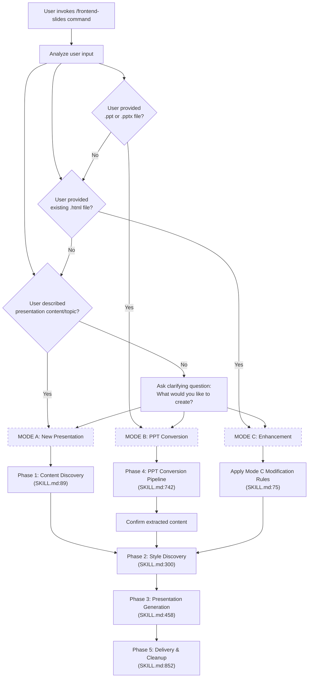
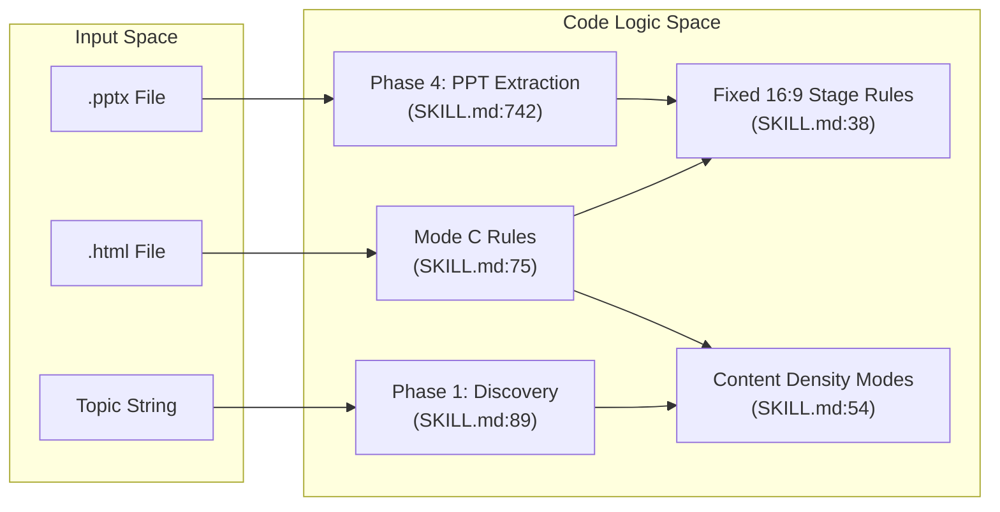

<!-- source: DeepWiki mcp.deepwiki.com · repo zarazhangrui/frontend-slides · extra page Phase 0: Mode Detection · fetched 2026-10-27 -->

# Phase 0: Mode Detection

<details>
<summary>Relevant source files</summary>

The following files were used as context for generating this wiki page:

- [SKILL.md](SKILL.md)
- [plugins/frontend-slides/skills/frontend-slides/SKILL.md](plugins/frontend-slides/skills/frontend-slides/SKILL.md)

</details>


## Purpose and Scope

Phase 0 is the initial routing phase of the `frontend-slides` workflow pipeline. It analyzes user input to determine which of three execution paths to follow: creating a new presentation from scratch, converting an existing PowerPoint file to HTML, or enhancing an existing HTML presentation. This phase acts as the entry point and dispatcher for all subsequent workflow phases.

For information about the subsequent phases, see [Phase 1: Content Discovery](), [Phase 2: Style Discovery](), [Phase 4: PPT Conversion Pipeline](), and [Phase 3: Presentation Generation](). For the overall workflow architecture, see [Five-Phase Workflow Pipeline]().

---

## Overview

Phase 0 implements a three-way routing decision that determines the user's intent based on their initial input to the `/frontend-slides` command. The detection logic is implemented as a classification system described in the system instructions. [SKILL.md:67-74]().

The three modes are:

| Mode | Description | Next Phase | Trigger Signals |
|------|-------------|------------|-----------------|
| **Mode A: New Presentation** | Create slides from scratch based on user requirements | Phase 1 (Content Discovery) | User provides topic, purpose, or content outline without files [SKILL.md:71-71]() |
| **Mode B: PPT Conversion** | Convert existing PowerPoint file to HTML | Phase 4 (PPT Extraction) | User provides `.ppt` or `.pptx` file [SKILL.md:72-72]() |
| **Mode C: Enhancement** | Improve existing HTML presentation | Phase 2 (Style Discovery) | User provides existing `.html` presentation file [SKILL.md:73-73]() |

Each mode represents a distinct entry point into the system but all paths eventually converge at Phase 2 (Style Discovery) before proceeding to Phase 3 (Presentation Generation).

**Sources:** [SKILL.md:67-74]()

---

## Mode Detection Decision Flow

The following diagram illustrates how Phase 0 routes user input to the appropriate workflow path, bridging the natural language request to the specific code-defined phases:

**Diagram: Intent Routing to Phase Dispatch**


**Sources:** [SKILL.md:67-74](), [SKILL.md:75-87](), [SKILL.md:89-108](), [SKILL.md:300-305](), [SKILL.md:380](), [SKILL.md:380](), [SKILL.md:380]()

---

## Mode A: New Presentation

Mode A is triggered when the user wants to create a presentation from scratch. This is the most common workflow path and requires extensive information gathering.

### Detection Criteria
The system enters Mode A when:
- User provides natural language describing a presentation topic.
- User states explicit intent to create new slides.
- No PowerPoint or HTML files are provided. [SKILL.md:71-71]()

### Workflow Path
```
Mode A → Phase 1 (Content Discovery) → Phase 2 (Style Discovery) → Phase 3 (Generation) → Phase 5 (Delivery)
```
Mode A follows the complete pipeline, starting with Phase 1 which requires structured questions about purpose, length, content readiness, and density. [SKILL.md:89-108]()

**Sources:** [SKILL.md:71-71](), [SKILL.md:89-108]()

---

## Mode B: PPT Conversion

Mode B is triggered when the user has an existing PowerPoint file that needs to be converted to HTML format.

### Detection Criteria
The system enters Mode B when:
- User provides a file with `.ppt` or `.pptx` extension. [SKILL.md:72-72]()
- User explicitly requests PowerPoint conversion.

### Workflow Path
```
Mode B → Phase 4 (PPT Extraction) → Content Confirmation → Phase 2 (Style Discovery) → Phase 3 (Generation) → Phase 5 (Delivery)
```
Mode B skips Phase 1 entirely and proceeds to Phase 4, where the `extract_pptx` logic extracts text and images. [SKILL.md:380]()

**Sources:** [SKILL.md:72-72](), [SKILL.md:380](), [SKILL.md:380]()

---

## Mode C: Enhancement

Mode C is triggered when the user provides an existing HTML presentation file that needs improvements.

### Detection Criteria
The system enters Mode C when:
- User provides an existing HTML file. [SKILL.md:73-73]()
- User requests improvements to a provided presentation.

### Workflow Path
```
Mode C → Mode C Modification Rules → Phase 2 (Style Discovery) → Phase 3 (Generation) → Phase 5 (Delivery)
```
Mode C must strictly follow **Modification Rules** to prevent viewport fitting issues:
1. Count existing elements against density limits before adding content. [SKILL.md:79-79]()
2. Ensure images fit the 1920×1080 stage; split slides if necessary. [SKILL.md:80-80]()
3. Maintain a maximum of 4-6 bullets per slide. [SKILL.md:81-81]()
4. Verify the 16:9 stage remains intact after any modification. [SKILL.md:82-82]()

**Sources:** [SKILL.md:73-73](), [SKILL.md:75-87]()

---

## Technical Mapping: Input to Code Entities

This diagram maps specific user input types to the internal system logic and rules they trigger.

**Diagram: Input to System Logic Mapping**


**Sources:** [SKILL.md:38-52](), [SKILL.md:54-65](), [SKILL.md:75-87](), [SKILL.md:89-108](), [SKILL.md:380]()

---

## Input Analysis Patterns

Phase 0 relies on pattern matching and file presence detection.

| User Input Example | Detected Mode | Rationale |
|-------------------|---------------|-----------|
| "Create a pitch deck for my AI startup" | Mode A | Natural language topic description, no files [SKILL.md:71-71]() |
| User uploads `presentation.pptx` | Mode B | PowerPoint file detected [SKILL.md:72-72]() |
| User uploads `existing-slides.html` | Mode C | HTML file detected [SKILL.md:73-73]() |
| "/frontend-slides" (no input) | Clarification | Ambiguous intent; ask user for Mode A, B, or C [SKILL.md:67-74]() |

**Sources:** [SKILL.md:67-74](), [SKILL.md:71-73]()

---

## Exit Conditions

Phase 0 completes successfully when:

1.  **Mode A**: Intent is classified as new creation. Exit to Phase 1. [SKILL.md:71-71]()
2.  **Mode B**: PowerPoint file is identified. Exit to Phase 4. [SKILL.md:72-72]()
3.  **Mode C**: HTML file is identified. Exit to Mode C Rules/Phase 2. [SKILL.md:73-73]()

**Sources:** [SKILL.md:67-74]()

---

