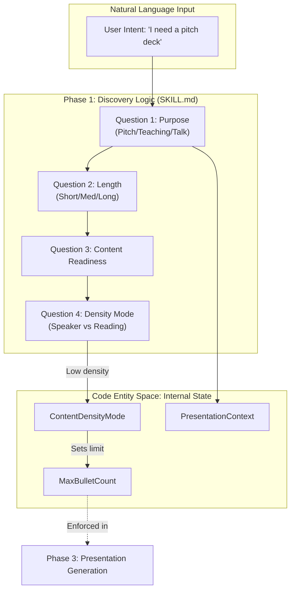
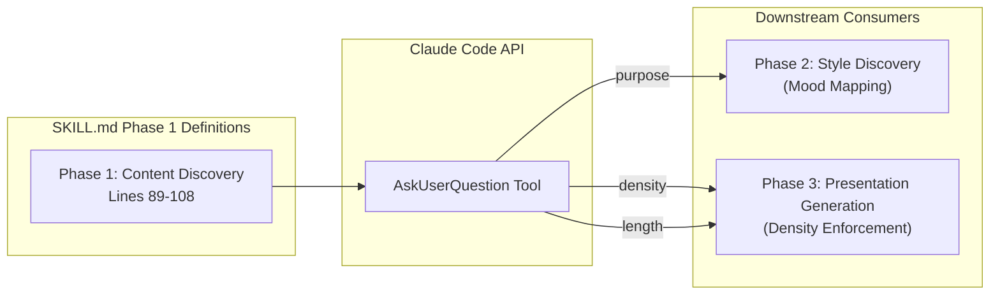

<!-- source: DeepWiki mcp.deepwiki.com · repo zarazhangrui/frontend-slides · extra page Phase 1: Content Discovery · fetched 2026-10-27 -->

# Phase 1: Content Discovery

Relevant source files

The following files were used as context for generating this wiki page:

- [SKILL.md](SKILL.md)
- [plugins/frontend-slides/skills/frontend-slides/SKILL.md](plugins/frontend-slides/skills/frontend-slides/SKILL.md)

## Purpose and Scope

Phase 1: Content Discovery is the information-gathering stage for **new presentations only**. This phase collects structured requirements from the user about the presentation's purpose, target length, content readiness, and visual density through a series of predefined questions. For PowerPoint conversion workflows, see [Phase 4: PPT Conversion Pipeline](#4.1.5). For the style selection process that follows this phase, see [Phase 2: Style Discovery](#4.1.3).

Phase 1 is activated after [Phase 0: Mode Detection](#4.1.1) determines the user wants to create a new presentation from scratch (Mode A) [SKILL.md:67-71]().

Sources: [SKILL.md:67-71](), [SKILL.md:89-108]()

---

## Overview

Phase 1 gathers requirements by asking a set of structured questions. The system is instructed to ask all questions together to minimize interaction friction [SKILL.md:91-92](). These questions establish:

1.  **Presentation context** — The intended use case (e.g., Pitch deck, Teaching).
2.  **Target scope** — Approximate slide count.
3.  **Content availability** — The user's starting point (notes vs. topic only).
4.  **Information density** — The visual balance between text and negative space.

Unlike open-ended prompts, Phase 1 uses structured choices to extract machine-parsable requirements that inform both content generation and style selection in subsequent phases.

Sources: [SKILL.md:89-108]()

---

## Question Sequence

### Question 1: Purpose
Identifies the presentation type, which influences content structure, tone, and recommended styles [SKILL.md:93-95]().

*   **Header:** `"Purpose"`
*   **Options:** `Pitch deck` / `Teaching-Tutorial` / `Conference talk` / `Internal presentation`

### Question 2: Length
Establishes scope, which determines content density and helps set user expectations for the generation process [SKILL.md:96-98]().

*   **Header:** `"Length"`
*   **Options:** `Short 5-10` / `Medium 10-20` / `Long 20+`

### Question 3: Content
Determines the level of AI assistance required for content structuring [SKILL.md:99-101]().

*   **Header:** `"Content"`
*   **Options:** `All content ready` / `Rough notes` / `Topic only`

### Question 4: Density
A critical design constraint that determines the visual "breathing room" of the slides [SKILL.md:102-106]().

*   **Header:** `"Density"`
*   **Options:**
    *   **"Low density / speaker-led"**: Big ideas, fewer words, 1-3 bullets max [SKILL.md:60-60]().
    *   **"High density / reading-first"**: Detailed internal docs, 4-8 bullets max [SKILL.md:61-61]().

Sources: [SKILL.md:54-63](), [SKILL.md:89-108]()

---

## Information Flow: Natural Language Space to Code Entity Space

The following diagram bridges the user's natural language requirements to the structured data used by the generation logic.

**Diagram: Requirement Mapping**

Sources: [SKILL.md:54-65](), [SKILL.md:89-108]()

---

## Content Density and Viewport Constraints

Phase 1 is the primary point where the system aligns user expectations with the **Fixed 16:9 Stage** requirement [SKILL.md:16-16](). Because every slide must fit the viewport without scrolling, the "Density" selection in Phase 1 acts as a hard constraint for Phase 3 generation.

| Density Mode | Max Bullets | Max Cards | Visual Behavior |
| :--- | :--- | :--- | :--- |
| **Low Density** | 1-3 | 2-3 | One idea per slide, large type [SKILL.md:60-60]() |
| **High Density** | 4-8 | 4-6 | Structured grids, tighter spacing [SKILL.md:61-61]() |

If the user's content exceeds these limits, the system is instructed to split the content into more slides rather than shrinking text [SKILL.md:63-63]().

Sources: [SKILL.md:54-65](), [SKILL.md:38-52]()

---

## Logic Integration: AskUserQuestion

The system uses the `AskUserQuestion` tool to present these choices. The mapping of responses to internal logic is illustrated below:

**Diagram: Tool Integration and Data Flow**

Sources: [SKILL.md:89-108](), [SKILL.md:301-305]()

---

## Content Validation and Refinement

After the structured questions, the system processes the user's content based on the `Content Readiness` answer [SKILL.md:100-101]():

1.  **All content ready**: The system proceeds to map the provided text into the 1920x1080 stage format.
2.  **Rough notes**: The system organizes the notes into a cohesive narrative structure.
3.  **Topic only**: The system generates a suggested outline for the user to approve.

In all cases, the system must verify that the content fits within the **Fixed Stage Rules** [SKILL.md:38-40](), ensuring no text overflows its card and no panels overlap [SKILL.md:82-82]().

Sources: [SKILL.md:38-52](), [SKILL.md:77-85](), [SKILL.md:99-101]()

---

