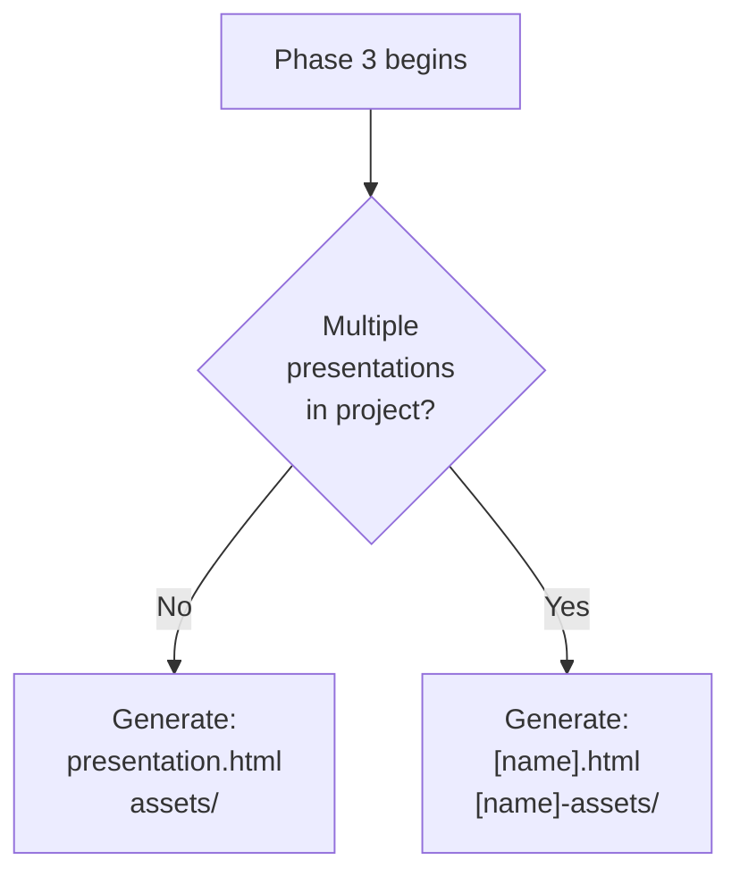
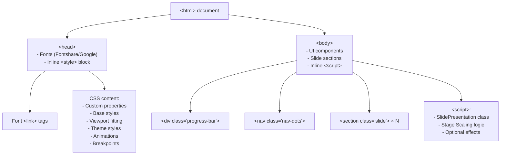
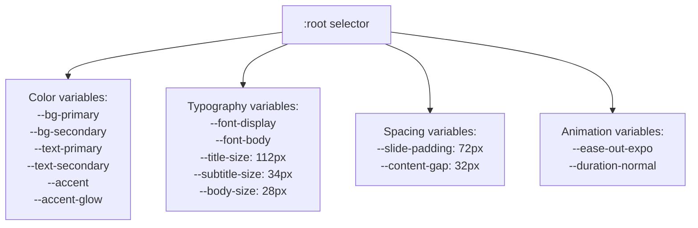
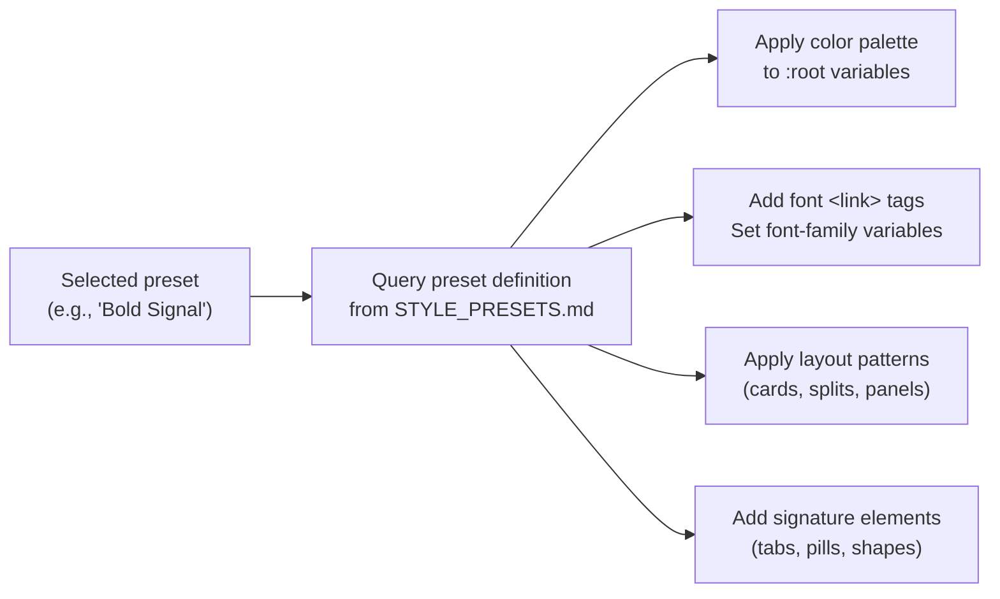
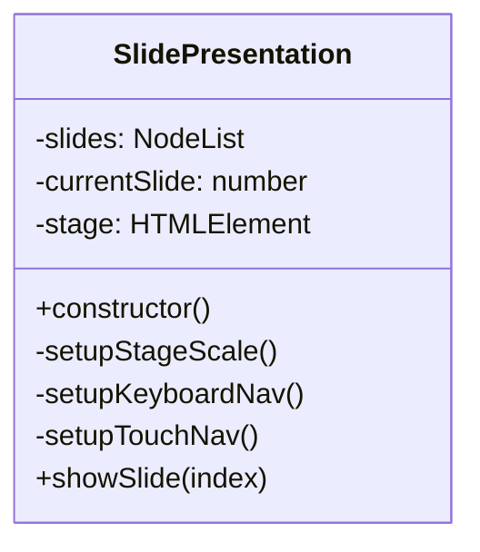
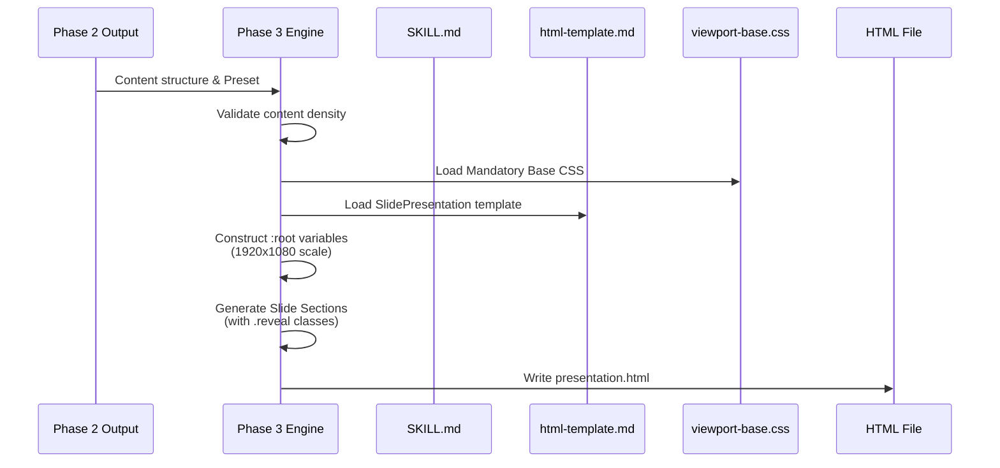

<!-- source: DeepWiki mcp.deepwiki.com · repo zarazhangrui/frontend-slides · extra page Phase 3: Presentation Generation · fetched 2026-10-27 -->

# Phase 3: Presentation Generation

<details>
<summary>Relevant source files</summary>

The following files were used as context for generating this wiki page:

- [html-template.md](html-template.md)
- [viewport-base.css](viewport-base.css)

</details>


Phase 3 is the core generation engine that transforms content and style decisions into a production-ready HTML presentation. After content has been gathered ([4.1.2]()) and a style preset has been selected ([4.1.3]()), this phase constructs the final self-contained HTML file with inline CSS, JavaScript, and enforced viewport fitting constraints.

For PowerPoint conversion specifics, see [4.1.5](). For delivery and cleanup procedures, see [4.1.6]().

## Input and Output Model

Phase 3 receives structured data and produces a single HTML artifact:

| Input | Source | Format |
|-------|--------|--------|
| Content structure | Phase 1 or Phase 4 | Slide titles, bullet points, images, notes |
| Selected style preset | Phase 2 | Preset name (e.g., "Bold Signal", "Neon Cyber") |
| Style customizations | Phase 2 | User-requested modifications to preset |

| Output | Location | Characteristics |
|--------|----------|-----------------|
| HTML presentation | `presentation.html` or `[name].html` | Self-contained, zero dependencies |
| Image assets (if any) | `assets/` or `[name]-assets/` | Referenced from HTML |

Sources: [SKILL.md:380]()

## File Structure Decisions

The generation logic determines output structure based on project context:



**Single presentation structure:**
```
presentation.html
assets/
  ├── slide_1_img_1.png
  └── slide_3_img_1.jpg
```

**Multi-presentation structure:**
```
pitch-deck.html
pitch-deck-assets/
  └── ...
company-update.html
company-update-assets/
  └── ...
```

Sources: [SKILL.md:380]()

## HTML Document Architecture

### Overall Structure

Phase 3 generates HTML following a strict template architecture with three primary sections. Every presentation follows a fixed 16:9 stage model: slides are authored at 1920×1080 and the whole stage scales to fit the browser window [html-template.md:1-3]().



Sources: [SKILL.md:380](), [html-template.md:5-145]()

### Semantic HTML Structure

Each slide uses semantic HTML with specific class hierarchy. The core container is the `.deck-viewport`, which holds the `.deck-stage` [html-template.md:81-82]().

```html
<div class="deck-viewport">
    <main class="deck-stage" id="deckStage">
        <section class="slide [type-class]">
            <div class="slide-content">
                <!-- Content with .reveal classes -->
                <h1 class="reveal">Slide Title</h1>
                <p class="reveal">Subtitle</p>
                <ul class="reveal">
                    <li>Item 1</li>
                    <li>Item 2</li>
                </ul>
            </div>
        </section>
    </main>
</div>
```

**Key classes:**
- `.deck-viewport` — Fixed inset container locking the browser viewport [viewport-base.css:18-23]().
- `.deck-stage` — The fixed 1920x1080 design canvas [viewport-base.css:27-36]().
- `.slide` — Absolute positioned container within the stage [viewport-base.css:40-51]().
- `.reveal` — Animation trigger class (opacity/transform controlled by `.visible`) [html-template.md:59-69]().

Sources: [SKILL.md:380](), [viewport-base.css:1-60](), [html-template.md:81-97]()

## CSS Architecture Generation

### Custom Properties System

Phase 3 generates a CSS custom property system in the `:root` selector, with all style preset values applied [html-template.md:23-46]().



**Critical requirement:** Because the stage uses a fixed 1920x1080 coordinate system [viewport-base.css:31-32](), typography and spacing variables are authored at that scale [html-template.md:32-41]().

Sources: [SKILL.md:380](), [html-template.md:23-46]()

### Mandatory Base CSS Injection

Phase 3 injects viewport fitting CSS rules from `viewport-base.css`. This is non-negotiable for all presentations [viewport-base.css:2-3]():

| CSS Section | Purpose | Key Rules |
|-------------|---------|-----------|
| Document lock | Prevent document overflow | `html, body { overflow: hidden; }` [viewport-base.css:13]() |
| Stage definition | Fixed 16:9 design canvas | `width: 1920px; height: 1080px; transform-origin: 0 0;` [viewport-base.css:31-34]() |
| Slide container | Absolute stack in stage | `position: absolute; inset: 0; visibility: hidden;` [viewport-base.css:41-47]() |
| Media constraints | Keep media inside slide | `max-width: 100%; max-height: 100%;` [viewport-base.css:62-68]() |
| Print behavior | One slide per page | `@media print { .slide { break-after: page; } }` [viewport-base.css:80-123]() |

Sources: [viewport-base.css:1-133]()

### Style Preset Application

The selected preset (from Phase 2) determines theme-specific CSS:



Sources: [STYLE_PRESETS.md:163-346]()

### Animation System Generation

Phase 3 generates CSS animation classes and JavaScript triggers using the `.reveal` pattern [html-template.md:59-76]():

```css
/* Generated animation classes */
.reveal {
    opacity: 0;
    transform: translateY(30px);
    transition: opacity var(--duration-normal) var(--ease-out-expo),
                transform var(--duration-normal) var(--ease-out-expo);
}

.slide.visible .reveal {
    opacity: 1;
    transform: translateY(0);
}

/* Staggered delays */
.reveal:nth-child(1) { transition-delay: 0.1s; }
.reveal:nth-child(2) { transition-delay: 0.2s; }
```

Sources: [html-template.md:59-76](), [SKILL.md:380]()

## JavaScript Component Generation

### SlidePresentation Controller Class

Phase 3 generates a `SlidePresentation` class that handles all presentation logic and stage scaling [html-template.md:103-143]():



**Stage Scaling Logic:**
The system uses a mathematical scale factor based on the smaller of the width or height ratios to maintain the 16:9 aspect ratio regardless of window size [html-template.md:115-119]().

```javascript
const factor = Math.min(window.innerWidth / 1920, window.innerHeight / 1080);
const x = (window.innerWidth - 1920 * factor) / 2;
const y = (window.innerHeight - 1080 * factor) / 2;
this.stage.style.transform = `translate(${x}px, ${y}px) scale(${factor})`;
```

Sources: [html-template.md:103-143](), [SKILL.md:380]()

### Inline Editing Affordance

Phase 3 includes lightweight post-draft editing controls by default [html-template.md:177-179](). It uses a JS-based hover approach to avoid CSS hover-chain breakage [html-template.md:183-192]().

```html
<div class="edit-hotzone"></div>
<button class="edit-toggle" id="editToggle" title="Edit mode (E)">✏️</button>
```

Sources: [html-template.md:177-192]()

## Content Density Validation

### Pre-Generation Validation

Before generating HTML, Phase 3 validates content against density limits to ensure viewport fitting.

| Slide Type | Maximum Content | Enforcement Location |
|------------|----------------|---------------------|
| Title slide | 1 heading + 1 subtitle + optional tagline | [SKILL.md:38]() |
| Content slide | 1 heading + 4-6 bullets (max 2 lines each) OR 2 paragraphs | [SKILL.md:39]() |
| Feature grid | 1 heading + 6 cards maximum (2×3 or 3×2 grid) | [SKILL.md:40]() |
| Code slide | 1 heading + 8-10 lines of code | [SKILL.md:41]() |
| Quote slide | 1 quote (max 3 lines) + attribution | [SKILL.md:42]() |

Sources: [SKILL.md:33-46](), [SKILL.md:221-236]()

## Phase 3 Workflow Summary



Sources: [SKILL.md:380](), [html-template.md:1-145](), [viewport-base.css:1-133]()

---

