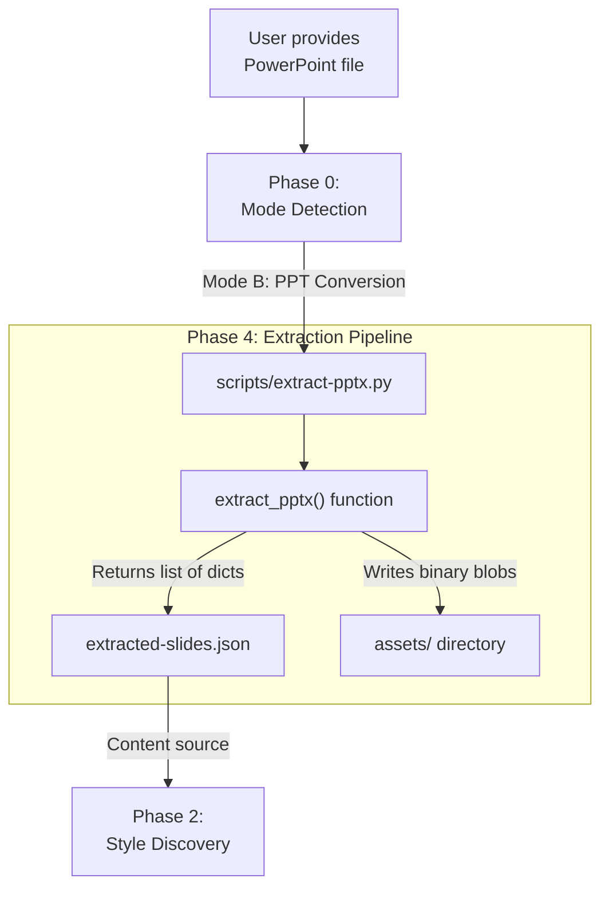
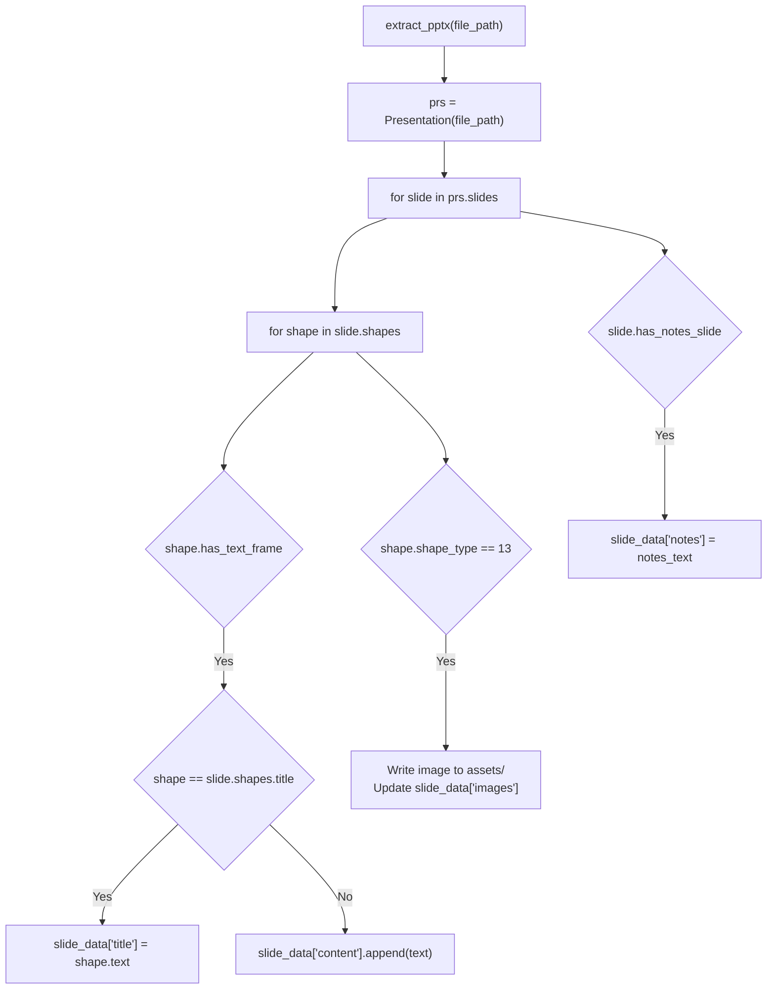

<!-- source: DeepWiki mcp.deepwiki.com · repo zarazhangrui/frontend-slides · extra page Phase 4: PPT Conversion Pipeline · fetched 2026-10-27 -->

# Phase 4: PPT Conversion Pipeline

<details>
<summary>Relevant source files</summary>

The following files were used as context for generating this wiki page:

- [animation-patterns.md](animation-patterns.md)
- [plugins/frontend-slides/skills/frontend-slides/scripts/extract-pptx.py](plugins/frontend-slides/skills/frontend-slides/scripts/extract-pptx.py)
- [scripts/extract-pptx.py](scripts/extract-pptx.py)

</details>


## Purpose and Scope

Phase 4 handles the conversion of PowerPoint files (`.ppt`, `.pptx`) into structured JSON data that can be transformed into HTML presentations. This phase is activated when Phase 0 (Mode Detection) determines the user wants to convert an existing PowerPoint file rather than create a new presentation from scratch.

The core logic resides in the `extract_pptx` function, which parses the binary presentation format, saves image assets, and structures text content for the subsequent generation phases.

**Sources:** [plugins/frontend-slides/skills/frontend-slides/scripts/extract-pptx.py:2-10](), [scripts/extract-pptx.py:2-10]()

---

## Phase Activation Context

Phase 4 is entered when the user provides a PowerPoint file as input. This can occur in two ways:

| Trigger | Description | Next Step |
|---------|-------------|-----------|
| **Direct File Provision** | User attaches or references a `.ppt` or `.pptx` file in their initial prompt | Immediately proceed to extraction |
| **Mode Detection Routing** | Phase 0 detects intent to convert PowerPoint based on user prompt keywords | Prompt user for file, then proceed to extraction |

After content extraction and user confirmation, Phase 4 transitions to Phase 2 (Style Discovery) with the extracted content serving as the presentation content.

---

## System Architecture Overview

The following diagram maps the logical flow to the specific Python script and data structures used during extraction.



**Diagram: PPT Conversion Architecture**

**Sources:** [scripts/extract-pptx.py:18-75](), [scripts/extract-pptx.py:89-91]()

---

## The extract_pptx Function

The core of Phase 4 is the `extract_pptx` function, which uses the `python-pptx` library to parse PowerPoint files. This function is the only external dependency in the system and is optional—it's only required for PowerPoint conversion functionality.

### Function Signature

```python
def extract_pptx(file_path, output_dir="."):
    """
    Extract all content from a PowerPoint file.
    Returns a list of slide data dicts with text, images, and notes.
    """
```
[scripts/extract-pptx.py:18-22]()

### Parameters

| Parameter | Type | Description |
|-----------|------|-------------|
| `file_path` | `str` | Path to the `.ppt` or `.pptx` file to be converted |
| `output_dir` | `str` | Directory where extracted assets and JSON will be saved (defaults to current dir) |

[scripts/extract-pptx.py:18-18]()

### Return Value

The function returns a list of slide data dictionaries, where each element represents one slide with the following structure:

```python
{
    "number": int,        # Slide number (1-indexed)
    "title": "",          # Slide title text (if found)
    "content": [],        # List of {"type": "text", "content": str}
    "images": [],         # List of {"path": str, "width": int, "height": int}
    "notes": ""           # Speaker notes text
}
```
[scripts/extract-pptx.py:31-37]()

---

## Content Extraction Process

The extraction process iterates through the `prs.slides` collection and examines every `shape` within each slide.



**Diagram: extract_pptx Internal Logic**

**Sources:** [scripts/extract-pptx.py:30-73]()

### Text Extraction

The function identifies text content by checking `shape.has_text_frame`. It distinguishes between the slide title and body content:
- If the shape is the designated `slide.shapes.title`, it is stored in the `title` field [scripts/extract-pptx.py:42-43]().
- Otherwise, the text is appended to the `content` list as a text block [scripts/extract-pptx.py:45-47]().

### Image Extraction

Images are identified by `shape.shape_type == 13` (Picture). The script performs the following:
1. **Binary Extraction**: Accesses the raw image data via `shape.image.blob` [scripts/extract-pptx.py:52]().
2. **Deterministic Naming**: Saves the file as `slide{slide_num}_img{index}.{ext}` [scripts/extract-pptx.py:54]().
3. **Physical Storage**: Writes the file to the `assets/` directory [scripts/extract-pptx.py:57-58]().
4. **Metadata Tracking**: Records the relative path, width, and height [scripts/extract-pptx.py:60-66]().

### Speaker Notes Extraction

If a slide contains notes, the script accesses `slide.notes_slide.notes_text_frame.text` and stores it in the `notes` field [scripts/extract-pptx.py:69-71]().

---

## Asset Management

### Directory Structure

The script ensures an `assets/` directory exists in the `output_dir` before extraction begins.

```python
assets_dir = os.path.join(output_dir, "assets")
os.makedirs(assets_dir, exist_ok=True)
```
[scripts/extract-pptx.py:27-28]()

### JSON Output

After processing all slides, the script writes the complete data structure to `extracted-slides.json` in the output directory.

```python
output_path = os.path.join(output_dir, "extracted-slides.json")
with open(output_path, "w") as f:
    json.dump(slides, f, indent=2)
```
[scripts/extract-pptx.py:89-91]()

---

## Dependencies and Requirements

PowerPoint conversion is the only part of the `frontend-slides` workflow that requires a specific Python environment.

| Requirement | Purpose | Source |
|-------------|---------|--------|
| **Python 3** | Script execution | [scripts/extract-pptx.py:1]() |
| **python-pptx** | PPTX parsing library | [scripts/extract-pptx.py:9]() |
| **JSON** | Data serialization | [scripts/extract-pptx.py:12]() |

**Sources:** [scripts/extract-pptx.py:1-15]()

---

