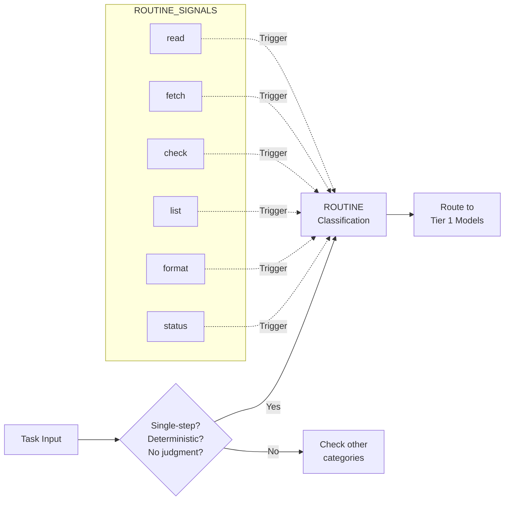
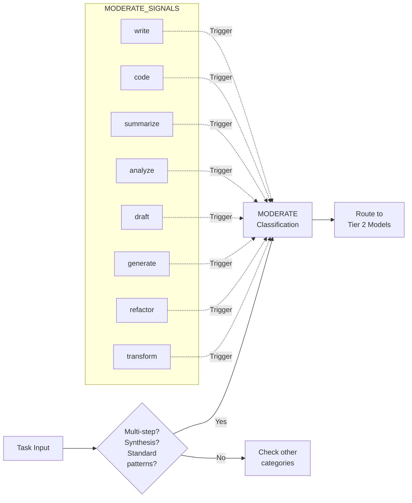
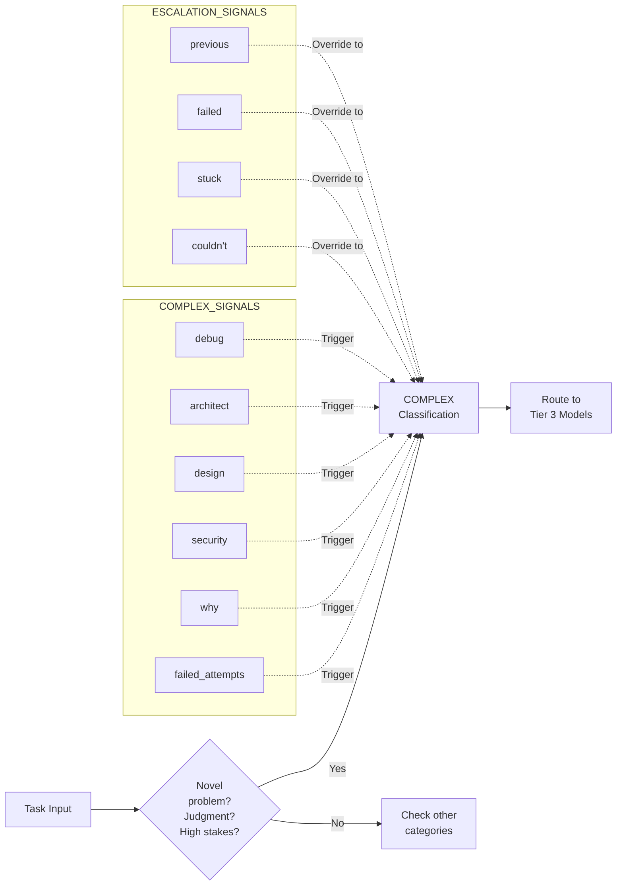
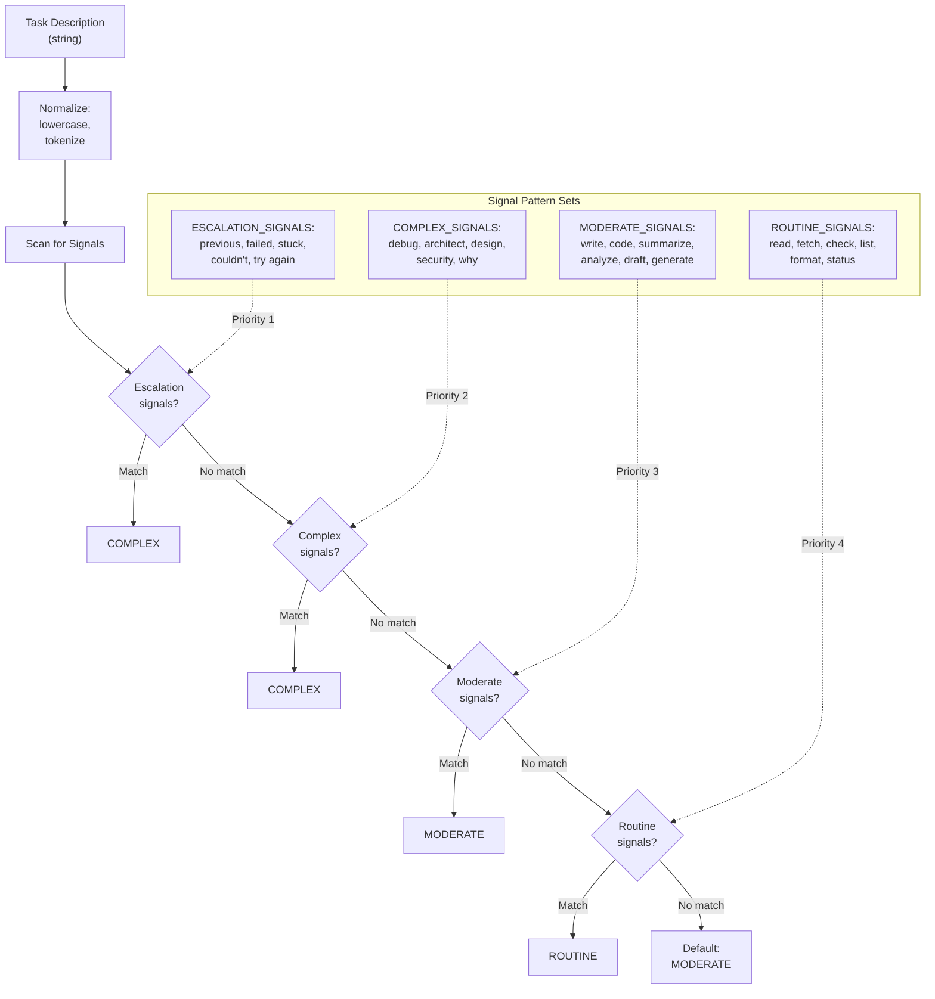
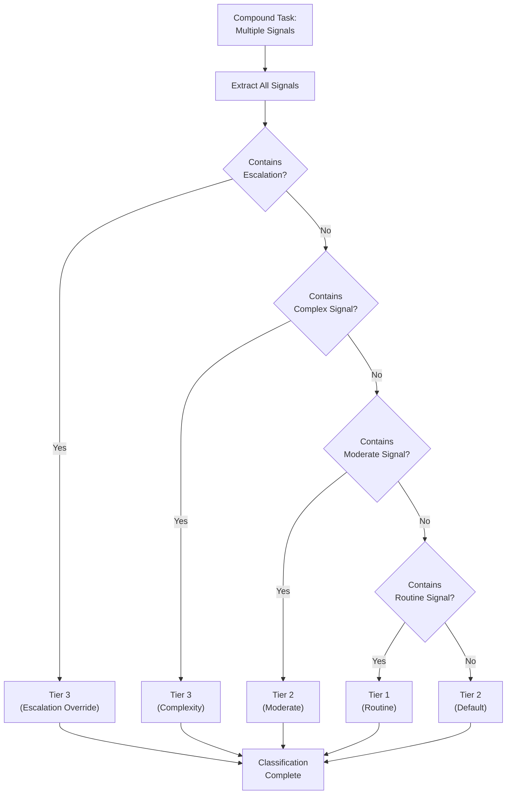
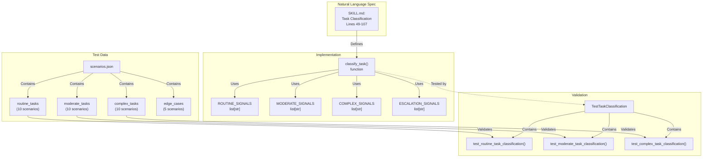

<!-- source: DeepWiki mcp.deepwiki.com · repo zscole/model-hierarchy-skill · page 3.1 Task Classification System · fetched 2026-10-27 -->

# Task Classification System

Relevant source files

The following files were used as context for generating this wiki page:

- [SKILL.md](SKILL.md)
- [tests/scenarios.json](tests/scenarios.json)

## Purpose and Scope

This page documents the task classification system that categorizes agent tasks into three complexity levels: **ROUTINE**, **MODERATE**, and **COMPLEX**. Classification determines which model tier should handle each task, forming the foundation of the cost optimization strategy.

This page covers the classification categories, their characteristics, and the signal patterns used for detection. For the model tiers assigned to each category, see [Model Tier Architecture](#3.2). For the algorithm that performs classification, see [Decision Algorithm](#3.3). For validation test cases, see [Test Scenarios](#6.1).

---

## Classification Categories

The system defines three mutually exclusive task categories based on complexity characteristics. Each category maps to a model tier with appropriate capabilities and cost.

### Category Overview

| Category | Model Tier | Complexity Level | Primary Characteristic |
|----------|-----------|------------------|------------------------|
| **ROUTINE** | Tier 1 (Cheap) | Single-step, deterministic | No judgment required |
| **MODERATE** | Tier 2 (Mid) | Multi-step, standard patterns | Some synthesis needed |
| **COMPLEX** | Tier 3 (Premium) | Novel problem solving | Nuanced judgment required |

**Sources:** [SKILL.md:49-107]()

---

## ROUTINE Tasks

### Characteristics

Tasks classified as ROUTINE exhibit the following properties:

- **Single-step operations**: Complete in one atomic action
- **Clear, unambiguous instructions**: No interpretation needed
- **No judgment required**: Purely mechanical execution
- **Deterministic output expected**: Same input produces same output

**Diagram: ROUTINE Task Classification Flow**

**Sources:** [SKILL.md:53-70]()

### Task Examples

The system recognizes the following operation types as ROUTINE:

| Operation Category | Task Examples | Signal Keywords |
|-------------------|---------------|-----------------|
| **File Operations** | Read file contents, List directory, Check file exists | `read`, `list`, `check` |
| **Status Checks** | Server health, Service status, Git status | `status`, `check`, `health` |
| **Simple Lookups** | Time queries, Weather checks, Definition lookups | Simple Q&A patterns |
| **Data Formatting** | JSON formatting, Date conversion, Text restructuring | `format`, `convert` |
| **List Operations** | Filter, Sort, Transform basic lists | `filter`, `sort`, `list` |
| **API Calls** | Fetch URL, GET requests with known parameters | `fetch`, `get` |
| **Monitoring** | Heartbeat checks, Cron tasks, Alert status | `heartbeat`, `monitor` |

**Example task descriptions from validation scenarios:**

- "Read the contents of config.json"
- "Check if the server is running"
- "What time is it in Tokyo?"
- "Format this JSON and fix the indentation"
- "List all files in the src directory"
- "Fetch the homepage of example.com"
- "Filter this list to only items over 100"
- "Run the health check"
- "Convert this date to ISO format"
- "Get the current git status"

**Sources:** [SKILL.md:61-70](), [tests/scenarios.json:2-53]()

---

## MODERATE Tasks

### Characteristics

Tasks classified as MODERATE exhibit these properties:

- **Multi-step but well-defined**: Multiple operations with clear sequence
- **Some synthesis required**: Combine information or create new content
- **Standard patterns apply**: Follows established templates or approaches
- **Quality matters but isn't critical**: Good output acceptable, not perfection

**Diagram: MODERATE Task Classification Flow**

**Sources:** [SKILL.md:72-88]()

### Task Examples

The system recognizes the following operation types as MODERATE:

| Operation Category | Task Examples | Signal Keywords |
|-------------------|---------------|-----------------|
| **Code Generation** | Write functions, Generate tests, Create scripts | `write`, `code`, `generate` |
| **Content Synthesis** | Summarize documents, Draft emails, Write documentation | `summarize`, `draft`, `write` |
| **Data Analysis** | Find trends, Transform data, Analyze patterns | `analyze`, `transform` |
| **Code Operations** | Refactor functions, Review code (non-security), Create READMEs | `refactor`, `review`, `create` |
| **Research Tasks** | Search articles, Gather information, Compare options | `search`, `research` |
| **Multi-file Operations** | Cross-file refactoring, Project-wide changes | `multi-file` patterns |
| **Tool Orchestration** | Chain multiple tools, Coordinate operations | Tool usage patterns |

**Example task descriptions from validation scenarios:**

- "Write a Python function to parse CSV files"
- "Summarize this 10-page document"
- "Draft an email to the team about the launch"
- "Analyze the sales data and find trends"
- "Refactor this function to be more readable"
- "Search for recent articles about AI agents"
- "Generate unit tests for this module"
- "Create a README for this project"
- "Review this pull request"
- "Transform this JSON into a markdown table"

**Sources:** [SKILL.md:79-88](), [tests/scenarios.json:54-105]()

---

## COMPLEX Tasks

### Characteristics

Tasks classified as COMPLEX exhibit these properties:

- **Novel problem solving required**: No established pattern or template
- **Multiple valid approaches**: Requires choosing between alternatives
- **Nuanced judgment calls**: Deep reasoning about tradeoffs
- **High stakes or irreversible**: Errors have significant consequences
- **Previous attempts failed**: Escalation from lower tiers

**Diagram: COMPLEX Task Classification Flow with Escalation**

**Sources:** [SKILL.md:90-107]()

### Task Examples

The system recognizes the following operation types as COMPLEX:

| Operation Category | Task Examples | Signal Keywords |
|-------------------|---------------|-----------------|
| **Debugging** | Multi-step debugging, Race condition analysis, Flaky test diagnosis | `debug`, `why` |
| **Architecture** | System design, Migration strategies, Database schema design | `architect`, `design` |
| **Security** | Security review, Vulnerability analysis, Threat modeling | `security` |
| **Escalation** | Tasks where cheaper models failed, Third attempt at solving | `previous`, `failed`, `stuck` |
| **Root Cause Analysis** | Environment differences, Load behavior, System anomalies | `why`, `explain` |
| **Creative Work** | Requiring originality, No template available | Originality indicators |
| **Long Context** | Tasks requiring >50K token context | Context length |
| **Adversarial Cases** | Edge cases, Attack scenarios, Boundary conditions | Edge case patterns |

**Example task descriptions from validation scenarios:**

- "Debug why this test is flaky and sometimes fails"
- "Design the architecture for a distributed cache system"
- "Review this smart contract for security vulnerabilities"
- "I tried three different approaches and none work. Why?"
- "Explain why the system behaves differently under load"
- "Architect a migration strategy from monolith to microservices"
- "This code has a race condition somewhere. Find it."
- "Design the database schema for a multi-tenant SaaS"
- "Why does this work in dev but fail in production?"
- "Evaluate the tradeoffs between these three approaches"

**Sources:** [SKILL.md:98-107](), [tests/scenarios.json:106-157]()

---

## Signal Detection Patterns

The classification system uses keyword detection to identify task complexity. Signal patterns are defined in the implementation and tested against validation scenarios.

### Signal Pattern Architecture

**Diagram: Signal Detection and Priority Cascade**

**Sources:** [SKILL.md:109-132](), [tests/scenarios.json:1-185]()

### Signal Pattern Definitions

| Priority | Pattern Set | Keywords | Override Behavior |
|----------|------------|----------|-------------------|
| 1 (Highest) | **ESCALATION_SIGNALS** | `previous`, `failed`, `stuck`, `couldn't`, `try again` | Always → COMPLEX |
| 2 | **COMPLEX_SIGNALS** | `debug`, `architect`, `design`, `security`, `why` | → COMPLEX |
| 3 | **MODERATE_SIGNALS** | `write`, `code`, `summarize`, `analyze`, `draft`, `generate`, `refactor`, `transform` | → MODERATE |
| 4 | **ROUTINE_SIGNALS** | `read`, `fetch`, `check`, `list`, `format`, `status`, `health`, `get` | → ROUTINE |
| 5 (Default) | No match | - | → MODERATE (safe default) |

**Implementation note:** The `classify_task` function in the test suite implements this priority cascade. Escalation signals override all other classifications, ensuring that failed attempts are always escalated to premium models.

**Sources:** [SKILL.md:113-132](), [tests/scenarios.json:1-185]()

---

## Edge Cases and Compound Tasks

The classification system handles edge cases where tasks contain signals from multiple categories. The system uses signal priority to resolve conflicts.

### Compound Task Resolution

| Task Description | Conflicting Signals | Resolution | Tier |
|-----------------|---------------------|------------|------|
| "Read this file and summarize it" | `read` (ROUTINE) + `summarize` (MODERATE) | MODERATE dominates | 2 |
| "Check the logs and debug why the service crashed" | `check` (ROUTINE) + `debug` (COMPLEX) | COMPLEX dominates | 3 |
| "Format this code" | `format` (ROUTINE) + `code` (MODERATE) | MODERATE dominates | 2 |
| "Write hello world in Python" | `write` (MODERATE) - minimal complexity | MODERATE (acceptable tradeoff) | 2 |
| "The previous model couldn't solve this. Try again." | Escalation signal | ESCALATION overrides all | 3 |

**Diagram: Compound Task Classification Priority Cascade**

**Principle:** Higher priority signals always dominate lower priority signals. This ensures that complex or escalated tasks are never accidentally routed to cheaper models.

**Sources:** [tests/scenarios.json:158-185]()

---

## Classification in Code

The classification system is implemented and validated in the test suite. The code entities bridge the natural language specification to executable logic.

### Code Entity Mapping

**Diagram: Natural Language to Code Entity Mapping**

**Sources:** [SKILL.md:49-132](), [tests/scenarios.json:1-185]()

### Test Scenario Structure

The `scenarios.json` file provides 35 test cases organized by category:

| Category | Test Count | Key Fields |
|----------|-----------|------------|
| `routine_tasks` | 10 | `description`, `expected_tier: 1`, `signals` |
| `moderate_tasks` | 10 | `description`, `expected_tier: 2`, `signals` |
| `complex_tasks` | 10 | `description`, `expected_tier: 3`, `signals` |
| `edge_cases` | 5 | `description`, `expected_tier`, `note` |

Each test case validates that the classification system correctly identifies task complexity and assigns the appropriate tier.

**Sources:** [tests/scenarios.json:1-185]()

---

## Summary

The task classification system categorizes agent tasks into three levels:

1. **ROUTINE** (Tier 1): Single-step, deterministic operations like file reads, status checks, and simple lookups
2. **MODERATE** (Tier 2): Multi-step synthesis like code generation, summarization, and data analysis
3. **COMPLEX** (Tier 3): Novel problem solving like debugging, architecture design, and security review

Classification uses a priority-based signal detection system with escalation overrides ensuring that failed tasks are always upgraded. The system handles compound tasks by selecting the highest priority signal. The 80/15/5 distribution of task complexity (80% routine, 15% moderate, 5% complex) drives the 10x cost reduction compared to using only premium models.

For implementation details, see [classify_task Function](#4.1). For model tier assignments, see [Model Tier Architecture](#3.2). For the complete decision algorithm, see [Decision Algorithm](#3.3).

**Sources:** [SKILL.md:49-132](), [tests/scenarios.json:1-185]()

---

