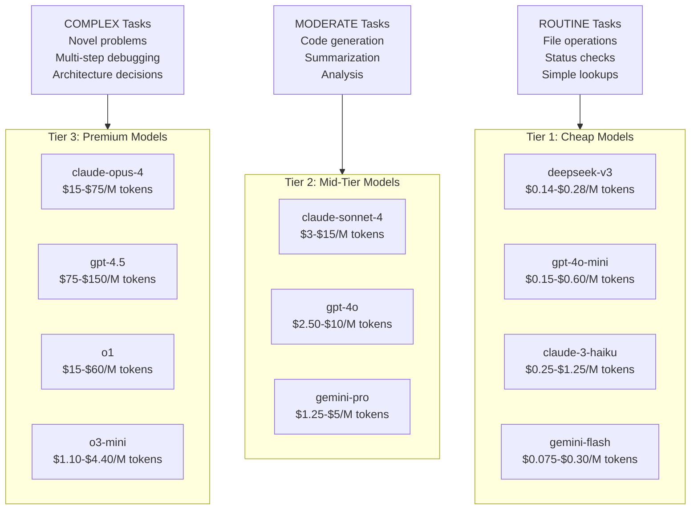
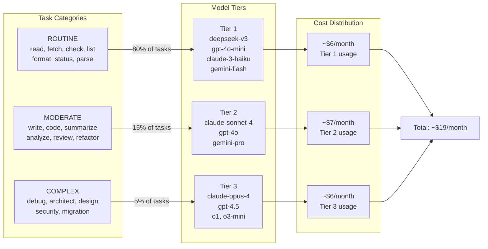
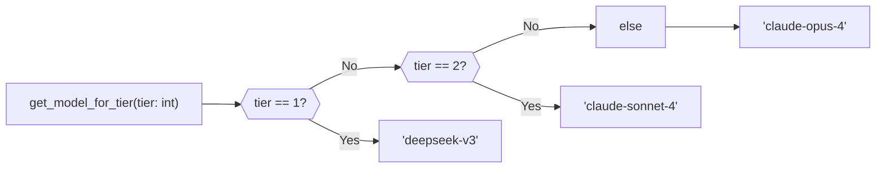
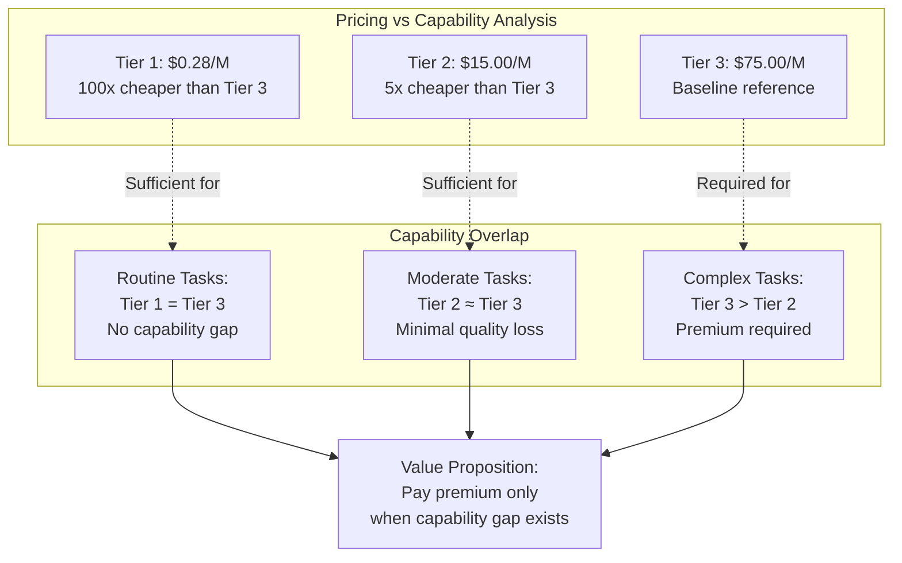

<!-- source: DeepWiki mcp.deepwiki.com · repo zscole/model-hierarchy-skill · page 3.2 Model Tier Architecture · fetched 2026-10-27 -->

# Model Tier Architecture

<details>
<summary>Relevant source files</summary>

The following files were used as context for generating this wiki page:

- [SKILL.md](SKILL.md)
- [tests/test_classification.py](tests/test_classification.py)

</details>


## Purpose and Scope

This page documents the three-tier model hierarchy that forms the foundation of the cost-optimization strategy. It defines which specific LLM models belong to each tier, their pricing characteristics, and the rationale for tier placement. 

For information about how tasks are classified into complexity categories, see [Task Classification System](#3.1). For the algorithm that selects models based on task classification, see [Decision Algorithm](#3.3). For the Python implementation of tier-based model selection, see [Model Selection Logic](#4.3).

---

## The Three-Tier Hierarchy

The model hierarchy divides available LLMs into three tiers based on their pricing and capabilities. This stratification enables intelligent routing where routine tasks use inexpensive models while complex tasks receive premium reasoning power.

### Tier Structure Diagram



**Sources:** [SKILL.md:19-46](), [tests/test_classification.py:15-18]()

---

## Tier 1: Cheap Models ($0.10-0.50/M tokens)

Tier 1 contains the most cost-effective models, optimized for high-volume routine operations where advanced reasoning is unnecessary.

### Model Specifications

| Model | Input Cost | Output Cost | Provider | Best For |
|-------|-----------|-------------|----------|----------|
| `deepseek-v3` | $0.14/M | $0.28/M | DeepSeek | General routine work |
| `gpt-4o-mini` | $0.15/M | $0.60/M | OpenAI | Quick responses |
| `claude-3-haiku` | $0.25/M | $1.25/M | Anthropic | Fast tool use |
| `gemini-flash` | $0.075/M | $0.30/M | Google | High volume tasks |

### Characteristics

- **Single-step operations**: File reads, status checks, formatting
- **Deterministic outputs**: Clear instructions with unambiguous expected results
- **High throughput**: Can process large volumes without cost concerns
- **No judgment required**: Tasks with well-defined success criteria

### Usage Pattern

Tier 1 models handle approximately **80% of agent tasks** in a typical workflow. This high percentage drives the overall cost savings of the hierarchical approach.

**Sources:** [SKILL.md:21-29](), [SKILL.md:178-182](), [tests/test_classification.py:16]()

---

## Tier 2: Mid-Tier Models ($1-5/M tokens)

Tier 2 provides balanced capability for tasks requiring multi-step reasoning or synthesis without demanding frontier-level intelligence.

### Model Specifications

| Model | Input Cost | Output Cost | Provider | Best For |
|-------|-----------|-------------|----------|----------|
| `claude-sonnet-4` | $3.00/M | $15.00/M | Anthropic | Balanced performance |
| `gpt-4o` | $2.50/M | $10.00/M | OpenAI | Multimodal tasks |
| `gemini-pro` | $1.25/M | $5.00/M | Google | Long context work |

### Characteristics

- **Multi-step workflows**: Code generation, data transformation, tool orchestration
- **Synthesis required**: Combining information from multiple sources
- **Standard patterns apply**: Well-understood problem domains
- **Quality matters**: Output correctness is important but not mission-critical

### Usage Pattern

Tier 2 models handle approximately **15% of agent tasks**, serving as the default for interactive work and ambiguous task descriptions where the complexity level is uncertain.

**Sources:** [SKILL.md:30-37](), [SKILL.md:138](), [tests/test_classification.py:17]()

---

## Tier 3: Premium Models ($10-75/M tokens)

Tier 3 consists of frontier models with advanced reasoning capabilities, reserved for complex problems where cheaper models have proven insufficient.

### Model Specifications

| Model | Input Cost | Output Cost | Provider | Best For |
|-------|-----------|-------------|----------|----------|
| `claude-opus-4` | $15.00/M | $75.00/M | Anthropic | Complex reasoning |
| `gpt-4.5` | $75.00/M | $150.00/M | OpenAI | Frontier tasks |
| `o1` | $15.00/M | $60.00/M | OpenAI | Multi-step reasoning |
| `o3-mini` | $1.10/M | $4.40/M | OpenAI | Reasoning on budget |

### Characteristics

- **Novel problem solving**: No established solution patterns exist
- **Multiple valid approaches**: Requires nuanced judgment calls
- **High stakes**: Errors have significant consequences (security, architecture)
- **Escalation scenarios**: Previous attempts with cheaper models failed
- **Long-context reasoning**: Tasks requiring analysis of 50K+ tokens

### Usage Pattern

Tier 3 models handle approximately **5% of agent tasks**, primarily complex debugging, architecture decisions, and escalated failures. Despite representing only 5% of volume, these tasks justify premium pricing due to their importance.

**Sources:** [SKILL.md:38-46](), [SKILL.md:89-107](), [tests/test_classification.py:18]()

---

## Task-to-Tier Mapping

### Complexity Routing Diagram



The routing strategy produces near-equal cost distribution across tiers despite vastly different per-token pricing. This occurs because high-volume routine work (80%) on cheap models costs similar to low-volume complex work (5%) on expensive models.

**Sources:** [SKILL.md:169-182](), [tests/test_classification.py:115-138]()

---

## Code Implementation of Tiers

### Tier Constant Definitions

The model tiers are implemented as Python lists defining which model identifiers belong to each tier:

```
TIER_1_MODELS = ["deepseek-v3", "gpt-4o-mini", "claude-3-haiku", "gemini-flash"]
TIER_2_MODELS = ["claude-sonnet-4", "gpt-4o", "gemini-pro"]
TIER_3_MODELS = ["claude-opus-4", "gpt-4.5", "o1", "o3-mini"]
```

These constants are used by test validation to ensure selected models match expected tier membership.

**Sources:** [tests/test_classification.py:15-18]()

### Model Selection Function

The `get_model_for_tier` function maps tier numbers to representative model identifiers:



This function returns the default/representative model for each tier. Platform integrations may substitute equivalent models based on provider availability or organizational preferences.

**Sources:** [tests/test_classification.py:84-91]()

### Cost Calculation Constants

Cost estimation uses approximate per-million-token pricing for output tokens (which are typically more expensive than input tokens):

| Tier | Cost per 1M Tokens | Representative Model |
|------|-------------------|----------------------|
| 1 | $0.28 | DeepSeek V3 output |
| 2 | $15.00 | Claude Sonnet output |
| 3 | $75.00 | Claude Opus output |

These values are used by `calculate_cost` and `calculate_monthly_cost` functions to project operational expenses.

**Sources:** [tests/test_classification.py:94-112]()

---

## Pricing Rationale

### Cost-Capability Tradeoff



The tier architecture exploits the insight that **model capability does not correlate with task performance for routine operations**. A $75/M model provides no measurable benefit over a $0.28/M model when reading a file or checking system status. This capability overlap creates the economic opportunity for dramatic cost reduction.

**Sources:** [SKILL.md:13-17](), [SKILL.md:169-183]()

---

## Platform-Specific Tier Implementations

Different agent platforms implement tier-based model selection using their native mechanisms:

### OpenClaw Implementation

OpenClaw uses file-based skill discovery where the tier definitions are embedded in `SKILL.md` and accessed through runtime commands:

- `/model opus` - Switch to Tier 3 (Claude Opus)
- `/model sonnet` - Switch to Tier 2 (Claude Sonnet)  
- `/model deepseek` - Switch to Tier 1 (DeepSeek)

Sub-agent spawning specifies tier through model parameter:

```yaml
sessions_spawn:
  task: "Fetch and parse these 50 URLs"
  model: deepseek  # Tier 1 for routine bulk operations
```

**Sources:** [SKILL.md:187-201]()

### Claude Code Implementation

Claude Code embeds tier-based routing rules as natural language instructions in project configuration:

```
When spawning background agents, use claude-3-haiku for:
- File operations
- Simple searches  
- Status checks

Reserve claude-sonnet-4 for:
- Code generation
- Analysis tasks
```

The system interprets these instructions to select appropriate tiers.

**Sources:** [SKILL.md:203-215]()

### Generic Function Implementation

Custom agent systems implement tier selection programmatically using signal detection:

```python
def get_model_for_task(task_description: str) -> str:
    routine_signals = ['read', 'fetch', 'check', 'list', 'format', 'status']
    complex_signals = ['debug', 'architect', 'design', 'security', 'why']
    
    desc_lower = task_description.lower()
    
    if any(signal in desc_lower for signal in complex_signals):
        return "claude-opus-4"  # Tier 3
    elif any(signal in desc_lower for signal in routine_signals):
        return "deepseek-v3"  # Tier 1
    else:
        return "claude-sonnet-4"  # Tier 2 default
```

This pattern maps signal detection directly to tier-specific model identifiers.

**Sources:** [SKILL.md:219-232]()

---

## Tier Extensibility

The tier definitions are designed for customization based on organizational needs:

### Adding New Models

To add a newly released model to the hierarchy:

1. Determine its pricing structure (input/output costs per million tokens)
2. Compare pricing to existing tier boundaries (Tier 1: <$0.50/M, Tier 2: $1-5/M, Tier 3: >$10/M)
3. Add model identifier to appropriate `TIER_X_MODELS` list
4. Update `get_model_for_tier` if making it the new tier default

### Adjusting Tier Boundaries

Organizations may adjust tier definitions based on:

- **Provider contracts**: Negotiated pricing may shift models between tiers
- **Budget constraints**: Stricter budgets may promote Tier 2 models to "premium" status
- **Domain requirements**: Specialized use cases may require different capability-to-cost mappings

**Sources:** [SKILL.md:249-256]()

---

## Cost Projection Methodology

### Monthly Cost Calculation

The `calculate_monthly_cost` function projects operational expenses based on task distribution:

```
monthly_cost = daily_tokens × 30 × (
    (routine_pct × tier_1_cost) +
    (moderate_pct × tier_2_cost) +
    (complex_pct × tier_3_cost)
)
```

Default distribution (80/15/5) with 100K tokens/day produces:
- Tier 1: 80,000 tokens × $0.28/M × 30 days = **$6.72**
- Tier 2: 15,000 tokens × $15.00/M × 30 days = **$6.75**
- Tier 3: 5,000 tokens × $75.00/M × 30 days = **$11.25**
- **Total: ~$19/month**

Compare to pure Tier 3 strategy:
- 100,000 tokens × $75.00/M × 30 days = **$225/month**

The hierarchical approach achieves **~92% cost reduction** versus pure premium usage.

**Sources:** [tests/test_classification.py:115-138](), [SKILL.md:169-183]()

---

