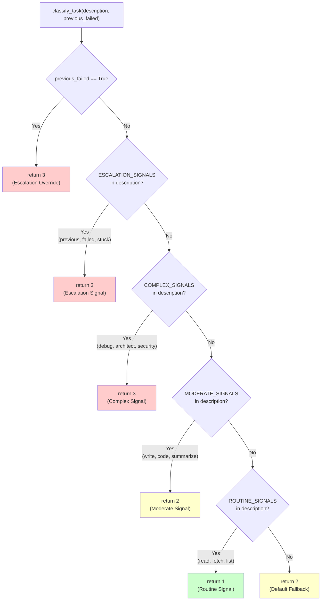
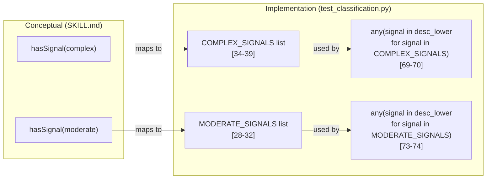
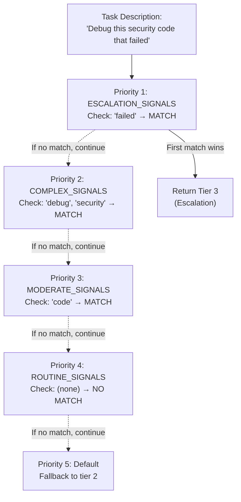
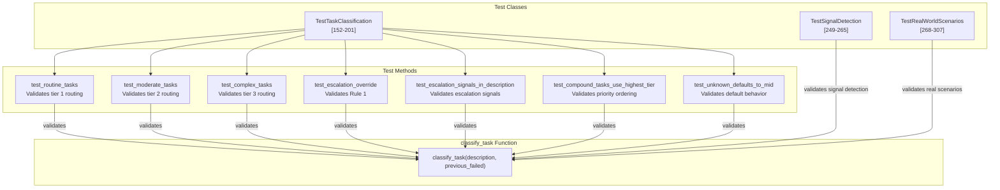

<!-- source: DeepWiki mcp.deepwiki.com · repo zscole/model-hierarchy-skill · page 3.3 Decision Algorithm · fetched 2026-10-27 -->

# Decision Algorithm

<details>
<summary>Relevant source files</summary>

The following files were used as context for generating this wiki page:

- [SKILL.md](SKILL.md)
- [tests/test_classification.py](tests/test_classification.py)

</details>


This page documents the `selectModel` function and its implementation logic for routing tasks to appropriate model tiers. The algorithm uses a three-rule priority system: escalation overrides, explicit complexity signals, and default classification. For information about the task categories themselves, see [Task Classification System](#3.1). For the tier structure, see [Model Tier Architecture](#3.2).

---

## Overview

The decision algorithm is defined conceptually in [SKILL.md:110-132]() as the `selectModel` function. This function takes a task and returns a model tier (1, 2, or 3) using three sequential rules with strict priority ordering. The actual implementation is the `classify_task` function in [tests/test_classification.py:47-81]().

The algorithm operates on two inputs:
- `description`: The task description string
- `previous_failed`: Boolean flag indicating prior failure

**Decision Tree**



Sources: [SKILL.md:108-132](), [tests/test_classification.py:47-81]()

---

## Three-Rule Priority System

### Rule 1: Escalation Override

The first rule checks for failure conditions and immediately returns tier 3, bypassing all other classification logic. This ensures that tasks which have already failed get maximum reasoning power.

**Conceptual Form** [SKILL.md:112-114]():
```
if task.previousAttemptFailed:
    return nextTierUp(task.previousModel)
```

**Implementation** [tests/test_classification.py:60-62]():
```python
if previous_failed:
    return 3
```

The implementation simplifies the escalation by always jumping to tier 3, rather than incrementing from the previous tier. This avoids the complexity of tracking which tier failed and ensures maximum capability on retry.

**Escalation Signals in Description** [tests/test_classification.py:64-66]():

The implementation extends Rule 1 by also checking for escalation signals in the description text:

| Signal | Example Usage |
|--------|---------------|
| `"previous"` | "The previous model couldn't solve this" |
| `"couldn't"` | "I couldn't figure this out" |
| `"failed"` | "This approach failed" |
| `"try again"` | "Need to try again with more power" |
| `"still not working"` | "Still not working after fixes" |
| `"stuck"` | "I'm stuck on this problem" |

Sources: [SKILL.md:112-114](), [tests/test_classification.py:60-66](), [tests/test_classification.py:41-44]()

### Rule 2: Explicit Complexity Signals

The second rule checks for explicit signal words in the task description that directly indicate complexity level. This rule has two sub-checks with priority ordering: complex signals (tier 3) are checked before moderate signals (tier 2).

**Conceptual Form** [SKILL.md:116-121]():
```
if task.hasSignal("debug", "architect", "design", "security"):
    return TIER_3

if task.hasSignal("write", "code", "summarize", "analyze"):
    return TIER_2
```

**Implementation Mapping**



**Complex Signals** [tests/test_classification.py:34-39]():

```python
COMPLEX_SIGNALS = [
    "debug", "architect", "design", "security", "why does",
    "why is", "tradeoff", "evaluate", "doesn't work", "failed",
    "tried", "race condition", "vulnerability", "migrate",
    "behaves differently", "under load", "production"
]
```

These signals indicate tasks requiring deep reasoning, novel problem-solving, or high-stakes decisions.

**Moderate Signals** [tests/test_classification.py:28-32]():

```python
MODERATE_SIGNALS = [
    "write", "code", "summarize", "draft", "analyze", "create",
    "generate", "review", "refactor", "transform", "search",
    "research", "explain", "describe", "compare"
]
```

These signals indicate multi-step but well-defined tasks requiring synthesis or standard patterns.

Sources: [SKILL.md:116-121](), [tests/test_classification.py:28-39](), [tests/test_classification.py:68-74]()

### Rule 3: Default Classification

The third rule applies when no explicit signals are detected. It first checks for routine signals (tier 1), then defaults to tier 2 if the task remains ambiguous.

**Conceptual Form** [SKILL.md:123-131]():
```
complexity = classifyTask(task)

if complexity == ROUTINE:
    return TIER_1
elif complexity == MODERATE:
    return TIER_2
else:
    return TIER_3
```

**Implementation** [tests/test_classification.py:76-81]():
```python
# Rule 4: Check for routine signals
if any(signal in desc_lower for signal in ROUTINE_SIGNALS):
    return 1

# Rule 5: Default to mid-tier if uncertain
return 2
```

**Routine Signals** [tests/test_classification.py:22-26]():

```python
ROUTINE_SIGNALS = [
    "read", "fetch", "check", "list", "format", "status", "get",
    "filter", "sort", "convert", "parse", "health", "ping", "time",
    "date", "lookup", "find file", "show", "display"
]
```

The implementation differs from the conceptual model by eliminating the `MODERATE` classification path in the default logic. Instead, it only checks for `ROUTINE` signals and defaults everything else to tier 2. This is because moderate signals are already handled in Rule 2, making a separate moderate check redundant here.

Sources: [SKILL.md:123-131](), [tests/test_classification.py:76-81](), [tests/test_classification.py:22-26]()

---

## Signal Priority and Precedence

The signal detection system uses strict priority ordering to handle overlapping signals. A single task description may contain multiple signals from different categories.

**Priority Order (Highest to Lowest)**



| Priority | Signal List | Tier | Check Order |
|----------|-------------|------|-------------|
| 1 | `ESCALATION_SIGNALS` | 3 | [Line 64-66]() |
| 2 | `COMPLEX_SIGNALS` | 3 | [Line 69-70]() |
| 3 | `MODERATE_SIGNALS` | 2 | [Line 73-74]() |
| 4 | `ROUTINE_SIGNALS` | 1 | [Line 77-78]() |
| 5 | Default | 2 | [Line 81]() |

**Example: Compound Signal Resolution**

Task: `"Write code to debug this security issue"`

- Contains `"write"` (MODERATE → tier 2)
- Contains `"code"` (MODERATE → tier 2)  
- Contains `"debug"` (COMPLEX → tier 3)
- Contains `"security"` (COMPLEX → tier 3)

Result: Tier 3, because COMPLEX_SIGNALS have higher priority than MODERATE_SIGNALS per [tests/test_classification.py:68-74]().

Sources: [tests/test_classification.py:47-81](), [tests/test_classification.py:190-195]()

---

## Implementation Function Signature

The `classify_task` function is the concrete implementation of the conceptual `selectModel` algorithm.

**Function Definition** [tests/test_classification.py:47-57]():

```python
def classify_task(description: str, previous_failed: bool = False) -> int:
    """
    Classify a task description into a model tier (1, 2, or 3).
    
    Args:
        description: The task description to classify
        previous_failed: Whether a previous attempt failed (forces escalation)
    
    Returns:
        Model tier (1=cheap, 2=mid, 3=premium)
    """
```

**Parameters:**

| Parameter | Type | Default | Purpose |
|-----------|------|---------|---------|
| `description` | `str` | (required) | Task description text to analyze |
| `previous_failed` | `bool` | `False` | Escalation flag for retry attempts |

**Return Value:**

Returns an integer representing the model tier:
- `1`: Tier 1 (Cheap models like DeepSeek V3)
- `2`: Tier 2 (Mid-tier models like Claude Sonnet)
- `3`: Tier 3 (Premium models like Claude Opus)

**Supporting Functions:**

| Function | Location | Purpose |
|----------|----------|---------|
| `get_model_for_tier(tier: int) -> str` | [Line 84-91]() | Maps tier number to specific model name |
| `calculate_cost(tier: int, tokens: int) -> float` | [Line 94-112]() | Estimates cost for a tier and token count |

Sources: [tests/test_classification.py:47-91]()

---

## Default Behavior and Safety Nets

The algorithm includes multiple safety mechanisms to handle ambiguous or unknown tasks.

**Mid-Tier Default** [tests/test_classification.py:80-81]():

When no signals match, the function returns tier 2 as a conservative default:
```python
# Rule 5: Default to mid-tier if uncertain
return 2
```

This default provides a safety net that:
- Avoids routing unknown tasks to cheap models that might fail
- Avoids wasteful routing to premium models for potentially simple tasks
- Aligns with [SKILL.md:138]() behavioral rule: "Default to Tier 2 for interactive work"

**Rationale for Mid-Tier Default:**

| Consideration | Why Tier 2 |
|---------------|------------|
| **Risk management** | Unknown complexity suggests caution |
| **Cost-quality balance** | Tier 2 handles most tasks adequately |
| **User experience** | Main session work defaults to good performance |
| **Escalation path** | Easy to upgrade to tier 3 if needed |
| **Downgrade opportunity** | Can spawn tier 1 sub-agents for identified routine work |

**Test Coverage** [tests/test_classification.py:197-200]():

The default behavior is explicitly tested:
```python
def test_unknown_defaults_to_mid(self):
    """Unknown tasks should default to tier 2."""
    tier = classify_task("Do something with the thing")
    assert tier == 2
```

Sources: [tests/test_classification.py:80-81](), [tests/test_classification.py:197-200](), [SKILL.md:138]()

---

## Algorithm Validation

The algorithm's correctness is validated through comprehensive test suites that verify each rule and edge case.

**Test Class Structure** [tests/test_classification.py:152-307]():



**Key Test Cases:**

| Test | Location | Validates |
|------|----------|-----------|
| `test_escalation_override` | [Line 173-177]() | Rule 1: `previous_failed=True` forces tier 3 |
| `test_escalation_signals_in_description` | [Line 179-188]() | Rule 1: Escalation signals in text |
| `test_complex_signals_detected` | [Line 260-265]() | Rule 2: Complex signal detection |
| `test_compound_tasks_use_highest_tier` | [Line 190-195]() | Signal priority ordering |
| `test_unknown_defaults_to_mid` | [Line 197-200]() | Default tier 2 fallback |

**Real-World Scenario Tests** [tests/test_classification.py:268-307]():

The test suite includes realistic agent task scenarios:

```python
def test_heartbeat_is_routine(self):
    """Heartbeat checks should be tier 1."""
    tasks = [
        "Run the heartbeat check",
        "Check if services are healthy",
        "Ping the server status"
    ]
    for task in tasks:
        assert classify_task(task) == 1
```

These tests ensure the algorithm makes correct decisions for common agent workflows, including heartbeats, code reviews, security analysis, and architecture decisions.

Sources: [tests/test_classification.py:152-307](), [tests/test_classification.py:268-307]()

---

