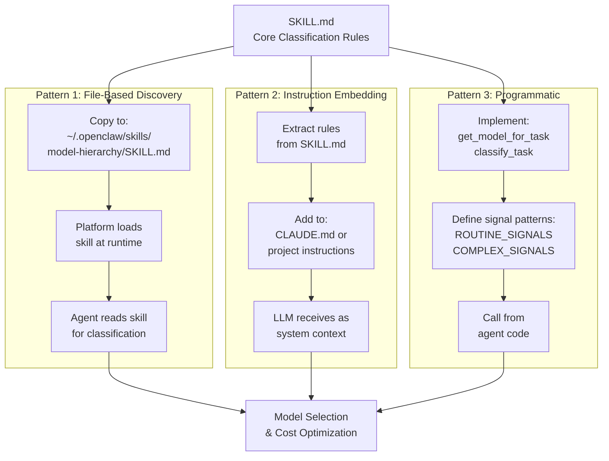
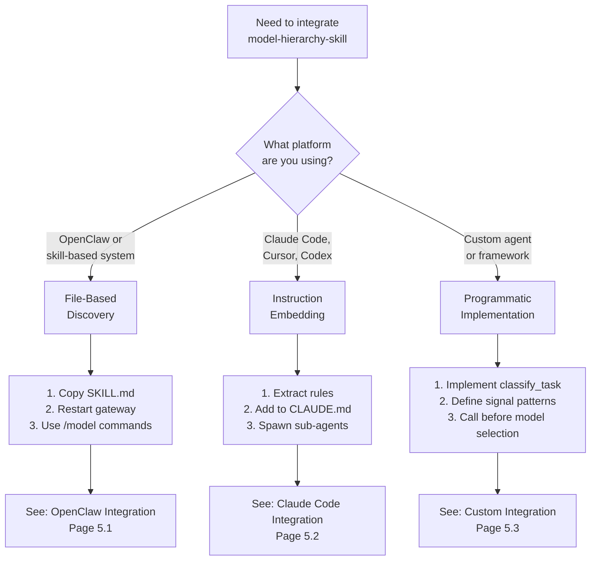
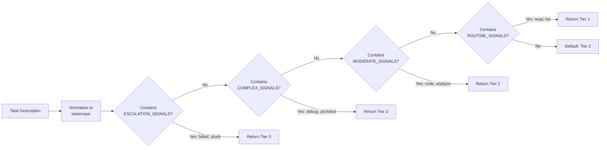
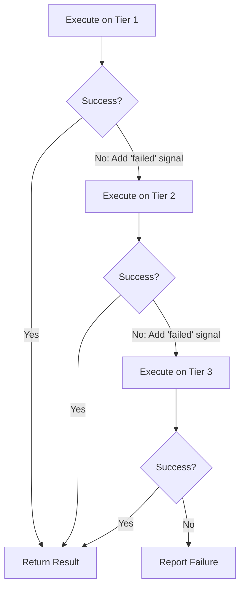

<!-- source: DeepWiki mcp.deepwiki.com · repo zscole/model-hierarchy-skill · page 5 Integration Guides · fetched 2026-10-27 -->

# Integration Guides

<details>
<summary>Relevant source files</summary>

The following files were used as context for generating this wiki page:

- [README.md](README.md)
- [SKILL.md](SKILL.md)

</details>


This document provides an overview of how to integrate the model-hierarchy-skill into various agent platforms. The skill can be adopted through three distinct integration patterns: file-based discovery, instruction embedding, or programmatic implementation.

For detailed platform-specific instructions, see:
- [OpenClaw Integration](#5.1) - File-based skill installation
- [Claude Code Integration](#5.2) - Instruction embedding approach
- [Custom Integration](#5.3) - Programmatic implementation for other systems

For understanding the classification logic being integrated, see [Task Classification System](#3.1) and [Decision Algorithm](#3.3).

---

## Integration Pattern Overview

The model-hierarchy-skill supports three integration approaches, each designed for different agent platform architectures:

| Pattern | Method | Best For | Example Platforms |
|---------|--------|----------|-------------------|
| **File-Based Discovery** | Copy `SKILL.md` to designated directory | Platforms with skill loading systems | OpenClaw |
| **Instruction Embedding** | Embed rules in project configuration | LLM-based code assistants | Claude Code, Codex, Cursor |
| **Programmatic Implementation** | Implement classification function | Custom agent systems | API-based agents, frameworks |

**Integration Pattern Architecture**



Sources: [README.md:23-50](), [SKILL.md:186-232]()

---

## Integration Decision Tree

**Choosing Your Integration Approach**



Sources: [README.md:23-50](), [SKILL.md:186-216]()

---

## Prerequisites

Before integrating the model-hierarchy-skill, ensure you have:

### Required Components

| Component | Purpose | Location |
|-----------|---------|----------|
| `SKILL.md` | Core skill definition with classification rules | Root directory |
| Model tier definitions | Tier 1, 2, 3 model lists and pricing | [SKILL.md:19-46]() |
| Task classification logic | ROUTINE/MODERATE/COMPLEX categories | [SKILL.md:49-107]() |
| Decision algorithm | `selectModel` pseudocode | [SKILL.md:108-132]() |

### Platform Requirements

Different integration patterns have specific platform requirements:

**File-Based Discovery:**
- Agent platform with skill loading mechanism
- File system access to skill directory
- Gateway or runtime that reads skill files

**Instruction Embedding:**
- LLM-based agent with project instruction support
- Configuration file (e.g., `CLAUDE.md`, `.cursorrules`)
- Sub-agent spawning capability (optional but recommended)

**Programmatic Implementation:**
- Programming language runtime (examples use Python)
- Access to LLM provider APIs
- Ability to intercept task execution flow

Sources: [README.md:74-84](), [SKILL.md:1-9]()

---

## Core Integration Components

Regardless of integration pattern, all implementations require these core components:

### 1. Signal Detection System

The classification logic relies on detecting specific keywords in task descriptions:

| Signal Type | Constant Name | Example Signals | Target Tier |
|-------------|---------------|-----------------|-------------|
| Routine | `ROUTINE_SIGNALS` | `read`, `fetch`, `check`, `list`, `format`, `status` | Tier 1 |
| Moderate | `MODERATE_SIGNALS` | `write`, `code`, `summarize`, `analyze` | Tier 2 |
| Complex | `COMPLEX_SIGNALS` | `debug`, `architect`, `design`, `security`, `why` | Tier 3 |
| Escalation | `ESCALATION_SIGNALS` | `failed`, `stuck`, `previous` | Tier 3 (override) |

**Signal Detection Flow**



Sources: [SKILL.md:220-232](), [SKILL.md:108-132]()

### 2. Model Tier Mapping

Each tier maps to specific LLM models:

```python
# Tier 1: Cheap models ($0.10-0.50/M tokens)
TIER_1_MODELS = [
    "deepseek-v3",          # $0.14/$0.28 per M tokens
    "gpt-4o-mini",          # $0.15/$0.60 per M tokens
    "claude-3-haiku",       # $0.25/$1.25 per M tokens
    "gemini-flash"          # $0.075/$0.30 per M tokens
]

# Tier 2: Mid-tier models ($1-5/M tokens)
TIER_2_MODELS = [
    "claude-sonnet-4",      # $3.00/$15.00 per M tokens
    "gpt-4o",               # $2.50/$10.00 per M tokens
    "gemini-pro"            # $1.25/$5.00 per M tokens
]

# Tier 3: Premium models ($10-75/M tokens)
TIER_3_MODELS = [
    "claude-opus-4",        # $15.00/$75.00 per M tokens
    "gpt-4.5",              # $75.00/$150.00 per M tokens
    "o1",                   # $15.00/$60.00 per M tokens
    "o3-mini"               # $1.10/$4.40 per M tokens
]
```

Sources: [SKILL.md:19-46]()

### 3. Classification Function Signature

All implementations should provide a classification interface:

```python
def classify_task(task_description: str) -> str:
    """
    Classify task complexity and return appropriate tier.
    
    Args:
        task_description: Natural language description of the task
        
    Returns:
        One of: "TIER_1", "TIER_2", "TIER_3"
    """
    pass

def get_model_for_task(task_description: str) -> str:
    """
    Get specific model name for task.
    
    Args:
        task_description: Natural language description of the task
        
    Returns:
        Model identifier (e.g., "claude-opus-4", "deepseek-v3")
    """
    pass
```

Sources: [SKILL.md:220-232](), [README.md:48-50]()

---

## Integration Verification

After integrating the skill, verify it works correctly:

### Verification Checklist

| Component | Verification Method | Expected Result |
|-----------|---------------------|-----------------|
| **Signal Detection** | Test with "read file.txt" | Should classify as ROUTINE/Tier 1 |
| **Complex Classification** | Test with "debug authentication failure" | Should classify as COMPLEX/Tier 3 |
| **Escalation Override** | Test with "previous attempt failed" | Should classify as Tier 3 regardless |
| **Model Mapping** | Verify tier → model mapping | Should return valid model identifier |
| **Cost Tracking** | Monitor model usage distribution | Should approach 80/15/5 split over time |

### Test Commands by Platform

**OpenClaw:**
```bash
# Test tier 1 routing
/model deepseek
# Enter routine task

# Test tier 3 routing
/model opus
# Enter complex task
```

**Claude Code:**
```markdown
# Ask agent to classify tasks
"Classify this task: read config.yaml and print contents"
# Expected: Should suggest cheap model or spawn sub-agent

"Classify this task: debug why authentication is failing"
# Expected: Should use or suggest premium model
```

**Programmatic:**
```python
# Run test suite
python -m pytest tests/test_classification.py -v

# Test specific scenarios
from tests.test_classification import classify_task
assert classify_task("read file") == "TIER_1"
assert classify_task("debug error") == "TIER_3"
```

Sources: [README.md:63-70]()

---

## Common Integration Patterns

### Pattern: Sub-Agent Spawning

Most platforms support spawning background agents for parallel work. The skill recommends spawning sub-agents on Tier 1 models by default:

```mermaid
sequenceDiagram
    participant User
    participant MainAgent["Main Agent<br/>(Tier 2)"]
    participant SubAgent["Sub-Agent<br/>(Tier 1)"]
    participant LLM["LLM Provider"]
    
    User->>MainAgent: "Process 50 log files"
    
    MainAgent->>MainAgent: classify_task()<br/>Identifies: Routine batch work
    
    MainAgent->>SubAgent: Spawn with task<br/>Model: deepseek-v3
    
    SubAgent->>LLM: Execute 50x read operations<br/>Tier 1 cost: $0.14/M tokens
    
    LLM->>SubAgent: Return results
    
    SubAgent->>MainAgent: Report completion
    
    MainAgent->>User: "Processed 50 files"<br/>Cost saved: ~10x vs Tier 3
```

**OpenClaw Example:**
```yaml
# Spawn sub-agent on cheap model
sessions_spawn:
  task: "Fetch and parse these 50 URLs"
  model: deepseek
```

**Claude Code Example:**
```markdown
When spawning background agents, use claude-3-haiku for:
- File operations
- Simple searches  
- Status checks
```

Sources: [SKILL.md:197-201](), [SKILL.md:206-215](), [SKILL.md:142-147]()

### Pattern: Escalation Handling

When a task fails on a lower-tier model, automatically escalate to the next tier:



Sources: [SKILL.md:113-114](), [SKILL.md:142-147]()

### Pattern: Cost Tracking

Integrate cost tracking to validate the expected 80/15/5 distribution:

| Metric | Calculation | Target Value |
|--------|-------------|--------------|
| **Tier 1 Usage** | (Tier 1 tokens / Total tokens) × 100% | ~80% |
| **Tier 2 Usage** | (Tier 2 tokens / Total tokens) × 100% | ~15% |
| **Tier 3 Usage** | (Tier 3 tokens / Total tokens) × 100% | ~5% |
| **Monthly Cost** | Σ(tokens_tier × cost_per_M_tier) | ~$19 for 100K/day |

Sources: [SKILL.md:168-183]()

---

## Platform-Specific Integration

For detailed instructions on integrating with specific platforms:

### OpenClaw
- **Integration Method:** File-based discovery
- **Installation:** Copy `SKILL.md` to `~/.openclaw/skills/model-hierarchy/`
- **Usage:** `/model` commands and `sessions_spawn` configuration
- **Details:** See [OpenClaw Integration](#5.1)

### Claude Code / Codex
- **Integration Method:** Instruction embedding  
- **Installation:** Add classification rules to `CLAUDE.md` or project instructions
- **Usage:** Natural language model suggestions and sub-agent spawning
- **Details:** See [Claude Code Integration](#5.2)

### Custom Agent Systems
- **Integration Method:** Programmatic implementation
- **Installation:** Implement `get_model_for_task` function with signal detection
- **Usage:** Call before LLM provider selection
- **Details:** See [Custom Integration](#5.3)

Sources: [README.md:23-50]()

---

## Next Steps

After completing integration:

1. **Verify Classification:** Test with known routine, moderate, and complex tasks
2. **Monitor Distribution:** Track actual tier usage to validate 80/15/5 assumption
3. **Measure Cost Savings:** Compare monthly costs before and after integration
4. **Refine Signals:** Add domain-specific keywords to signal patterns (see [Extending the Skill](#7.3))
5. **Run Test Suite:** Execute `pytest tests/` to validate implementation accuracy

For implementation details of the classification logic, see [Implementation Reference](#4).

For understanding the cost optimization analysis, see [Cost Optimization Analysis](#2.3).

Sources: [README.md:63-70](), [SKILL.md:249-256]()

---

