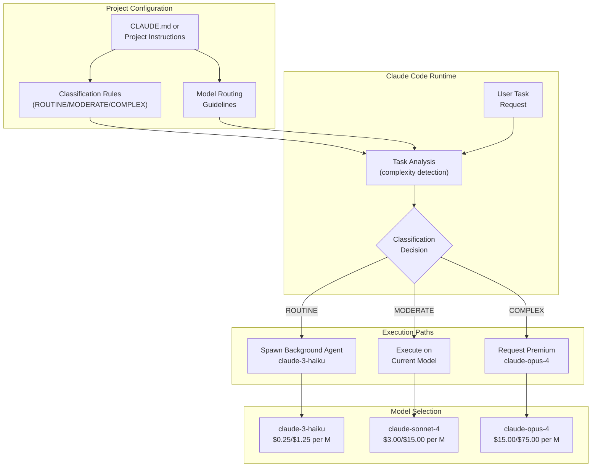
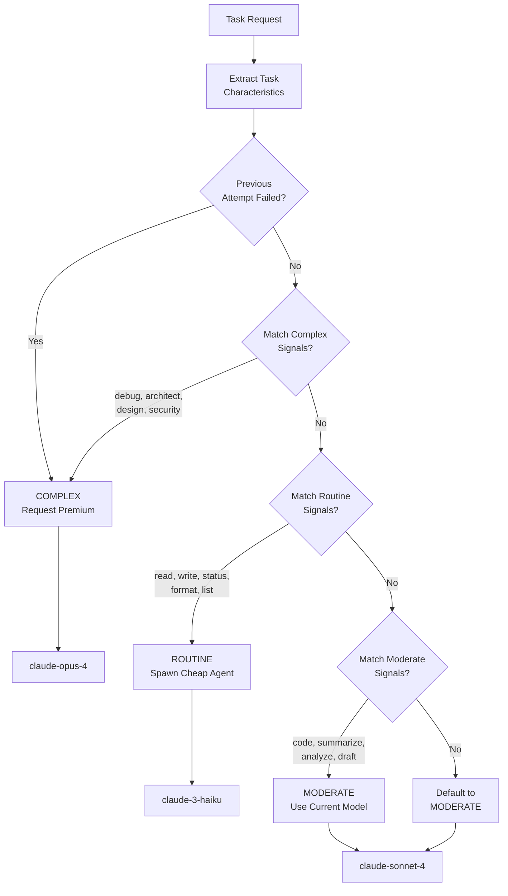
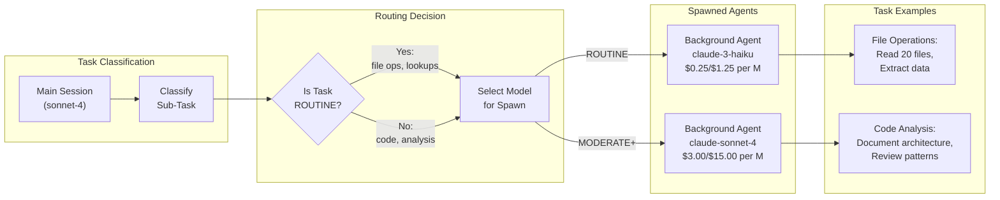
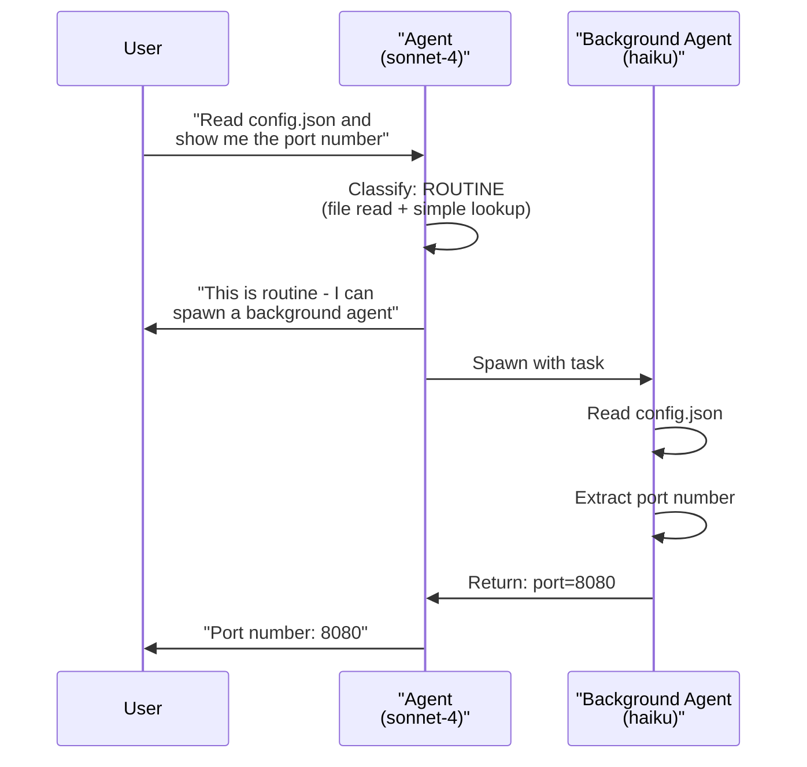
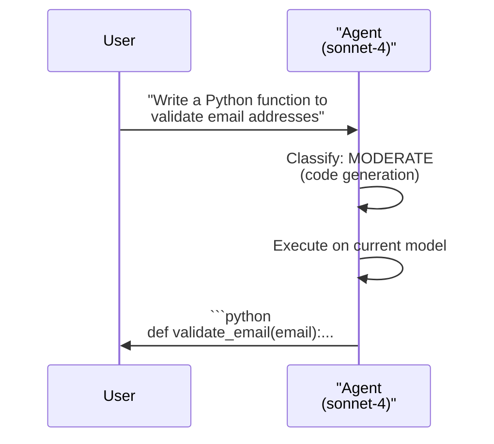
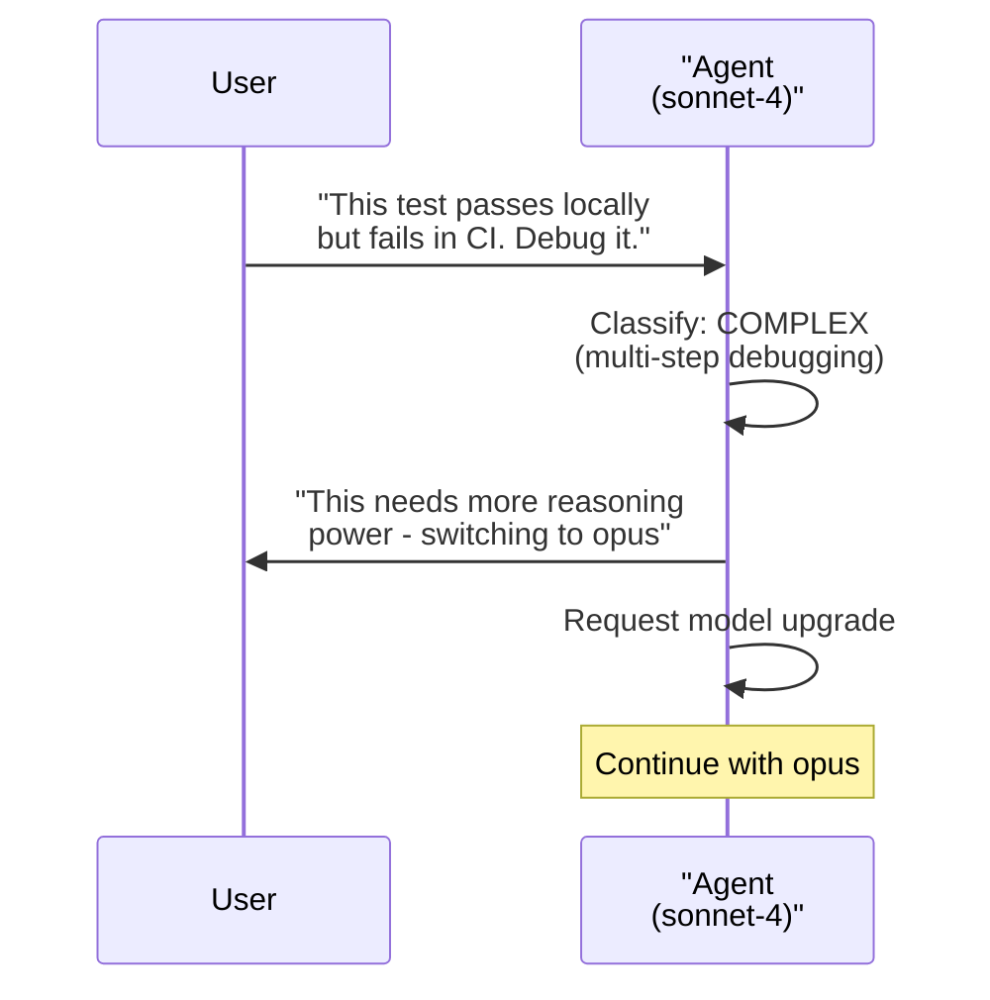
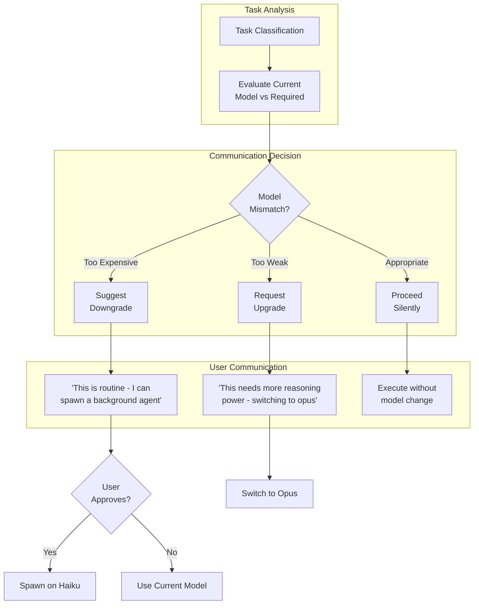

<!-- source: DeepWiki mcp.deepwiki.com · repo zscole/model-hierarchy-skill · page 5.2 Claude Code Integration · fetched 2026-10-27 -->

# Claude Code Integration

<details>
<summary>Relevant source files</summary>

The following files were used as context for generating this wiki page:

- [README.md](README.md)
- [SKILL.md](SKILL.md)
- [examples/claude-code.md](examples/claude-code.md)

</details>


## Purpose and Scope

This document explains how to integrate the model hierarchy skill into Claude Code/Codex environments through instruction embedding. Unlike file-based installations (see [OpenClaw Integration](#5.1)), Claude Code integration embeds classification rules as natural language instructions in project documentation files. This approach leverages Claude Code's ability to follow project-specific guidelines and spawn background agents with configurable model selection.

For programmatic integration approaches, see [Custom Integration](#5.3). For the underlying classification rules and model tier definitions, see [The Skill Definition](#3).

---

## Integration Architecture

Claude Code integration operates through instruction embedding rather than code execution. The model reads classification rules from `CLAUDE.md` and applies them during task analysis.

### Integration Flow



**Sources:** [examples/claude-code.md:1-77](), [SKILL.md:203-215](), [README.md:33-46]()

---

## CLAUDE.md Embedding

The primary integration mechanism is adding classification rules to the project's `CLAUDE.md` file or global instructions. This file serves as project-specific guidance that Claude Code reads before executing tasks.

### Standard Template

The minimal embedded instructions follow this structure:

| Section | Purpose | Content |
|---------|---------|---------|
| **Model Routing Header** | Signals that model selection is task-dependent | `## Model Routing` |
| **Classification Rules** | Defines ROUTINE/MODERATE/COMPLEX criteria | Task characteristics and examples |
| **Routing Instructions** | Maps classifications to model tiers | Spawn rules and upgrade triggers |

### Example Embedding

```markdown
## Model Routing

Before executing tasks, classify by complexity:

### ROUTINE (spawn on haiku/cheap)
- File read/write operations
- Status checks and lookups
- Formatting and list operations
- Simple Q&A

### MODERATE (use current model)
- Code generation
- Summarization
- Draft writing
- Data analysis

### COMPLEX (request upgrade if needed)
- Multi-step debugging
- Architecture decisions
- Security reviews
- Tasks where previous attempt failed

When spawning background agents, default to claude-3-haiku for routine work.
When stuck on a problem, suggest upgrading to opus.
```

This template appears in [examples/claude-code.md:8-32]() and is derived from the core classification rules in [SKILL.md:49-107]().

**Sources:** [examples/claude-code.md:1-32](), [README.md:35-46](), [SKILL.md:49-107]()

---

## Classification System for Claude Code

Claude Code applies classification through natural language pattern matching rather than programmatic signal detection. The agent interprets task descriptions and matches them against the embedded criteria.

### Classification Decision Tree



**Sources:** [examples/claude-code.md:12-28](), [SKILL.md:109-132]()

### Task Characteristics Mapping

The embedded classification rules map task characteristics to model tiers:

| Classification | Characteristics | Model Tier | Example Tasks |
|----------------|----------------|------------|---------------|
| **ROUTINE** | Single-step, deterministic, no judgment | Tier 1 (Haiku) | File operations, status checks, formatting |
| **MODERATE** | Multi-step, synthesis required, standard patterns | Tier 2 (Sonnet) | Code generation, summarization, analysis |
| **COMPLEX** | Novel problems, nuanced judgment, high stakes | Tier 3 (Opus) | Debugging, architecture, security reviews |

This mapping derives from [SKILL.md:53-107]() and is simplified for Claude Code's natural language interpretation in [examples/claude-code.md:12-28]().

**Sources:** [SKILL.md:53-107](), [examples/claude-code.md:12-28]()

---

## Background Agent Spawning

Claude Code's background agent feature allows spawning sub-agents with specific model assignments. The model hierarchy skill optimizes this by defaulting to cheap models for routine work.

### Spawning Patterns



**Sources:** [examples/claude-code.md:64-76](), [SKILL.md:142-147]()

### Good vs Bad Spawning Examples

The integration guide provides concrete examples of appropriate model selection for spawned agents:

**Good Patterns:**
```
Spawn background agent (haiku): "Fetch these 20 URLs and extract titles"
Spawn background agent (sonnet): "Analyze this codebase and document the architecture"
```

**Anti-Pattern:**
```
Spawn background agent (opus): "Read all .md files in this directory"
```

These examples appear in [examples/claude-code.md:67-76]() and implement the sub-agent rules from [SKILL.md:142-147]().

**Sources:** [examples/claude-code.md:64-76](), [SKILL.md:142-147](), [SKILL.md:236-246]()

---

## Behavioral Examples

Claude Code integration guides agent behavior through example scenarios that demonstrate proper classification and model selection.

### Routine Task Behavior



This sequence implements the classification rules from [SKILL.md:53-69]() and demonstrates the downgrade suggestion pattern from [SKILL.md:158-159]().

**Sources:** [examples/claude-code.md:36-43](), [SKILL.md:53-69](), [SKILL.md:158-159]()

### Moderate Task Behavior

For moderate complexity tasks, the agent uses the current model without spawning or requesting changes:



This behavior follows the moderate task classification from [SKILL.md:71-88]() and the main session rule to use the current model for moderate work [SKILL.md:138-140]().

**Sources:** [examples/claude-code.md:45-52](), [SKILL.md:71-88](), [SKILL.md:138-140]()

### Complex Task Behavior

Complex tasks trigger upgrade requests when the current model is insufficient:



This implements the complex task classification from [SKILL.md:89-107]() and the upgrade request pattern from [SKILL.md:161-162]().

**Sources:** [examples/claude-code.md:54-61](), [SKILL.md:89-107](), [SKILL.md:161-162]()

---

## Communication Patterns

The embedded instructions guide how agents communicate model selection decisions to users. These patterns maintain transparency about cost optimization.

### Standard Communication Templates

| Scenario | Communication Template | Rationale |
|----------|----------------------|-----------|
| **Downgrade Suggestion** | "This is routine - I can spawn a background agent" | Indicates cost optimization opportunity |
| **Upgrade Request** | "This needs more reasoning power - switching to opus" | Explains escalation to premium model |
| **Sub-Agent Spawning** | "Spawning background agent on haiku for [task]" | Clarifies model selection for spawned work |

These templates derive from the communication patterns section in [SKILL.md:154-166]().

### Communication Flow



**Sources:** [SKILL.md:154-166](), [examples/claude-code.md:36-61]()

---

## Integration Checklist

To successfully integrate the model hierarchy skill into Claude Code:

### Implementation Steps

1. **Add Classification Rules to CLAUDE.md**
   - Copy template from [examples/claude-code.md:8-32]()
   - Customize task examples for your domain
   - Place in project root or global instructions

2. **Define Model Routing Guidelines**
   - Specify when to spawn on `claude-3-haiku`
   - Define upgrade triggers for `claude-opus-4`
   - Set default behavior for ambiguous cases

3. **Test with Sample Tasks**
   - Routine: "Read this file and count lines"
   - Moderate: "Generate a Python class for user management"
   - Complex: "Debug this race condition in the async code"

4. **Monitor Agent Behavior**
   - Verify correct classification
   - Check spawning patterns
   - Validate model selection decisions

### Validation Criteria

| Criterion | Expected Behavior | Validation Method |
|-----------|------------------|-------------------|
| **Routine Tasks** | Spawn on haiku or suggest downgrade | Request file operations, status checks |
| **Moderate Tasks** | Execute on current model (sonnet) | Request code generation, summarization |
| **Complex Tasks** | Request opus upgrade | Request debugging, architecture decisions |
| **Sub-Agent Spawning** | Default to haiku for routine work | Monitor spawned agent models |

**Sources:** [examples/claude-code.md:1-77](), [README.md:33-46]()

---

## Differences from OpenClaw Integration

Claude Code integration differs significantly from OpenClaw's file-based approach:

| Aspect | Claude Code | OpenClaw |
|--------|------------|----------|
| **Installation Method** | Instruction embedding in `CLAUDE.md` | File copy to `~/.openclaw/skills/` |
| **Model Switching** | Natural language requests | Explicit `/model` commands |
| **Sub-Agent Spawning** | Background agent with model parameter | `sessions_spawn` with model field |
| **Configuration** | Project-level instructions | Gateway-level `config.yml` |
| **Skill Loading** | Read on context initialization | Loaded by gateway restart |

For OpenClaw-specific features like explicit model commands and gateway configuration, see [OpenClaw Integration](#5.1).

**Sources:** [examples/claude-code.md:1-77](), [examples/openclaw.md:1-79](), [SKILL.md:187-215]()

---

## Advanced Customization

The embedded instructions can be extended for domain-specific requirements.

### Custom Signal Patterns

Add domain-specific classification signals:

```markdown
### ROUTINE (spawn on haiku/cheap)
- File read/write operations
- Status checks and lookups
- **Database health checks**  <!-- Custom -->
- **Metric collection tasks**  <!-- Custom -->

### COMPLEX (request upgrade if needed)
- Multi-step debugging
- Architecture decisions
- **Production incident response**  <!-- Custom -->
- **Performance optimization**  <!-- Custom -->
```

### Budget Awareness

Include cost tracking guidance:

```markdown
## Model Routing

[Standard classification rules...]

### Cost Tracking
When spawning multiple background agents, log:
- Number of agents spawned
- Model used for each
- Estimated token usage

Alert if daily spawn count exceeds 50 agents on sonnet-4.
```

These extensions follow the customization guidelines in [SKILL.md:249-256]().

**Sources:** [SKILL.md:249-256](), [examples/claude-code.md:1-77]()

---

## Troubleshooting

Common integration issues and resolutions:

| Issue | Symptom | Resolution |
|-------|---------|-----------|
| **Agent ignores classification rules** | Uses expensive model for routine tasks | Ensure `CLAUDE.md` is in project root; check file is being read |
| **No background agent spawning** | All tasks execute in main session | Add explicit spawning examples to instructions |
| **Incorrect classification** | Routine tasks classified as complex | Review task examples; add domain-specific signals |
| **Excessive upgrade requests** | Agent constantly requests opus | Lower threshold for moderate classification |

**Sources:** [examples/claude-code.md:1-77](), [SKILL.md:154-166]()

---

